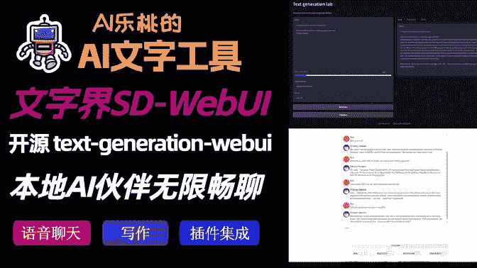

# text-generation-webui

> 来源：[https://seigy6zzam.feishu.cn/docx/Z5mgdUPSComCwIxtpq1cz5b5nOd](https://seigy6zzam.feishu.cn/docx/Z5mgdUPSComCwIxtpq1cz5b5nOd)

# 项目介绍

<https://player.bilibili.com/player.html?bvid=1s94y1v7vk>

# 相关介绍

+   [个人玩家使用文本生成LLM](https://seigy6zzam.feishu.cn/wiki/QeSjwneQVies16kzf1HcXIzun6d)

# 懒人包安装

## webui界面安装

解压路径中不可以带中文，空格，特殊标点等，使用方法参考上面视频

|  | 夸克 | 度盘 |
| --- | --- | --- |
| [UP主CyberDaVinci](https://space.bilibili.com/317694827) v1.5 | [pan.quark.cn](https://pan.quark.cn/s/9b27975a447c) | [pan.baidu.com](https://pan.baidu.com/s/1YdnpwrfMzU6tthH3Q-eL2w?pwd=0et2) |
| 我提供的版本 |  |  |

## 模型安装

+   小模型：

+   【英文语言模型】https://huggingface.co/coyude/Chinese-plus-Pygmalion-7b-GPTQ

+   【中文语言模型】https://huggingface.co/mayaeary/pygmalion-6b_dev-4bit-128g

+   推荐模型

+   Chronos-Hermes-13B-GPTQ：12G以上N卡可用，直接解压至Models目录里

+   Chronoboros-33B-GPTQ：24G-N卡可用，直接解压至Models目录里

+   Wizard-Vicuna-7B-GPTQ：8G以上N卡可用，直接解压至Models目录里

# 参考链接

+   开源项目地址

+   【开源webui】https://github.com/oobabooga/text-generation-webui/

+   角色界面

+   【RisuAI】 https://github.com/kwaroran/risuAI （AI加载器）

+   角色下载

+   【Chub】 https://www.chub.ai/ (角色下载）

+   【Booru】 https://booru.plus/+pygmalion (角色下载）

+   【AI Character Editor】 https://zoltanai.github.io/character-editor/ （制作角色）

+   【Character Creator】 https://phantasy.vercel.app/ （一句话生成角色内容）