# [懒人包]AI对话懒人包发布 解压即用(text-generation-webui)可加载chatglm/rwkv/vicu

> 来源：[https://seigy6zzam.feishu.cn/docx/FmuZdD4vLoZkq6xBpj5cnkAHnS7](https://seigy6zzam.feishu.cn/docx/FmuZdD4vLoZkq6xBpj5cnkAHnS7)

> 🔗 原文链接： h[ttps://www.bilibil](https://www.bilibili.com/read/cv23495183)i.com/read/cv234...

**1.前言**

**5月18日更新:V1版正式发布，启动程序改成图形**[**化界面了，v1版视频教程请看我最新视频 [AI对话]懒人包v1发布 图**](https://www.bilibili.com/video/BV1tP411d7wo/)形化启动界面(oobabooga/text-generation-webui)可用chatglm/rwkv/vicuna

前天做了个text-generation-webui的懒人包，为了节省空间，并没有内置任何模型。

因为是 第一次做这种懒人包 ，所以我也不确定懒人包的稳定性。因此 如果成功运行了或运行失败请在评论区反馈一下，感激不尽！

如果看不懂图文教程，在网盘里有视频教程，可以查阅。

本地跑模型最少也要6G显存左右(7b量化模型)，如果显存不够，可以查阅文章最后部分的pre_layer选项，即让一部分运算交给显卡，一部分运算交给CPU。

如果你显存不足6G，或者是A卡/者核显用户可以使用llama.cpp，text-generation-webui内置了llama.cpp，只需要下载对应的ggml格式模型即可使用cpu推理。

至于怎么加载ggml模型，这里有个教程视频

[没](https://www.bilibili.com/video/BV18c411A72q)有N卡怎么进行AI对话?(加载ggml模型/llama.cpp)使用text-generation-webui


**2.下载链接**

**网盘我附带了一些量化模型，如果hugging fa**ce下载的速度过慢，可以从网盘下载解压。

**夸克网盘链接：**

我用夸克网盘分享了「[懒人包@coyude]text-generation-webui」，点击链接即可保存。打开「夸克APP」，无需下载在线播放视频，畅享原画5倍速，支持电视投屏。

链接：https://pan.quark.cn/s/27ec3cde648a

**百度网盘链接：**

链接：https://pan.baidu.com/s/1AXwX7U2RAdV10H8YEitBwA?pwd=1e2r

提取码：1e2r


**3.启动器界面展示(丑**


主页


启动参数


模型管理

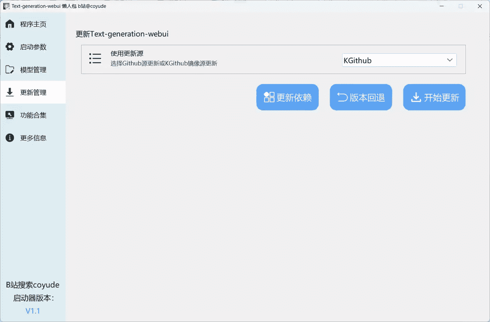

更新管理

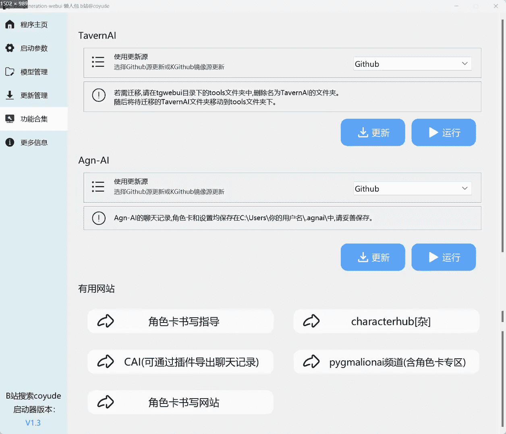

功能合集

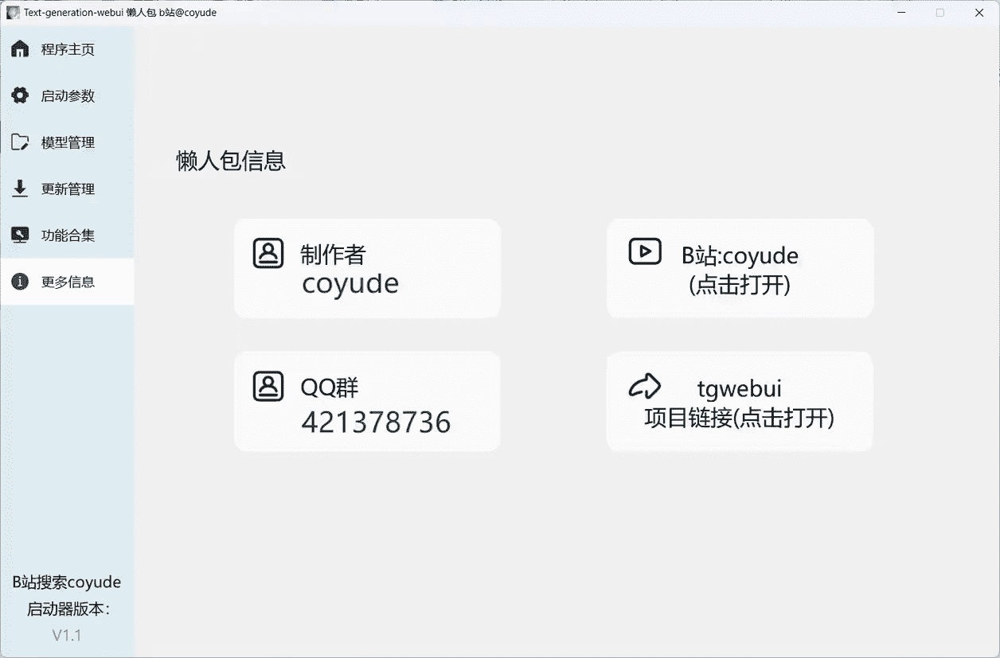

更多信息

**4.可能出现的错误**

①下载模型的时候，给的用户名+仓库名不对，导致无法下载。

例如我输入114514(，会提示requests.exceptions.HTTPError: 401 Client Error: Unauthorized for url: 错误，这是请在Hugging face上复制正确的用户名+仓库名

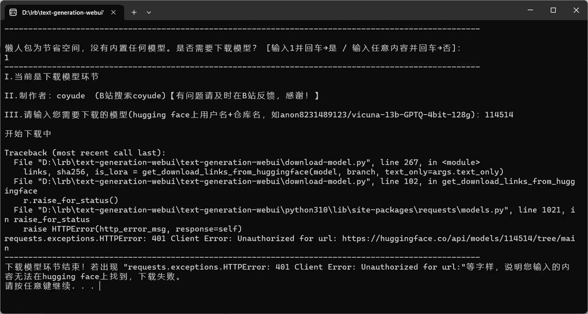

②加载模型的时候爆显存

例如出现 “CUDA out of memory.”

```
return self._apply(lambda t: t.cuda(device)) torch.cuda.OutOfMemoryError: CUDA out of memory. Tried to allocate 86.00 MiB (GPU 0; 8.00 GiB total capacity; 7.19 GiB already allocated; 0 bytes free; 7.19 GiB reserved in total by PyTorch) If reserved memory is &gt;&gt; allocated memory try setting max_split_size_mb to avoid fragmentation. See documentation for Memory Management and PYTORCH_CUDA_ALLOC_CONF webui已关闭！若浏览器没有自动打开webui网页而直接关闭的话，说明启动出现异常。 请按任意键继续. . .
```

选择加载量化模型或加载更小参数的模型。比如加载的是原版13B模型，那就尝试加载13B 4bit模型，或者7B模型

**还有一种方法 **，如果你加载的是GPTQ量化模型的话，请调 GPTQ parameters参数的pre_layer参数

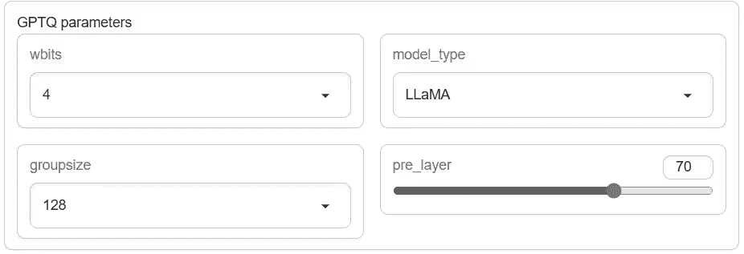

这个70的意思是，有70%的运算是在你显卡进行运行，剩下30%的运算在你的CPU上。

或者....你可以使用CPU推理，但是速度很慢。也可以使用下载ggml模型进行cpu推理。

当然，最有用的方法是花钱升级显卡(

大致教程已经结束，目前懒人包还算是出于测试阶段，有问题请及时反馈，非常感谢！

**③如果你加**载的是vicuna等llama衍生模型，最好使用 英文对话 ，因为这些模型的中文能力并不强。

**④chat模式使用时最好在下方 gallery选择examp**le的角色卡进行对话。当然如果你要玩角色扮演的话，肯定要自己去捏角色的。

[**这篇专栏的第三步介绍了一个捏角色网站，可以查看 [A**](https://www.bilibili.com/read/cv22355581)I对话]使用KoboldAI和tavernai进行无限制对话(数据私有化/可以NSFW)

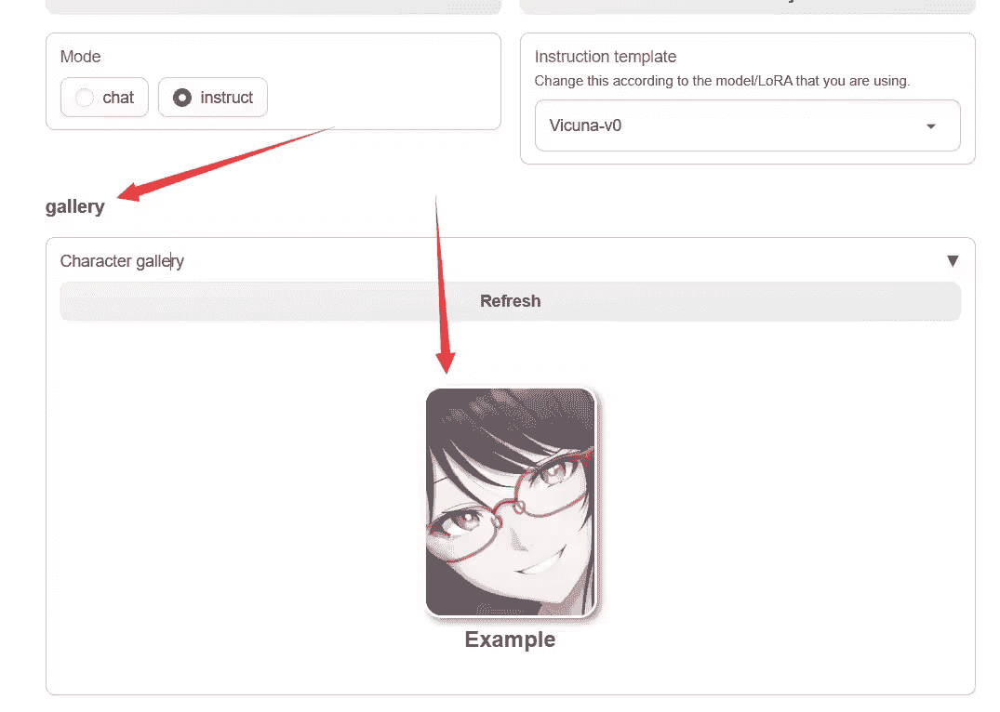

⑤如果要拿来玩角色扮演，最好使用agn-ai或tavernai来调用tgwebui的api（启动tgwebui的时候选择模式2或4，或者自定义启动参数的时候加上--api）

如何部署agn-ai和tavernai？我这里也有两篇专栏

agn-ai: [[](https://www.bilibili.com/read/cv23387641)Agn-AI]用Agn-AI与AI老婆对话(调用openai/claude/text-generation-webui/kob

tavernai: [[AI对话]使用KoboldAI和tavernai进](https://www.bilibili.com/read/cv22355581)行无限制对话(数据私有化/可以NSFW)


**5.更新日志**

懒人包V1.3.2++版本更新[6.6]：

1.给SillyTavern补上角色卡。

**2.添加“打开懒人包环境.bat”文件，方便在启动**器无法启动懒人包环境的用户激活懒人包环境


启动器V1.6版本更新 [6.6] :

1.修改启动参数关于GPTQ参数和Bitsandbytes参数设置

2.更新管理处新增“打开环境”按钮，方便用户对懒人包环境进行修改。

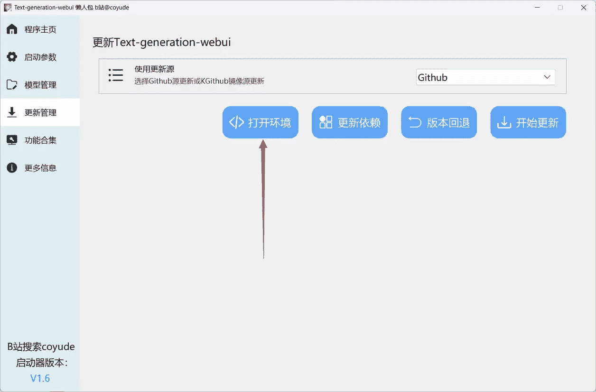

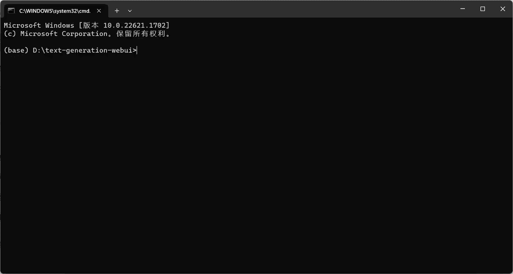


懒人包V1.3.2版本更新[6.3]：

1.更新text-generation-webui和环境依赖。 2.给懒人包安装上AutoGPTQ。一种新的加载GPTQ量化模型方式(以前的方法是GPTQ-for-LLaMa)。经过测试使用AutoGPTQ加载模型比GPTQ-for-LLaMa加载的文本生成速度要快。目前不清楚使用AutoGPTQ加载模型能不能解决帕斯卡架构显卡使用GPTQ-for-LLaMa加载模型出现乱码(胡言乱语)的问题？🤔有兴趣的可以尝试一下。

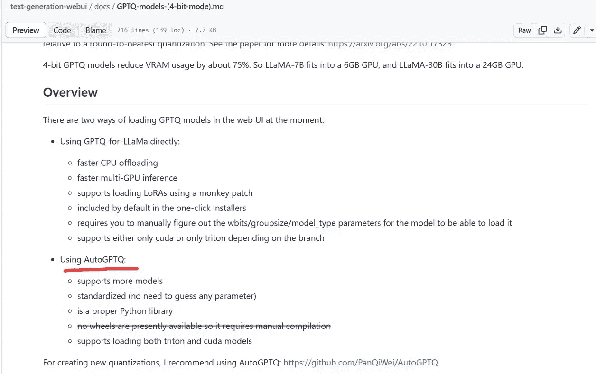

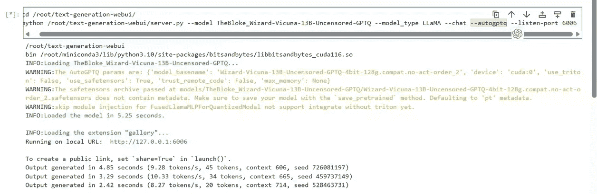

启动器V1.5版本更新 [6.3] :

1.启动参数中新增启用AutoGPTQ选项 2.激活conda环境改为cd conda+call .\\Scripts\\activate.bat


懒人包V1.3.0更新[6.1]：

**1**.将内置的TavernAI替换成SillyTavern。 另外为了保证可移植性，在首次使用SillyTavern或Agn-ai前都必须先点击更新按钮(安装依赖)，方能运行使用。

PS：为了方便各位调用openai的api(gpt模型)，我依旧将SillyTavern TavernAI和Agn-AI的openai的api服务器都自动修改成我用vercel搭建的反代理服务器 (点击更新按钮即可触发)

2.懒人包中GPTQ环境重新配置，使用了tgwebui的readme上建议的 precompiled wheels(GPTQ-for-LLaMa-Wheels)

**启动器V1.4更新[6.1]：**

1.将内置的TavernAI替换成SillyTavern。 2.删除QtCore.QCoreApplication.setAttribute(QtCore.Qt.AA_EnableHighDpiScaling) 因为在某些高DPI屏幕下窗口过大。

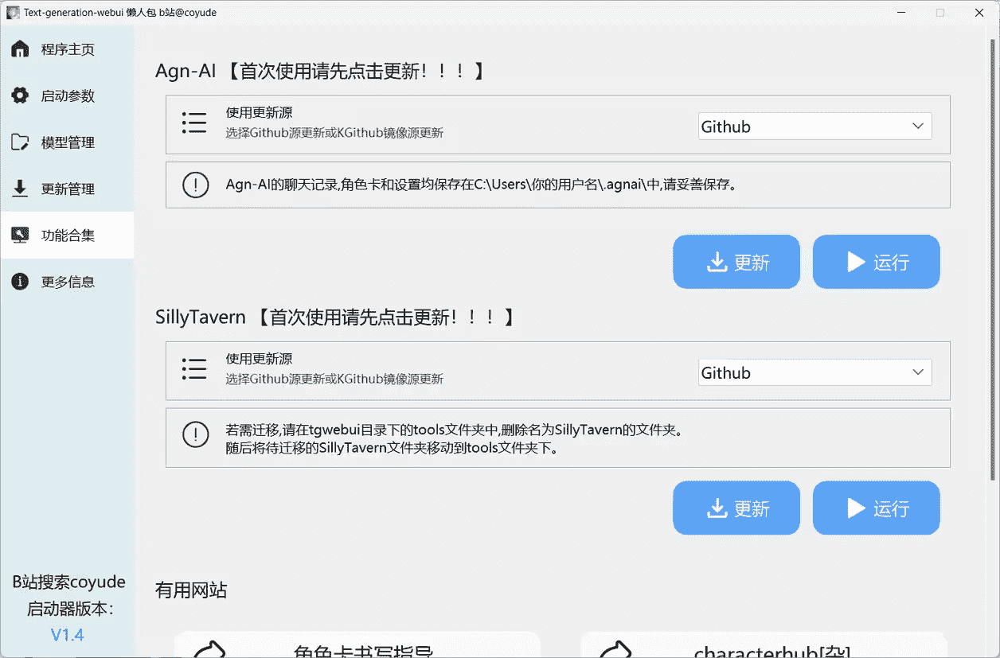


懒人包V1.2.0更新[5.28]：

1.内置了 TavernAI和Agn-AI ，均存放在tools文件夹中

**PS：为了方便各位调用openai的api(gpt模型)，我将TavernAI和A**gn-AI的openai的api服务器都设置成我用vercel搭建的反代理服务器

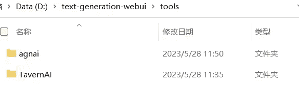

2.懒人包环境改conda环境

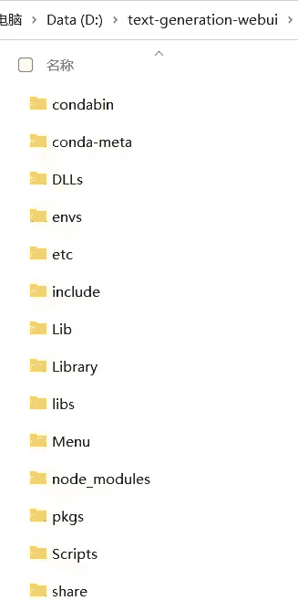

1.重新编辑功能合集页面，新增TavernAI和Agn-AI的对应功能选择以及有用网站。


2.添加QtCore.QCoreApplication.setAttribute(QtCore.Qt.AA_EnableHighDpiScaling)

解决在高分辨率+高缩放比下的排版错误问题（应该）

旧版启动程序在4K屏幕下字体显示不全(尤其是API那个选项）

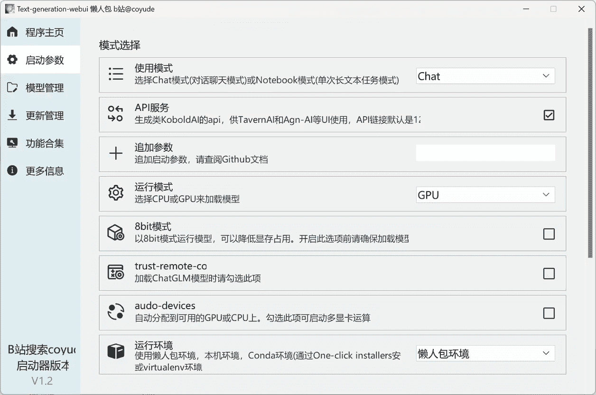

新版启动程序在4K屏幕下字体显示完整

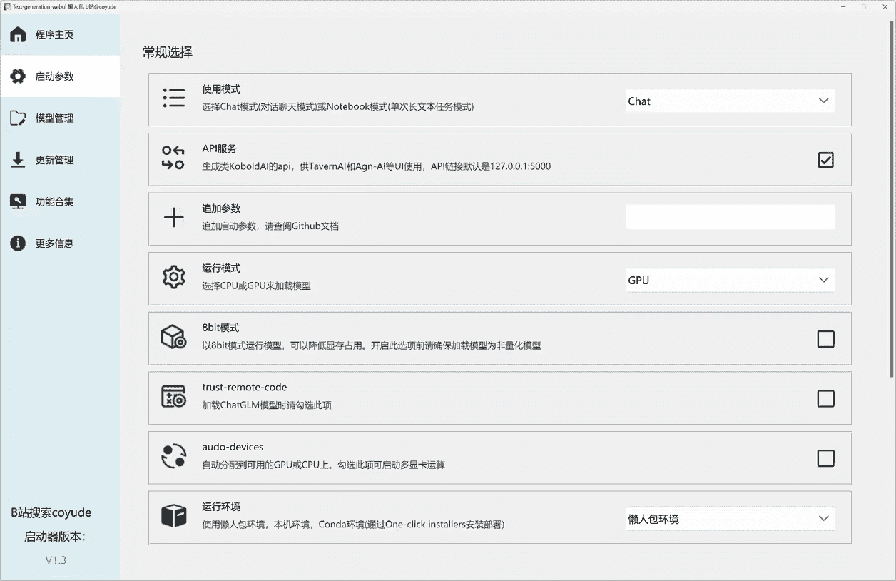

懒人包V1.0.8更新[5.21]：

1.  将bitsandbytes中的libbitsandbytes_cuda116.dll更改为libbitsandbytes_cuda117.dll

1.  tgwebui内置了几张tavernai上推荐的角色卡(主要都是碧蓝档案)以及自己写的一张猫猫卡(neko)

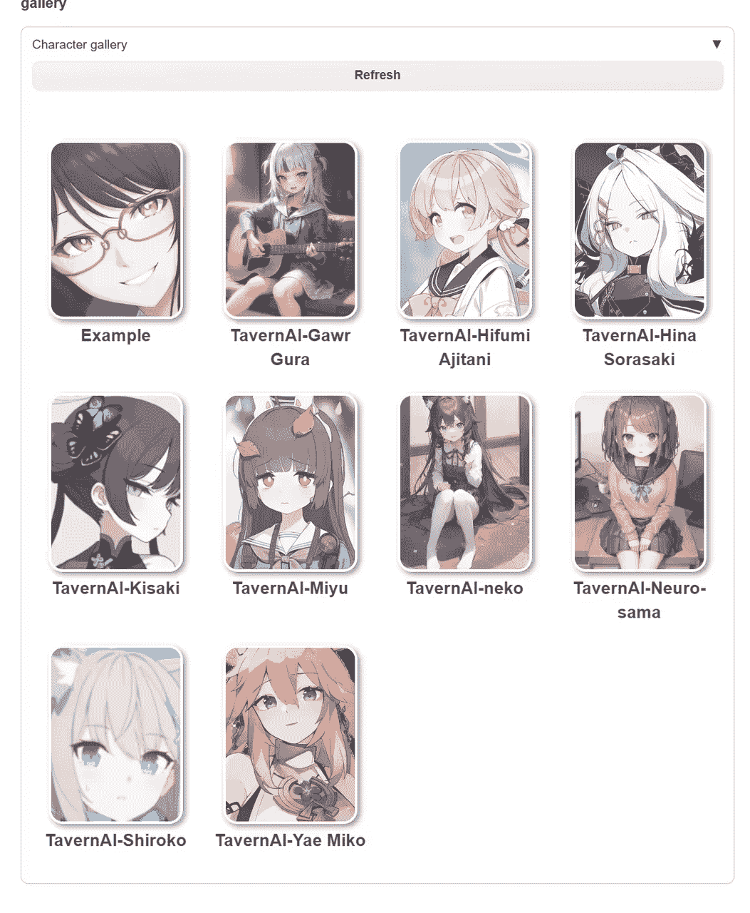

启动器V1.1更新[5.21]：

1.  **启动参**数新增两个选项：①是自动分配 ②是让用户选择启动环境，可以选择懒人包环境/本机环境/Conda环境。这样即使用户不使用懒人版环境，也可以使用这个启动器来调用自己的python环境或conda环境（用tgwebui的一键安装脚本安装的conda环境）来启动。增强启动程序的泛用性(bushi

1.  ③将自定义参数修改为追加参数，设置该选项不再导致当前设置页面的所有设置失效。

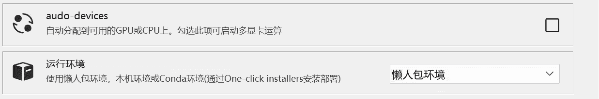

2.更新管理处新增两个选项：①更新依赖，即进行pip install -r requirements.txt操作 ②版本回退，用于版本更新后遇到兼容问题时，进行版本回退(每次只回退上一个版本)

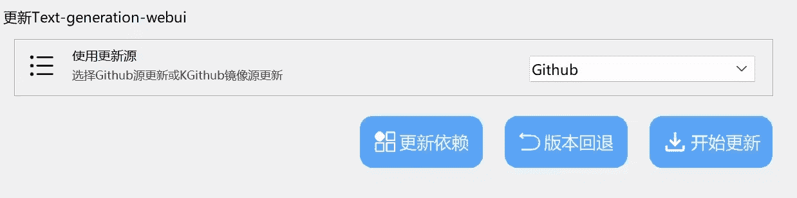

3.新增功能合集页面，点击即可打开对应网页，不过目前还没有想好加什么(

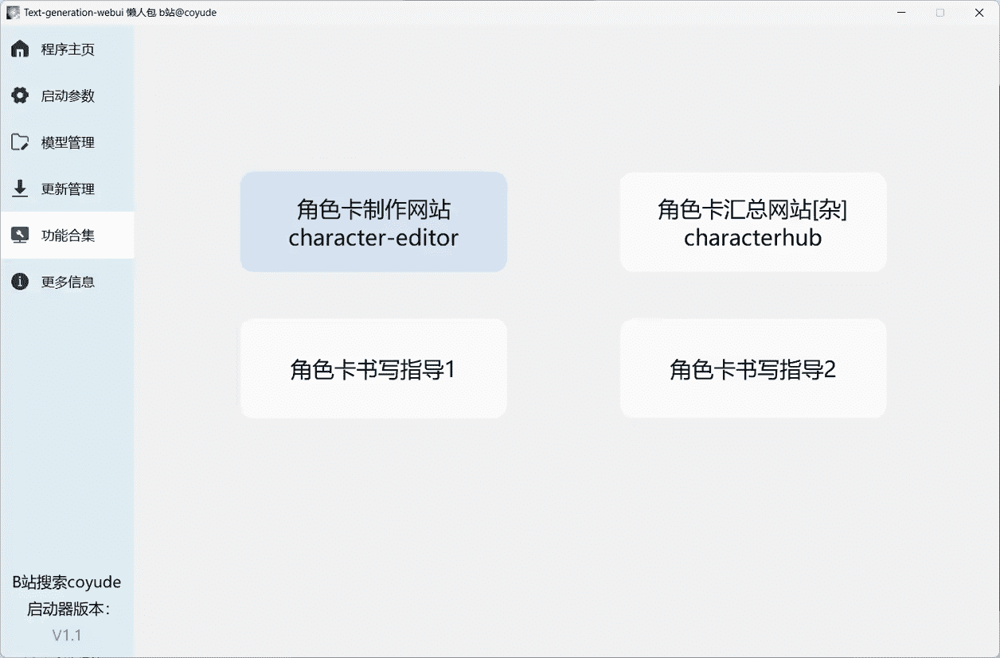