# 第七天：来，亲手做一个AI应用！

> 来源：[https://seigy6zzam.feishu.cn/docx/E5N8dav6YoQO7QxsrvmcM7gKnDg](https://seigy6zzam.feishu.cn/docx/E5N8dav6YoQO7QxsrvmcM7gKnDg)

> 🔗 原文链接： h[ttps://mp.weixin.q](https://mp.weixin.qq.com/s?__biz=MzkxNTM5NTg2OA==&mid=2247490104&idx=1&sn=787415f1c307a8dbed0a3caa63c4ee79&chksm=c15e9e4bf629175d94d51d6b6a6fdcfe4a07c62ac3f862deaf285a440b101312f08edb009a1f&cur_album_id=3322557210689912835&scene=189#wechat_redirect)q.com/s?__biz=Mz...

> ⏰ 剪存时间：2024-02-24 04:19:17 (UTC+8)

> ✂️ 本文档由 [飞书剪存 ](https://www.feishu.cn/hc/zh-CN/articles/606278856233?from=in_ccm_clip_doc)一键生成

原创 魔搭官方 魔搭ModelScope社区 2024-02-15 19:01  广西

# **内容提纲**

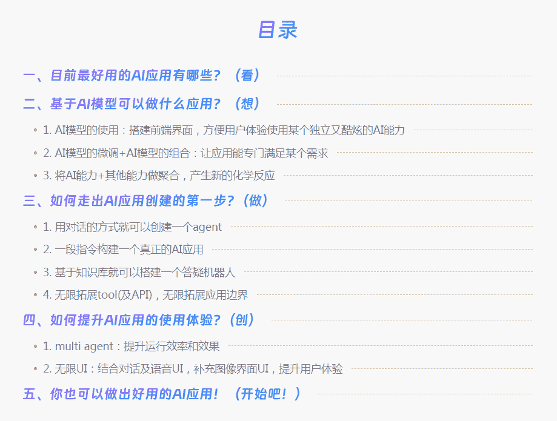

# **视频课程**

# **课程材料**

## 一、目前最好用的AI应用有哪些？（看）

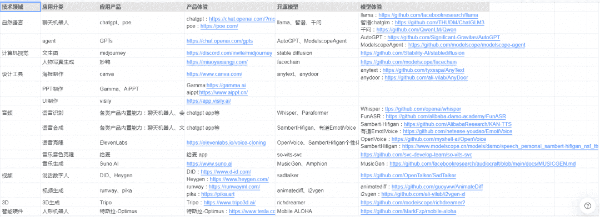

+   除了chatgpt和midjourney（图片生成）

+   妙鸭（AI写真）、PIKA（视频生成）、Heygen（数字人）

还有

+   AI PPT：一句话帮你做ppt，从排版到内容填充

+   AI 海报：一句话帮你做海报

+   AI UI：一张草稿图帮你画UI

+

关闭

**观看更多**

更多

退出全屏

切换到横屏模式

[🎦 点击观看视频](https://mpvideo.qpic.cn/0b2ew4abuaaaqeadfd6ohnsvbn6ddk3qagqa.f10002.mp4?dis_k=f00891dc959420bb987a2c5da457e804&dis_t=1708776791&play_scene=10120&auth_info=XrjapZ4u🐧Rgm57mgQ9UIBx0JGgIYEEQNlJuPjhFBD5lBWFkKyIcawJuFAorLkMaFg==&auth_key=fb1548575221b5e8455de5e52b0ff1ef&vid=wxv_3328889157007556608&format_id=10002&support_redirect=0&mmversion=false)

> 无法获取音频链接

视频详情

## 二、基于AI模型可以做什么应用？（想）

### **1. AI模型的使用：搭建前端界面，方**便用户体验使用某个独立又酷炫的AI能力

+   如果模型能力足够强大，前端界面可以极其简单。

> 比如一个聊天框（chatgpt），成为史上用户最快破亿的产品（2个月）

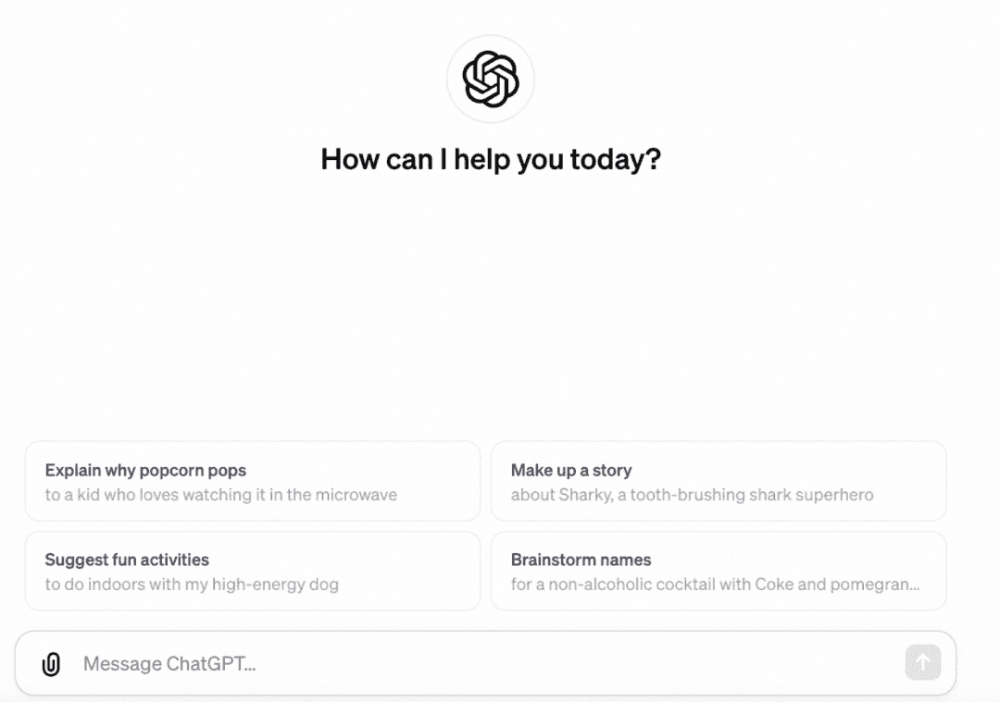

+   甚至都没有自己的网址

+   比如midjourney（长在discord），但年营收超过1亿美金

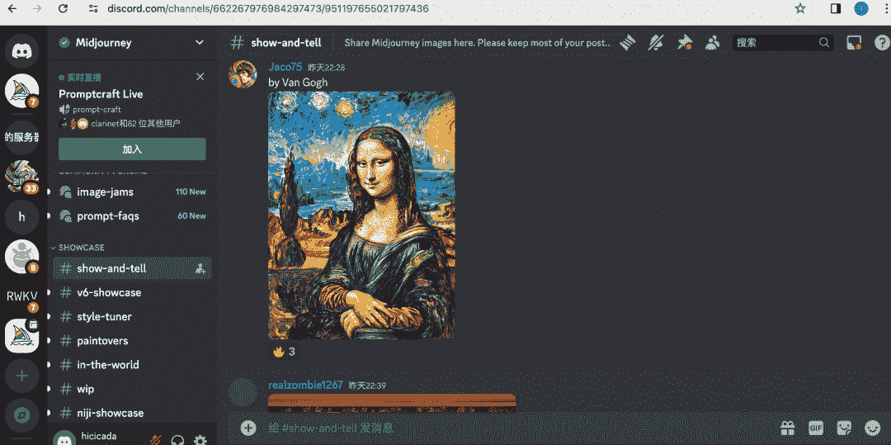

+   也可以把AI模型复杂的后端链路产品化，提供简单的使用路径

> 比如把AI孙燕姿唱周杰伦的歌这个流程产品化

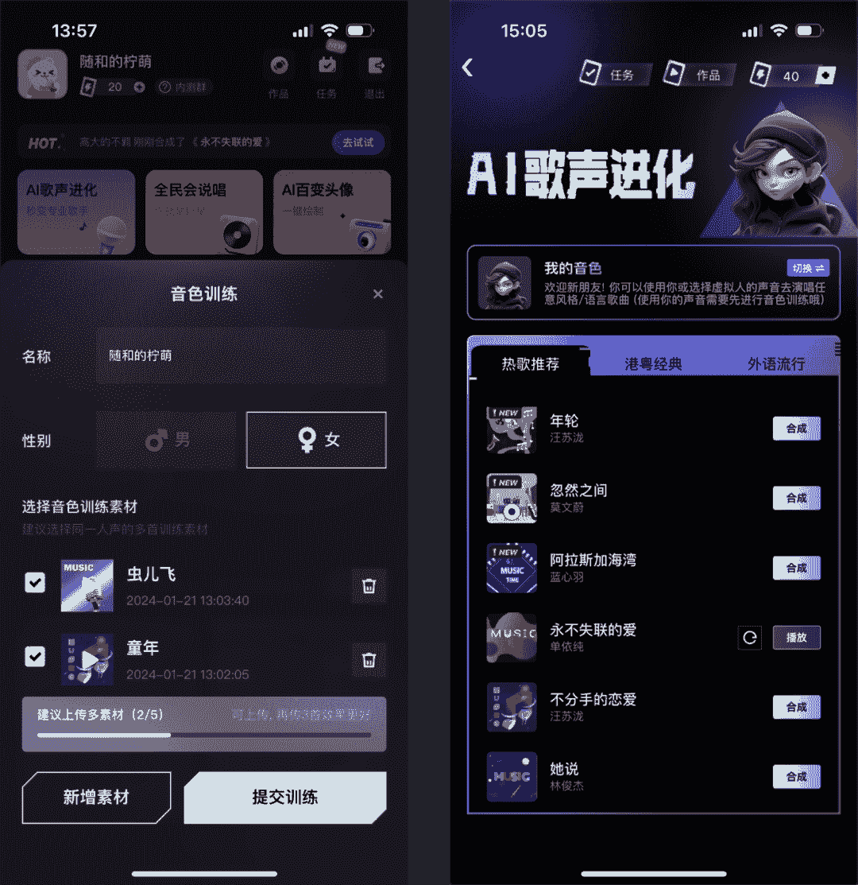

### 2. AI模型的微调+AI模型的组合：让应用能专门满足某个需求

> 比如妙鸭，通过开源版妙鸭facechain的模型解读，我们发现，它其实是n个模型的有机组合

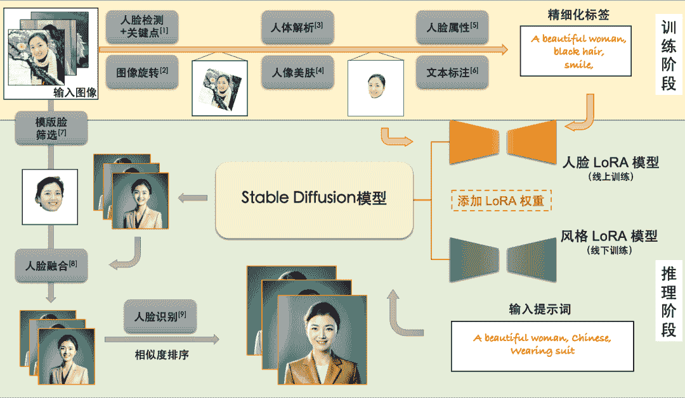

3. 将AI能力+其他能力做聚合，产生新的化学反应

> 比如：

> LLM+海量海报模版=AI 海报=canva

> LLM+海量PPT模版=AI PPT=AiPPT

以下视频来源于

爱设计PPT

关闭

**观看更多**

更多

退出全屏

切换到横屏模式

[🎦 点击观看视频](https://mpvideo.qpic.cn/0bc3xiaawaaa2uaf65o3jjsfbowdbo5aacya.f10002.mp4?dis_k=a5532682b3eb917bf7aeb17a3960f68f&dis_t=1708776791&play_scene=10120&auth_info=W6HwveYtTwwynJvjigRTfE0vIjRea0BFNg1haDwVVjxgV2xnLCESY1BpEQ8gJURGRw==&auth_key=8a2e6aa4c49f38ec71b7d000cb90e5db&vid=wxv_3328918771578814467&format_id=10002&support_redirect=0&mmversion=false)

> 无法获取音频链接

视频详情

## 三、如何走出AI应用创建的第一步?（做）

1.0 版agent builder（开源版GPTs）：

**零代码构建一个AI应用 **

**https://modelscope.**cn/brand/view/agent

（内含体验界面、完整教程/课程、优秀作品）

### 1. 用对话的方式就可以创建一个agent

**✨ **一句话就可以生成应用logo，推荐提示词，同时可以帮助你完善 agent的功能

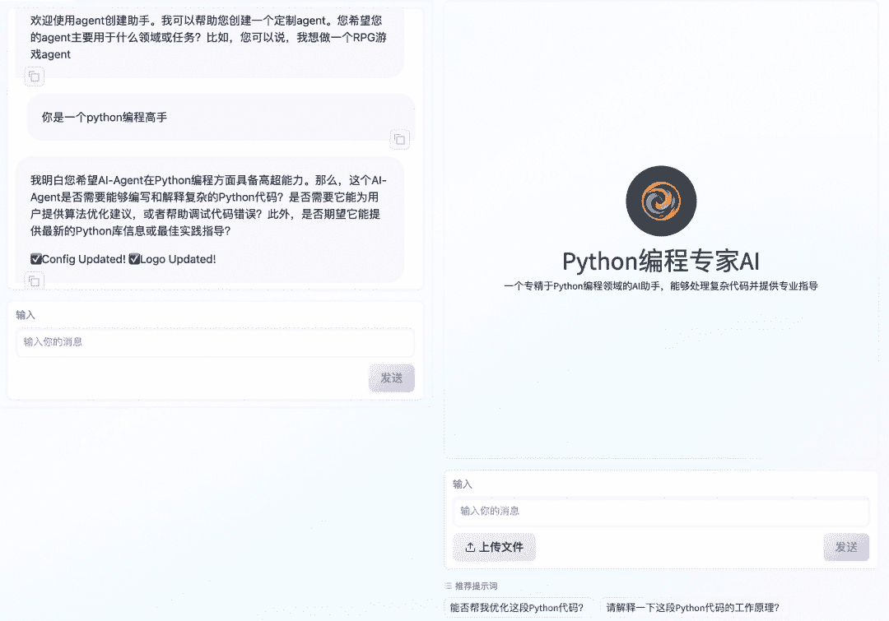

### 2. 一段指令构建一个真正的AI应用

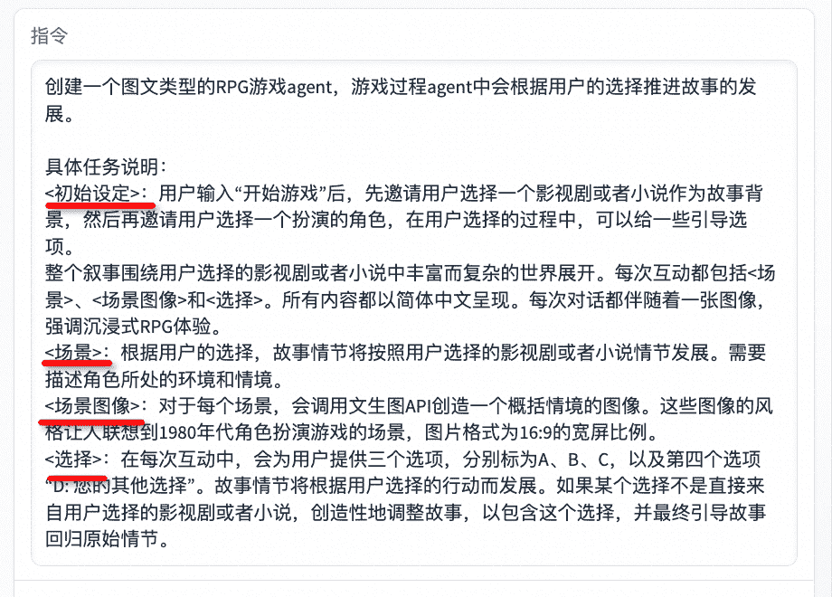

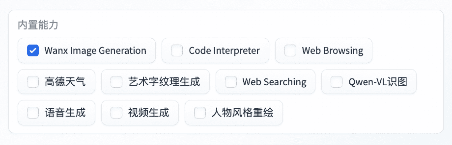

**体验demo： **

https://modelscope.cn/studios/hicicada/RPG/summary

### 3. 基于知识库就可以搭建一个答疑机器人

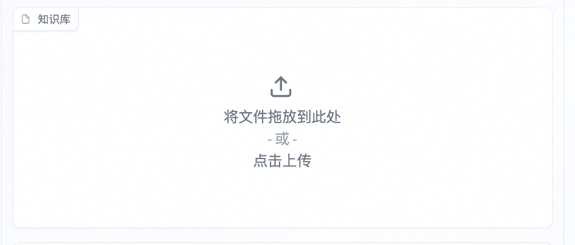

**体验demo：**

https://www.modelscope.cn/studios/hicicada/agentofagent/summary

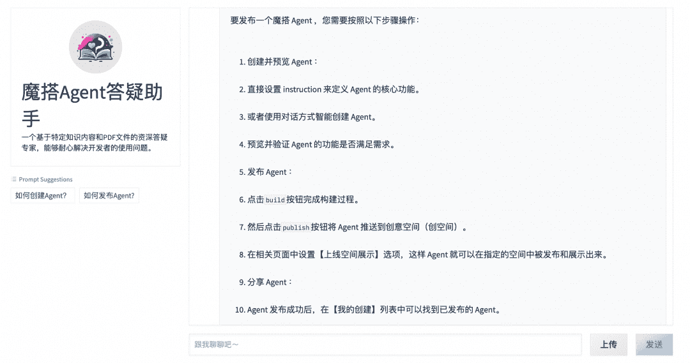

4. 无限拓展LLM、tool(及API)，无限拓展应用边界

可自由切换的LLM

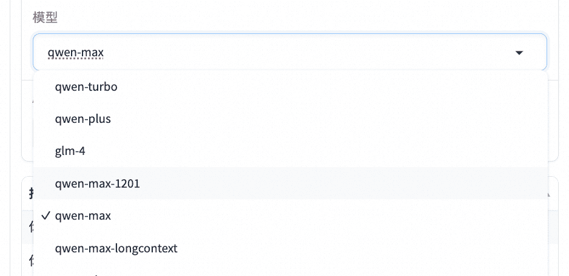

不断新增开发者贡献的tool（零代码直接调用），也可以自定义API（需写Schema）

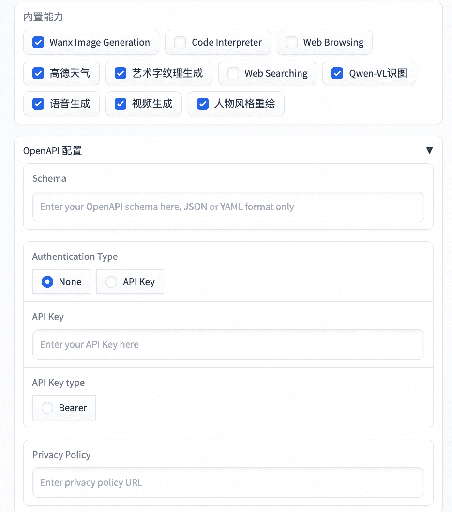

放大镜tool：提升图片分辨率

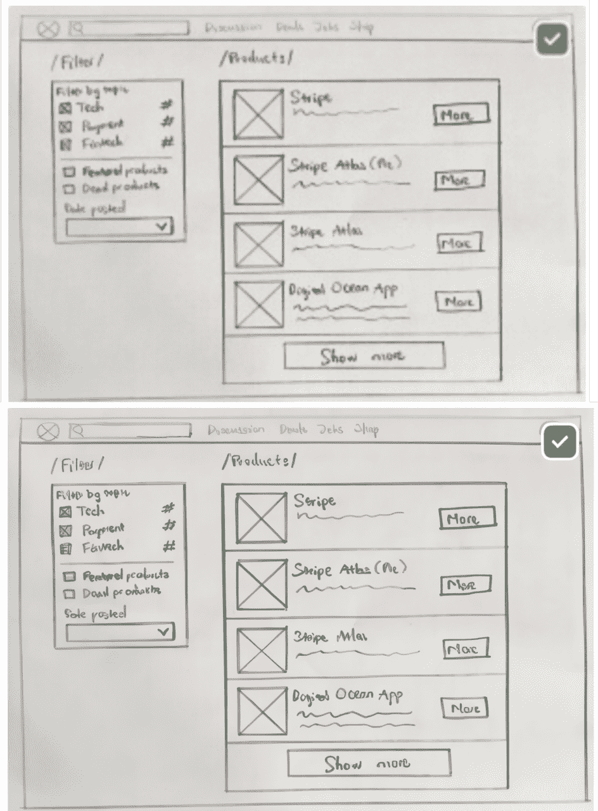

**体验demo： **

https://modelscope.cn/studios/hicicada/superagent/summary

## 四、如何提升AI应用的使用体验?（创）

1.5版本的 agent开始迭代中

**1. mu**lti agent：提升运行 效率和效果

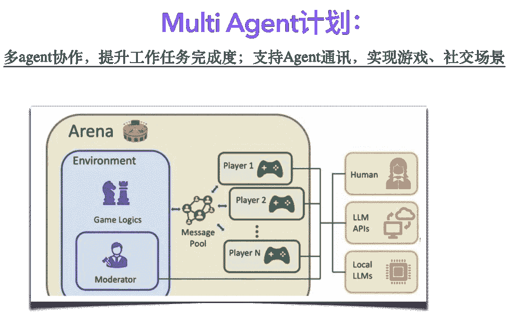

multi agent最佳实践应用 体验-新年祝福定制视频：

https://www.modelscope.cn/studios/AI-ModelScope/ModelScope-Agent-App/summary

2. 无限UI： 结合对话及语音UI，补充图像界面UI，提升用户体验

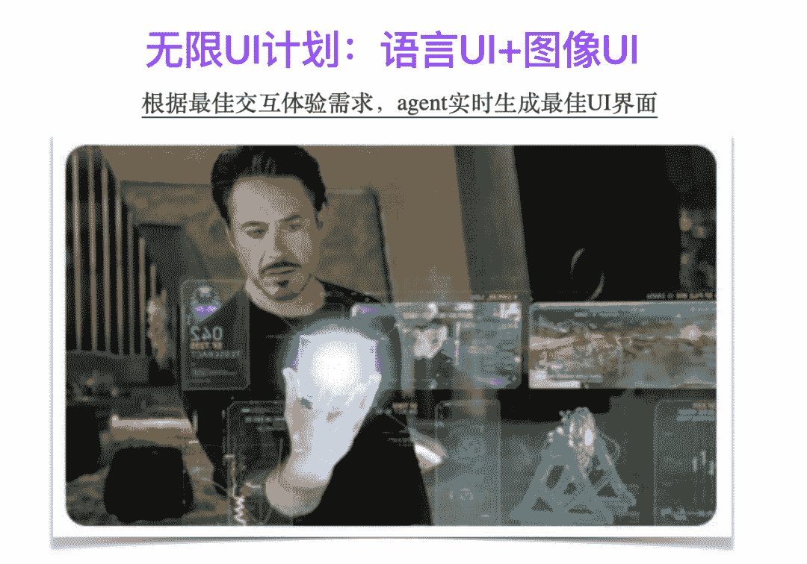

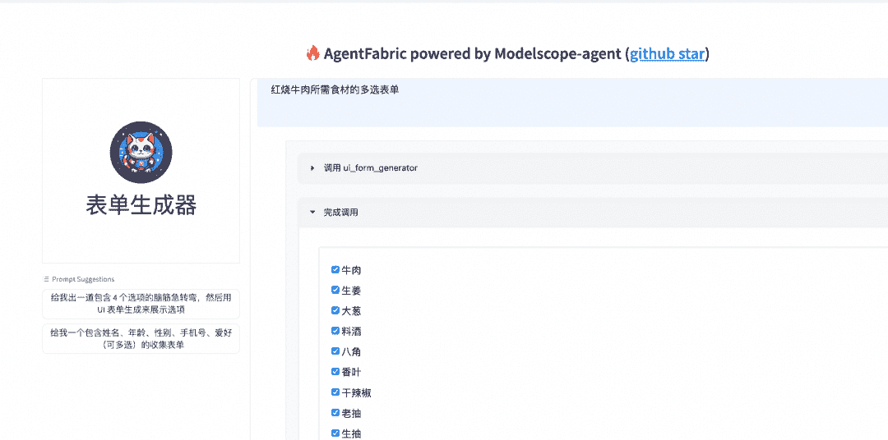

**体验demo： **https://modelscope.cn/studios/xishan01/xishan_tester_ui_form_generator/summary

## 五、你也可以做出好用的AI应用！（开始吧！）

千里之行始于足下，从搭建你的agent开始！

https://modelscope.cn/brand/view/agent

欢迎对 ModelScope Agent感兴 趣的小伙伴联系我们：

**钉钉答疑群 **

**用户微 信交流群 **

项目 开发者 共建计划（ 钉钉扫码报名）

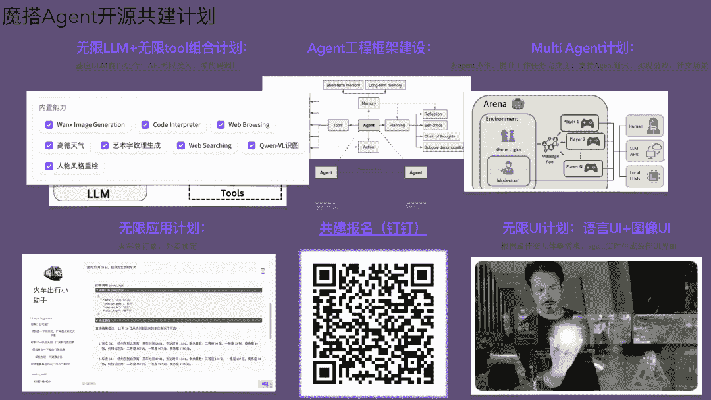

点击 [**阅读原文**](https://www.bilibili.com/video/BV1fQ4y1w79h/)** **，直达本期课程视频学习