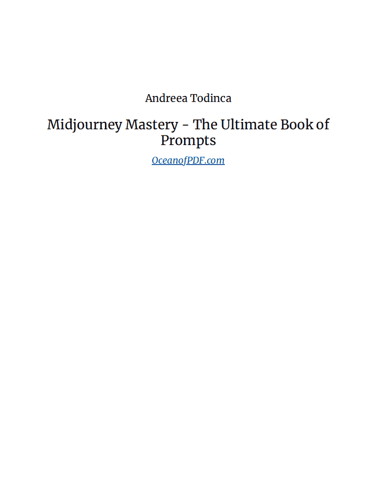
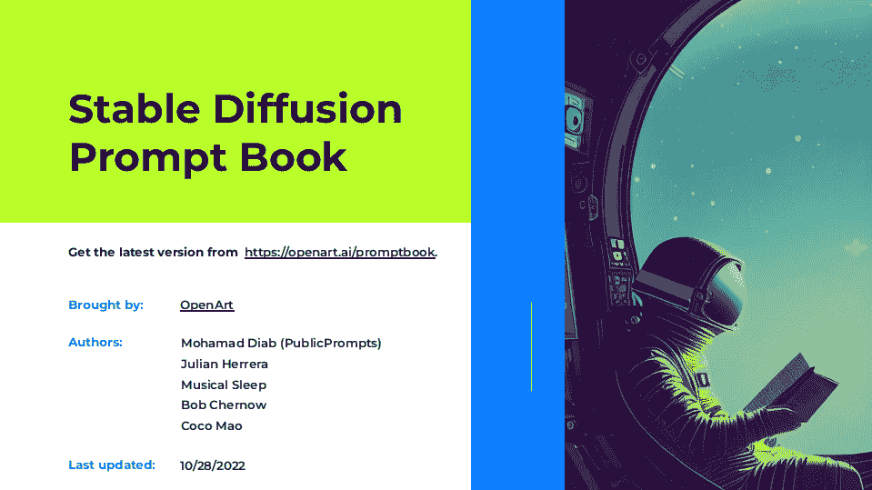
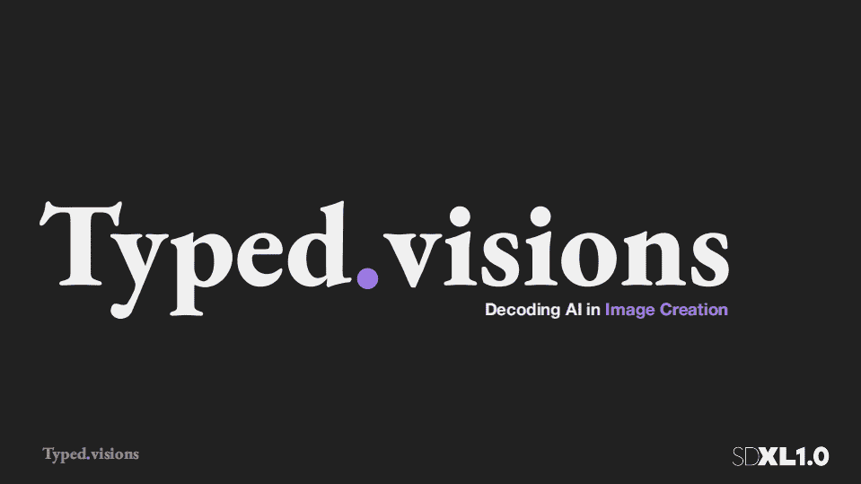

# 🎨 AI绘画

> 来源：[https://seigy6zzam.feishu.cn/docx/Yn0XdYUdCoGOcqxBbBocK4zxn3l](https://seigy6zzam.feishu.cn/docx/Yn0XdYUdCoGOcqxBbBocK4zxn3l)

# 子页面目录

# 三足鼎立

## 自然语言流Dalle-3

TODO：面向未来？

## 最简交互流Midjourney

折中方案，当前美感最优，在线提示词生成工具：https://promptfolder.com/midjourney-prompt-helper/

+   https://bowwe.com/en/blog/guide-to-midjourney-prompts

[Ultimate GuideTo Midjourney Prompts.pdf](https://internal-api-drive-stream.feishu.cn/space/api/box/stream/download/all/K61Ab9SDQogAEhxDfcScHhQOnqe)

+   大师课程

[Midjourney Mastery.pdf](https://internal-api-drive-stream.feishu.cn/space/api/box/stream/download/all/Pph4bUXFsoEJG3xW3EEcDTMlnQd)

## 多样生态工具Stable Diffusion

+   工具

+   Stable Diffusion WebUI

+   ComfyUI

+   Fooocus

+   模型

+   SD 1.5 模型，需要各种搭配控制

+   参数：Clip, Steps, CFG Scale, Seed

+   VAE

+   Hypernetwork

+   Embedding

+   Lora

+   Controlnet

+   LyCORIS

+   介绍学习

[Stable Diffusion Prompt Book From OpenArt.pdf](https://internal-api-drive-stream.feishu.cn/space/api/box/stream/download/all/O70Lby57hoK1DTxSp2actvtLnLd)

+   SDXL：最新介绍

[Typed Visions - SDXL - September 2023.pdf](https://internal-api-drive-stream.feishu.cn/space/api/box/stream/download/all/R3XqbJqFZoK8tWxv2qfccDYineM)