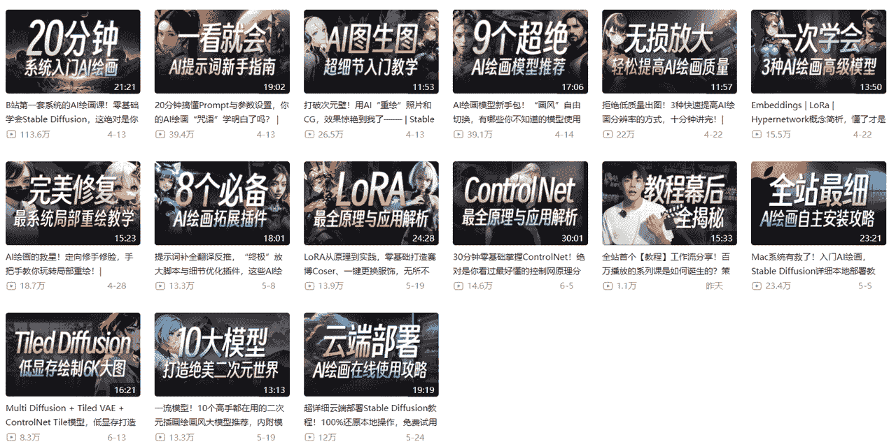

# 进阶篇

> 来源：[https://seigy6zzam.feishu.cn/docx/VaTEdcswAoAjqVxQ2duc4W6AnDe](https://seigy6zzam.feishu.cn/docx/VaTEdcswAoAjqVxQ2duc4W6AnDe)

# 推荐课程

B站上看过最系统的一套课程，前后关联，逻辑严密，可以按部就班，按照up整理的顺序逐步学习，整体学习曲线比较平滑，而且每一篇都有配套的思维导图和相关资源的下载链接，非常品质的课程，感觉比市面上很多付费课程质量都要高出一个档次，也是我看后直接劝退我做视频教程的原因😂

# 整理笔记

## Controlnet

+   秋叶插件说明：[【](https://www.bilibili.com/video/BV1fa4y1G71W)AI绘画】全面升级！ControlNet1.1 使用教程 更加强大的控制功能！线稿上色/风格迁移/局部修改_哔哩哔哩_bilibili

# 相关资源下载

## 软件安装

+   视频资源：https://mubu.com/doc/_2As4DSE4m

+   🔗夸克：https://pan.quark.cn/s/0185938d47c5

+   🔗度盘：https://pan.baidu.com/s/10rzgzIjzad7AKmj-w8zO_w?pwd=nely

## 官方插件

+   github.com/AUTOMATIC1111/stable-diffusion-webui/wiki/Extensions

+   Tiled Diffusion & VAE扩展下载：

+   🔗仓库链接：https://github.com/pkuliyi2015/multidiffusion-upscaler-for-automatic1111

+   🔗网盘分流：https://pan.quark.cn/s/0185938d47c5（加餐课文件夹内）

## 资源站点

+   https://civitai.com/

+   https://www.liblibai.com/

+   https://huggingface.co/

## 云端部署

+   函数计算FC资源包领取地址：https://free.aliyun.com/?productCategory=%E5%87%BD%E6%95%B0%E8%AE%A1%E7%AE%97%20FC&scm=20140722.M_9489742._.V_1?spm=a1z389.11499242.0.0.65452413jgv5bn&utm_content=g_1000372611

+   函数计算FC控制台地址：https://www.aliyun.com/product/fc?spm=5176.devs

+   文件存储NAS试用并开通地址：https://free.aliyun.com/?product=9657388

+   SD1.5 官方模型下载：https://huggingface.co/runwayml/stable-diffusion-inpainting/resolve/main/sd-v1-5-inpainting.ckpt