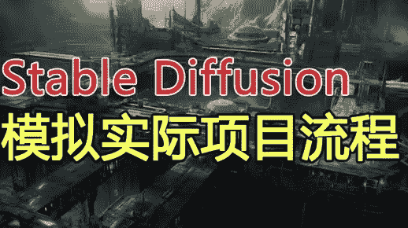

# 实战篇

> 来源：[https://seigy6zzam.feishu.cn/docx/MufydZvhMo0Gl3xXQg4chnw8nIc](https://seigy6zzam.feishu.cn/docx/MufydZvhMo0Gl3xXQg4chnw8nIc)

# 小实验

# 商业应用

## 综合案例

+   相关资源下载：

+   视频中的图&文&模型：
链接：https://pan.baidu.com/s/1Expu1s-FK8rc7gZJ1wIyug?pwd=orji  提取码：orji

+   秋叶 SD v4 整合包：（非常感谢秋叶大佬，功德无量）
链接：https://pan.baidu.com/s/1a0aCc9yspc6C_CyQ0Gn1LQ?pwd=cq0t  提取码：cq0t

+   controlnet 1.1 模型文件下载与各文件放置位置：
链接：https://pan.baidu.com/s/1P52oIpwV8Prj_liN63qoSA?pwd=peag  提取码：peag

## 插件应用

+   文字版：[Segment Anything for Stable Diffusion WebUI安装学习资料](https://dirk3j7xco.feishu.cn/docx/MM2Cdqz6ioU40kxEhURcLMLDn1d)

+   视频版：[【A](https://www.bilibili.com/video/BV1Vh411F7Zn/)I绘画】Stable Diffusion强到离谱的插件让商业换装如此简单，Segment Anything GroundingDINO喂饭级安装教程_哔哩哔哩_bilibili