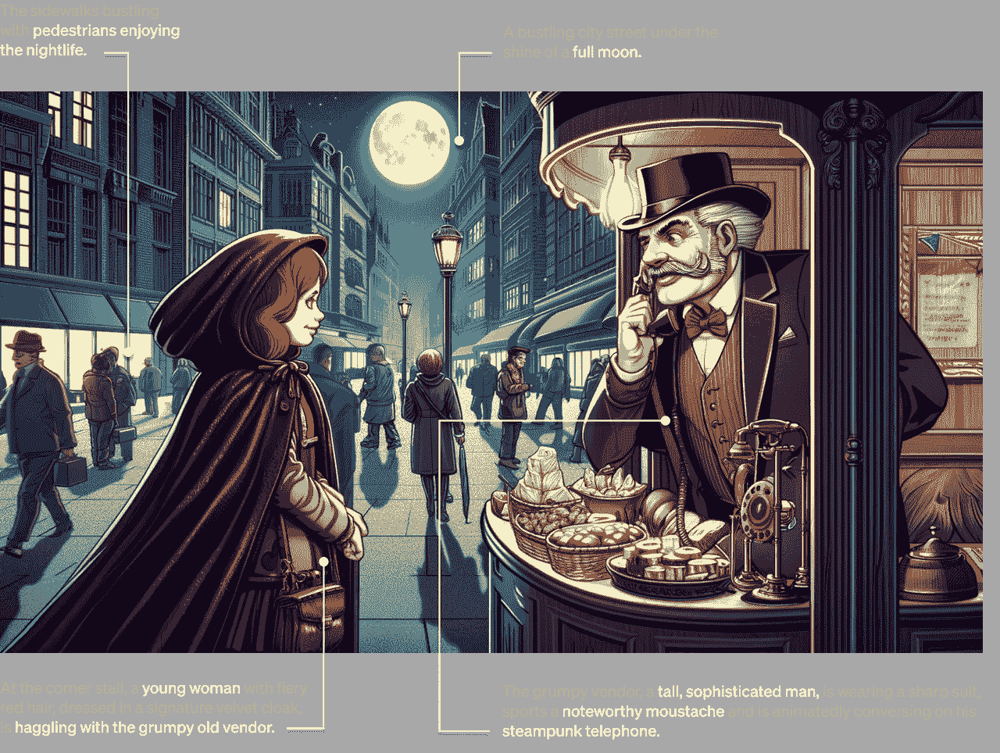
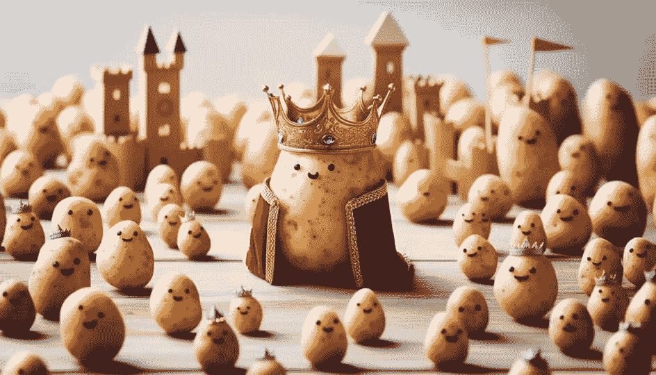
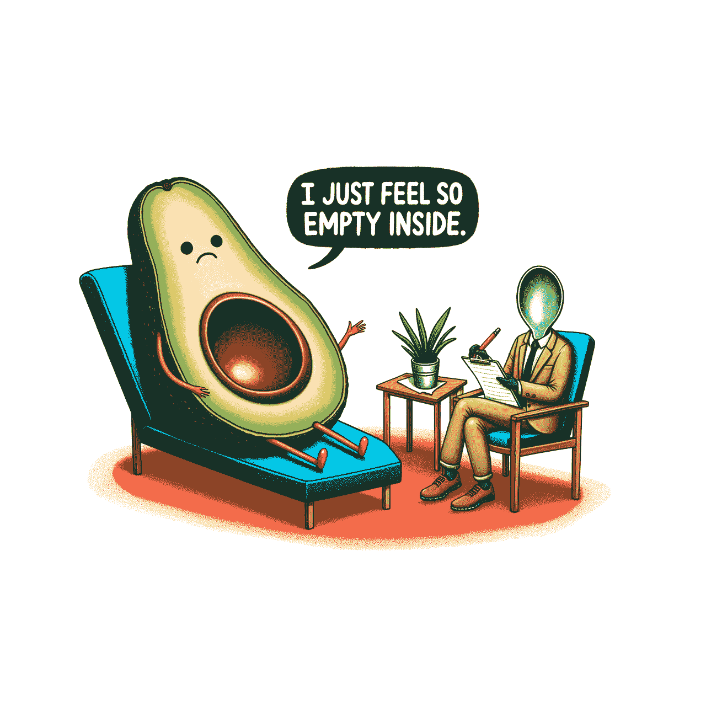
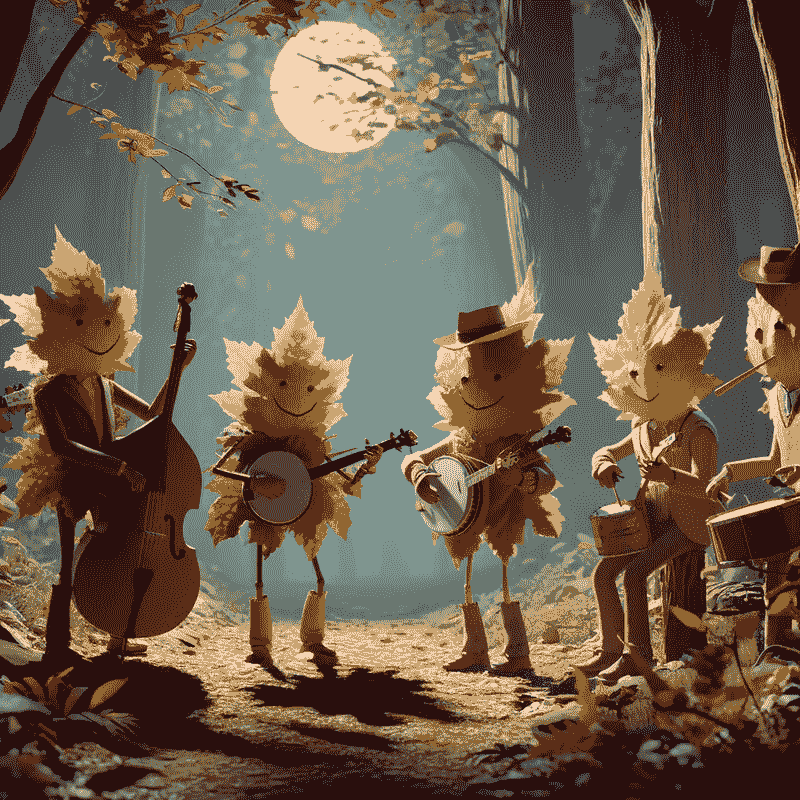
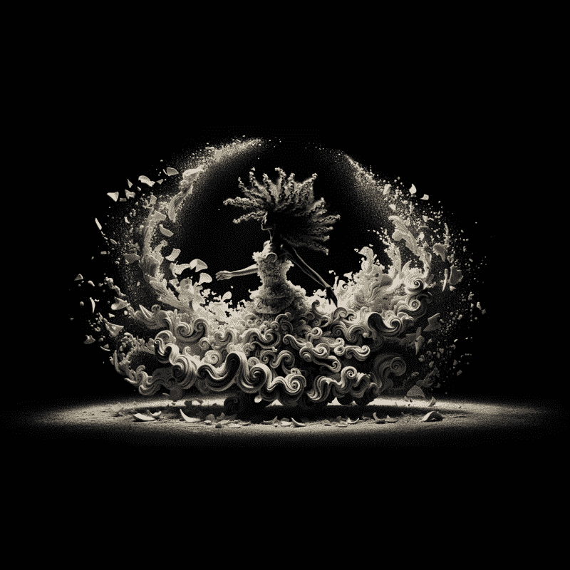
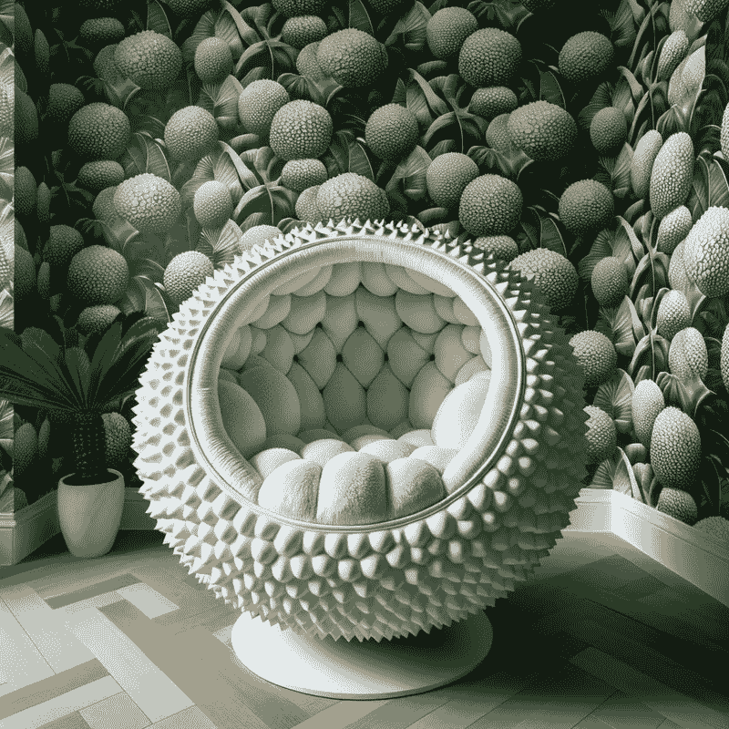

# Dalle-3（自然语言交互）

> 来源：[https://seigy6zzam.feishu.cn/docx/OqjDddXU7oQXO5xfRxYcZUJqn8c](https://seigy6zzam.feishu.cn/docx/OqjDddXU7oQXO5xfRxYcZUJqn8c)

# 自然语言的理解能力

# 自然语言交互能力

[dalle-3.mp4](https://internal-api-drive-stream.feishu.cn/space/api/box/stream/download/all/BQCxbgd0DoeVrax9Mnmcm7zXnDg)

# 画面表现能力demo

[dalle-3-show.mp4](https://internal-api-drive-stream.feishu.cn/space/api/box/stream/download/all/PpEBbjzlDohgdUx56oicSSPEnqg)

|  | 提示词 |
| --- | --- |
|  | An illustration of an avocado sitting in a therapist&#x27;s chair, saying &#x27;I just feel so empty inside&#x27; with a pit-sized hole in its center. The therapist, a spoon, scribbles notes. |
|  | A 2D animation of a folk music band composed of anthropomorphic autumn leaves, each playing traditional bluegrass instruments, amidst a rustic forest setting dappled with the soft light of a harvest moon. |
|  | In front of a deep black backdrop, a figure of middle years, her Tongan skin rich and glowing, is captured mid-twirl, her curly hair flowing like a storm behind her. Her attire resembles a whirlwind of marble and porcelain fragments. Illuminated by the gleam of scattered porcelain shards, creating a dreamlike atmosphere, the dancer manages to appear fragmented, yet maintains a harmonious and fluid form. |
|  | Photo of a lychee-inspired spherical chair, with a bumpy white exterior and plush interior, set against a tropical wallpaper. |

# 参考材料

+   https://openai.com/dall-e-3