# FaceFusion

> 来源：[https://seigy6zzam.feishu.cn/docx/UmIFdyd5QouRApxidtgcov6Inxg](https://seigy6zzam.feishu.cn/docx/UmIFdyd5QouRApxidtgcov6Inxg)

# 支持特性

## **界面基本设置**

+   选择操作和模型（如果想要更好的效果记得选择脸部增强 face_enhancer，模型一般保持默认即可）

+   执行控制选择合适的配置（最好用cuda）

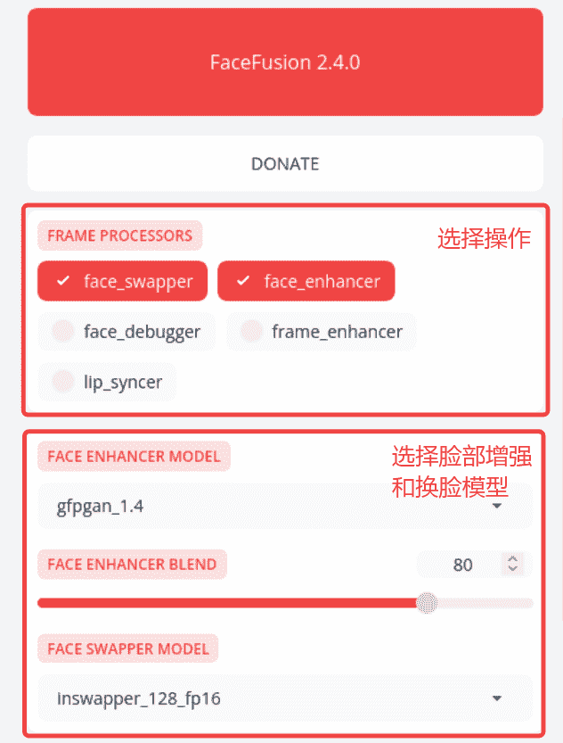

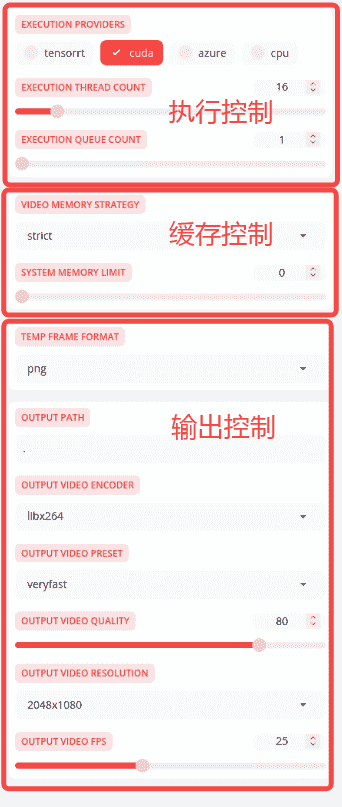

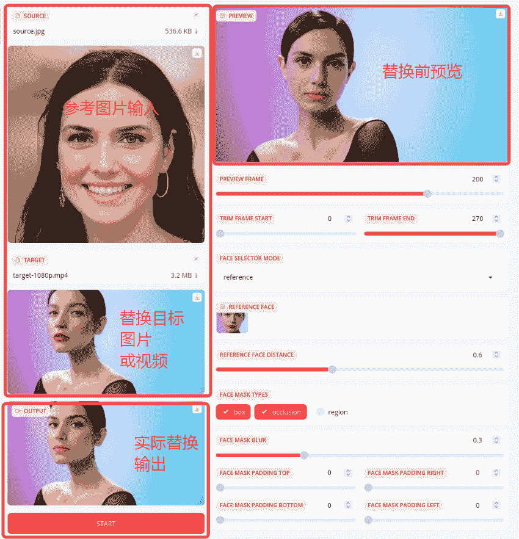

+   整体界面（2.4.0版本）

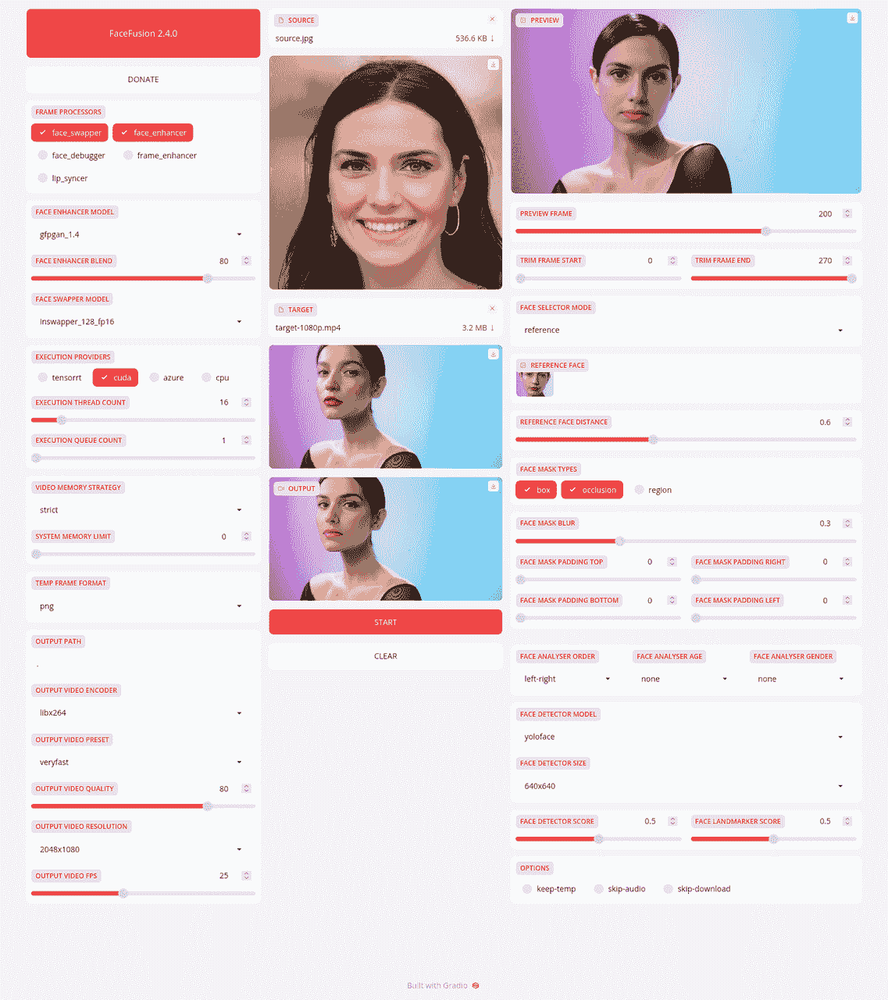

## **图片换脸流程**

### 单张脸图片

+   参考照片正面照，清晰且无遮挡

+   待替换可以是视频也可以是图片

+   右上角预览效果，觉得可以直接点击下面的 start 按钮

+   其他参数暂时保持默认就可以

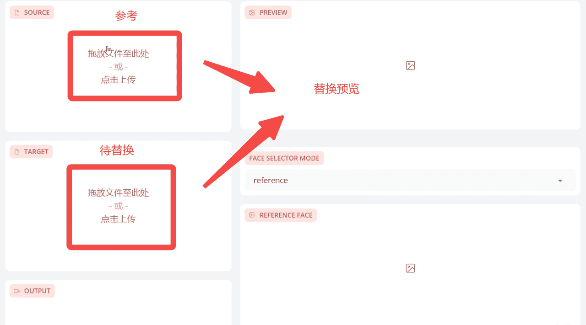

### 多张脸图片

+   脸部选择模式：

+   reference：从下面选择

+   many：替换所有的脸

+   one：替换检测到的第一张脸

+   参考脸部举例，一般默认0.6，如果有侧脸或者d'd'd，可以适当加大，使用最大1.5可能出现所有人脸被替换

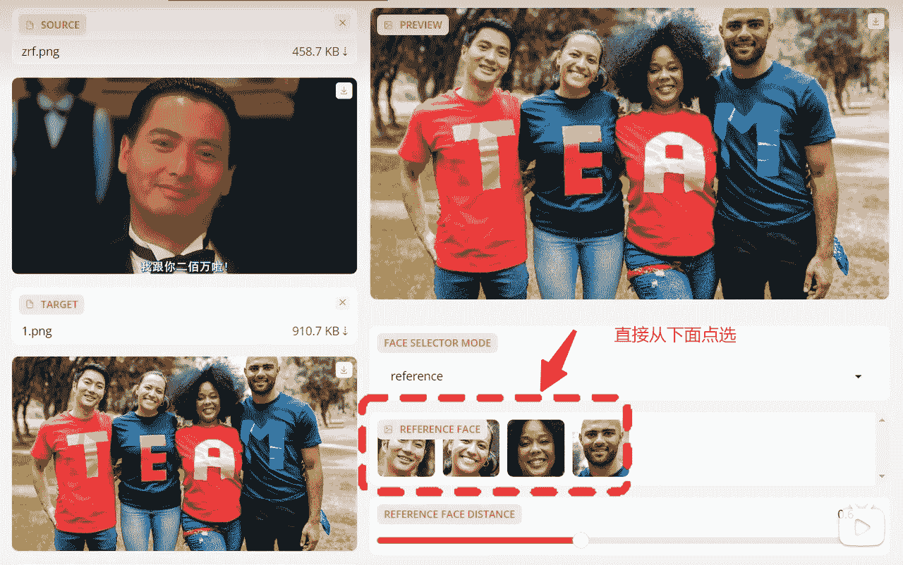

## **视频换脸流程**

基本跟图片是一样的，只是注意预览图片是按照帧数选择的，默认是预览替换第一帧

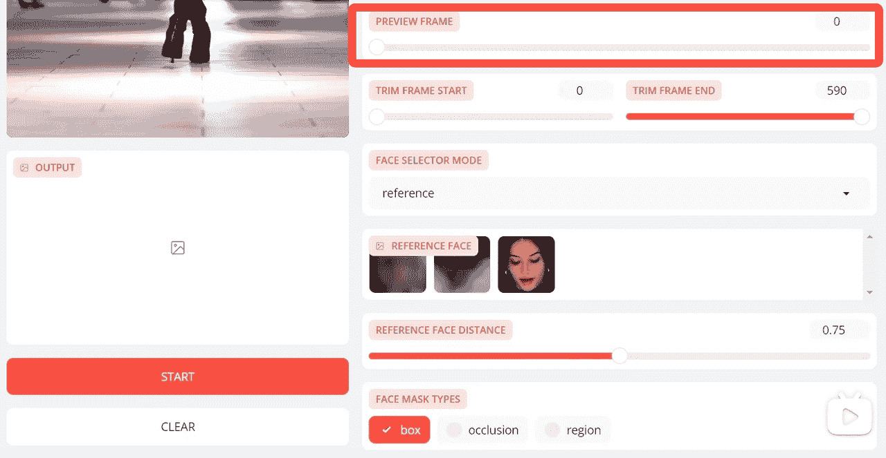

## **遮罩设置介绍**

> 注意所有调试模式，在测试完成后，在实际执行换脸 start 前，记得关闭调试模式，不然会保留红框和点

**在利用遮罩处理的时候开启调**试模式，方便看到预览区域的红线和点

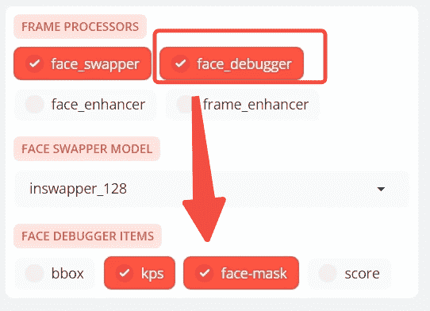

### box模式

会是一个盒子的结构，把遮罩物也处理到，适用于无遮挡的情况


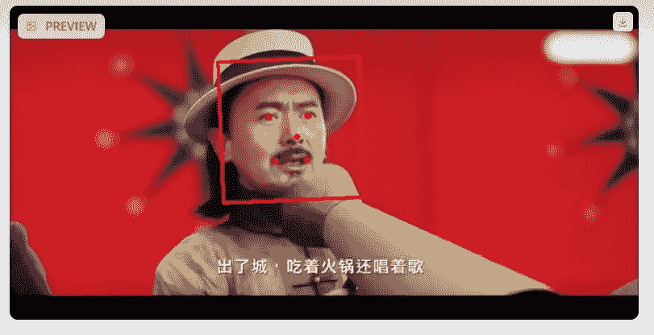

### 封闭模式

可以调节透明度参数，对于不透明的物体建议调整到0.5以上，太小了遮罩物会有明显的模糊透明效果，但是对于透明的物体，比如玻璃杯和眼镜，应该调小这个值

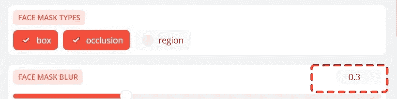

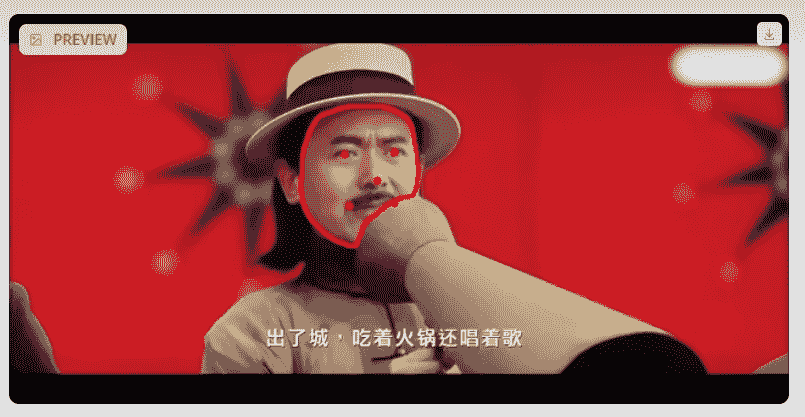

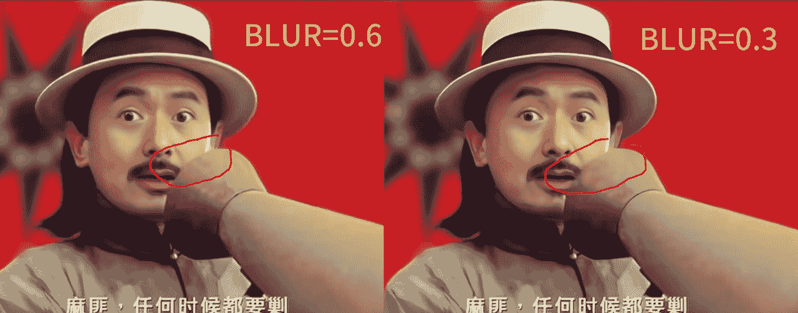

### 区域模式

选中后会出现两排控制控件，主要可以根据脸部区域选择是否替换，默认全部部位选中，如果我们不希望替换嘴，可以取消勾选，效果可以在调试模式下查看，比如对于嘴部动作比较多的讲话视频，效果会更好

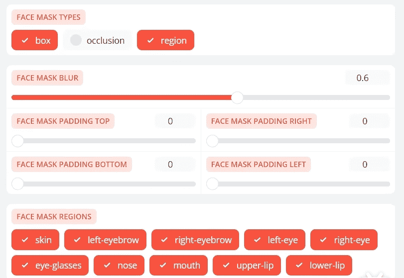

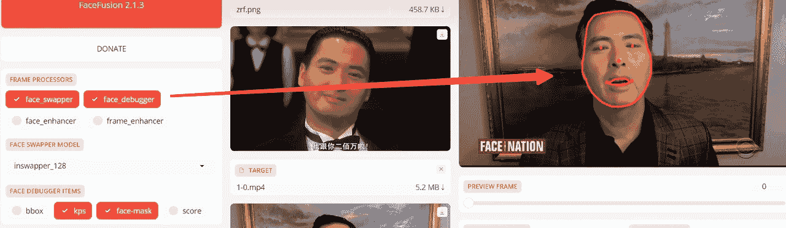

### 遮罩区域

在所有上面三种模式下可以在调试模式下对比不同的区域起始位置，这个功能主要对于换脸区域的更加精确控制

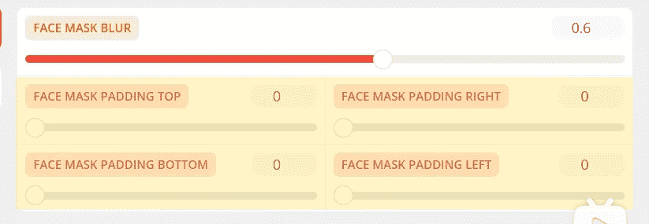

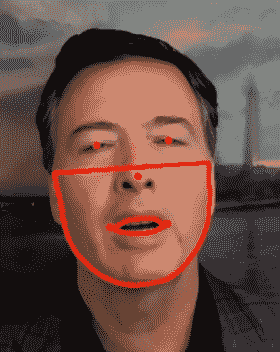

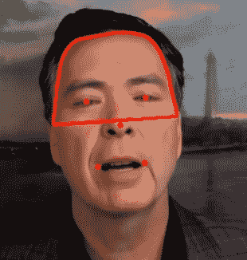

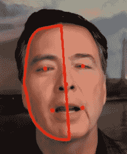

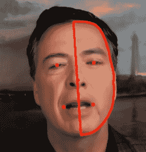

通过调整区域，对于最常规的box模式，可以防止换脸区域覆盖到字幕的部分，影响字幕

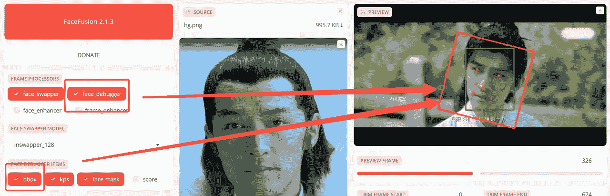

## 处理高清视频

设置人脸分析高清分辨率，设置脸部增强，且使用高清算法

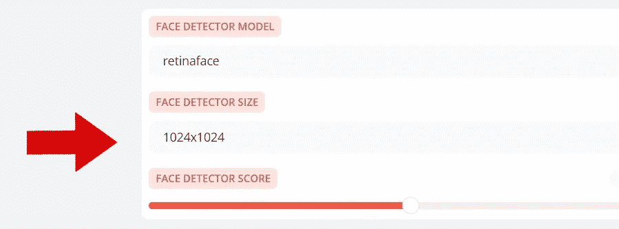

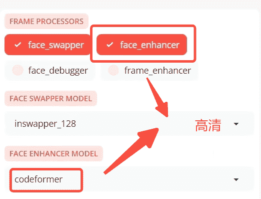

## 卡通目标替换

主要换用这个 simswap_256 的模型，添加脸部高清增强，视频为了提速，建议换回 inswapper_128 模型

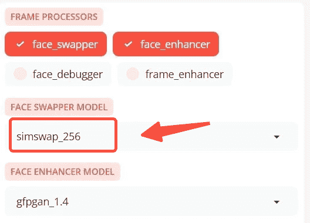

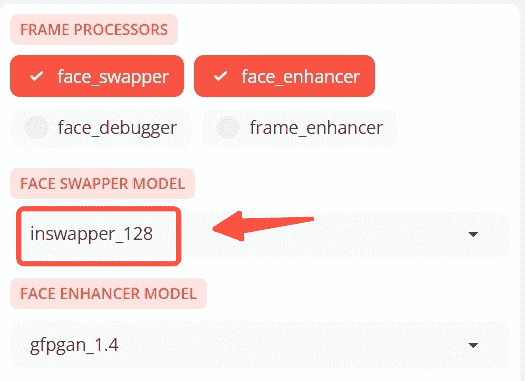

## 新增唇形同步

因**为换脸和唇形同步**不能同时用，需要关闭所有仅保留唇形同步，有cuda一定用，8G显卡可以使用12个线程，正常唇形同步开启嘴巴会模糊，建议开启脸部增强

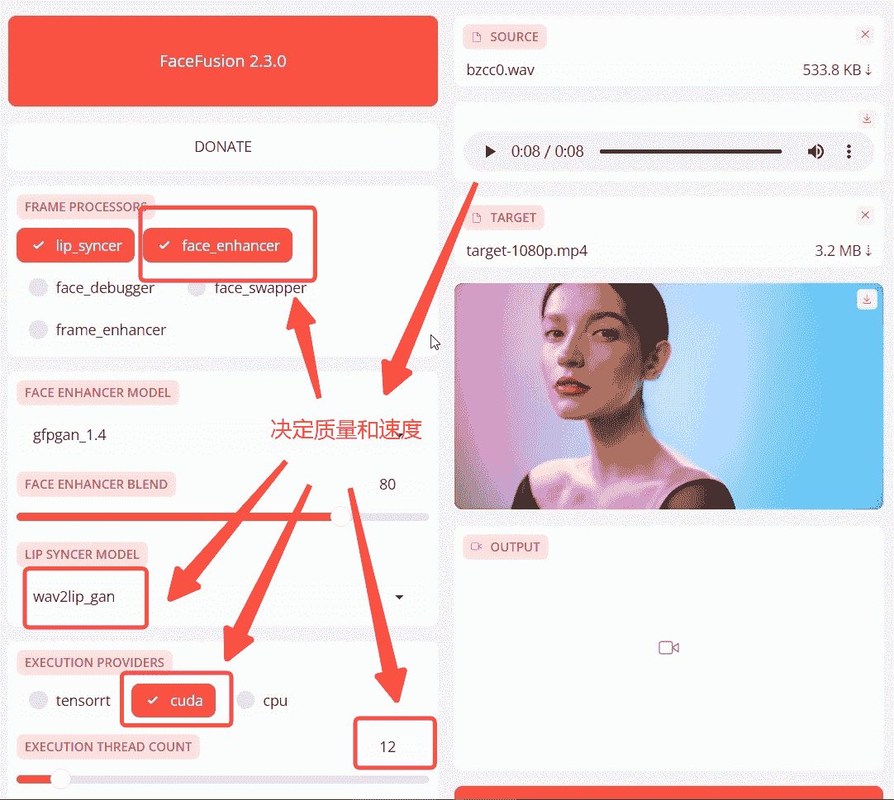

## 场景经验总结

yoloface虽然提升了弱光下识别准确度，但是在非box模式下对于遮罩的处理欠佳，所以最好结合场景选择最优的人脸检测算法

+   如果想音频驱动嘴型效果好，还是需要用wav 2 lip项目训练人物专属模型

+   直接使用wav 2 lip gfpgan效果较差

+   项目目前只能驱动语音+视频换嘴，无法图片换嘴。音频+图片换嘴用sadtalker较好

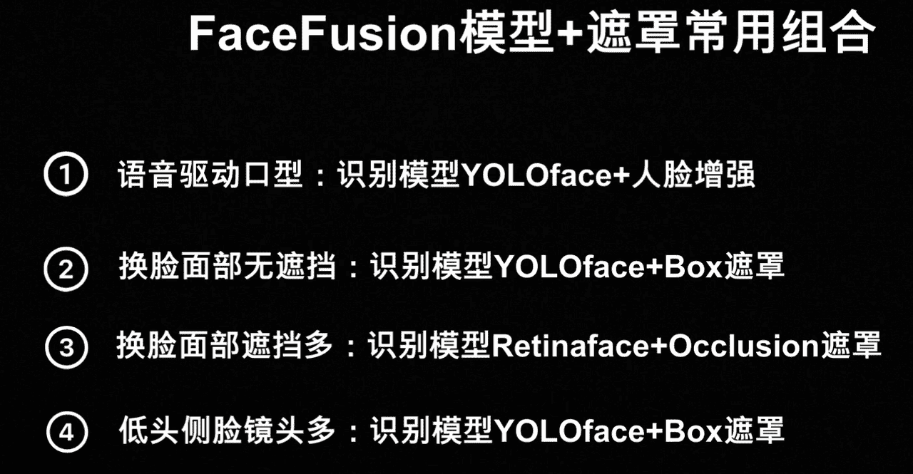

# 安装过程

## 所需软件

+   A卡和集成显卡必须：

+   python-3.10.6-amd64.exe：https://www.python.org/downloads/release/python-3106/

+   Git-2.41.0-64-bit.exe：https://git-scm.com/downloads

+   VisualStudioSetup.exe：https://visualstudio.microsoft.com/zh-hans/downloads/

+   ffmpeg6.0：https://www.gyan.dev/ffmpeg/builds/

+   N卡需要：

+   cuda_11.8.0_522.06_windows10.exe：https://developer.nvidia.com/cuda-11-8-0-download-archive

+   cudnn8.9：https://developer.nvidia.com/rdp/cudnn-archive

注意：所需软件可直接从网盘下载：

+   [百度网盘：](https://pan.baidu.com/s/1U_vsRu9ILHn9FQ_5iph-YQ?pwd=f86f#list/path=%2Fsharelink1848234799-200018639564459%2FFaceFusion%2F1%E4%BE%9D%E8%B5%96%E8%BD%AF%E4%BB%B6&parentPath=%2Fsharelink1848234799-200018639564459)提取码：f86f

+   [夸克网盘](https://pan.quark.cn/s/1ff4f0c9b607#/list/share/5001e0dd6b804562b444db9971e8d9db-facefusion/9744cabcfaff4ec18bd3286b7d04ad88-1%E4%BE%9D%E8%B5%96%E8%BD%AF%E4%BB%B6)：提取码：hwX8

## 验证安装

windows上使用 win+R启动下面的对话框

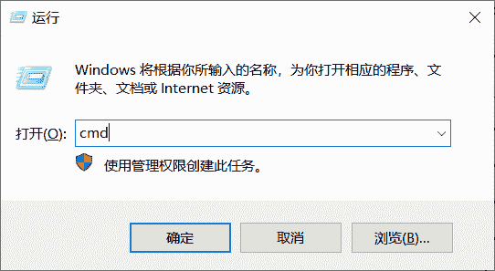

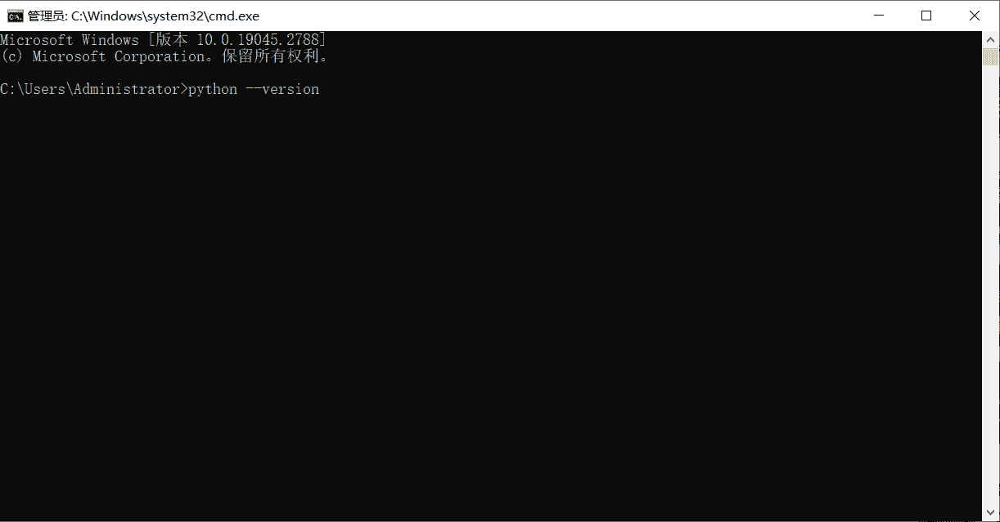

```
# 逐个执行下面的命令，看到有正常输出就代表安装成功
python --version
git
ffmpeg
nvcc --version
```

## 安装依赖

执行下面命令也需要在上面的黑色命令窗口中

+   下载程序库 git clone https://github.com/facefusion/facefusion.git

+   切换当前目录 cd facefusion

+   创建虚拟环境 python -m venv venv

+   激活虚拟环境 call venv\scripts\activate.bat

+   运行安装依赖 python install.py

+   复制模型文件夹 解压模型压缩包，把models移到 facefusion\.assets 下

**注意：所需模型**文件可以从网盘下载（包含模型文件和7z加压缩软件）：

+   [百度网盘：](https://pan.baidu.com/s/1U_vsRu9ILHn9FQ_5iph-YQ?pwd=f86f#list/path=%2Fsharelink1848234799-200018639564459%2FFaceFusion%2F2%E6%A8%A1%E5%9E%8B%E6%96%87%E4%BB%B6&parentPath=%2Fsharelink1848234799-200018639564459)提取码：f86f

+   [夸克网盘](https://pan.quark.cn/s/1ff4f0c9b607#/list/share/5001e0dd6b804562b444db9971e8d9db-facefusion/e95de2c184034ef188f6cbc190dfb4bf-2%E6%A8%A1%E5%9E%8B%E6%96%87%E4%BB%B6)：提取码：hwX8

## 启动应用

+   常规运行facefusion：python run.py

+   启用摄像头运行：python run.py  --ui-layouts webcam

# 参考资料

+   2.1.3：[F](https://www.bilibili.com/video/BV1Q94y1N77Q/?spm_id_from=333.337.search-card.all.click&vd_source=fde5a9889a63d07e61c738ceccd15018)aceFusion重磅更新！去遮挡、高清化、卡通脸一键替换！本地安装与使用详细教程，支持N卡、A卡和集成显卡

+   新增了很多模型和高清算法，效果大大提升

+   加了遮罩功能，完美消除遮挡物体

+   支持卡通动漫风格的人脸替换

+   2.3：FaceFusion语音+视频口型同步

+   安装文档：[参考](https://aidiscovery2045.notion.site/aidiscovery2045/FaceFusion-V2-28b020d535444014a2f6c90b13aaeac5)