# 阿赵的AIGC工具库丨持续更新中

> 来源：[https://my.feishu.cn/docx/UbTqduGfCoGAuuxtaiyc95oSn6c](https://my.feishu.cn/docx/UbTqduGfCoGAuuxtaiyc95oSn6c)

> 可前往：[阿赵的AI资料库](https://mq1nzy47gs.feishu.cn/wiki/IxFew33ruiHG7Skp115c0G2Pnsd)

> 正在看：阿赵的AI工具库

> 可前往：[阿赵的AI案例库](https://mq1nzy47gs.feishu.cn/wiki/YJr5wpanBiRCdvkI0bFcRehZnlg)

---

AIGC工具库将会持续更新迭代，如有遇到工具无法访问或使用过程中遇到问题，可随时联系阿赵或在群内反馈

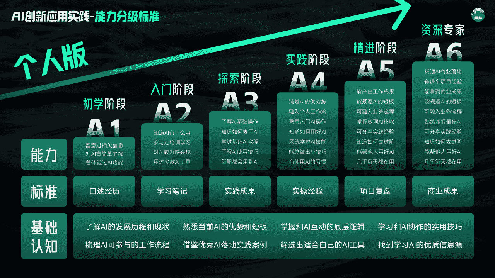

### AI智能助手【全能通用】

> 功能丰富，使用简单，通过对话即可辅助你完成各项工作，根据个人使用习惯，熟练掌握1-2款即可

> **通用AI助手-国内工具****推荐**

可免费使用丨功能丰富丨**点击即用**

---

[豆包](https://www.doubao.com/chat/)丨[DeepSeek](https://www.deepseek.com/)丨[Kimi Chat](https://kimi.moonshot.cn)

点击上方工具链接，微信扫码登录

通过对话就能辅助你解决各类问题

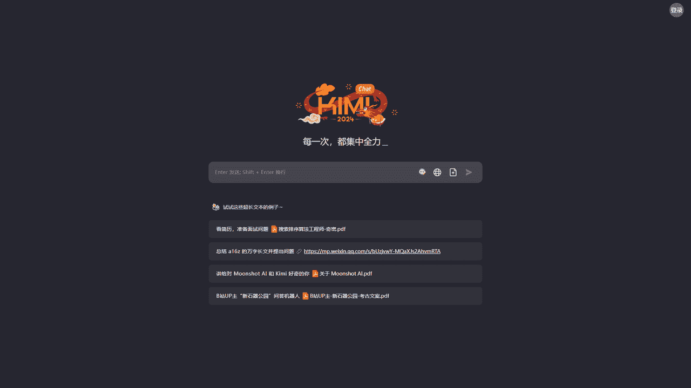

---

更多工具：[阿里通义](https://qianwen.aliyun.com/)丨[腾讯元宝](https://yuanbao.tencent.com/)

[智谱清言](https://www.chatglm.cn)丨[讯飞星火](https://xinghuo.xfyun.cn/)丨[文心一言](https://yiyan.baidu.com/)

> 通用AI助手-国外热门工具

聚合型工具丨功能单一丨**需要魔法**

---

[POE](https://poe.com)丨[Chathub](https://chathub.gg/)

付费后可使用多款国外AI大模型

例如热门的ChatGPT和Claude等

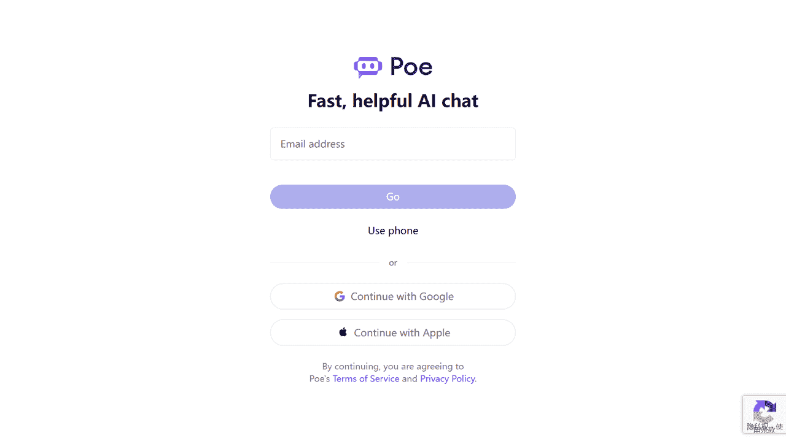

---

如果你暂时无法使用特殊网络

推荐用国内的[豆包](https://www.doubao.com/chat/)丨[阿里通义](https://qianwen.aliyun.com/)

> 通用AI助手-国外热门工具

**使用门槛高**丨效果较好丨**需要魔法**

---

[ChatGPT](https://chat.openai.com/chat#)丨[Gemini](https://gemini.google.com)丨[Claude](https://claude.ai/)

注册步骤较复杂，可在B站搜索教程

部分功能稍强，适合进阶玩家体验

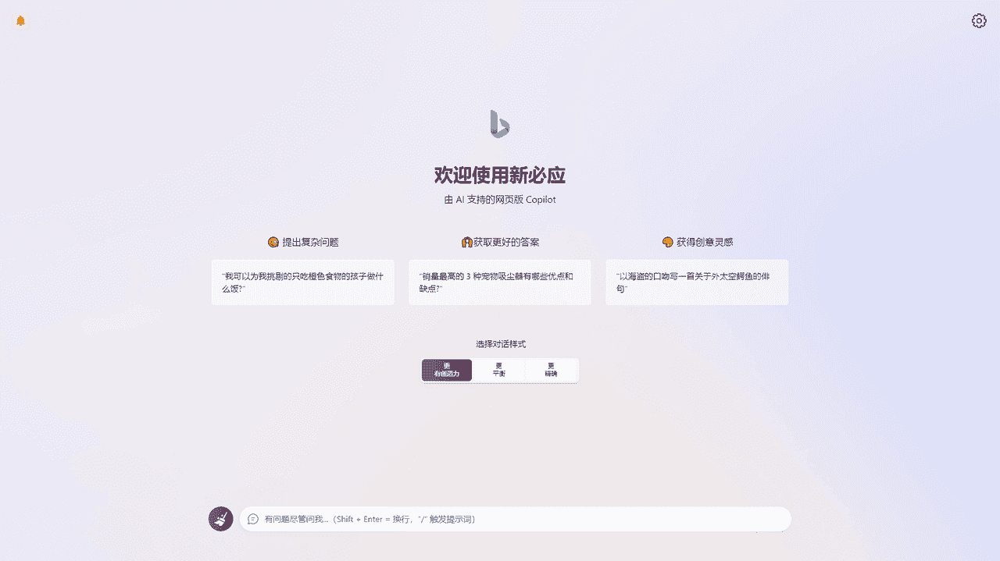

---

如果你暂时无法使用特殊网络

推荐用国内的[豆包](https://www.doubao.com/chat/)丨[阿里通义](https://qianwen.aliyun.com/)

> [和AI高效对话的技巧](https://github.com/langgptai/LangGPT/blob/main/README.md)丨

### AI办公助手【高效办公】

> 智能办公AI-国内工具推荐

推荐使用丨功能丰富丨点击即用

---

[天工AI](https://www.tiangong.cn/)丨[扣子空间](https://www.coze.cn/space-preview)

在解决各类办公问题时也非常好用

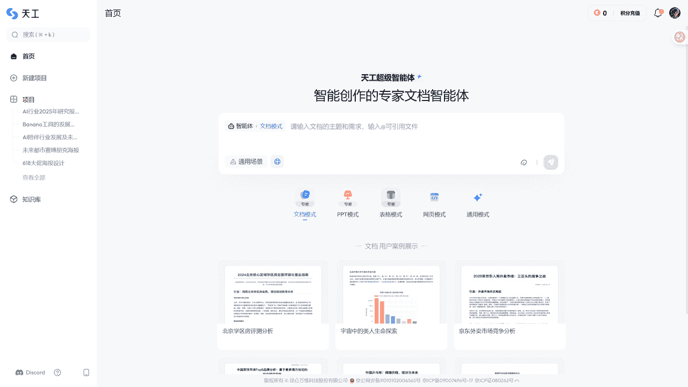

---

[WPS-灵犀AI](https://lingxi.wps.cn/)

包含智能文档、表格、PPT等工具

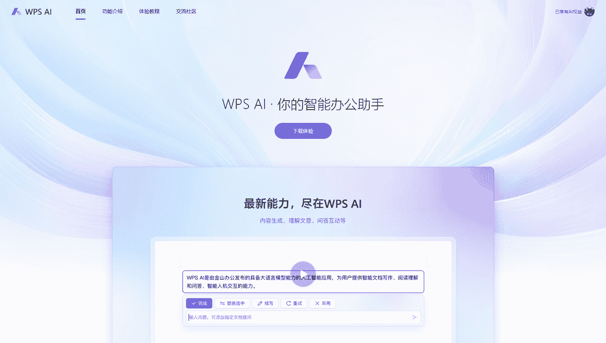

---

AI无限画布（思维脑图）

[博思白板](https://boardmix.cn/)丨[百度自由画布](https://wenku.baidu.com/board)

> 智能办公AI-更多工具推荐

推荐使用丨独立工具丨点击即用

---

智能搜索

[秘塔AI搜索](https://metaso.cn/)丨[纳米AI搜索](https://www.n.cn/?src=360dh_aiguangchang)

---

PPT生成

[Chat PPT](https://chatppt.cn/)丨[Ai PPT](https://www.aippt.cn/)

---

海报生成&图片修改

[美图AI](https://design.meitu.com/?from=try&source=try&categoryId=2455)丨[稿定AI](https://www.gaoding.art/create)

---

网页翻译（浏览器插件）

[沉浸式翻译](https://immersivetranslate.com/)丨[彩云小译](https://fanyi.caiyunapp.com/#/)

---

语音/会议记录转文字

[飞书妙记](https://www.feishu.cn/product/minutes?from=thosefree.com)丨[通义听悟](https://tingwu.aliyun.com/home)

---

AI知识库（知识管理）

[腾讯ima](https://ima.qq.com/)丨[flowith](https://flowith.io)

> 智能办公AI-国外热门工具

使用门槛高丨效果较好丨需要魔法

---

智能搜索（国外）

[perplexity](https://www.perplexity.ai/)

---

PPT生成（国外）

[Gamma](https://gamma.app/)

---

智能设计（国外）

[Canva海外版](https://www.canva.com/)

---

浏览器AI插件：[Monica](https://monica.im/)丨[豆包](https://www.doubao.com/chat/)

AI浏览器：Comet丨Dia

---

全能办公助手（国外）

[Genspark](https://www.genspark.ai/)丨[Manus](https://manus.im/app)

---

> 推荐大家从[WPS-灵犀AI](https://lingxi.wps.cn/)或[天工AI](https://www.tiangong.cn/)这类通用办公工具开始体验，然后再根据个人需求，探索更多辅助工具

### 创建AI助手【AI Agent】

如果你希望让AI深度参与工作流程，帮助自己搞定更难更复杂的问题，可以尝试体验并探索下目前的AI Agent工具

> [AI Agen](https://www.coze.cn/home)t[智能体](https://www.coze.com)工具：推荐用[扣子Co](https://dify.ai/)ze国内版丨海外版[，或海外工具Dif](https://waytoagi.feishu.cn/wiki/QSVJwSkMfijmeZkcUSnckVXhnnd)y、Fastgpt，点击可查看学习教程

### 帮你写内容【文案创作】

将AI应用到创作内容的流程中，辅助我们记录-思考-创作-完善-优化，在创作过程中找到最适合自己的工具

> 让AI帮你**记录思考和灵感**

记录灵感和零碎思考：[Flomo浮墨](https://flomoapp.com/?ref=watcha.cn)

---

辅助阅读和知识管理：[Get 笔记](https://www.biji.com/?ref=watcha.cn)

---

构建自己的知识库：[飞书](https://www.feishu.cn/product/wiki)丨[ima](https://ima.qq.com/)

---

大纲/脑图梳理：[博思白板](https://boardmix.cn/)丨[Xmind](https://xmind.cn/)

> 让AI辅助你**创作各类内容**

办公/自媒体文案创作助手

[讯飞绘文](https://turbodesk.xfyun.cn/home)丨[橙篇](https://cp.baidu.com/)丨[Copy AI](https://www.copyai.cn/)

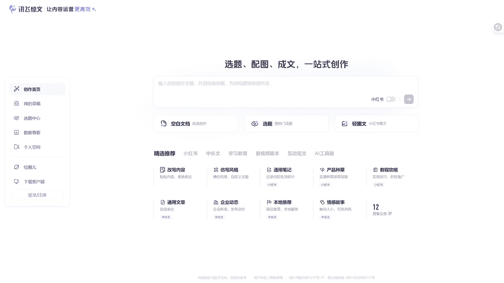

可根据不同使用场景生成文案

> 让AI帮你完成最后的优化

文案审核纠错和润色：[TextWell](https://www.text-well.com/zh?ref=watcha.cn)

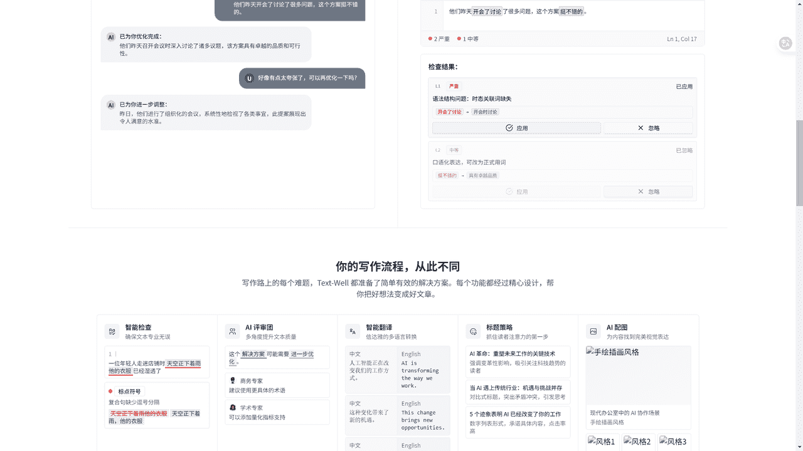

---

智能排版工具：[壹伴](https://yiban.io/?utm=ad_dh_pbx)丨[135编辑器](https://www.135editor.com/)

> 有灵魂的内容更容易打动人，这正是目前AI所欠缺的，所以不要强求AI一键创作出你预期的“完美文案”

### 帮你做设计【图片制作】

> 一键生成设计海报&长图

通过对话让AI搞定各类图片设计

---

[稿定AI](https://www.gaoding.art/create)丨[星流AI](https://www.xingliu.art/)丨[Lovart](https://www.lovart.ai/zh)

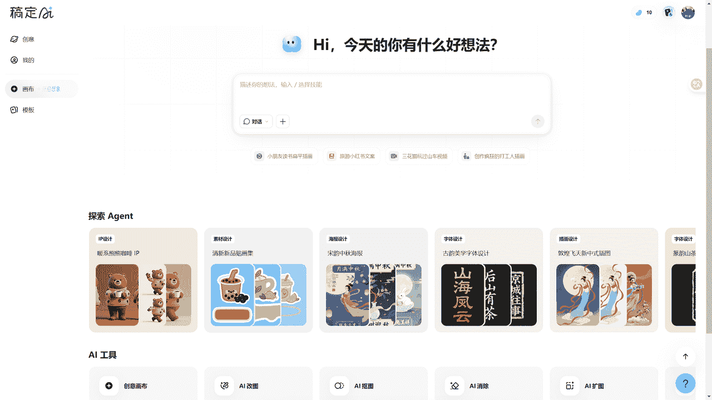

没有设计经验也可以轻松使用

> 创意图片素材生成工具

帮助设计师生成创意图片素材

---

国内工具：[即梦](https://jimeng.jianying.com/ai-tool/home)丨[哩布哩布](https://www.liblib.art/)

国外工具：[Recraft](https://www.recraft.ai/)丨[Midjourney](https://www.midjourney.com/explore?tab=random)

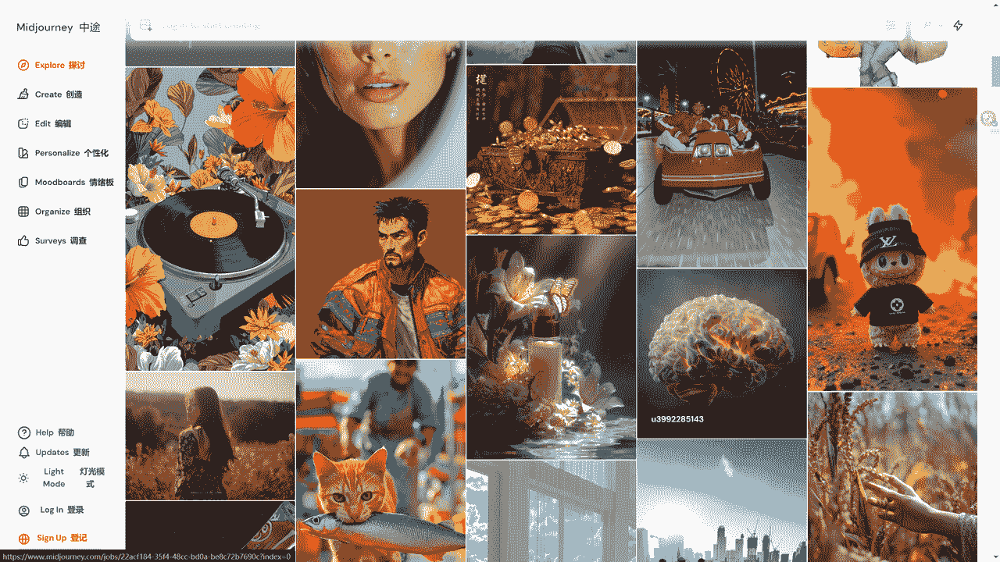

> 图片转换为动态视频工具

让你的图片创意动起来

---

[即梦](https://jimeng.jianying.com/ai-tool/home)丨[可灵](https://kling.kuaishou.com/)丨[Runway](https://app.runwayml.com/)

视频素材经过剪辑合成可成为短片

> [即梦4.0手册](https://bytedance.larkoffice.com/docx/L4vCdah1DoDg7axVdYGcoplSn9f)丨[生成海报技巧](https://jexopm4t2a.feishu.cn/wiki/FwIYwTvKviZb2kktkSFcFr2TnBd?from=from_copylink)丨[1000+AI绘图风格及配图](https://l719wc3ou7.feishu.cn/docx/PYF6dNH0AoNV33xWc0wcTwRZnZg)丨国外AI创意（需魔法）：[Lexica](https://lexica.art/)丨[Prompthero](https://prompthero.com/top)

### 轻松做视频【视频创作】

> 一键成片AI-国内入门工具

可免费体验丨值得体验丨点击即用

[度加](https://aigc.baidu.com/make)

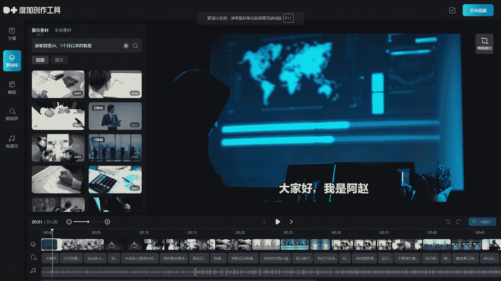

可一键生成文案并自动生成视频

工具还提供热点排行和灵感参考

即使是零基础新人也能快速上手

> 智能剪辑AI-国内进阶工具

全能型工具丨推荐使用丨点击即用

[剪映](https://www.capcut.cn/)

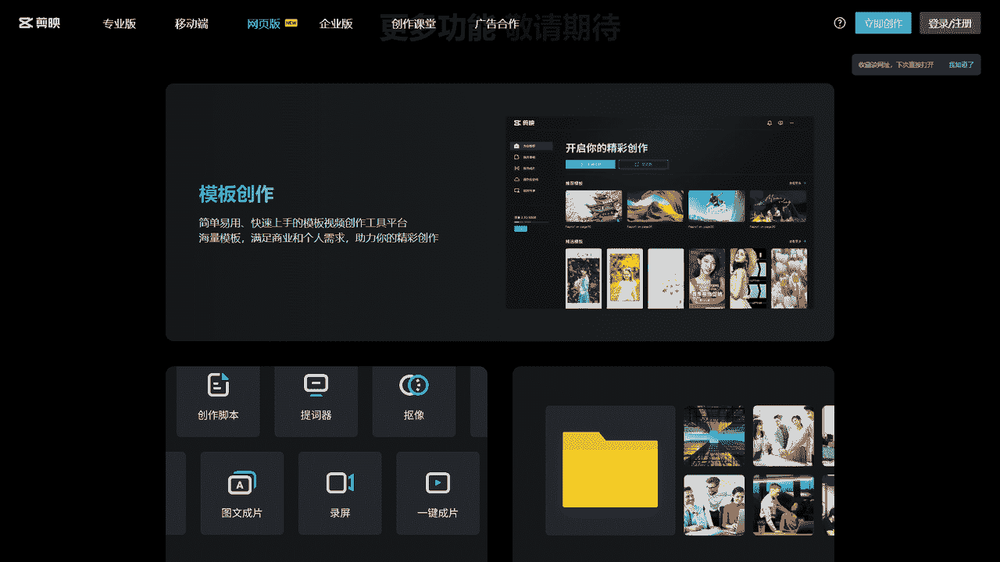

---

包含智能成片、声音&形象克隆

智能识别字幕、智能剪辑等功能

> 其他视频制作辅助工具

音乐生成：

[海绵音乐](https://www.haimian.com/)丨[网易天音](https://tianyin.music.163.com/#/)丨[SUNO](https://suno.com/?ref=ai-bot.cn)

---

视频素材生成：

[即梦](https://jimeng.jianying.com/ai-tool/home)丨[可灵](https://kling.kuaishou.com/)丨[Runway](https://app.runwayml.com/)

---

AI配音/声音克隆：

[剪映](https://www.capcut.cn/)丨[魔音工坊](https://www.moyin.com/)

---

数字人：[剪映](https://www.capcut.cn/)丨[闪剪](http://shanjian.tv/)丨[Heygen](https://www.heygen.com)

> 数字人商用解决方案，推荐了解：[硅基智能](https://guiji.cn/#/index)、[特看](https://www.zhubobao.com/)、[魔珐科技](https://www.xmov.ai/)、[深锶](https://www.psyai.com/zh-CN)这几家公司的产品，看一下最新演示

> 完整视频制作工作流，建议通过[剪映](https://www.capcut.cn/)开始练习；阿赵录课&直播工具：[OBS](https://obsproject.com/)（[点击此处可查看新手教程](https://www.bilibili.com/video/BV1Qs4y1M7Zt/?spm_id_from=333.337.search-card.all.click&vd_source=9906d8bd5bd0019e6c06f8d76a38e0bc)）

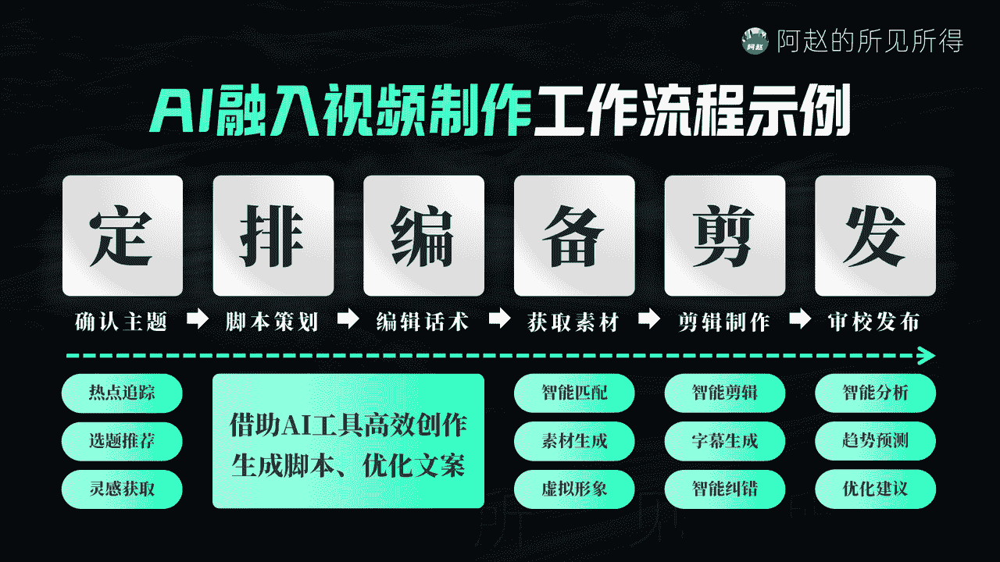

---

### 更快探索AI【经验分享】

推荐通过[B站](https://search.bilibili.com/all?keyword=AIGC&from_source=webtop_search&spm_id_from=333.1007&search_source=5)、[小红书](https://www.xiaohongshu.com/explore)、[即刻](https://web.okjike.com/recommend)（AI探索圈），搜工具、找教程、查干货，也可以直接私聊阿赵为你解答各类问题

> 你还可以通过下面这些导航网站找到更多AI工具；如果精力有限，优先查看上面阿赵为你筛选好的工具

[映技派](https://www.yjpoo.com/)

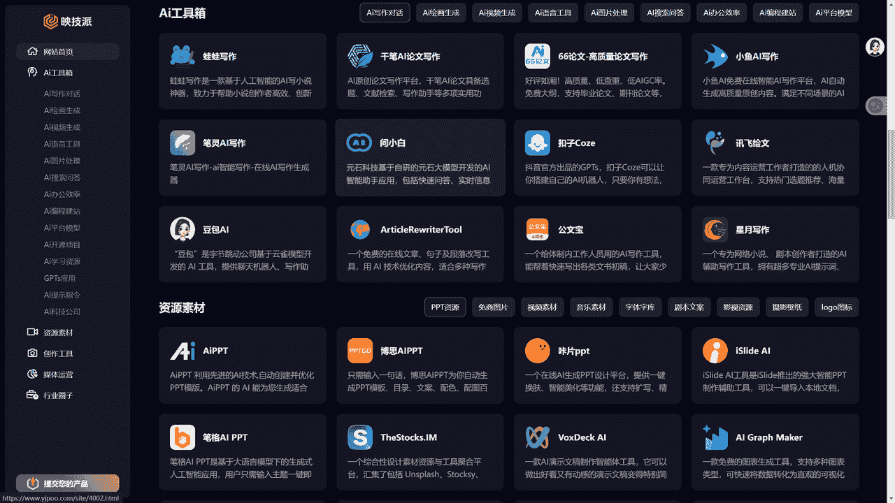

[Toolify](https://www.toolify.ai/zh)

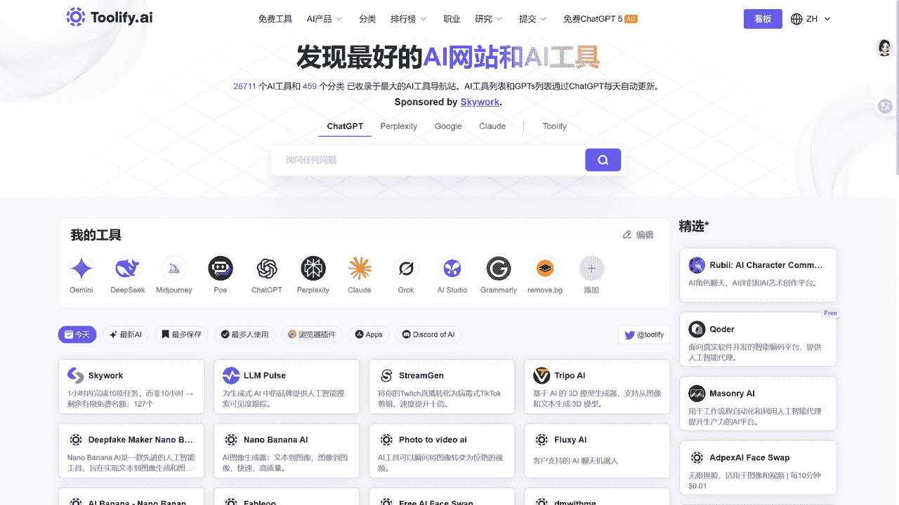

[Ai-bot](https://ai-bot.cn/)

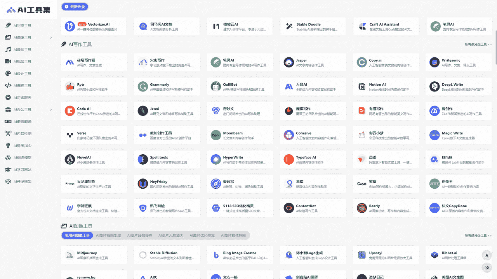

[国内AI产品热度榜](https://dnipkggqxh.feishu.cn/wiki/C5XGwG6ITiWxNmkEhNOcCtYbntd?sheet=ewQRjo)

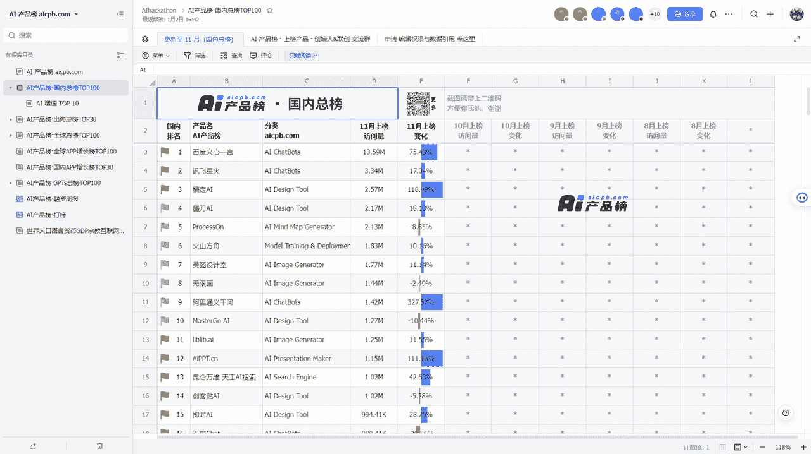

[AI-Bot](https://ai-bot.cn/)

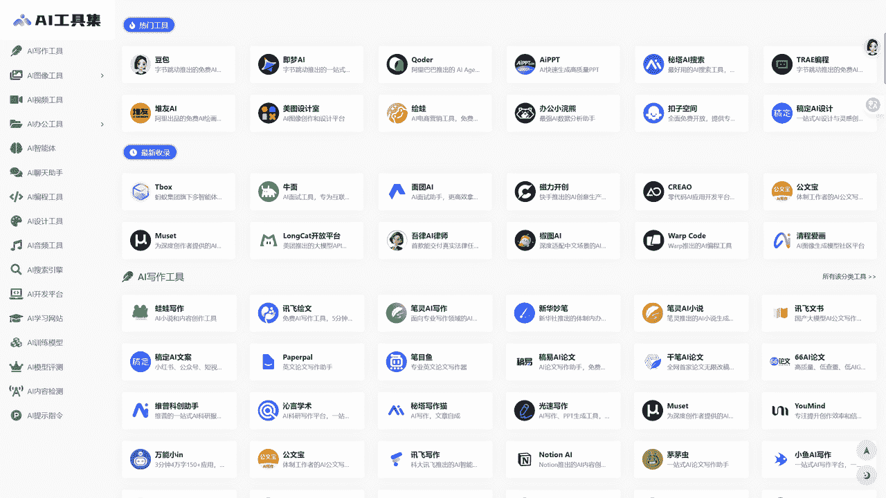

[观猹-特工宇宙](https://watcha.cn/)

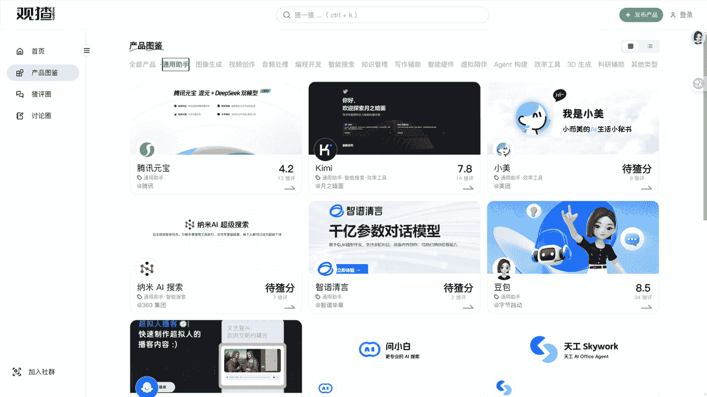

---

> 可前往：[阿赵的AI资料库](https://mq1nzy47gs.feishu.cn/wiki/IxFew33ruiHG7Skp115c0G2Pnsd)

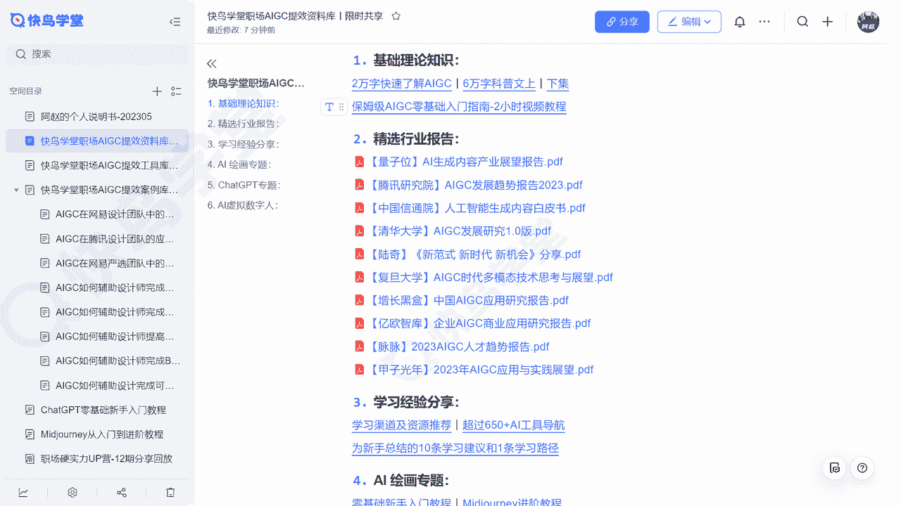

> 正在看：阿赵的AI工具库

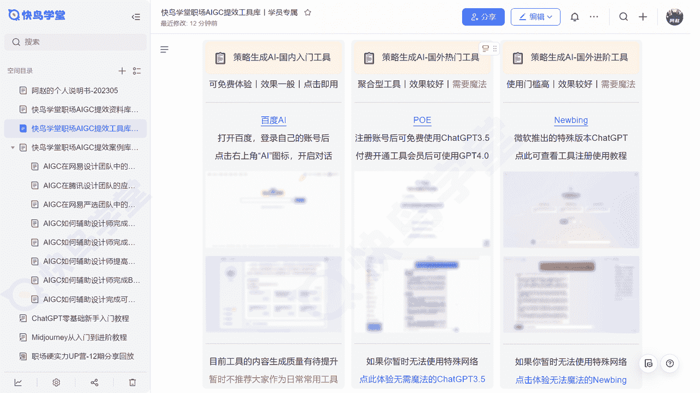

> 可前往：[阿赵的AI案例库](https://mq1nzy47gs.feishu.cn/wiki/YJr5wpanBiRCdvkI0bFcRehZnlg)

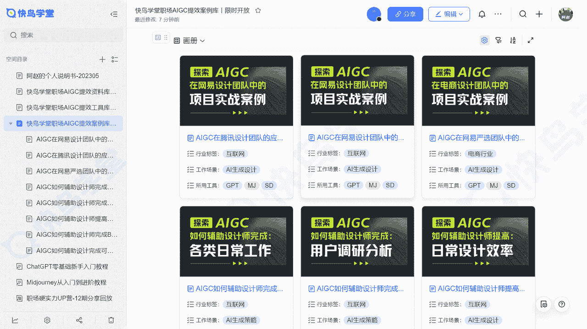