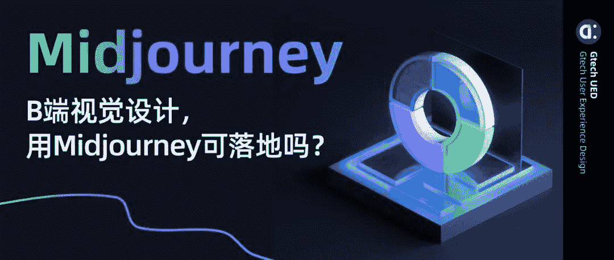
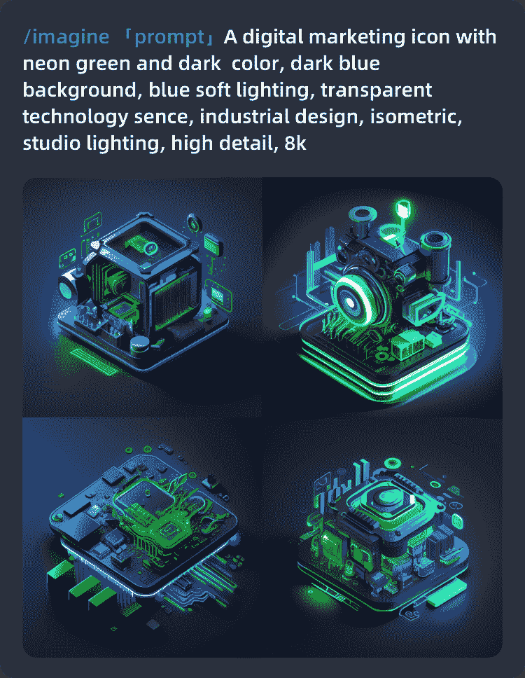
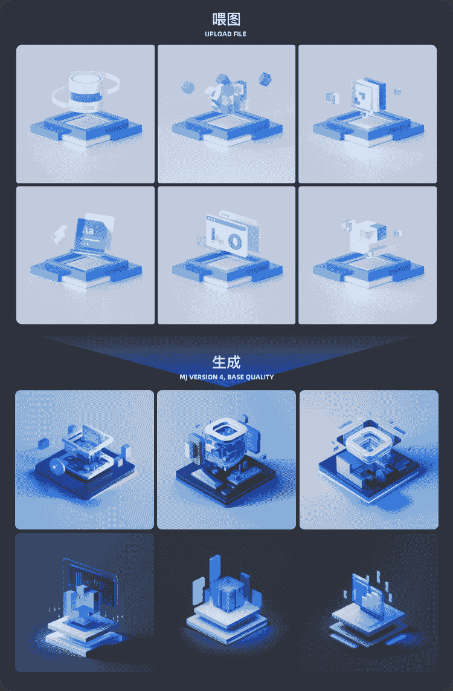
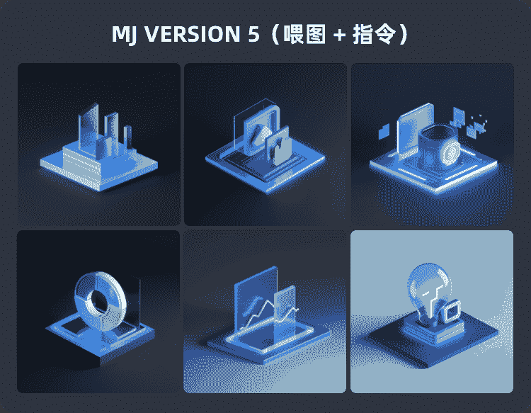
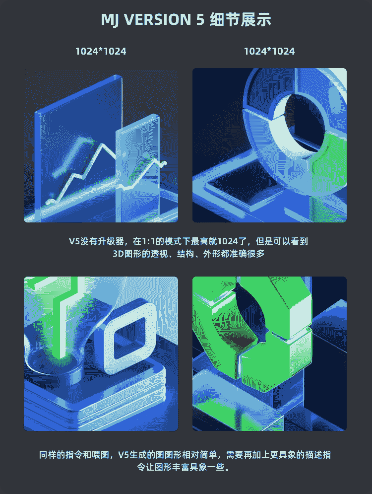
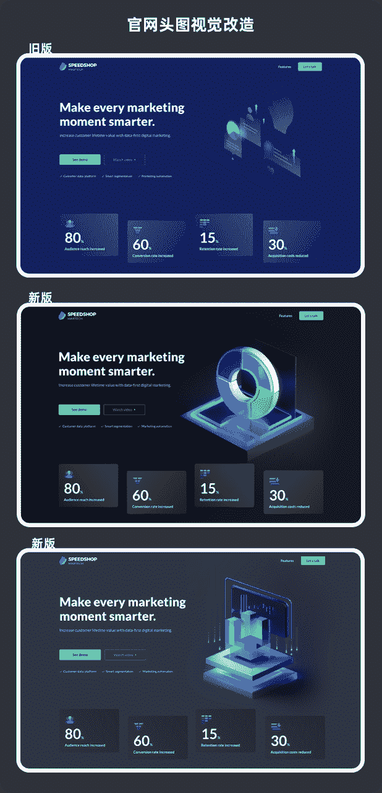
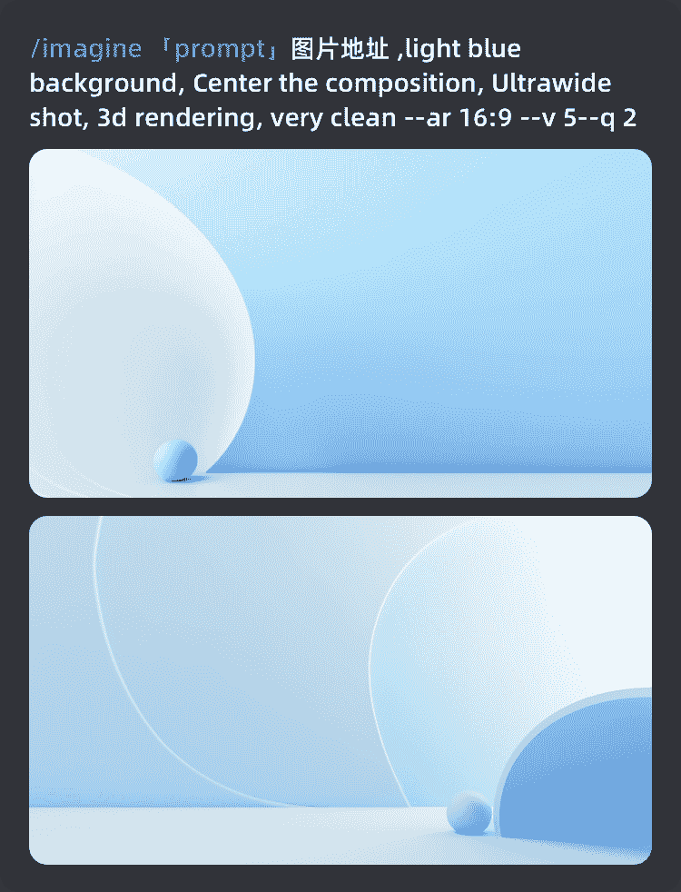
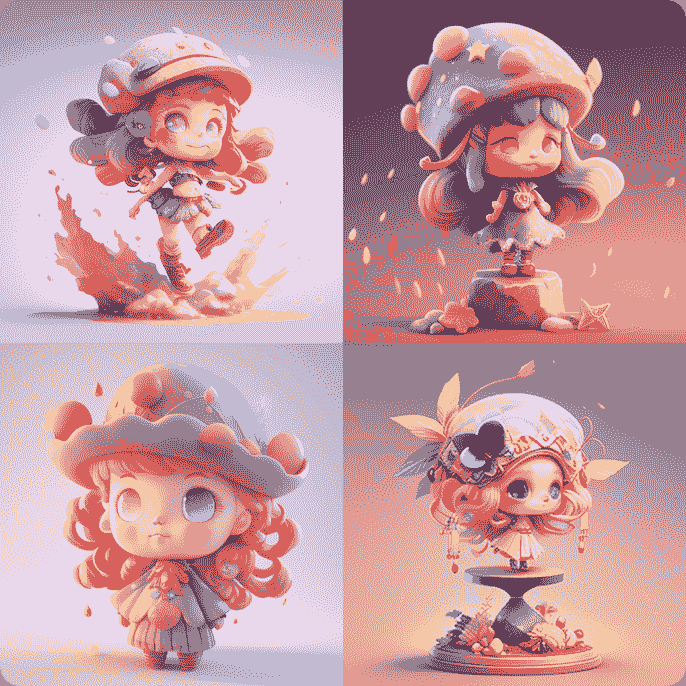
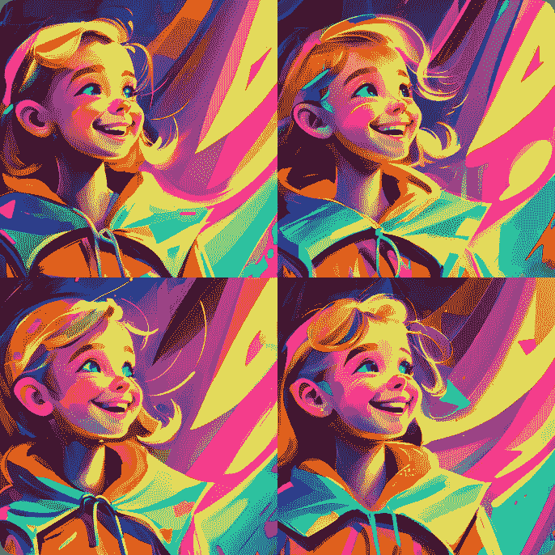

# 如何借助MJ辅助完成B端视觉设计

> 来源：[https://my.feishu.cn/docx/XNQPdh6WtoKWjIxByOUckriPnre](https://my.feishu.cn/docx/XNQPdh6WtoKWjIxByOUckriPnre)

<https://my.feishu.cn/sync/CV7edZp1nspUQobYJhicxeP7nrb>

---

翻看最近的朋友圈，似乎人人都在玩AI绘画、和Chat GPT聊天，AIGC的发展速度异常惊人。

在校大学生们纷纷感叹到“还没毕业就已经失业了”， “ 对于插画师来说，简直就是二向箔降维打击”... ... 这个焦虑确实是存在的，对处于底层的插画师、原画师、场景设计师等职业来说，专业能力不够出众，本身在行业里的竞争性就差，能给到公司的价值也相对较低，那公司层面希望利益和效率最大化，能够使用AI绘画的话确实是替代底层设计师的不二选择。

对于做用户体验设计的我们来说，视觉表达只是表现层的具象设计，那就像是货架商品的外包装设计，更重要的在于冰山之下看不见的那部分。我们的设计工作更多是针对业务场景，用设计解决实际问题，产品设计是有复杂的业务理解和交互逻辑的，无论是Sketch、Figma、MasterGo、Photoshop，它们的存在是工具，帮助设计师将脑海中的方案直输出来，同时帮助我们进行跨团队沟通。

但我们在工作中也会遇到这样的情况：交互能力强的设计师，视觉能力较弱，视觉这块的想法就受到技能及经验的限制。如果要强求每位用户体验设计师的雷达图都达到技能的顶点，是很难的，人的精力有限，好在现在的软件和工具越来越简单，学习成本相较10年前是降低不少，我们用部分时间去提升、学习新的软件，不仅能够帮助我们提升短板，更好的表达观点，同时也能通过接触新事物新技术给予新的启发。

对于Midjourney我的态度是拥抱变化，我们的设计团队不像BAT大厂大几百、上千人的规模，没有专职的C4D设计师、动画设计师，因此当设计中需要3D视觉效果的时候，就犯难了。如果招聘一位专职设计师，于公司来说是性价比低的投入，于设计师来说是没有晋升及长远发展的一份工作。 假设Midj ourne y 能够帮助提升团队的视觉输出能力，那我无疑是非常愿意接受这个智能伙伴。

# **Midjourney 入门**

**01. 了解商用版权和价格**

新用户能免费使用20-25次进行AI绘图；

付费版用户每个月需支付 30 美元，生成的图片可用于商用：若因 Midjourney 获利在每月 2 万美元及以下的，不用支付 Midjourney 分成；若因 Midjourney 获利在每月 2 万美元以上的，需要支付 Midjourney 20% 的分成。特殊形况也可以跟官方签订协议，和 Midjourney 商讨出其他分成比例。

02. 学习Mid journey

既然我的目的是想让 Midj ourne y(后面就缩写为 MJ) 在设计项目中落地，那我们就需要设定明确的目标进行学习。首先，我希望通过MJ生成B端风格的3D图标，对目前SpeedShop Martech的官网头图进行视觉改造升级。

学习的过程无非是去看大量的视频教程以及查阅官方文档，然后不断的尝试。了解下来，主要有两种绘图方式，一种是直接通过命令生成，另一种是以图生图，也就是“喂图”，通过给MJ一些参考图，然后再加上明确的指令生成图片，这样能够有效缩小范围，使得结果更接近你想要的。

我希望 M J绘制出“一个3D风格的、荧光绿加深蓝色的、数字化营销图标”，指令如图，结果图和我想象的差距较大，图标细节过多太复杂，需要简化，然后图意上需要重点体现“营销”。

为了明确告知MJ我的意向，我找了一个系列的图进行喂图，然后加上同样的指令，喂图后生成出的效果如下，大方向已经符合我的设想了。

*套图来源iconfont公开库

后面我将MJ Version 4调整到5，由base quality调整成high quality再次进行生成对比，看缩略图似乎差异不大。

但是我们将图片放大看细节，可以明显直观 地 感受到V5比V4生成的3D图结构更合理，空间关系也正常一些，光影的渲染更真实。

我在用V4渲染的时候，还在跟同事说，这MJ不行啊，出图的效果没法落地到项目中，这P图成本太高了！但当我转到 V 5的时候，就马上改口了（啪啪打脸，还是自己学艺不精），V5的出图简直是质的飞跃，透视、结构、外形的渲染都精准很多，当然跟用专业3D软件建模渲染精准度不能比，但对于我们这种不想花更多的时间去学习建模渲染的设计师来说，这AI绘图实在是香～

通过几天疯狂 地 测试，用现有的经验来简单总结下MJ的优缺点：

**MJ优势： **

1、面向大众，不用学习很多软件，有审美及学会使用指令就行；

2、操作简单，虽然非常依赖关键词，但是网络高手已经给出了很多句型+关键词，可以去套用后再进行调整；

3、更适合前期创意探索阶段，能让设计师在进行创意视觉输出之前进行大量的输入与尝试，从此技能不再限制我们的创意表达；

4、适合出版印刷行业，用于笔记本封面、插画内页这些素材要求不高，体量较大的视觉输出。

**MJ劣势： **

1、3D图的输出结果相对3D软件的输出粗糙很多，它没有办法把多物体之间的结构关系、透视效果、细节处理的那么逼真和细节；

2、结果不可控：对于满意的效果图，没有办法在此基础上生成其他角度的图；也无法在此基础上增加或减少物体；无法可控的生成系列套图（就如我喂的那套图）；

3、要落地用还得再通过PS精加工；

4、分辨率不够高，目前V4 1:1 最高到2048* 2 04 8px ， V5 1:1 到1024*1024px ；

回到我们最初的问题，B端视觉设计，用Midjourney可落地吗？

**在单一场景下可以落地使用 **，比如B端icon不需要系列化体系化去生成套图形成正式的VI体系应用在各种场景，只是局部使用。如果想要做成阿里云、腾讯云官网的系列3D图标， 从精准度、清晰度、体系化， Midjour ney 目前都无法做到 。

我所选择的轻量化应用场景， 只需要提升局部细节， 我们把生成的图带入官网头部看下效果：

整体效果还是比较满意的，后期我会继续精进，修炼“咒语”去更好地控制输出结果。

另外，还有一个合适的应用场景，就是生成背景图搭建素材库，适用于登录界面、网站背景、PPT等。

# **写在最后**

◆ **用积极的心态去拥抱变化， **我们需要去学会掌控技术，把主动权握在自己的手中，来帮助我们的工作提质提效，让设计师成为AIGC的最大受益者，而不是最大的冲击对象。

◆ 要建立起自己的竞争优势，有思想、有观点、有经验、有技术 ，处于底层的人本身就容易被淘汰，与AIGC没有必然联系。

◆ 每个人都有自己的思维局限，受限于学识、经验、认知，我们在自己的编织的茧房之中生活，AI能帮我们突破自身创造力的上限，拓展边界，丰富我们的想象力。

◆ 我们与AI之间是相辅相成的，它的内容源于人，它合成新的内容后又反馈到人，我们共同在进步。

# **🎉彩蛋🎉**

**在学习过程中，有些“咒语”生成的图还是**非常养眼的，大家一起看看吧，欢迎探讨 ！

**泡泡玛特盲盒风格的人物**

（手部问题还是很明显的）

**超现实幻想**

关键词：fantasy , surrealism

**3D动画风格头像**

关键词：Pixar trending, 3D render, headshot

**丙烯荧光人像画**

关键词： acrylic painting, fluorescent color , geometry art

感谢阅读到最后，我们下期再见！

> 内容来源：Gtech UED

> 原文链接：[点击查看](https://mp.weixin.qq.com/s?__biz=Mzg5NTcwNDU0NA==&mid=2247484582&idx=1&sn=f6a060dd74d3c1dbd7939950583214b1&scene=21#wechat_redirect)

---

<https://my.feishu.cn/sync/CV7edZp1nspUQobYJhicxeP7nrb>