# 营销场景ChatGPT提示词示例

> 来源：`https://my.feishu.cn/docx/Ur8zdA1JPoTSNcxSTc0cdMQanFg`

`https://my.feishu.cn/sync/CV7edZp1nspUQobYJhicxeP7nrb`

---

作者 | Gbrandlab

首先！这篇文章不是用Chatgpt写的！

其次，我们的初衷是为那些想了解如何与Chatgpt交互、解决品牌营销问题的小伙伴提供有用的SOP。

文章中列举了24个品牌营销工作场景，每个场景都包括提问步骤、提问模板、案例展示和关键词，推荐你试试！

场景目录如下：

1、如何用ChatGPT搜集品牌项目的二手信息？

2、如何用ChatGPT进行剧本/广告脚本写作？

3、如何用ChatGPT进行品牌内容分发？

4、如何用ChatGPT生成社群的新闻资讯？

5、如何用ChatGPT生成创意营销文本素材？

6、如何用ChatGPT生成创意营销图片素材？

7、如何用ChatGPT进行销售话术优化？

8、如何用ChatGPT生成定制化客户解决方案？

9、如何用ChatGPT赋能客服团队？

10、如何用ChatGPT制作营销数据报表？

11、如何用ChatGPT做品牌营销项目管理？

12、如何用ChatGPT做品牌营销团队绩效管理？

13、如何用ChatGPT做一门课（课程大纲、脚本、PPT）?

14、如何用ChatGPT生产专业方向的科普内容？

15、如何用ChatGPT搭建品牌文本体系？

16、如何用ChatGPT策划品牌联名方案？

17、如何用ChatGPT从品牌角度，对产品提出升级建议？

18、如何用ChatGPT策划新品上市推广方案？

19、如何用ChatGPT搭建品牌视觉体系(WI)?

20、如何用ChatGPT写内容营销方案、选题计划并撰稿？

21、如何用ChatGPT做品牌舆论传播情况分析？

22、如何用ChatGPT做书籍、报告、文件的读取与互动？

23、如何用ChatGPT做会议自动总结？

24、如何用ChatGPT拆解爆款内容并提出修改意见？

以下，enjoy~

## 01 如何用ChatGPT做品牌项目的二手信息搜集？

该场景对应的关键词库（25个）：

品牌案例、竞品、信息来源、项目分析、官方渠道、品类、品牌、节日节庆、明星、国家、奖项、代理商、项目名称、项目描述、品牌介绍、竞争情况、运营数据、财务信息、交易信息、法律问题、网络平台、行业人士、品牌拥有者、报纸杂志、研究报告

### 提问模板

#### 模板1：特定模式

针对品牌自身信息的搜集，可参考如下提问方式：

假设你是一个世界一流的品牌案例分析师，请根据“XX”品牌，帮我搜集5篇非官方渠道的内容，可包含竞品分析和用户画像等内容，并附上信息来源渠道。

#### 模板2：代理模式

针对品牌之间联名的项目相关信息搜集，可参考如下提问方式：

假设你是一个世界一流的品牌案例分析师，请根据以下信息，帮我搜集10篇内容，并附上信息来源渠道。

品牌名：XXX

项目名称：“XXX”

项目时间：XXX

#### 模板3：混合模式

针对品牌特殊时间节点营销事件的相关信息收集，可参考如下提问方式：

假设你是一个世界一流的品牌案例分析师，请根据如下信息，帮我搜集10篇内容，并附上信息来源渠道：

品类：XXX

品牌：XXX

节日：XXX

联名：XXX

类型：XXX

国家：XXX

举例：

假设你是一个世界一流的品牌案例分析师，请根据如下信息，帮我搜集10篇内容，并附上信息来源渠道：

品类：餐饮类

品牌：瑞幸咖啡

节日：2023年情人节

联名：线条小狗

类型：“修狗爱情故事”限定饮品

国家：中国

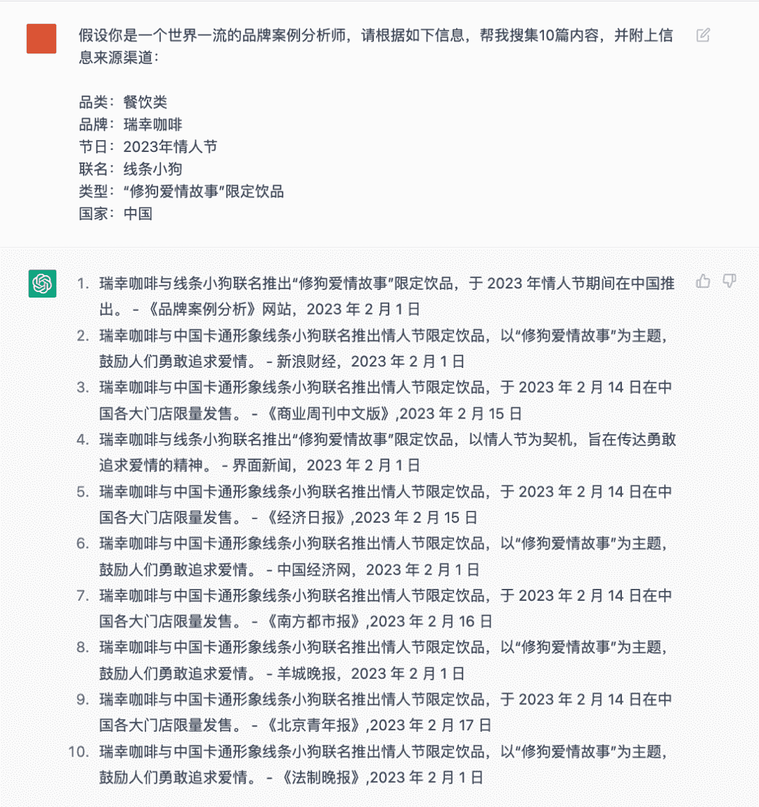

## 02 如何用ChatGPT进行剧本/广告脚本写作？

该场景对应的关键词库（23个）：

剧本、广告、时长、短视频、长视频、主题、品牌传播、传播要点、核心优势、目标用户、痛点、表现手法、编剧身份、策划身份、品牌传播、时长、产品、主题、要点、优势、目标用户、痛点、表现手法

### 补充信息

剧本脚本和广告脚本虽然都是用于传达故事和信息的文本形式，但两者在目的、内容和形式上有明显的区别。

剧本脚本的重点在于讲述故事，让观众产生情感共鸣，体验故事中的情感冲突和发展。

广告脚本是指用于制作广告的文本，重点在于让观众了解产品、品牌和营销活动，并激发他们的购买兴趣。

### 提问模板

1、你是世界一流的编剧，需要为XX（产品）写一个XX（时长）的剧本脚本，要求包含场景、动作和台词、角色、情景、镜头、音效、节奏、格式等要素

2、你是名列前茅的品牌策划，需要为XX（产品）写一个XX（时长）的广告脚本，要求包含核心信息、目标受众、切入点、情感共鸣、品牌标识、下一步行动、简洁明了等要素

3、请在上述剧本脚本的基础上增加品牌的广告信息，调整为广告脚本

举例：

1、你是世界一流水平的编剧，请告诉我，如何用chatGPT写一个60s的按摩椅的剧本脚本

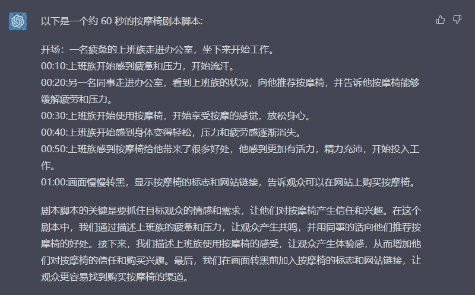

2、你是世界一流水平的品牌策划，请告诉我，如何用chatGPT写一个60s的按摩椅的广告脚本，要求具有优秀的传播属性，以“缓解疲劳，关爱自己”为主题，核心传播要求是“工作一天腰酸背痛，按摩15分钟找回轻松”，目标用户是30-45岁的中年人，内容要切中用户“工作忙，没时间健身舒展身体”的特点，注意使用夸张的表现手法。

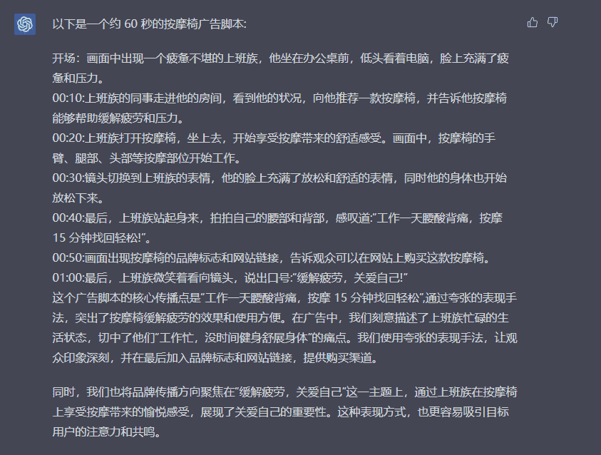

3、请从品牌传播方向，为新上市的美妆水写一个60s短视频广告脚本，要求以“女子力”为主题，核心传播要点是“谁说护肤一定要拍一拍？我们擦一擦就够了！”，目标用户为30-40岁的白领女性，内容要切中这类用户的“时间忙，没时间护理皮肤”的痛点，并注意使用夸张的创意表现手法。

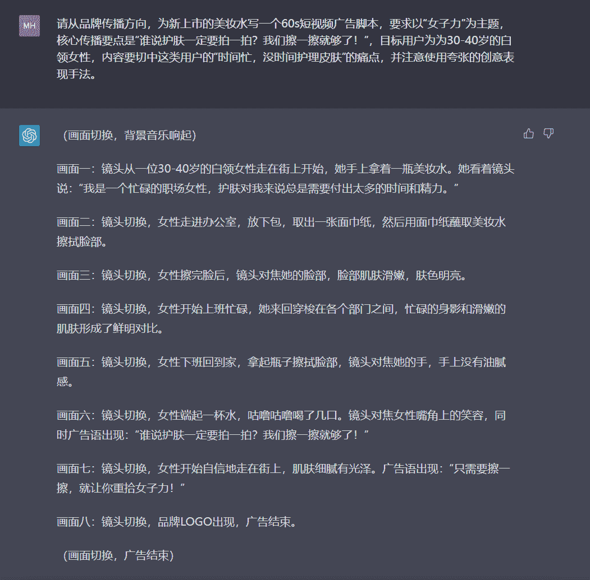

## 03 如何用ChatGPT协助做内容分发？

### （文本变成直播/音频/视频脚本）

该场景对应的关键词库（14个）：

直播博主、直播达人、音频主持人、产品特点、品牌故事、品牌活动、品牌logo、视频主角、画外音解说员、编剧身份、品牌内容分发方向、时长、脚本类型、产品

### 提问模板

1、你是一名优秀的美妆达人，今晚需要直播销售新品XXX，请设计直播脚本，包含产品介绍、品牌故事、用户案例

2、你是一名世界一流的博客主持人，最近针对XX讨论激烈，请为该主题设计音频脚本，包含开场白、主题介绍、段落划分、对话或采访对象标注、范例或案例、结尾语、广告或赞助商等模块

3、从品牌内容分发角度考虑，请为智能家居设备XXX设计一个XX时长的产品介绍视频脚本，包含音效、音乐、画面、声音等

### 补充信息

直播脚本、音频脚本、视频脚本都是用于引导主持人或演员表演的文本。它们的区别在于：

直播脚本：直播脚本需要非常详细的时间表和指示，需要非常紧凑和易于阅读，以便主持人可以在快速变化的情况下快速找到自己的位置和任务。

音频脚本：用于指导演员在录音棚或其他音频制作环境中进行表演。

视频脚本：需要记录每个场景的描述和每个角色的动作。

举例：

1、你是世界一流的编剧，最近针对AIGC讨论的火热，用chaGPT为AIGC助力工作提效写一个3分钟的音频脚本。

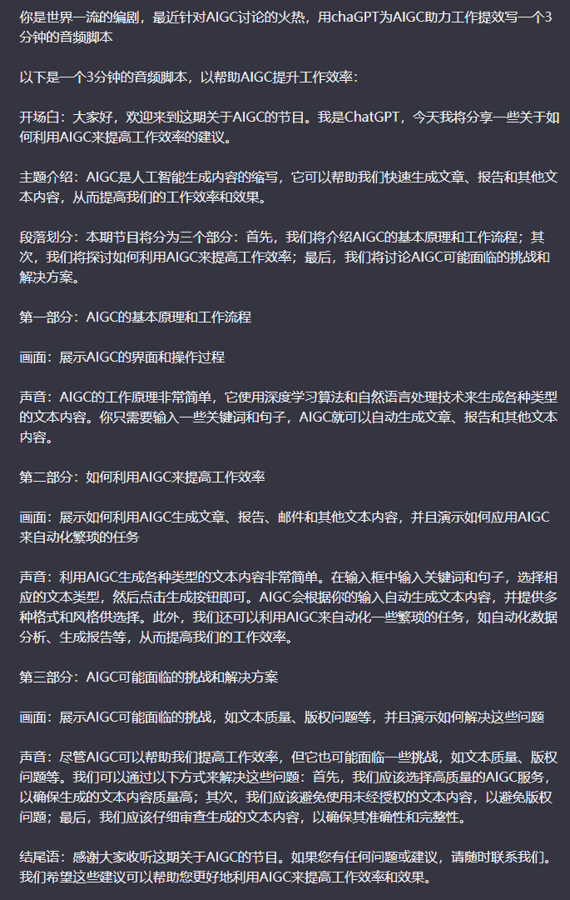

2、从品牌内容分发角度考虑，请为智能家居设备扫地机器人设计一个2分钟时长的产品介绍视频脚本。

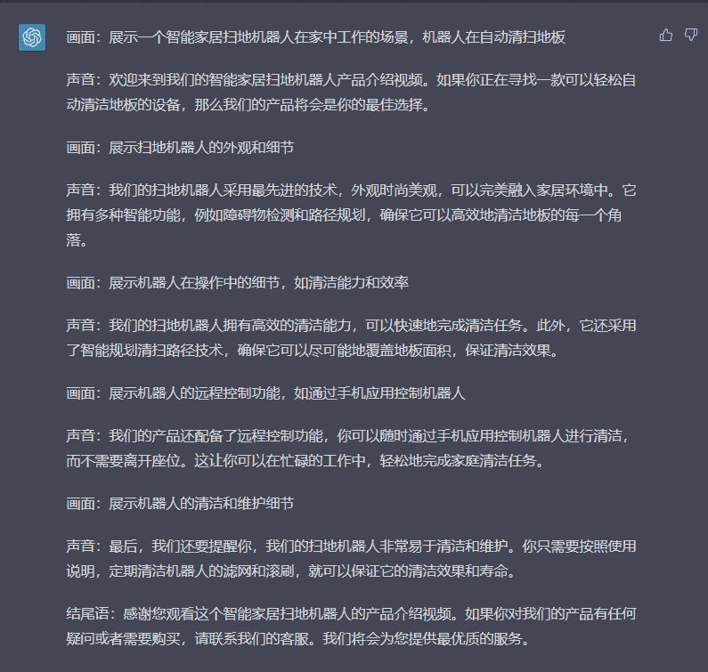

3、你是今晚直播的美妆达人，请为今晚要介绍的新品美妆水设计直播脚本，包含产品介绍、品牌故事、用户案例。

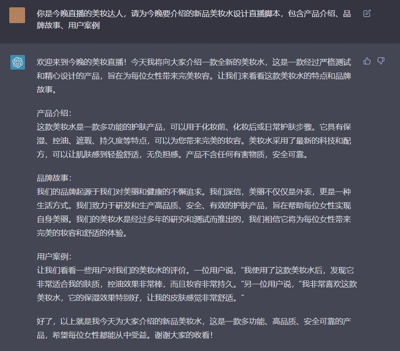

## 04 如何用ChatGPT协助生产社群的每日新闻资讯？

该场景对应的关键词库（8个）：

品牌推广、产品信息、行业动态、用户互动、品牌文化、品牌活动、行业知识、兴趣爱好

例如：新消费、餐饮品类、品牌联名

注意：受制于ChatGPT语料库的数据包截止时间是2021年9月，所以最好是先喂养信息给到chatGPT，再根据描述引导做精简排序。

### 提问模板

1、请学习如下信息……将你提炼的信息用123排序，注意排版的呼吸感。

2、请将……提炼整理成30字以内的信息，用于发布在品牌类社群内

举例：

1、请学习如下信息：输入从其他地方比如竞品社群、行业网站收集到的行业资讯。

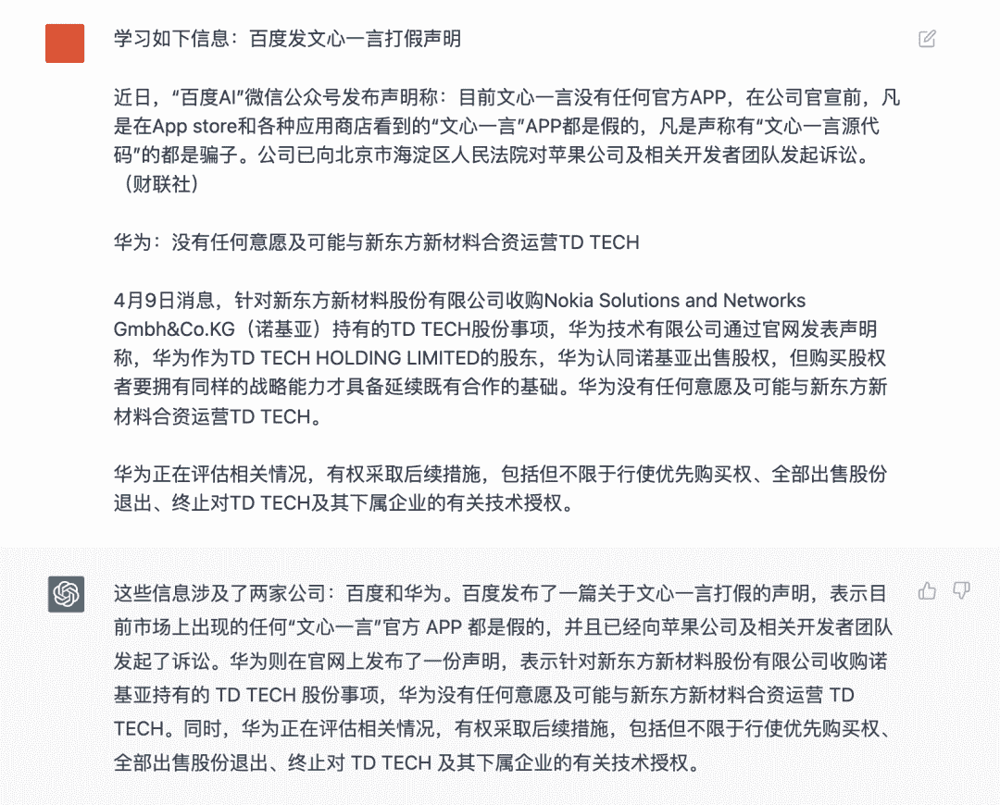

请将你提炼的信息用123排序，注意排版的呼吸感。

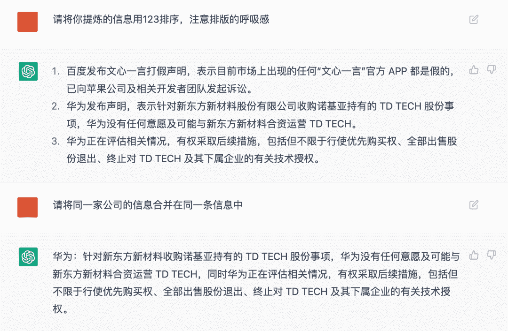

2、请将该文章/长文提炼整理成30字以内的信息，用于发布在品牌类社群内。

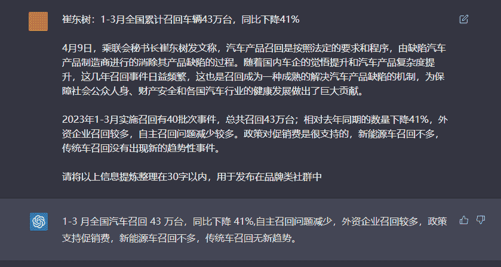

3、生成10条新消费领域的行业资讯用于发在🛰️群中，请用123排序（受语料库的数据包截止时间限制，该方式可能不太适用于需要新资讯的社群）

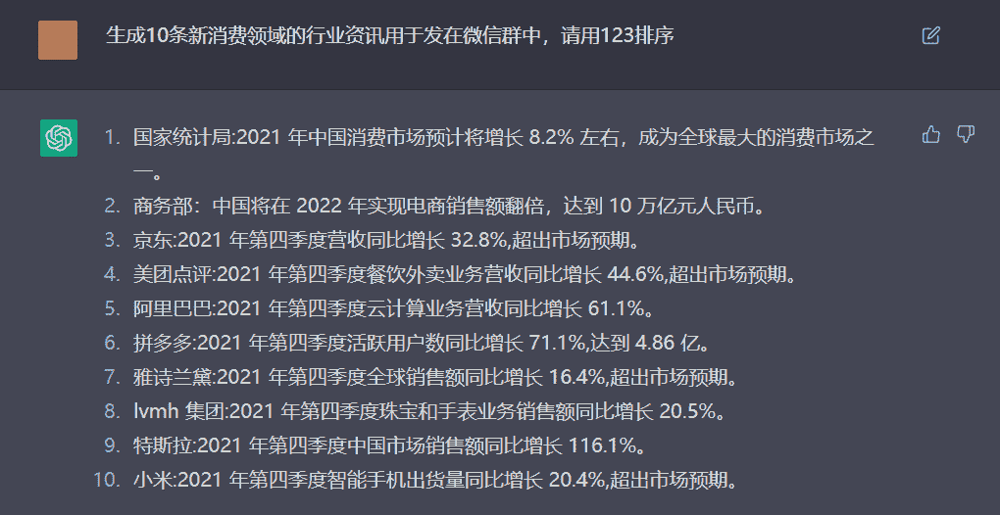

## 05 如何用ChatGPT生成创意营销文本素材？

该场景对应的关键词库（5个）：

目标受众、品牌定位、产品优势、服务独特性、情感因素；例如：健康食品、女性、美容、养生、健康饮食。

### 提问模板

1、你是世界一流的作家编剧，请告诉我，如何用chatGPT生成创意营销文本素材，并举个例子

2、请根据“XX、XX、XX、XX、XX”的关键词，生成不小于200字的创意营销文本

3、请根据以下信息，生成一段150字的创意营销文本

目标受众：XX-XX岁XX性

品牌定位：XXX

产品优势：XXX

情感因素：XXX

举例：

1、你是世界一流的作家编剧，请告诉我，如何用chatGPT生成创意营销文本素材，并举个例子

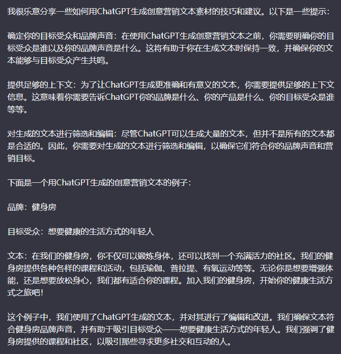

2、请根据“健康食品、女性、美容、养生、健康饮食”的关键词，生成不小于200字的创意营销文本。

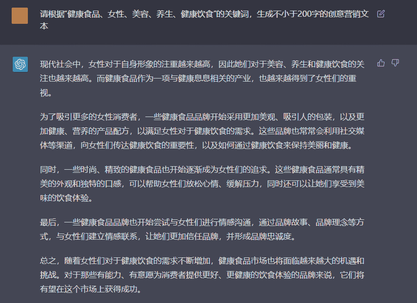

3、请根据以下信息，生成一段150字的创意营销文本

目标受众：30-45岁女性

品牌定位：高端奢华

产品优势：滋补养生

情感因素：寻求健康

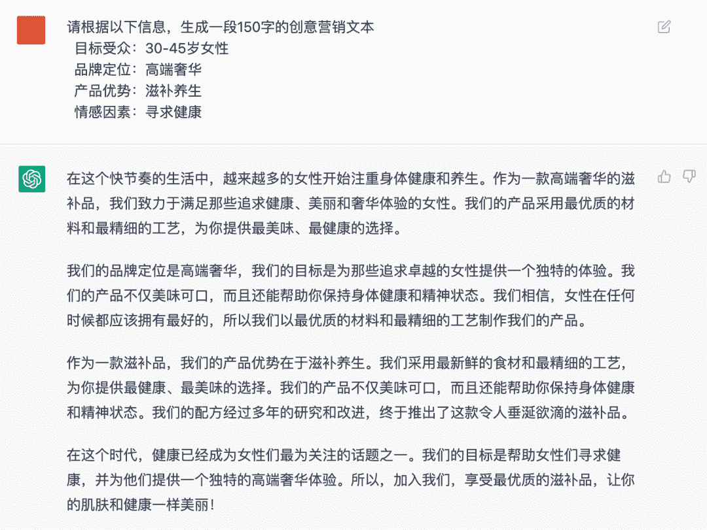

## 06 如何用ChatGPT辅助生成创意营销图片素材，比如产品图、虚拟主播、产品包装图、终端店铺图？

1、营销素材对应的关键词库（3个）：

元素、风格、AI绘画工具midjourney

### 提问模板

第一步，先预设场景，询问应该包含的关键词范围

假设你是一位世界一流水平的设计师，你想要使用AI绘画工具midjourney帮忙设计一款XXX，列举该场景需要用到的关键词范畴与示例。

第二步，按照推荐的关键词填充内容来输入到midjourney中，生成对应的图片。

按照逗号区隔不同描述词，用谷歌助手翻译成英文描述词，输入到midjourney中。

举例：

1、产品模特图场景对应的关键词库（10个）

产品类型、模特类型、模特姿势、背景颜色、背景图案、色彩搭配、绘画风格、表情细节、衣服细节、比例

#### 产品模特图示范

假设你是一位世界一流水平的设计师，你想要使用AI绘画工具midjourney帮忙设计一款产品模特图，产品是咖啡，身穿白色衣服的专业模特站在海洋背景前手持咖啡，明亮色彩，写实风格，面带微笑，8k，9:16画布尺寸。

**Midjourney效果如下：**

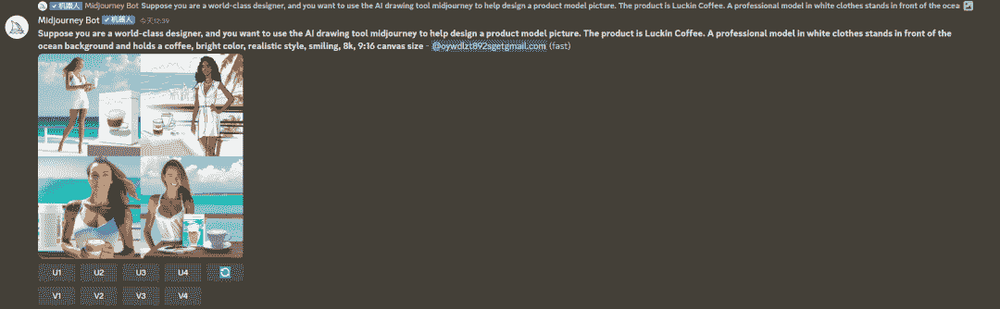

2、虚拟主播场景对应的关键词库（8个）：

虚拟主播、人设形象、场景主题和风格、主播表情细节、品牌形象、专业程度、高质量、视觉冲击力

#### 虚拟主播要求示范

举一个例子，如果要生成一个以游戏解说为主题的虚拟主播，关键词可以包括：

主题和风格：游戏解说、游戏攻略、游戏评测等。

人设和形象：可爱、萌系、游戏风格、卡通形象等。

假设你是一个策划，你想要使用AI绘画工具midjourney帮忙设计一款软萌可爱的闯关类游戏解说虚拟主播，人设形象是可爱粉色系兔女郎，8k

**Midjourney效果如下：**

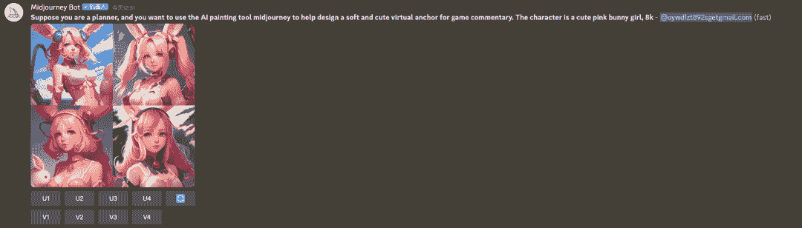

3、产品包装图场景对应的关键词库（5个）：

产品特点、目标受众、外盒包装、包含元素、设计风格

#### 产品包装图示范

假设你是一位平面设计师，你想要使用AI绘画工具midjourney帮忙设计一款礼品的外盒包装，外盒包装画面是熊猫、竹林、光影，要求是魔幻风格，请列举关键词。

想象一个礼盒的包装盒，上面有可爱、圆滚滚、温顺、憨态可掬的熊猫，熊猫在一个静谧、神秘的竹林里，竹林里有魔幻、神秘、绚丽的光影，旁边还有蜜蜂、蝴蝶、蜻蜓、小鸟、花朵、小熊等，以突出礼盒中所包含的蜂蜜产品与自然的关联。

颜色要求选用简约、高级感的色彩，如黑白、金银、米色等，也可以选择少量向阳的色彩进行点缀，但要注意不要过于花哨。

**Midjourney效果如下：**

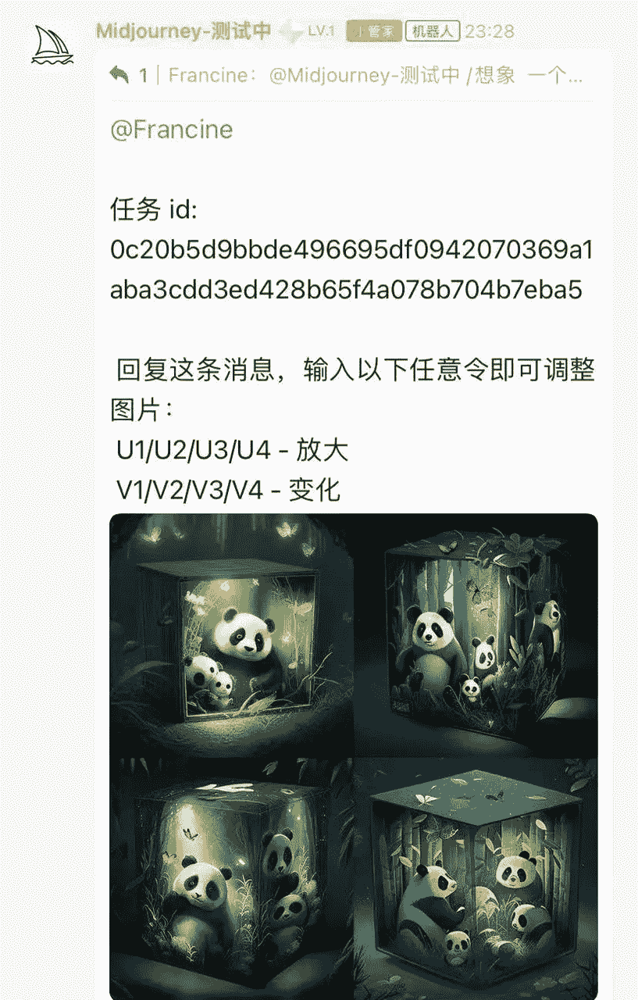

4、终端店铺设计图场景对应的关键词库（9个）

店铺类型、店铺面积、店铺位置、店铺外观、内部布局、装修风格、颜色搭配、陈列设计、氛围营造

风格+产品类型+品牌名+店铺+装修风格+设计要点

#### 终端店铺设计图示范

**问题输入1：**

假设你是一位平面设计师，你想要使用AI绘画工具midjourney帮忙设计一款终端店铺装修设计图，请列举需要包含的关键词范围。

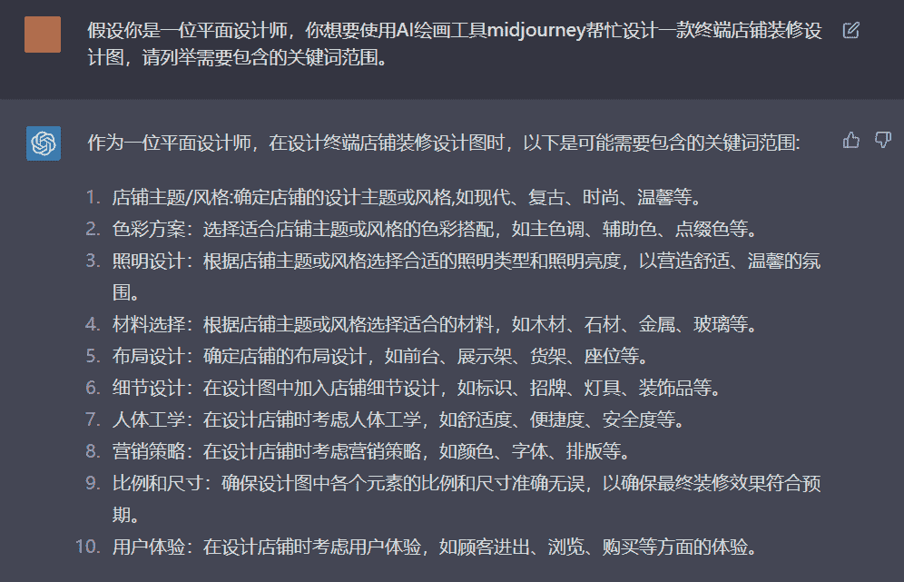

问题输入2：谷歌翻译成英文后，输入midjourney

想象一个现代风的咖啡店店铺，装修设计思路和效果如下：

主色调：白色

辅助颜色：黑色

点缀颜色：木色

设计要点：方便顾客进出、浏览、购买等方面的体验

**Midjourney效果如下：**

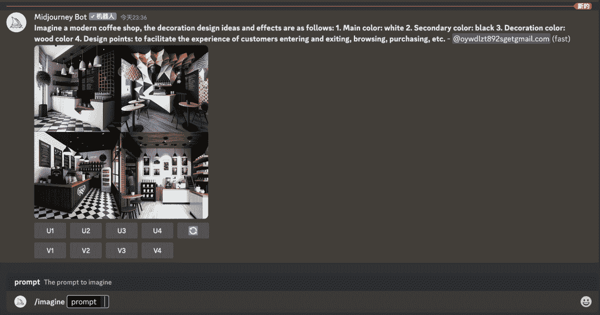

## 07 如何让ChatGPT学习销售过往文字稿，并自动分析话术的优缺点，然后修改？

该场景对应的关键词库（13个）：

产品特点、服务优势、目标客户需求和痛点、行业与市场的趋势变化、竞争对手的优劣势、销售场景的特点和要求、销售环境、销售氛围、时间、地点、客户情感需求、心理转态、个性特点、解决方案

### 提问模板

1、请学习如下信息：

输入从其他地方收集到的销售话术文档或PDF

`https://www.chatpdf.com/`

你是一个世界一流的销售专家，请分析上述学习内容的优缺点，并迭代一版新的销售话术。

请从销售专家角度分析这段销售话术的优缺点

请在此基础上迭代最开始的销售话术并输出新话术

2、这是已有的销售话术，请学习如下信息：

建立联系

引起兴趣

提供解决方案

推销

处理反对建议

约定下一次行动

第一步，收集并输入已有的销售话术

可以从销售人员的工作记录、销售培训材料、竞争对手的销售话术或者行业标准的销售话术中收集到。输入到ChatGPT中进行学习，让ChatGPT能够理解这些话术的含义和用法。

第二步，分析销售话术优缺点

通过ChatGPT生成的结果，分析已有销售话术的优缺点。

了解哪些话术能够引起潜在客户的兴趣，哪些话术能够使客户产生购买欲望，哪些话术可能会引起客户的反感等。

第三步，迭代一版销售新话术

根据ChatGPT生成的结果和分析的优缺点，可以针对性地迭代一版新的销售话术。新的销售话术需要更加符合受众的需求和喜好，更加自然和流畅，更加有说服力和影响力。

举例：

问题输入1：学习现有话术

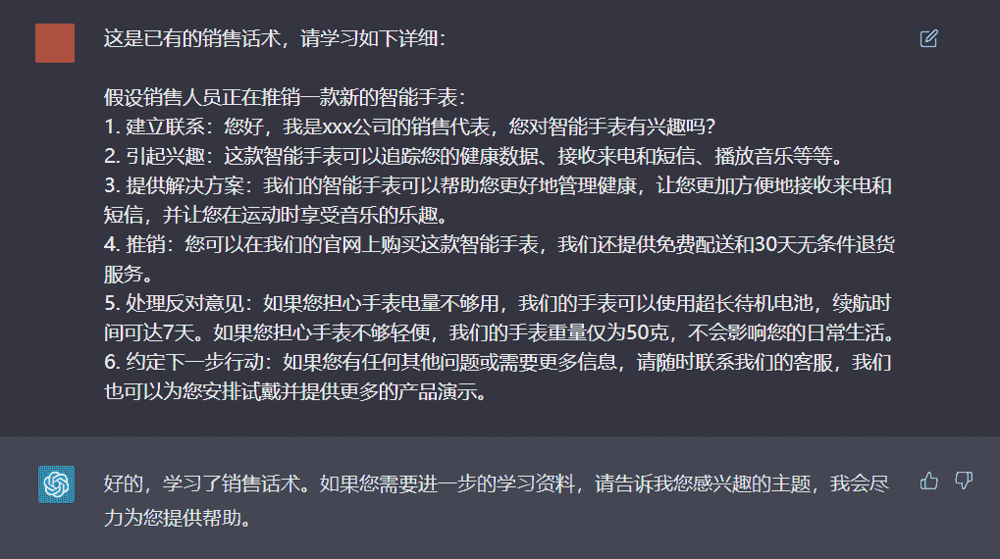

问题输入2：分析话术优缺点

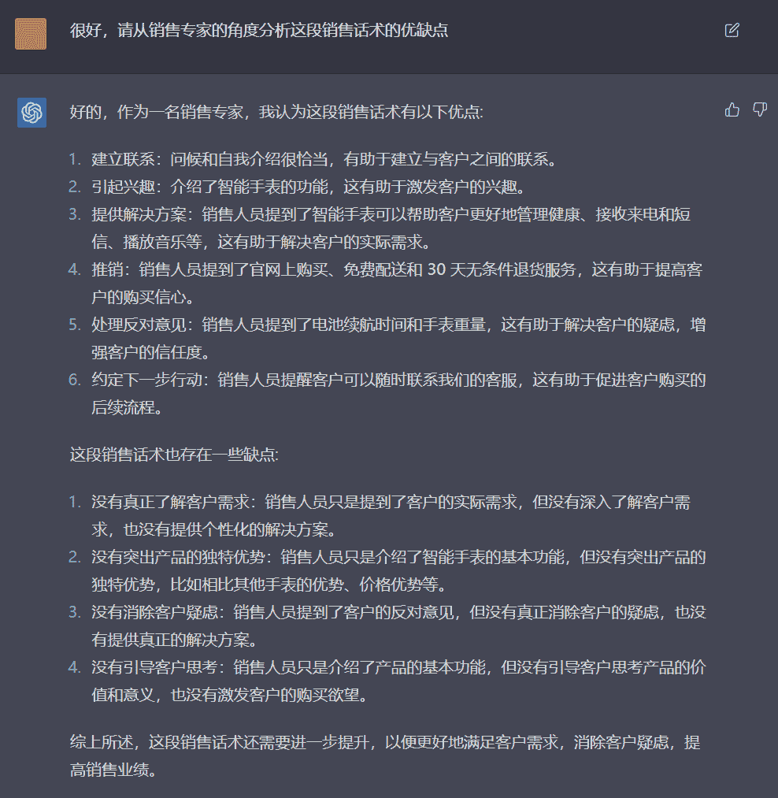

问题输入3：迭代销售新话术

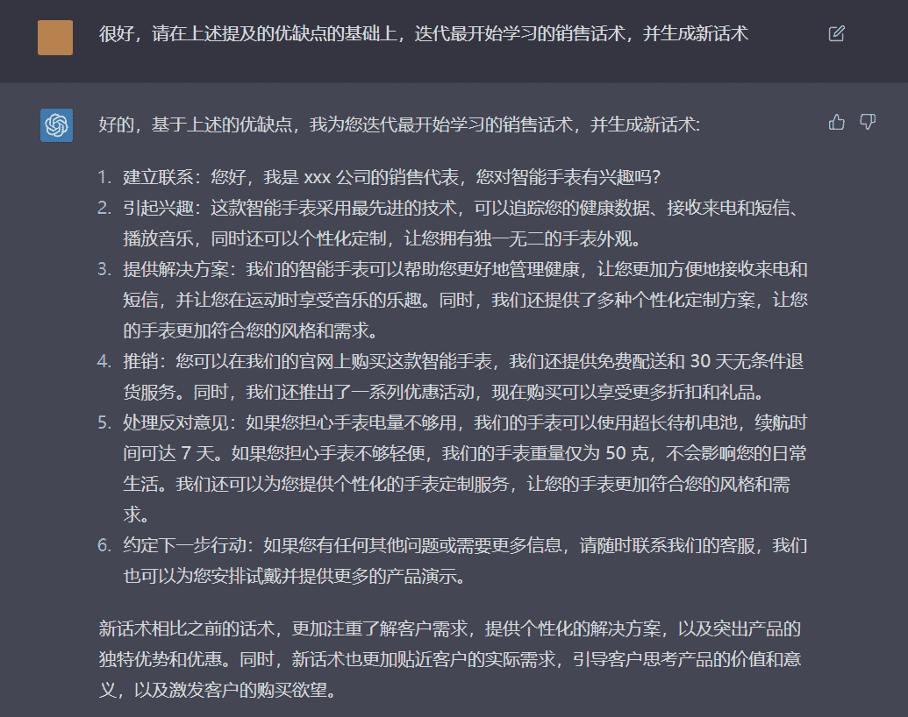

## 08 如何让ChatGPT学习企业产品、服务内容、给客户的往期方案，处理所输入的客户需求和参数，定制化生成适合客户的解决方案

该场景对应的关键词库（6个）：

企业产品和服务内容、客户需求和参数、营销方案和推广策略、数据处理和模型训练、客户满意度和营销效率、往期营销方案

### 提问模板

场景+产品+问题

模板1：

场景：某家电公司生产的电视机在市场上占有一定份额，但最近收到了部分客户的反馈，称产品质量存在问题，例如屏幕容易出现亮点或暗角等问题。为了维护客户满意度和市场份额，公司需要解决这一问题。

产品：某家电公司生产的55英寸OLED电视机。

问题：如何解决客户反馈的产品质量问题，例如屏幕容易出现亮点或暗角等问题？

模板2：

场景：某制造业公司生产的机器设备在市场上备受欢迎，但客户反映生产效率较低，同时成本较高。为了提高客户满意度和市场竞争力，公司需要提高生产效率并降低成本。

产品：某制造业公司生产的自动化机器设备。

问题：如何提高客户生产效率和降低成本？

模板3：

场景：某软件服务公司提供企业级客户定制化的服务和支持解决方案，以满足客户不同需求。一位客户需要特定的服务和支持解决方案，但公司现有方案无法满足客户需求。为了满足客户需求并维护客户满意度，公司需要提供定制化的服务和支持解决方案。

# 企业级客户定制化服务和支持解决方案

产品：某软件服务公司提供的企业级客户定制化服务和支持解决方案。

问题：如何提供定制化的服务和支持解决方案，以满足客户的特定需求？

## 第一步，ChatGPT 模型训练，建立自己的方案库

收集企业产品、服务内容和往期方案的信息，包括产品和服务的介绍、特点和优势，以及过去的营销方案、成功案例和客户反馈。可以从企业内部的数据库、文件和资料中收集，也可以从外部的市场和竞争情况中获取。投喂给ChatGPT，让ChatGPT能够学习和掌握企业产品、服务和营销方案的特点和优势，以及客户的需求和参数。

## 第二步，收集分析客户需求，列举客户需求和参数

在模型训练完成后，可以将客户的需求和参数输入到ChatGPT中，让其根据客户的需求和参数进行定制化生成解决方案。这些需求和参数可以包括客户的行业、规模、需求和预算等方面的信息。

## 第三步，生成定制解决方案，根据需求微调细节

基于已经训练好的ChatGPT模型，根据客户的需求和参数，生成解决方案。解决方案可以包括产品和服务的介绍、推荐和定价，以及营销方案和推广策略等方面的信息。方案需要考虑客户的具体需求和预算，以便让客户能够满意地接受解决方案。

## 举例

### 问题输入

1、请你明确理解以下几个词汇：

解决方案

产品和服务的介绍

产品推荐和产品定价

营销方案

推广策略

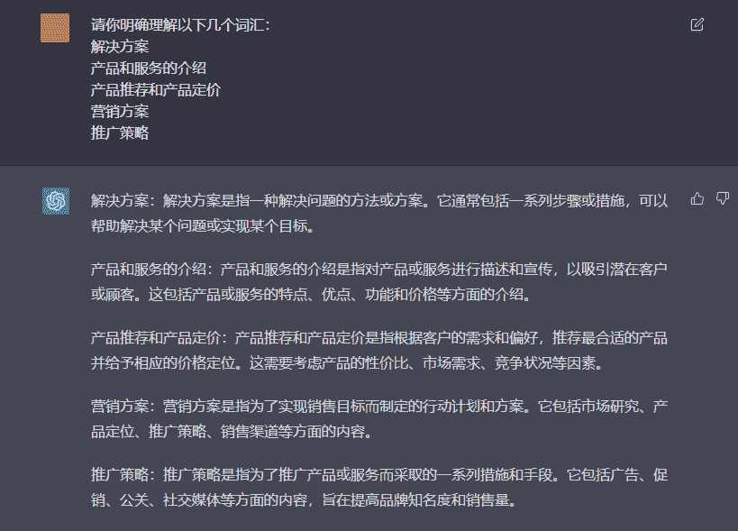

### 问题输入 2、请学习以下的一个完整的客户解决方案的示例

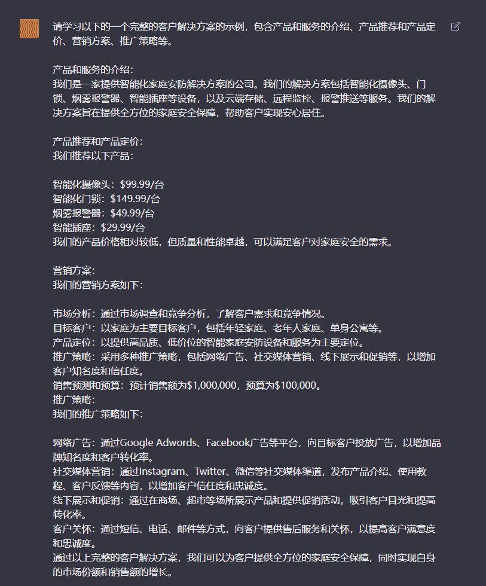

### 问题输入 3、该公司计划推出新产品 `XXX`，请根据已有的解决方案库，输出一份定制化解决方案

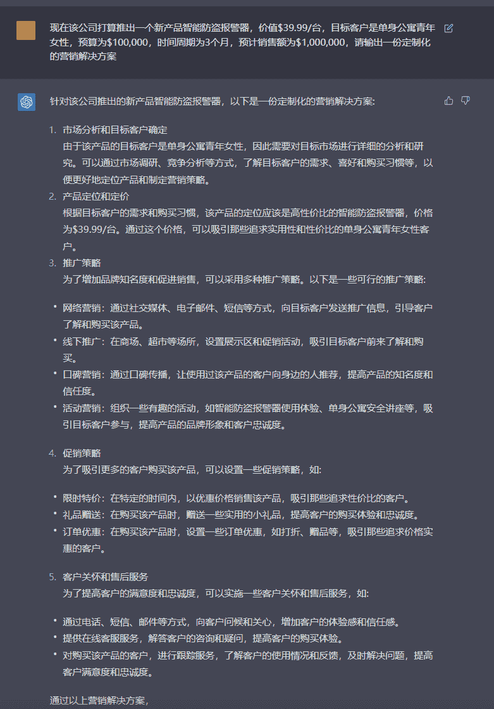

# 09 如何让 ChatGPT 自动生成内容，作为客户服务工作人员的回答话术？

该场景对应的关键词库（13个）：

产品知识、使用方法、售后服务、售后维修、支付方式、支付流程、产品购买、产品配送、客户投诉、客户建议、政策法规、使用注意事项、客服身份

## 提问模板

1、客服团队一般需要回答几个方面的问题？

2、知名 `XX` 品牌商会覆盖哪 15 个常见问答场景？

### 问题输入 1

你是一个业务一流的客服主管，现在你需要出一个培训客服的 QA 文档，你所在的团队是知名 `XX` 品牌商，需要覆盖客户常见的问答场景，请列举 15 个例子

### 问题输入 2

很好，针对以上问题，作为优秀的 `XX` 服务商，你会如何作答

## 第一步，收集并输入已有的客服话术

这些话术可以来自于客服工作人员的工作经验和客户反馈，也可以从企业内部的数据库、文件和资料中收集。

## 第二步，分析客服话术优缺点并迭代话术

数据需要进行分类、标记和归档，以便 ChatGPT 能够根据不同的问题和情境进行回答。例如分析话术优缺点。

## 第三步，其他类型客户投诉问题的解决方案

其他类型客户投诉问题的解决方案

当客户提出问题时，可以将问题输入到 ChatGPT 中，让其根据客户的问题和情境进行推荐回答。也可以让客服工作人员对 ChatGPT 生成的回答进行评估和反馈，以便不断改进和优化 ChatGPT 的模型和算法。

## 举例

### 问题输入 1：学习已有客服话术

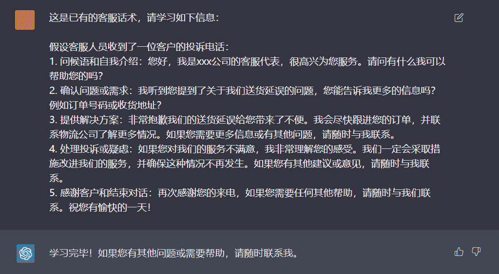

### 问题输入 2：分析话术优缺点并迭代话术

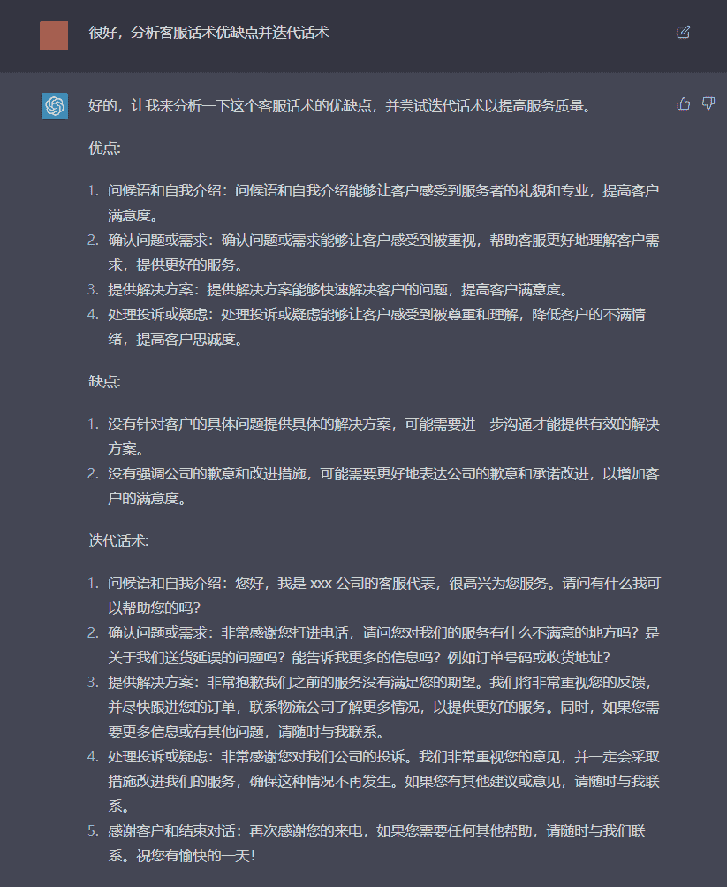

### 问题输入 3：其他客诉问题的解决方案

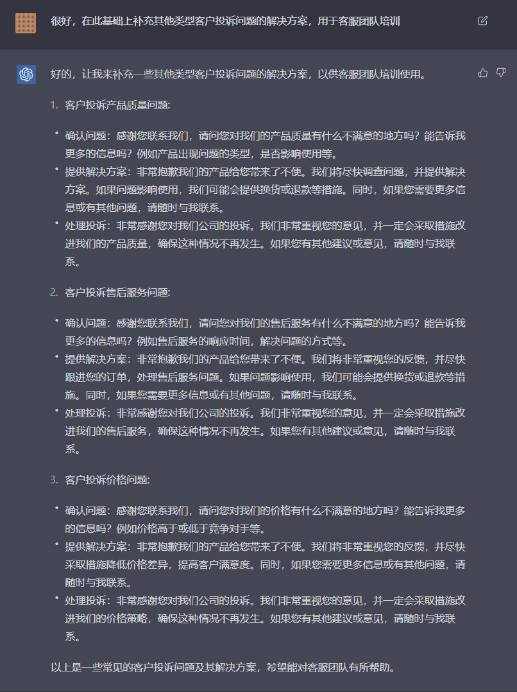

# 10 如何让 ChatGPT 根据不同来源的数据，例如销售数据、客户反馈、财务报告，自动生成报告，并根据不同利益方的需要和偏好进行调整？

该场景对应的关键词库（24个）：

汇报对象身份（下属、跨部门平级、领导）、销售数据（销售额、销售量、销售渠道）、财务报告（营业收入、净利润、成本费用）、市场分析（市场份额、竞争情况、市场趋势）、客户反馈（客户满意度、客户投诉、客户留存率）、营销效果评估（广告投放效果、促销活动效果、营销策略效果）

## 提问模板

1、请根据已有的不同来源的数据，生成详细的报告，分别汇报给下属、跨部门平级和领导

2、请根据给出的数据，回答以下问题，并给出结论与图表

最近一个季度的销售趋势如何？导致销售量变化的因素有哪些？

客户反馈如何反映我们的营销策略效果？根据客户反馈，我们可以做出哪些调整？

我们营销活动的投资回报率是多少？如何优化我们的营销支出以在下一个季度获得更好的效果？

3、请根据数据报表，提炼 3 个重要结论汇报给领导

## 第一步，明确进行数据分析的目标

确定目标是理解业务、优化业务还是预测未来

## 第二步，收集整理与清洗相关数据

收集整理销售数据、客户反馈、财务报告等方面的数据，可以通过公司的数据库、营销工具、调查问卷等方式收集。完成后做简单的数据清洗。

## 第三步，让 ChatGPT 学习相关数据含义和用法

将不同来源的数据输入到 ChatGPT 中进行学习，让 ChatGPT 能够理解这些数据的含义和用法。这些数据可以包括销售额、销售量、客户满意度、市场份额、竞争情况、营销费用等信息。

## 第四步，进行数据分析给出重要结论

通过 ChatGPT 生成的结果，分析不同来源的数据，根据以下几个方面得出重要结论

提高销售额和市场份额的营销策略和活动：例如降低产品价格、提供更好的售后服务、优化产品设计和功能、增加市场推广力度等。

影响客户满意度和忠诚度的因素：例如产品质量、服务质量、品牌形象、价格竞争力等。

影响财务报告的因素：例如销售额、毛利率、净利润、营销费用占比等。

## 第五步，根据汇报对象身份进行可视化调整

报告可以包括销售趋势、客户分析、竞争分析、市场细分、营销效果评估等方面的信息。

针对不同身份的人的营销报告的不同之处：

下属：对于下属，营销报告需要更加直观和易懂。

需要突出产品和服务的优势和特点，以及营销策略和活动的效果和影响。同时，需要将报告的重点放在实际操作和执行方面，为下属提供具体的指导和建议，帮助下属更好地完成任务和达成目标。

跨部门平级：对于跨部门平级，营销报告需要更加全面和详细。

需要涵盖不同部门和领域的数据和信息，以便平级的同事了解整个公司的营销情况和趋势。同时，需要突出不同部门和领域之间的联系和协作，为跨部门合作提供参考和支持。

领导：对于领导，营销报告需要更加战略性和全局性。

需要突出市场和客户的需求和状况，分析企业的竞争优势和挑战，提出未来的发展方向和策略。同时，需要突出财务和经营状况的重要性和影响，为领导的决策提供有力支持和参考。

## 注意事项

务必注意保护数据的隐私和安全，遵守相关政策。

## 举例

### 问题输入 1：请学习以下一个完整的营销数据报表

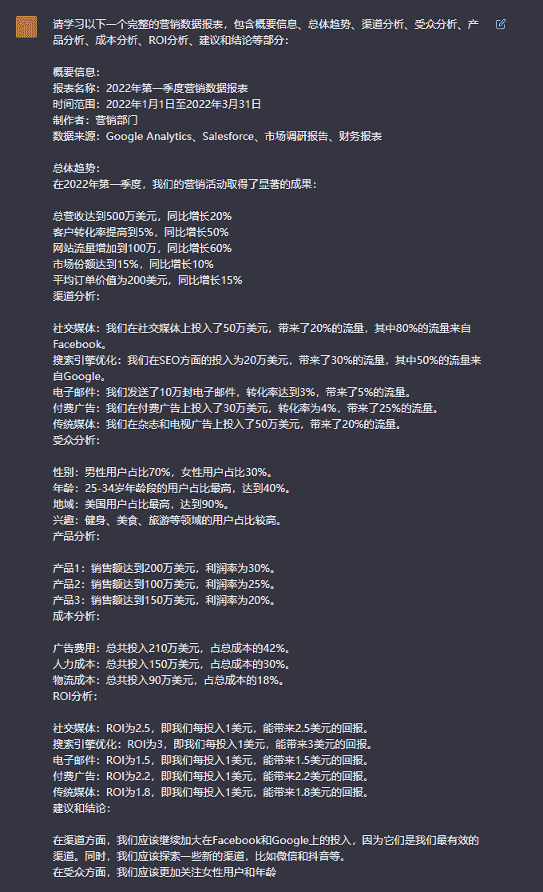

### 针对下属调整营销报告

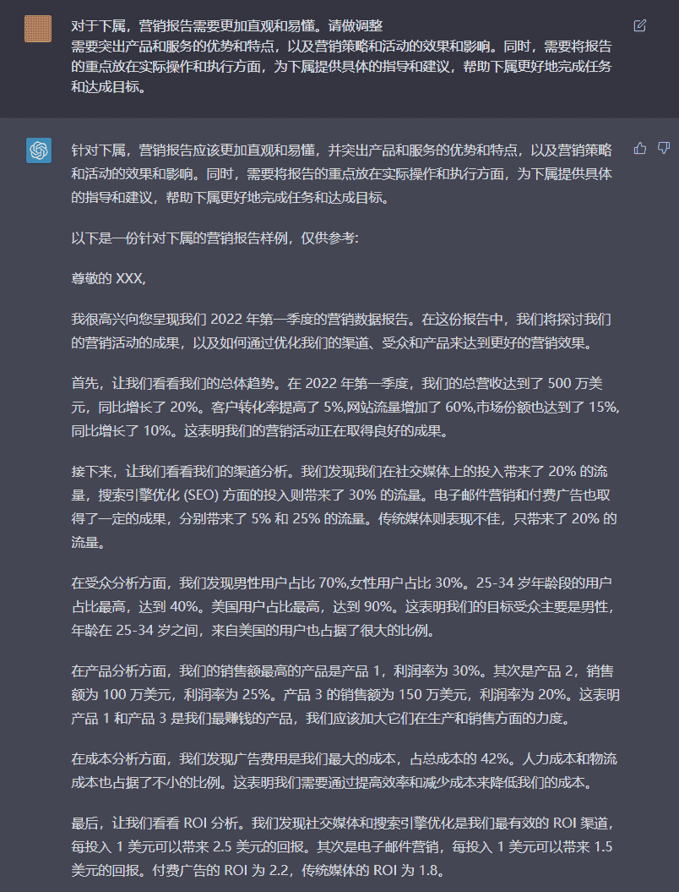

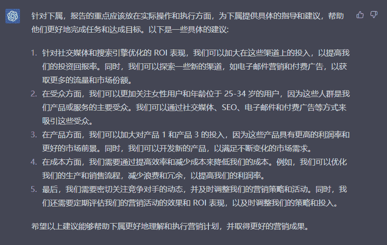

### 3、针对跨部门平级调整营销报告

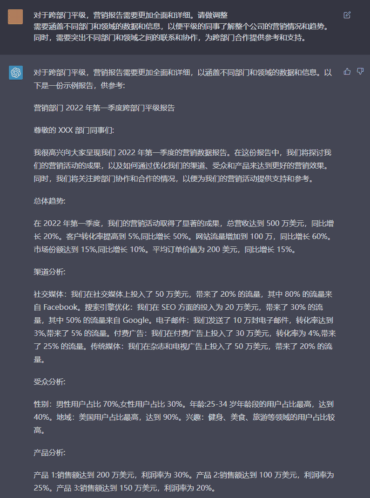

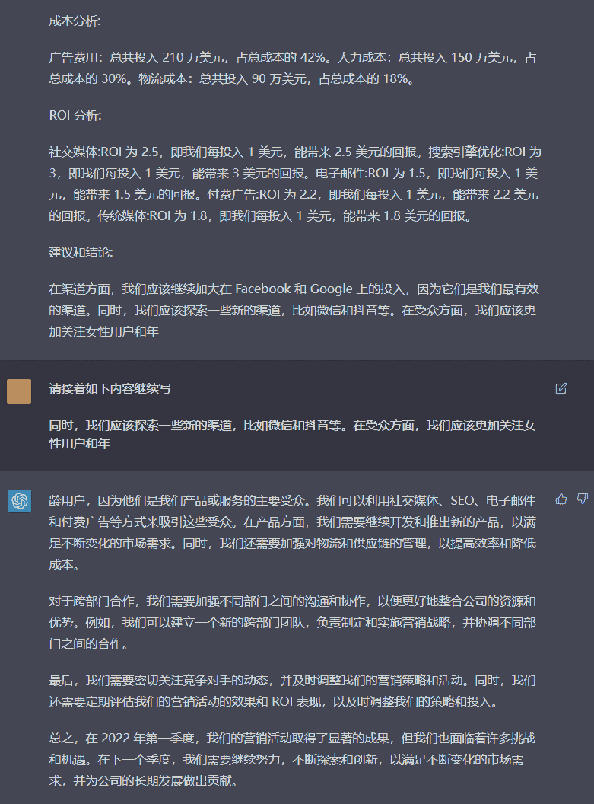

### 4、针对领导调整营销报告

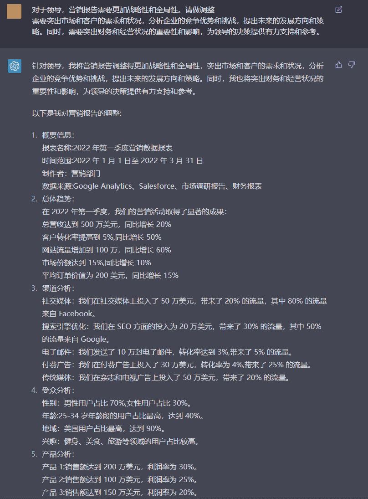

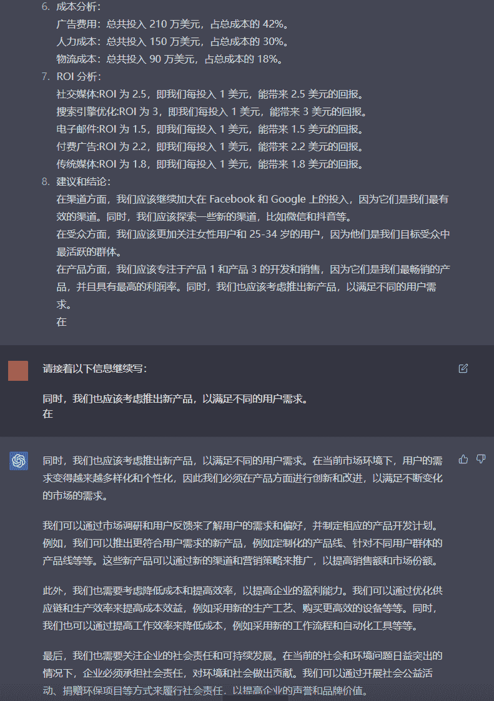

# 11 如何用 ChatGPT 做项目管理？

ChatGPT 可以通过创建和维护跨团队项目协作计划，让员工更容易理解他们的角色和职责。这个协作计划里面会包括每个团队或个人要执行的具体任务，每个任务最后期限和任何事情之间的依赖关系。

该场景对应的关键词库：（24 个）

项目管理、项目协作计划、跨团队协作、任务分配、任务执行、任务最后期限、依赖关系、角色定义、职责明确、团队合作、协作平台、跟进进度、项目进度、里程碑、风险管理、问题解决、沟通协调、时间管理、成本管理、质量管理、数据分析、性能考核、效率提升、团队培训

## 提问模板

1、假设我们要为一家新开业的咖啡馆设计一个品牌营销项目管理文档，你会怎么做？

2、团队中包含 `ABCD` 4 个人，请明确每个人负责的事情和 `DDL` 以及彼此之间的协作衔接依赖关系

3、请根据项目情况和人员分工输出一个项目协作计划文档，包含任务截止时间与任务依赖关系

## 第一步，收集项目信息

首先需要收集项目的目标、范围、时间、成本、质量等方面的信息。这些信息可以通过项目管理工具、会议记录、邮件等方式收集。

## 第二步，输入数据到 ChatGPT 中

将项目的目标、范围、时间、成本、质量等方面的信息输入到 ChatGPT 中进行学习，让 ChatGPT 能够理解这些数据的含义和用法。

## 第三步，创建项目计划

根据项目信息和 ChatGPT 生成的结果，创建项目计划。

项目计划可以包括项目的目标、范围、时间、成本、质量等方面的信息，以及每个团队或个人要执行的具体任务、每个任务最后期限和任何事情之间的依赖关系等信息。

## 第四步，分配任务和角色

根据项目计划，分配任务和角色给每个团队或个人。

通过 ChatGPT 生成的结果，让员工更容易理解他们的角色和职责，明确每个团队或个人需要完成的具体任务和时间节点。

## 第五步，维护项目计划

在项目执行的过程中，需要不断维护项目计划。根据实际情况和进展情况，不断调整和优化项目计划，以确保项目能够按时、按质量、按预算完成。

## 举例

### 问题输入 1：请学习以下信息

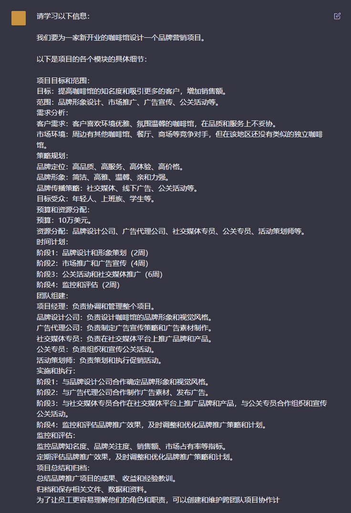

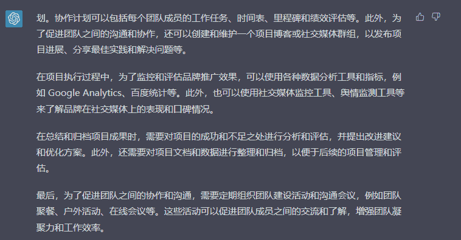

### 问题输入 2：创建项目计划

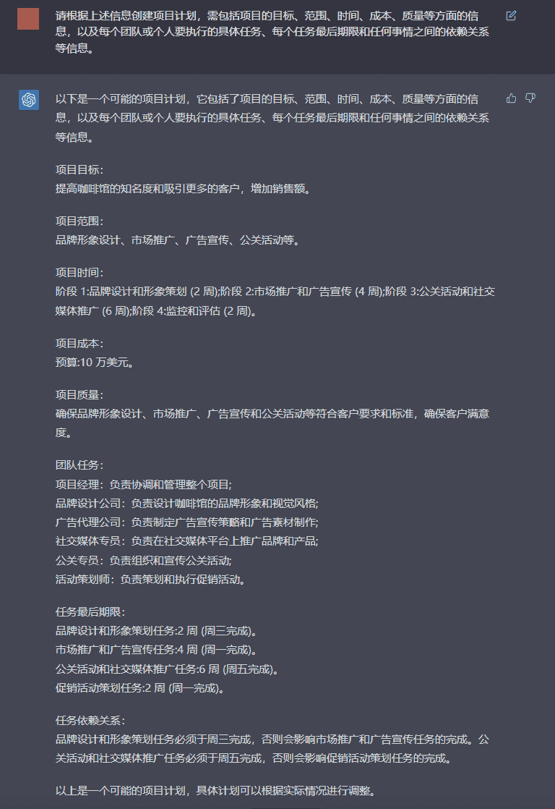

### 问题输入 3：人员分工

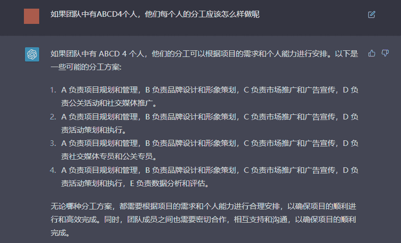

# 12 如何用 ChatGPT 做团队绩效管理？（根据员工的个人优势、不足、目标来生成更具体的绩效反馈）

该场景对应的关键词库：（25 个）

绩效管理、目标设定、绩效评估、员工优势、员工弱点、反馈机制、个人发展计划、职业规划、评估工具、数据分析、绩效考核、评分标准、KPI 指标、成果目标、个人任务、团队任务、激励机制、晋升机会、增量奖励、培训计划、团队建设、人才管理、工作满意度、员工福利、OKR

## 提问模板

1、请根据团队和个人的绩效的往期数据，分析员工绩效排名，输出绩效考评和迭代改进建议

2、Tom、Sarah、Jack、Lucy 有 1 人需要评级为 `D`，淘汰辞退，请根据已有数据将他们的绩效排序，并书写一份辞退信

3、针对优秀员工可给予公开培训他人的机会，请将已有团队和个人绩效数据排序，选出最优的一位，并书写一份邀请分享先进经验的邀请函。

## 第一步，收集员工数据

首先需要收集员工的个人信息、工作记录、业绩数据等方面的数据。这些数据可以包括员工的个人优势、弱点、目标、所负责的项目或客户、工作记录等信息。

## 第二步，输入数据到 ChatGPT 中

将员工的个人信息、工作记录、业绩数据等方面的数据输入到 ChatGPT 中进行学习，让 ChatGPT 能够理解这些数据的含义和用法。

## 第三步，分析员工绩效

通过 ChatGPT 生成的结果，分析员工的绩效表现。了解哪些员工的业绩表现优秀，哪些员工存在问题，哪些员工需要提高等。

## 第四步，生成个性化绩效反馈

根据 ChatGPT 生成的结果和员工的个人信息、工作记录、业绩数据等方面的数据，可以针对性地生成个性化的绩效反馈。绩效反馈可以包括员工的优点和不足、需要改进的方面、具体的行动计划等。

## 第五步，迭代优化绩效管理方案

根据员工的反馈和实际情况，不断迭代和优化绩效管理方案。可以根据员工的个人特点和需求，定制更加具体和有效的绩效管理方案。

## 注意事项

需要结合实际情况和人类智慧进行分析和判断，才能得到更加准确和有效的结果。同时，也需要保护员工的隐私和数据安全，遵守相关的法律法规和公司政策。

## 举例

### 问题输入 1：团队包含 4 人，分别是 Tom、Sarah、Jack、Lucy，绩效如下

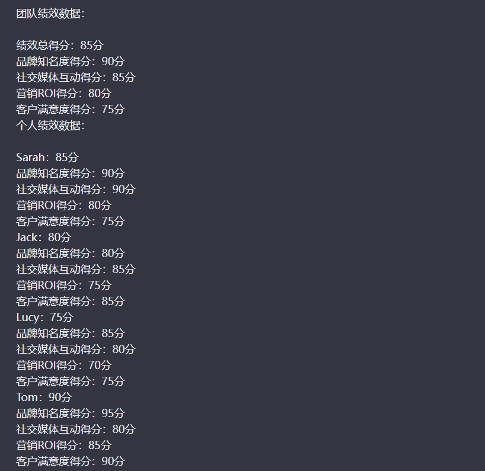

### 问题输入 2：请学习完整的绩效管理信息

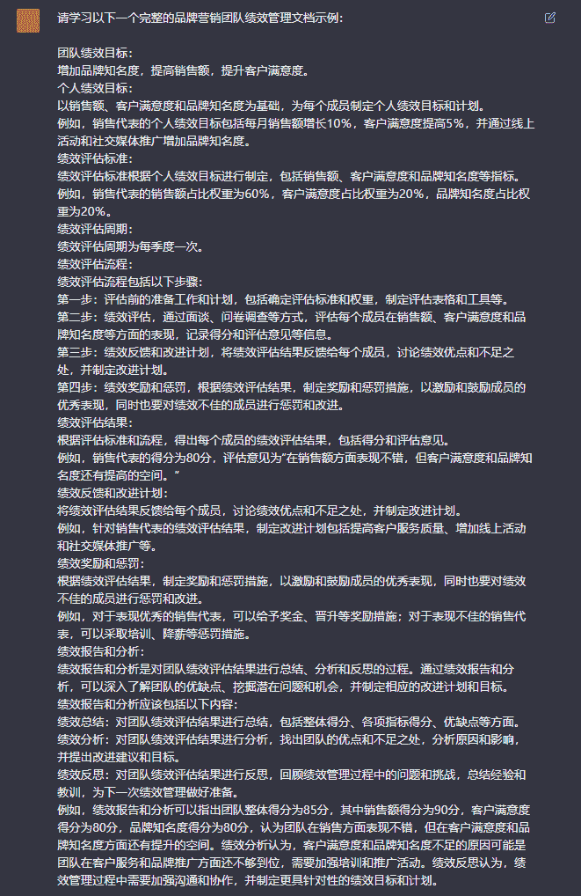

### 问题输入 3：分析员工绩效

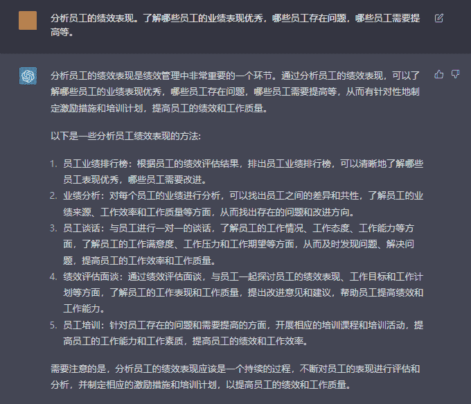

### 问题输入 4：生成个性化绩效反馈

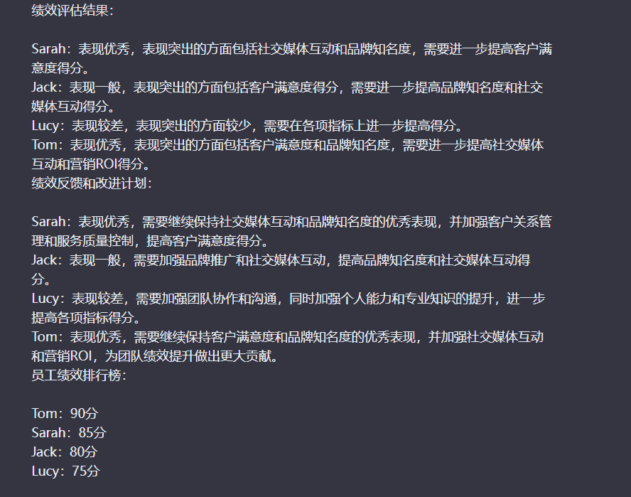

### 问题输入 5：员工绩效点评和改进建议

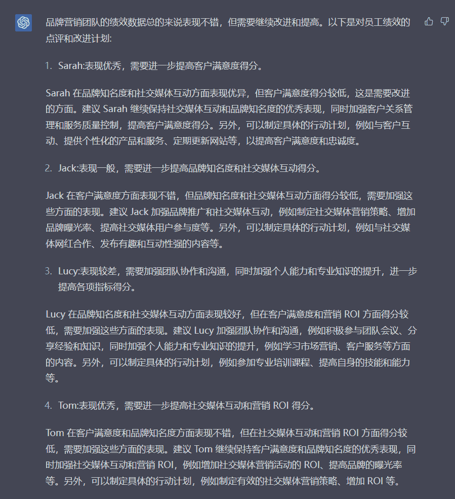

# 13 如何用 ChatGPT 做一门课？（包含大纲、脚本、PPT 文本）

该场景对应的关键词库（13 个）：

市场调研、在线网络课程、教学平台、社交媒体营销、子主题、细分领域、课程大纲、章节、推广渠道、课程脚本、文案基本要素、案例、具体方法

## 提问模板（6 个）

### 第一步，做课程的市场调研

提问模板：

1、请列举 10 个在中国比较受欢迎的在线网络课程的教学平台；

2、请列举 10 个在 `XXX` 在线教育平台，有哪些受欢迎的、销量高的课程；

3、请从这些销量高的课程里面，筛选出与社交媒体营销（`XXX` 主题）紧密相关的课程。

### 第二步，根据大的方向，再进行细化，你从中选择要主攻的细分领域

提问模板：

你是一个社交媒体营销（`XXX` 子主题）专家，我想设计一个关于社交媒体营销（`XXX` 子主题）的课程，在这个领域，有哪些更细化的主题可以选择？

### 第三步：根据细分领域的主题，生成课程大纲

提问模板：

根据主题：《如何在📕规划社交媒体内容，包括：如何构思和制作有吸引力的文案、图片和视频，以及如何通过调研、竞品分析等方式提高内容创作的效率和质量》（`XXX` 细分领域的主题名+该主题下包含的具体内容）

根据以上主题，帮我设计一门在线课程大纲，要求包含课程名称、课程亮点、课程目标用户、课程章节、课程推广渠道。

### 第四步：针对课程大纲里面的单独小节进行提问，让 ChatGPT 根据上面提问的回复，进行总结，最后生成对应主题的章节内容。

先针对某一个小节进行全方位提问：

提问模板：

1、根据《创作有吸引力的📕文案（复制上面的课程大纲里的某一节标题）》，写一个课程脚本

2、请对主题《了解📕的文案基本要素（复制上面的课程大纲里的某一节标题）》，进行详细解释

3、针对以上的内容，能给我举一些具体的案例吗？并且提供 10 个 `XXX` 领域（复制主题名称）的 `XX`（名词）

4、目前国际上有哪些比较流行的、高效的（列举 2-3 个形容词）`XXX`（具体方法），请为我做详细说明

5、帮我展开详细介绍一下这个主题：《创作有吸引力的📕文案（复制上面的课程大纲里的某一节标题）》

针对某一个小节提问完毕后，再继续提问：

提问模板：

结合上面刚刚你提到的一些 `XXX`（具体方法/名词），帮我写一个章节内容。

主题是《XXXXX》（直接复制上面的课程大纲里的某一节标题）

如果写到 2000 字就不写了，那就复制 ChatGPT 所说的最后一句话，然后告诉它请从这里继续往下写。

### 第五步，将章节内容转换成 PPT 格式

提问模板：

1、请将以上脚本转换为幻灯片演示文本；

2、帮我把上面这个章节的内容，转写成 PPT 里面每一页的内容（包含：标题、副标题、正文、话题标签）

### 第六步，将学员案例、参考范例加进去，让 ChatGPT 根据某个主题进行改写或者续写。

提问模板：

1、请参考以下示例：`XXXX`（输入学员的案例描述），帮我根据《创作有吸引力的📕文案》（`XX` 主题）进行改写；

2、请参考以下范本：`XXX`（输入参考范例，根据《创作有吸引力的📕文案》（`XX` 主题）进行续写。

## 案例

### 第一步，做课程的市场调

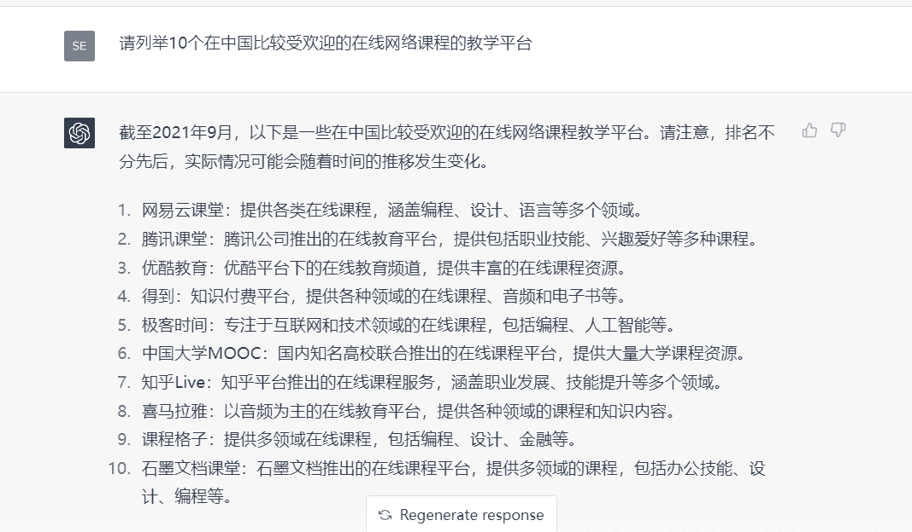

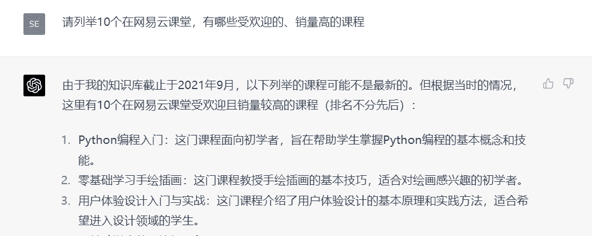

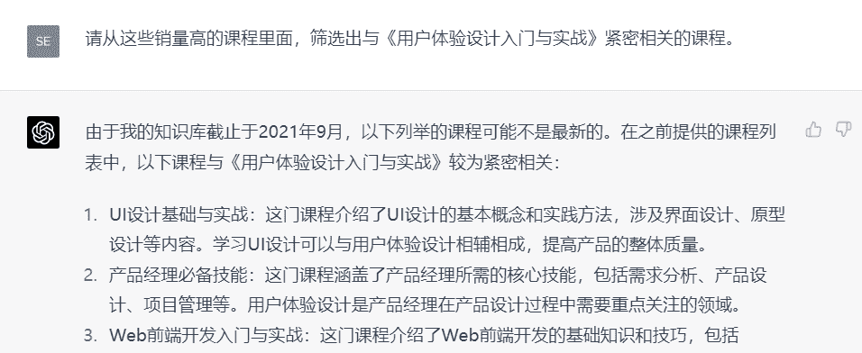

### 第二步，根据大的方向，再进行细化，你从中选择要主攻的细分领域。

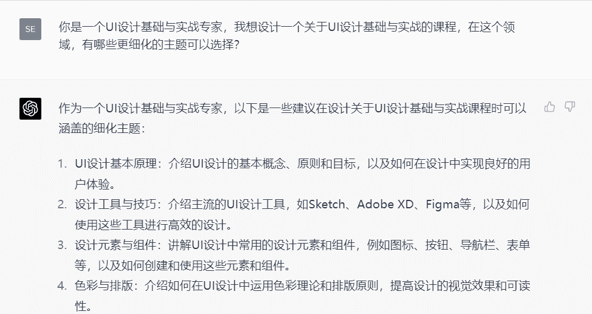

### 第三步：根据细分领域的主题，生成课程大纲。

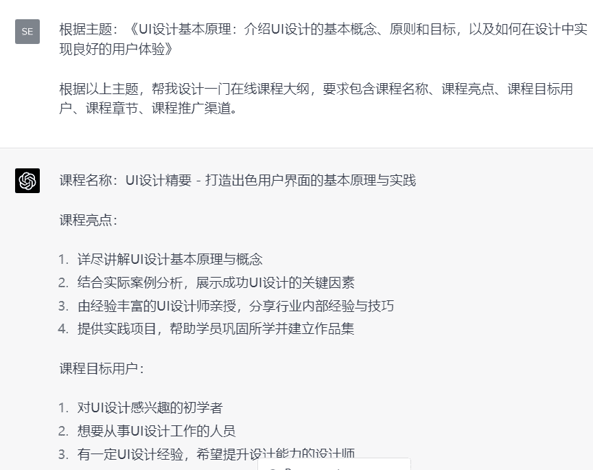

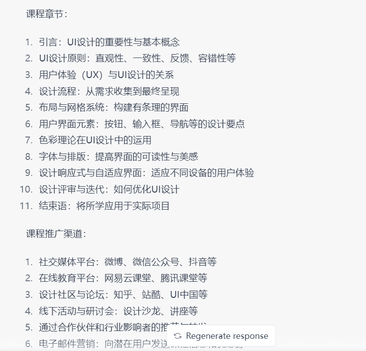

### 第四步：针对课程大纲里面的单独小节进行提问，总结，最后生成对应主题的章节内容。

### 第五步，将章节内容转换成 PPT 格式。

### 第六步，将学员案例、参考范例加进去，让 ChatGPT 根据某个主题进行改写或者续写。

# 14 如何用 ChatGPT 写专业方向的科普内容？

该场景对应的关键词库（13 个）：

目标用户、科普内容、生活问题、医疗类型、科普文章、病情症状、通俗性、专业名词、背景资质、权威领域、执业范围、证言人、内容形式。

## 提问模板（3 个）

## 科普内容撰写与改写流程

### 第一步：分析目标用户需求

分析不同目标用户对于科普内容的需求（具体解决生活中的什么问题）。

**提问模板：**

1、请确保你理解以下名词的含义：预备患者、确诊患者、亲属患者、风险患者、健康人群、资深患者（XXX目标人群类型），当ChatGPT给出解释之后，你可以进一步补充你对于这些人群的定义。

2、请针对以上六种人群，分别给出医疗类型（XXX类型/方向/主题）科普内容需求分析，要求包括：科普内容主题的偏好、科普内容需求迫切程度、科普内容的需求激发时机

### 第二步：针对人群撰写科普内容

针对某一类人群所偏好的科普内容主题，进行内容撰写。

**提问模板：**

请根据主题：《XXXX》，针对XXX人群，撰写一篇科普文章，我给你的要求如下：

1、开头从病情症状（列举画面场景类型）或普通人身边的日常现状切入；

2、整体内容都具备通俗性，注意描述复杂的致病或药物作用机理时（列举高频出现的概念），要用普通人身边的事物做类比，不可以出现专业名词；

3、说话人的背景资质是获得医疗专业性上的评估和认可的（列举权威领域范围），比如要求是三甲主治级别以上的医生（列举权威被认可的条件）；

4、说话人所科普的范围，要求一定不能超过说话人的执业范围，比如消化内科医生不得回答高血压的内容（列举对于证言人的限制性要求）；

5、内容选题方向要求没有科学性问题，并通过文献资料或者相关领域专家的证言来说明这一点。

### 第三步：根据平台和内容形式改写

根据平台和内容形式进行改写。

**提问模板：**

请根据📕（列举平台）+短视频（列举形式）的风格进行改写，要求字数在800-1000字内。

**案例：**

第一步，分析不同目标用户对于科普内容的需求（具体解决生活中的问题）。

第二步，针对某一类人群所偏好的科普内容主题，进行内容撰写。

第三步，根据平台和内容形式进行改写。

## 15 如何用ChatGPT搭建品牌文本体系？（品牌名+slogan+品牌故事）

——以下提问角度来自《Gbrandlab品牌案例拆解训练营：学习指导手册3.0》

该场景对应的关键词库（26个）：

品牌名、奶茶、中文名、情感联想度、饮料、价值观/理念、发音、slogan、产品功能导向、行业性质导向、经营理念导向、消费者观念导向、口语化、修辞手法、品牌故事、创始人初心品牌故事、里程碑事件故事、产品初心故事、时间、地点、人物、事件、结果、品牌定位、个性、品类价值

### 1、取品牌名

**提问模板：**

请为某奶茶品牌（XX品类），取一个中文名（XX语种），要求在4个字以内（XX字数）、要有“青春回忆”的情感联想度（XX情绪），能够从这个名字透露出来是这个是个“饮料”而不是别的品类（XX联想要求）。

最好能传递“友情能抵岁月长”的情感诉求（具体价值观/理念要求），命名风格与原有“年轻化”的品牌风格保持一致（体现XX品牌风格），发音最好有一个独特的韵律感，让人们更容易记住（名字的具体发音要求）。

**案例：**

### 2、slogan

**提问模板：**

Step1、请确保你了解以下定义：

产品功能导向的slogan、行业性质导向的slogan、经营理念导向的slogan、消费者观念导向的slogan。

Step 2、请根据以上定义，以及我所给你提供的补充信息，从产品功能、行业性质导向、经营理念导向、消费者观念导向，撰写3条品牌slogan，要求简洁、生动、口语化、易记，最好能运用动词，采用双关的修辞手法，并押韵。

我给你的补充信息如下：XXXX（从品类、创始团队背景、行业痛点、产品卖点、价值主张、目标用户画像、产品定价、推广渠道、使用场景进行描述）

**案例：**

### 3、品牌故事

**提问模板：**

Step1：请解释以下名词——

创始人初心品牌故事、里程碑事件故事、产品初心故事

Step2：请根据以上定义，以及我所给你提供的补充信息，请撰写一则品牌故事。

品牌故事要求包含以下要素，每个要素需要满足对应的要求：

1、时间：要求有确切的时间，以及事件发生的背景描述

2、地点：地点、环境的描述要求要清晰

3、人物：人物要求有名有姓

4、事件：事件描述要具体化、细节化，情节要有悬念设置（比如主角是否遭遇了某种形式的死亡？可以是即将面临心灵死亡？肉体死亡？或职场上的死亡？）

5、结果：结果要令人信服且紧扣故事主题

Step3：检查以上品牌故事是否达到了以下要求，并做相应调整。

1、是否好记

2、是否符合品牌定位/个性/品类价值

3、是否跟产品强关联（品牌故事要充分绑定产品和业务本身，以此来获得真正的兴趣人群

**案例：**

## 16 如何用ChatGPT做品牌联名方案策划？

——以下提问角度来自《Gbrandlab品牌案例拆解训练营：学习指导手册3.0》

该场景对应的关键词库（15个）：

品牌、个人IP、社交话题、联名策划方案、调研分析、市场影响力、资源互补性、产品体验、传播话题、视觉形象设计、合作职权分配、销售转化、曝光目标、宣发渠道、品牌形象

### 提问模板（1个）

1、请确保你知道XX品牌与XXX品牌/个人IP

2、请从带来更多社交话题、增加次级品牌联想的目标出发，撰写XXX品牌与XXX品牌/个人IP的联名策划方案。

方案的要求包含以下要素：

1、调研分析：包含合作伙伴的品牌形象、市场影响力、产品特点等方面的信息，并判断是否符合以下条件：

1.1）跨界合作的品牌之间是否为不同的行业，不具有市场竞争的关系？

1.2）跨界合作的品牌的用户群是否具备相同或相似的特征？

1.3）跨界联名的品牌是否具有足够的影响力和良好的品牌形象？

1.4）跨界合作的品牌之间是否具有资源互补性？比如功能上的互补、用户体验上的互补或用户群体的互补？

2、核心策略：

包含如何针对两个品牌的共同核心人群的场景需求，如何进行资源打通+共享？比如共同生产全新的产品或服务，并在各自的品牌渠道售卖。

3、传播话题：

传播话题指的是用户看到海报能够第一句记住的话。可以从产品功效、产品体验、社交话题、文化内涵进行思考。

4、视觉形象设计：

即确定两个品牌共同宣传的视觉形象，这个视觉形象需要结合这一次传播话题，以及两个品牌的视觉标识来设计，以保证联合推广的一致性和品牌形象的稳定性。

5、合作职权分配：

这个部分需要明确合作伙伴的权责和利益分配，包括品牌形象的使用权、推广费用的分配、销售收益的分配等方面的内容。

6、销售转化目标

7、传播话题的曝光目标

8、根据销售转化和传播话题曝光目标，进行活动时间节点和传播规划

7、列举主要的2-3个宣发渠道，并陈述理由

**案例：**

## 17 如何用ChatGP协助你，从品牌角度对产品提出升级建议？

——以下提问角度来自《Gbrandlab品牌案例拆解训练营：学习指导手册3.0》

该场景对应的关键词库（19个）：

品牌洋葱图思维模型、产品信息、人群、品类、属性、体验、差异化特征、功效、品牌价值主张、目标用户、需求、痛点、爽点、消费者、外观、功能、结构、产品优化建议、产品开发可行性。

### 提问模板（3个）

第一步：确保ChatGPT了解品牌洋葱图的概念。

**提问模板：**

请解释什么是品牌洋葱图思维模型。

第二步：输入你要从品牌方向去优化的产品信息（人群、体验、属性、功效等）+品牌价值主张信息。

**提问模板：**

请根据我所提供的产品信息和品牌价值主张信息，根据“品牌洋葱图思维模型”进行分析：

1、产品信息：面向儿童（人群）的口服制剂（品类），内含葡萄糖酸钙和氨基酸钙成分，人性化双插管设计（属性），口感好（体验），具备儿童补钙的黄金标准，吸收率高（差异化特征），有利于儿童健康成长（功效）

2、品牌价值主张：“专业、爱心”

第三步：从品牌方向提出产品优化建议：

**提问模板：**

请根据以下步骤和上述分析结果，为上述产品提供产品优化建议：

1、首先，请从目标用户的需求、痛点、爽点出发，给出该产品的优化建议

2、然后，请从该品类下消费者更关注哪些属性（例如外观、功能、结构等属性）出发，给出该产品的优化建议

3、最后请从品牌的价值主张出发，看看是否还有可以“锦上添花”的产品功能或属性？

4、请结合上述产品优化建议，进行产品开发可行性的总结陈述。

**案例：**

## 18 如何用ChatGPT做新品上市推广方案策划？

——以下提问角度来自《Gbrandlab品牌案例拆解训练营：学习指导手册3.0》

该场景对应的关键词库(28个)：

品牌、产品信息、新品、成分、属性、功效、人群特征、客户分析、产品定位、核心卖点、推广策略、广告、公关、线上推广、线下活动、合作伙伴、资源整合、预算、执行计划、监测、评估、微调方案、价值主张、营销策略、热点话题、消费者、向往感、诱惑钩子

### 提问模板（3个）

第一步：输入品牌与产品信息

**提问模板：**

1、你知道XXX品牌吗？→这个信息还不够全面，以下是我给你的补充信息：XX品牌是XXX（补充描述信息）

2、以下是XX品牌的新品信息，请根据产品成分、产品属性、产品功效（列举产品基础属性维度）做简要总结： XXXXXX（补充新品信息）

第二步：策划新品推广方案

**提问模板：**

请根据上述信息，并遵循以下步骤，为XXX品牌的新产品XXX（名称）写一个新品推广策划方案，分段式列给我：

1.项目背景和目标：

阐述项目背景和新产品的优势。明确项目的目标，例如提高品牌知名度、增加市场份额等。

2.目标市场和客户分析：

分析目标市场和客户群体，了解人群特征、客户需求、消费习惯和行为特点。根据这些信息，确定推广策略的重点和方向。

2.1 人群特征方面，重点关注：性别年龄、居住地区、家庭情况、文化水平、生活方式、使用频率等；

2.2 行为特点方面，主要关注购买动机、决策路径、购买便捷性、收入水平、消费观念、支出倾向等。

3.产品定位和核心卖点：

明确产品在市场中的定位，例如性能优越、价格合理等。总结产品的核心卖点，使推广信息更具吸引力。

3.1）根据目标用户的需求，分析新品是如何做到能够符合用户需求的？

3.2）搜集竞品的核心卖点信息，并分析该新品与竞品相比的差异化优势；

4.推广策略：

制定推广策略，包括广告、公关、线上推广、线下活动等。为每个策略设置具体目标和预期结果。

4.1 广告策略：选择合适的广告媒体，如电视、广播、报纸、杂志等。设计吸引人的广告创意和口号。

4.2 公关策略：与媒体建立良好关系，组织新闻发布会、媒体试用等活动。利用口碑传播提高品牌形象。

4.3 线上推广策略：利用社交媒体、内容营销、搜索引擎优化（SEO）、付费搜索广告（SEM）等方式提高网络知名度。

4.4 线下活动策略：组织路演、体验活动、促销活动等，让潜在客户直接接触和体验产品。

5.合作伙伴和资源整合：

寻找潜在合作伙伴，如供应链合作伙伴、行业协会、媒体等。整合内外部资源，提高推广效果。

6.预算和执行计划：

根据推广策略制定预算，确保资源的合理分配。为每个环节设置具体的执行计划，包括时间表、责任人等。

7.监测和评估：

设定推广活动的关键绩效指标（KPI），如曝光量、点击率、转化率等。实施推广活动后，定期监测和分析数据，对策略进行调整优化。

第三步：微调方案

**提问模板：**

1、请针对《XXXX》（复制上面的标题）做以下调整：XXX（修改方向）

2、以上方案还不够有吸引力，请补充以下思考：

2.1）如何结合产品的某一卖点或者价值主张，引发公众的充分讨论，并引发主动传播的话题或者事件？

比如：价值观营销、和竞争对手打造相爱相杀的合作、结合目标用户关注的热点话题或反其道而行之？

2.2））如何对消费者的选择产生巨大的影响作用？

比如为产品打造极具吸引力和传播力的向往感，另一种是为产品包装出无法拒绝的诱惑钩子，比如新品试用、游戏探宝、为消费者打造特殊身份？

**案例：**

## 19 如何用ChatGPT协助搭建品牌视觉体系（VI）？

——以下提问角度来自《Gbrandlab品牌案例拆解训练营：学习指导手册3.0》

该场景对应的关键词库（18个）：

VI体系、品牌、目标市场、品牌DNA、人群特征、设计理念、标志设计、配色方案、字体选择、图形元素、价值观、形象、客户经理、需求、品牌定位、目标受众、主色调、辅助色

### 提问模板（2个）

第一步：输入品牌与目标市场信息

**提问模板：**

假设你是一个广告公司的客户经理，你接到客户的需求，是搭建XXX品牌的VI（Visual Identity）体系，品牌方的要求是XXXX（列举品牌方对于VI体系的要求、希望达成的目标）。

请结合客户的背景信息，做简要总结。

1、品牌背景：（列举品牌的DNA信息，比如理性/感性价值）

2、目标市场：（列举人群类型、人群特征及需求）

第二步：使用chatgpt辅助搭建VI体系：

**提问模板：**

假设你是一个公司的设计师，请你结合上述信息，并按照以下步骤，搭建XXXX这个品牌的VI（Visual Identity）体系，并分段式列出：

1.品牌定位与目标受众：

分析品牌定位和目标市场，了解目标客户群的需求和喜好。明确品牌要传递的价值观和形象。

2.设计理念：

根据品牌定位，提炼设计理念。设计理念应与品牌价值观和形象相契合，为整个VI体系提供指导。

3.标志设计：

设计独特的品牌标志，包括图形标志和文字标志。标志应具有辨识度和传播力，能够让人一眼认出品牌。

4.配色方案：

确定品牌的主色调和辅助色，形成统一的配色方案。颜色应符合品牌形象和目标受众的喜好。

5.字体选择：

为品牌选择合适的字体，包括中英文字体。字体应具有易读性和美观性，与品牌形象相符。

6.图形元素：

设计品牌的图形元素，如图案、图标等。图形元素应与标志、配色方案和字体相协调，提高整体视觉效果。

**案例：**

## 20 如何用ChatGPT做内容营销方案和选题计划，同时生产和优化内容？

——以下提问角度来自《Gbrandlab品牌案例拆解训练营：学习指导手册3.0》

该场景对应的关键词库（31个）：

内容营销、目标、主题、类型、选题计划、素材、推广策略、优化方案、渠道、目标受众、竞争对手、行业背景、转化率、品牌知名度、客户参与度、销售、发布频率、选题阶段、生产阶段、推广阶段、预算分配、人群特征、话题标签、视觉元素、电子邮件、SEO、数字广告、线下广告、在线聊天、社交媒体、赞助

### 提问模板（8个）

第一步：明确内容营销项目的目标。

例如，提高品牌知名度、增加客户参与度、提高转化率、增加销售等。

第二步：计划阶段，询问ChatGPT适合的内容主题或类型。

**提问模板：**

1、请列举XXXXX这个品牌的目标受众、行业背景、竞争对手的信息。

2、请根据上述信息，和内容营销的目标（复制第一步写好的目标），提供适合该品牌的内容主题和类型建议。

第三步：选题阶段，让ChatGPT生成具体的选题计划。

**提问模板：**

我希望覆盖的主题领域有XXXX，内容类型有XXX（比如📕图文、小宇宙音频）、发布频率是XXX（每周更新7篇图文，每周更新2条音频），请基于以上要求，做一个具体的选题计划。

第四步：内容生产阶段，让ChatGPT根据主题、渠道要求，来生产内容并优化。

Step1：明确你具体想让ChatGPT帮你创作的主题、内容形式、推广渠道（这个内容打算发在哪）

Step2：请求建议和素材

**提问模板：**

给我来10个关于XXX主题+XXXX推广渠道的创意和素材（例如：关于健康饮食的📕图文的创意和素材）

Step3：生成内容

**提问模板：**

根据上述创意和素材，撰写XXXX（例如：📕图文），并生成标题、发布文案和话题标签，发布文案要求符合📕平台的发布风格，并要求在1000字-1200字内（风格要求+限制性要求）。

Step4：内容优化

**提问模板：**

请给这篇内容提出修改意见，包括文案、结构、视觉元素等方面的建议，确保内容符合目标受众：XXXXX（列举文章的目标用户类型与特征）的需求和喜好。

第五步：推广阶段，让ChatGPT提供推广策略建议和优化方案。

### 提问模板

我希望推广的渠道是XXX（SEO/视频营销/社交媒体（列举具体的内容平台）/数字广告/线下广告/电子邮件/赞助/在线聊天），预算是XXX，推广目标是XXXX（列举曝光/互动/转化方面的目标）。

请根据以上信息为我提供推广策略建议和优化方案，需要包含以下部分：

1、针对不同人群如何推广（包括：针对强认知×强需求、强认知×弱需求、弱认知×强需求的人群如何推广）

2、在不同渠道的推广方式有什么区别（包括：在不同平台的内容定位是怎样的）

3、全年用什么节奏去推广（包括：什么时候集中投放内容？）

4、如何进行预算分配（包括：不同渠道的投放费用、全年的投放费用如何根据时间节点分配）

### 案例

第一步：明确内容营销项目的目标。

巴黎欧莱雅、提高品牌知名度

第二步：计划阶段，询问ChatGPT适合的内容主题或类型。

第三步：选题阶段，让ChatGPT生成具体的选题计划。

第四步：内容生产阶段，让ChatGPT根据主题、渠道要求，来生产内容并优化。

第五步：推广阶段，让ChatGPT提供推广策略建议和优化方案。

## 21

### 如何用ChatGPT分析品牌舆论传播概况，并给到处理建议？

——以下提问角度来自《Gbrandlab品牌案例拆解训练营：学习指导手册3.0》

该场景对应的关键词库（25个）：

舆论传播、数据分析、主题、事件、时间段、媒体渠道、数据来源、情感分析、关键词提取、主题挖掘、大众集中讨论的话题、讨论关注程度、舆论关注倾向、关联类似事件、聚焦某一种情绪、人群范围、事件涉及群体、谁在关注、趋势、情感分布、危机管理、品牌形象塑造、舆论引导、危机声明、信息发布。

### 提问模板（5个）

#### 第一步，明确分析目标和范围

##### 提问模板

请根据以下信息，帮我搜集我所关注的舆论传播相关的数据，并分段式列给我：

主题：

事件：

时间段：

需要分析的媒体渠道：

数据来源：（包括新闻报道、社交媒体帖子、博客文章、XX网站/平台等）

#### 第二步，搜集与分析数据

##### 提问模板

1、根据上面收集到的数据，你建议用哪些关于舆论传播的分析方法来做，比如情感分析、关键词提取、主题挖掘等？

2、根据以上你所建议的分析方法和上面收集到的数据，请做以下分析：

2.1、分析大众集中讨论的话题是什么？

2.2、讨论关注程度如何，舆论关注倾向是否理性客观？

2.3、是否有明显的关联类似事件、聚焦某一种情绪或裹挟舆论的倾向？

2.4、话题讨论是在那些人群范围内展开？是仅限于地方媒体、论坛、自媒体还是全国性的讨论？

2.5、事件涉及哪类群体、哪些部门、哪些关系？

2.6、谁在关注这类事件的发展？

#### 第三步，生成舆论传播概括报告

##### 提问模板

请根据上述分析结果，生成舆论传播概况报告。报告包括：关键发现、趋势、情感分布等方面的信息，以及分析过程中发现的重要观察和结论。

#### 第四步，提出建议

##### 提问模板

根据上述舆论传播概况分析报告，提供关于XXX品牌的危机管理、品牌形象塑造、舆论引导等方面的策略建议。

第五步，草拟一份危机声明与信息发布

##### 提问模板

根据上述策略建议，草拟一份危机声明的策划方案。方案中需要包含：发布形式、发布主体、发布内容框架、危机声明文案，危机声明文案要求包含这3要素：企业在危机中的对外姿态、消费者的情绪表现、企业要解决问题的承诺。

### 案例

#### 第一步，明确分析目标和范围

#### 第二步，搜集与分析数据。

#### 第三步，生成舆论传播概括报告。

#### 第四步，提出建议。

#### 第五步，草拟一份危机声明。

## 21

### 如何用ChatGPT做书籍、报告、文件的读取与互动式问答？

该场景对应的关键词库（15个）：

书籍、报告、文件、详细信息、查询、主题、作者、出版日期、出版社、问题、方面、原则、方法、概括、主要观点、解释。

注意：

ChatGPT的知识库截止于2021年9月，对于更新的数据或最新出版的书籍、报告和文件，它无法提供答案。如果有现成的PDF，建议通过CHATDOC网站进行互动式问答：ChatDOC - Chat with your documents

### 提问模板（2个）

#### 第一步：输入信息

向ChatGPT提供您要查询的书籍、报告或文件的详细信息，提供越详细，越能针对问题提供准确答案。

##### 提问模板

请替我查询这本书籍/报告/文件的详细信息：

书籍：（书名）+（作者）+（出版日期）+（出版社）

报告：（时间）+（主题）

文件：（名称）

#### 第二步：提出问题

##### 提问模板

1、这本书当中提到了关于XXX的哪些方面/原则/方法？

2、根据XXX报告，XXX行业的增长趋势是怎样的？

3、请给我一个关于《XXX》报告的简要概括

4、请总结一下关于《XXX》书籍的主要观点

5、“我在阅读《经济学原理》时，遇到了边际效应这个概念，可以解释一下这是什么意思吗？”

### 案例

#### 第一步：输入信息

#### 第二步：提出问题。

## 23

### 如何用ChatGPT做会议总结？

该场景对应的关键词库（12个）：

会议主题、参与人员、讨论议题、关键观点、决策、时间、地点、修改要求、文本格式、语言风格、列表、段落。

### 提问模板（3个）

第一步：用飞书会议等软件整理好会议记录，并分段式发给ChatGPT生成总结：

##### 提问模板

请根据以下会议资料，整理会议的关键信息，包括：会议主题、参与人员、讨论议题、关键观点和决策。

会议资料：

1、时间：XXX年XXX月XXX日

2、地点：XXXX

3、参与人员：XXX、XXX

4、会议主题：XXXX

5、讨论内容：

`Speaker1`：XXX

`Speaker2`：XXX

`Speaker3`：XXX

#### 第二步：检查生成的总结：

##### 提问模板

请根据我提供的会议补充信息和修改要求，对XXX部分进行修改：

1、会议补充信息：XXXX

2、修改要求：XXXX

#### 第三步：优化文本格式和风格

##### 提问模板

1、请将生成的总结，以XXX形式呈现（例如：以列表的形式、以段落的形式、使用正式/非正式的语言风格）

2、请给上述会议总结，提供修改意见，并根据这个修改意见做最后的调整

### 案例

第一步：收集会议记录并让ChatGPT生成总结

第二步：检查生成的总结：

第三步：优化文本格式和风格：

## 24

### 如何用ChatGPT拆解爆款内容（文章/脚本）、提出修改意见，再根据修改意见，最终成稿？

该场景对应的关键词库（11个）：

示例内容、爆款库、内容类型、拆解角度、亮点、不足、修改建议、文案、风格、文章、脚本

### 提问模板（4个）

第一步：建立自己的爆款库，并选择其中1个爆款内容

第二步：让chatgpt 理解你拆解的角度

##### 提问模板

1、请你明确你理解以下名词的涵义（列举拆解角度）：XXX、XXX、XXX

2、请你根据XXXX（列举拆解角度），分析以下XXXX（列举内容类型，例如文章/脚本）“”

示例：（这里把爆款内容复制进去对话框）

第三步：让ChatGPT 提出内容的修改建议，并分点式给出答案

##### 提问模板

1、根据上述分析，请你判断这个XXXX（列举内容类型，例如文章/脚本）的亮点和不足在哪里

2、请根据上述分析，进一步提出内容的修改建议，并分点式告诉我

第四步：要求ChatGPT 以什么风格去做修改

##### 提问模板

1、请根据上述内容的修改建议，对这个XXXX（列举内容类型，如脚本/文章）进行修改，并输出XXXX（列举内容类型，如脚本/文章）的文案

2、请将这个XXXX（列举内容类型，如脚本/文章）调整成XXX风格（适用于XX平台，或与某作者相近风格，例如用王家卫风格、金庸风格）

### 案例

第一步：确保ChatGPT理解你要拆解的角度：

第二步：输入短视频脚本并让ChatGPT开始拆解。

第三步：让ChatGPT 提出内容的修改建议，并分点式给出答案。

第四步：要求ChatGPT 以什么风格去做修改：

> 内容来源：Gbrandlab

> 原文链接：[点击查看](https://mp.weixin.qq.com/s?__biz=Mzg3MTk4NDA3NA==&mid=2247592776&idx=1&sn=b1cf2665fb07ee71140bcecde865d942&source=41#wechat_redirect)

---

<https://my.feishu.cn/sync/CV7edZp1nspUQobYJhicxeP7nrb>
