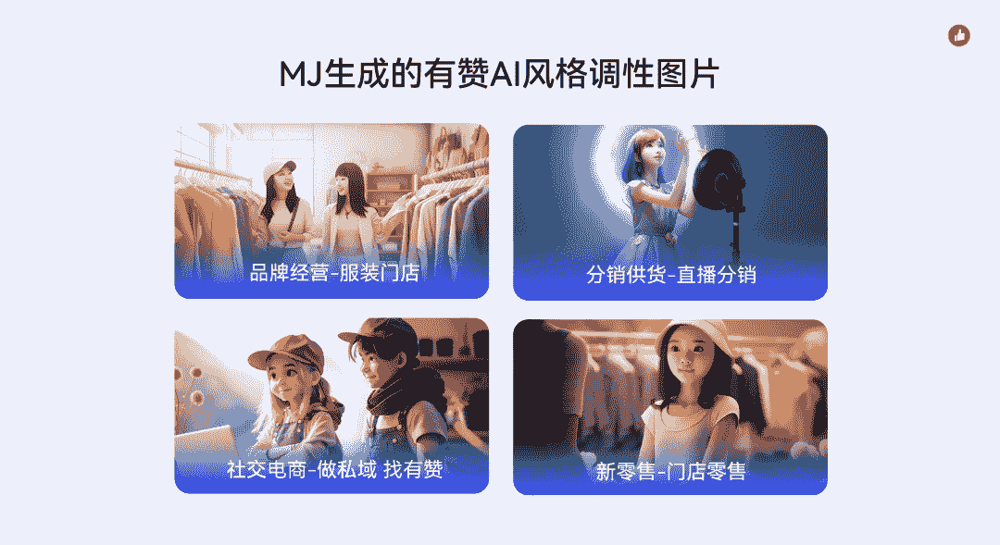
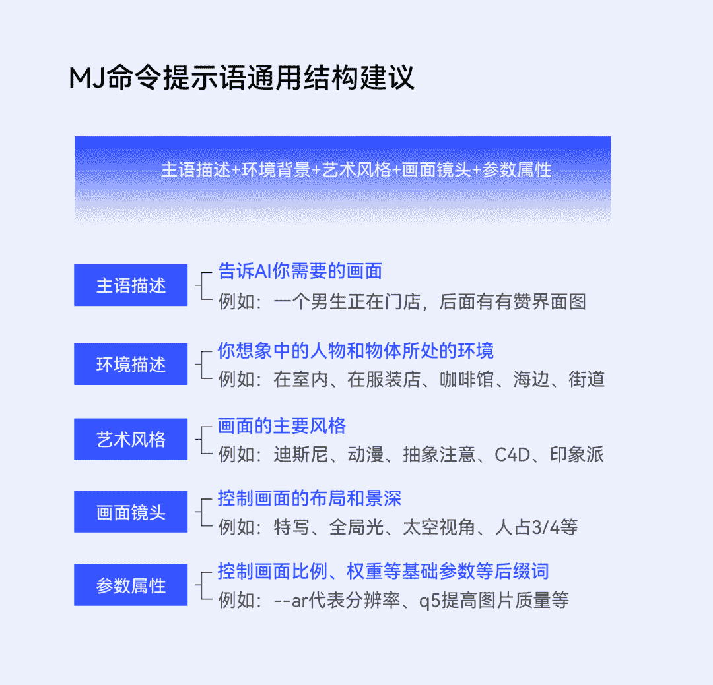
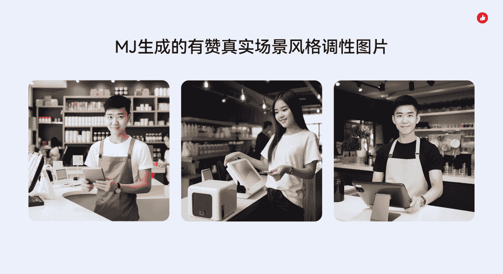
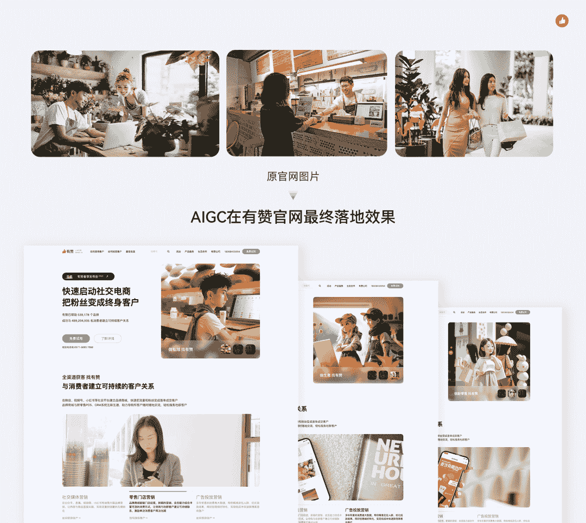
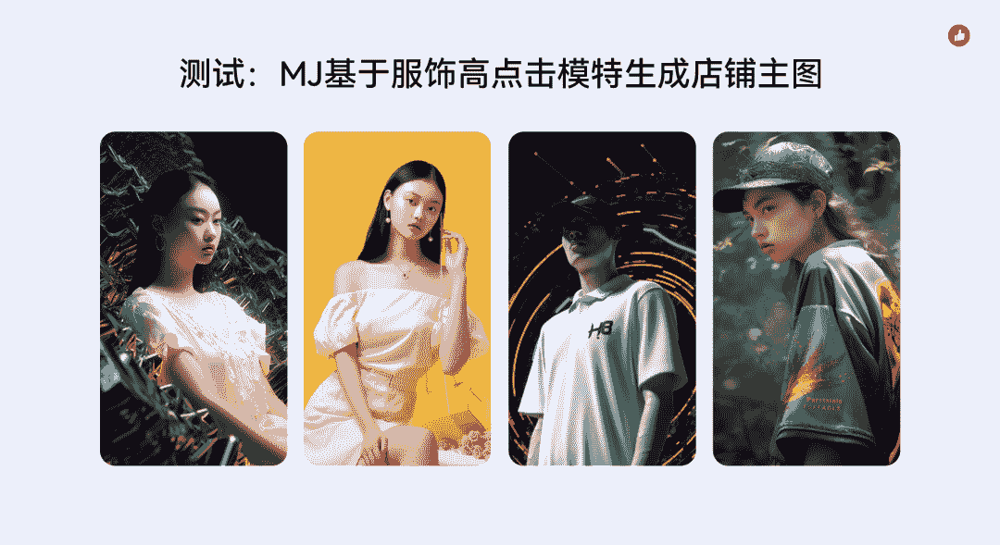
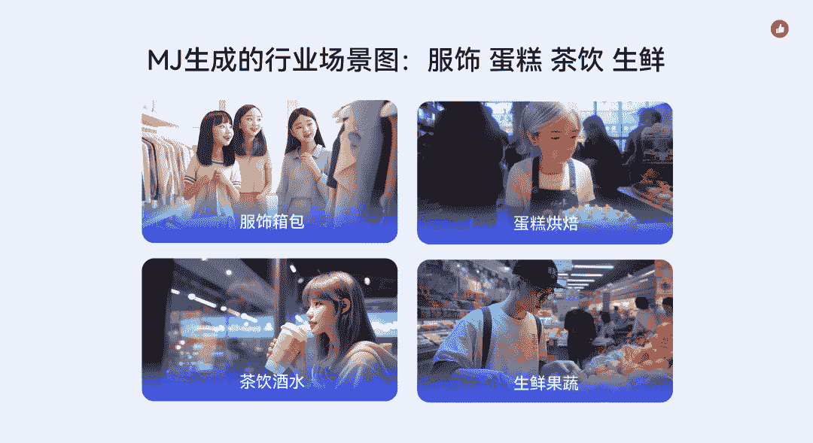
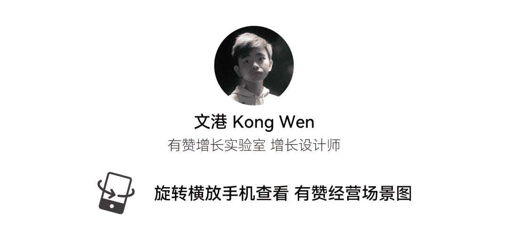
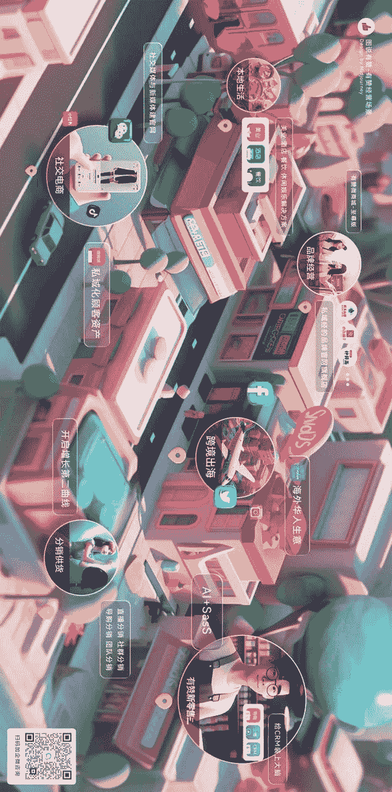

# 有赞增长实验室AIGC实践案例

> 来源：[https://my.feishu.cn/docx/IFYgdv6SKoBaCjxmt6XcfasKnpd](https://my.feishu.cn/docx/IFYgdv6SKoBaCjxmt6XcfasKnpd)

<https://my.feishu.cn/sync/CV7edZp1nspUQobYJhicxeP7nrb>

---

> 内容来源：有赞说

> 原文链接：[点此查看](https://mp.weixin.qq.com/s?__biz=MjM5NDQ5MjUyMA==&mid=2651454215&idx=1&sn=449eaedf6f287c22fd6c0474fefa2fb1&scene=21#wechat_redirect)

> 发布时间：2023-04-12

# **项目背景**

设计界总是一波未平一波又起，从区块链到元宇宙，这轮风开始吹到AIGC，什么是AIGC？AIGC全称（AI Generated Content）是一种新型的内容创作方式。越来越多数字内容工作过程中，创作者需要不断地学习探索和创新，以满足不断变化的市场需求。（本篇文章只聚焦设计内容生成方向，不展开ChatGPT辅助研究能力）

# AI在有赞增长实验室实际设计业务中的应用探索

M2L增长实验室（Marketing To Leads）包含了公域营销（增长工程、广告投放、渠道拓展）、内容营销（内容策划、内容运营、渠道分发）、社群运营（活动策划、私域营销、人群运营）、商机培育（需求探索、商机培育、线索转出）四个核心领域的工程，利用内容、数据、算法，驱动有赞通过搜索引擎、社交媒体等渠道展开精准营销，获得到有效的商家线索，探索用户需求，培育商机并输出给到各销售团队完成商家付费，带来有赞商家数的增长。

随着技术不断发展为设计领域带来了许多变化和机遇，3月中旬我们团队开始了有赞经营场景AI图的打造，从可行性与推广性的角度出发，尝试AIGC在产品、品牌、营销、体验等多个领域应用与探索。

市面上存在大量的AI绘画工具，每个工具擅长的画风也各有所长；例如基于Discord架构下的Midjourney，画面注重细节的构建和表达，Open AI的stable-Diffusion，画风更偏写实，Google的Disco Diffusion画风比较均衡，同时我们也发现每一类不同的模型也会有不同的风格效果，我们主要是使用当下人气最高的Midjourney展开落地。

# **AI绘图的原理简要分析**

说到AI绘图，AI绘图的模型是基于GAN生成对抗网络(GenerativeAdversarialNets,GAN)，是一种基于对抗学习的深度生成模型。信息可以是⽂字、图⽚、声⾳等等，编码器会把所有类型的信息都处理成低维度的 Latent，可以理解为开发人员从互联网数以万计的图片中抓取素材，每一张图片素材都会有对应的文字描述，AI通过识每一张像素点的文案，最终输出专属于你想要的图片。

# 利用Midjourney垫图能力辅助设计官网头图

**AI绘图在电商中有多种应用：**

1、图片修饰和美化：通过使用AI绘图工具，可以对电商平台上的商品图片进行优化和美化，提升商品的视觉效果，吸引更多的消费者。

2、3D渲染和展示：可以利用3D技术将商品进行全方位展示，为消费者提供更加真实、直观的商品体验，增加购买决策的可能性。

3、自动化设计：自动生成商品的设计方案，帮助电商平台快速生成各种风格的设计作品，提高工作效率和创意水平。

4、图像识别和智能推荐：通过对消费者的行为和偏好进行数据分析，AI绘图工具可以实现图像识别和智能推荐，向消费者推荐更符合其需求和兴趣的商品，提高销售转化率。

我们计划进行把官网里面的图片，以图生图的形式， 让AI帮助我们设计符合有赞风格调性的官网首图。

在有赞官网实践案例：首先在创作内容前把你的需求简单描述，在Discord 中将参考图发给它，并结合意向的风格和ChatGPT中生成的关键词，就可以输出初步满足我们预期的图片，加上前提特征分析的描述，例如（主题+环境背景+构图版头+灯光+颜色+风格参考+质量&后缀）

品牌传播与官网首图需要符合品牌特色和调性的图片，以往我们从海量的素材网站找图，往往很难找到和品牌完全匹配的风格，并且M2L在营销传播中经常会使用大量图片在SEM、广点通、📕进行广告投放。现在我们通过MJ生成符合有赞风格调性的图像，可以节省很多拍摄时间和采购成本。

按照以前官网真实照片通过垫底+描述的方式生出了新AI版本的三张图片，并落地在有赞官网，分别是："做私域找有赞”、“做新零售找有赞”、“做生意找有赞”

有赞600万商家，商家每年需要采购和拍摄⼤量商⽤版权图⽚⽤于营销素材（均价1500元/张）。现在使⽤ MJ ⼯具可⽆限生成的多样性素材。⼤幅降低图⽚采购成本，提⾼⽣产效率，下面是我们运用AIGC生成的图片，收集目前有赞商家高点击的模特，测试生成店铺主图，未来AI有着非常多的场景落地。

4月10日有赞门罗春季发布会中，有赞发布了首个AI产品加我智能，目前已上线图文推广（为商品和页面生成更高转化率更被喜欢的推广图文）、活动策划（通过对话明确活动目标和方案并完成复杂的系统配置）两个场景，而在未来，加我智能还将会具备店铺设计、报告分析、销售加强、售后客服、商品制作等能力。

# **AI对于有赞增长实验室的帮助**

**1.辅助创意，视觉品质提升**

在我们历经一个月的探索中，通过使用AI辅助进行相关设计工作。使用AIGC辅助可以提升整个设计的品质，帮团队内设计师产出更高质量的设计，同时我们也储备了一定prompt作为设计资产，可作为图片素材库，为后续快速上线不同经营类目的落地页做准备。

**2.提升效率，快速出图**

业务需要做不同行业不同场景的设计图时，通过AIGC就可以让图片生出咖啡店、水果店、蛋糕店，能快速替换服饰箱包、蛋糕烘焙、茶饮酒水、鲜花果蔬风格的有赞生意经营场景图，下面是我们生成的一些案例图：

# 展望未来，全新的设计模式已经出现

未来，随着AI绘画技术的不断发展和应用，我们将看到更多的艺术作品、设计方案和数字媒体内容将会通过AI绘画技术的支持而得以创作。同时，AI绘画也将会促进艺术设计领域的创新和发展，推动人工智能技术与艺术设计的融合，创造出更多前所未有的艺术形式和体验。我们有理由相信，AI绘画将会为未来的设计和艺术带来更多的新机遇和无限可能，横放手机，一起来看看AI版有赞经营场景图吧！迎接AI的到来！

---

<https://my.feishu.cn/sync/CV7edZp1nspUQobYJhicxeP7nrb>