# 值得买电商设计团队AIGC探索

> 来源：[https://my.feishu.cn/docx/YqE5do4u6oq6AWxu3OscsKrdnMc](https://my.feishu.cn/docx/YqE5do4u6oq6AWxu3OscsKrdnMc)

<https://my.feishu.cn/sync/CV7edZp1nspUQobYJhicxeP7nrb>

---

> 内容来源：值得买UED

> 原文链接：[点击查看](https://mp.weixin.qq.com/s?__biz=Mzg3Mjk2MTcxOA==&mid=2247483698&idx=1&sn=2f7725cb69f4dfefb18d1677e1570650&scene=21#wechat_redirect)

> 发布时间：2023-04-24

写在前面

# —

> 早在今年2月份，我们就通过Midjourney辅助设计，上线了专题 「从入门到 行家 -单板滑雪篇」。一开始上线还是比较忐忑的，因为对于AI的探索大家都刚刚起步，害怕通过AI 生产的专题会遭到用户的反感。但后续得到数据验证，并未影响线上效果，并且还能大大提升团队的工作效率。自此，正式开启了值得买UED的AIGC探索之旅。

> 随着AIGC持续火热，值得买UED团队也一直在探索如何使用AIGC能力辅助设计团队快速落地日常项目。 我们边探索边实践的过程中，目前找到比较好的应用场景主要有【专题头图】和【banner模版】生成。

今天这篇文章主要给大家分享一下我们在「从入门到行家」这个重点栏目IP下，如何使用Midjourney帮助我们快速产出专题设计。

「从入门到行家」系列专题，作为「什么值得买」的精品栏目之一，汇聚了各个行业优质的消费相关的内容。在AIGC辅助设计火爆之前，就已经形成了固定的视觉风格，也得到了用户的广泛认可。

如何提高这个专题的设计效率，并保证统一的视觉风格，是我们一直在探索的问题。随着AI工具越来越强大，我们逐渐探索到了一些方法，并希望与大家一起分享学习。

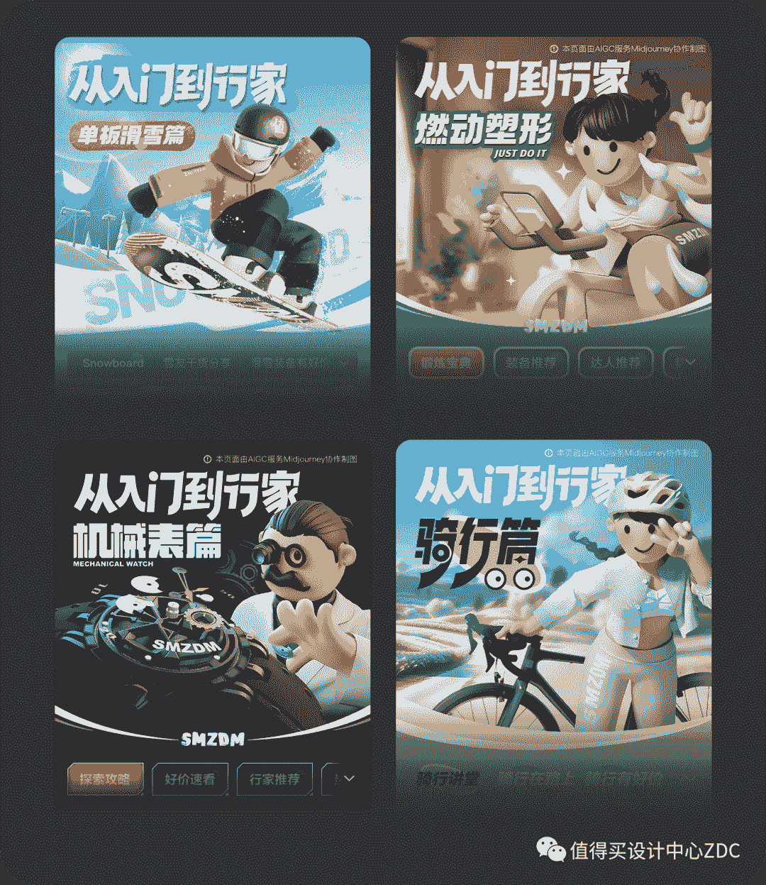

众所周知，一个专题从结构上看，可以分成顶部【头图】和下方【楼层】两个部分。

在【入门到行家】这个专题头图中又可以粗略的分为三层元素，按照重要性从高到低，分别是标题、主体、背景。

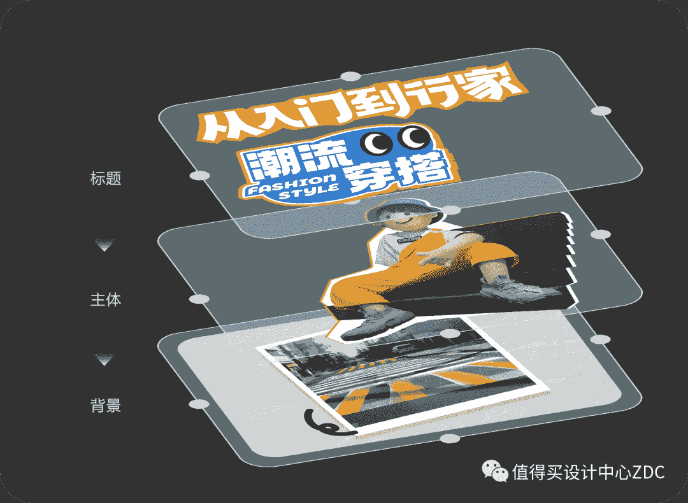

# **01 背景设计**

# **—**

背景是重要性最低的图，主要作用是烘托气氛，是最容易被AI直接完成的部分。

以「从入门到行家」系列之潮流穿搭的专题头图为例。需求方想表现的是街头的潮流穿搭文化。这个时候用一张街拍图片做为背景再合适不过了。于是我在网上找的下面这张图，并简单处理一下。

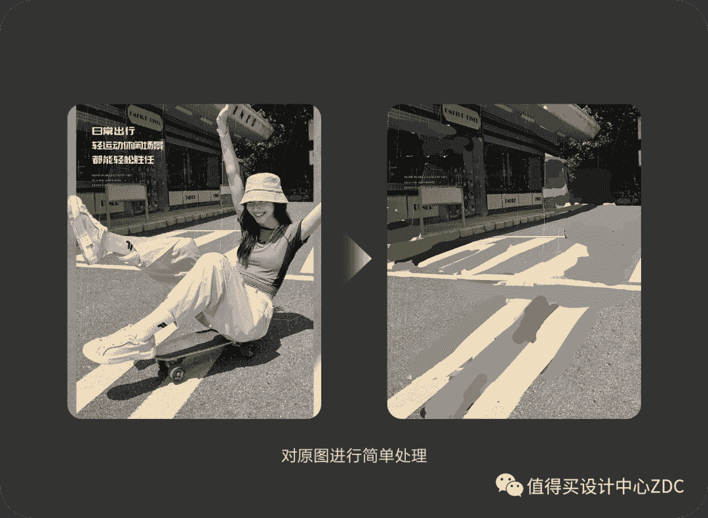

接下来用到了Midjourney的图生文功能。

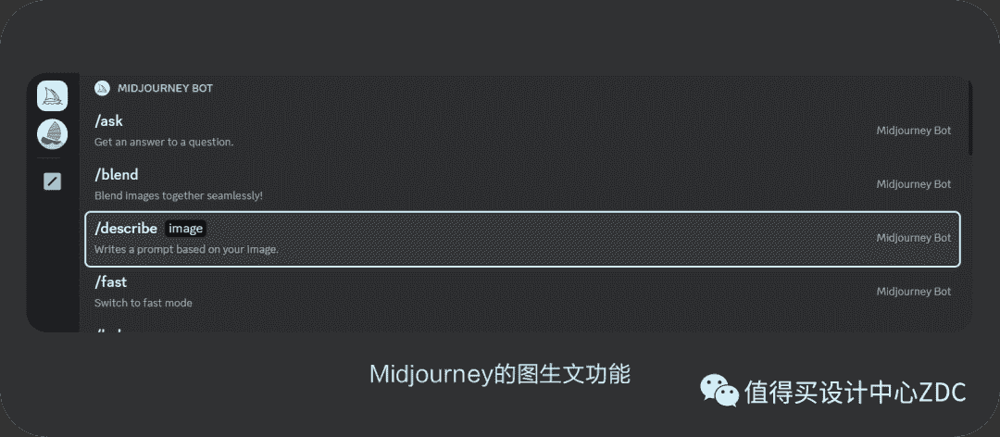

得到了以下提示词

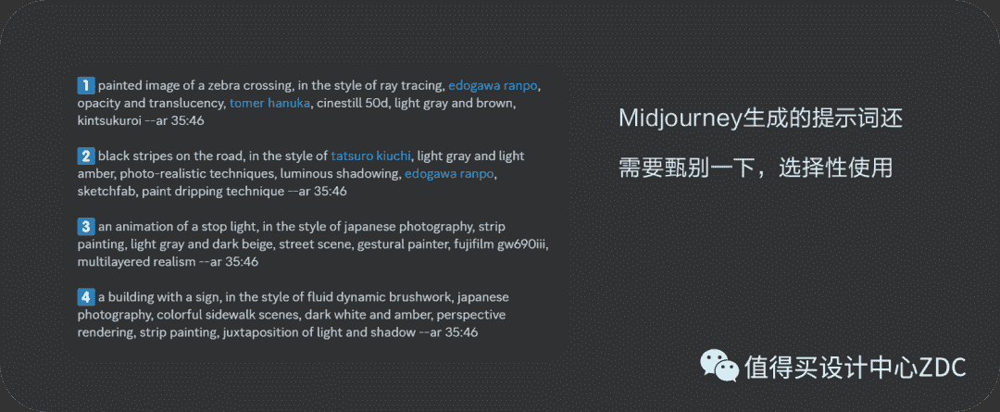

再加上网上收集的其他“咒语”

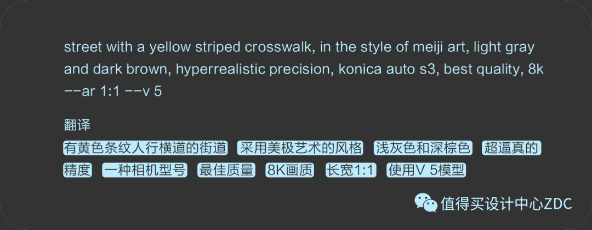

得到如下图片

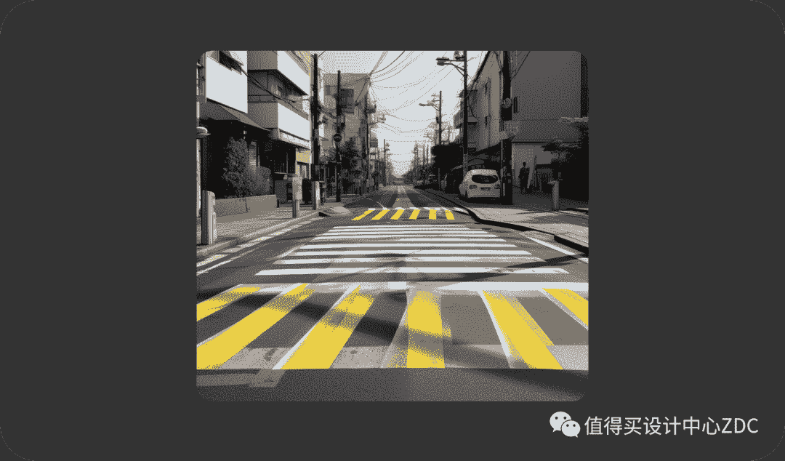

虽然很多细节有问题，但是作为一张图背景图是够用的。最终完成的头图效果 如下：

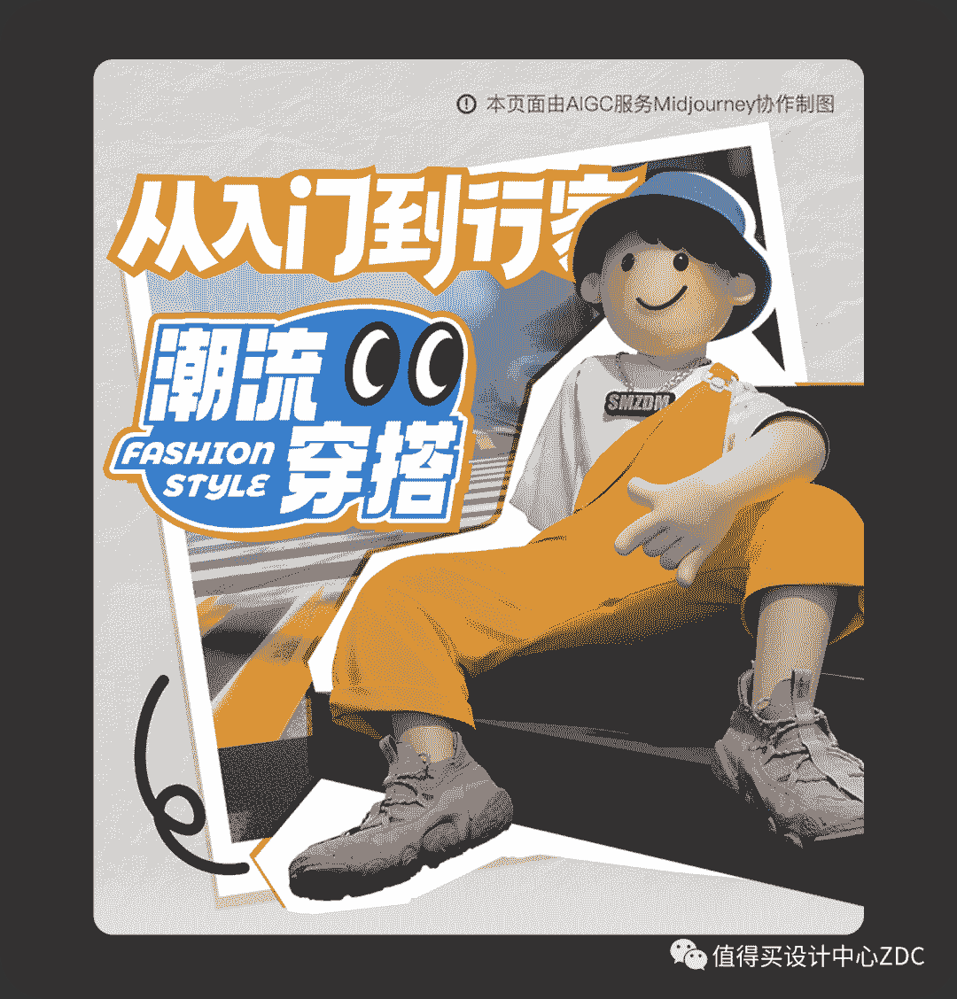

# **02 主体设计**

# **—**

主体部分，我目前还是使用Blender进行制作。之所以不使用Midjourney原因如下：

1.主体的人物形象作为这个系列专题的IP形象已经固定。而Midjourney的随机性较大，不适合生成固定的IP形象；

2.由于骨骼绑定、布料模拟等3D技术的加持，目前效率比在Midjourney里反复尝试更高。

但是，AI技术是未来，相信它能很快克服这些问题。据说Stable Diffusion的可控性更高，接下来会进行尝试。

# **03 标题设计**

# **—**

标题设计，目前基本上没有AI可以胜任。我推测原因有以下2点：

1.设计字体，本质上是要创新，是要设计出没有出现过的形式，否则就是侵权行为。但是，AI做的是学习海量的人类优秀作品，然后找出其中的规律，再应用这些规律来生成作品。所以，让AI以创新为目的来设计字体，它可能真的暂时做不到；

2.汉字的本质是有象征意义的抽象符号。汉字的每个笔划都有着严格的规范，稍有错误就完全不能接受。例如“土”和“士”，只是细微的笔画长短变化意思就完全不同。具象的物体就完全不同了，手指稍长或者稍短，如果要求不严，都是可以接受的。

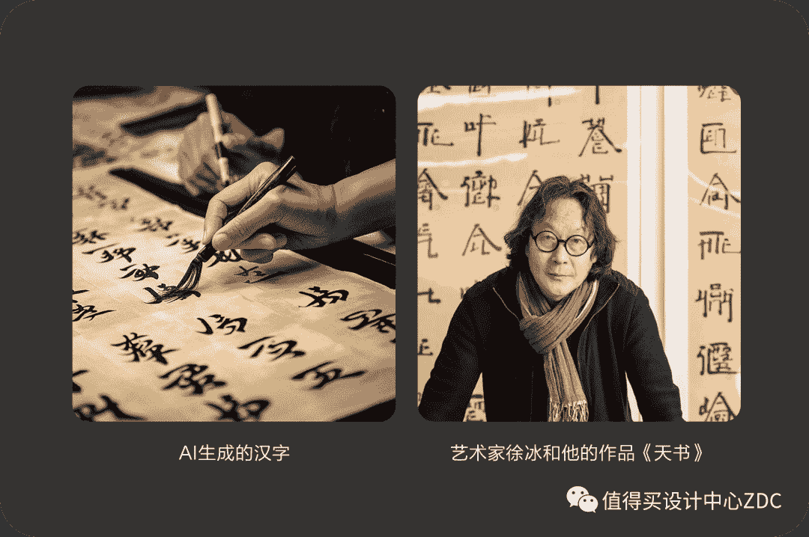

从上图可以看出，AI总结出了汉字形式上的规律，但是生成的汉字没有一个是正确的。这方面很像艺术家徐冰的作品《天书》，只是形式上的汉字，却没有象征意义。如果想让它写正确，就需要AI把每个汉字都训练一遍，估计这个工作需要国内的公司来完成了。

所以，我预测AI短时间对汉字的生成很难完成。看看会不会很快被打脸吧...

# **04 楼层元素的设计**

# **—**

在楼层的元素设计中，我采用了另外一种方式来利用AI，即对AI生成的图片进行深度修改。

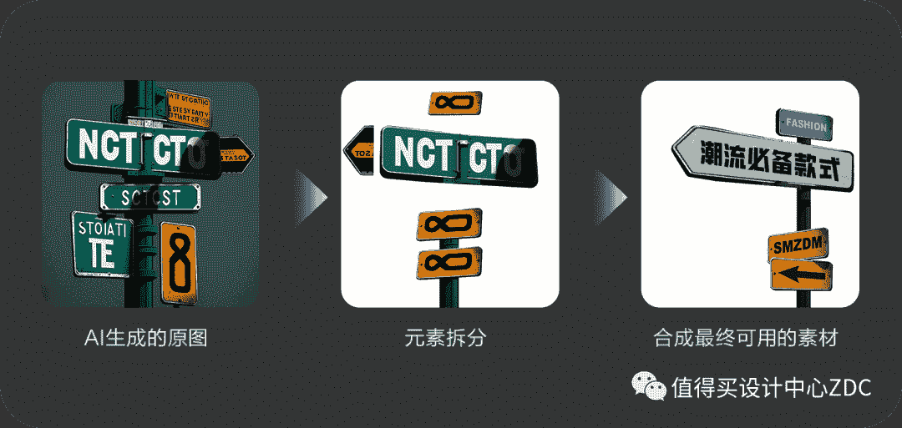

元素最终的应用效果如下：

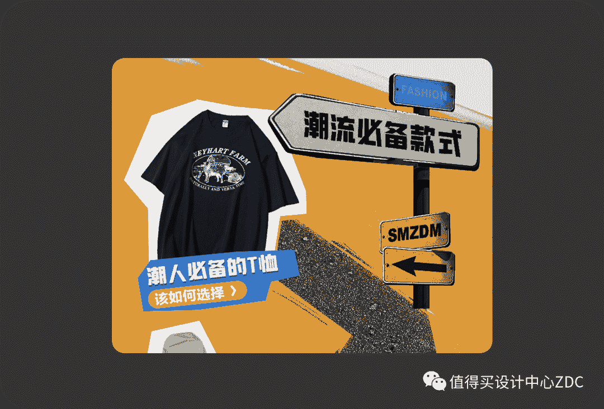

# **总结**

# **—**

Midjourney的优点是快速、完成度高，缺点是可控性差。所以，目前我主要用它完成两方面的工作，一个是前期的灵感激发，另一个是重要性相对较低的背景图。在【 从入门到行家】系列专题的设计中 ，这样做的效率提高约10%到20%。但是，在其他可直接使用Midjourney生成图作为头图的专题中，效率可以提升约80%。

如此大幅度地提高我们的工作效率，难怪比尔盖茨说AIGC的 重要程度不亚于手机和互联网的诞生。 我们会持续学习和探索AIGC在专题设计中的应用方式，并在这里与大家分享。

欢迎大家关注我们🛰️👸号，一起在设计领域探索AIGC，后续也会带来更多精彩内容。

同时您还可以在📕搜索【值得买UED】关注我们，在那里我们会分享更多Midjourney实战咒语和教程。

感谢您的阅读 👏🏻

---

<https://my.feishu.cn/sync/CV7edZp1nspUQobYJhicxeP7nrb>