# AIGC在广告行业的落地实践思路

> 来源：[https://my.feishu.cn/docx/Pyg3dqdO5oBKAUxX9vecf0q4nkh](https://my.feishu.cn/docx/Pyg3dqdO5oBKAUxX9vecf0q4nkh)

<https://my.feishu.cn/sync/CV7edZp1nspUQobYJhicxeP7nrb>

---

> 内容来源：特赞Tezign

> 原文链接：[点击查看](https://mp.weixin.qq.com/s/XaQrTqHwJZbO6XT_dZm8mg)

> 发布时间：2023-05-29

随着ChatGPT、Midjourney等热门AI模型的普及，AIGC已经从“遥远的未来”变成了“可触及的当下”。

2022年，卡夫亨氏、雀巢、可口可乐等国际品牌已经将AI应用于商业广告中。今年伊利、飞猪、钟薛高等中国品牌也陆续发布了AIGC的广告作品。

在查阅上述国内外优秀案例后，我们总结了当前AIGC广告的4种应用思路：

## **👉思路1**

## 将AI 作 为广告的核心创意形式

采用这种思路的品牌未必在广告设计中使用AI技术，他们往往把“AI 人工智能”作为营销中的创意亮点。

今年5月初，肯德基为宣传K萨系列新品，邀请品牌代言人朱一龙共同创作《初次体验与AI对话》。视频中，朱一龙向AI提问：“什么是一见倾心的味道？”。朱一龙并不认同AI的回答，他向AI分享自己的理解，同时将K萨的食材和特别烹饪方式娓娓道出。

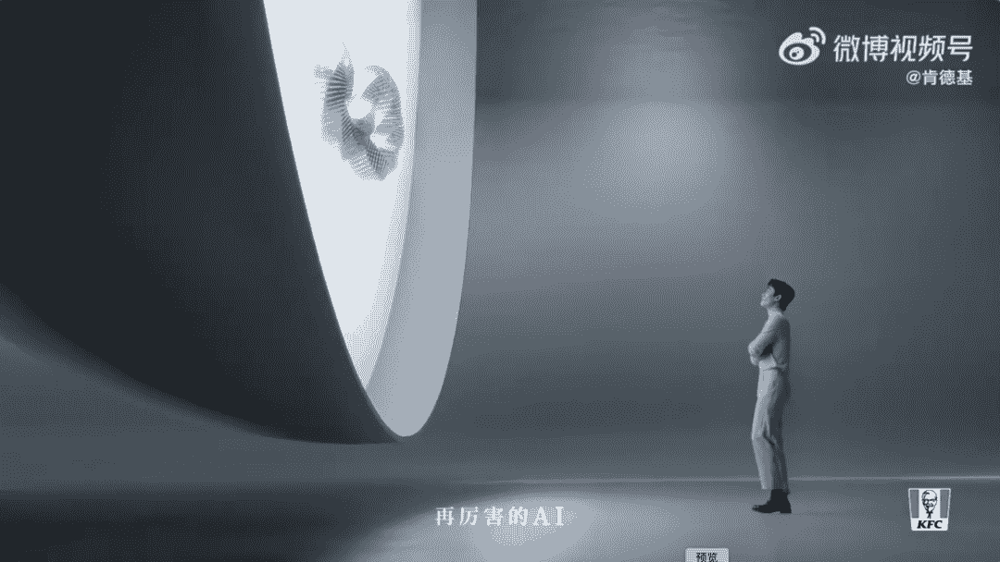

肯德基·初次体验与AI对话

亨氏和雀巢也曾在去年借助AI的创意形式，发布了一些非常有意思的广告案例：

2022年7月，亨氏发布了"Heinz A.I. Ketchup"的创意广告。利用AI图像生成工具DALL-E 2，通过「以文生图」的方式画出不同的番茄酱。然而，无论向AI输入什么千奇百怪的关键词，最后生成的图片都像“亨氏”的产品。

视频的结尾“It has to be Heinz Ketchup (一定是亨氏番茄酱)”的文案出现，仿佛在人工智能的世界里亨氏已经建起了自己的番茄酱王国。

[🎦 点击观看视频](https://v.qq.com/txp/iframe/player.html?origin=https%3A%2F%2Fmp.weixin.qq.com&containerId=js_tx_video_container_0.4353117664126509&vid=z3351xoq4nn&width=661&height=371.8125&autoplay=false&allowFullScreen=true&chid=17&full=true&show1080p=false&isDebugIframe=false)

亨氏· Heinz A.I. Ketchup

雀巢旗下乳制品品牌La Laitière一直以来在品牌宣传中使用约翰内斯·维米尔的油画作品《倒牛奶的女佣》。2022年9月La Laitière发布视频，记录了在DALL-E 2的“Outpainting”功能帮助下，这幅油画作品被慢慢拓展开来的过程。

画面中不再是倒牛奶的女佣独自一人——左右突然多出了十几个围观倒牛奶的“观众”。原来单调的场景也变得丰富生动起来：天花板的横梁、挂在墙上的锅碗瓢盆、桌子下探出头来的小孩......

在AIGC的协助下，La Laitière带消费者看到了画外可能存在的一种风景，也引出了La Laitière品牌的标语 “C'est si bon de prendre le temps（花时间品味美好的愉悦时光）”。

**除了在广告物料中运用AI作为创意亮点，在与**消费者互动时也可以在机制中加入AI工具。

今年3月，可口可乐发起“Create Real Magic”的比赛，邀请消费者们一起参与这场AIGC的共创之旅。粉丝们登入网址，挑选喜欢的可口可乐的品牌元素，通过Dall-E 2和GPT-4这两款AI模型的赋能，人们通过“以文生图”的方式便能轻松地完成一幅创意作品。

4月中旬，在3CE与天猫为品牌年度会员日发布的“春日AI花神装”活动中。品牌为每一款主推的口红产品对应设计了不同的“花神妆容”。消费者被邀请上传自己的照片，通过AIGC以图绘图的方式，消费者可以生成自己独一无二的AI花神装照片。

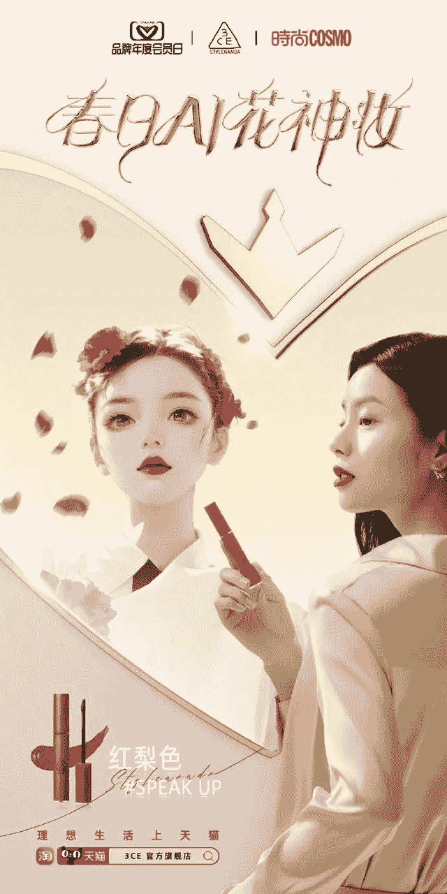

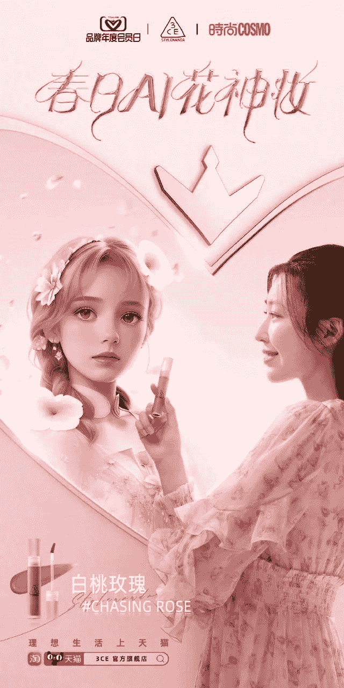

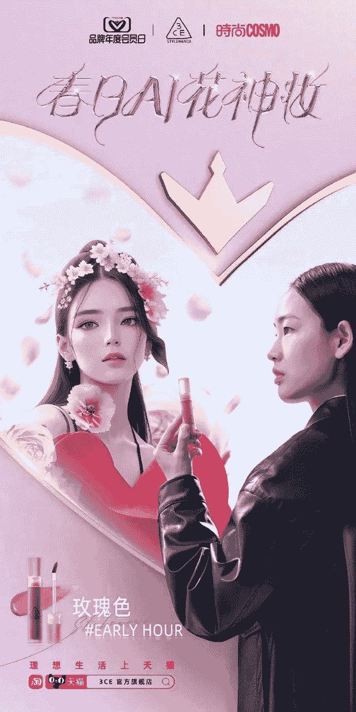

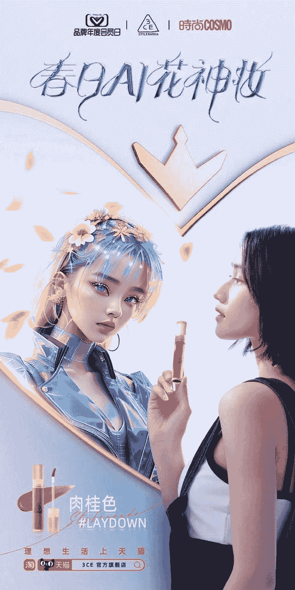

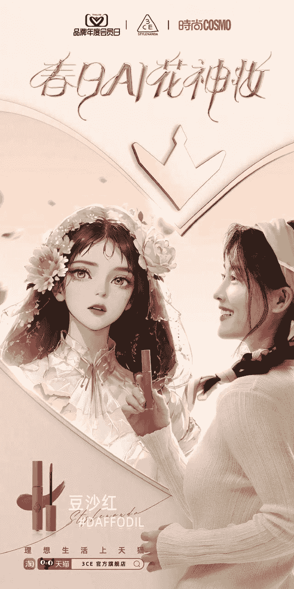

3CE春日 AI 花神妆

## **👉思路2**

## **将AI作为传播物料的设计工具**

当AI作为传播的物料工具时，ChatGPT等AI模型可以被用来智能生成创意文案，Midjourney、Stable Diffusion等AI绘画工具也被大量运用在平面和视频类广告的制作中。

不得不提可口可乐在今年3月发布的经典广告片《Masterpiece》。在这条广告大片中，可口可乐贯彻着"Real Magic"的理念，将美术馆里的艺术作品和现实生活联系在一起，让名画生动上演了一场“艺术馆奇妙夜”。据悉，这条广告是实拍、3D制作和AI绘画合力完成的，而其中AI的部分则借助了AI绘画工具Stable Diffusion。

[🎦 点击观看视频](https://v.qq.com/txp/iframe/player.html?origin=https%3A%2F%2Fmp.weixin.qq.com&containerId=js_tx_video_container_0.00903141806751906&vid=f3506rcr6r1&width=661&height=371.8125&autoplay=false&allowFullScreen=true&chid=17&full=true&show1080p=false&isDebugIframe=false)

可口可乐Masterpiece（杰作）

丹麦国家旅游局鼓励大家前往丹麦，不只是做一名游客，而是成为一位深度探索者。3月，丹麦国家旅游局也使用了AIGC技术使蒙娜丽莎、梵高等名画作品“开口说话”为丹麦旅游代言。

这则广告中应用了deepfake和运动合成技术。广告文案也是由AI语言模型智能生成。VisitDenmark 的市场总监弗莱明 · 布鲁恩(Flemming Bruhn)提到：“100%的脚本都是由人工智能AI技术生成。我们没有书写一个字，只删除了太长或不真实的部分。“

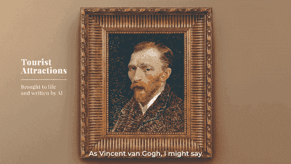

名画开口说话

除视频广告案例外，平面广告中的AIGC应用案例更是不胜枚举。

5月，淘宝品牌but lab围绕新品“苦命甜心”为主题，创作了系列海报。文风犀利而戳心地道出职场中的内心独白，海报的视觉风格也颇为独特。

对于不熟悉AI绘画工具的消费者而言，其实很难发现这些背景图片也是由AI生成的。

虽然作品中使用的AI作画工具还没有那么“完美”，细究也会发现破绽：背景往往是复古风格、人物妆造和场景搭建也有一些年代感、电脑和人的比例偶尔会出现错误、画面中即使出现了文字也往往是不可读的语言。

但无论如何，我们也会不由得惊叹：现在的AI绘画在细节和精美度上可能已经超乎了我们的想象！

而作为品牌方来说，模特、场景搭建、拍摄，这些广告流程和不小的预算如今在AI的帮助下都可以被节省下来。

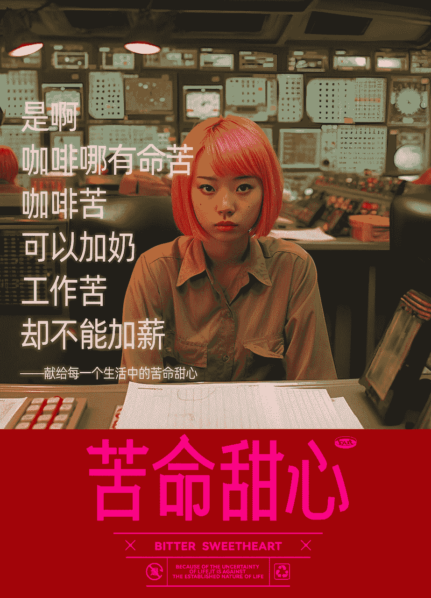

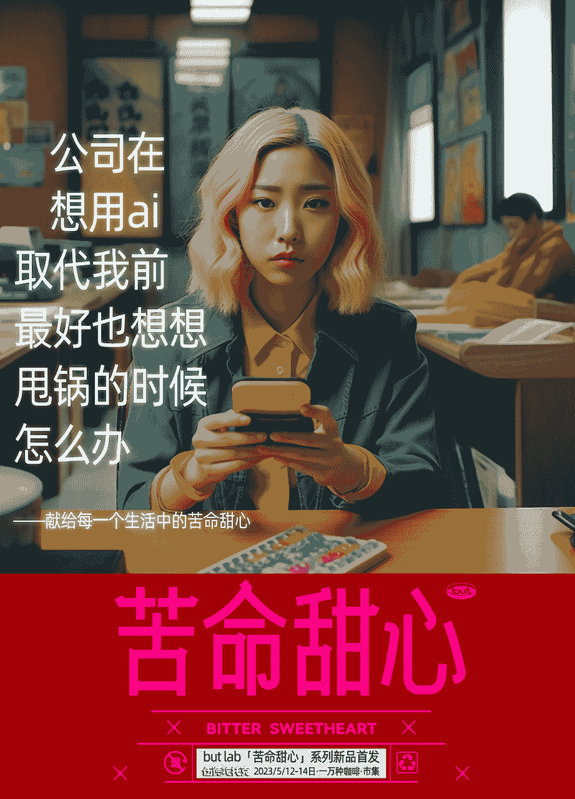

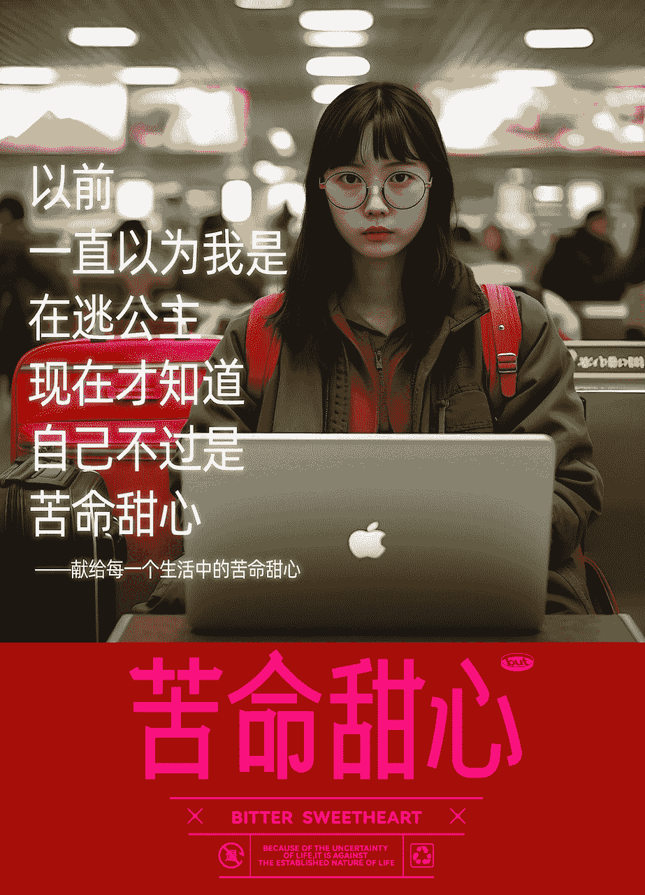

but lab苦命甜心海报

今年4月初，飞猪在地铁站投放了由AI制作的系列户外广告。飞猪通过AI工具将想象中的旅行目的地绘制了出来。飞猪官方🛰️👸号发布文章“1小时，飞猪用AI做了1000张平面广告！”，讲述了这批AI平面海报背后的故事。

美团优选的省钱系列海报、爱彼迎(Airbnb)与北面(The North Face)使用Midjourney共创的《Stay Exporation》系列海报、梦百合的《AI梦剧场·72遍》等案例，也在平面广告的方向做了不同艺术风格的AIGC尝试。

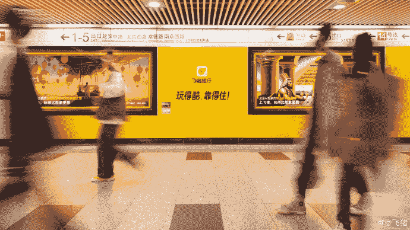

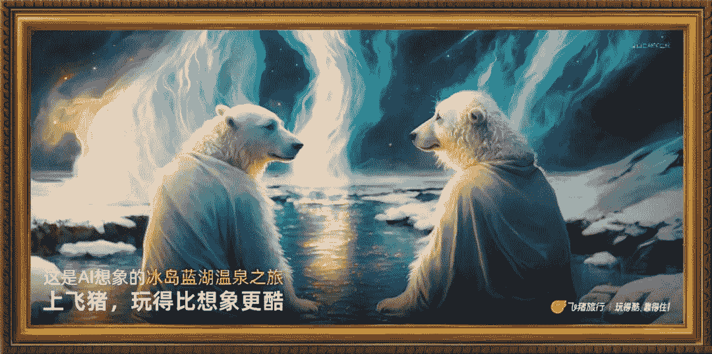

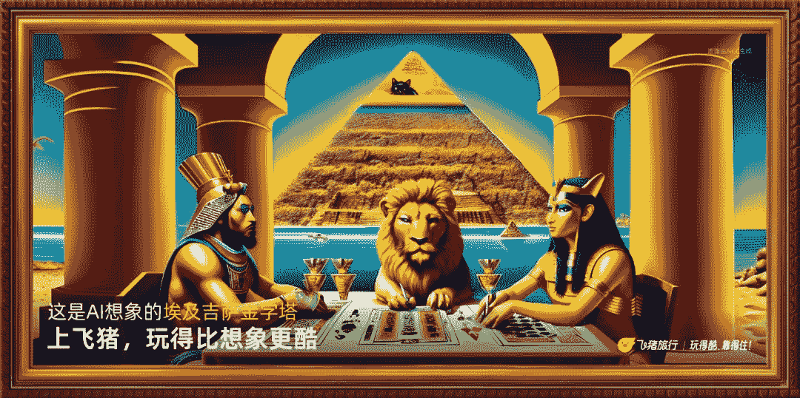

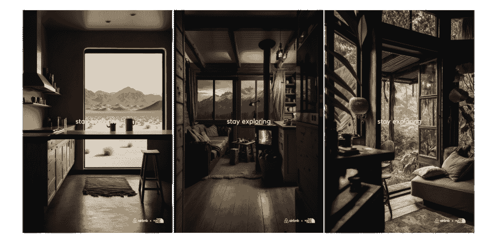

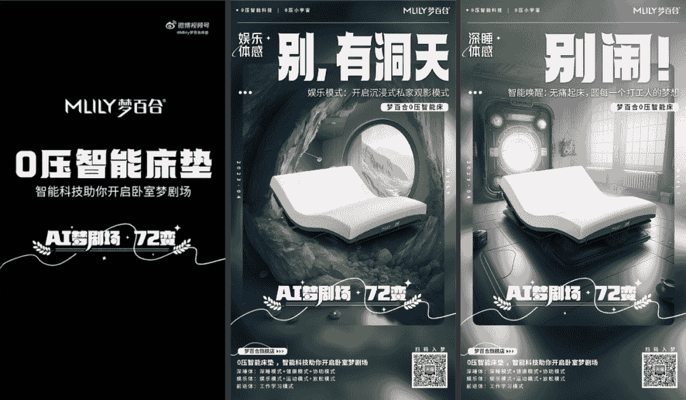

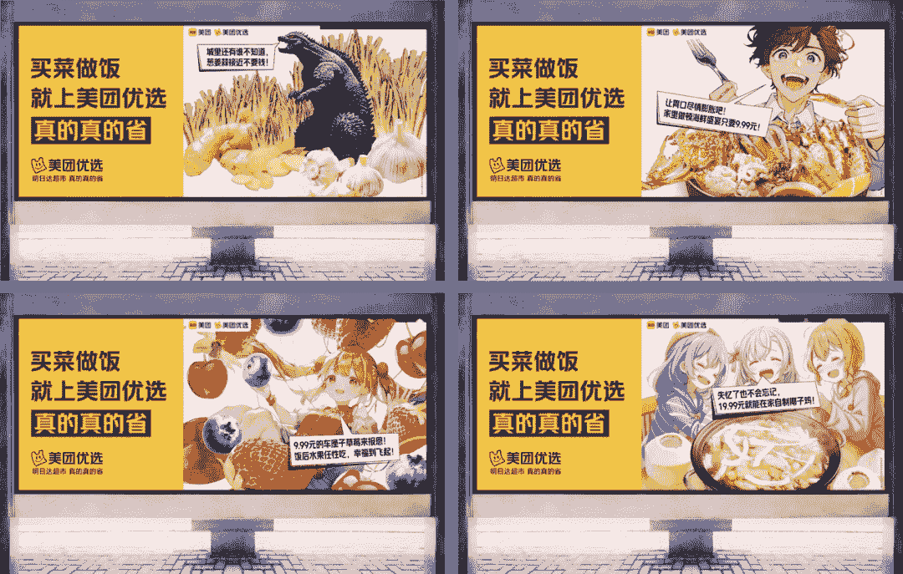

各大品牌在AIGC的商业实践中主要使用了这3款AI绘画工具：

**1. DALL-E 2**

DALL-E 2 是在2022年下半年发布的AIGC海外广告案例中最常被使用的AI模型。

它由Open AI开发，是一款可以根据文本生成图像的人工智能系统。通过使用"Inpainting"和"Outpainting"的功能，艺术家可以智能拓展画面、部分改变画面元素。

**2. Midjourney**

由于注册门槛和设备局限较低，Midjourney已是当下在国内使用人群最为广泛的AI制图工具。

无论是专业设计师还是美术，通过关键词的描述，在短短1分钟内Midjourney就可以生成4张精美的图片供你选择。

Midjourney生成的图片可以实现艺术风格丰富多样，对材质细节的把控也比较细腻。

除了“以图生图”以外，Midjourney还可以上传参考图片通过“垫图”来生成与参考素材更加相似的作品。然而，它的出图稳定性不高，这也成了当下使用Midjourney来AI作画的痛点之一。

3. Stable Diffusion

Stable Diffuison是另一种AI模型，并且是一个开源的项目。

通过ControNet插件的使用，使得Stable Diffusion的功能更为强大。通过ControlNet为模型添加额外的控制调节（如检测边缘、检测深度结构、提取人物姿势等），可以帮助创作者生成更符合预期的绘画作品。

由于功能更多和出图质量的稳定性更高，Stable Diffusion成为了当下AI设计师们热衷挑战与学习的重要AI绘画工具。使用它作图的设计师常戏称自己为“炼丹师”，而出图的过程也叫“炼丹”。

不过，Stable Diffusion对硬件和使用者的要求更高，也为它的普及构建了比较高的门槛。

这三款AI图像生成模型各有自己的特点，从艺术风格上也不尽相同：

Youtube博主Wade Mcmaster在《BEST AI Art Generator? Dall E 2 vs Midjourney vs Stable Diffusion》中的测评中提到：

**DALL-E： **生成的图片效果往往不如其他两款语言模型。

**Midjourney： **生成的作品非常具有艺术风格，对人物面部的细节把握更好。让人眼前一亮。

Stable Diffusion： 风格更加写实，对"照片"风格的艺术作品往往有稳定的把握。但有时容易丢失一些面部细节和材质细节。

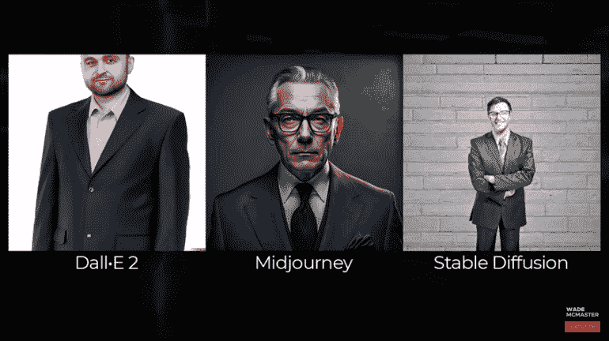

关键词：商人,照片

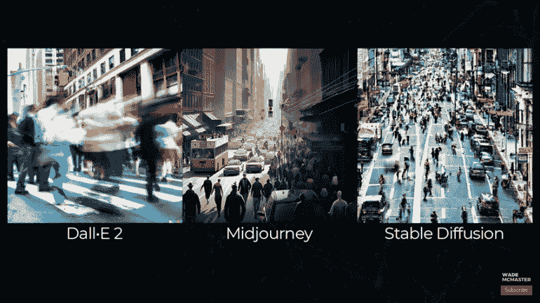

关键词：忙碌的城市街道

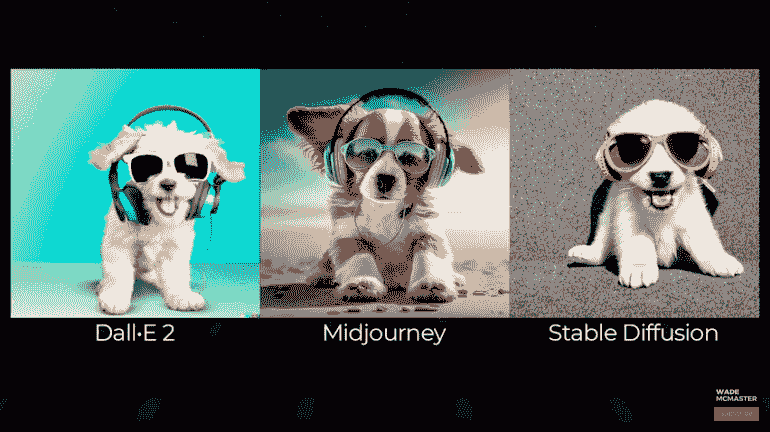

关键词：一只可爱的小狗,戴眼镜,戴耳机

## **👉思路3**

## **将AI作为产品设计的重要工具**

今年3月底，钟薛高推出单价为3.5元的新品Sa'saa系列冰淇淋。从「名字由来」、「口味选择」、「包装设计」到「产品推广」的几个产品设计重要环节都是由AI完成的。

伊利在4月底也发布了6款不同风格的牛奶包装，而这些包装设计都是由AI生成的。

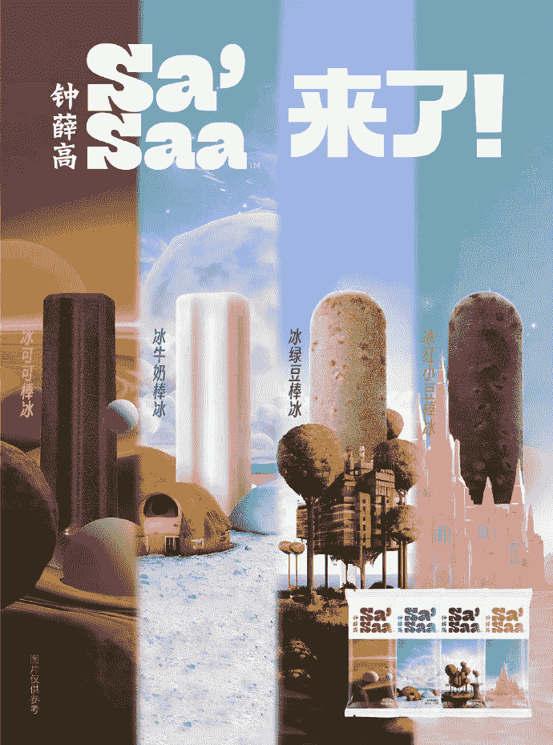

钟薛高Sa'saa系列冰淇淋

## **👉思路4**

## 将AI作为广告工作流程的优化工具

**在这**个思路下，我们在出街的广告案例中未必能看见AI的痕迹。但在广告背后的生成环节里，AI发挥了非常重要作用。未来，如果在广告生产环节里充分利用合适的AIGC工具，可以帮助品牌解放生产力、实现降本增效。

+   **营销策略支持： **通过ChatGPT等AI工具来协助完成市场调研、策略洞察。

+

+   **激发创意灵感： **通过AI绘图工具来进行大批量的视觉探索。在美术风格的阐述上帮助设计师们的答卷从“填空题”变成“选择题”。同时，也可以帮助已经形成自己独特美术风格的摄影师去做一些新的探索。

+

+   **助力广告提案： **可以使用AI工具来制作moodboard和场景demo。相较于以往图库找图的方式来说，AIGC不仅在视觉呈现更接近设计师的想象，找图效率也可以大幅提升。

+

+   **节省预算开支： **AI可以通过文本直接生成图片。这对于写实风格的作品来说，甚至可以节省摄影、搭建、差旅、模特等开支；如果使用AI生成符合版权规定的视觉素材，也可以节省租图费用。

+

+   **完成适配性/延展性设计： **可以通过AIGC针对不同细分市场、不同细分用户做更多适配性的设计，提高广告投放效果；通过人工智能技术的不断完善，相信在未来我们针对同一物料的不同投放要求做细化延展时，AIGC能发挥更多的作用，将设计师从这一部分机械重复的工作中解放出来。

在特赞最近 的商业实践中，我们也真实感受到了AIGC为我们工作流带来的改变和惊喜。

**5月3日，特赞AIGC STUDIO 为**伊利品牌创作的微缩食物海报正式上线了。 在大家即将回归上班的日子，伊利提出“继续放假”的畅想。而我们利用AIGC，将伊利的明星产品与各种脑洞场景相结合，对应伊利的9款明星产品分别设计了9张海报。

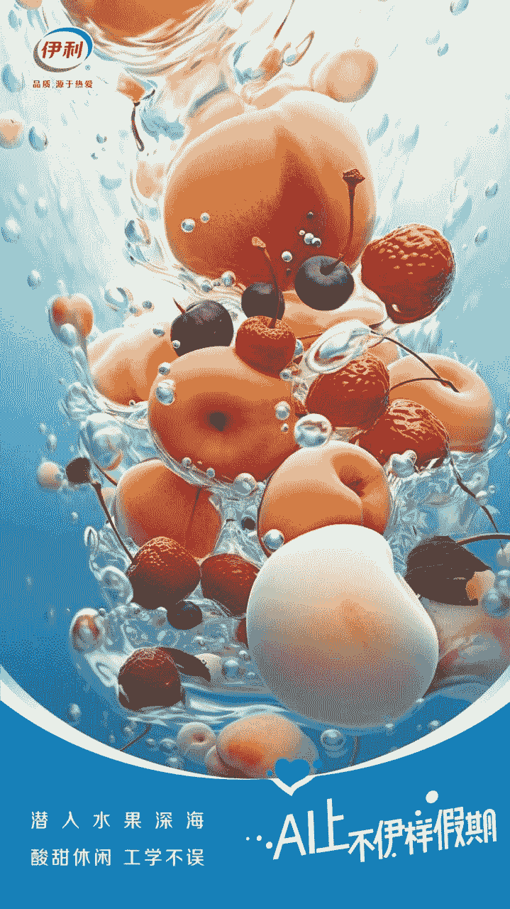

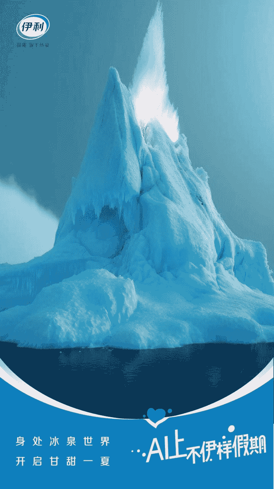

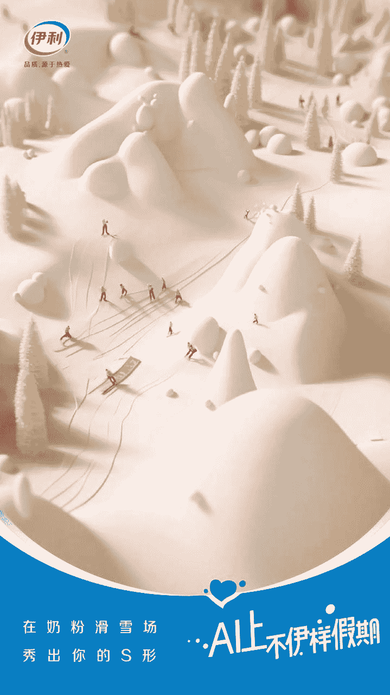

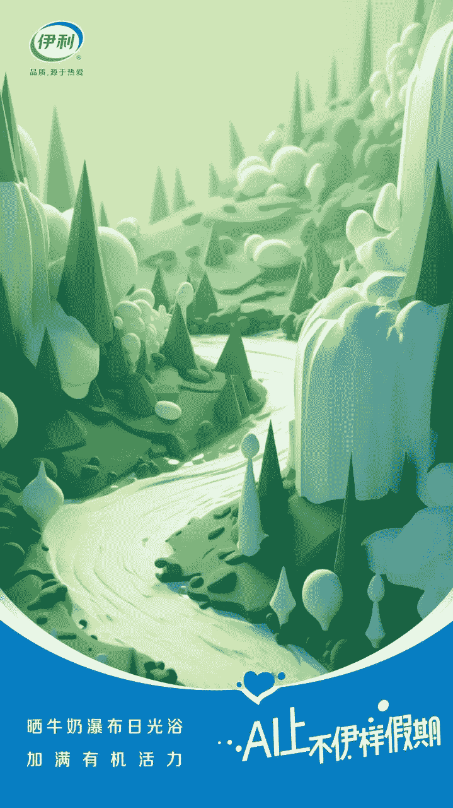

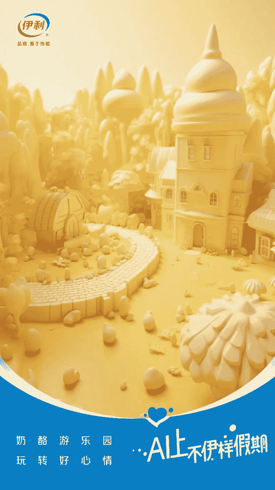

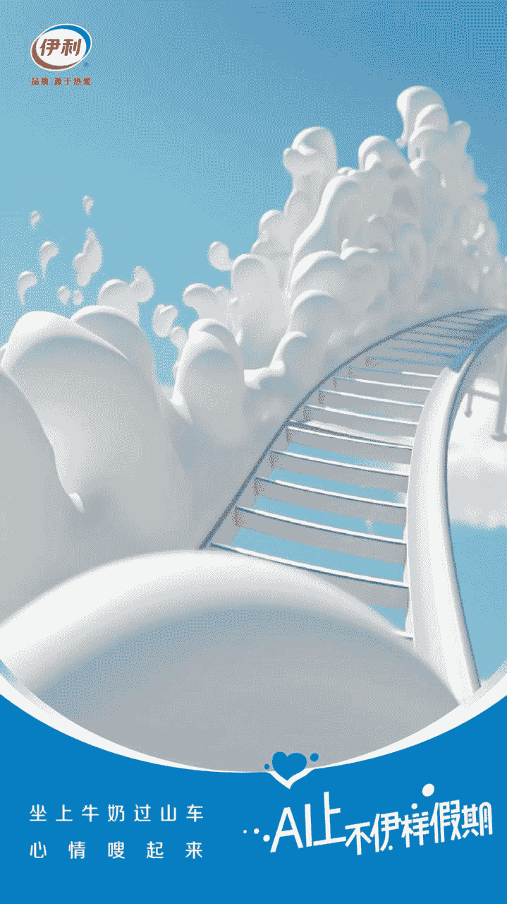

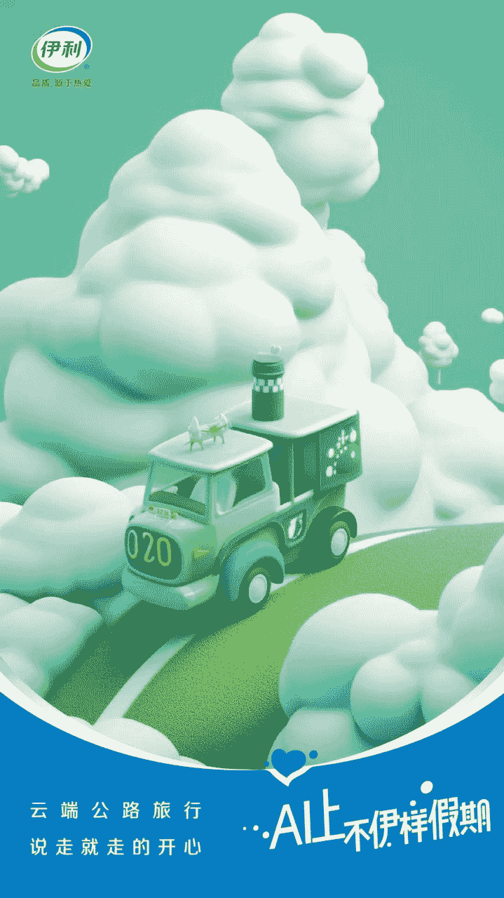

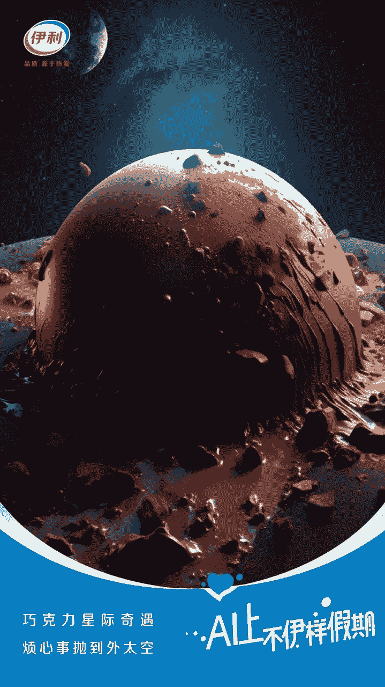

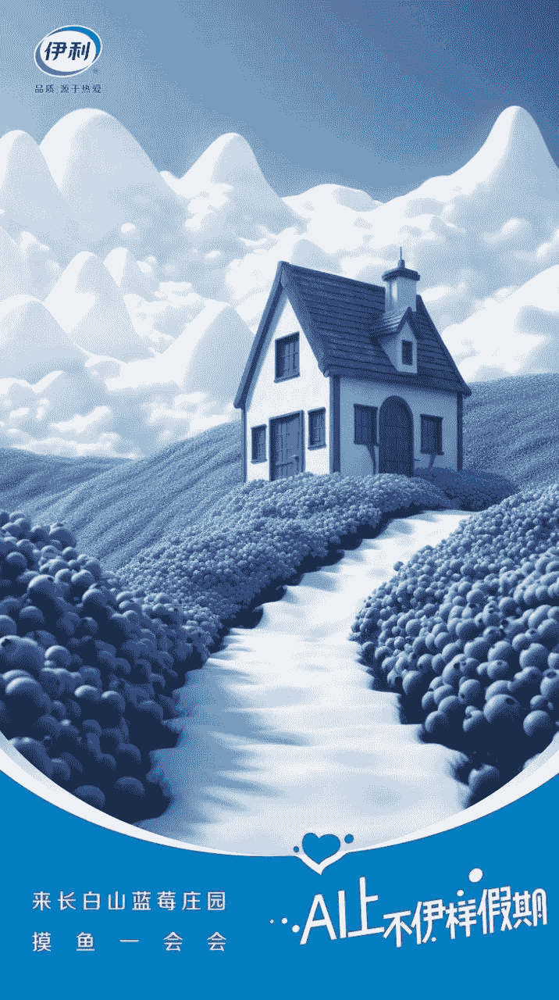

伊利AIGC五一海报

海报整体呈现出五彩缤纷的度假感，画面充满想象空间。牛奶瀑布日光浴、长白山蓝莓庄园、云端公路旅行、潜入水果深海、牛奶过山车、奶粉滑雪场、巧克力星际奇遇、奶酪游乐园......打破时空、地域限制，游客一键清除，收获不「伊」样的假期。截 至 🧣话题发布后8小时，互动量已达3.3w。

**整个campaig**n从brief到交付， 仅用时5个工作日 ，在AIGC的深度参与下，内容生产工作流成功实现了流程提效。

## **💡写在最后**

随着人工智能应用的热度不断上升，在AIGC领域也不断产生过“AI是否会取代设计师”的热议和讨论。在我看来，这个问题答案是否定的。

因为“设计师”三个字中最重要的是具有创造力的“设计”。当我们使用关键词在Midjourney尝试生成图片的时候，若没有任何的想象力、没有对Midjourney的语言的储备，要完成一 幅 很棒的作品是相当困难的。

正因为我们善于思考：思考画面应该什么风格？画面里应该出现什么内容？我应该如何向ChatGPT问出更好的问题？——AI的设计作品中才会有创意的火花和魅力。

**我们不妨去思考，在日常工作中有什么内容是枯燥的、重复的**、机械的。那这一部分是否可以用AI替代？

当下各类AI工具都有自己对应的学习门槛，各个品牌或团队在广告领域对于AIGC应用还处于探索阶段。我们呼吁对AIGC有兴趣、有信心的伙伴们，都可以继续坚持学习、保持热情！

**特**赞在AIGC STUDIO、MuseDAM、DAM.GPT这3款产品的赋能下，可以为企业客户提供以下解决方案：

+   用AIGC做视觉海报，策划执行AIGC Campaign

+   AIGC Playground提供100+ 开源模型，激发更多想象力

+   **将AIGC引入企业完整的系统工作流**，用品牌内容资产帮助品牌训练自己的GPT

+

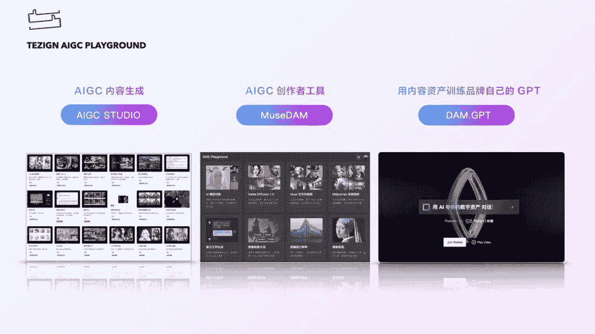

---

<https://my.feishu.cn/sync/CV7edZp1nspUQobYJhicxeP7nrb>