# 对话雀巢/安慕希聊聊AI包装设计

> 来源：[https://my.feishu.cn/docx/A41ddevzEo9yhuxjLqSccdjIn1e](https://my.feishu.cn/docx/A41ddevzEo9yhuxjLqSccdjIn1e)

<https://my.feishu.cn/sync/CV7edZp1nspUQobYJhicxeP7nrb>

---

> 内容来源：FBIF

> 原文链接：[点击查看](https://mp.weixin.qq.com/s/4OxBbTqeyLhi6CCoGyI6Gg)

> 发布时间：2023-05-10

作者：Chain、圆圆

DALL·E、Stable Dif**fusion**、Midjourne[y等“ AI设计师 ”横空出](https://mp.weixin.qq.com/s?__biz=MzA3ODEzMjg5Mg==&mid=2652461702&idx=1&sn=b5a8f6c97f405a7e47ec4575fd1006b4&scene=21#wechat_redirect)世以来，“ AI是否会颠覆食品包装设计 ”成为了业内热议的话题。

这一波讨论高潮迭起，不仅由于AI图像的生成质量令人惊艳，以“分钟”甚至“秒”为单位计的生成速度也是重要原因。有人兴奋地表示，AI必将颠覆包装设计！也有人持反对意见，认为AI出的图根本称不上是“设计”——好看，但不具备商业价值。

在上期文章中，FBIF曾在一整个包装设计流程中 探索用AI设计食品包装的潜力和局限 ，发现AI的“设计作品”充满创意，但难以控制。最终的商业落地，仍然需要人类设计师的参与。

AI设计是否最终会被商用，“客户”视角无疑极为关键。

鉴于此，我们向来自雀巢、玛氏、安慕希的品牌/设计总监提出了以下几大 关键问题：

+   如何看待AI目前生成的作品效果？

+   **目前是否已经在使用、或未来是否考虑应用AI**进行或辅助设计流程？考虑怎样的应用形式？

+   当AI辅助设计技术进一步发展，是否会对设计的效率和成本提出更高要求？

+   **使用AI设计，是否影响品牌对设计作品价值的**判断？是否会改变与外部机构的合作方式？

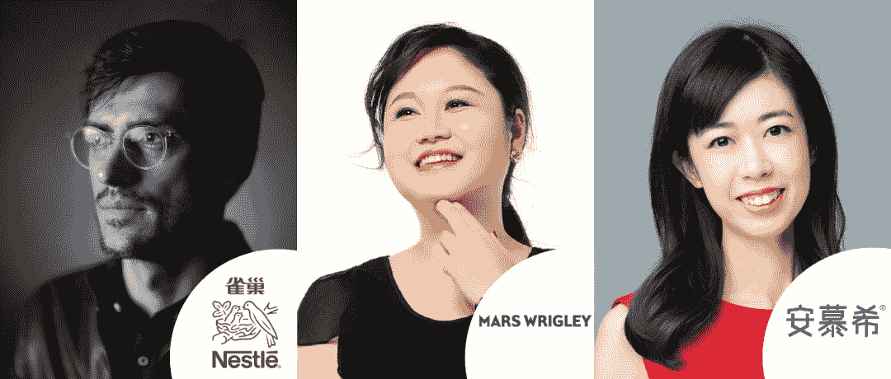

FBIF采访了雀巢全球视觉识别与设计主管Bruno Singulani，玛氏箭牌设计部副总监苏丽娜，以及伊利集团液态奶事业部安慕希品牌总监陈彦汝，看他们分别对AI设计持有怎样的看法。

###

###

### 如何看待AI目前生成的作品效果？

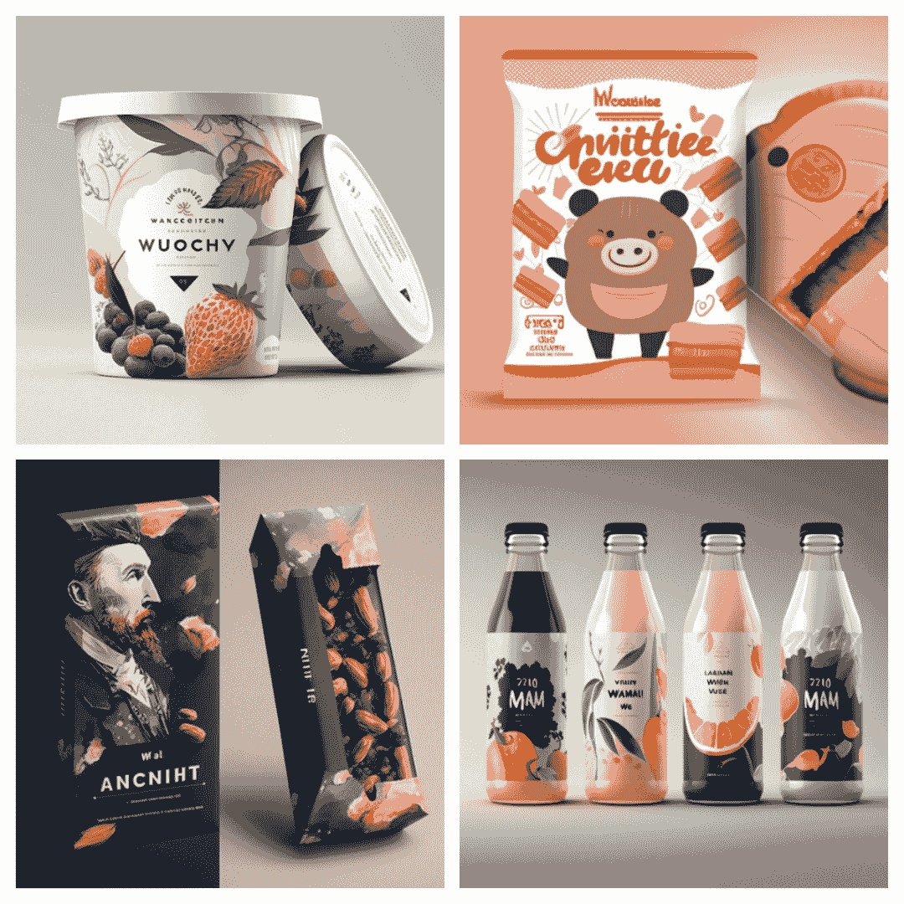

使用Midjourney生成的部分包装设计作品

图片作者：FBIF

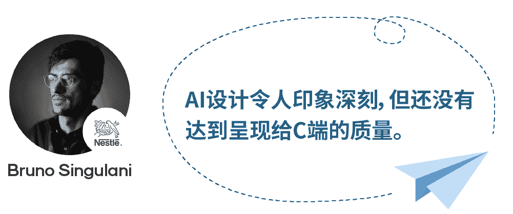

AI设计令人印象深刻，已经体现出明显的价值。 至少对我来说，将AI用于可视化、提供灵感，都是很好的应用方式。 不过，我认为AI作品还没有达到直接呈现给消费者端的质量。

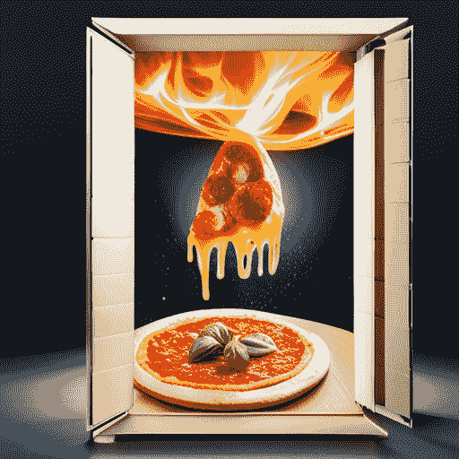

Stability AI生成的披萨盒图片

图片作者：FBIF

比如，设计新的披萨包装时，我希望在图上做出芝士流淌下来的效果。利用目前已有的AI工具，我可以快速地看到有哪些角度和光线可以选择，以及它们可以生成大致什么样的效果——这完全可以加快设计的探索阶段。不过，这些生成的作品都非常粗糙，后续还需要对作品进行细节调整，才能达到面向消费者的作品质量。

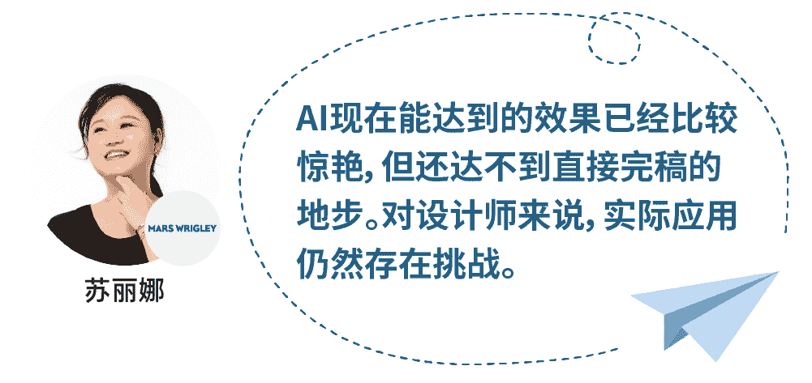

Midjourney出图的效果确实很美，但对于设计师来说，实际应用仍然存在挑战。

从生成图像的功能上来说，Midjourney存在以下一些局限：

首先， 它不太能支持品牌规范手册的细节设计要求 。比如为益达无糖口香糖设计包装，不仅要保证Logo与整体图案有机地结合，而且Logo要占到一定的比例、放在指定的位置，这些都是与品牌心智相关的设计规范。Midjourney目前很难处理这些细节。

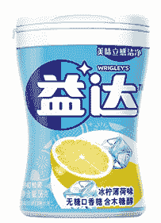

益达无糖口香糖

图片来源：Wrigley箭牌天猫旗舰店

第二， **对词意的理解不一定准确 **。很多时候，品牌风格是我们前期定义的，但AI对词意的理解却是从**网络上**汇总的。比如，某糖果品牌是一个“ 搞怪 ”的风格，但AI对“搞怪”的理解可能与品牌的理解不一致，做深层次的设计就容易产生偏差。

第三， 做平面的图像可行，但3D立体的生成相对较弱 。目前，用Midjourney要做3D立体的东西，或者在结构上进行一些设计的时候，质量就不算特别好。

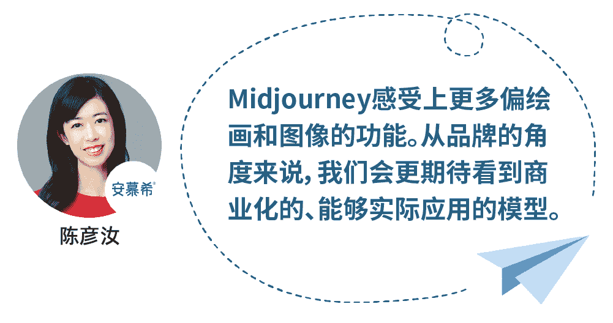

总体来说，现在能达到的效果已经比较惊艳，但还达不到直接完稿的地步，仍需要设计师做一些迁移的工作。

从目前生成的一些图像来看，我觉得Midjourney感受上更多偏绘画和图像的功能。这也意味着它对我们提Brief的能力要求很高——我们要非常清晰地知道自己想要什么，然后输入到平台，才有可能生成合适的图像。

其实从品牌的角度来说， 我们会更期待看到商业化的、能够实际应用的模型 。我们有尝试做一些简单的运用，但是会发现，这些产品目前商业化开发得并不是非常完善。我们伊利的其他品牌也有去与百度等公司做一些前端的交流，但还没有看到商业化的具体可行模式。

###

目前是否已经使用AI辅助设计流程？

**有怎样的应用形式？**

###

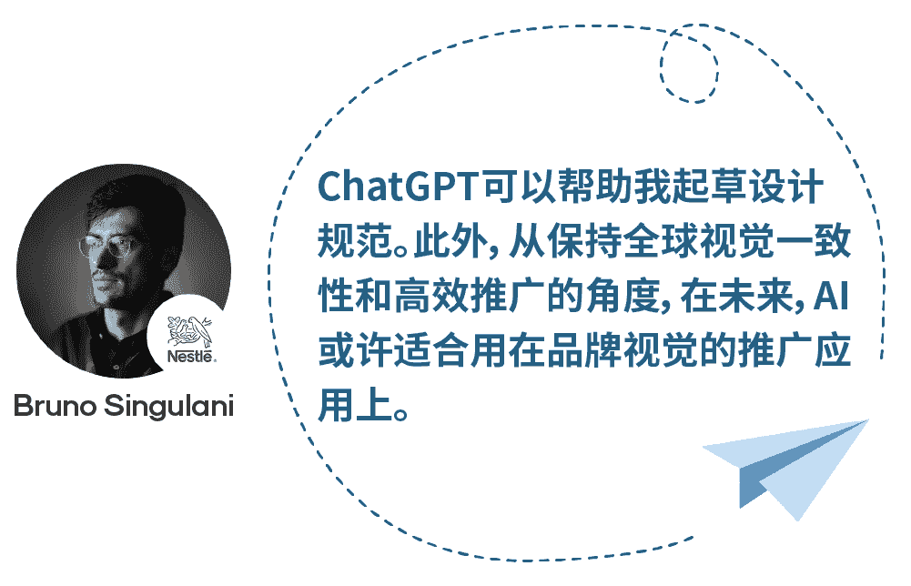

我大概从去年9月就开始了对Midjourney、DALL·E这些软件的探索。探索下来，我认为AI在概念的可视化上面可以得到很好的应用。比如，Midjourney非常擅长为抽象的概念配图。当我需要一张抽象的图片，比如说演示幻灯片的封面图片时，它可以根据主题生成效果很棒的图。

**此外，作为跨国品牌的设计主管，除了**设计工作以外， 我也经常需要撰写全球的设计规范文件——这里ChatGPT就能够派上用场了 。让ChatGPT来起草一份包括食品造型、摄影、字体等规范的文件，它会生成一份看着还不错的草稿。其实，AI从网上找到的参考资料，和我自己去搜索到的结果是大差不差的；在此基础上，我可以继续加入品牌设计风格等，让它继续完善……整个过程，会比自己拟草稿要快上很多。

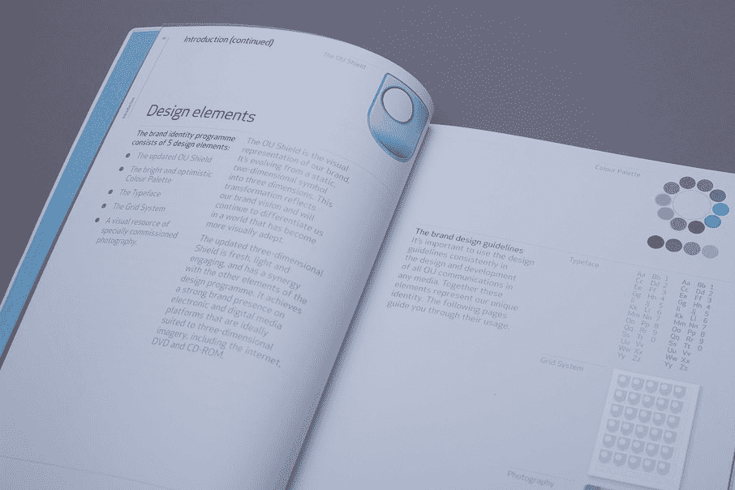

The Open University Brand Design Guidelines

图片来源：Flickr

此**外，在品牌视觉的推广应用这一点上，就算出**具了统一的设计规范，全球各地的设计师还是会从自己的角度去理解，自行做一些延伸和创造。 从保持全球视觉一致性和高效推广的角度，如果未来发展成熟，AI或许更适合做这件事。

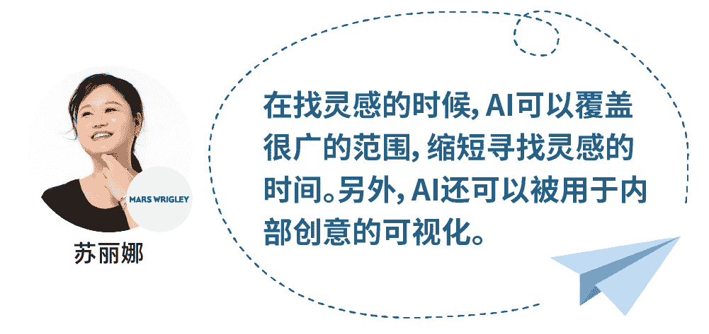

我们目前在做两方面的尝试：一方面研究有哪些AI工具，它们能够做到什么；另一方面在做一些小型试点，将AI应用在实际工作中可能产生的任务里，看看能起到哪些帮助。

探索下来，我们认为AI工具有两个点特别好。

一个是用在找灵感的时候，AI可以覆盖很广的范围，缩短寻找灵感的时间。 我们平时的设计工作流程是这样的：首先，我们根据Brief或者项目背景，来思考设计的点，或者要表达哪些内容，写下一些关键词。然后，我们会去一些设计师常用的网站，比如Instagram，输入这些关键词来获得相关灵感和启发。最后，结合这些灵感和元素的启发，思考具体如何应用。

在寻找灵感的时候，设计师大概搜索两三个网站，几乎就能获得所需的内容。理论上，A**I应该**可以在更短的搜索时间内，覆盖更广的范围。另外，AI生成的内容也会有一些“ 变体 ”，带来一些意想不到的惊喜。

Visualization

图片来源：Pixabay

**另外一个是内部创意的可视化。 **在产品团队围绕一个新品进行脑暴的时候，并不是每个参与的人都是设计师。因此，相比枯燥的文字，非设计师的伙伴可以借助AI工具，快速生成高质量的图片，对自己的创意进行更加直观的呈现。有了这样的图片，也可以帮助团队成员快速理解其他人的创意，进行更加高效的讨论。

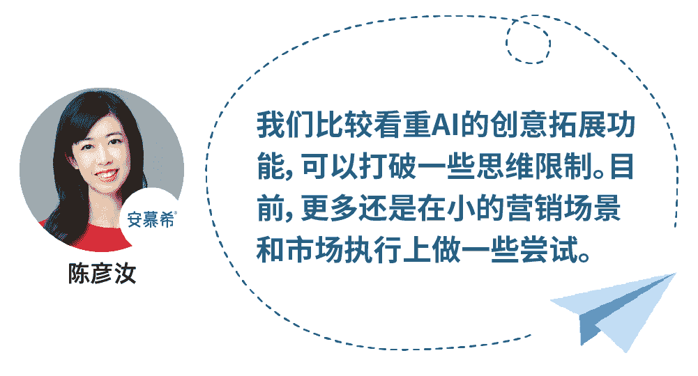

目前阶段， 我们会比较看重AI的创意拓展功能 。

安慕希经常会与其他品牌做一些跨界联名合作，需要做很多元的延展。假如哪天AI系统可以成熟商业化落地，并且能够确保版权无风险，我们比较期待AI系统在短时间内给到很多种demo，以扩大前端的创意开口，从而给品牌方提供更多选择。

因为我们拒绝循规蹈矩，尤其是在联名拓展的时候，总是希望看到更多的“雏形设计”。如果是人类设计师，很多时候可能只会提供一个或者少数几个选择，有时也会受限于品牌VI的限制——而我们希望AI可以打破这些限制。

**不过，我们目前还没有正式做从零到一的商业应**用，比较担忧的还是法律法规方面的问题。

首先，不同国家、不同行业都会有不同法律法规的要求，AI本身的版权争议也很大。哪怕不考虑AI，设计版权的保护本身就不简单。在市面上，安慕希的包装设计就遇到了很多“盗版”，有的产品甚至达到了远远看上去能“以假乱真”的程度。但即使要起诉这样明显的设计侵权，我们仍然需要提交大量的举证，整个过程非常复杂。

所以，AI设计的版权这个点特别微妙，你没有办法判断这个产品有没有侵权，也不知道如果遇到版权纠纷，AI设计的这个成品能不能胜诉，法院判定的时候会不会考虑AI因素——这些风险目前都无法规避。

因此， 我们更多的还是在小的营销场景和市场执行上做一些尝试 ，比如店招海报。这种需求对创意要求不高，但是数量很多，而且运用场景差异化较大。举个例子，如果在上海不同的小店做类似的海报，根据店的地理位置和道路名，又想要做一些设计的差异化。假如使用AI，理论上就可以根据这些细节的不同，产出差异化的店招设计。

###

###

### 是否会要求更高的效率或更低的成本？

### **会更加看重团队的哪些能力？**

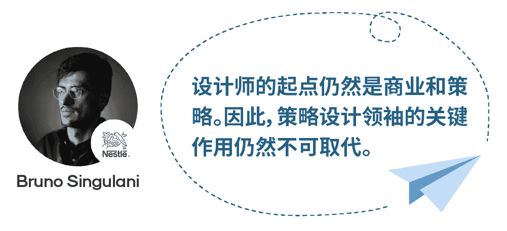

说到速度，人类总是比不上机器的。对一个**全球品牌来说，在品牌视觉诞生或更新后， 假如使用**AI工具可以成本更低、速度更快地将新视觉推广到各个市场的所有产品，肯定是很棒的 。

而**作为品牌设计团队，我们要学会如何**更好地评估和表达自己的需求。毕竟，Midjourney的生成图是基于你输入的关键词（prompt）—— 所有的AI工具都无法给我们提供最初的想法，而创意，是从最初的想法开始的 。

作为设计师，你的起点仍然是商业和策略，通过设计解决的是一个商业问题，面对的是不同市场的复杂性。 所以，策略设计领袖的关键作用仍然不可取代。 他们需要将这些复杂因素放在一起考虑，并制订整体的设计策略；同时，他们还需要考虑策略的执行，如何去改进现有的视觉资产等。

假设**在**未来，AI设计技术进一步发展，只要输入品牌颜色和标志、产品品类、竞品信息、信息层级等，AI可以将这些都综合纳入考虑，并输出非常有效的包装设计。那么这个时候，问题又来了： 如何打造差异化？从如今的Midjourney等软件上，不难发现，生成的设计看起来都有那么一些相似——这些作品，你总会觉得曾经在哪里看到过。 而有的时候，你会很明显感觉这张图就是AI生成的。

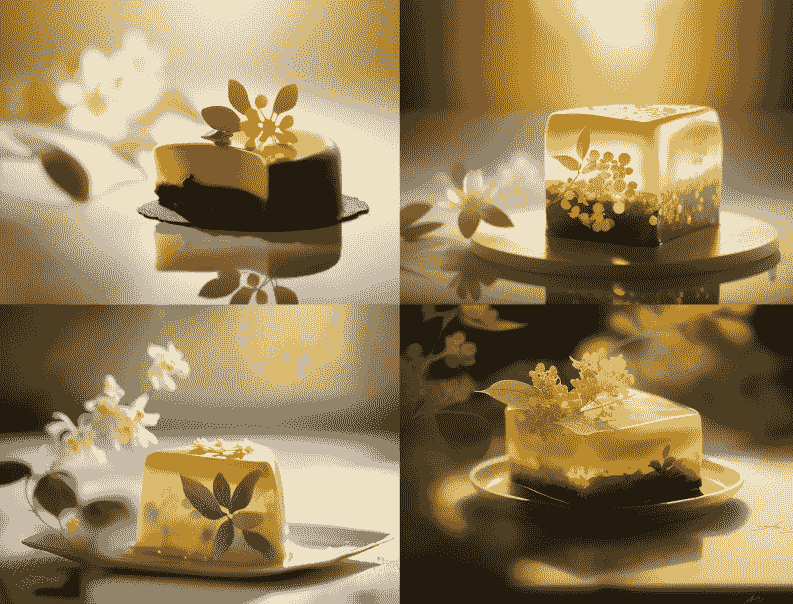

Midjourney生成的桂花糕点

图片作者：Jenny

因此，当AI设计推广开来时，要如何再次打破常规，塑造品牌独有的资产，从同品类中脱颖而出？这也会是非常重要的能力。

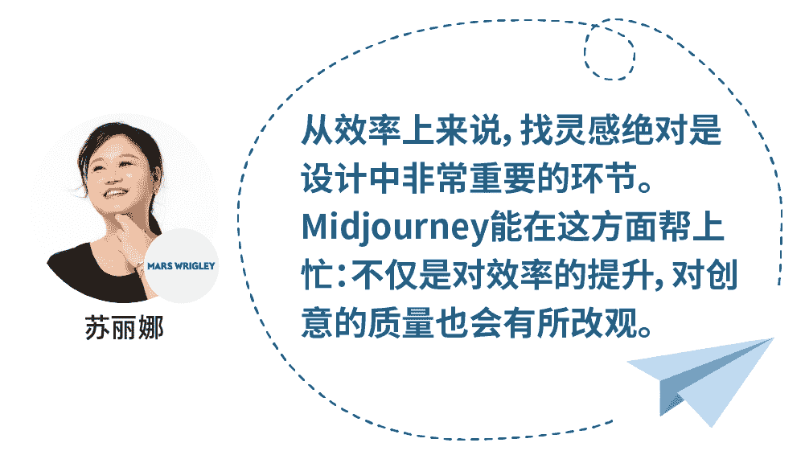

确实，我们会有一些这方面的期待。我觉得拥抱新事物是很棒的，我们团队内部也在讨论可以如何更好地应用这些工具。就像我前面说的，我们在出方案前第一步是寻找一些启发（Stimulus），然后去讨论我们想要的是什么样的感觉，但是 语言文字的表达还是不如视觉直观 ，所以往往会找一些素材来帮助表达。而有了Midjourney的帮助，我们就可以在更广的层面上，更迅速地表达自己的想法。

虽然Midjourney目前不能生成最终的完稿，但是单从找灵感的方面上，它就可以起到很大的帮助。 从效率上来说，找灵感绝对是设计中非常重要的环节。 所有的创意都不是凭空诞生的，就像小时候写作文，也是需要找一些范例做参考，去启发自己产生灵感和创意。所以，Midjourney能在这方面帮上忙，不仅是对效率的提升，对于创意的质量也会有所改观。

未来，我觉得在如何去构建关键词来快速得到较好的AI可视化呈现，会是对设计师的一个新要求。

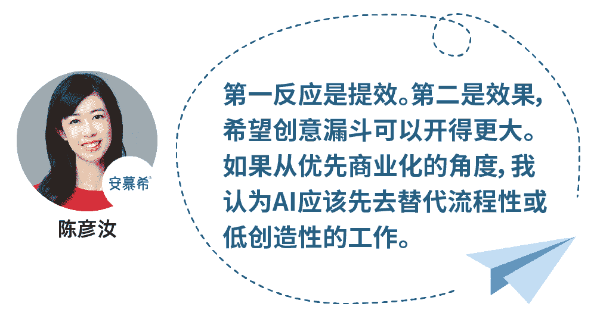

第一反应还是提效，会希望 **效率 **有所提升。第二是 **效果 **，当创意漏斗开得越大，可选择的余地也越多，我会希望能尽可能多地呈现和选择，不遗漏掉任何可能性。

但是，如果从优先商业化或者落地的角度考虑，我会觉得AI这样的工具应该先去替代流程性或低创造性的工作。

比如，乳品包装设计其实有着很细节的法规要求。如果我们可以把法律法规都输入到AI系统里，让它来确保我们的包装设计没有任何不合规的地方，就已经是很大的帮助了。举个例子， 产品的净含量在包装上的文字展示 ，可能是“100克”或者“200毫升”，为了确保消费者能看清楚，这个文字的大小规格是严格规定的。

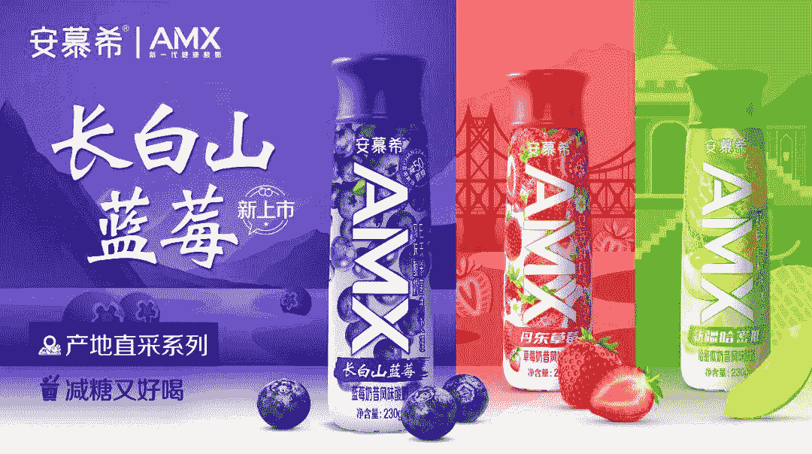

安慕希AMX酸奶

图片来源：安慕希

我们做的设计文件肯定符合这个要求；但是在印刷和塑膜之后，由于材质不同会有一些收缩，最后的成品可能就达不到标准。出于经验，我们设计的时候就会放宽一些。但是在成品检验的时候，仍然只能靠人工用游标卡尺这种最原始的工具去抽查。 用AI也许可以很好地替代人工的检查和复核，准确性也更高。

###

###

### AI设计是否会影响作品商业价值？

### 是否会改变与外部机构的合作形式？

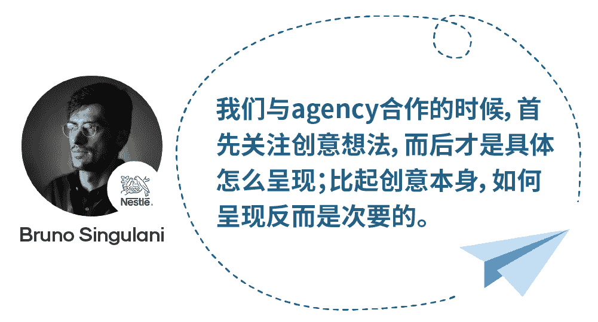

我接触到的一些agency，在应用AI技术上仍然非常谨慎，或者说至少在官方口径上没有透露出太大的兴趣。我想，他们也许也在探索AI带来的影响，但是目前还没有明确地与客户表示会用AI来辅助生成哪些作品。

从**品**牌的角度，我们买的是创意，不是吗？我们并不在意创意是怎么呈现的。对我来说，AI只是一种创意的可视化工具。 我们与agency合作的时候，首先关注创意想法，而后才是具体怎么呈现；比起创意本身，如何呈现反而是次要的。 所以，如果我合作的agency告诉我，根据我提供的需求，有ABC三个创意方向，他们使用AI工具对这些创意做了快速的呈现，并用PS做了精修呈现给我，我觉得完全没问题，因为最原本的创意仍然是基于人类对我们品牌需求的认知去思考的。而且，假设在使用AI的情况下，让原本需要花费2周去呈现的设计，变成了1周就能交稿，这不是很棒吗？

我认为，未来设计中的策略角色会变得更加关键。 agency可能会逐渐分化成两类 ：一类极其关注策略，并且注重人类能够提供的独特价值，比如匠心或手工；一类则以高效著称，可以在极短时间内完成修改——他们会更多地利用AI工具。

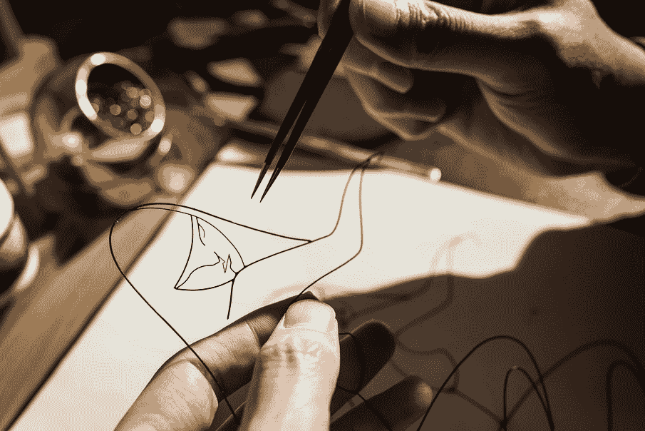

匠心手工

图片来源：Pixabay by lshoon2211

第一类策略性的公司可能拥有精简的创意团队，专注于做AI做不到的事情。比如，从0到1创设一个AI从现有库中找不到参考的品牌；又比如，考虑时代变化，为一个有世纪历史的悠久品牌改进视觉。

说到与agency的合作， 我认为创意筛选是我会看重的能力 。有的agency会给我展示15个创意方向，但我觉得这是一种筛选责任的“转嫁”，其实我可能更想他们为我聚焦到更吸引人的3个；甚至，如果agency敢于只给我看1个创意，我会很惊讶也很佩服，因为这体现了一击必中的自信，他们在大胆地告诉我，这就是最佳解决方案。

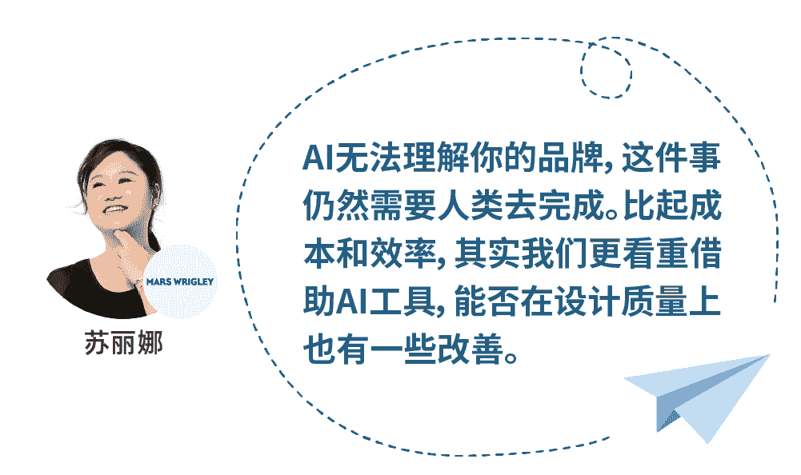

这个问题其实会回到对品牌策略的理解上面，因为很明显的，AI没法帮助你落地的一个很大的原因，在于 它无法理解你的品牌，这件事仍然需要人类去完成 。但是，用AI来做灵感启发，与这一点是不矛盾的。

与**agency的合作上，AI可以有助于**创意想法的快速可视化，促进双方的高效沟通。在整体的成本和效率上，我们会期待有一些提升； 不过比起这些方面，其实我们更看重借助AI工具，能否在设计质量上也有一些改观 。按我们的想法，原本可能完全依赖设计师自己的能力，但是有了AI之后，设计师理论上可以得到更好的启发。

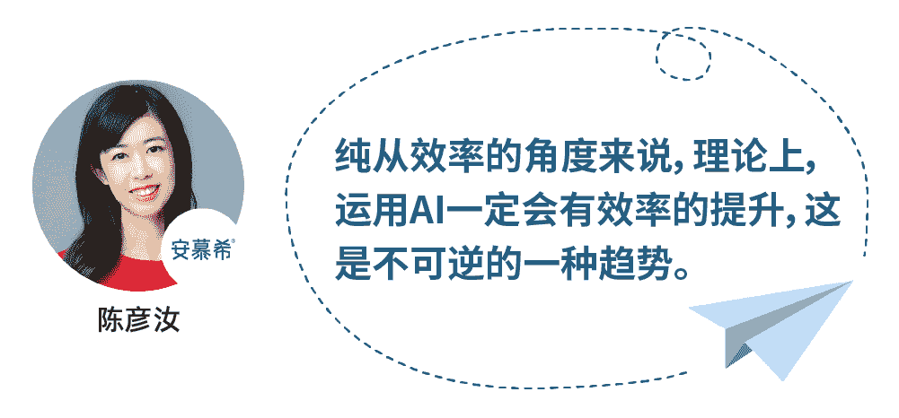

我觉得面对AI这种新事物，肯定会有拥抱变革的人，也会有坚持原来创作方式的人。 以日本动漫界为例，哪怕大多数动画公司都在大规模使用软件作画了，吉卜力还一直在坚持手工绘画。 这两种都很好，没有孰优孰劣。

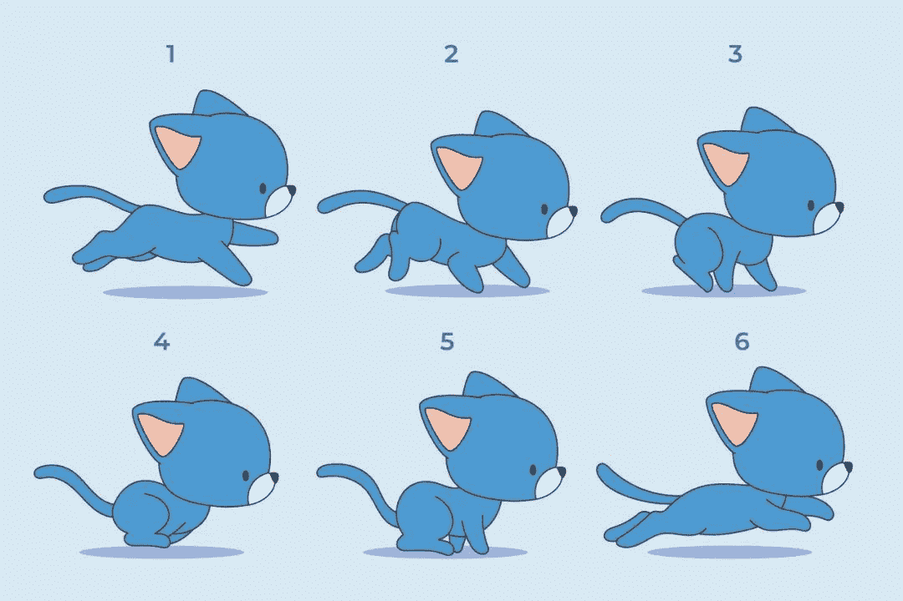

手绘动画的动作拆解

图片来源：Freepik

但是，纯从效率的角度来说， 理论上运用AI一定会有效率的提升，这也是不可逆的一种趋势 。在日本动画界，多少动画片的质量，已经跟十年前完全不一样了。

作为品牌方，我个人对AI是非常开放的。因为我自己的风格，就是喜欢穷尽可能性之后再做选择，比起筛选2万个方案，我更怕的是没有穷尽所有的可能，有哪些没有尝试到。

[你们之前的文章](http://mp.weixin.qq.com/s?__biz=MzA3ODEzMjg5Mg==&mid=2652466478&idx=1&sn=642059467f849a3fe07933a9ef63367e&chksm=84aaaeddb3dd27cb1fb8f5951f0e0a573480e2a85e0a39233ac8fe6c161737bcfd169f4b8857&scene=21#wechat_redirect)里有写到，比如日本的 Plug公司 ，使用人工智能去做包装设计与市场预测的商业应用。假如通过AI，可以快速生成2万个设计，让AI推荐其中20个，然后它还可以继续做大数据分析和市场预判，最终聚焦到3个，这个决策流程是非常省时间的。用传统的思路换算，首先做2万个设计，至少得有100个代理公司，然后这100家可能需要的时间也不一样，估计保底一个月，这之后，我还得自己去做市场调研和分析。

这样对比之后就可以发现，用AI提效这件事情，是顺理成章的。

###

###

### **结语**

我们不难发现，接受采访的几位品牌方，对AI设计都是比较开放的态度。

在大家最为关注的 “是否准备将AI用于商业设计流程” 这个问题上，品牌们都认为，目前的AI辅助软件仍然达不到完稿或是终端使用的水平，但是在创意灵感的获取和提升效率方面，仍然有很大的可取之处，甚至可以期待技术进一步发展后，带来更多革新性的应用方式。

**其中，值得我们进一步关注和思考的，或许是对设计商业价**值的反思。 AI带来的影响无疑是颠覆性的，但运用AI作画与运用AI进行商业设计，仍然是完全不同的领域。 除了对AI设计版权问题的担忧以外，或许我们更应该回归到对商业设计本身的 探讨：

如何运用AI设计，才能真正实现我们的商业目的？

**更快的出图速度，如何才能真的帮助我们**获得“更好”而不仅仅是“更快”的设计？

---

<https://my.feishu.cn/sync/CV7edZp1nspUQobYJhicxeP7nrb>