# 借助AI完成食品产品创新和设计

> 来源：[https://my.feishu.cn/docx/C98XdLsFyoeebYxkR1bcy2konmb](https://my.feishu.cn/docx/C98XdLsFyoeebYxkR1bcy2konmb)

<https://my.feishu.cn/sync/CV7edZp1nspUQobYJhicxeP7nrb>

---

> 来源：FBIF食品饮料创新

> 原文链接：[点击查看](https://mp.weixin.qq.com/s/PMtnxuRLxWU6BN1EmKXXLw)

> 发布时间：2023-06-28

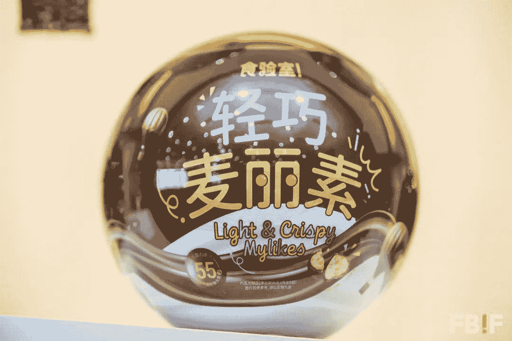

食验室与东西制造局用AI设计的“轻巧麦丽素 ”

2023年或许是人类史上浓墨重彩的一笔：无论是惊艳世界的ChatGPT，还是拿下设计大奖的AI生成摄影图，都让人工智能的商业化应用落地人间。

然而，过去的设计流程、组织架构、人才标准统统是围绕“人类”制定的，如何更安全更有效地应用AI，仍然是需要不断探索的过程。

在刚刚举办的FBIF2023零食与烘焙分论坛上，新锐品牌食验室创始人孙思达与东西制造局的两位创始人Mona、陈允信一起分享了 如何利用AI，拓宽想象力和生产力的界限。

内容来源：6月16日，FBIF2023食品饮料创新论坛，零食与烘焙分论坛

【下文根据现场分享内容整理，内容有删节】

# **关于AI的几个基本认知**

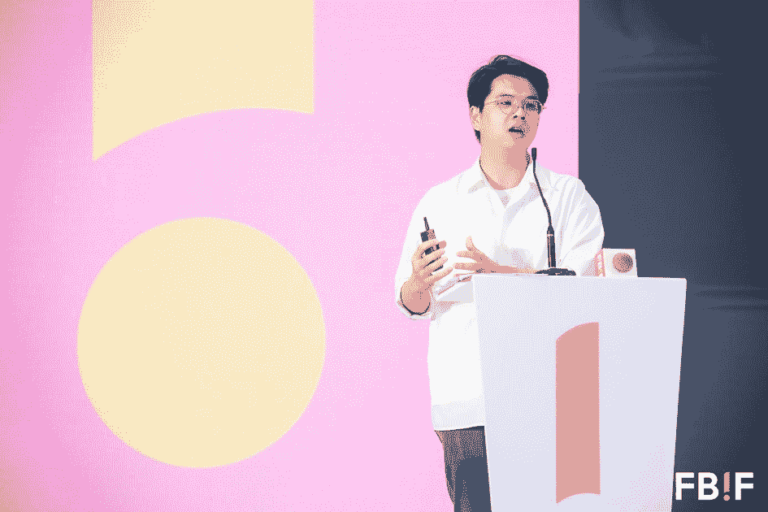

分享嘉宾：孙思达 创始人兼CEO 食验室

大家好，我是食验室的创始人孙思达。今天分享的主题是如何用AI工具提升企业效率，并探索想象力的边界。

先简单介绍一下食验室，食验室是一家健康零食公司，拿到了很多类目的第一名，创新地做了很多有意思的产品，比如做了鸡胸肉薯片、没有油的辣条等，我们致力于把零食是垃圾食品的帽子摘掉，为零食世界带来颠覆式的创新。

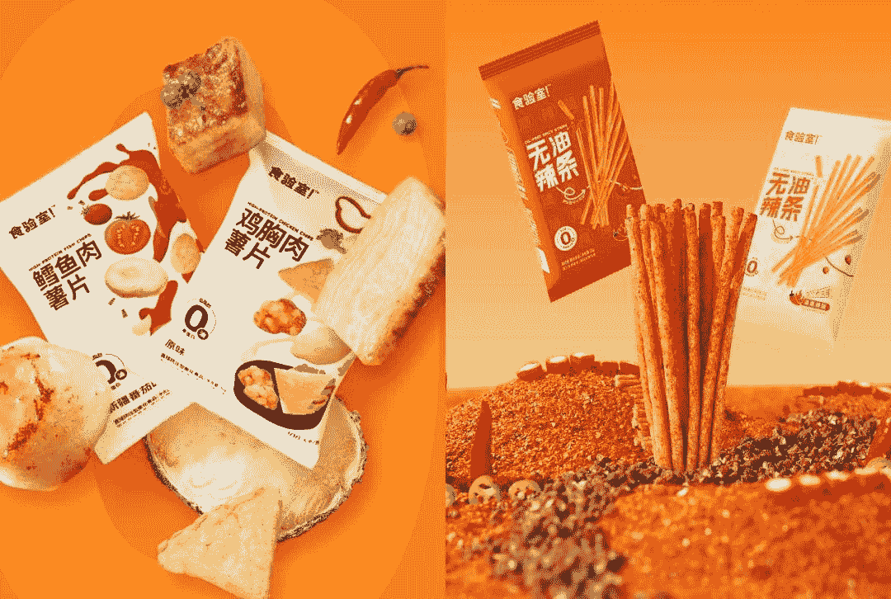

食验室肉薯片、无油辣条

图片来源：食验室

AIGC是一场工业革命般的浪潮，消费品公司的产品流程、组织架构及商业模式都有可能会发生翻天覆地的变化。在过去6个月里，我们和 东西制造局的主理人Mona和阿信 做了两个探索：

+   AI做的包装，到底能不能让商品卖出去？

+   什么样的提问者所生成的包装设计能够卖得更好？

实践出真知，我们一口气上线了5款包装，测试哪一款产品会卖得更好。这里面有设计师的作品，还有我、阿信、产品经理和设计师用AI做的作品。

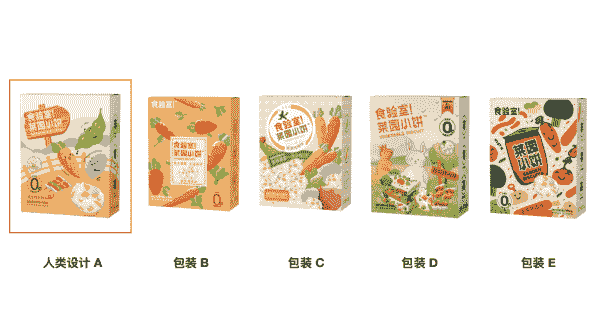

图片来源：食验室

**是人类还是AI的包装会胜出呢？**

最后，由产品经理生成的D包装以微弱的优势战胜了人类设计师。而我和阿信用AI生成的包装没有什么差距， 所以设计能力强不一定能够用好AI 。

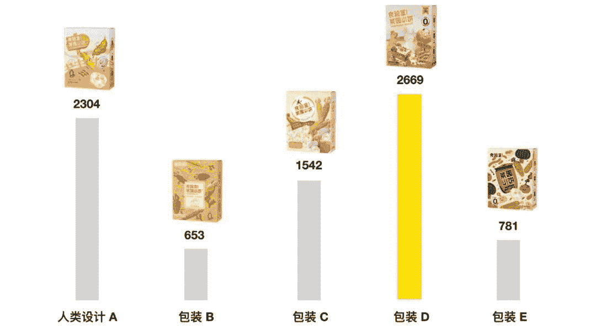

图片来源：食验室

那一刻我们有了一个感知：用AI来做70分的包装是可行的，而且非常高效。

以前设计师做一个包装版式大概要花费几天到一周的时间，而以上4款包装大约只花了4个小时。有了初步认识后，食验室就将AI融合进了工作流程中。

食验室产品上线之前其实有一个众筹过程，众筹期间会测试产品概念是否能吸引消费者浏览与买单。在这个测试环节里，包装做到70分就可以了，但很多设计师会觉得这一需求无理取闹，因为无论是做70分还是100分，前期策划花费的精力是差不多的，并且大部分设计师是抗拒“70分”这种心态的。

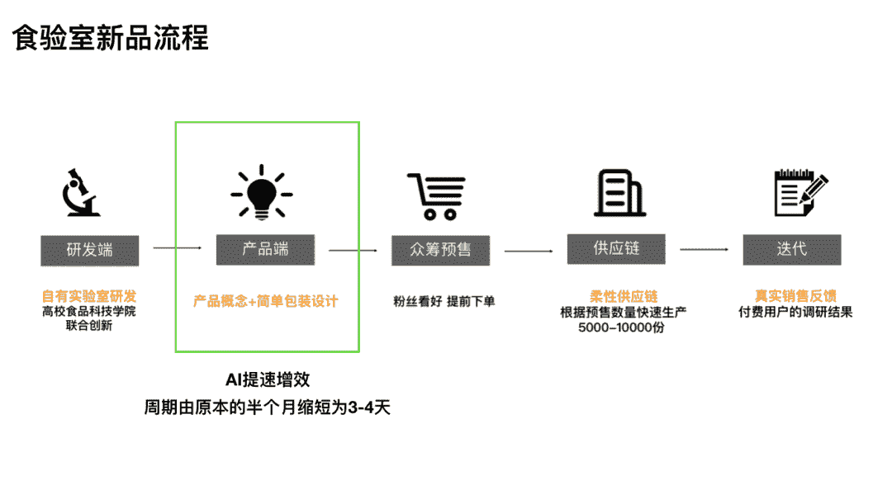

图片来源：食验室

过去做一款测试包装要一周左右，而使用AI，设计师只需要2-3小时就能做出测试包装，甚至在测试阶段可以一口气拿出10款包装给消费者选择，根据结果再挑一款继续深化。

但从4月份实验到今天，我们又开始思考一个新问题：AI有没有可能做出一款90分的产品？

我斩钉截铁地告诉大家结论：AI不可能直接交付90分的结果，但“AI+人”可以帮助你以十分之一的时间来完成一个90分的作品，甚至比你想得更快、做得更好。

我们将从三个主题来拆解这件事：

+   关于主流AI工具的原理和使用方法；

+   分享和设计/创意相关的项目案例；

+   AI赋能做产品的全流程，包括决策、包装、场景设计等，以及怎么做到“90分”。

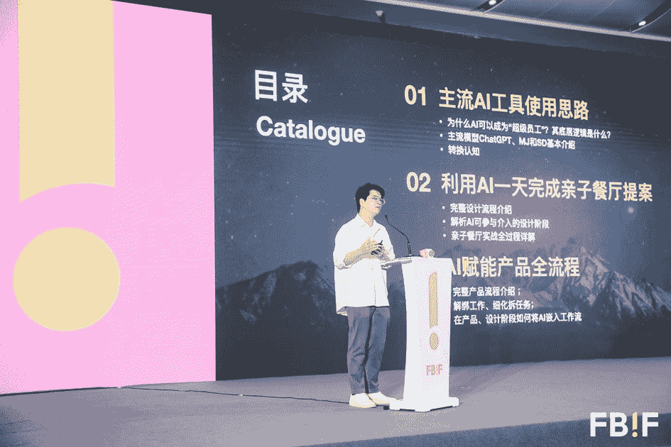

我先讲一下AI与工作流。

消费品行业是一个介乎理性和感性之间的行业，既需要总结客观规律，还需要洞察消费者心理，最后做出一个系统性决策，并不像是计算机或者艺术行业那样完全的理性或者包容极大的感性。所以如何用AI赋能消费品，也不会像上述两个行业那样简单直接。

首先，我先介绍一下目前主流的AI工具。

第一个AI大模型，是以ChatGPT为首的对话式语言模型。

相信GPT大家已经不陌生了。今年三四月份，各种社交软件都被GPT刷屏，为什么GPT可以带来如此大的冲击呢？来看看它与之前的AI模型具体有哪些不同。

与之前的大模型相比 ，它最大的特点是真正能够理解我们的意思，并且能用我们听懂的话回答。

比如，有一个我们经常会遇到的提问——为什么吃蛋白质容易有饱腹感？GPT很快给出了答复。

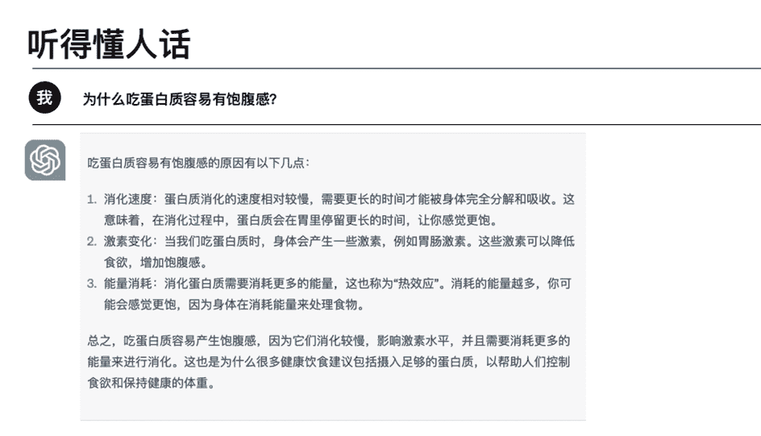

图片来源：食验室

但是我觉得它说的话很复杂，作为一个不懂激素、能量、热效应的人，我并不想去理解这些。于是我告诉它，我是个初中生，理解不了你的问题，很快，它就给了我一段非常简单明了的解释，还会用一些生活中出现的事情打比方，它是能理解自然语言背后的含义的。

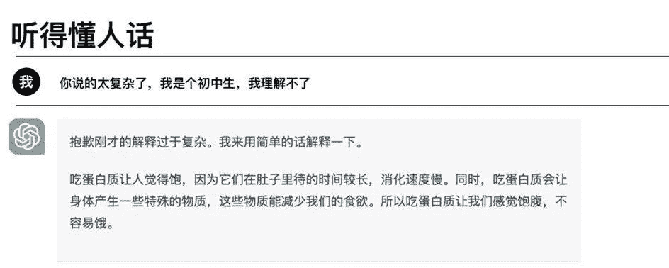

图片来源：食验室

再比如，这是网上一段比较流行的梗，问GPT我的妈妈和妻子同时掉进河里，我晚上应该吃米饭还是面条？GPT没有落到问题的陷阱里，而是给出建议应该先救人，它背后有“像人类一样”思考和推理的逻辑能力，甚至可以做一些非结构化推理。

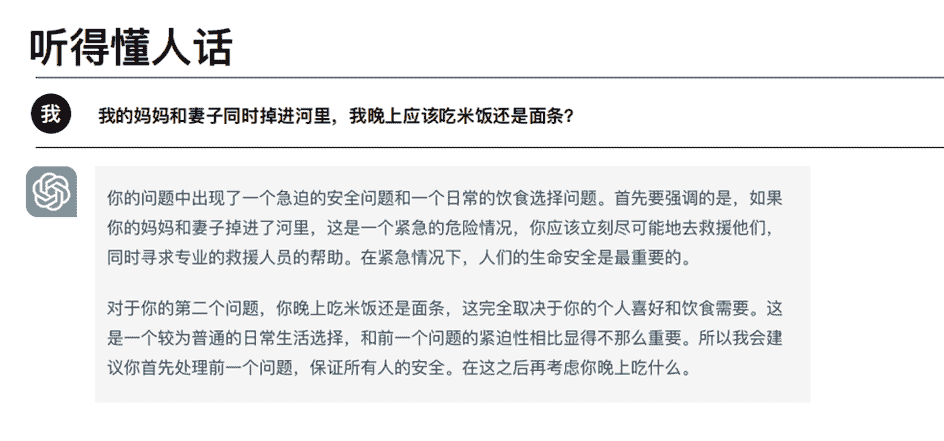

图片来源：食验室

其次，它已经学习了足够多的知识，还具有极强的学习和自我进化能力，在很多基础能力方面已经超过了人类。

有些使用过GPT的人可能会觉得它会有些局限性，比如信息不准、思考能力有限，表达时好像在胡说八道，但是这些都是时间问题。GPT3.5版本在SAT和GRE考试中，都已经达到了前10%的水平，甚至是许多藤校的录取标准。

刚刚过去的5月，GPT4已经正式开始测试联网功能，它已经可以搜索实时信息了，这至少是一个从初中生到高中生的转变。在表达方面，它胡说八道的问题正在逐步地得到解决，GPT4已经比GPT3.5好了非常多，甚至像谐音梗，幽默感这些事情它都可以理解。

所以， **我们**在使用它时，可以将它当作一个营销专家、一个资深的供应链经理，这样的话，任何人都可以给自己配一个AI秘书、一个AI设计师、一个AI程序员、一个AI文案，实现个人+AI大于等于一个团队的效果 。

第二个要提到的是在设计领域的AI——Midjourney。这是一个图像创意生成领域的绝对王者，它看过互联网上的所有图片，能够理解和无限生成你想要的内容，无论是摄影、漫画、建筑，还是产品包装设计，它在15秒之内就能给你4张图。

Midjourney强项是非常有创意，弱项则是太有创意了，内容相对不可控。对于消费品公司来讲，任何一款包装在保证好看有创意的同时，还要保证信息完整性和层级，并符合品牌视觉规范。这两点几乎不可能稳定生成。

第三个工具是图片可控生成领域的SD，它是完全开源的，目前已经有很多根据特定数据训练出来的模型，比如AI换装、AI模特、AI主播等，广泛应用在商业创意领域。

当然，还有one more thing，如果把以上的AI工具背后的数据库变成我们公司自己的数据库，是不是就能更可控地做一些内容了？

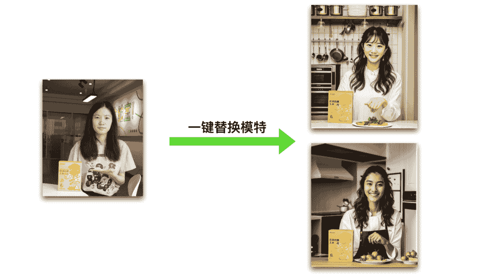

图片来源：食验室

我们内部有一些简单定义，比如把ChatGPT称为智商超高的藤校毕业生，有很强的信息检索和整合能力，当助理很好用，但是实践经验比较少，不知道自己该干什么，相信大家招过实习生都有这样的经历，所以跟ChatGPT对话一定要有详细的指令。

Midjourney是创意鬼才，虽然可控性比较差，很难直接用在包装设计上，但如果做一些海报和平面图，不仅速度快，而且偶尔会有惊喜，没有灵感就用它。行政部门以前做一个公司内部海报都要找设计部门排期，现在自己用Midjourney生成就可以了。

SD则是一个勤劳美工，需要给它清晰的指令，虽然做得比较慢一点，也相对吃硬件配置，但结果是稳定可控的。

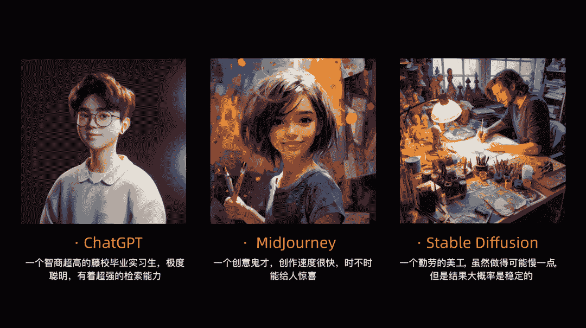

图片来源：食验室

我们前面讲到，AI不能直接给我们交付90分的结果，但是要用好AI，除了对AI功能的认知以外，更重要的是思维模式的转变。

AI不是直接取代某一个岗位，而是帮助完成任务。我们任何一家公司，本质上都是去解决消费者的问题，而解决消费者的问题需要经历一个完整的工作流程，并且为这个流程匹配对应技能的人。本质上创造价值的是工作流，工作流当中有非常多的任务，这些任务对应特定的技能，这个技能被某个特殊的岗位所拥有。

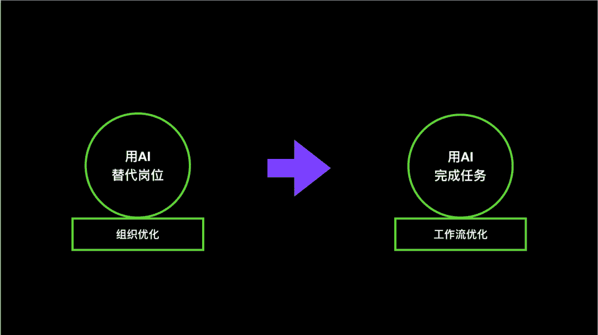

图片来源：食验室

所以，当我们思考怎么用AI的时候，不要思考它可以替代哪个岗位，而是要思考它可以取代这个工作流当中的哪个任务。

# **商业设计中的创意加速器**

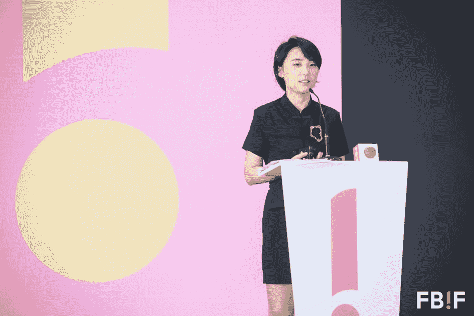

分享嘉宾：Mona 复眼主理人 东西制造局创始人兼创意总监

面对AI浪潮，我们公司有人认为这是机遇，有些人认为AI是来抢饭碗的。

但在我看来，AI是机遇还是挑战的核心在于你是理解它还是抵触它。

我会分享三个方面：

一是如何把ChatGPT集成到设计的工作流中；

二是ChatGPT生成创意的使用方法，也是我们总结出来的技术研究；

三是ChatGPT在商业设计中的具体案例。

首先，这是英国平面设计师协会2005年发布的“Double Diamond”的流程图，是非常简洁科学的流程。从发现问题开始，寻找解决问题的思路，随后找到设计方向，再开始执行、创意、发散，最终形成解决方案。

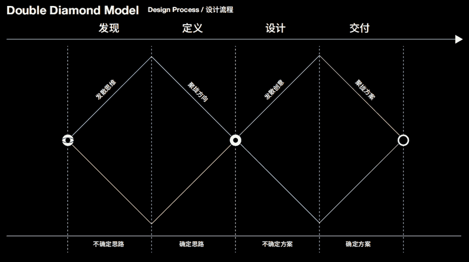

英国平面设计师协会发布的“双钻模型”

图片来源：东西制造局制图

从发散、聚拢、发散、聚拢的过程，看起来像两个钻石，就叫“双钻模型”。

我们在每个流程中尝试使用AI，它确实可以覆盖每个部分，成为整体的加速器。但在收拢设计方向到发散创意这两个部分，AI的参与面和特性结合是效果最明显的。

重点说说创意部分。ChatGPT可以极大加速我们想点子的效率，无限次进行头脑风暴。比如我们公司在一个项目开始之前，要了解项目背景、所在行业以及风格需求，我们很多项目和中国传统文化有关，收集和调研工作往往需要一周，但有ChatGPT之后，可能一个小时就能帮助我们划出重点。

我们把ChatGPT定义为一个超级创意工具。

第二部分则是这个超级创意工具的使用方法。这个案例是一个亲子餐厅项目，占地4000平方米，这么大空间需要有一个大主题概念，而要描绘“概念”少不了视觉展示。

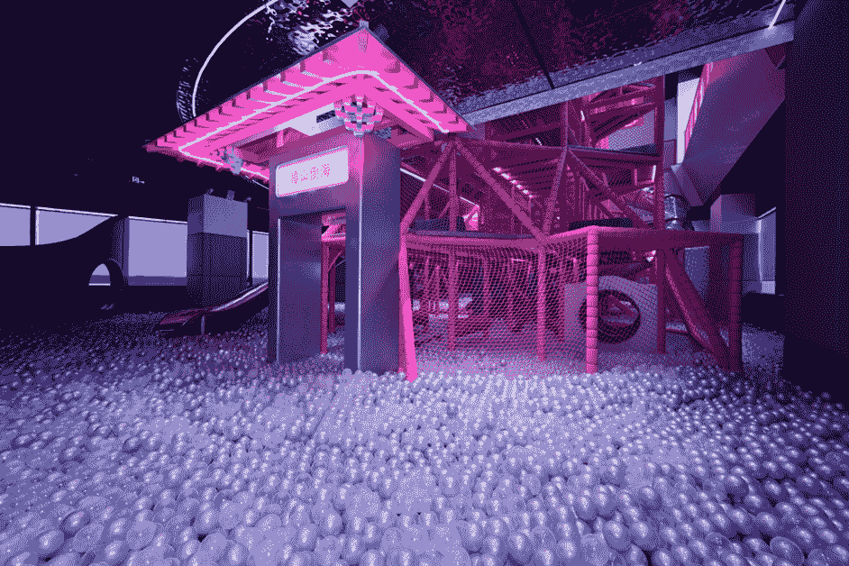

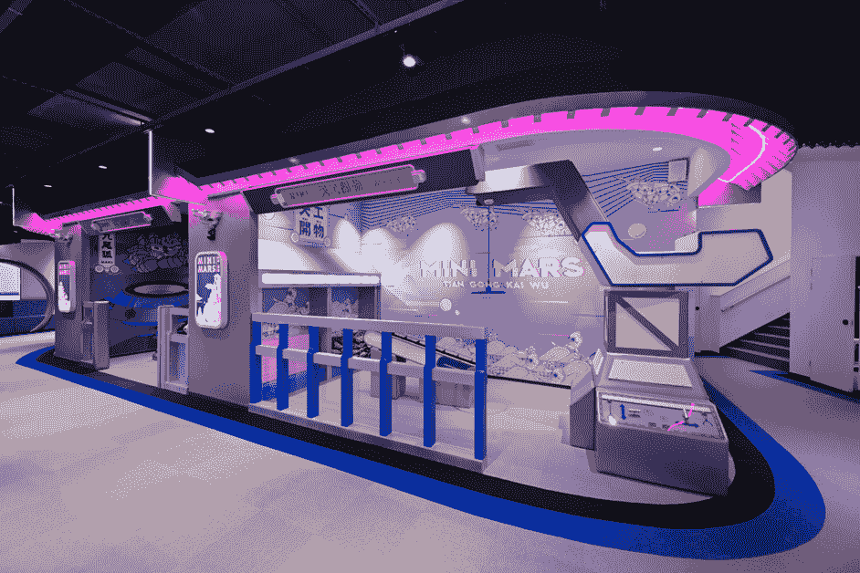

图片来源：东西制造局

我们通过ChatGPT来完成插画中的细节设定。以山海经为背景的主题插画，里面的建筑、IP动态、故事线、游乐设施概念都是ChatGPT帮我们生成的。

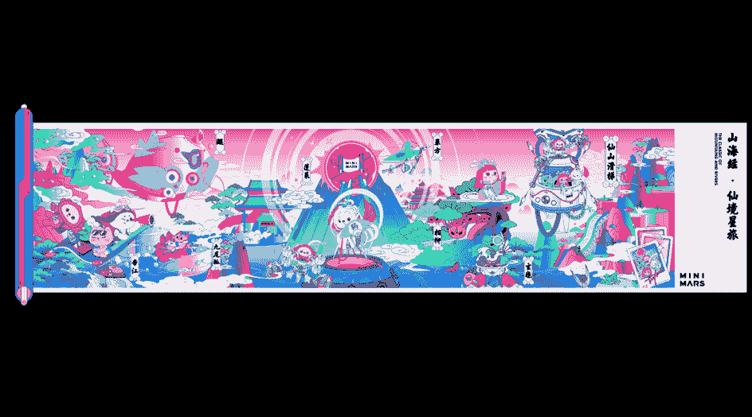

图片来源： 东西制造局

要做到这件事，一是需要让ChatGPT理解需求。要把设计需求拆解并描述得非常精确，否则AI回答会很笼统和宽泛，没有办法聚焦，尤其“风格”和“元素”越具体越好。

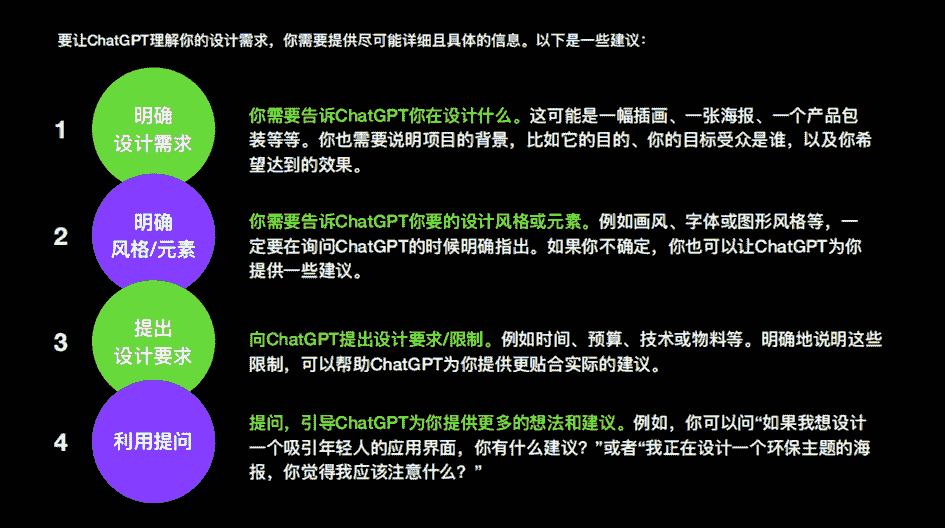

图片来源： 东西制造局

其二则是要和ChatGPT进行有效互动，这是我们总结出来的一些提问技巧：

+   预设身份。告诉它作为一位创意创作者，比如文学作家或是儿童绘本插画师来回答问题。

+   明确提问。AI回答的准确度，取决于提问的具体程度。

+   拆解问题。拆解得越细，就相当于你在给设计师提出更有效的意见，创意就会像双钻模型一样不断收紧和不断聚焦。

+   开放式提问。问题没有办法很具体的时候，尽量开放式提问，比如“我准备怎么做/有某个想法，而你有什么建议给到我，从而提升某个方面？”

+   反复迭代。尽量多角度的反复提问。

+   审查和验证。ChatGPT有时候会胡诌，之前问过它关于某个风格的代表性作品与艺术家，结果有些是虚构的。

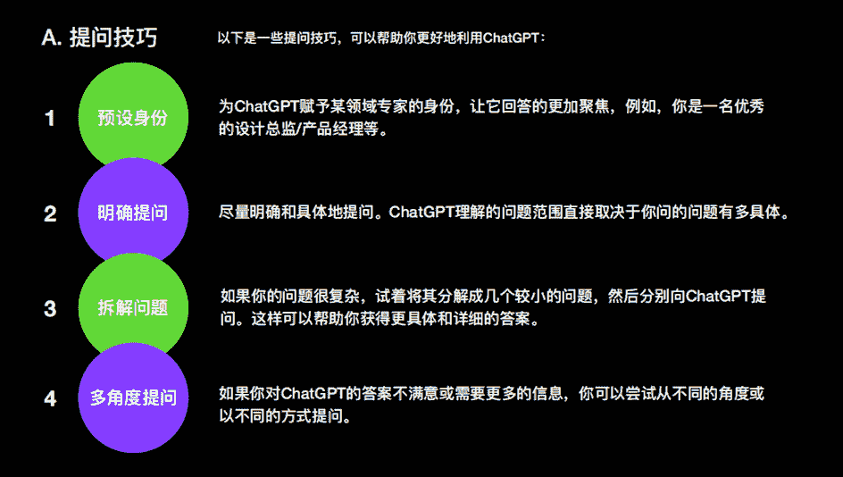

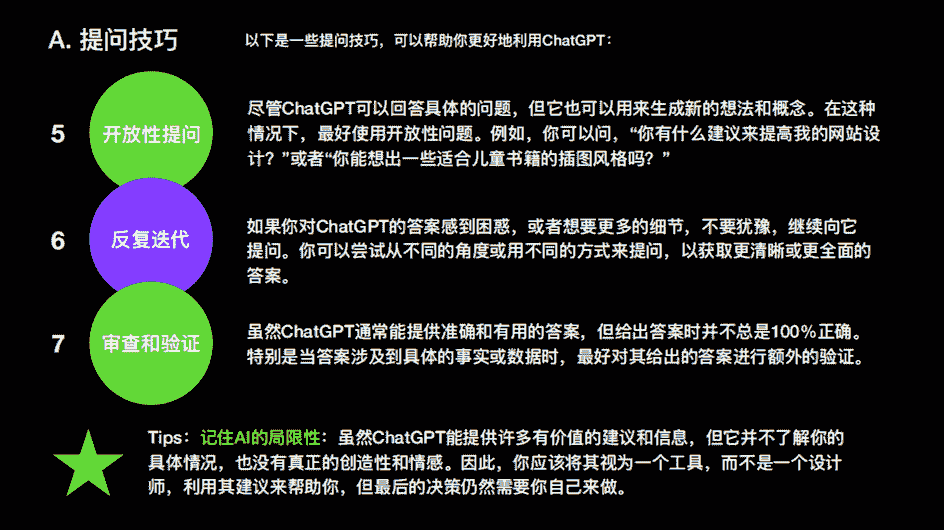

图片来源： 东西制造局

这是我们总结出来的有效句式：

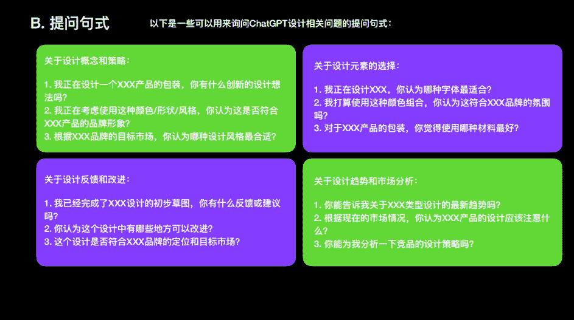

图片来源： 东西制造局

而接下来是关于ChatGPT如何加速头脑风暴的流程。

在过去，头脑风暴的整个周期反反复复，在每次卡壳、收集资料、调研和进行头脑风暴会议的过程中，基本上要消耗一周时间。而ChatGPT可以24小时待命且不会“卡壳”，我们总结了一套结合AI的新头脑风暴流程：

第一步是确定设计目标、设计类型、目标人群、目标市场是什么，品牌核心属性是什么。

第二是发散创意，从各个方面进行提问。

第三是加入限制，不断增加这个品牌的人群是什么，想要的风格是什么。

最终在获得构思之后，让它进行画面描述，甚至是细节元素的构想。到这一步就可以用刚刚说到的AI绘画工具生成草图，基于草图进行调整和反馈，形成设计方案。

接下来用我们的实际案例给大家演示整个流程。这次项目是一个亲子餐厅，要我们做的设计类型是主题视觉和故事。

这个项目在上海的蟠龙天地，是一个古色古香的业态，所以客户明确提出要融入中国传统文化。

同时，小孩们喜欢的游乐设施普遍是挖掘机、赛车等带有科技元素的项目，所以客户也希望体现科技感，把孩子喜欢的挖掘机和赛车融入到亲子餐厅中。目标人群则是10岁以下的儿童和其父母。

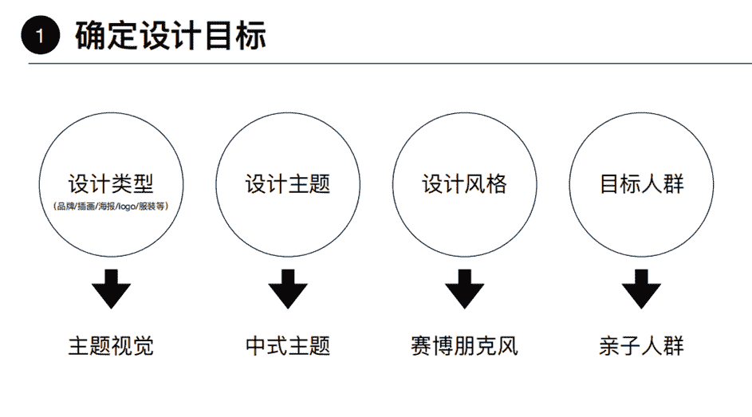

图片来源： 东西制造局

接下来是发散创意的部分，我给AI提问“现在我要给一个亲子餐厅画一个故事性比较强的品牌插画，希望它是古风的，你觉得有哪些中国古籍可以给我们参考？尤其能体现一些奇特冒险的？”

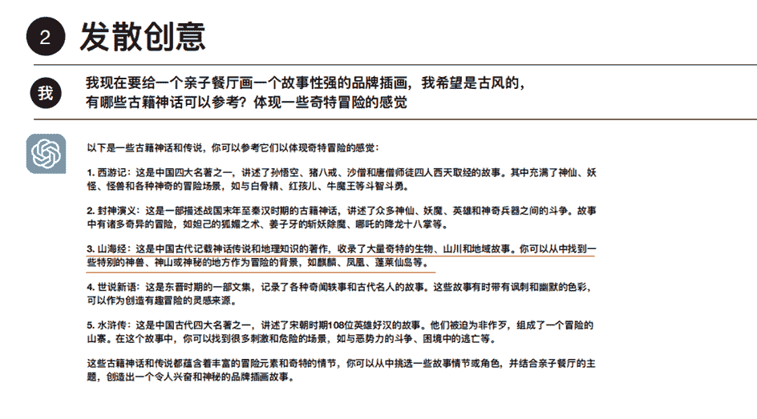

图片来源： 东西制造局

AI提供了很多答案，比如说西游记、封神榜、世说新语、水浒传，有一些知名度太高，不容易形成独特IP，有一些则不太贴合儿童餐厅这一背景。最后选定了山海经，山海经可以说是中国版的哈利·波特世界，里面有充满想象力的生物、植物，有大的环境场景利于持续挖掘。

于是继续发问，“给我7个中国神话故事《山海经 》 中的场景”。它给我提供了昆仑山、桃花源等，最后我发现蓬莱仙岛这个设定很有意思，里面有山、有东海的水，风景又秀丽，还有神仙、仙女等概念，正好可以让小孩穿上古装cosplay。

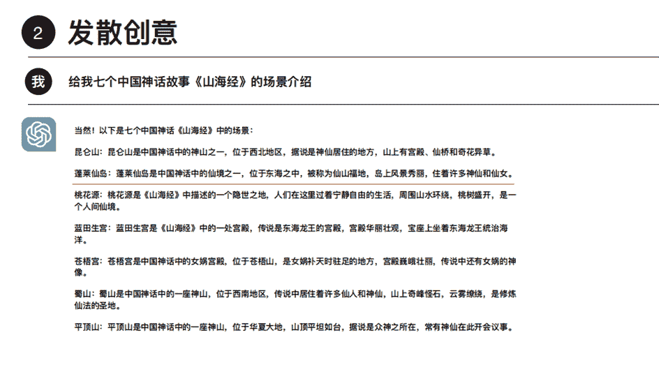

图片来源： 东西制造局

接下来就是加入限定了，“根据蓬莱仙岛写一段跟冒险有关的儿童故事”，ChatGPT就讲了很多小明怎么看到仙山，和仙女相遇，描绘了很多生物，故事完整度很高。

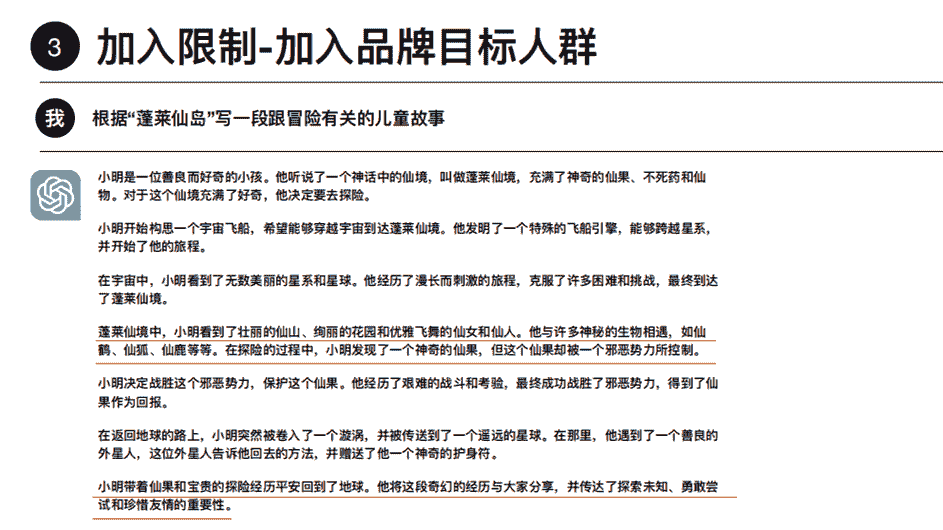

图片来源： 东西制造局

我们让它进一步优化故事情节。MINI MARS亲子餐厅本身拥有4个品牌IP，一只猴子、一只狗、一只猫、一只青蛙，把这些IP设定加进去之后故事变得更有趣了，和只有小明的故事版本相比更为生动，并且寓教于乐，强调勇气和好奇心。

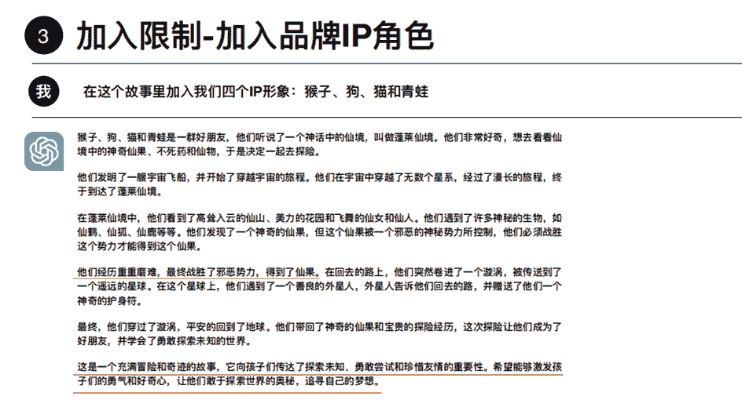

图片来源： 东西制造局

继续加入限制，比如前面提到的科技元素。我们第一个想到的是赛博朋克风格，这个风格本身就有很多东方与科技融合的部分。

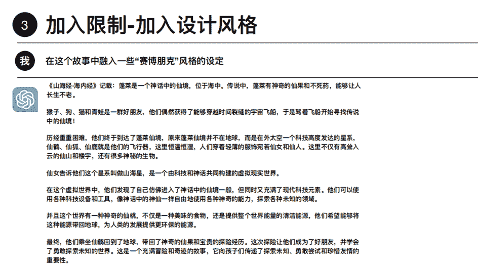

图片来源： 东西制造局

加入赛博朋克后，ChatGPT把故事场景命名为“山海星”，给山海经想了一个谐音梗，在这个星球上把科技和神话共性的部分做了一个结合。比如神仙会飞，在这个星球上有个人飞行器，再比如仙桃作为一种神奇植物，拥有帮助人类环保发展的能力，迎合了当下社会思潮。

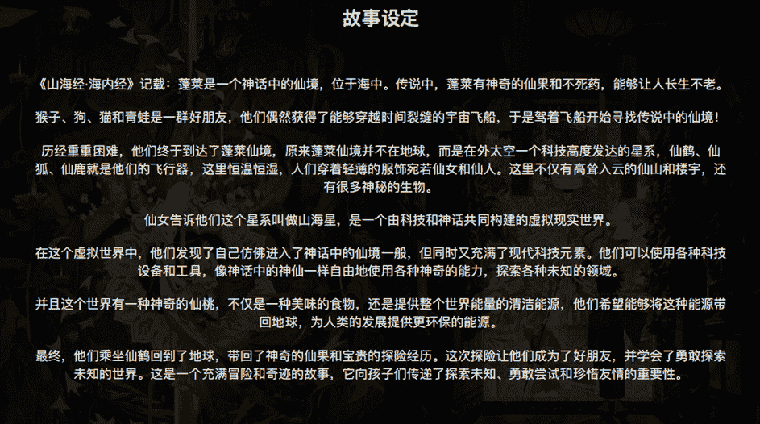

图片来源： 东西制造局

在这些设定下我们创作了最终方案：山海经中的蓬莱仙岛本就不在地球，而是在外太空科技发达的星系中，仙鹤、仙狐、仙鹿是拟态飞行器，很轻薄的服饰是由于环境保护很好，恒温恒湿，最后还采用了AI提出的名字之一，“仙境星旅”。

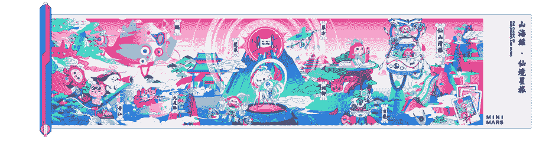

图片来源： 东西制造局

客户看完方案很满意，感觉像看了三分钟电影。

基于这个故事，我们让AI进行画面描述，从而衔接设计执行。AI让仙山在画面中央，4个主角和飞船从画面右侧进入，在花园里长着各种各样奇怪的植物，云雾遍布中，主角们最后留下了很多有勇气的故事，带着故事离开这个画面的场景。

为了方便给插画师下Brief，我们还让AI继续描述蓬莱仙岛里可能出现的元素。这些元素都源自山海经，不用团队里的人把山海经这么厚的一本文言文通读一遍，只需15秒AI就把重点划好了。

这是我们的最终作品，大家可以看到和ChatGPT给我们生成的描述基本相符：

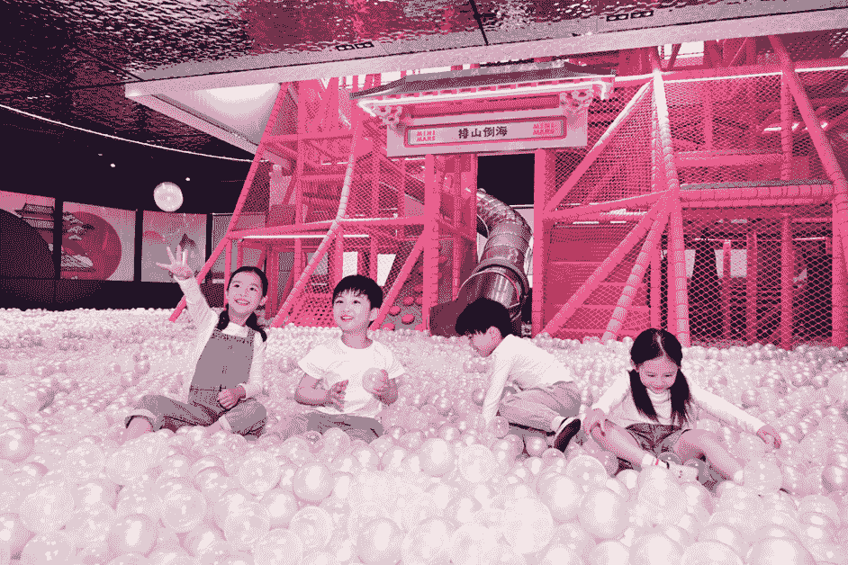

图片来源： 东西制造局

包括仙山滑梯，也是ChatGPT在了解到要做儿童亲子餐厅时提出的灵感。

图片来源： 东西制造局

因为客户说最热门的项目就是波波球，于是让它生成一个和波波球有关的创意，最终就把波波球和九尾狐做了一个结合——让九尾狐在波波球里玩Switch。

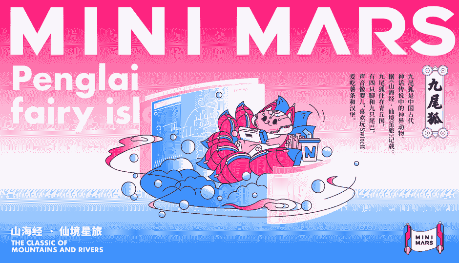

图片来源： 东西制造局

毕方是传说中的仙鸟，它的翅膀是一个太阳能源棒；

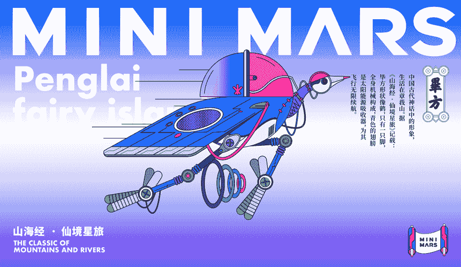

图片来源： 东西制造局

穷奇是一个吃货，在吃火锅；

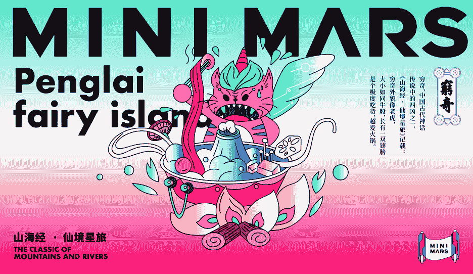

图片来源： 东西制造局

九头蛇“相柳”；

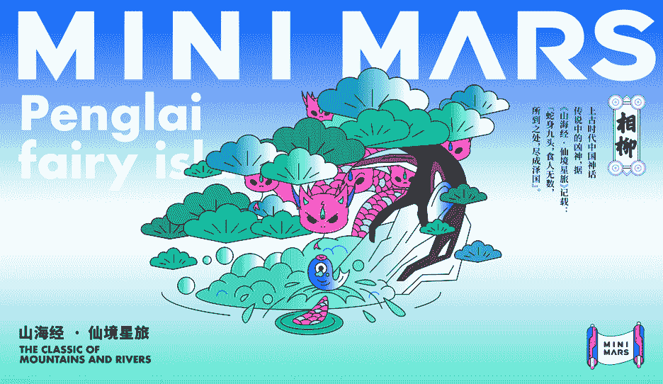

图片来源： 东西制造局

机械版的鲲等。

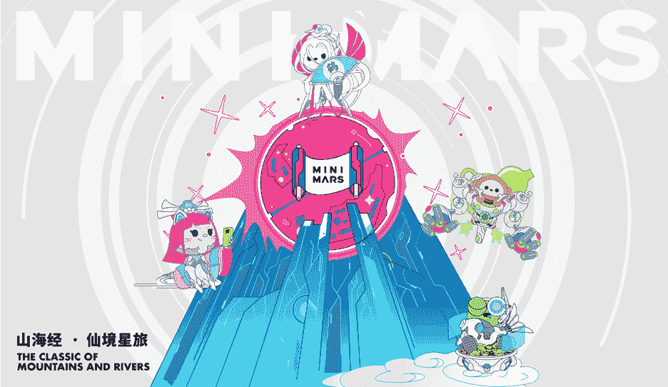

图片来源： 东西制造局

最后想跟大家强调，ChatGPT是一个超级工具，不是一个替代品，它可以**辅助设计师做创造，给设**计师更多的可能性和灵感，并不意味着能取代设计师这一角色。 设计中的人性无法替代。

# **AI辅助下的零食全流程**

## **1、产品阶段**

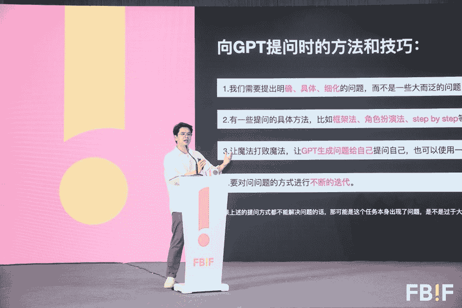

分享嘉宾：孙思达 创始人兼CEO 食验室

怎么做好一个产品，一直是食验室思考的核心。

大部分公司做产品的流程是：需求洞察、市场调研、卖点分析、产品定位、包装概念提案、包装设计及相关物料生产，我们前面讲到AI不能替代某个岗位，但是可以帮助我们完成某些任务，所以我们根据这个流程来拆解出任务，让AI辅助我们去做产品。

首先是需求洞察。如果大家吃过食验室的产品，会发现我们在做一些经典的童年零食，这是我们品类扩展的方向之一：改造一个童年零食，用真材实料和更健康的方式把它做出来，比如说零油辣条、零油薯片。

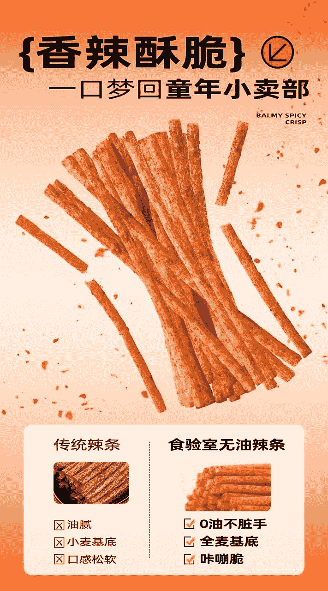

食验室无油辣条

图片来源：食验室

那如何选择要改造的品类？哪些零食是90后和00后的共同记忆？

这需要产品经理有极强的行业经验，其次要非常理解食品行业的供应链和工艺知识，还要懂营养学。而ChatGPT是一个非常牛的“藤校毕业生”，也是我们公司的“实习生”，它给了我们三个挑选品类标准：

+   受欢迎程度。即这个产品是不是大家在小时候都知道它的味道。

+   改造潜力。如果这个产品在小时候已经非常健康，对食验室来讲就没有什么改造的必要。

+   生产复杂性。我们的供应链能力是否能支持其规模化。

这些其实也一直是我们内部的标准。

上个月ChatGPT完成了4.0升级且联网之后，给出的答案准确了很多，它推荐了一些产品：XX雪饼、XXX奶糖、麦丽素等等。

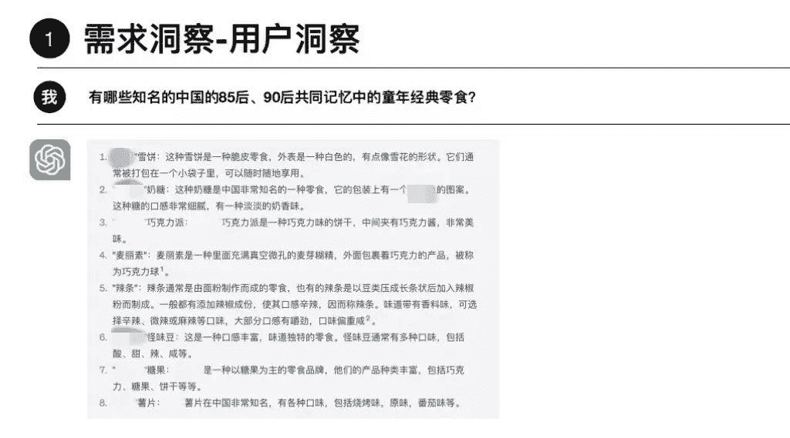

图片来源：食验室

依据它前面的三个标准，它对推荐产品重新做了排序，第一个是XX辣条。

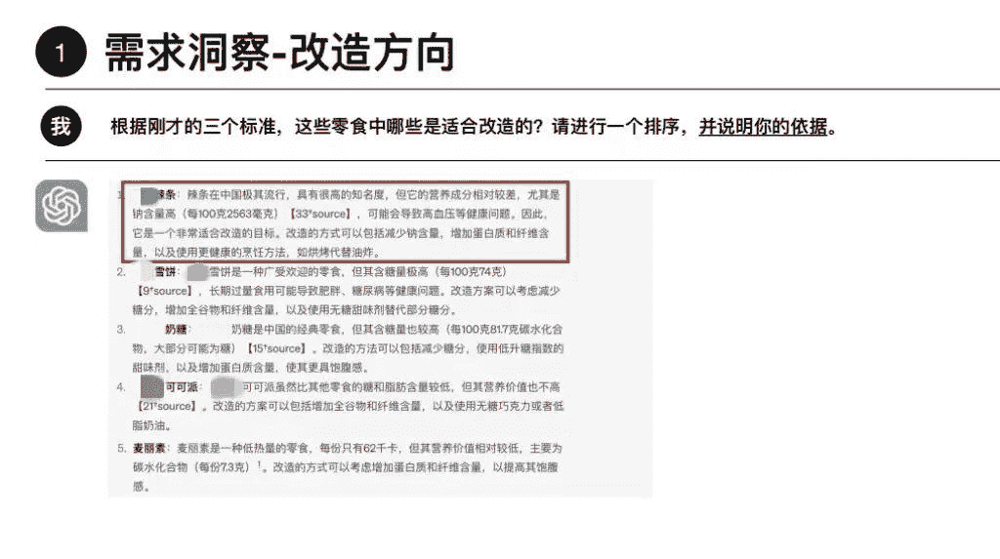

图片来源：食验室

ChatGPT提到XX辣条里的盐分和油脂含量非常高，改造潜力非常大，也因此食验室如今就上了这样一款产品“无油的辣条”。

第二个是XX雪饼，这是一个童年记忆，但毕竟是一个精制淀粉作为主要原料的产物，AI认为可以在里面可以增加一些膳食纤维，增加“粗粮”的元素。好巧不巧，我们在3月份上线了五黑奶酪小雪饼，没有添加糖，并且有非常高的膳食纤维，确实卖得非常好。

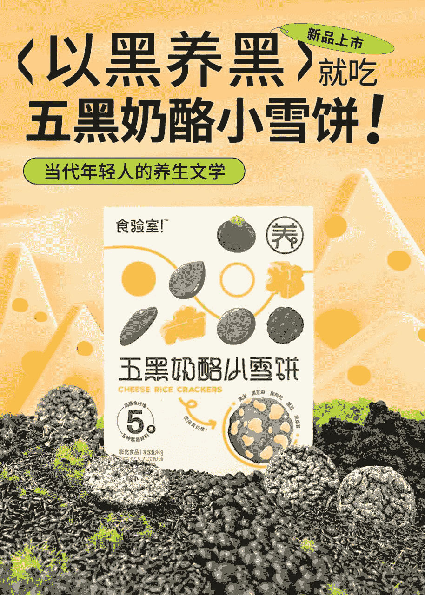

食验室五黑奶酪小雪饼

图片来源：食验室

第三个和第四个提到的XXX奶糖和XXX巧克力派，和食验室的现有供应链体系没有那么匹配，不在改造范围之内。

第五个是麦丽素，也是我们比较看好的品类，AI认为改造的可能性源自三点：

一是替代糖。小时候的麦丽素有很多白砂糖，可以换成代糖或者是低聚糖。

二是增加蛋白质，这个品类本身就有奶香味，增加蛋白是有匹配度的。

三是用更健康的巧克力，抛弃年轻人已经不太喜欢的代可可脂，用真正的纯可可脂。

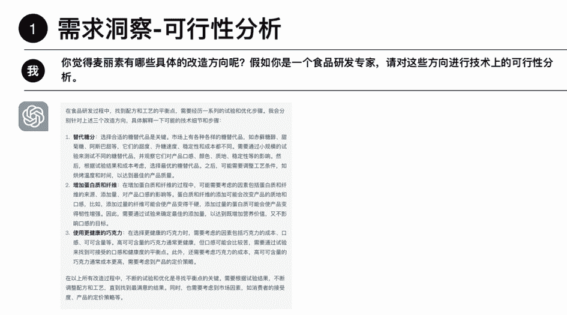

图片来源：食验室

然而这些回答总体来说还是比较浅层次的，当我们搜索市面上的产品后，发现这些都有人做过了，有高蛋白方向，基本上都用到纯可可脂，也不会额外添加白砂糖，甚至有加了高纤维、益生菌、益生元还有跳跳糖的版本。

此时GPT给的还是70分的答案，这些方向的改造都没有理想的销量。我们想知道这些先入局的“麦丽素”为什么不能成为爆款，消费者到底哪一点（需求）没有被满足？

我们设想了三种操作：

首先，我们直接问GPT目前市场上都有哪些比较火的麦丽素产品，让它帮我们做一个竞品分析报告。它诚实地告诉我们，没有办法直接跟京东和淘宝做交互，想当初在它还不能联网的阶段，它一定会胡编乱造出一堆东西来糊弄你，但是现在联网了之后，它可能不会骗人了，直接告诉你这个问题回答不了，它放弃了，所以我们排除掉了这个问法。

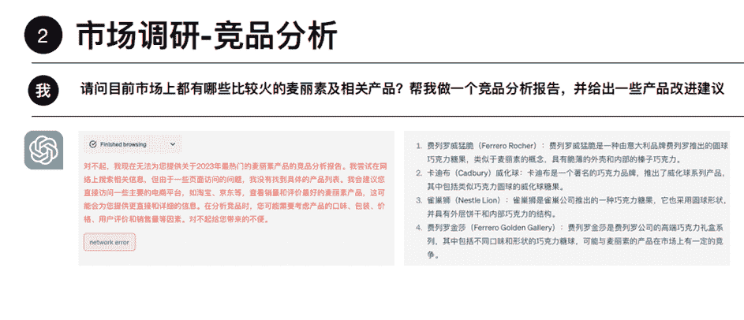

图片来源：食验室

既然GPT没办法与一些电商网站做交互，那我们尝试着将这些竞品的相关信息输入给GPT，让它为我们做一些竞品分析，找找看这些产品有没有值得改进的点。可以看到，GPT虽然回答了这个问题，但没有找出这些产品真正值得改造的点，只是给了一句考虑增加营养这样非常泛泛的建议。

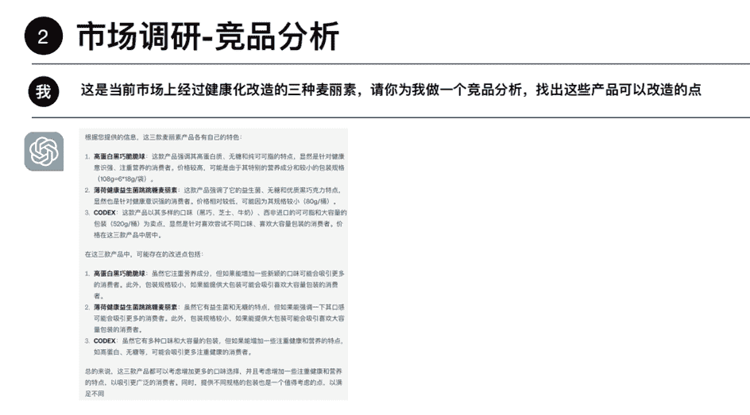

图片来源：食验室

所以，这两个方法都失败了，我们回过头来看下这两个提问方式，其实都存在一些共性的问题，算是一个典型的无效提问，比如比较火的麦丽素产品？这个比较火是什么时候？什么样的点是需要改进的？基于什么来提改进建议呢？不足的点是什么点？以及，麦丽素相关的产品，我们知道有非常非常多类似的巧克力制品，那什么样的产品算是相关的巧克力制品呢？虽然GPT的算力和智力都很非常牛，但是我们给它输入过于大而泛的问题的时候，它也没有办法去回答。就好比我们今天给一个藤校毕业的校招生说，你去帮我写一份给我公司赚钱的方案，他听到了也应该会非常迷茫。

所以，这里有个非常重要的提问方法。就是如果我们想要AI给我们更好的结果，我们就需要给AI明确、细化和具体的指令，越细化、越具体越好。

选项A和B都失败了，最后， **我**们只能用选项C，用魔法打败魔法——当你遇到问题并且不知道如何清楚准确地描述问题时，你可以让AI提问自己。

很多AI模型比如AutoGPT都是基于这个原理：用户提出问题后，它不仅自己会回答问题，也会问自己相关的问题来保证你得到满意答案。毕竟AI的算力和智力非常强，获得答案的成本非常低。

我们把问题抛回给了ChatGPT：“我该怎样对现有市场上的麦丽素进行竞品分析，从而找出做麦丽素的关键点？”

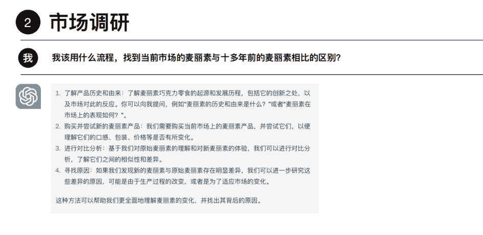

图片来源：食验室

ChatGPT给了我们4个步骤：首先要了解产品的历史和由来，第二自己买来尝一尝，第三个是解析产品，第四是确定方向。

第一个步骤是让我们比较意外的，通常企业的市场分析只着眼于现在的麦丽素，而忽略了历史上它与众不同的地方。可以看到，GPT给了我们从1936年开始的麦丽素发展历史，分析了这款产品独特之处，并且讲解了它是怎么进入中国，又是怎么淡出人们视野的。

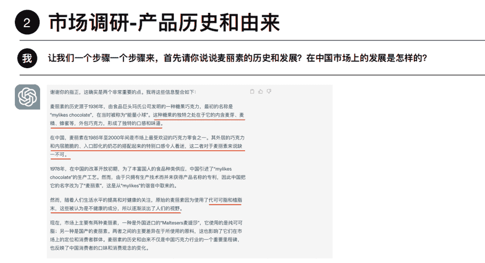

图片来源：食验室

我们来看它说的这些比较关键的句子。第一、这种糖果的独特之处在于它内含麦芽、麦精和蜂蜜等，外包巧克力，形成了独特的口感和味道。第二、外层的巧克力和内层脆脆的、入口即化的奶芯，搭配出的口感令人着迷，这二者对于麦丽素来说缺一不可。

这一段回答，我们觉得非常非常惊喜，回过头去看当前市场上的麦丽素，它们大多因为要保证高蛋白或者其它营养功能，将蛋白粉加入了麦丽素的脆芯中，导致麦丽素奶味不够足，也不能入口即化。

接着，我们进一步去验证这个假设，也就是刚刚流程中的第二、第三步。我们买了许多麦丽素来品尝，也去看了这些产品的评论，确实这些产品在内芯上都差点意思。而我们在小红书搜相关的词条时，发现甚至会有不少人会去专门买麦丽素的内芯吃。

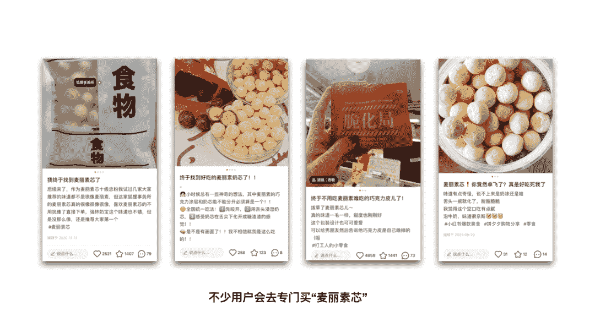

图片来源：食验室

通过和市面上的改良版“麦丽素”对比，买来尝一遍之后，我们惊喜地发现这些产品虽然替代了糖、做了高蛋白高纤维的改造，但这些成分却影响了脆皮的口感，也让内芯难以“入口即化”，且由于从代可可脂升级到了纯可可脂，巧克力味道掩盖掉了内芯的奶香味，从麦丽素变成了“巧克力球”。

食验室要做出真正差异化和90分的产品，就要在保证脆芯口感和入口即化的基础上做营养添加。当然，我们在研发过程中付出不少努力，才有了食验室的这款麦丽素。口感独特且轻盈无负担，高蛋白、纯可可脂、甜而不腻，没有当代消费者不认可的要素。

那么我们基本可以确定， 此次改造要实现的核心之一就是儿时同款麦丽素脆芯入口即化的口感 。

在研发上确认了这款产品可实现后，我们基本确定下来了这款麦丽素的卖点。首先，它是我们经典儿时同款的麦丽素，有入口即化、奶味十足的麦芽脆心，可以完美还原我们小时候吃麦丽素的感觉。其次，我们对它进行了健康化的改造，它是1.5倍高蛋白、无蔗糖添加，纯可可脂的，轻盈无负担的一款麦丽素，吃我们食验室的零食，就是在补充营养。最后，食验室的零食绝对不会使用不健康的成分，所以无蔗糖添加、无植脂末添加和0反式脂肪酸是必须要做到的。

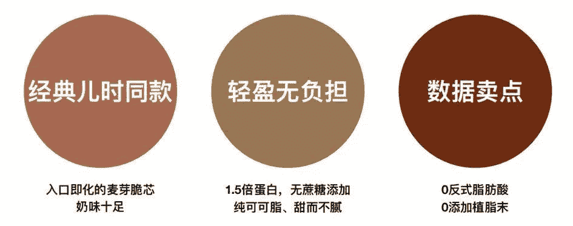

图片来源：食验室

到此为止，我们的产品已经基本确认了下来。接下来我们就进入到产品定义的阶段，也就是确定产品的名字、一句话卖点等信息，这些要素里，大部分都可以让GPT来辅助，我们来逐个进行。

我们先让GPT给我们起个产品名字，一开始它起的我们不是很满意，于是我们让它再给我们起20个，大家可以猜一猜，在这些产品名字中，我们选了哪一个？

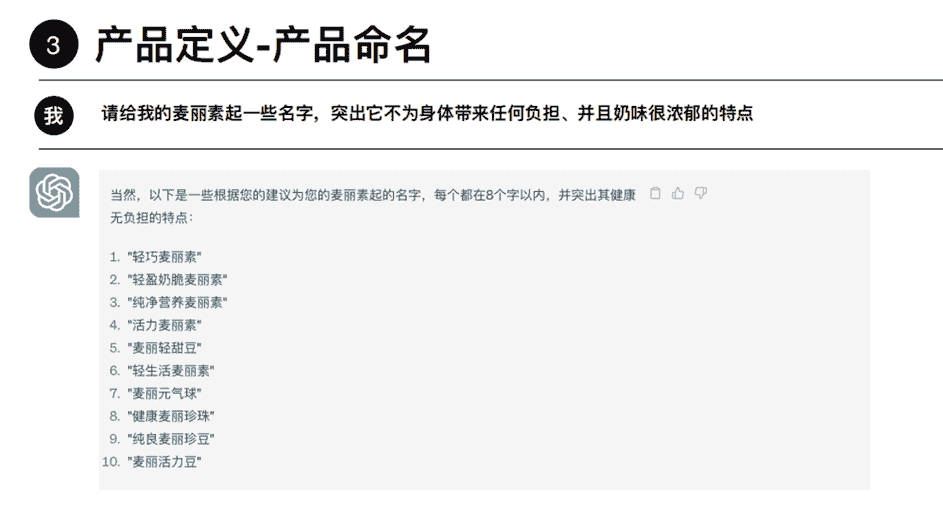

图片来源：食验室

因为在卖点中，我们强调了奶味和入口即化的脆芯特点，我们选择了轻巧麦丽素这个名字，其实还有另一个名字我们也觉得很不错，大家猜猜是哪个？

这里有个提问的小技巧，像命名、文案、选题一类的问题，如果AI一开始给你的答案你不满意，可以让它再给你10个、50个、100个，这样一来，AI就为我们提供了无限的生产力和想象力，我们可以从中挑选，当然，如果发现这些里都没有满意的，那可能就要思考一下，是不是提问题的方法出现了问题。

接着，我们需要AI给我们一句话作为我们的一句话卖点。同样，这里它一开始提炼的我不是很满意，但是我再让它为我们提炼10个，然后产品经理选了「轻盈奶脆，入口即化」还不错，可以体现我们这款麦丽素健康无负担的特点和产品最大的差异点。

在包装概念这一步，我们向GPT提出，让它为我们想一款能给人感觉无负担和轻松的包装，并且让它一次性想10个创意，它给了我们羽毛、云朵、气球，都是给人感觉无负担和轻松感的东西，但是我不知道该怎么选，而且说实话，我不是设计师，对画面的想象力还是比较有限的，如果让设计师去帮我做一个初稿我最后却不用，是非常消耗设计师的精力、耐心和创作欲的。

随后，我们找了“创意鬼才”Midjourney同学，让AI把这些创意多试一下，生成了大量图片。通过MJ，产品经理也可以自己把GPT的创意做无限的尝试，形成一个闭环，再从中选择比较满意的方向，非常高效。

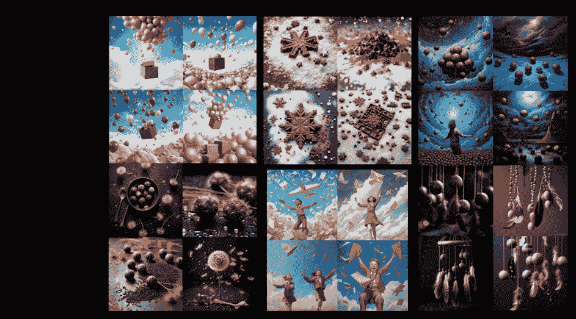

图片来源：食验室

最后我们觉得“巧克力气球”不错，能够体现巧克力和卖点。其实还有“巧克力蛋白云朵”也是一个让我们感到惊喜的创意。

图片来源：食验室

到了这里，产品经理的工作几乎完成了。食验室在完成了AI工程之后，效率极大地提升，原本一周以上的工作量能浓缩到1-2天完成。

## **2、设计阶段**

分享嘉宾：陈允信 设计便利店主理人 东西制造局创始人兼设计总监

顺着刚才讲的产品企划，我会分享两个板块，一个是Midjourney和SD高速生图的实战经验，以及Midjourney的万能公式。

Midjourney如何用于实战？

除了前面的构思和沟通环节，我们要思考一款包装到底由多少个视觉要素构成。以食验室的鳕鱼肉薯片举例，一个包装会拆解为LOGO、外型、颜色、版式和ICON，这些要素可以归纳为三个核心：

主视觉画面，即包装上呈现的画面；

卖点的视觉可视化；

包装的品牌识别。

图片来源：东西制造局

说回这款轻巧麦丽素，它的卖点一是儿时经典同款；二是轻盈无负担；三是数据卖点。对于设计师来说，最能够视觉表达的卖点是“轻盈无负担”，通过询问ChatGPT，基本上敲定了4个核心元素：气球、天空、云朵、冷色。

图片来源：东西制造局

Midjourney在生成图像的效率上远远超过了我们的想象力。一开始小试牛刀，跟它说想生成一款有食欲的巧克力球，它用半个小时时间生成了100张巧克力球产品图。过去要拍摄这样一个巧克力球包装，前期策划、和摄影团队洽接沟通、道具准备、现场拍摄、后期修图，整个流程下来至少5-7天的工作量，现在一个人有一台电脑，30分钟就完成了整个流程，而且图片质量并不低，足够在草稿阶段做一些尝试。

这是我们生成的第一个包装：

当然，还可以更有意思一点，我们把一切推翻了重来，毕竟30分钟又能生成上百个，这次换了“巧克力奶浪”的概念来生成。

再换成“热气球”来呈现：

图片来源：东西制造局

对于一个设计师来说，一直不断推翻自己的作品多少有点心理负担，但现在这种心理负担没有了，因为随随便便就可以重新再来。

那天晚上我们开会就灵机一动，有没有可能直接把这款包装形状就做成热气球？后来我们就生成了热气球包装，已经有打样出来的实物了。

图片来源：东西制造局

从想法、概念、样式到样本，整个过程是很有意思的状态，不断颠覆自己，随便重来的感觉。

图片来源：东西制造局

另外，我们做消费品还常常需要满足线下海报或电商平台的视觉需求，我们借助了SD，让AI“把这个热气球放在一个有意思的场景里”，有天空、巧克力乐园等场景。

图片来源：东西制造局

如果让一个三维设计师来，从构思到渲染基本需要5-7天，中间还不排除有返稿的过程，现在用AI两个小时做完，极大提升了内部效率。

轻巧麦丽素

接下来介绍一下Midjourney的使用方法，这是非常干货的、我们总结的Midjourney万能公式：

有些人觉得生成图片不好用，其实是因为限制条件不够精确。

我们的公式是 **主体+类型+背景+风格+参数 **。

主体是男人/女人、小孩/老人、动物/植物、物品/卡通，形状是方形还是球体？

类型是插画/写实、游戏/摄影、设计/电影、三维/平面？

背景，如果是需要扣下来使用的素材，就告诉AI是白背景生成，或者根据需求要AI提供城市、乡村、草地背景等。

风格是Midjourney最强大的一个标签，可以是水彩、赛博、写实、波普、中式、拼贴等都能做。最后还有一个小Tips，输入你要的质量及尺寸参数。

大家也可以问ChatGPT有什么样的风格推荐，它会告诉你一些答案，比如说像素风、水彩风等，每一个风格都有对应的专业名词，使用这些名词喂给AI会更加聚焦和具体。

除了宽泛的风格类型，如果你对某个艺术家的画非常有执念，你也可以告诉AI生成这个艺术家的画风。包括材质，比如说金属、铝、纸板、纤维，又或者角度不太对时，告诉AI要的是远景、俯视、侧视，这些描述都能使生成出来的图更加精准。

AI大幅度提高了我们的效率，解放了我们的时间，可以让设计师将更多的时间和精力投入到创造性的思考和实践中。我想警醒大家，不拥抱就会被淘汰。拥抱AI不要有排斥心态，才能持续探索AI和设计的无限可能性。

整理编辑：小犬

审稿：Yanyan

校对：Clare

**提示：**

* 本文为FBIF原创首发，欢迎无条件转发 朋友圈。转载请在后台回复“转载”了解规则。

---

<https://my.feishu.cn/sync/CV7edZp1nspUQobYJhicxeP7nrb>