# 美团优选借助AI制作户外广告

> 来源：[https://my.feishu.cn/docx/Lh1zdJUino5fSexAU22cdCL6n5c](https://my.feishu.cn/docx/Lh1zdJUino5fSexAU22cdCL6n5c)

<https://my.feishu.cn/sync/CV7edZp1nspUQobYJhicxeP7nrb>

---

> 内容来源：美团优选

> 原文链接：[点击查看](https://mp.weixin.qq.com/s/-hkARSZz671KMkFdUd14Mg)

> 发布时间：2023-04-14

近日，美团优选推出了「省钱少女漫」系列广告，并于 4 月 6 日正式登陆广东汕头，开启了户外刊登「连载」15 天的历程。这一系列广告，讲述了 10 组可爱省钱人的脑洞晚餐故事。值得一提的是，广告中的 10 幅漫画，均是由 AI 和人类共同合作的作品。

美团优选通过人机合作这一智能化的生产方式，实现了艺术创意连续输出的可能，极大程度上达成了效果与效率的统一。品牌将漫画布置在街头，以趣味的方式深入消费者的心智，同时持续不断地向大众输出物美价廉的品牌形象。

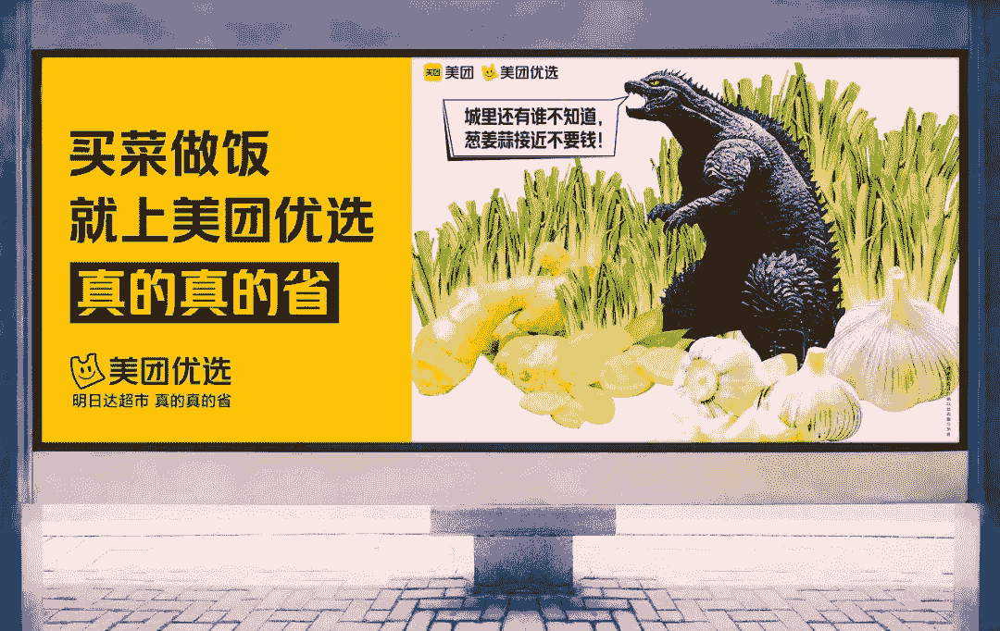

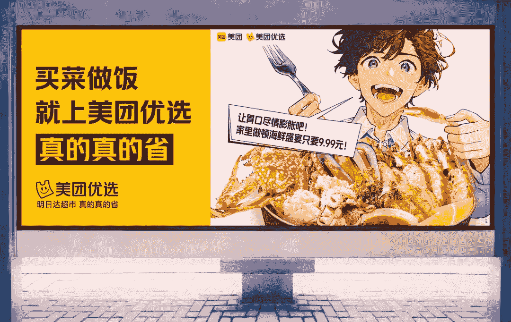

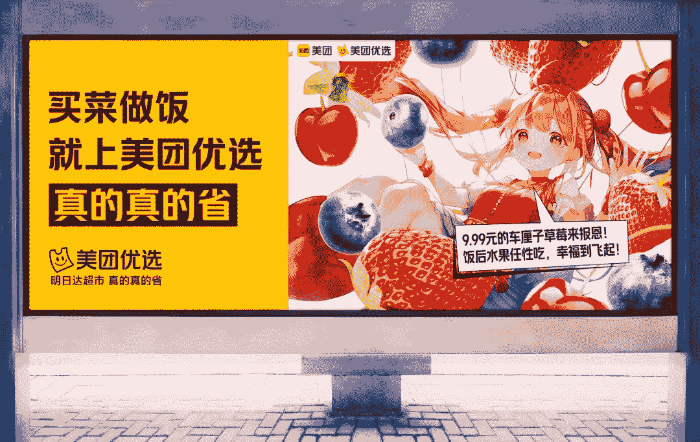

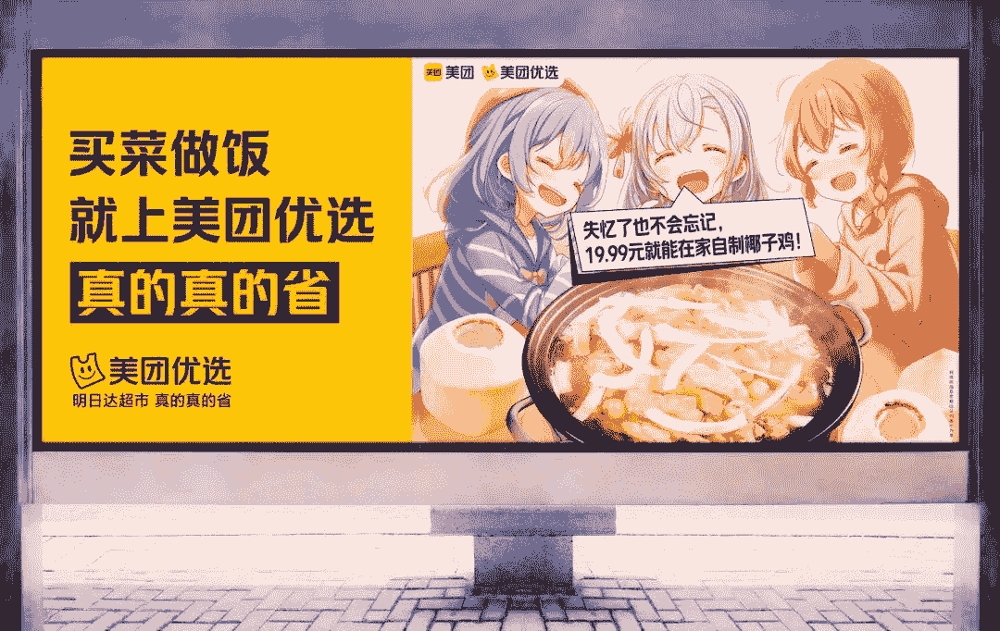

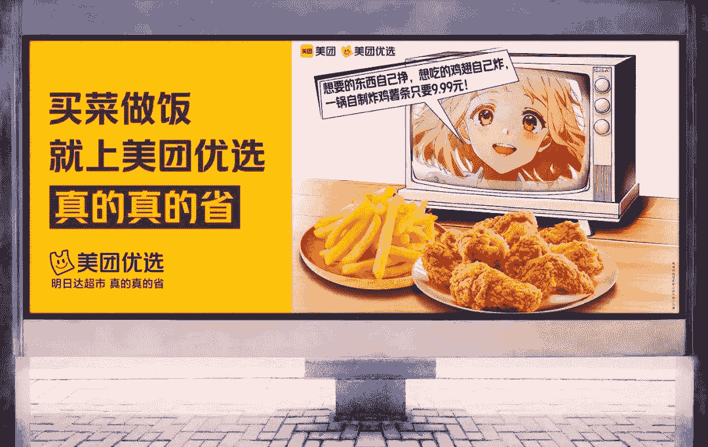

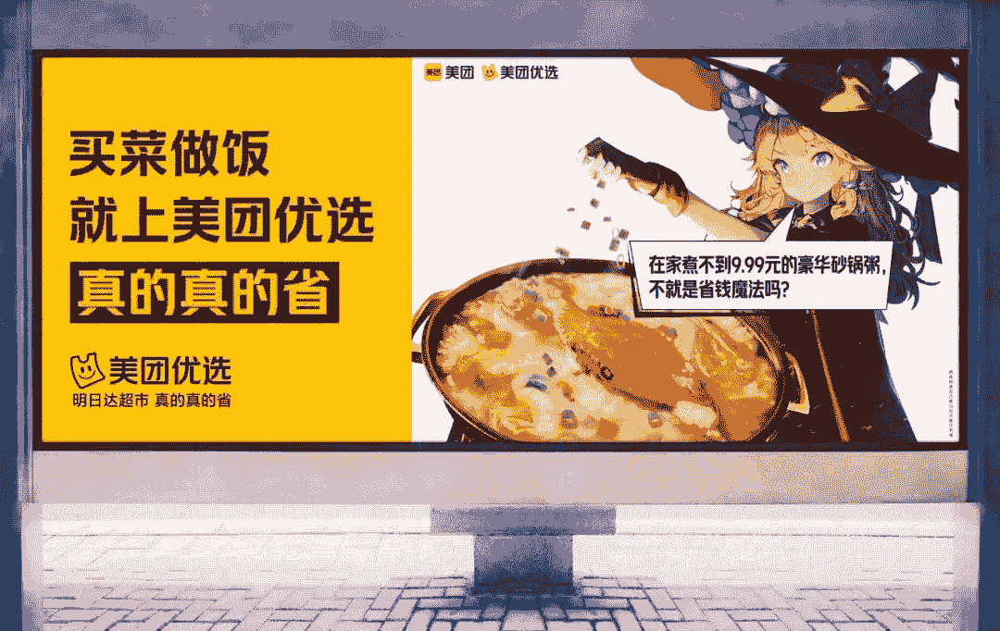

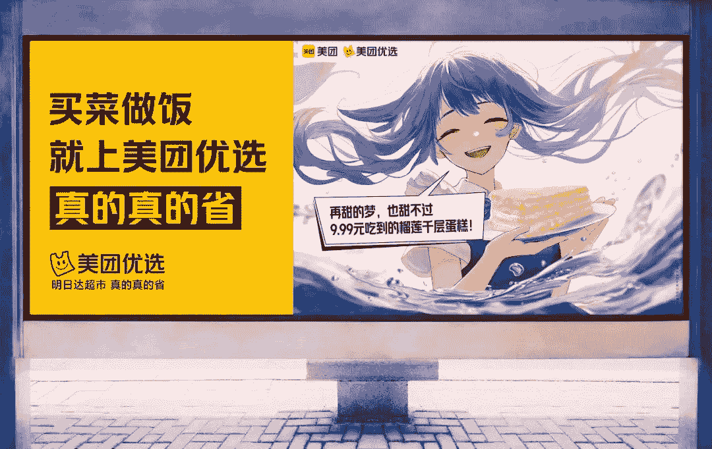

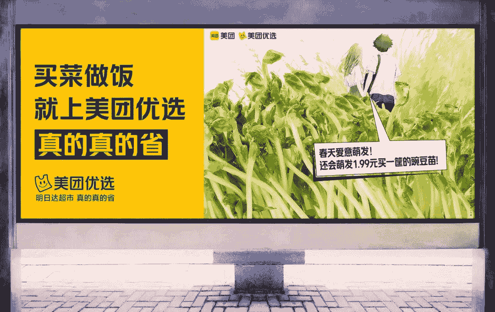

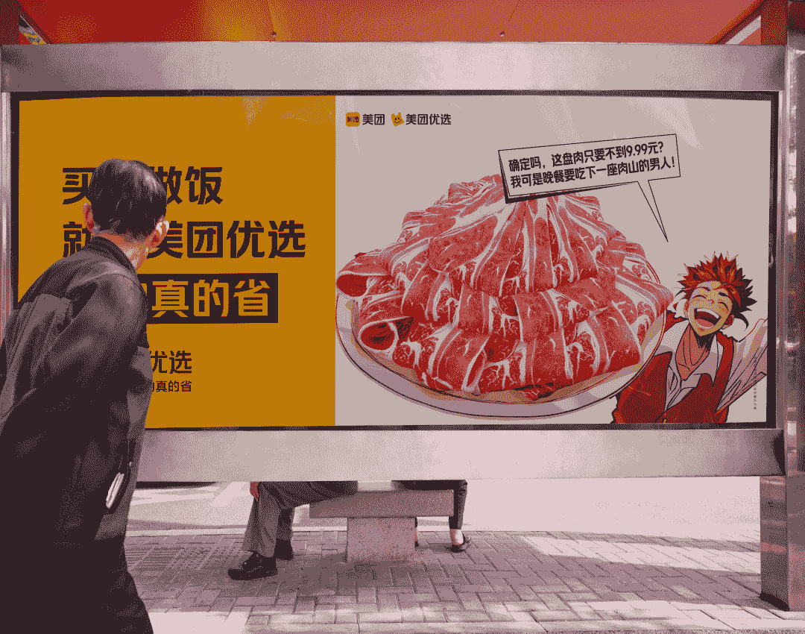

同样不可忽视的是，占了三分之一画面的大字文案：

“买菜做饭，就上美团优选，真的真的省”

左右呼应间，这组广告的目的，相信大家已经心中了然。

没错，主打的就是一个 **“帮你省钱” **。

这就是美团优选的新广告——

**「省钱少女漫」**

据了解，这是 **美团优选本地化营销汕头站专项 ****，这组户外广**告由 AI 绘画出品，将在汕头全城 连载十五天 。

**把户外广告**做成了连载漫画，这招挺新鲜，小马我也属实感受到了其中 省到极致 的愉悦感。

**据了解，这组户外广**告在抓人眼球的呈现效果的背后，还有着 很扎实的内在逻辑 。

一、打造差异化的内容抢占用户心智。

市场上千篇一律的大字报、明星大头照式户外广告，已经让消费者视觉疲劳，漫画能够更好地在街头抢占用户注意力；

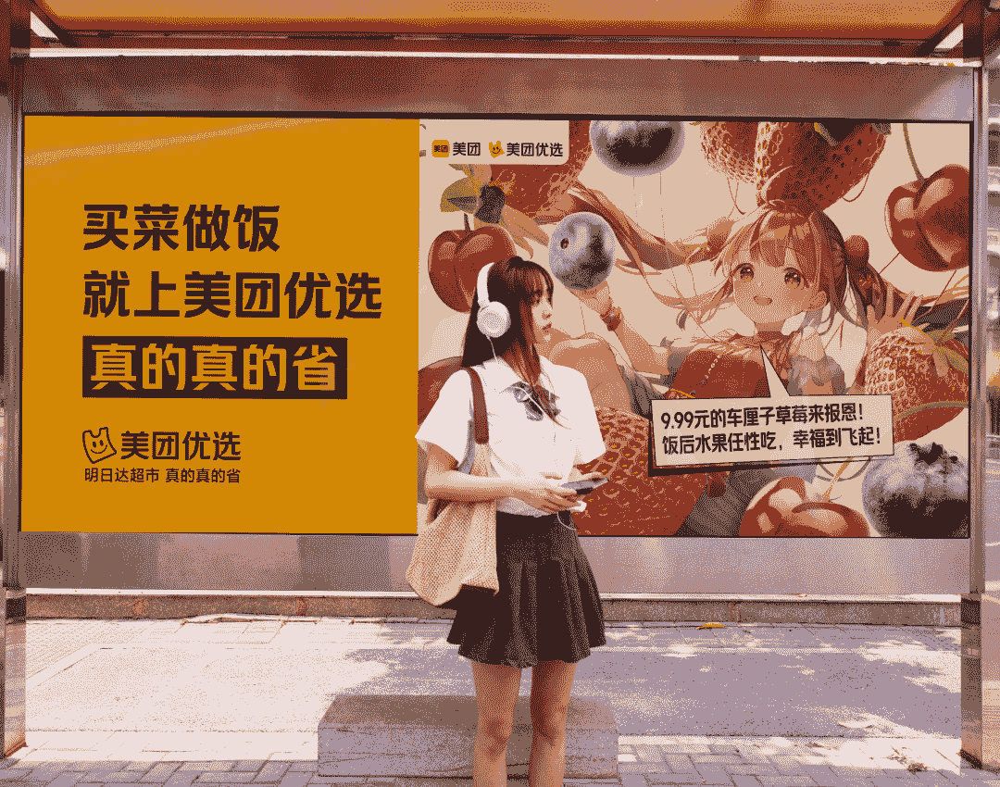

二、内容形式符合用户偏好。

小马了解到，品牌方经调研发现，用户对于连环画这种讲故事的图文形式更容易接受且记忆，因此有了「省钱漫画」这一创意。

另外，在内容上，广告也细腻地洞察到了广东人 重视晚餐 的习惯。

比如，“滋补炖汤”对应着广东人晚餐爱喝汤的风俗；“海鲜大餐”贴合汕头靠着海的食材特色；“豌豆苗”代表着广东人餐桌上必不可少的那道绿叶菜……

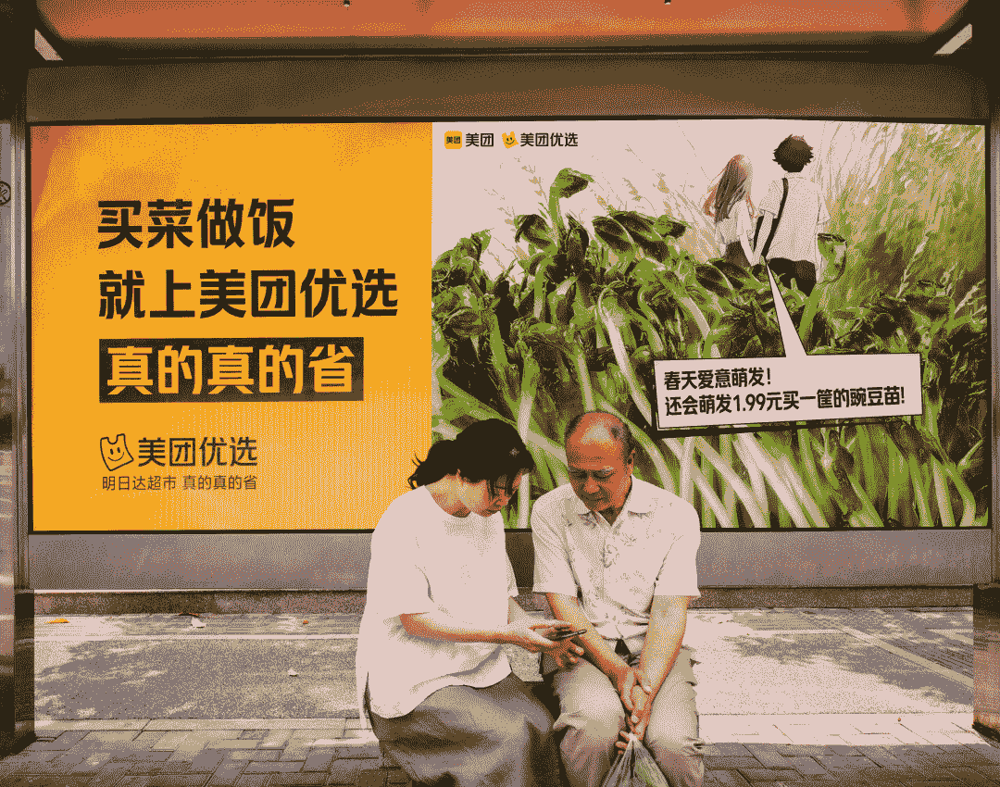

**精准抓住了买菜做饭的**人群**，针对性击中用户**痛点，品牌 把“省”讲到了实处 ， 懂人心也接地气 。

作为一则户外广告，美团优选不仅在画面上足够吸引眼球，更是抓住了城市特色，踩准了场景卖点。看到这里，你可能在心里暗暗觉得，这把城市营销被美团优选给拿捏了。

如果告诉你，这组户外广告其实是AI做的，你又会怎么看？

# **-02- AI**执行揭秘： 「人类甲方」与「AI乙方」初体验

关于 AI，马可婷不说大家也知道它有多火。

ChatGPT 多次刷屏，国内外公司纷纷入场。AI产品不仅回复效率极高，而且文案、绘画等功能齐全。诸多品牌也已经在酝酿试探AI营销……

**据了解，美**团优选品牌内部团队在 2 月底 就萌生了使用AI去执行这一创意进行绘画的 idea。对于复杂的漫画型需求，AI绘画是一个非常高效的工具，能够在短时间内产出多种风格的物料以供选择，极大地缩减物料的打磨时间。

**那么这其中的执行过程是什么样的？「人类甲方」和**「AI乙方」之间的合作又能足够顺利吗？

以下是小马打听到的 **一些幕后 **：

**『怎么下 brief 』**

**给 AI 下 brief** 的人，需要 在脑海中绘制出整张画面 ，想象出每一个细节。

比如 AI 绘制一位热血少年，文案需要到细化到对发型发色，刘海走向，眼睛轮廓，眼神里光的颜色，眉毛的粗细形状等等进行一一描述。

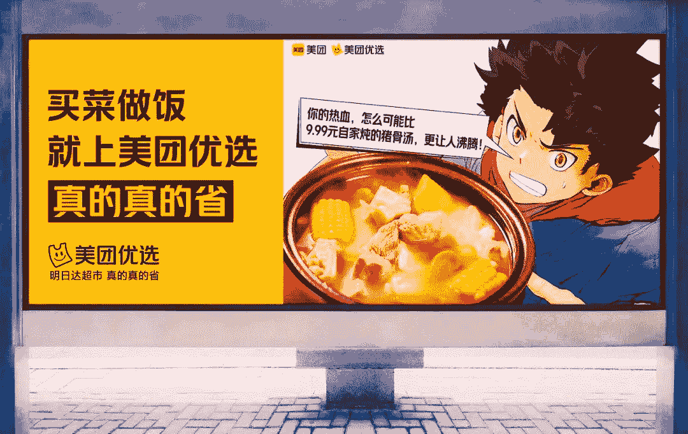

就像侦探剧中追踪疑犯那样，不是任由 AI 发挥。

**『 执行过程 』**

**每一幅达到出街标**准的漫画，至少需要写过 上万字的描述词 。

美**团优选「省钱少女漫」作为首个由 AI 执行出街的户**外广告，具备创新性的实验价值。品牌营销团队用实践表达对待 AI 的观点： 大航海时代即将到来，能够将 AI 这一工具使用好的品牌人，能够更高效地去交付高质量的作品。

# **-03- 本地化媒介投****放新解法： “城**市猎手”出手

美团优选本地化营销汕头站的背后，不仅仅是创意内容，这里面还有品牌营销团队独创的 【城市猎手精准户外营销媒介投放】一整套打法 。

区别于广撒网饱和式宣传模式——

这种打法在创意上更追求 **打造有效捕捉注意力的视觉锤 **。

媒介上，则要在 **最精准范围内做到掷必有声 **。通过城市小区房价、提货点位效益、城市人群对广告接受态度的多重选取，把关人群和点位的匹配程度。组合点位深度渗透目标用户的主要生活+社交行为轨迹，实现强触达、准触达的传播核心目标。

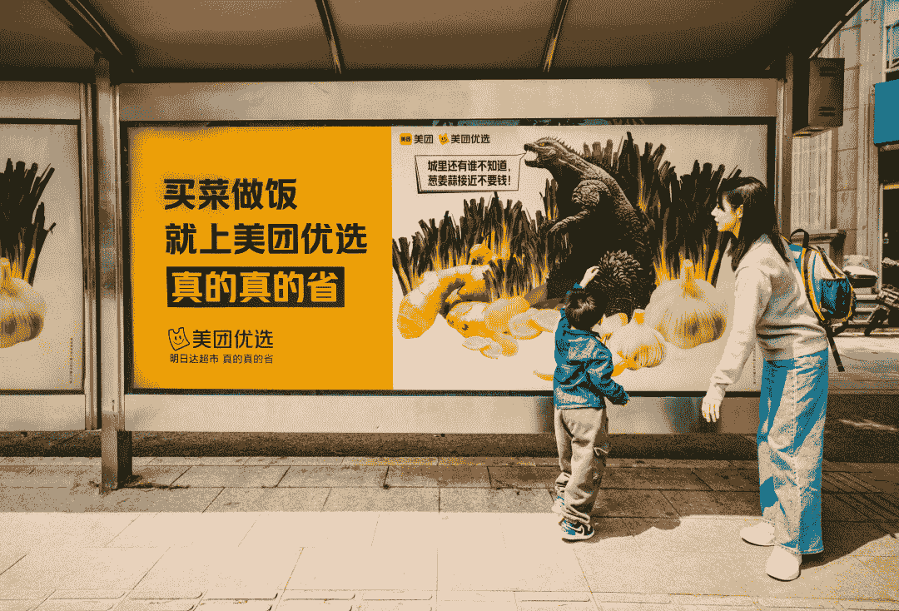

可以说，在本地化营销过程中，美团优选潜移默化地提升了品牌的知名度和好感度，也成功沉淀出了一套适用于当今环境且适用于美团优选区域营销的方法论。

---

<https://my.feishu.cn/sync/CV7edZp1nspUQobYJhicxeP7nrb>