# 借助AI设计《消失的她》电影海报

> 来源：[https://my.feishu.cn/docx/LFDhdGTR0oXPJzxfFUZce3bBnEd](https://my.feishu.cn/docx/LFDhdGTR0oXPJzxfFUZce3bBnEd)

<https://my.feishu.cn/sync/CV7edZp1nspUQobYJhicxeP7nrb>

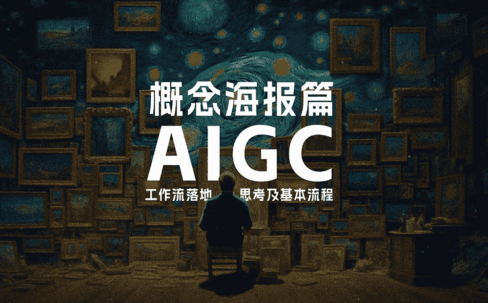

在AI进步飞速的大趋势下，拥抱AI所带来的改变是设计师们当下不得不去做的事情，思考如何更[好地将A](https://www.uisdc.com/tag/%e6%b6%88%e5%a4%b1%e7%9a%84%e5%a5%b9)I技术融入日常设计工作已经成为当务之急。本文将分享如何用2天时间，完成《消失的她》上影节AIGC单元展映海报。

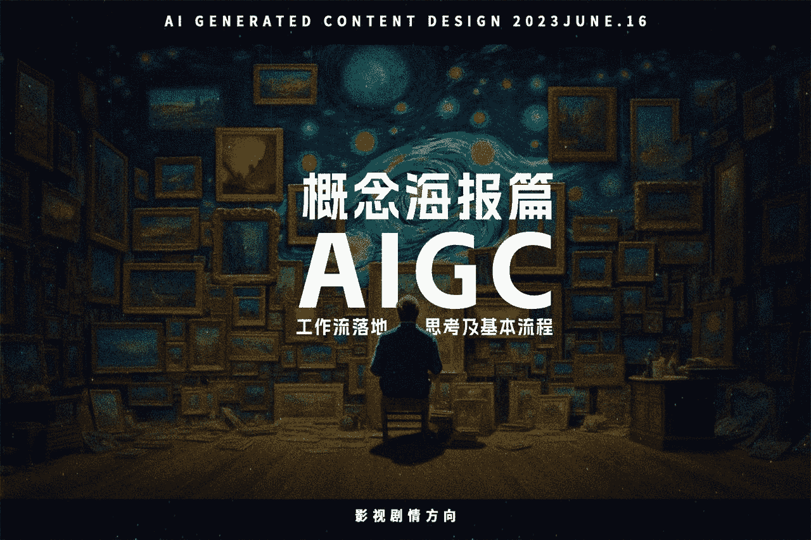

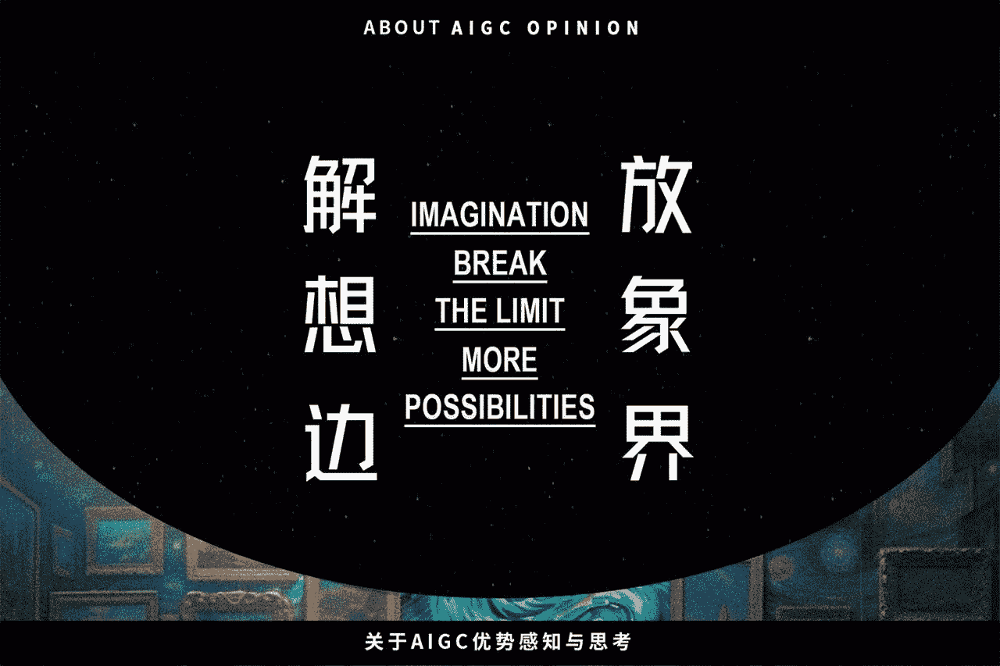

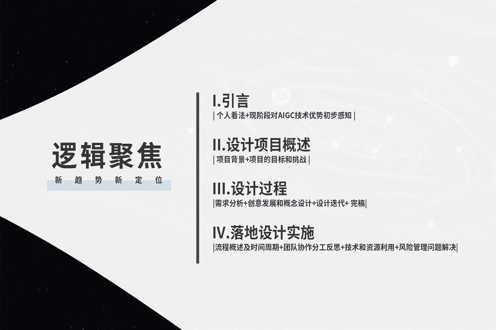

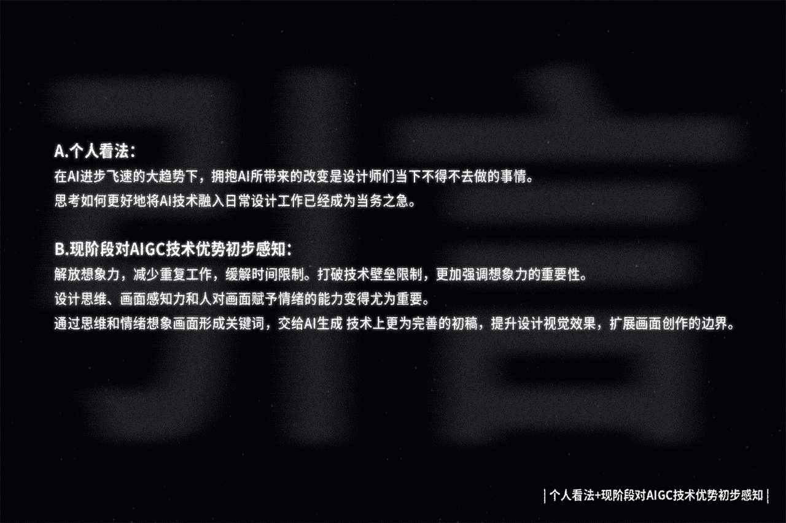

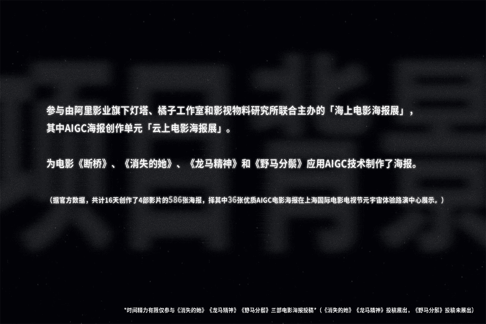

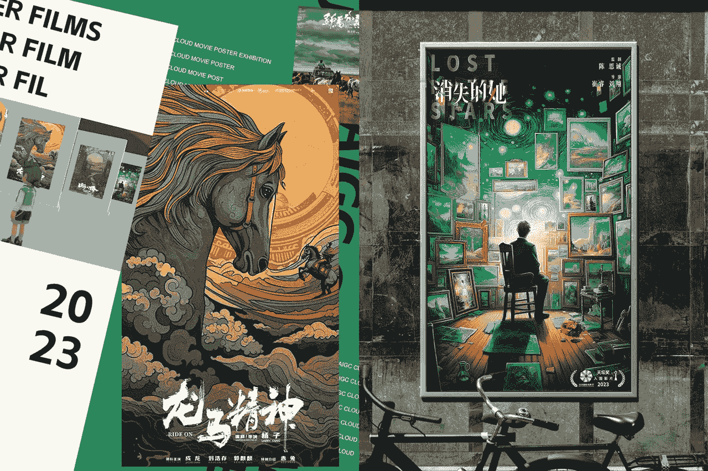

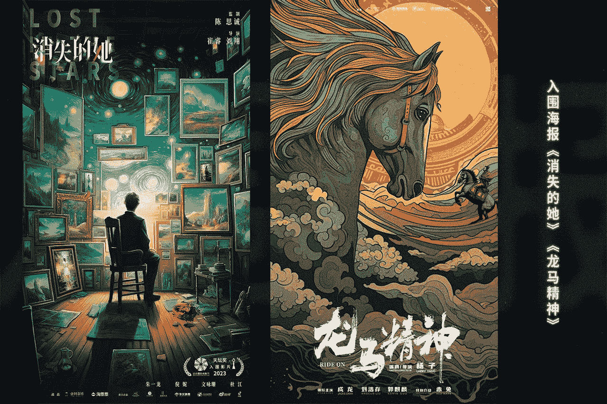

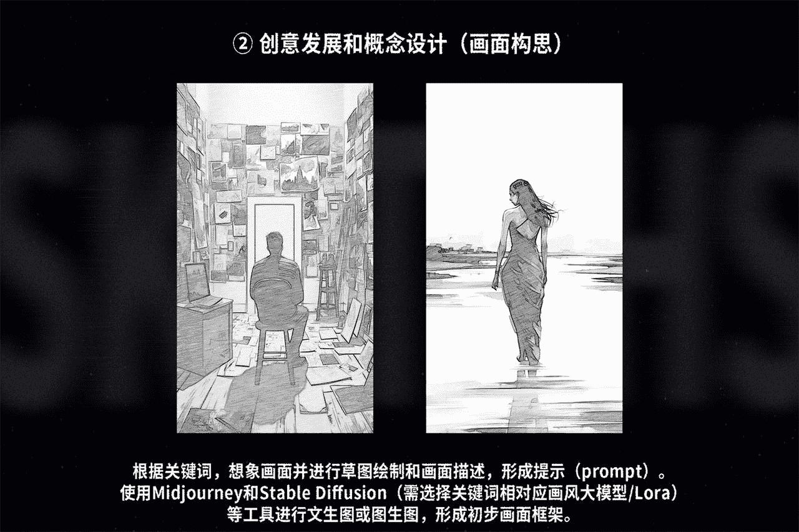

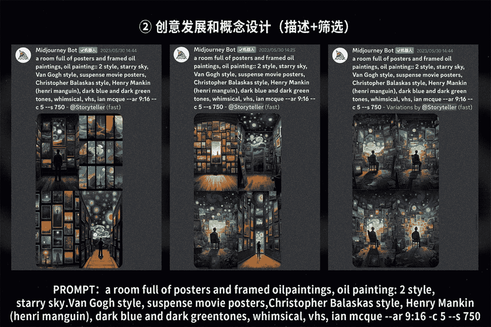

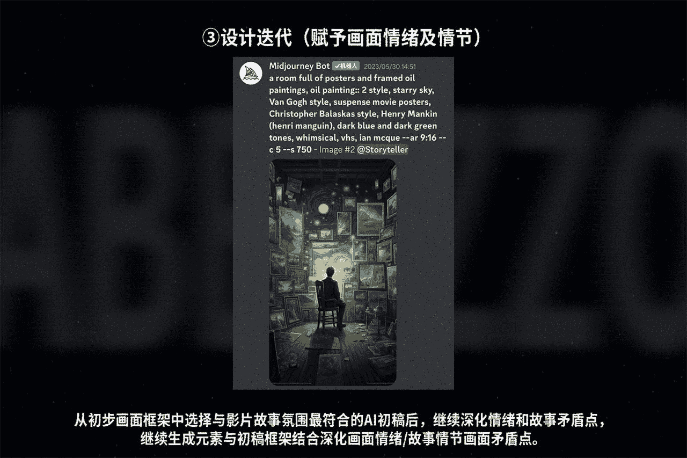

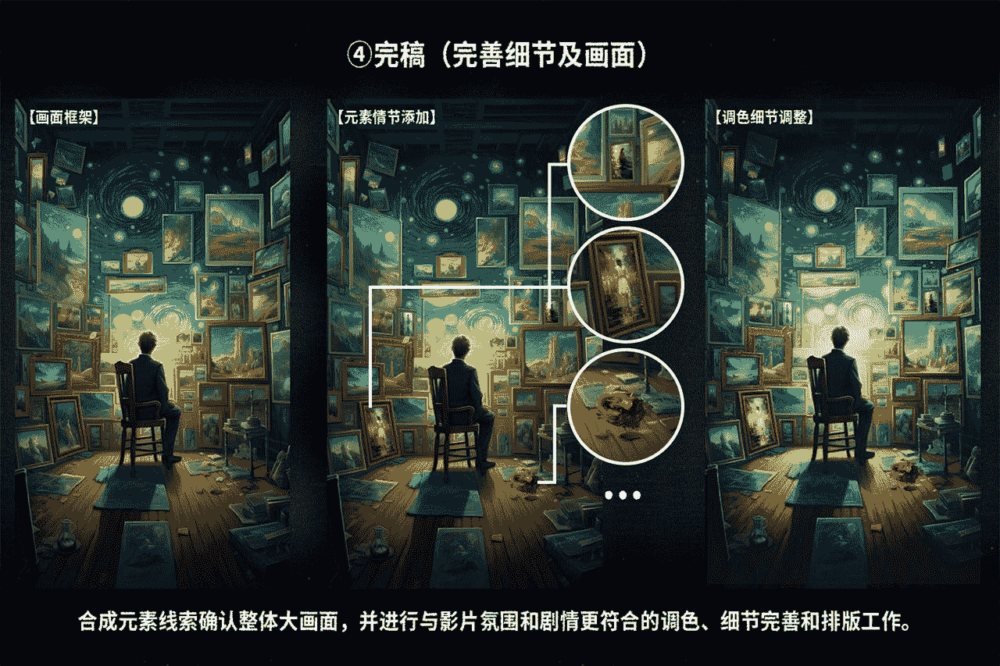

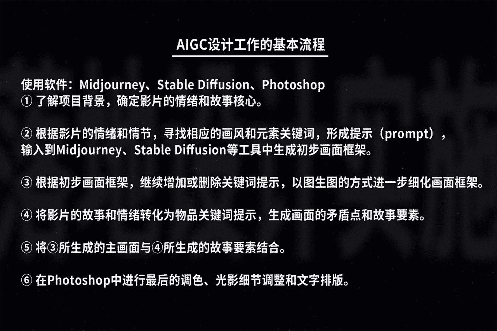

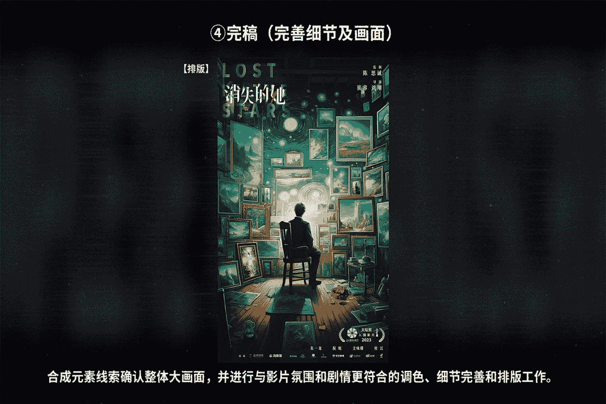

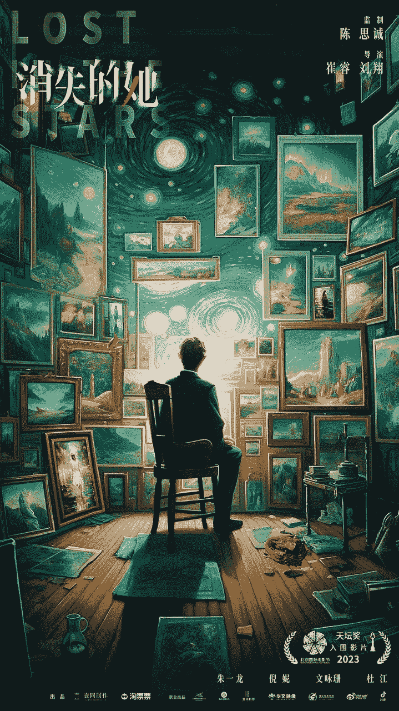

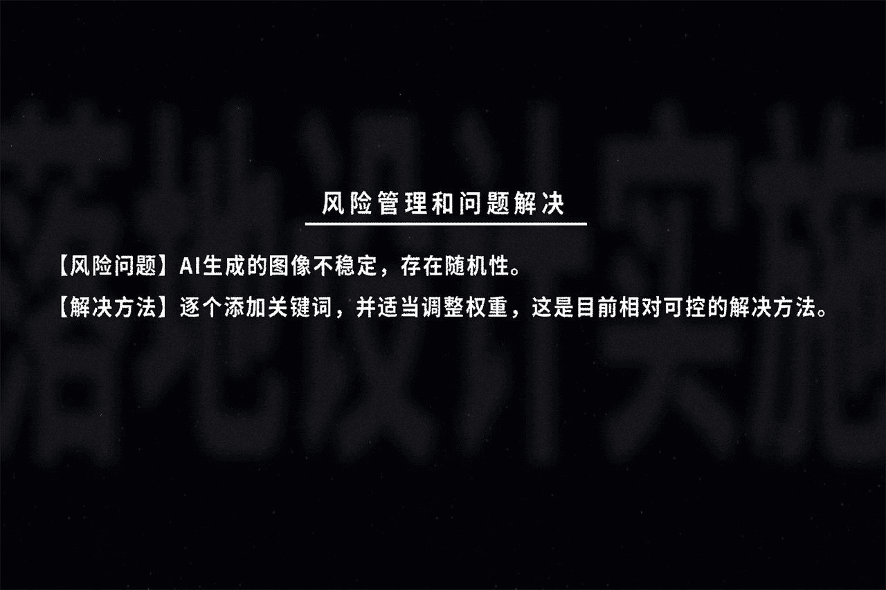

<https://my.feishu.cn/sync/CV7edZp1nspUQobYJhicxeP7nrb>