# 赶集直招借助AI提高设计生产力

> 来源：[https://my.feishu.cn/docx/Z47vd0WCboIC9AxyIDec6aRNnLd](https://my.feishu.cn/docx/Z47vd0WCboIC9AxyIDec6aRNnLd)

> 可前往：[AIGC提效资料库](https://mq1nzy47gs.feishu.cn/wiki/IxFew33ruiHG7Skp115c0G2Pnsd)

> 可前往：[学员专属工具库](https://mq1nzy47gs.feishu.cn/wiki/KHmYwQs9BipuPrkGcgPcRfH3njh)

> 可前往：[AIGC提效案例库](https://mq1nzy47gs.feishu.cn/wiki/YJr5wpanBiRCdvkI0bFcRehZnlg)

---

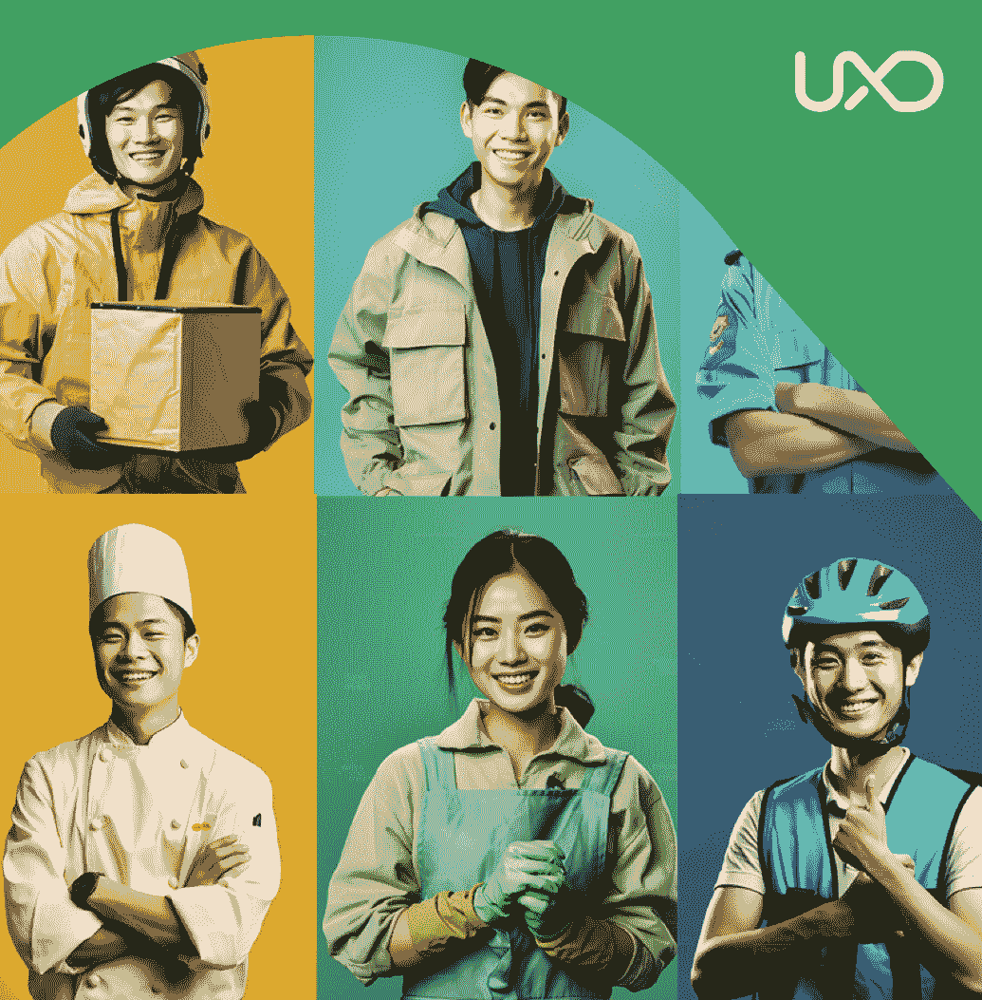

随着AI技术不断的发展，AI也给设计师的工作方式带来了全新的机遇与可能。赶集直招设计团队启动AI设计专项，主动探索，目前已将AIGC引入多个设计领域，包括设计资产搭建、品牌语言表达、设计生产流程等，显著提升设计效率与质量。本文将详细介绍AIGC在赶集直招视觉设计中的应用与探索。

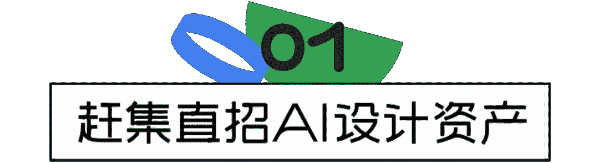

## **AI搭建赶集设计素材库**

通过前期反复调试，团队开始运用MidJourney快速生产符合赶集直招设计需要的人物素材、物品道具素材，实现「赶集直招设计素材库」的高效、高质量搭建。

引入AI设计，可以打破以往素材资源的限制，定制人物素材，更灵活地表现外貌特征、情绪状态、动作姿态、角色身份等，也能更自由地创作物品道具素材，进一步满足赶集业务的需求。

1、人物素材库搭建

目前，团队已通过AI工具生成100余张职业人物素材，覆盖10余类重点行业。这些人物素材具有一致的气质调性，不仅展现美丽、帅气的人物气质，而且又符合赶集职业人物年轻、积极向上的态度。

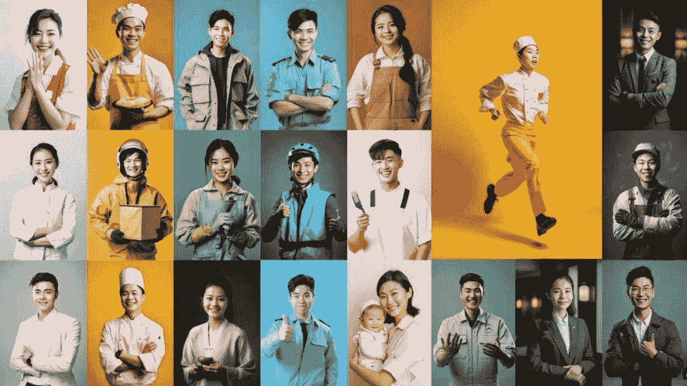

**2、道具素材库搭建**

同时，团队还产出100余张职业道具素材，基本实现了所思即所得，摆脱以前在各种素材平台找图的局限性，目前已经在需求中快速应用。

**AI人物素材生产方法**

使用MidJourney生成人物，可以做到高质量统一的人物形象群体，自由控制体态动作，大幅提升素材质量。

我们将AI人物素材生产分为3类：

1）基础日常人物素材

2）精准行业人物+职业道具素材

3）特殊项目定制人物素材

**1、基础日常人物**

针对赶集直招的重点行业，使用MJ储备基础的人物素材，通过服装和职业标准色强化角色职业，动作干练自信，表情统一表现出微笑、积极、正能量的态度。这类素材在赶集的日常运营设计中，有较高的复用性。

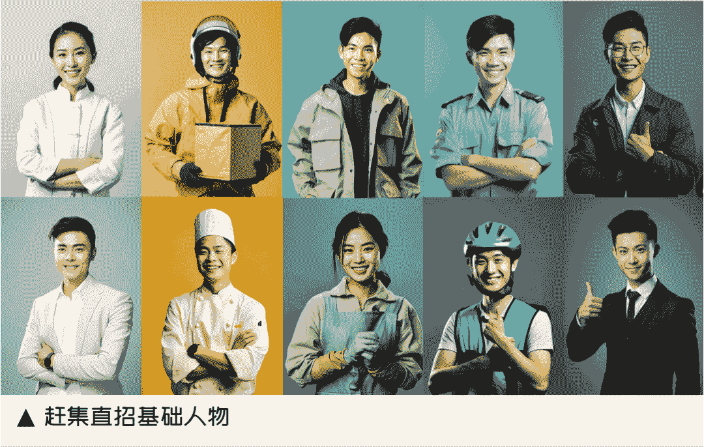

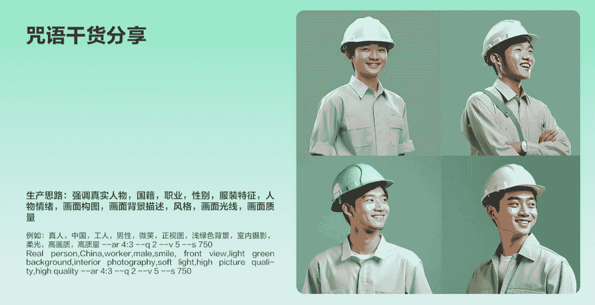

2、精准行业人物素材，职业道具更精准

在基础人物之外，应用MJ更灵活的拓展人物与职业道具融合的素材，如拿粉底刷的化妆师、端甜点的餐饮服务员，拿文件夹的销售等，提升人物素材库的丰富度与适用性。

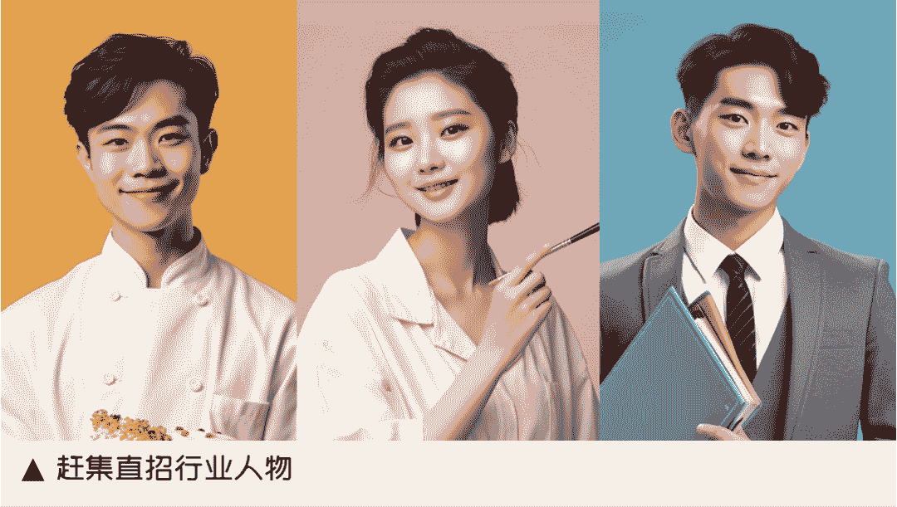

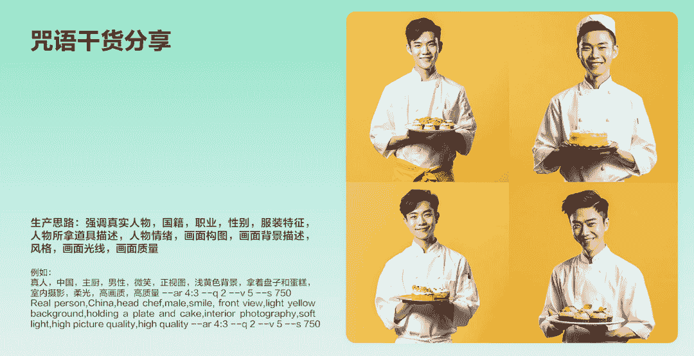

3、特殊项目定制人物素材

在日常运营设计中，除了在素材库中选择已有素材，AI工具也能帮助设计师针对特殊项目，快速且精准的定制人物素材，提升设计的吸引力。

例如赶集直招近期的「烟火淄博招聘专场」需要快速上线，切入“淄博烧烤”热点，设计师通过AI快速产出精准人物素材，同时实现了项目的快速上线，与设计的精准表达。

**AI道具素材生产提效**

在没有AI介入之前，为了解决设计提效，我们使用C4D搭建了行业道具组件库。道具组件库基于赶集直招的品牌语言-真实有感，始终向上，制作了一套具有统一光源、统一摄像机角度、统一材质质感及圆角大小的道具组件库。其中，部分行业道具搭建较为复杂，一张图从建模到渲染完成，平均需要1-4个小时。引入AI工具后，基于一套描述词，生成行业道具素材，一张图只需10-20分钟即可。相较C4D搭建，单位时间可以产出更多高质量素材。估算下来，AI生成效率提高了83%，AI素材库储备量短期内实现翻倍。

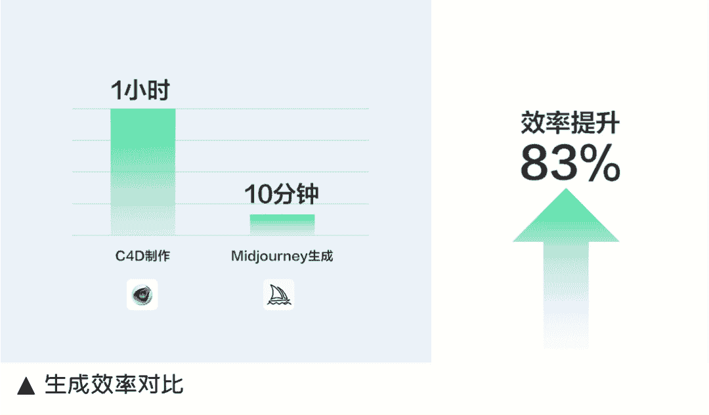

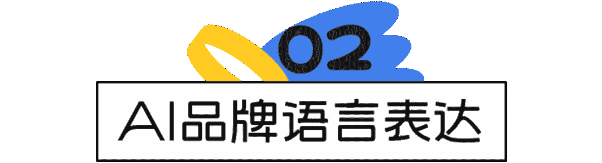

赶集直招自有一套系统的设计规范，来保护设计调性的稳定性与独特性。通过引入MidJourney、StableDiffusion等AI设计工具，我们正持续探索通过形、色、质、动等维度，让AI更精准地呈现“赶集直招风格”，增强赶集直招品牌语言和设计风格的表达。

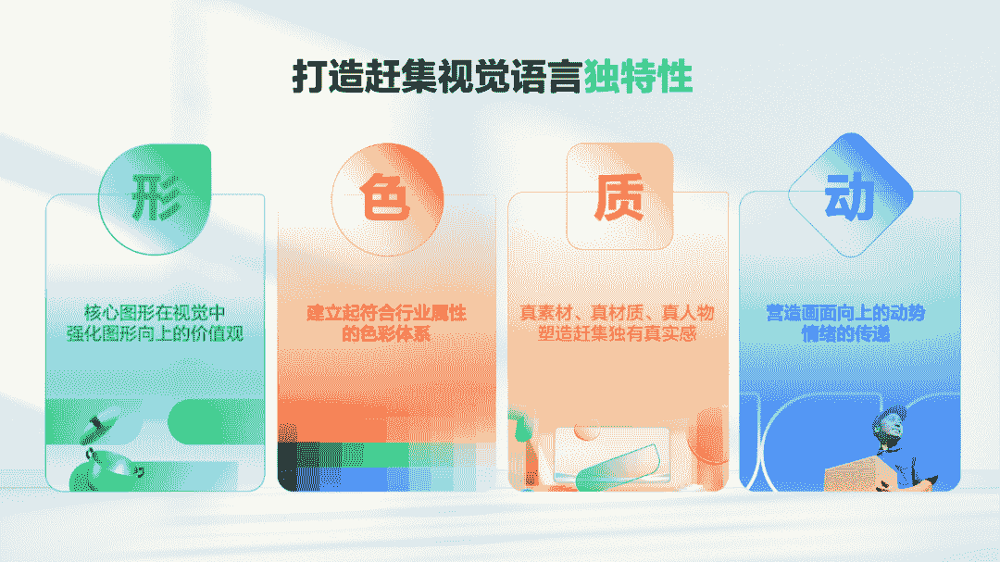

**形- UP°超级符号**

赶集直招品牌语言概念是真实有感 ，始终向上，通过超级符号UP°传递始终向上的设计价值。超级符号用于画面背景凸显主体，提升画面年轻感、空间感。

通过对SD的初步研究，我们已实现AI对超级符号UP°的标准绘制，并结合SEG图方式进行更高品质的创意表达。SD的运用解决了MJ可控性较低的问题，将视觉符号的可识别性以及更多创意发挥出来，让过往停留在脑海里的创意可以跃然纸上。

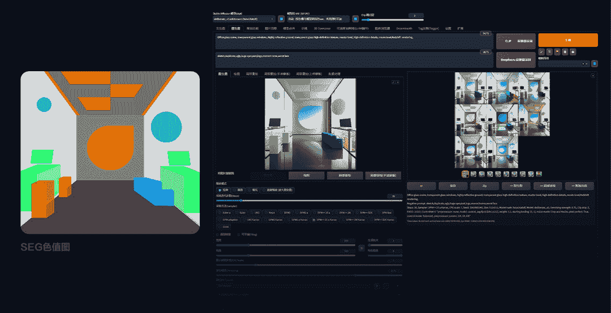

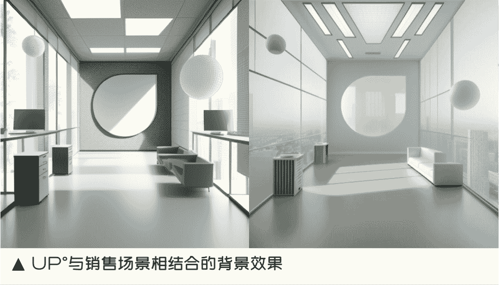

在此基础上，我们通过给SD投喂草图，加入相关描述词，再结合MJ生成的动态的人物，便可实现整体主视觉的创意设计。

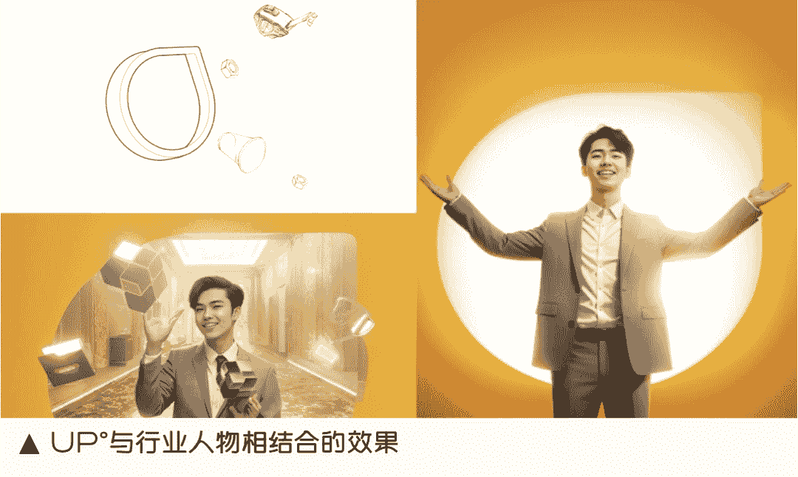

**色-遵循语言行业色彩**

在赶集直招的设计规范中，我们通过行业属性分析，建立起符合行业属性的色彩体系，让颜色成为不同职业的核心记忆点。同时融入辅色及渐变色，带来了更丰富的色彩深度，将色彩情绪与设计价值融合，使其更加充满活力，更年轻积极向上，让人们能够感觉到被关注。

引入AI设计后，我们在人物素材和场景设计中，可以直接通过色彩关键词或标准色彩垫图，实现符合职业色彩规范的设计产出。

**质-更加真实的玻璃质感**

赶集直招视觉语言的常用材质是玻璃质感，带给我们更丰富的感官体验，具有通透性、艺术性、与物体交叠出丰富的光影美感，色彩的千变万化。并且透过玻璃聚焦物体，可以看的更清楚更真实。

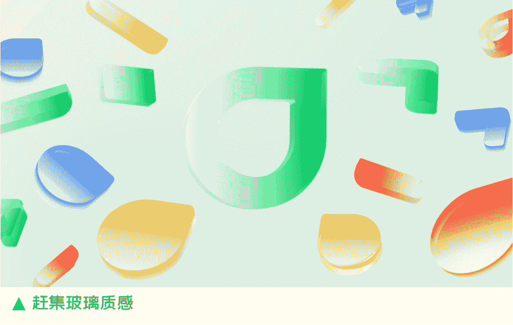

我们通过AI生成标准玻璃质感的道具素材，较之前的设计方式，能有更高的效率，并呈现出更具有丰富细节的质感。

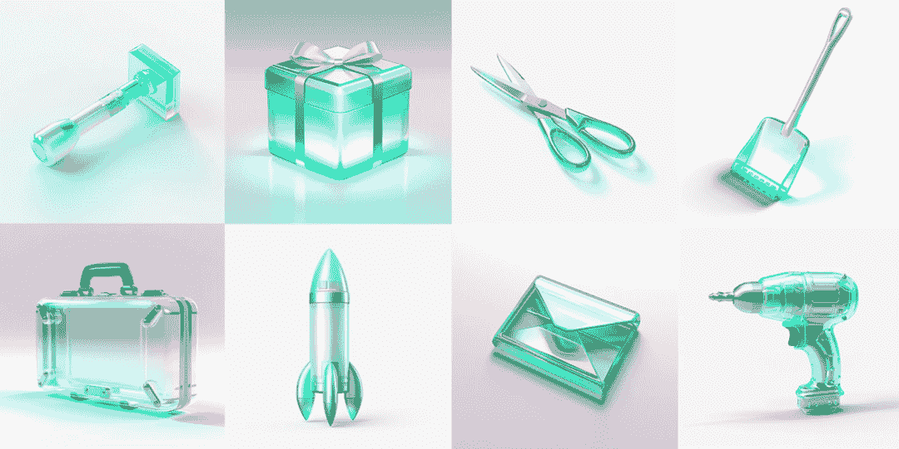

AI生成也秉承之前的品牌视觉理念，通过不断地人工喂图训练，从而生成通透的玻璃的画面质感，让页面轻量化同时又具有细节，搭配自建素材库，即可实现多元且调性一致的主视觉场景设计。

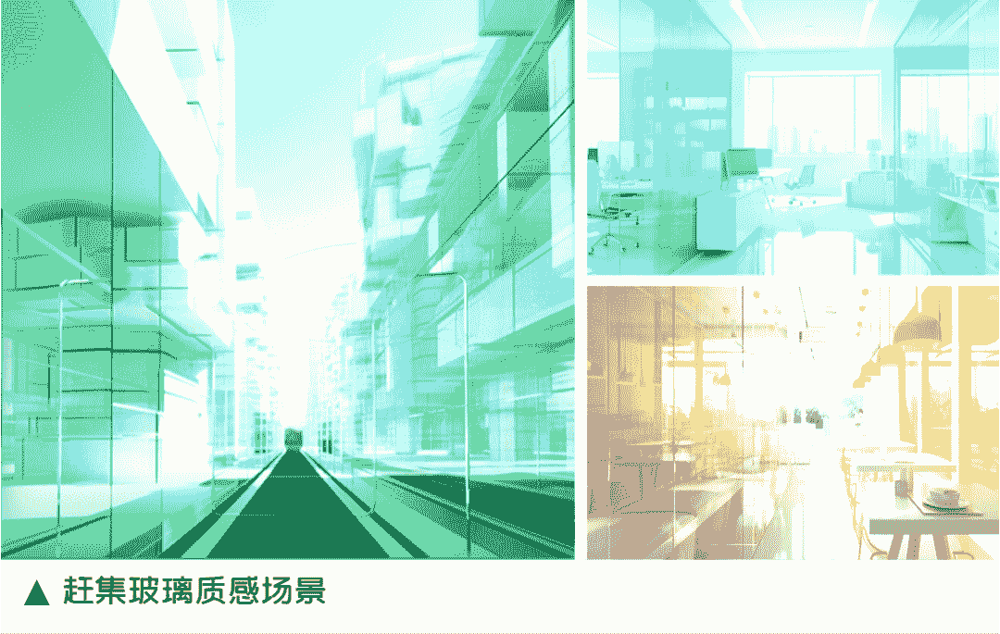

在赶集直招的「一键投递职位专区」项目中，我们通过MJ图片训练产出符合赶集质感的背景图，再与AI生产的道具素材结合，实现了最终方案的系列感与品牌感。

**动-向上的动态**

赶集直招另一个核心的设计语言，是积极向上的动态。赶集直招让城市各个角落的劳动者对未来充满希望，这是一种信息传递、一种情感表达，更是一种向上的力量，传递始终向上的设计价值。

以往受限于素材库的丰富度，设计师很难获得理想的人物素材（既适用画面，又富有动感），从而很难表达出赶集“向上动态”的品牌语言。引入AI设计后，通过AI更自由地产出具有动势的人物，有效提升了设计画面的冲击力和动感，增强了品牌气质的表达。

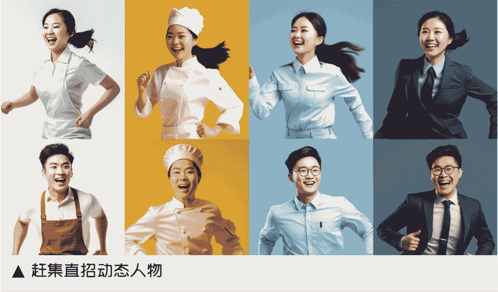

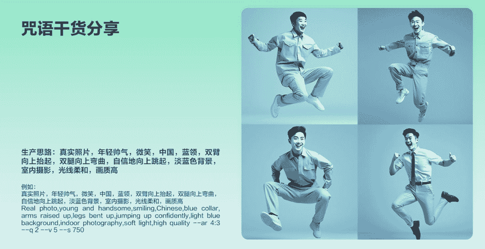

在赶集直招的「甄选品牌榜」项目中，尝试使用MJ生成动态人物与场景，再后期结合PS的方式进行设计，最终达到了画面向上动态、画面质感一致的设计 目标。

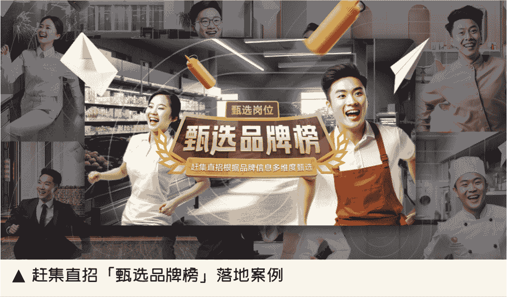

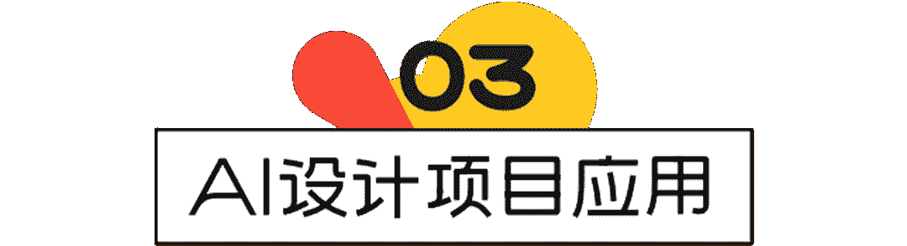

赶集直招设计团队在引入AI工具后，重新梳理了设计工作流程，在创意阶段、设计产出阶段持续挖掘AI的可能性与价值，已实 现日常视觉设计的初步提效。

**赶集直招运营设计工作流程演变 **

旧工作流程中，团队设计落地一场运营活动，约需要9-12天。

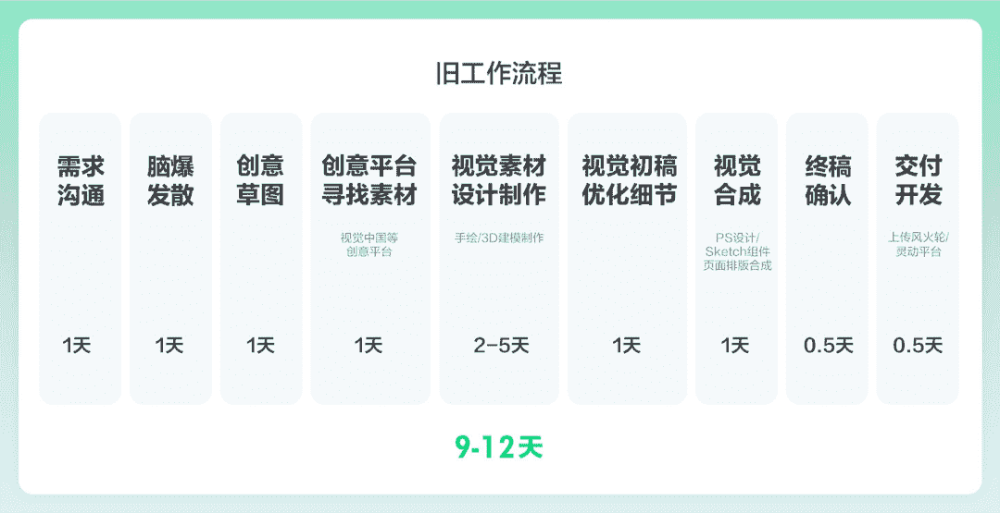

AI化的新工作流程中，团队设计落地一场运营活动，已缩减到6-7天。

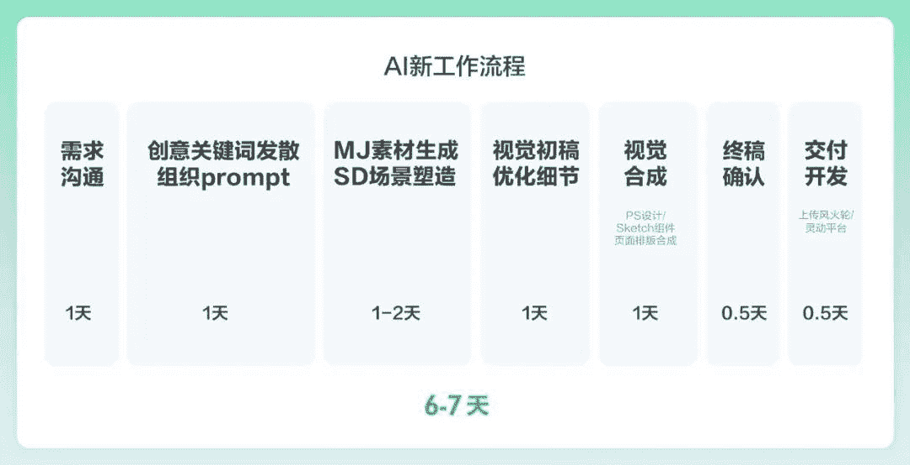

**AI项目应用**

通过将AIGC引入设计资产搭建、品牌语言表达、设计生产流程，赶集直招设计团队已落地10余场运营活动设计，初步提升了设计效率与质量，实现品牌统一透传。

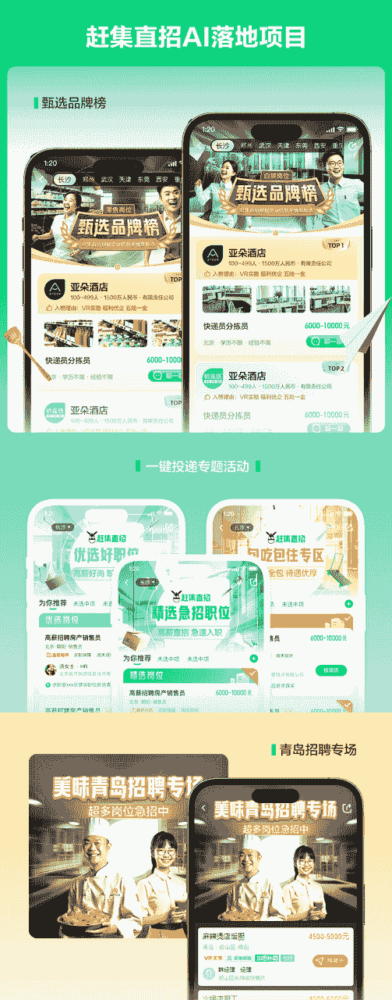

赶集直招设计团队的AI探索之路才刚刚开始，AI将会在未来的设计工作扮演越来越重要的角色。我们将持续深入AIGC领域的探索，例如SD模型训练、3D设计融合等，给设计师提供更多设计创意的可能性，给用户带来更高品质的设计、更好的体验。

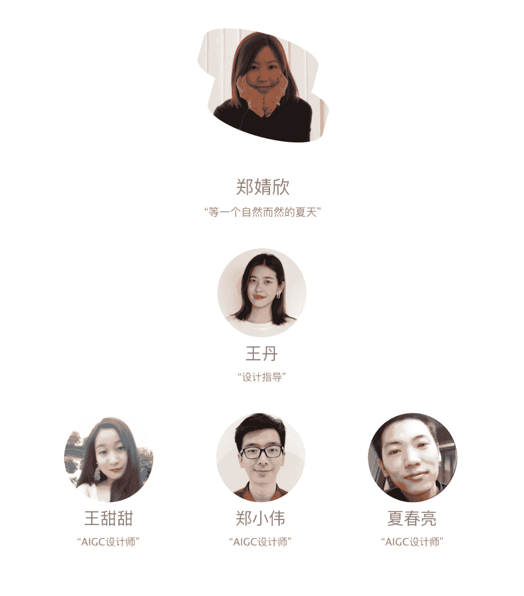

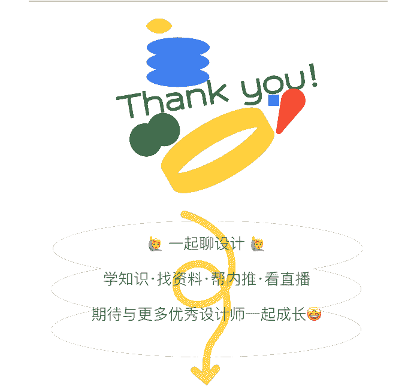

> 内容来源：58UXD

> 原文链接：[点击此处可查看原文](https://mp.weixin.qq.com/s/NVUddE6OUvSSpjvun5uGhQ)

---

<https://my.feishu.cn/sync/CV7edZp1nspUQobYJhicxeP7nrb>