# 借助AI辅助完成UI创意设计教程

> 来源：[https://my.feishu.cn/docx/Aek7dph0yoVr14x7fpRcxWlwnzb](https://my.feishu.cn/docx/Aek7dph0yoVr14x7fpRcxWlwnzb)

<https://my.feishu.cn/sync/CV7edZp1nspUQobYJhicxeP7nrb>

---

本篇文章主要是 [AIGC ](https://www.uisdc.com/tag/aigc)在图标设计上的一个应用，希望对大家有所帮助。

更多落地教程：

## APP活动弹窗

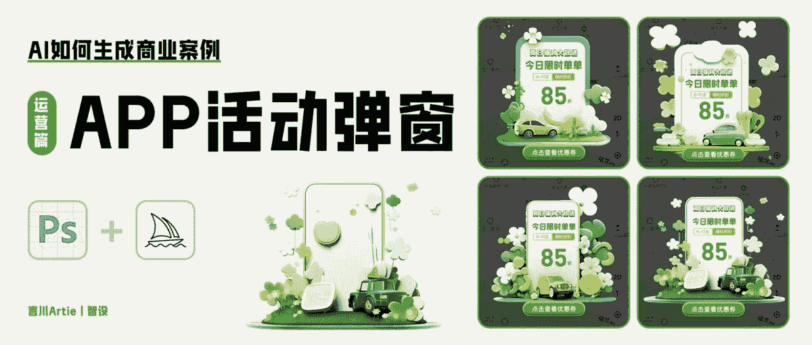

1. 花瓣网找参考图，处理不必要的元素

这个弹窗设计我尝试了很多方法，发现还是需要垫图才能生成符合我想要的效果，所以这个方法还是得去找参考图才行，以下这张图来自花瓣网。

用 ps 处理下文字，别偷懒~（百度直接搜“花瓣网”即可，然后搜索“弹窗设计”)。

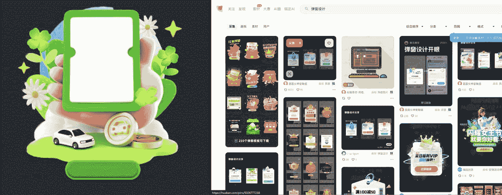

尝试了图生文功能，这里没能如愿生成合适的，不过也给了我写关键词的灵感，突然发现图生文还可以这样用，牛~

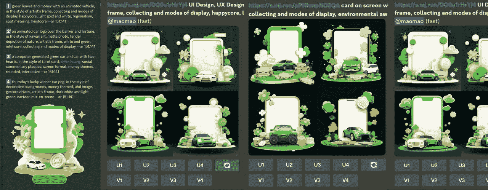

**2. 关键词描述并垫图生成**

然后我开始尝试写关键词，以下是完整关键词：

Use a card as the background, It is surrounded by clover and white flowers, Green base, White trolley, Pale gold coins, Yellow stars, Clouds, Disney style, cartoon style, 3D, behance, dribbble --iw 2 --v 5.2

使用一张卡片作为背景，四周环绕着三叶草和白色的花朵，绿色的底座，白色的小车，淡金色的硬币，黄色的星星，云彩，迪士尼风格，卡通风格，3D, behance，dribbble

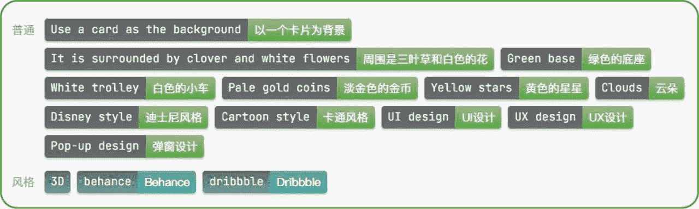

上面这个写关键词的网站还挺好用的，也内置了一些常用关键词，分享给大家： https://moonvy.com/apps/ops/

接下来就简单了，垫图+关键词组合。参数命令用 --iw 2（增加图片权重，出图更接近原图）。--v 5.2 这个模型是最新的，用 v5 和 v5.1 模型生成的效果也差不多。

**3. 挑选图片并抠图**

[Midjourney ](https://www.uisdc.com/tag/midjourney)的随机性大家知道，多跑几次图准有你想要的图：

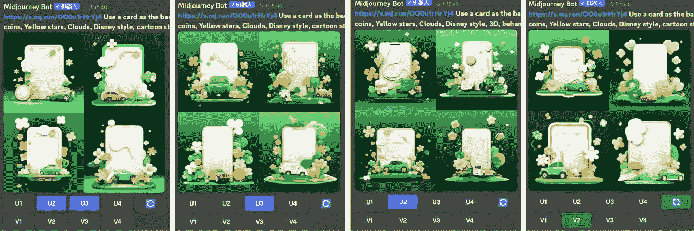

选好图片之后就需要处理图片了，抠图和修部分细节，这一点也很简单。这里用到两个工具，Clipdrop 和 PS Beta。

我是利用 Clipdrop 抠图的，PS Beta 也可以，不过我感觉 Clipdrop 抠的更好点，这个是它的网址： https://clipdrop.co/

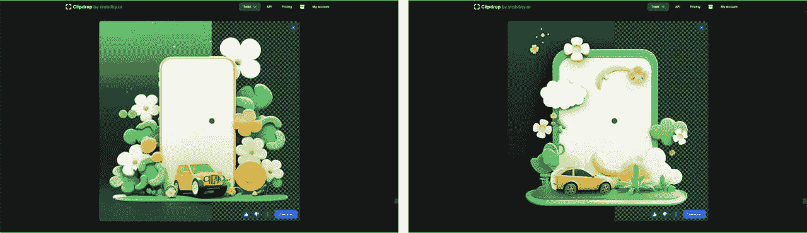

接下来就要用到 PS Beta 了，这个需要大家安装下，真的很好用。

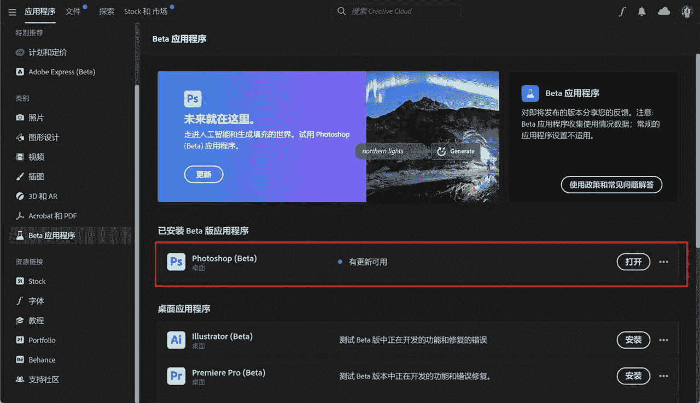

**4. 文案排版+UI 规范**

为什么会用到 PS Beta 呢，是因为我需要处理这个卡片上的元素，我需要有一块空白的地方填写文案，框选不需要的元素，使用“内容填充”和“创意式填充”，根据最终的效果来合理运用。

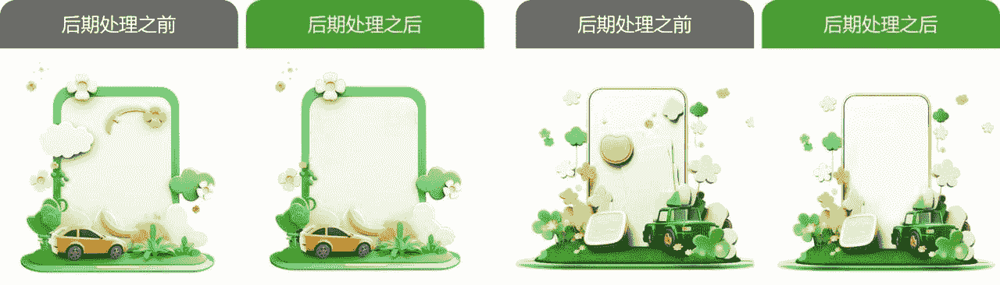

最后一步，写上文案并进行 UI 规范设计一下~

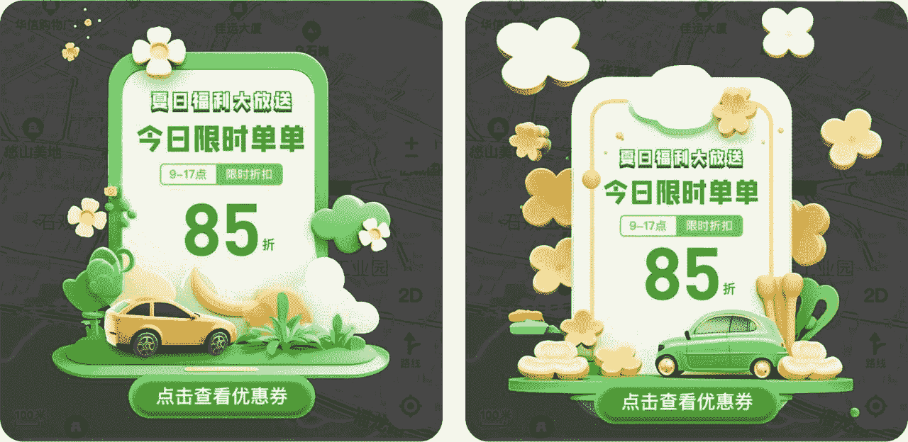

来看下最终效果：

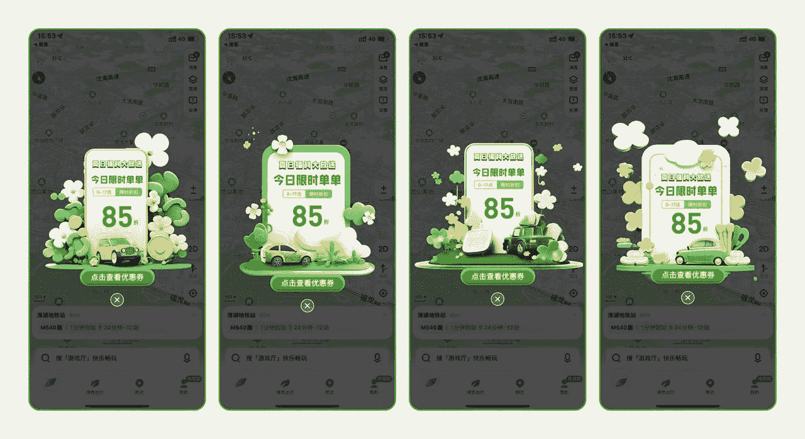

## 运营活动弹窗

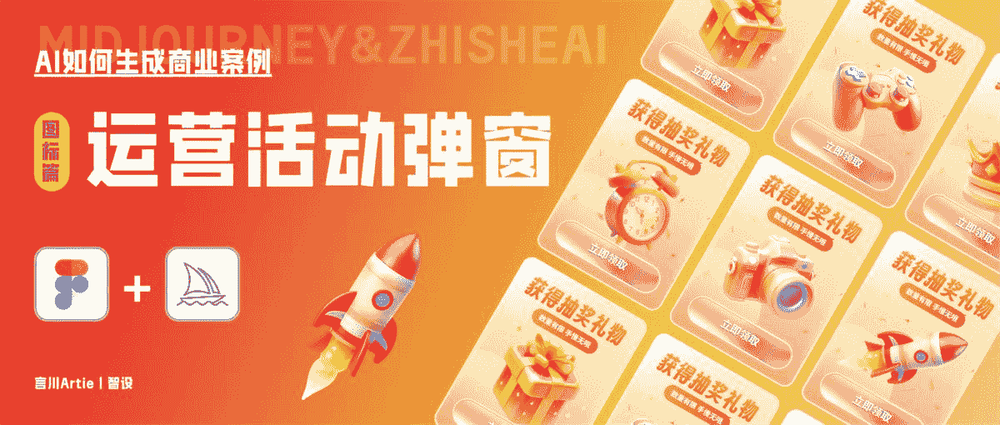

**1. 找参考图，确定设计风格**

我们在接到设计需求之后，大家是否会跟我一样，根据需求来去找对应的参考图片。需求分析我就不介绍了，我们直接开始视觉设计篇。

首先就是去找到与需求描述相符的参考图片，注意的是我们下面的操作不会用到“/describe”功能（咱也不能老是用垫图的方法是不，这多没技术含量，虽然很好用...）。老办法，素材网站找参考图，这里还是我们的老朋友：花瓣。

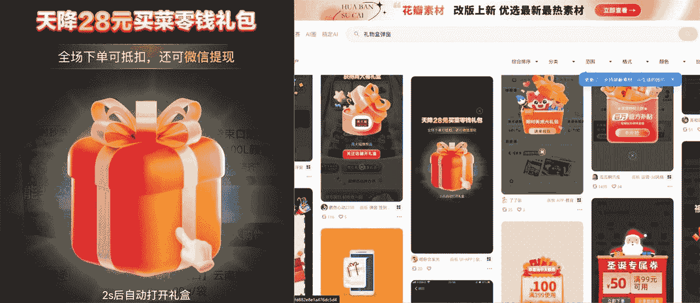

我们先确定主体元素样式，这里我找到了这个礼物盒的图标，就它了，接下来我就会根据这个礼物元素进行关键词描述。

我会根据以上这个格式去写关键词，其实这个格式的顺序不是太重要，因为你会发现网上很多博主写的格式都不太一样，我建议大家按照自己的习惯描述就行，不要太久纠结到底是什么顺序，切记不要转牛角尖~

2. 根据需求及参考图，写出关键词

画面主体：礼物盒，3D 图标，粘土，卡通，任天堂

修饰词：可爱，光滑，光泽，红色和黄色，渐变颜色

细节词：白色背景，最高细节，等距视图，高清，最佳质量

参数后缀：--niji 5 --q 2（质量）

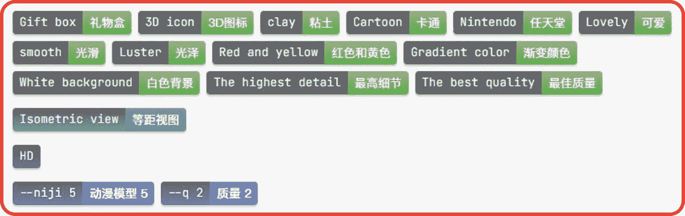

上面写的关键词就是根据找的礼物盒来描述的，不信你可以对着看，大家写关键词都可以用这种思路去创作，你会发现，写关键词真的不难~

完整关键词咱也不能落下，要分享就拿出咱最大的诚意来：

Gift box, 3D icon, clay, Cartoon, Nintendo, Lovely, smooth, Luster, Red and yellow, Gradient color, White background, The highest detail, The best quality, Isometric view, HD --niji 5 --q 2

这套关键词可以作为画这种 3D 风格图标的一套模板，可替换的关键词为：

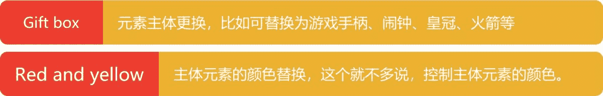

**3. 挑选生成的素材，抠出元素**

开始跑图吧，剩下的事情就好办了，Midjourney 的随机性会让你不得不多跑几组图片，这一点要耐心~

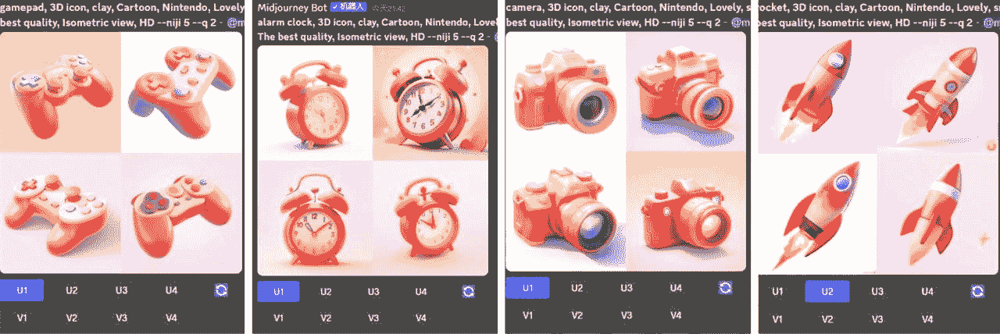

图跑出来了就开始把咱们的 3D 元素抠出来吧，这次我就不开 PS 了，用 Clipdrop 抠图，简直不要太快。

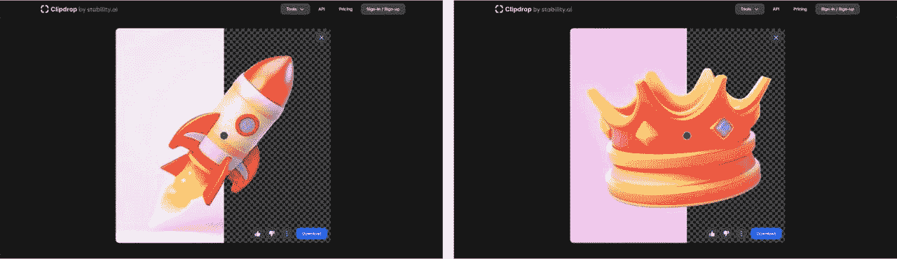

看来这次的教程又是 4 步就可以完成了，真的是 泰裤辣！

下面一步我会用“Figma”这个软件，大家用 PS 等设计工具也可以哈，都是可以完成最后一步的，接着看：

**4. 排版出图，真的可落地！**

排个版都会吧，打上文案，加点装饰元素，做个按钮，就很简单...

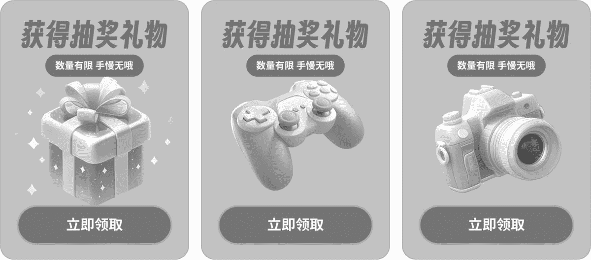

最后再配个颜色，就大功告成啦~

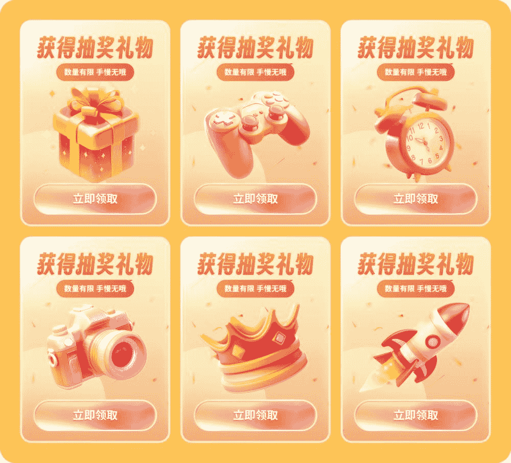

## B端运营海报

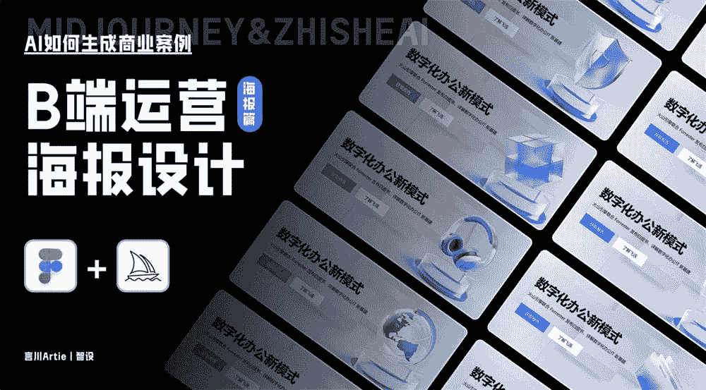

**1. 找参考图，确定设计风格**

第一步，找风格元素参考去，这是我们接下来描写关键词的重点，建议大家不要凭空想象，先看别人做的，我们参考改进，下面还是这个网站（花瓣）：

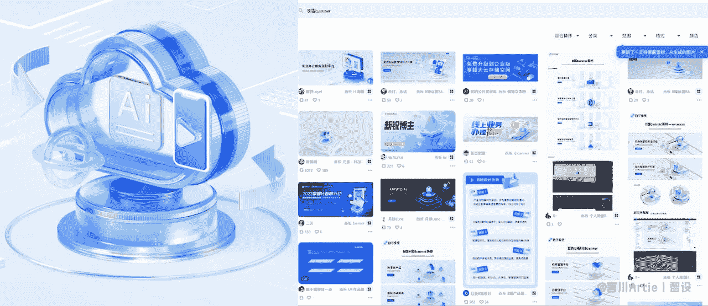

上面的这个图标就是我找到的参考，接下来我会按照我描述关键词的步骤开始头脑风暴，进行创作

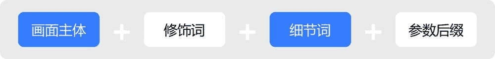

这期的效果也不用垫图，可关键词直出图，也可以垫图来控制画面风格，不过注意你如果生成的关键词是 盾牌图标 ，那么你垫的图片也要是 盾牌图标 ，不然会出现灾难现场，自己可以试试

2. 根据需求及参考图，写出关键词

画面主体：一个 3D 盾牌 图标

修饰词：蓝色渐变，磨砂玻璃

细节词：超简约外观，明亮色彩，工作室照明，光线追踪，蓝白色背景，工业设计，等距视图，丰富的细节，超高清，高质量，16K

参数后缀：--V 5.2

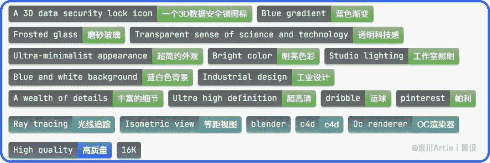

这组描述词我测试了很久很久，现在我感觉用 AI 绘图最耗时间的事情就是写关键词了，因为需要不断的用关键词来测试效果，这个效果不行就修改关键词继续测试，所以写关键词也很重要！！以下是完整关键词：

A 3D shield icon, Blue gradient, Frosted glass, Transparent sense of science and technology, Ultra-minimalist appearance, Bright color, Studio lighting, Blue and white background, Industrial design, A wealth of details, Ultra high definition, dribble, pinterest, Ray tracing, Isometric view, blender, c4d, Oc renderer, High quality, 16K --v 5.2

橙色标注地方为可替换关键词，其它关键词可保持不变，同样这套可作为 B 端科技风格图标的一套模板关键词。

3. 生成合成图片素材，抠出元素

先来看看我最终设计的图片：

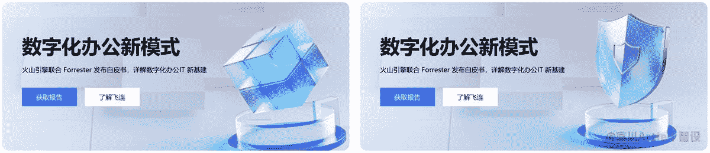

这组设计并不是直接出一张图，然后排版就完成的。是我生成了一共 3 组不同的元素，然后合成为一张场景图的。

我也尝试过关键词直出一张图，但是实际上不管我怎么写关键词，垫图，始终无法达到我的最终设计要求，哪怕我“运气好”生成了一组合适的图片，后面的视觉风格保持统一也很难做到，所以只能把各个元素拆分，后期合成了。

具体怎么做的咱们继续往下看吧~

首先用上面写的关键词跑出以下元素：

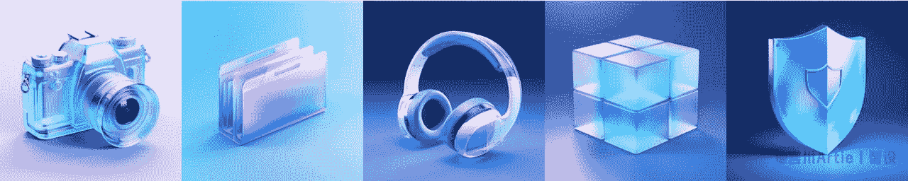

再提醒一遍，前面写的关键词我只改了一个单词，就是把 盾牌 关键词分别改成了：“相机、文件夹、耳机、魔方、地球仪”，其他关键词保持不变，这也是为了保持风格统一。

主体元素确定了，还缺一个辅助元素，那就是 主体元素 下面的底座。这一步也很简单，垫图+关键词（注意，这里的关键词还是刚刚那组，把 盾牌 关键词改为 pedestal（底座）。

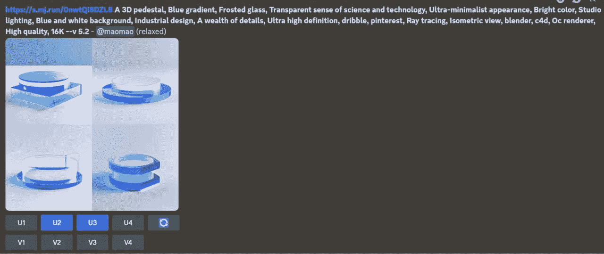

垫图注意：一定要与我们生成的主体元素差不多风格的图片，不要随便放一个底座图片上去！！！

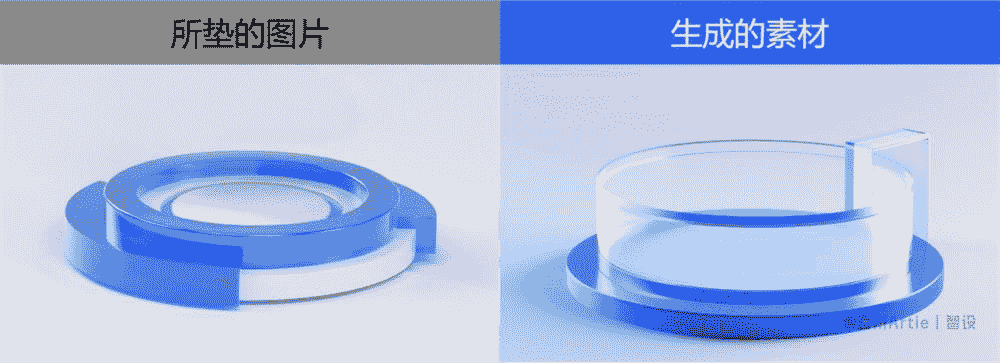

这一步完了之后再来一张背景素材就搞定了，背景素材简单，直接图生文，然后垫图+关键词，看图。

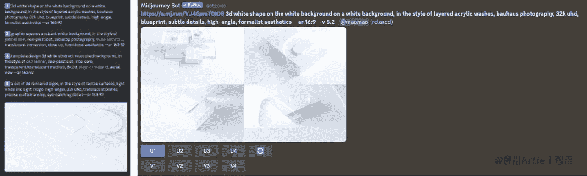

怕你们看不懂，我再啰嗦一遍，找一张合适的图片参考，然后用“/describe”命令，找一组大致符合这个图片的关键词，然后垫同样的图片，把关键词加上，跑图即可。

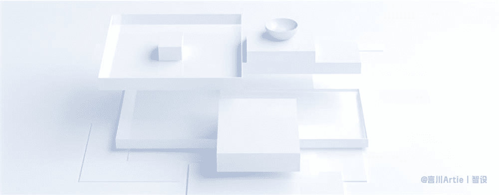

最后就是把主体元素，辅助元素抠图：

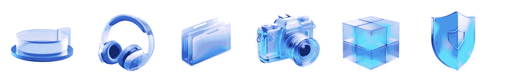

**4. 合成排版出图，可落地！！**

我的宝藏设计工具：Figma！先出个 Demo，把文案排版一下：

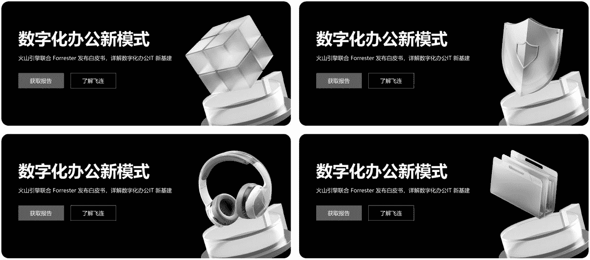

然后配上颜色，把背景素材合成上，剩下的路得你们自己走了，整个流程已经走完，希望本篇文章对你有帮助。

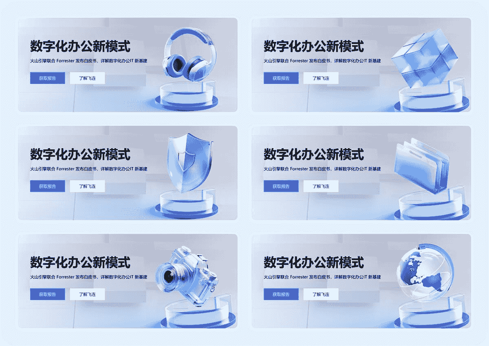

## 福袋活动弹窗设计

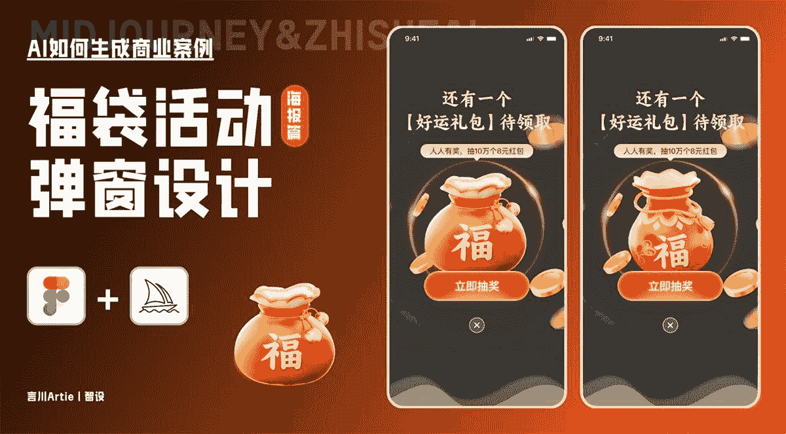

**1. 找参考图，确定设计风格**

老样子，先找参考图，根据参考图及需求写出关键词，这期的福袋设计会用到垫图+关键词 的方式。

第一步，找风格元素参考去，这是我们接下来描写关键词的重点，建议大家不要凭空想象，先看别人做的，我们参考改进，下面还是这个网站（花瓣）：

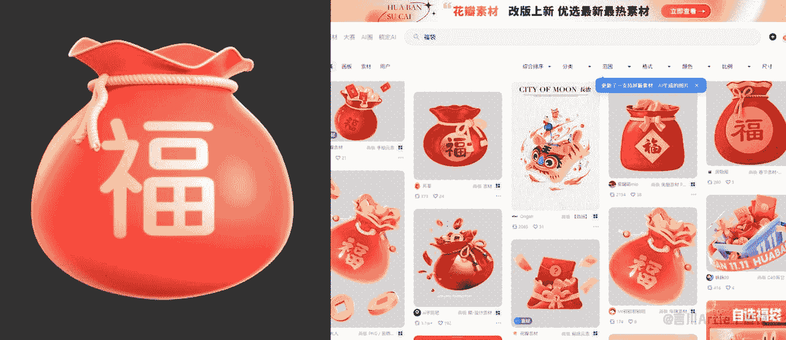

上面的这个福袋就是我找到的参考，接下来我会按照我描述关键词的步骤开始头脑风暴，进行创作

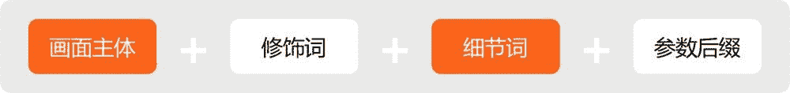

这组关键词其实就是用的之前做 3D 元素弹窗的关键词，属于比较通用的一组关键词，适用于任何此类型的 3D 图标。

尝试了关键词直接生成的图片，很难生成符合国内的福袋风格...

2. 根据需求及参考图，写出关键词

画面主体：福袋，3D 图标

修饰词：中国风，卡通风格，粘土材质，可爱，光滑

细节词：红色和黄色，白色背景，3D 渲染，最高细节，最好的质量，正视图，高清，8K

参数后缀：--niji 5

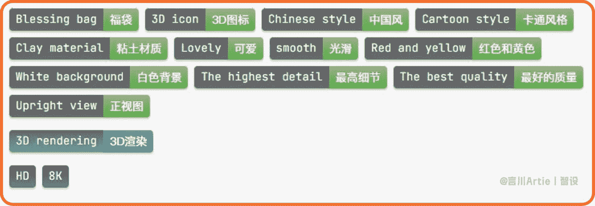

基本上我就修改了前面的关键词，后面的关键词都可以被固定，作为生成 3D 元素的关键词，改变主体元素即可，然后改下颜色关键词，以下是完整关键词：

Blessing bag , 3D icon, Chinese style , Cartoon style, Clay material, Lovely, smooth, Red and yellow, White background, The highest detail, The best quality, Upright view, 3D rendering, HD, 8K --niji 5

橙色标注地方为可替换关键词，其它关键词可保持不变。

3. 生成合成图片素材，抠出元素

然后开始操作跑图吧，垫上前面找的参考，然后加上关键词，然后抠图都知道吧，不重复了：

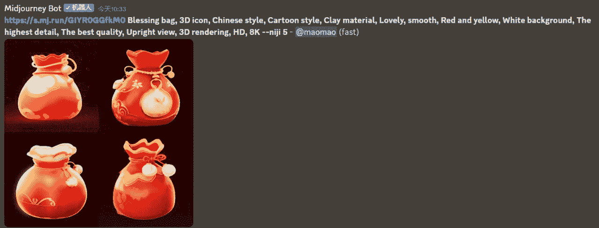

我们再来看看不垫图生成的效果，这种效果也很不错，但是这个并不是我们最终落地的效果，之所以垫图，就是控制图片的整体风格，再配合关键词，基本上就能很好的控制最终的效果，把“命运掌握自己手中吧”：

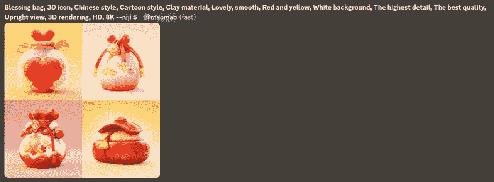

还有个小知识，可以多垫几张图，但是风格需要是一致的图片，这样通过 垫图+关键词 的操作，生不出合适的元素，你可以化身“东北锤王”来捶我，我不反抗

**4. 文案排版+UI 规范**

处理下图片吧，把不需要的元素，效果不好的地方，用“PS Beta”处理下，不用 Beta 版本也行，我也只用到了“内容填充”的功能。

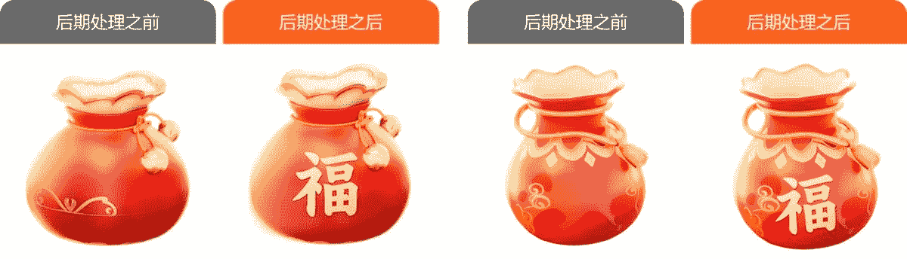

完了之后排个版，加点装饰元素，这福袋活动弹窗不就完成了。

那个周围的金币元素也是用同样的方式生成，把 福袋 关键词 ，改成 金币 即可。

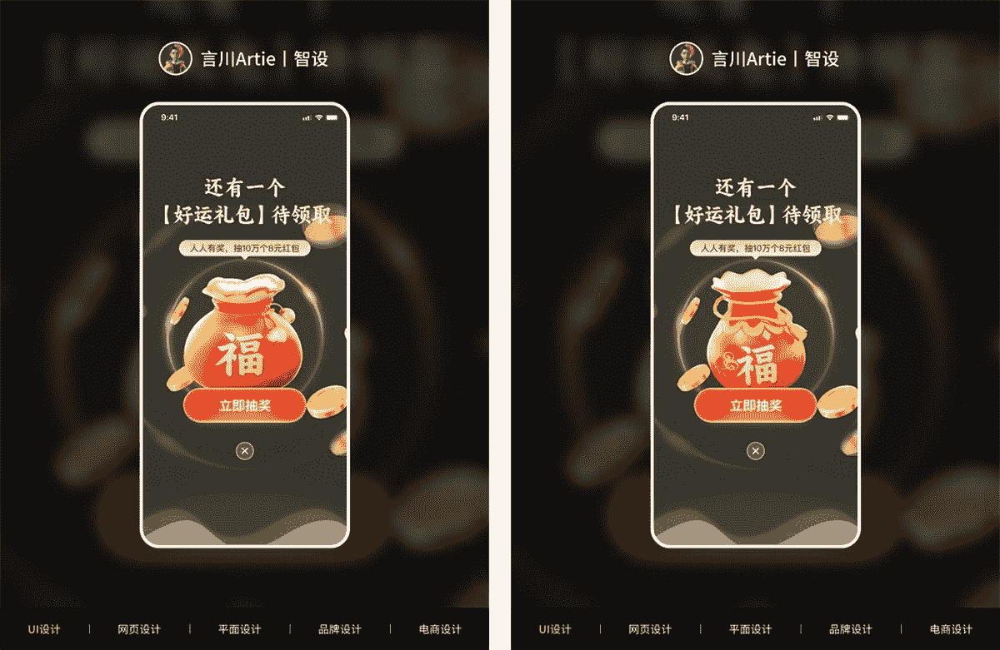

## 直播礼物图标设计

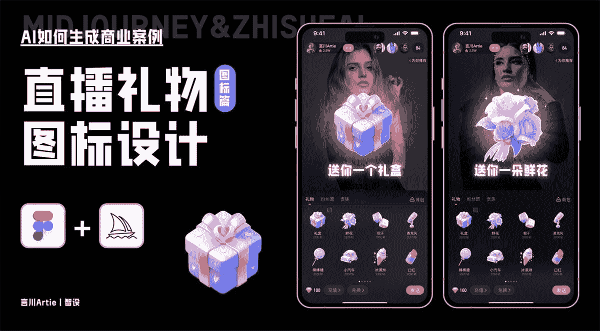

**1. 关键词生图**

这个系列的 3D 元素关键词基本就是通用的模板，大家把这套关键词保存好即可，替换部分关键词就可以控制 3D 元素的形状和风格，一下紫色地方关键词可替换。

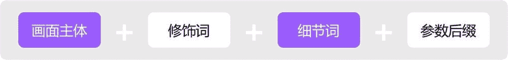

car, 3D icon, clay, Cartoon, Nintendo, Lovely, smooth, Luster, Pink and blue, Gradient color, White background, The highest detail, The best quality, Isometric view, HD --niji 5 --q 2

汽车，3D 图标，粘土，卡通，任天堂，可爱，光滑，光泽，粉色和蓝色，渐变颜色，白色背景，最高的细节，最好的质量，等距视图，高清

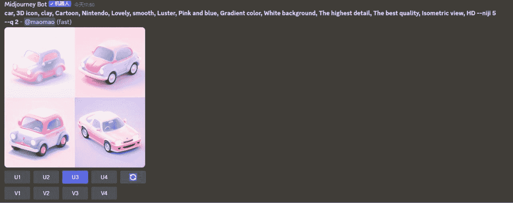

**2. 快捷一键抠图**

上一步生成了下面这些 3D 元素，接下来就开始抠图了

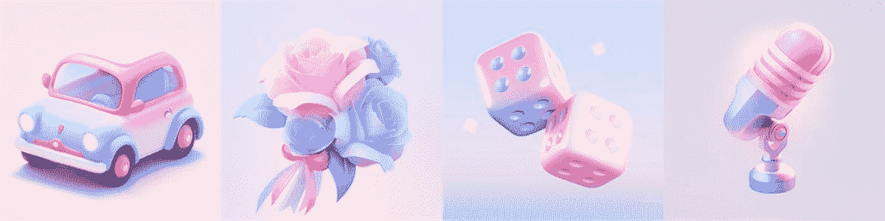

**3. Figma 排版出设计稿**

我们 3D 元素搞定了，接下来就是做 UI 设计稿了，把信息和 3D 元素组合一起就大功告成了。

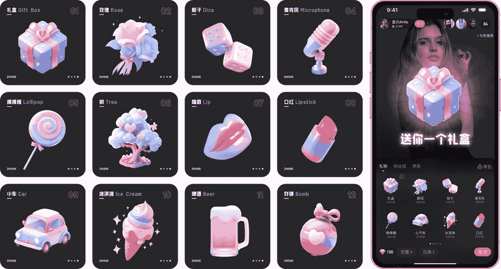

以上就是这篇 AI 工具赋能 UI 设计的教程了，欢迎大家来与我一起交流讨论更多的商业场景。

> 内容来源：言川Artie

> 原文链接：[点击此处可查看原文](https://www.uisdc.com/aigc-5)

---

<https://my.feishu.cn/sync/CV7edZp1nspUQobYJhicxeP7nrb>