# 猴子无限-品牌营销领域AIGC报告

> 来源：[https://my.feishu.cn/docx/ZxXNdAnQJot68cxV03gcPSyHnmc](https://my.feishu.cn/docx/ZxXNdAnQJot68cxV03gcPSyHnmc)

<https://my.feishu.cn/sync/CV7edZp1nspUQobYJhicxeP7nrb>

> 🔗 原文链接： h[ttps://mp.weixin.q](https://mp.weixin.qq.com/s/Ffp3FP7SMtT8OFCPa-7MXg)q.com/s/Ffp3FP7S...

> ⏰ 剪存时间：2023-09-13 17:37:24 (UTC+8)

> ✂️ 本文档由 [飞书剪存 ](https://www.feishu.cn/hc/zh-CN/articles/606278856233?from=in_ccm_clip_doc)一键生成

原创 猴子无限@Wency 猴子无限 2023-07-12 21:24 发表于 上海

本文核心观点:

**1、 AIGC的出现之后，品牌们**很难用战术上的勤奋去掩饰战略上的懒惰了：

a.不再是酷炫拼预算和制作精良物料的时代了，因为aigc的出现，内容将会更加极速爆炸，好的内容才是稀缺的

b.为进一步提高营销效率和成本，倒逼品牌需要更清晰定义不同岗位的每一步工作流，让AI更好地介入提效

c.品牌与品牌之间的差距会被以更快速拉开，营销的障碍将不是信息不对称，而是认知不对称，因为消费者缺乏的不是信息获取能力，而是认知能力，认知不代表全部事实，但它就是消费者大脑中的真实。

**2、AIGC的出现之后，在不久的将来将重**新定义市场部和品牌部，成为一项必备技能：

a.很有可能有新的市场营销岗位诞生：模型训练师、prompt训练师等

b.重构工作流，重复性的品牌市场工作都会逐渐被替代，以前：市场人天天向设计师提需求，设计师完成设计；未来：市场人向模型训练师提需求，模型训练师根据需求训练模型，市场人根据 brief 直接用模型产出设计物料

**3、AIGC并不能替代人的角色，它像一个超级老**师+助手，无所不知、无限耐心、大概率准确

a.产品侧：可以协助品牌调研、A/B test

b.工具侧：可以协助想法的落地实现

c.创意侧：AIGC 能协助头脑风暴，批量产出创意，给人做筛选，或者用于启发人

一、目前AIGC在品牌营销行业的现状

就目前的发展现状来看，无论国内外，目前AIGC在品牌营**销行业起到的具体应用主要****解决的都是关于 文字**类素材和图文型素材 的作用，文字类集中在处理文案、文字总结、下需求、提供脑暴灵感等偏向于 信息整合、信息搜索 的工作；图片类集中在海报制作、商品图（包装、电商详情页等）生成， 偏向于已有较完整SOP的图片处理工作 。

AIGC视频类的技术和应用都还不足够成熟，且整体对于信息的处理能力要求较高，所以目前想要制作一个完整且能达到品牌方要求的视频类内容，仍然需要比较多人工的参与和介入，如利用chatgpt生成脚本文案后在利用mj或者stable defussion等图形生成的模型，最终完成视频内容素材的制作。

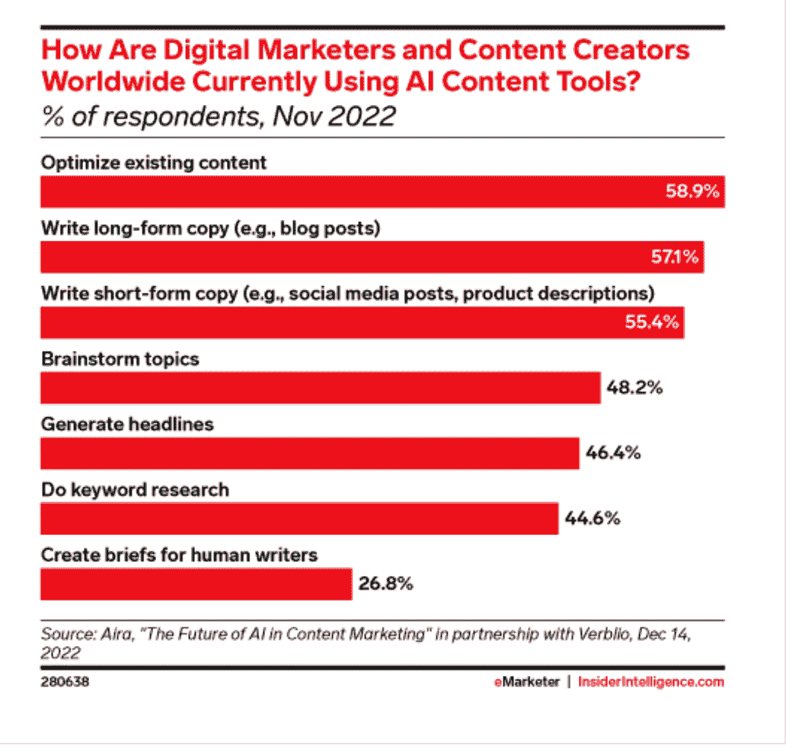

上述以 **内容产出的形态 **去阐述了目前整体市场对于aigc的使用情况，接下来我们以实际品牌营销经常提到的消费者的生命周期来看，目前aigc能够参与的场景想象力在什么地方：

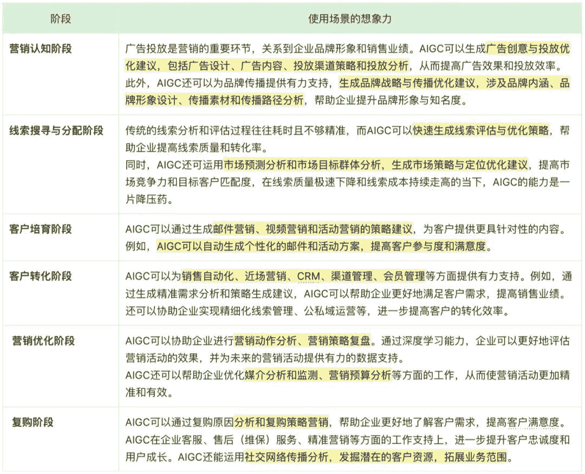

落实到再营销到更具体的工作内容来看，以广告、内容、社媒、电商、用户增长的工作岗位，AIGC已经开始实际介入营销人的工作工作当中（如下图标蓝部分所示），我们相信这仅仅是个开始，随着整体技术的成熟和市场接受度的提高，AIGC会渗透到未来工作中的方方面面。

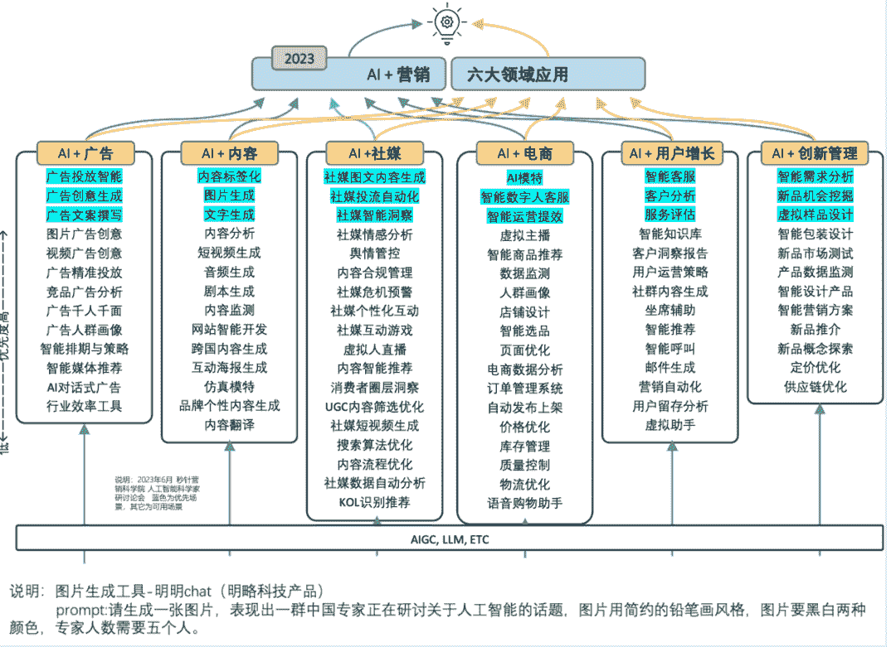

资料来源：报告《2023 AI+人工智能与营销新纪元》

不可否认的一点是，不仅要有想象力，实践尝试的意义永远大于坐而论道，所以我们讲目光放回到国内外实践的层面来看看AIGC在品牌营销当中的应用。

二、 AIGC在品牌营销当中的应用（国内外）

**1、国内现状**

总结：头部企业效应明显企业，3个作用，一个是用来内部提高工作效率，二是跟AIGC结合本身就是一个很好的营销卖点，三是实现一些人脑海中能想象，但实际难以落地的创意场景。

**应用一：提高内部工作效率**

大多数的消费品企业，对于AIGC的接受程度在于用来提高岗位上个体的工作效率，优先是创意/设计的相关部门会有所涉及，以一个消费品企业设计or品牌部门产出 提高工作效率举例，以传统4a公司工作流程来过，传统的工作流和创意工作流如下图所示，大致的工作流会呗分为5个步骤，梳理需求、脑暴创意、搜集参考、产出DEMO、定稿。

而在AI介入这整个创意工作流之后，在5个步骤里都会大大缩短实际产出的时间。但不可否认的事情是，在品牌方能够实际尝到ai的甜头之前，需要前期投入一定的耐心给到相关岗位的员工去了解学习，以及实际去进行落地。

目前市面上主流的大模型工具仍然是国外的开源模型ChatGPT、Midjourney、等工具，国内企业需要面临的问题在于：

1.通用大模型在使用层面上需要企业来适应它本身的使用逻辑和数据库，所以想要整个企业来使用ai工具需要自上而下去推动这个事情来加速转型。

2.实际应用上对于prompt以及各类大模型的特性了解有一定的要求，想要规模化地提高效率，需要企业内部有自己操作上的工作流来确保每一个环节的可行性。

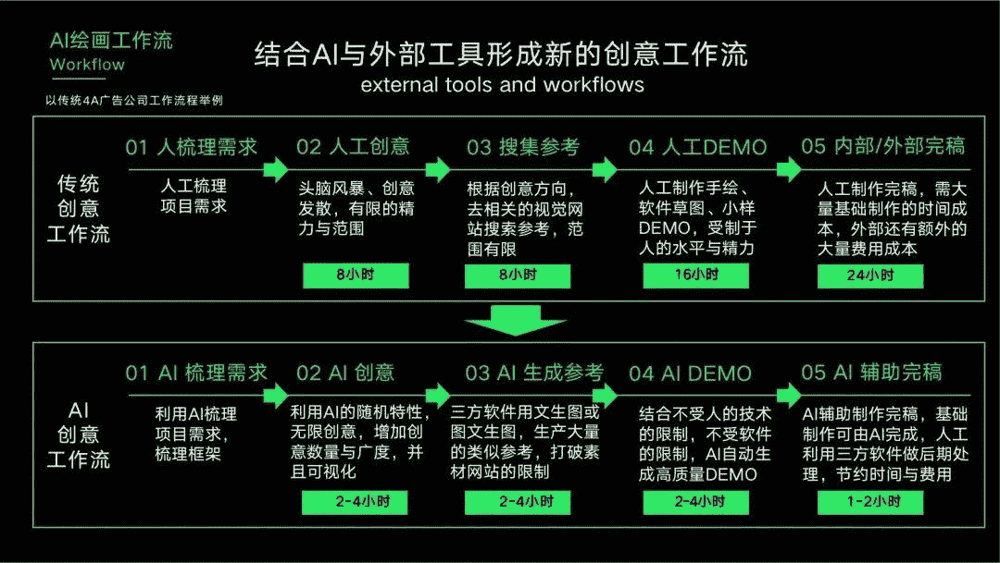

在执行端的工作流来说，我们以产出品牌的海报举一个简单的例子：

第一步，需要利用企业内过往数据沉淀梳理出自己的创意概念和主体内容，也可以介入chatgpt+人工筛选脑暴的方式产出；

第二步，利用mj或者其他的ai生成工具，使创意落地有可视化的表达，常见以图片为主要表达载体；

第三步，利用三方工具解决现有通用大模型分辨率不够等问题，满足印刷、户外喷绘等问题；

第四步，利用三方工具（ps beta等）在不影响出图效果的前提将图片进行处理，最后定稿。

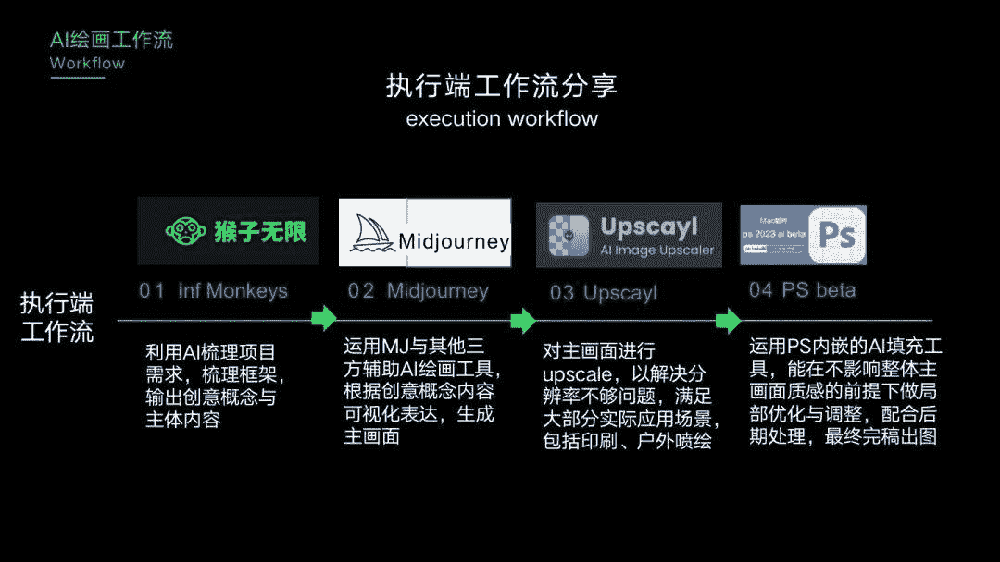

**应用二：作为品牌的一个营销卖点**

对于国内企业来说，我们在2023年能看到比较亮眼且在实践层面扩大了AIGC想象力的品牌其实是钟薛高，钟薛高利用AIGC的工具，参与完整从概念、选品到包装的新产品线的工作流，最后产生了sa'saa系列产品。

其实最后并没有用aigc生产出来的东西真正的投入生产去做实体的产品，所以这个事情本身的闭环还没有跑通，但是确实这个事情带来了很高的讨论热度和关注度。

原因是一方面确实AIGC是时下大火的一个话题，现在整个市场的关注度很高，另一方面是因为对于AIGC大多数消费品企业也在抱着观望的态度，也希望看到有先落地实践的企业，但这个行为确实给了大家更多的信心，验证了除资源更加丰富龙头企业外，也有许多新兴的国产消费品愿意去接受和尝试这种新型的方式。

我们也期待看到更多品牌，面对这个机会能够找到最小的切口行动起来。

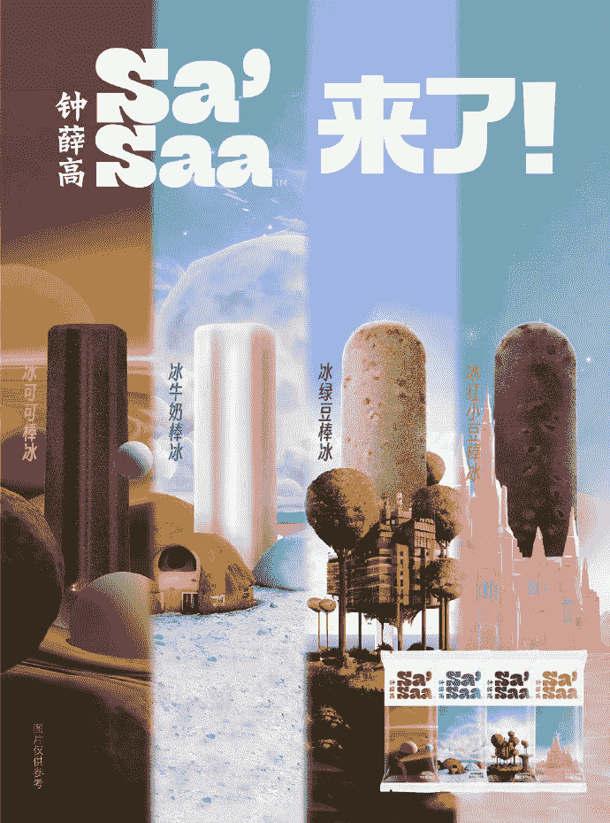

应用三：实现可想象但难以落地的艺术/时尚场景

艺术和时尚行业本身相较于其他行业对于创意的要求就更高，所以如何将从业人员脑子里的画面落实到可视化的产出其实是非常需要技术的革新来推动的，很显然aigc的发展将这一进程大大推进了一步。

比如AI画师ENKAKO可乐、李道丞、（📕账号：Bluemon Pro）利用AI借助人工智能绘图工具midjourney和实景拍摄，让易烊千玺光顾了八个不同的平行世界，在那里，每一个他，都共享了此时与此刻。

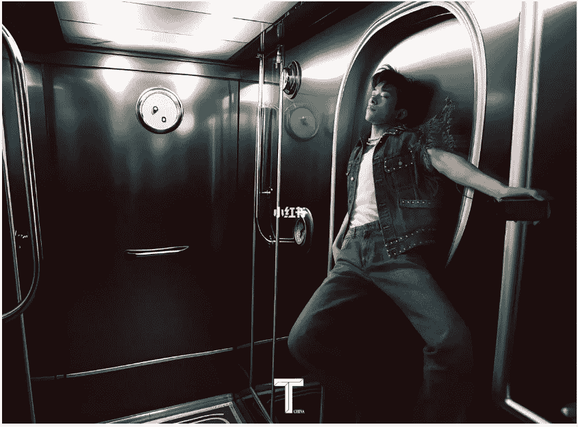

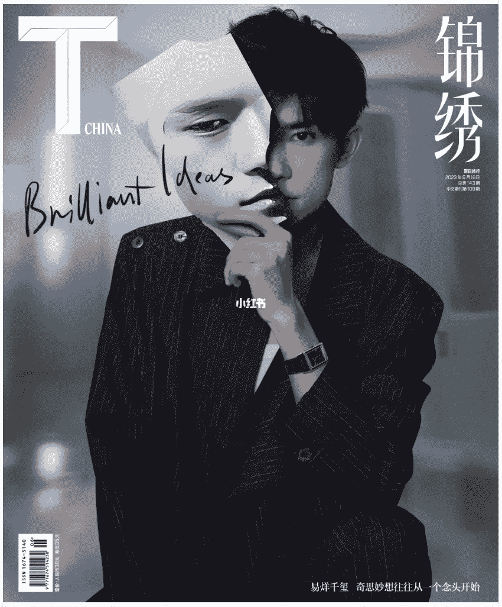

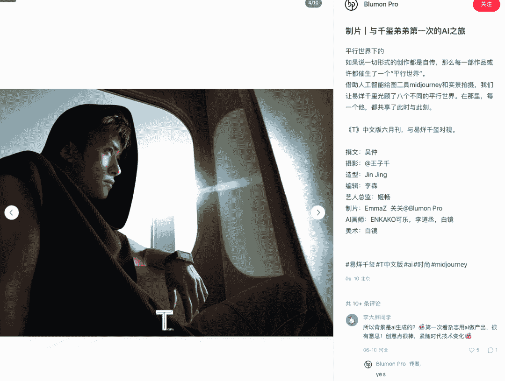

《T》中文版六月刊，与易烊千玺对视（图片来源如图）

同时最近抖音大火的变装博主@氧化菊最近也跟杂志的合作中，每一套造型的实际场景也是通过AI工具来进行后期渲染和场景的呈现。

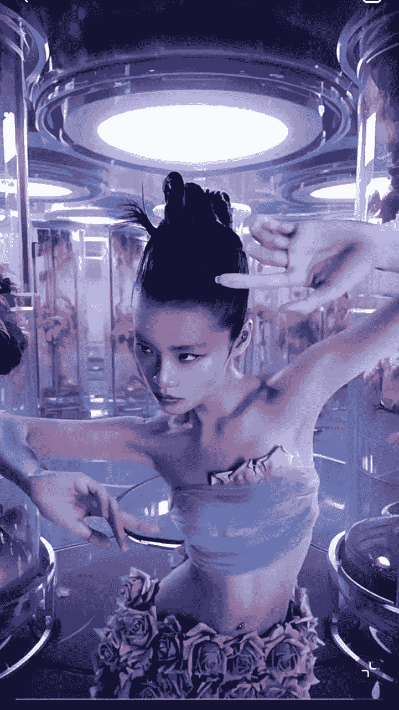

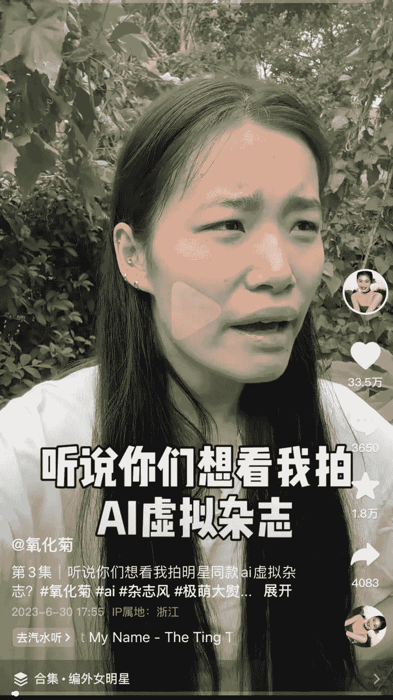

**2、国外现状**

总结：国外品牌目前在AIGC的应用上跟国内类似，国内外最大的不同在于整体的营销环境不同，导致工作流不同，所以衍生出来的使用场景不同。

对于常见的产出文案或者图片的需求来看，国外品牌同样是多数利用mj和chatgpt这样的工具来进行生产力的提效，在这里就不进行过多赘述。

我们发现有趣的营销环境不同点在于国内的协作工作流有所不同：

a.国内我们更多使用🛰️、企业🛰️、钉钉、飞书等协作交流工具，且社交软件也更集中基本是用🛰️qq进行；国外更多使用的是邮件，所以国外有类似于Merlin AI这样的AIGC工具来提高邮件回复的效率，且社交行为更分散，所以诞生了类似text这样对文字工作流进行集中处理的AI软件。

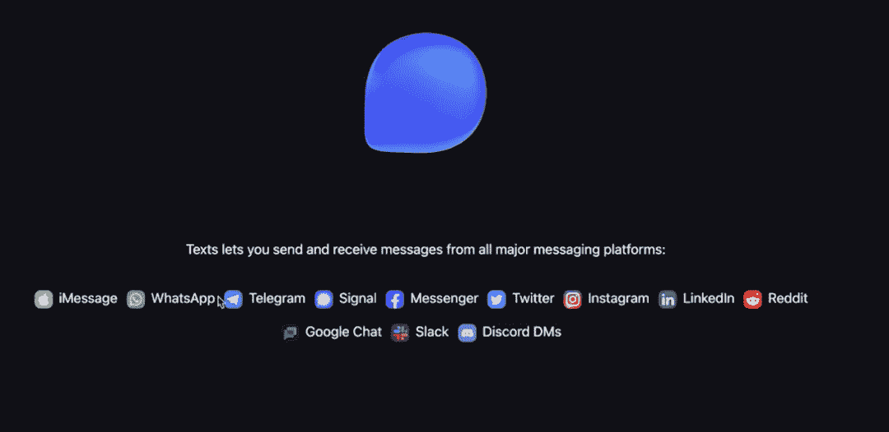

Merlin AI网站示意图

b.国内电商环节的闭环更分散，种草分散在双微小快抖b，电商集中在淘宝、天猫、京东、拼多多等平台；而国外更多是品牌自建网站，在自己的网站里形成从种草到电商收割的环节，所以有类似durable协助建网站的AI工具。

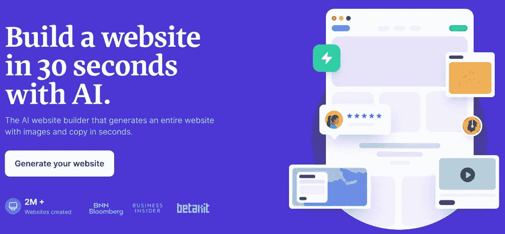

durable网站示意图

**3.国内外现状总结**

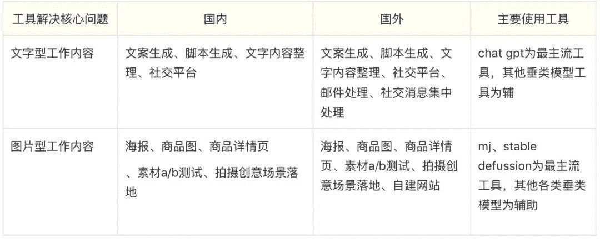

现状如上图所示，这个事情会需要逼企业倒逼把岗位的工作流和需求梳理清楚，开一个玩笑是——相信我们在未来会看到更多能把需求下明白给乙方（AIGC工具）的甲方。

与此同时我们讲目前能看到的市面上跟消费品相关的AIGC案例进行了简单的陈列，我们不难发现这几个规律：

a.对于 **食品饮料 **这种消费高频、可替代性强的、需要更多在产品上推陈出新的行业来说，需要更高频次和更有趣地触达用户行业，aigc无疑能在节约成本、提高人效、体现创意3方面的到最直接的好处；

**b.对于品牌是一种精神内核**的品牌，如 互联网、生活方式、文旅类 的品牌来说，aigc工具是一个非常好的可以协助企业把品牌内核更具像化呈现给消费者的工具；

c.对于 **鞋服时尚 **这类需要更高品牌调性，更前沿地引领带领行业，表达个性的品牌来说，aigc也是他们促进行业创新最好用的工具。

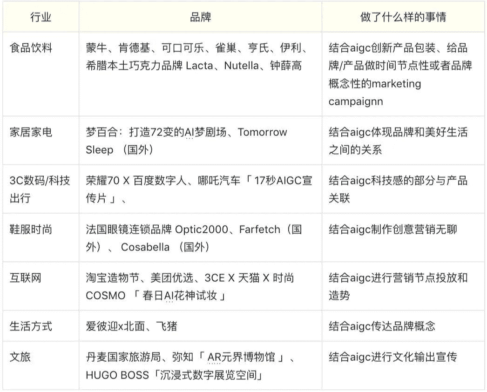

4.明星企业创始人对AIGC 洞察

对于AIGC整个行业来说，国内目前各家大厂也都在试图抓住这个机会，在自研模型方向上迅猛发力，从各家老板的发言里不难看出，aigc对国内大厂而言是上至战略，下到资源、人员力上得到老板的大力支持的：

|  |  |
| --- | --- |
|  |  |
|  |  |
|  |  |

经常有朋友问我，小米对大模型和AIGC怎么看？我统一回复如下：小米在AI领域已经耕耘多年，有AI实验室，小爱同学，自动驾驶等团队。对于大模型，我们当然会全力以赴，坚决拥抱。我们正在研发一些有趣的技术和产品，等我们打磨好了，再给大家展示。（2023年4月14日🧣）——雷军小米科技创始人

三、AIGC是如何改变品牌营销的

那究竟为什么aigc能给我们的品牌营销，乃至各行各业带来如此之大的影响的？

想回答这个问题，首先我们需要知道AI运营的原理是怎样的，以目前现有的AIGC能力来说，它的原理是总共分为4个步骤：

第一步，在各自现有算力基础上，投喂大量图片的数据形成数据库；

第二步，利用AI技术进行数据深度学习，结合图片扩散的原理对应自然语言；

第三步，通过发送prompt（自然语言口令）的方式，使AI进行理解且匹配到对应的扩散数据；

第四步，通过数据生成新的图片，从而实现创意绘画

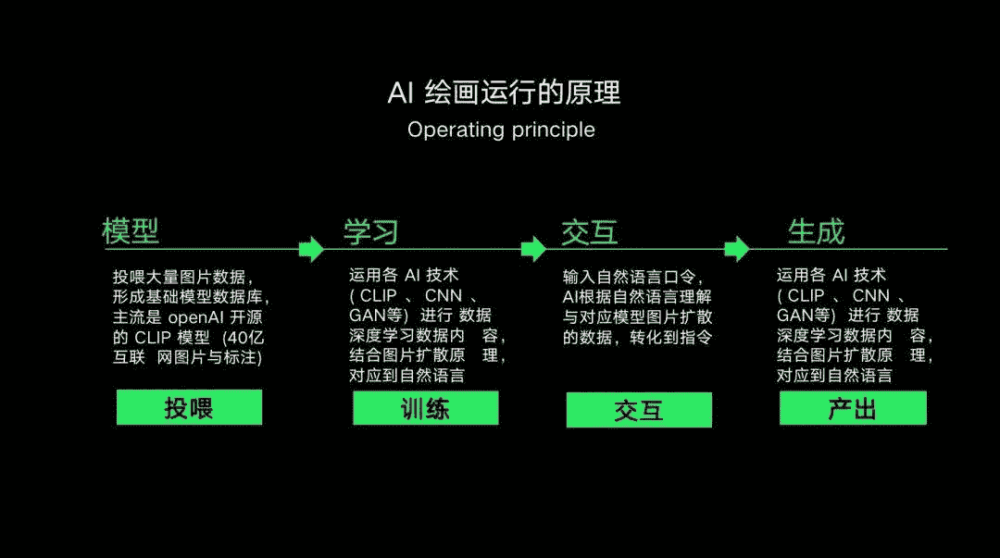

AIGC革新了人类现有的信息处理的方式：

**理解 信息 整合： **AI高度准确理解人的表达，并能急速搜索，并以针对性的方式呈现，搜索革命

**理解 建模 执行： **AI高度理解人的表达，并能根据人的表达建模，再在人提供的数据上执行模型，办公革命

所以本质上现在的aigc考验的是 模型的算法算力、内容资产的沉淀和使用能力 。

对于模型的算法算力来说，如上文提到各家大厂在迅猛发力，在未来几年我们一定能看到国内的自研大模型相继问世投入使用的现状，就更贴近品牌营销的场景来说，它其实在考验品牌对内容沉淀和内容使用的能力。

AIGC的出现之后，在不久的将来很有机会重新定义市场部和品牌部：

1.很有可能有新的市场营销岗位诞生：模型训练师、prompt训练师等；

2.重构工作流，重复性的品牌市场工作都会逐渐被替代，以前：市场人天天向设计师提需求，设计师完成设计；未来：市场人向模型训练师提需求，模型训练师根据需求训练模型，市场人根据 brief 直接用模型产出设计物料。

**在**这里我们并不担心AIGC会替代人类这件事情，现阶段AI绘画现阶段属于生产工具升级，跟人的生产关系暂时不变。

以下图为例，现在AI和人类的擅长点是有所区别的，它像一个超级老师+助手，无所不知、无限耐心、大概率准确，所以它本质上现在跟人类是协作而并非竞争的关系。

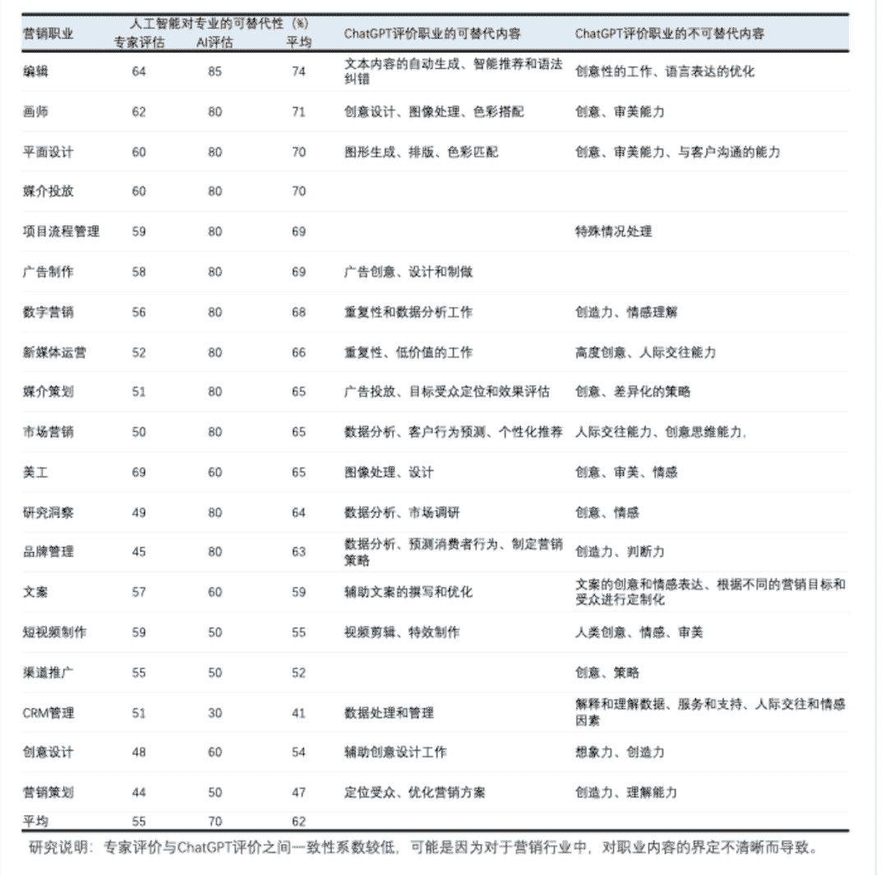

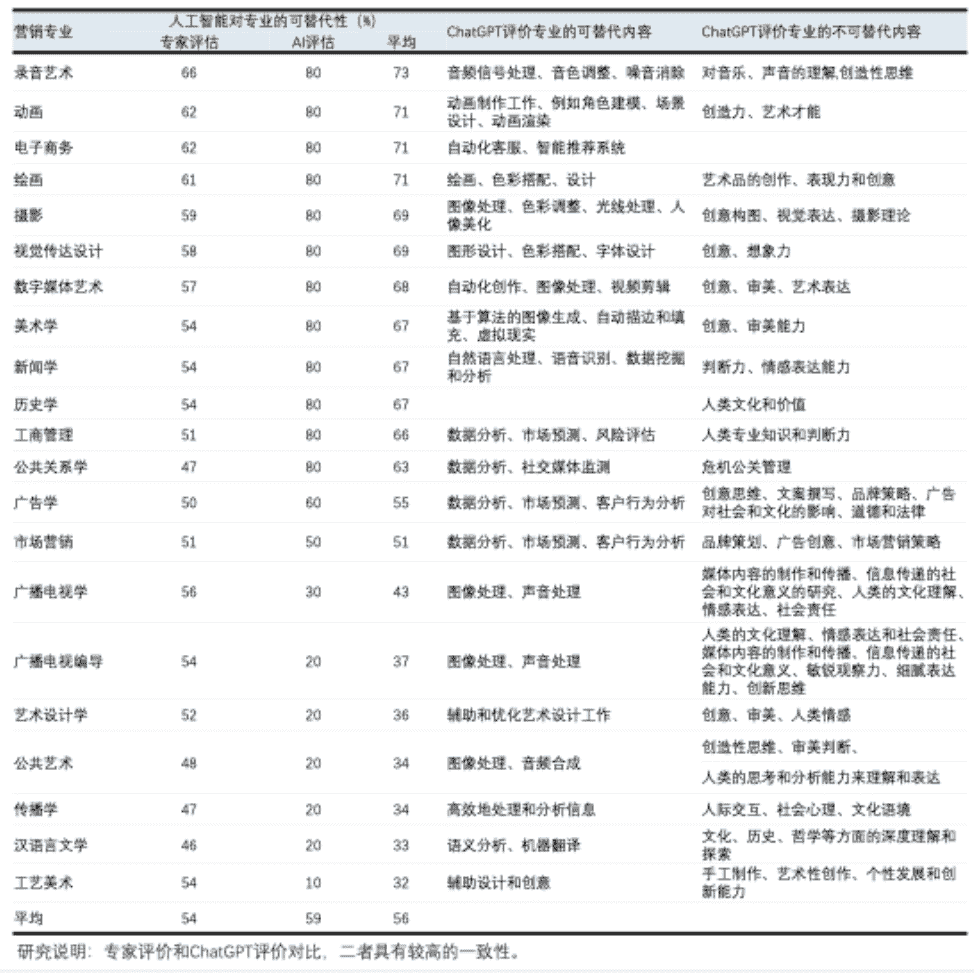

资料来源：报告《2023 AI+人工智能与营销新纪元》

它将从以下的三个方面全力以赴协助协助未来的品牌营销从业者：

产品侧：可以协助品牌调研、A/B test等

工具侧：可以协助想法的落地实现、内容整理等

创意侧：AIGC 能协助头脑风暴，批量产出创意，给人做筛选，或者用于启发人等

从整个企业的层面，它可能更改的是整个企业协作的战略:

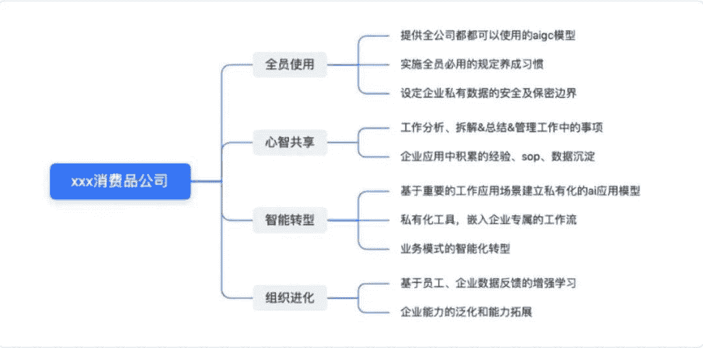

**虽然短时间内，生产关系并不改变，但是AIGC的出现之后， 品牌们很难用战术上的勤奋**去掩饰战略上的懒惰，不再是酷炫拼预算和制作精良物料的时代了，因为aigc的出现，内容将会更加极速爆炸和制作成本的降低，好的内容才是稀缺的。

举个例子，法国眼镜连锁品牌 Optic2000:用 AI “看见”盲人的世界：

法国眼镜连锁品牌「Optic2000」携手巴黎创意机构「Australie.GAD」构思和策划了一个概念，「Optic2000」集团基金会和「Valentin Hauÿ」协会主要通过摄影展的形式，共同呈现视障者全新的视角。

这次摄影展的作品都很独特，因为它们是由 AI 技术所绘，指令基于视障人士描述令人难忘的心理图像。在此之前，作品中的景象之前只存在于视障人士脑海里，如今，AI 让这一切具象化，从作品中可以看到，他们的世界有静谧的街道、淡雅的花束，也有阳光下的鹅卵石以及海边的孩童。这些作品在巴黎美术馆展出，展览结束后，这些作品将以每件750欧元的价格出售，所有收益将捐给「Valentin Hauÿ」协会，为视障人士和盲人提供文化和体育活动。

让更多人看到视障人士的内心世界，有助于提高人们对隐形残疾的认识。AI 对品牌的价值通过这个案例已经不单单是在生产力上的帮助了，而是更核心在帮助品牌以一个更高效低成本的方式去强化品牌在消费者心理的"标签"，去协助品牌构建更长远的品牌资产。

或许品牌与品牌之间的差距，在aigc时代会被以更快速拉开，因为现在营销的障碍不是信息不对称，而是认知不对称，因为消费者缺乏的不是信息获取能力，而是认知能力，认知不代表全部事实，但它就是消费者大脑中的真实。

在这里举个例子，一位叫@demonflyingfox的Youtube博主上传了一支AIGC制作视频，名为Harry Potter by Balenciaga，视频里，哈利波特剧中的人物全部换上了巴黎世家的时装造型，粉丝耳熟能详的经典台词也被改成了巴黎世家版。

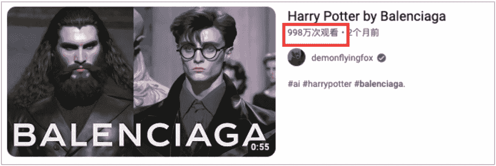

下面有不少网友说" 比品牌自己花钱拍摄的宣传片更有意思" ，近两个月的发酵，巴黎世家AIGC越来越热。在网友的齐心协力下，“xxx by Balenciaga（巴黎世家版xxx）”这把火已经烧遍了各大国外影视IP。《绝命毒师》、《指环王》、《权力的游戏》、《黑客帝国》、《怪奇物语》、《沙丘》……等等，几乎你能想到的知名国外影视IP，都已经被国外网友玩了个遍。

对**绝大部分人来说，不管你以****前知不知道巴黎世家，在被一大波AIGC洗礼后，**一定能在众多奢侈品牌中准确地找到巴黎世家， 高颧骨、扑克脸、科技感 ，这三个关键词几乎可以概括绝大多数巴黎世家带给人的品牌印象， 它并不能代表巴黎世家全部的思想，但这三个关键词已经成为了巴黎世家最终要的"品牌标签" 。

在这里引入一段营销行业自身从业者@空手老师对于品牌iP的观点来更好地理解为什么巴黎世家这次的内容共创，能在非官方等的情况下引起用户的自传播。

关于品牌IP

过去广告是品牌传播的中心，传播是单向度的、中心化的；而现在内容变成了中心，传播是双向的、去中心化的。

今天做传播需要更加强调消费者的参与和交互，传播后要能够形成社会扩散。那种不顾消费者不感兴趣（甚至反感），一味砸钱搞媒体轰炸，试图洗脑消费者的做法，其效果正变得越来越差。

正因为如此，斯坦福大学的两名营销学教授伊塔马尔.西蒙森和伊曼纽尔.罗森曾指出，品牌的力量将随着人们能够获得免费信息的趋势而逐渐萎缩。

因为消费者缺乏的不是信息获取能力，而是认知能力。

在一个信息大爆炸的年代，人们掌握的信息越来越多，但是并不意味着你的认知水平就能得到显著提升。

认知能力和掌握信息的多寡有关，但更重要的是你如何从芜杂的信息中筛选出有价值的知识，并进行分类归纳、整理提取，理解其背后的逻辑和因果性，最后形成自己的洞见、观点、思想。

人和人之间最大的差异是认知。面对同一件基本事实，不同人之间的认知偏差，犹如鸿沟一般无法逾越、难以调和。沟通难、说服人难，实际上就是认知不在同一水平线上，跨越认知鸿沟太难。

人和人的比拼，不是比你知道多少，而是比对一件事物的理解及对趋势的判断。固然行动力有差异，但行动是对认知的实践，行动力不足乃是认知不够深刻。认知决定了一个人的思维模式和行为偏好。

而这件事情也不仅仅是国外的个例，如何将AIGC跟ip更好结合在今年也激起了不小的水花，今年由于AIGC的成熟，兴起了大批用户利用AIGC生成明星翻唱的视频，这一举使得在乐坛沉寂许久没有新作品的孙燕姿火了一把。

B站的AI孙燕姿。单独搜AI，关联出来的第一位也是她 。

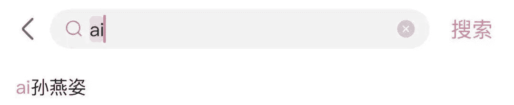

这是个什么现象呢，就是不少up用孙燕姿的声音训练AI，然后翻唱其他的歌曲。于是你就听到了一首首以孙燕姿声线和技巧特点，灌制的“新专辑”。随便一个播放就上百万。所以现在在营销效率的比拼基础之上，还在比拼谁能更快给消费者认知中在这个品类下贴上更多的标签。 越早占据心智，越早拉开跟别的品牌的距离。

**四、品牌营销应用场景未来展望**

**我**们相信AIGC未来一定会在品牌使用百花齐放，下一个阶段会在 更加落地垂直的大场景去做更加复杂的交付，包括数据资产的重构、生产流程的重构（用大模型打造企业自己的垂直应用）。

但这件事情，认知需要时间、实践需要时间、商业化需要时间,它在技术上考验我们国内外AIGC大模型的算法，是否能更快更稳定地支撑这个事情；在市场上更考验我们对这个事情的想象力，究竟能如何把AIGC和人类的创意不断结合,把过往只能放在科幻片里的场景，或者不可能实现的场景在现在来实现。

在这里举个实践案例：

丹麦国家旅游局鼓励大家前往丹麦，不只是做一名游客，而是成为一位深度探索者。3月，丹麦国家旅游局也使用了AIGC技术使蒙娜丽莎、梵高等名画作品“开口说话”为丹麦旅游代言。这则广告中应用了deepfake和运动合成技术。广告文案也是由AI语言模型智能生成。VisitDenmark 的市场总监弗莱明 · 布鲁恩(Flemming Bruhn)提到：“100%的脚本都是由人工智能AI技术生成。我们没有书写一个字，只删除了太长或不真实的部分。”

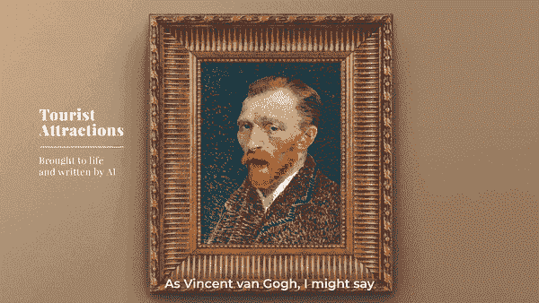

**五、商业模式的特点**

AIGC如火如荼的今天，大家同时也在非常关注的一个点是：目前aigc的企业究竟是什么样的？aigc企业究竟能否短期内带来商业价值？

就目前的市场情况来看，企业分为两种情况：

**情况一：小场景（简单交付）**

通过聊天机器人/虚拟人/数字人内核（工作流 API交付）、 企业级生成式 AI 平台（OEM交付）交付给给类品牌营销的企业。

**情况二：大场景（复杂交付）**

包括数据资产重构、生产流程的重构（用大模型打造垂直应用）、营销物料生成平台、生产（设计、创意）物料平台，简单来说就是构建属于企业的专属大模型。

而目前猴子无限在这方面已经有相关的落地和客户和对应的解决方案了。

猴子无限是国内首家专注在企业级应用的生成式 AI 平台，以模型调优和流程编排为核心能力，最大程度释放大模型的潜能，基于企业数据构建企业级的数字智能，解决 OpenAI 和 Midjourney 解决不了的问题。目前已经在品牌营销、内容创作、工业设计领域有了头部客户的落地，也在探索信息检索、IOT 设备、生物信息领域的大模型应用。

服务行业：营销、游戏、工业、金融、教育等。

我们将会持续关注AIGC在消费品行业的应用，并以我们自身作为AIGC最佳的实践方，后续将给大家带来更多的最佳实践和品牌案例，在此预告我们即将带来的2篇内容：

**1、海尔AIGC的实际解决方案**

2、猴子无限如何利用aigc打造自己的服装厂牌

欢迎提前关注我们，等待后续内容！

同时，

如果你对于AIGC有 **实际的业务问题 **，欢迎添加我们，我们非常乐意与你一起解决

---

<https://my.feishu.cn/sync/CV7edZp1nspUQobYJhicxeP7nrb>