# B端视觉设计全攻略-手把手教程

> 来源：[https://my.feishu.cn/docx/F8MEddyk5oodHbxLT2scCVR6ngf](https://my.feishu.cn/docx/F8MEddyk5oodHbxLT2scCVR6ngf)

<https://my.feishu.cn/sync/CV7edZp1nspUQobYJhicxeP7nrb>

> 🔗 原文链接： h[ttps://mp.weixin.q](https://mp.weixin.qq.com/s/7zPTUjx2lyGHPT6uJ_G7QQ)q.com/s/7zPTUjx2...

> ⏰ 剪存时间：2023-09-13 17:41:10 (UTC+8)

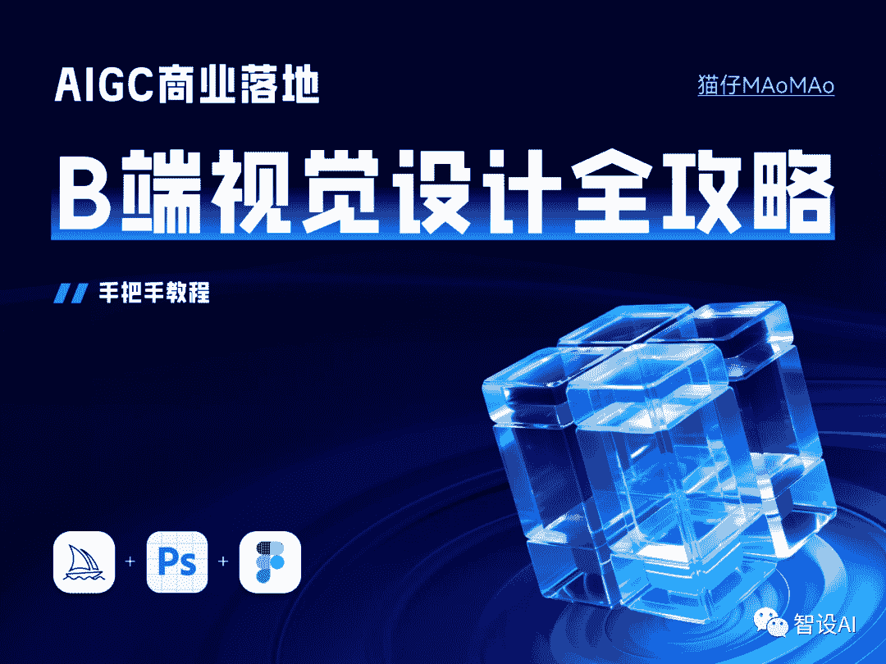

#

# **一：前言**

人工智能的崭新概念正在逐渐改变我们对设计的认识和实践方式。在这个数字化时代，AI不再仅仅是一种辅助工具，它已经成为设计师的得力助手，能够提供更高效、更智能的设计方案。在B端设计视觉中，AI的应用为我们开辟了一条通向更优质设计的道路，本文将深入探讨如何借助AI技术，辅助设计师完成B端设计视觉。无论你是刚刚踏入设计领域的小白，还是经验丰富的资深设计师，都可以利用AI工具来提升设计效率、优化视觉效果。

# **二：3D视觉banner设计**

在B端项目中，公司通常希望展示自己在技术和创新方面的实力，3D视觉效果可以赋予设计以更高的专业感和现代感，也更加能够吸引观众的眼球，让设计在竞争激烈的商业环境中脱颖而出，但很多设计师小伙伴苦于不会建模、渲染，就让AI来辅助你完成这种棘手的需求吧。

**1、设计构思与参考**

B端很多都是概念性的需求，所以我会先去参考网站上寻找参考图，确定设计方向，以暗色系B端视觉为例，我们找到一堆参考图：

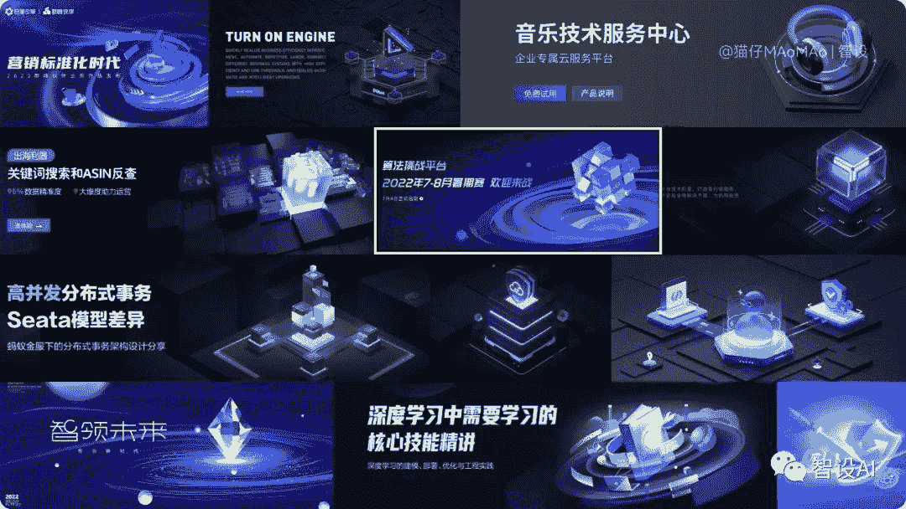

确定参考方向后，脑袋里面大致有了画面思路，主视觉在画面右方，螺旋状背景突出主视觉，文字排版在左边，整体色调为蓝色+青色光感。这里我们对所选参考图进行拆分：

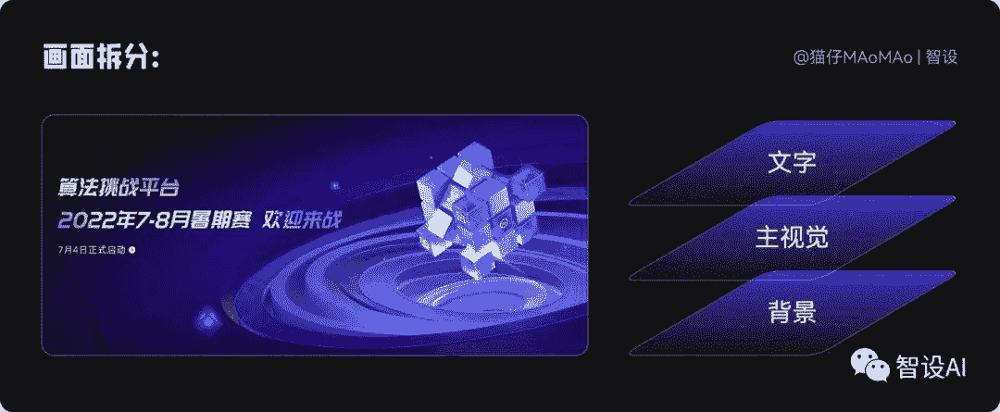

需要的视觉元素只有背景和3D主视觉，需要分开制作，现在就可以使用AI进行辅助设计了。

**2、AI辅助生成素材**

Midjourney生成图片有两条路径：“文生图”和“图生图”；

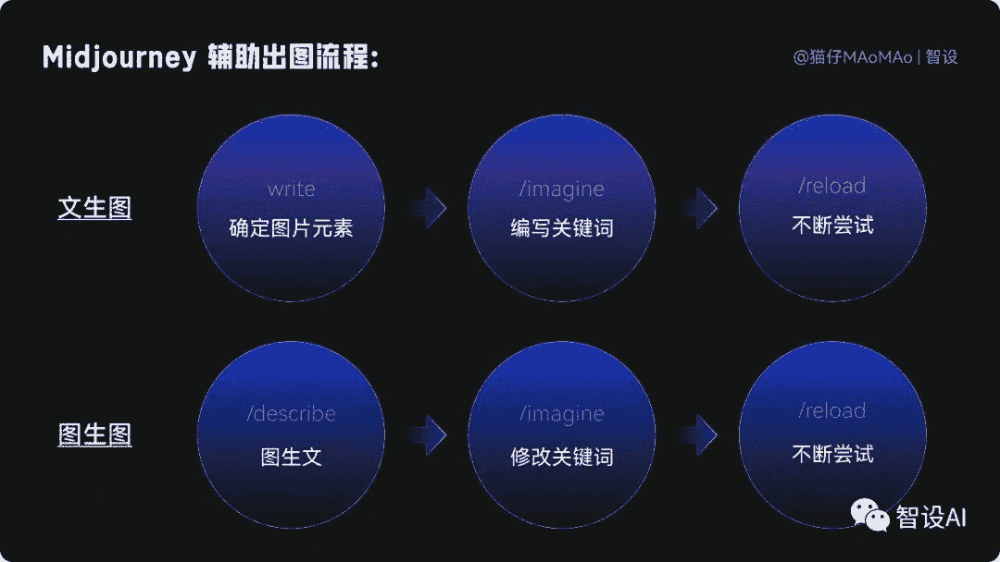

**文生图： **顾名思义，需要自己脑暴出关键词出图，再通过修改关键词，不断践行尝试出图。

**图生图： **在有参考图的情况下，用 /describe 图生文命令，让系统直接生成关键词，再通过修改关键词，不断进行尝试；我们先使用这种方式生成背景素材。

参考图中的背景，我们需要使用 Photoshop Beta 先处理一下参考图；

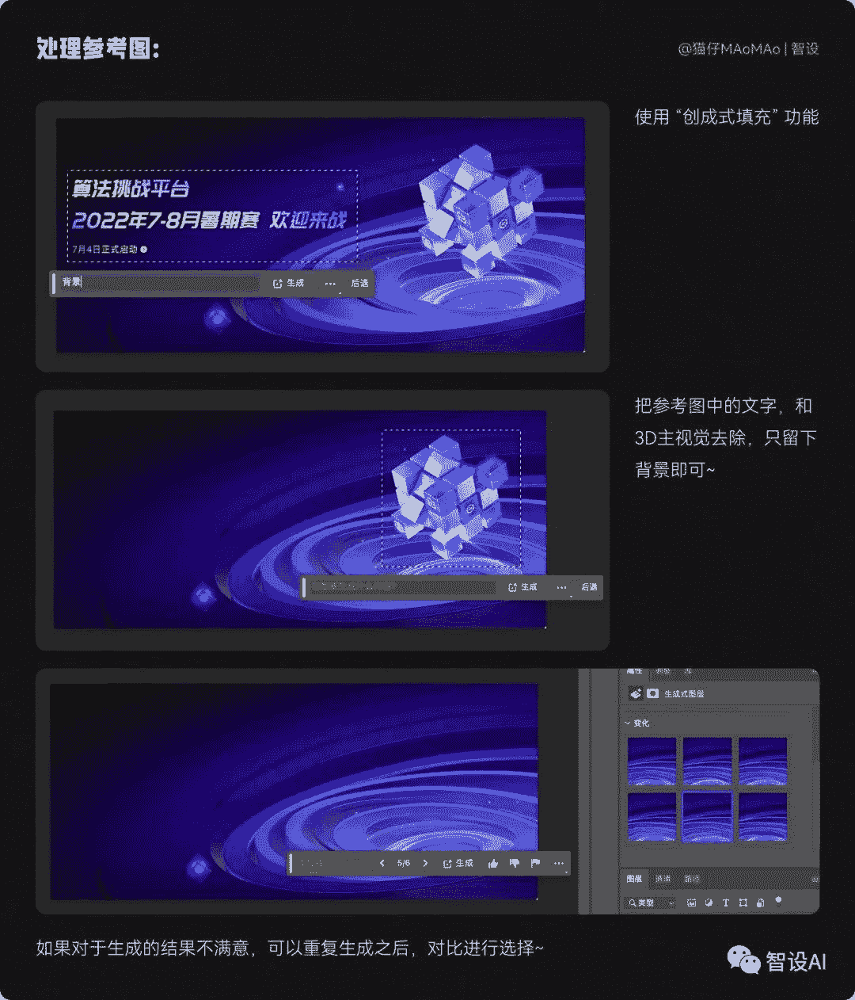

我们得到最终的背景图，就可以在 Midjourney 里进行操作了，输入命令 /describe ，把图片拖入输入框中，回车等待系统结果。

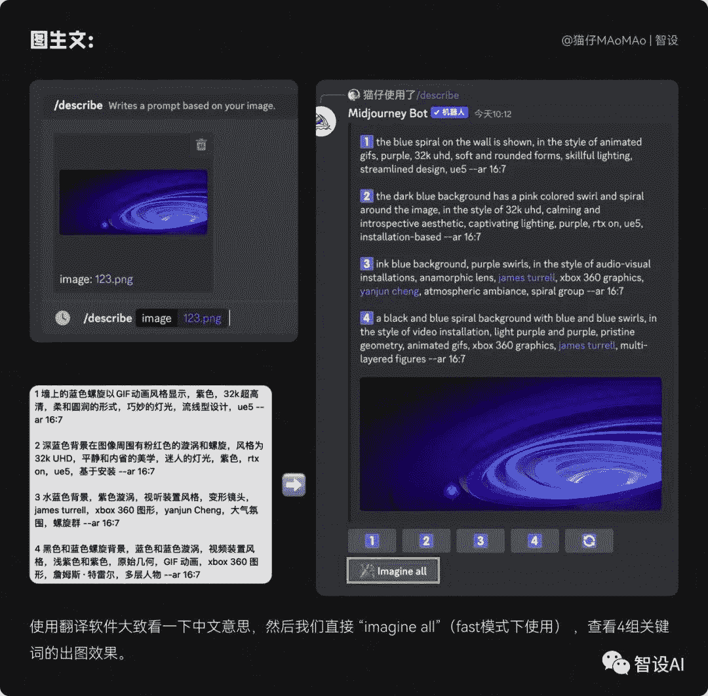

我们看到第一次关键词直出的效果，并不理想，与我们的参考图相差甚远。

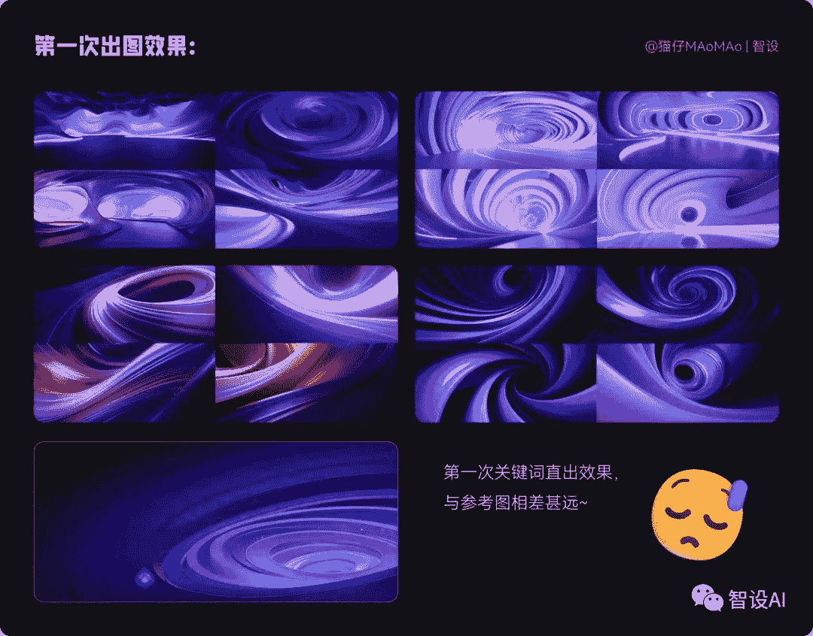

这个时候不要慌，也不要着急去改关键词，我们只需要添加上一个神奇的后缀“--iw 2”,官方文档的翻译中，这个参数叫做“图像权重参数”，用来调整关键词中文本与参考图的相似度，默认值为 1 ，范围为 0~2 ，值越高，生成的图与原图更像，注意在 V5 和 niji 模型中使用才能生效。

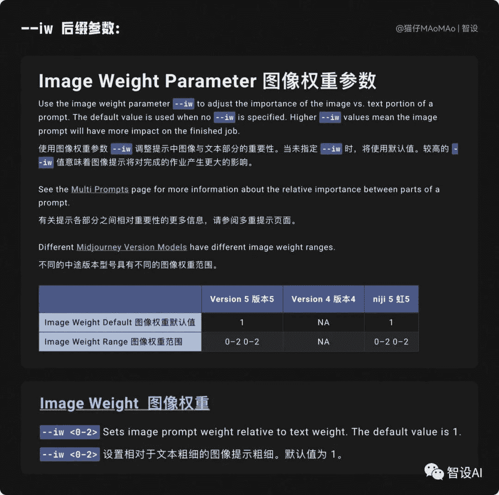

使用 --iw 后缀参数时，需要“垫图”，就是把参考图的链接加到关键词中，接下来我们看看关键词不变的情况下，只加垫图和后缀参数，能不能达到我们想要的效果。

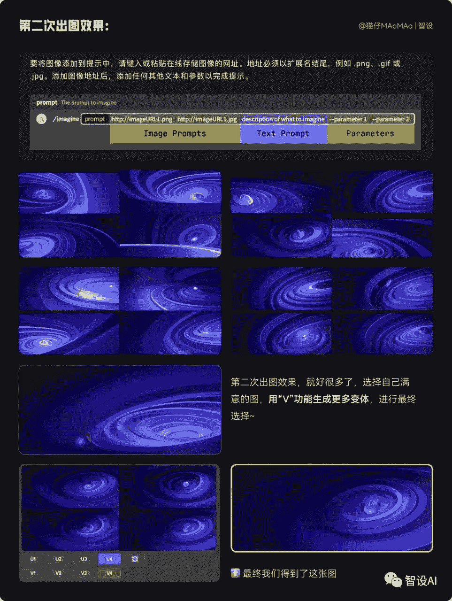

最终关键词：https://s.mj.run/8rHQ4ehBH-o a black and blue spiral background with blue and blue swirls, in the style of video installation, light purple and purple, pristine geometry, animated gifs, xbox 360 graphics, james turrell, multi-layered figures --iw 2 --v 5.2

尽管AI现在可以辅助我们进行设计，但设计师的审美和基本功仍然至关重要，在输出核心素材时，我们需要通过不断微调细节，从大量素材中精挑细选出最合适的那一个，最终得到我们需要的背景素材图。

3D主视觉我们采用文生图的方式制作，写关键词的基本公式参考下图，具体写关键词时，需要灵活进行增减，然后不断尝试，直到出现自己满意的效果。

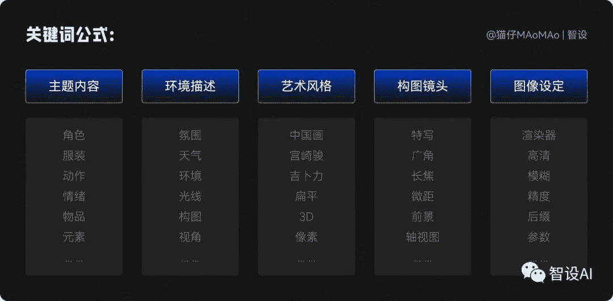

我们大致构想一下图形里面的元素、色彩、风格等关键词，经过不断尝试，以下关键词是我试出来最符合的：

A 3D **cube **icon, in the style of white and blue, translucent glass material, macro photography, emitting cyan fluorescent light --ar 3:4 -- v 5.2 一个 3D 立方体图标，白色和蓝色风格，半透明玻璃材质，微距拍摄，发出青色荧光

一般我们生成B端视觉，都是banner组图等，不是单张出现，想要保持风格不变的同时，主题内容不同，只需要更改红色关键词即可实现，最终我们就得到了下图我需要的所有主视觉元素。

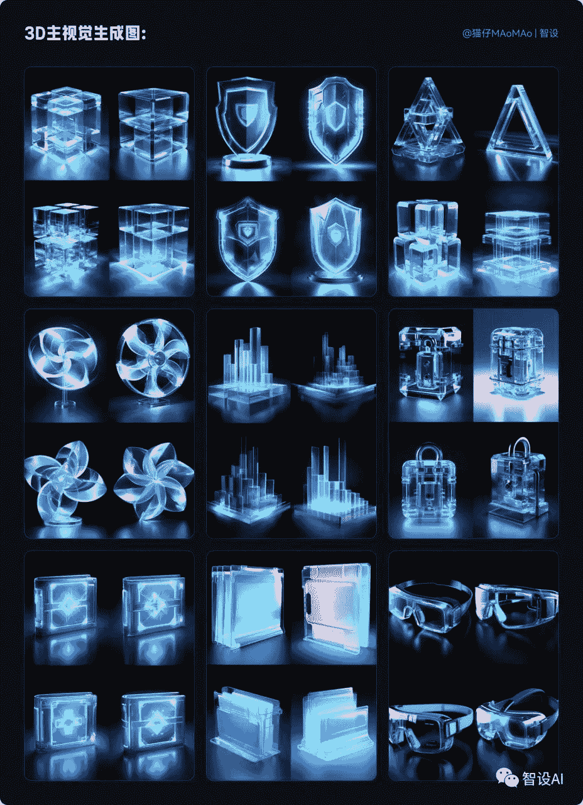

但是我们发现现在得到的素材，色调不统一，有些看起来也没有玻璃质感。所以我们还需要在PS Beta 里面进行视觉合成，让整体视觉看起来更加统一协调。

**3、视觉合成、排版**

生成的素材我们需要先用 PS 处理一下，背景素材需要处理的地方：主视觉多余的部分需要删掉、色调处理、图片比例修改。

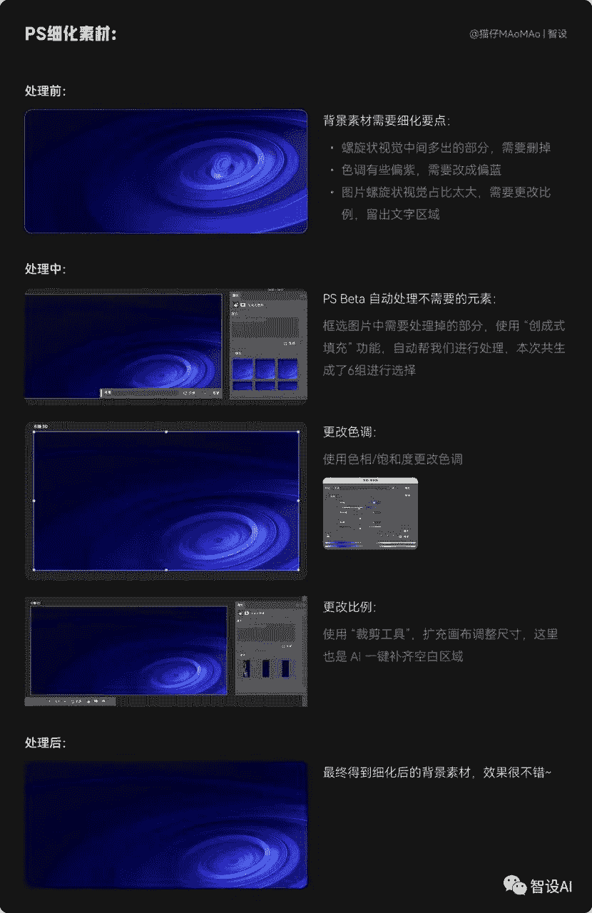

3D主视觉的部分，我们需要先进行抠图，如果不想使用 PS 手动抠图，这里推荐我常用的一键免费抠图网站： https://pixian.ai/ ，处理简单的图片，直接把图片扔进去就好了，简单好用~

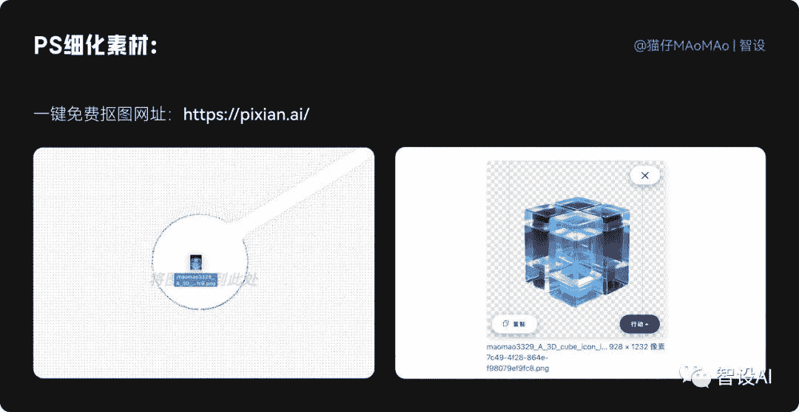

这一步考验的是设计师的审美和手活，我们需要把背景和主视觉素材，进行视觉合成，其实也非常简单：

这里我定的主要色调是蓝色+青色的光感，首先需要将色调整体统一；然后想要表现出玻璃质感的通透，我们需要加上一些光感；最后文字排版出图即可~

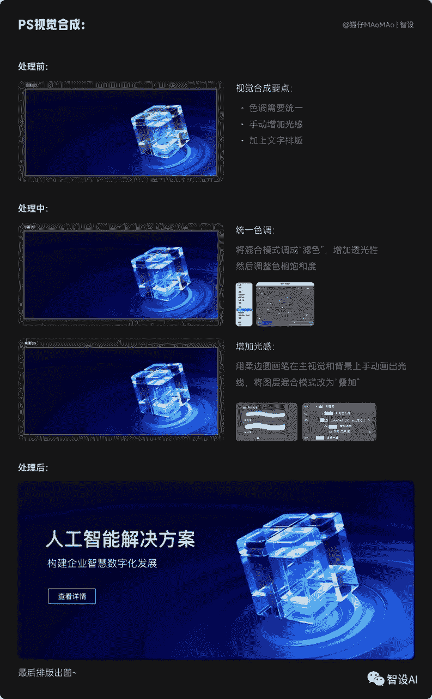

**4、排版出图**

其他的主视觉重复上面的步骤，就可以得到如下的多图，以后碰到这样的需求，大家知道如何搞定了吧~

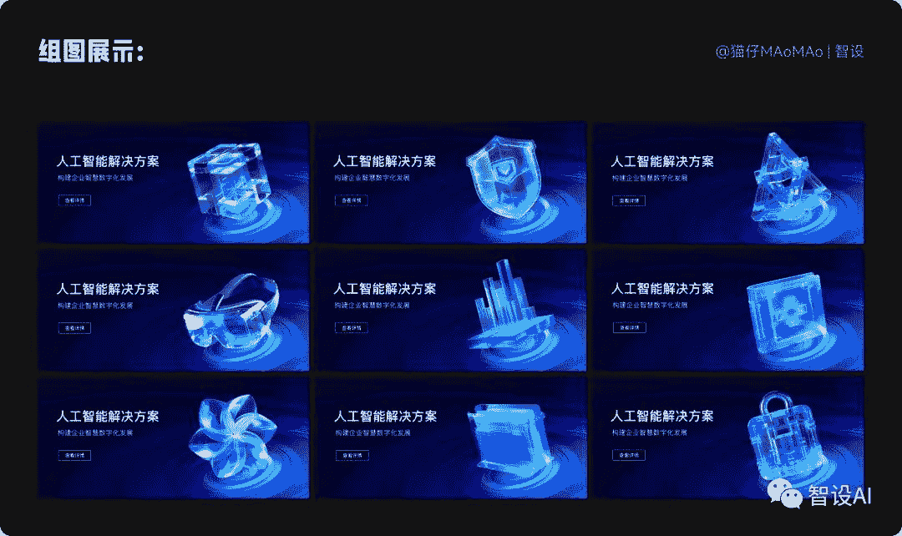

使用AI出图要凭运气，像抽卡一样，有时候可能很久才能抽到一张满意的图，以上的方法适用于不会建模渲染，但是工作中拿到了这样的需求，现学3D软件肯定是不现实的，AI可以帮助我们以最快的时间搞定这样的需求；如果你本身是会3D的设计师，AI更适合用来辅助设计寻找灵感。

# **三：B端活动弹窗设计**

B端活动弹窗一般需要传达专业、正式的氛围，符合商业环境的要求。颜色使用亮色系，会给人一种现代感和专业感，在企业环境中，例如亮蓝色、亮橙色、以及渐变等这些颜色可以传达创新、前瞻性和高科技的形象，这对于数字化转型和业务优化的主题非常合适。除此之外，中性色如灰色、白色等可以用于平衡设计，减少视觉冲击，使主要内容更突出。插画风格来说，扁平设计风格在B端设计中更为常见，它强调简洁的图形和颜色，适用于传达清晰的信息和数据，或者使用抽象的图形元素和几何形状可以营造出现代感，同时为活动弹窗带来独特的视觉吸引力。

**1、确定创意方向**

在没有设计方向的时候，不妨让AI大语言模型来帮助我们，它会根据需求的业务场景，给出合理的内容建议，以及画面元素的建议。

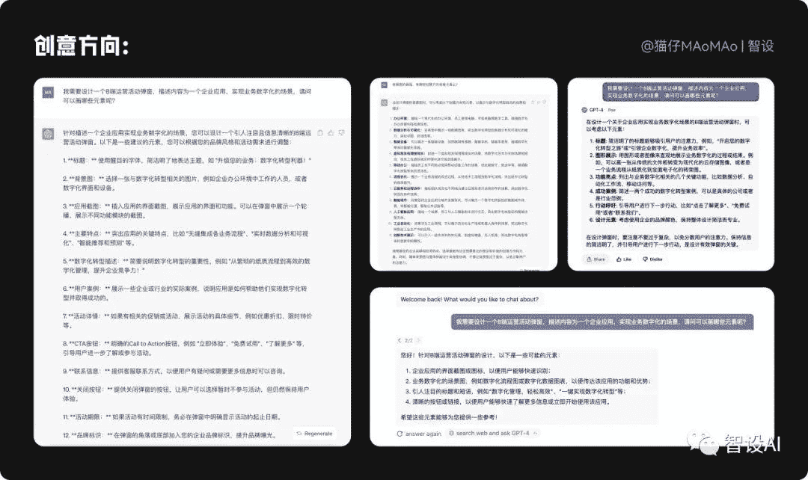

在这些回答中，我大致确定了元素和画面，标题、内容、背景图、按钮是已经在现有需求中的，我们主要聚焦于背景图的元素生成；元素内容：数据分析与可视化（在背景中展示一组数据图表，突出数字化转型后数据分析和可视化的能力，如柱状图、折线图等）、移动办公（ 描绘员工在不同地点使用移动设备工作的场景）。

**2、AI辅助生成素材**

首先来生成 “ **移动办公 **” 的场景，主体物的关键词可以是正在赶路的工作人，拿着公文包，使用手机处理工作任务，凸显出数字化办公的优势，我们直接使用Midjourney生成素材。

**主题内容： **A man walking with phone and briefcase

**艺术风格： **folk-inspired illustrations、animated gif, elegant lines

**色彩色调： **blue and light blue

因为是单个元素生成，背景环境关键词可以省略，大家在编写关键词时，注意灵活增减，不用一定按照所谓的公式来写，艺术风格是插画素材，我们直接使用niji模型，其中expressive风格会让插画更加富有表现力，可以直接在关键词后面加上后缀“--style expressive ”，或者用“/settings”命令，更改设置。

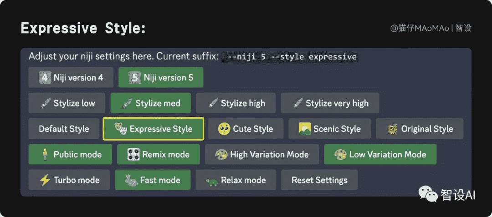

A man walking with phone and briefcase, in the style of folk-inspired illustrations, animated gif, elegant lines, blue and light blue, illustration --ar 4:3 --niji 5 --style expressive 带着手机和公文包行走的男子，民俗风格插图，gif 动画，优雅线条，蓝色和浅蓝色，插图

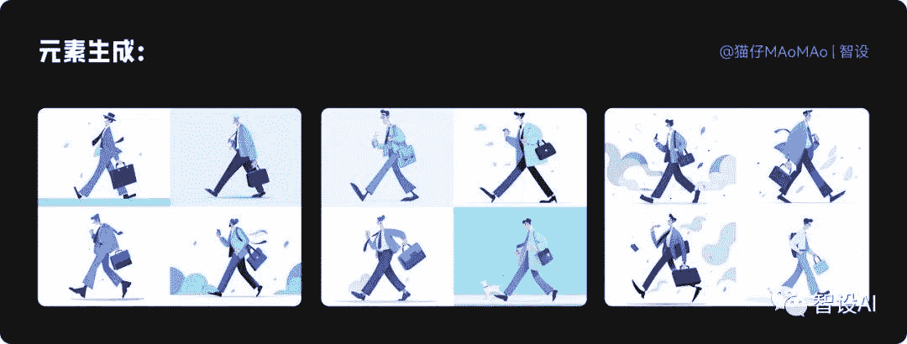

**数据分析与可视化的背景 **，直接生成数据图表的效果并不是很理想，把办公室场景全部描绘出来生成的素材更加符合需求，但是还需要再手动对素材进行细化。

**主题内容： **a office worker standing in front of a dashboard with chart

**环境描述： **in front of a dashboard with chart

**艺术风格： **Flat illustration

**色彩色调： **blue and cyan, gradient

Flat illustration of a office worker standing in front of a dashboard with chart, blue and cyan, gradient --ar 4:3 --niji 5 --style expressive 一名办公室工作人员站在仪表板前的平面图，上面有图表、蓝色和青色、渐变

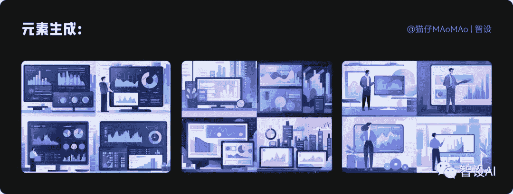

把其中需要PS处理的图片，一样按照上面教过的方法进行处理就好了~

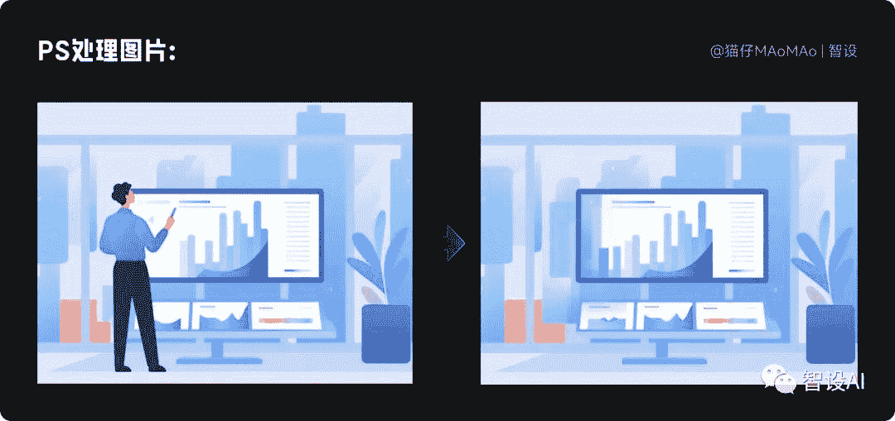

**3、视觉合成、排版**

最后使用figma，简单合成，排版出图。

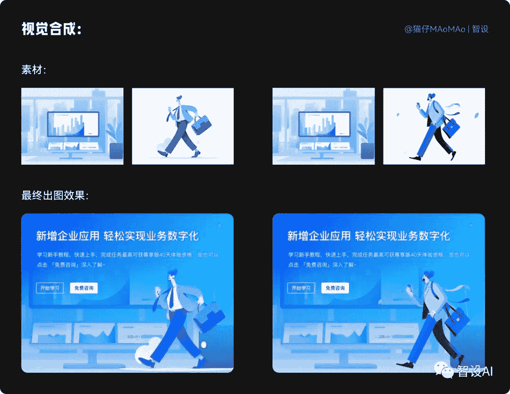

根据得到的主视觉，还可以同时延展出其他物料：

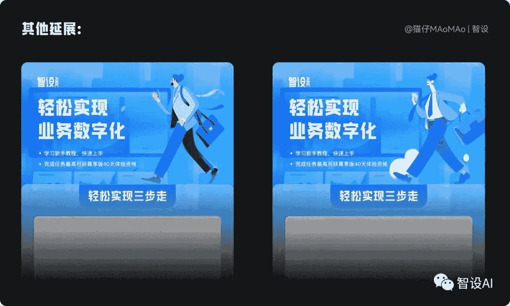

# **四：总结**

以上案例通过利用AI，设计师们可以更快速地生成创意、优化设计，并在不断的实验中不断改进。

随着算力不断提升，我们将能够以更快的速度生成大量的设计作品。这将进一步推动创作的效率，使创作者能够更迅速地实现他们的创意。尽管AIGC在设计领域尚处于早期阶段，但已经展现出对设计带来实质性提升和变革的潜力。同时人工智能也能够以更丰富的方式生成内容，从而为创作过程增添更多创意的可能性。另外随着各大公司的涉足，人工智能工具的性能将不断改进，生成内容的可控性增强，使用工具的门槛降低。设计师将能够更轻松地运用人工智能工具创作出更高质量的作品。

不过人工智能虽然在设计中具有巨大的潜力，但设计师的创造力和审美仍然是不可替代的核心因素。技术和行业的飞速发展，设计师需要保持持续学习的态度，以不断提升自己的认知能力，紧跟变化的步伐。AI只是一个工具，最终的创作仍需要设计师的独特思维和艺术灵感。我们可以期待它与人类设计师之间更深入的合作，共同创造出更加出色的设计作品。

---

<https://my.feishu.cn/sync/CV7edZp1nspUQobYJhicxeP7nrb>