# AIGC在电商产品设计中的应用

> 来源：[https://my.feishu.cn/docx/LNIKd0VXnod5KKxP0jHccnUXnMe](https://my.feishu.cn/docx/LNIKd0VXnod5KKxP0jHccnUXnMe)

<https://my.feishu.cn/sync/CV7edZp1nspUQobYJhicxeP7nrb>

> 🔗 原文链接： h[ttps://mp.weixin.q](https://mp.weixin.qq.com/s/WnuFXfZMRFsoeQevSs6mpg)q.com/s/WnuFXfZM...

> ⏰ 剪存时间：2023-09-13 17:45:55 (UTC+8)

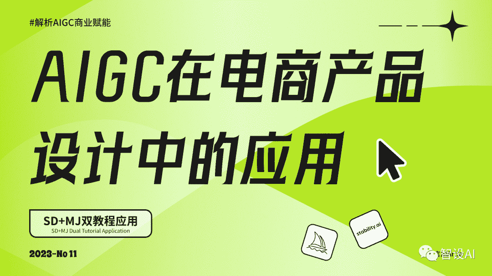

# **一、前言**

在当今数字化时代，人工智能（AI）正逐渐渗透到各个领域，为我们的生活和工作带来了革命性的变化。其中，绘画领域也不例外。借助强大的AI绘画工具，我们可以在电商设计中探索全新的可能性。无论是为产品添加独特的视觉效果，还是为品牌塑造独特的形象，AI绘画工具都为电商设计带来了创新的元素。本教程将深入探讨如何将AI绘画工具融入电商设计中，为看官们呈现一个全新的创作体验。

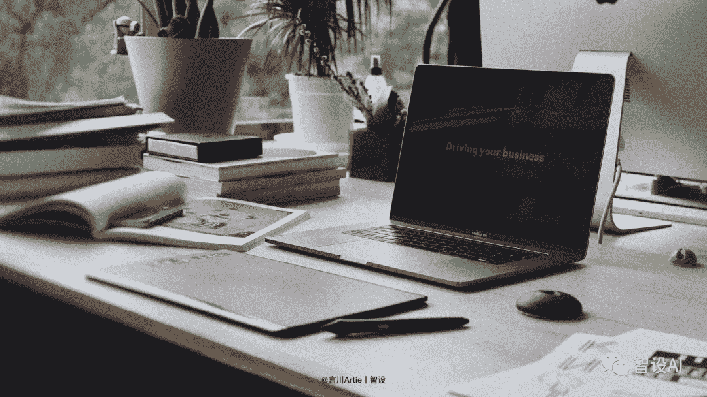

在以往的文章中，我都是使用Midjourneny进行落地项目的案例分享，可能大家确实看的有点“腻”了，对StableDiffusion应用落地项目的教程呼声很高。

我在这解释一下：StableDiffusion这款软件确实对新手的同学们不太友好，配置要求也很高。相比它来说，

Midjourneny除了付费，基本上不会有其他问题，适合广大的新手同学们使用，而且出图效果也不差，只要控制得当，也能在我们设计工作场景中得到大量的应用。

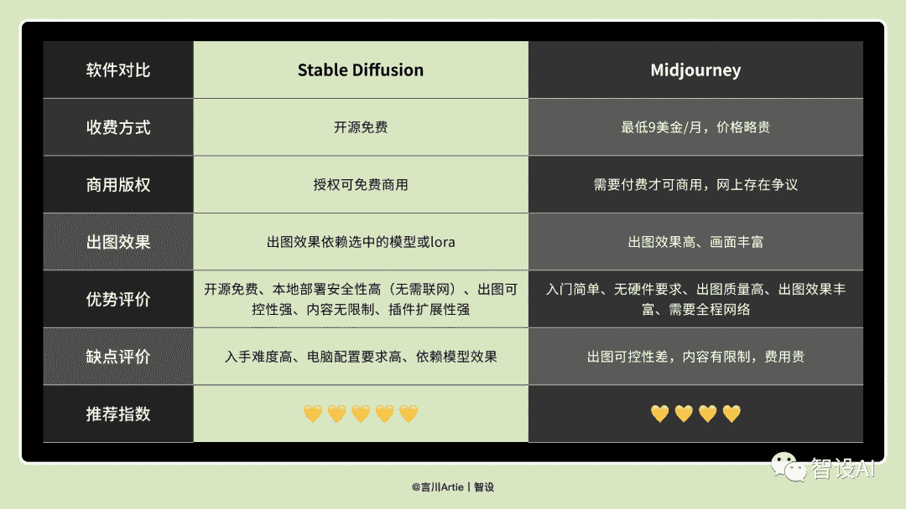

但是，要说谁最适合应用工作流中，还得是老大哥【StableDiffusion】，原因大家都知道（controlnet插件简直强的离谱）。Midjourneny除了控制性差，效果还是很不错的，关键是也简单。好了，废话太多了，小孩子才做选择，我们都用！

所以，在本次案例中，我会分别使用Midjourney和StableDiffusion这两款软件进行实际操作演示，两手抓！

# 二、Midjourneny制作电商产品海报

目前AI绘画在产品海报设计的表现是真的很不错，它替代了传统设计中的素材合成以及部分3维建模方面的工作，使得我们在短时间就可以做出可落地的需求设计。当然，它也并不是完美的，在产品设计方面，简直“惨不忍睹”，不过我们可以通过自己掌握的设计能力来修正，具体操作往下看：

**01、关键词真的很简单写**

首先我们先来看看我们要做的产品以及设计需求。需求是我自拟的，主要目的是给大家分享创作思路：根据现有产品，重新做一张该产品的视觉海报，应用场景为电商主图以及详情页面，视觉风格与产品调性保持统一。

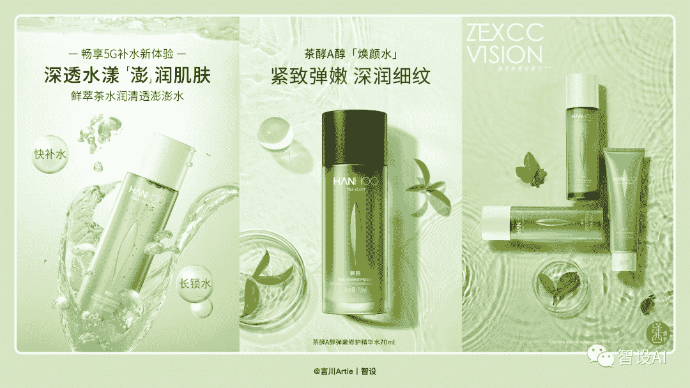

如果我们在设计之前，找到一些对标的参考图，或者是风格大致符合需求的参考图，那我们使用Midjourneny是很方便的。如写关键词，我们可以通过图生文“/describe”功能来智能生成关键词：

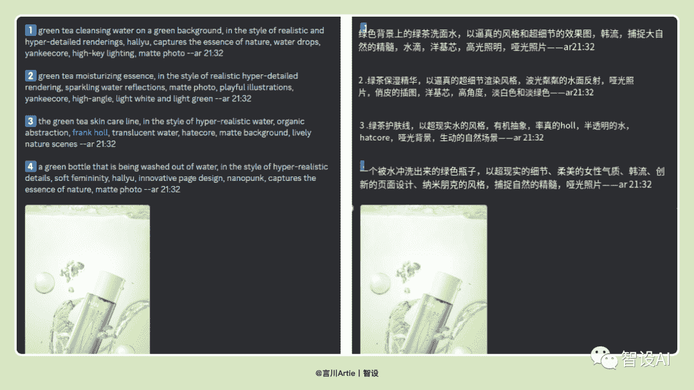

**注意：所上传的图片需要去除掉文字以及非必要的元素信息**，避免Midjourneny识别有偏差。

挑选关键词最符合参考图，或者是符合我们需求的一组。在本次案例中，Midjourneny生成的关键词基本上不需要改动，根据参考图所写的关键词也比较准确，所以我可以不用再重新写关键词。

如果关键词描述与参考图差别很大，那我们可以只选取个别关键词描述，剩余的自己根据需求重写，也比较简单。

把上述图生文的4组关键词全跑一遍，测试的实际效果如下：

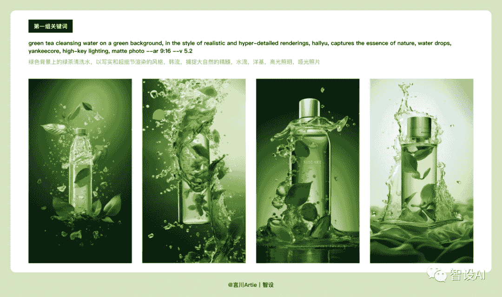

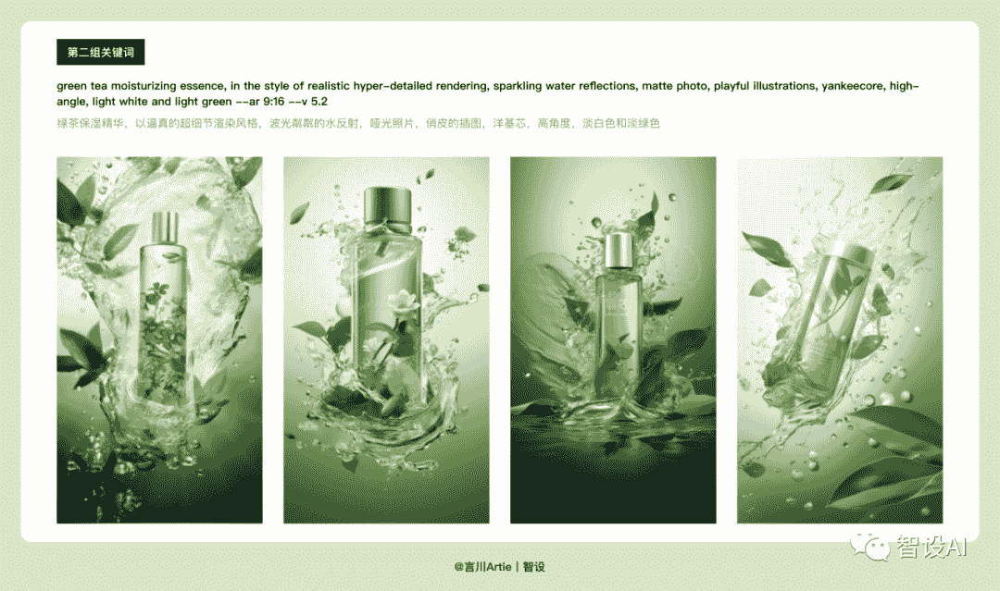

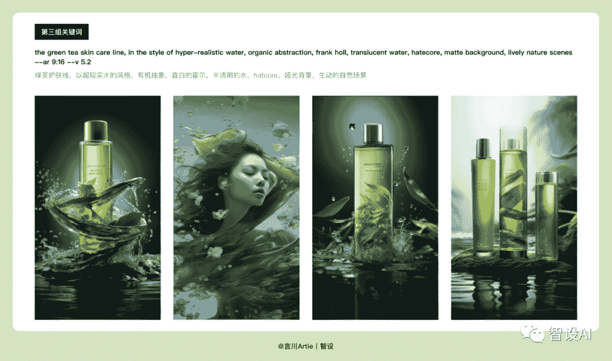

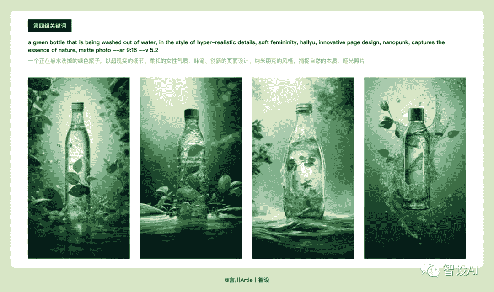

这4组关键词测试下来，效果都还可以，每组关键词都有各自的特色，在不垫图的情况下，关键词直出的效果到这种程度就可以了。最接近参考图的为第二组关键词，所以我们接下来应用的关键词就是这组了：

green tea moisturizing essence, in the style of realistic hyper-detailed rendering, sparkling water reflections, matte photo, playful illustrations, yankeecore, high-angle, light white and light green --ar 9:16 --v 5.2

绿茶保湿精华，以逼真的超细节渲染风格，波光粼粼的水反射，哑光照片，俏皮的插图，洋基芯，高角度，淡白色和淡绿色

受到Midjourney特性的影响（可控性差），我们很难通过关键词直出图来达到符合需求的设计效果，这时需要用别的方式控制一下（垫图），通过垫图控制出图效果，这也是Midjourney的优势之一。这时就不得提到【图像权重参数--iw】了。

**02、图像权重参数详解**

使用图像权重参数【--iw】来控制垫图与关键词对出图效果的影响。【--iw】的范围是0-2

【--iw】默认值为 --iw 1（就是你不在后缀输入--iw参数），【--iw】值越高，垫图影响出图效果越大。

来看看Midjourney官方给的一组效果说明：

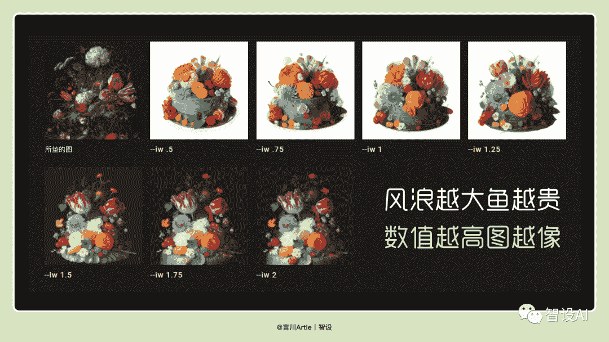

而一般情况下，我使用最多的还是【--iw 2】这个值。我认为，大家如果使用Midjourney融入到工作流中，这个参数是核心，必须清楚的了解该参数的使用及信息。

**03、控制出图效果**

了解了图像权重参数之后，我们就需要对垫图采取一些控制，牢记以下三点：

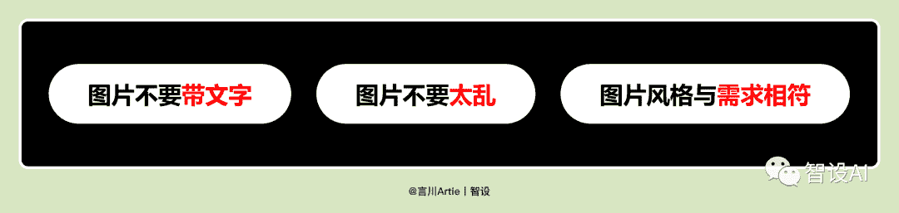

图片要确保与需求相符，不能偏差太大，所垫的图会影响最终效果的构图、风格、元素等。所以我们在图片上还需要小范围的优化下。

比如上述使用图生文的那张图片（也是经过处理的），利用PS Beta工具，把原图上的文字都清除掉，我们就得到了一张无文字污染的图片。这种图片上传给Midjourney就不会有任何问题。

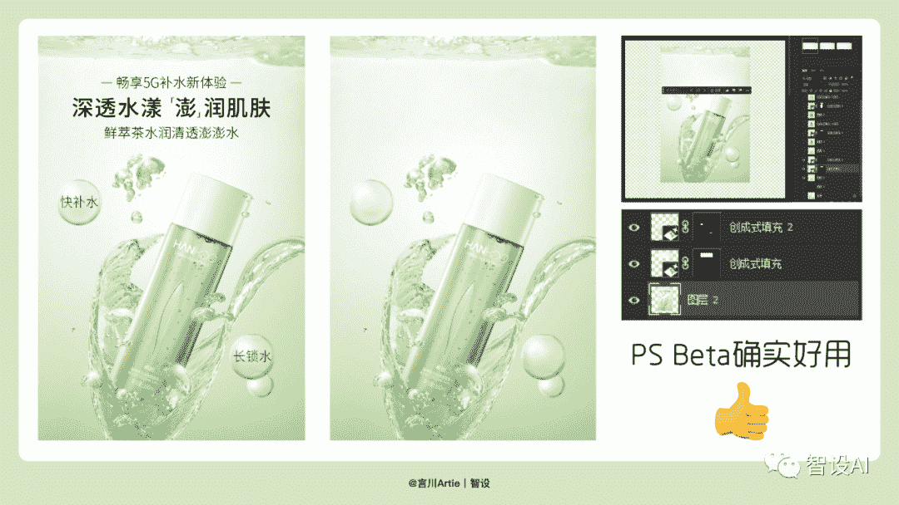

我们使用这张图片来测试出图效果吧，垫图+关键词：

【图片链接】+ green tea moisturizing essence, in the style of realistic hyper-detailed rendering, sparkling water reflections, matte photo, playful illustrations, yankeecore, high-angle, light white and light green --ar 4:6 --v 5.2 --iw 2

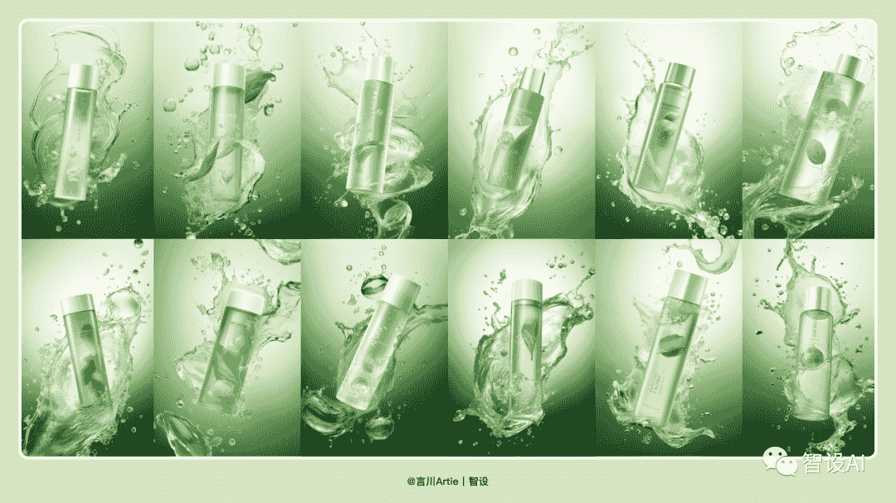

不看产品，看图片效果及元素，已经很接近原图了，而且有些图的效果甚至在细节上比原图还丰富。到这一步其实就可以拿着我们的产品进行后期的合成，这海报就结束了。不过我教大家另一种做垫图的方式，扩展下思路。

我们可以手动拼图，来控制最终的出图效果。产品+场景图=产品图，不需要进行细节的调整，做成这样就行了。

在此处还需要注意一点的是，垫图的比例最好与最终生成图的比例一致，相比大家都遇到黑边的情况吧，就是垫图不规范导致的，这个我们是可以控制的，切记！

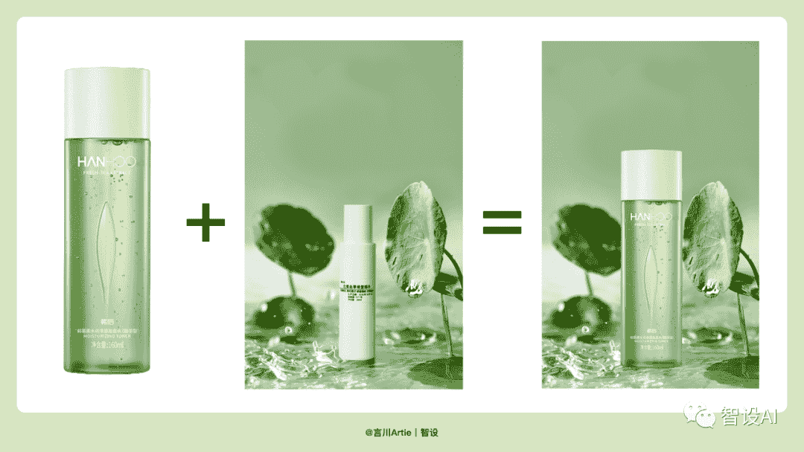

接下来重复上面的操作，用这张垫图生成效果图：

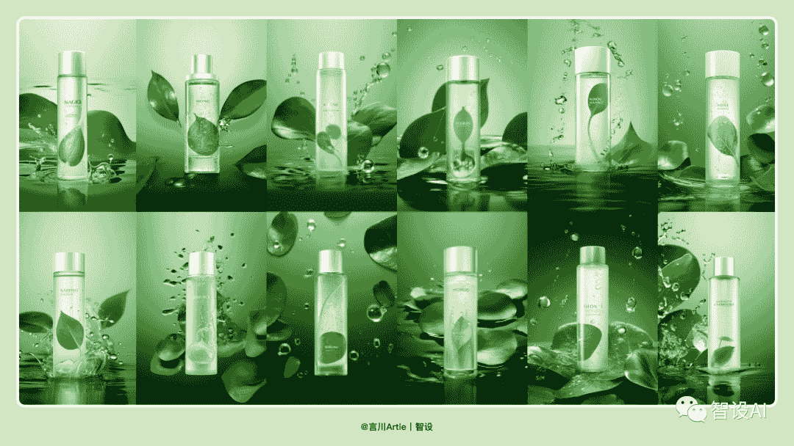

（图像权重 --iw 1默认）

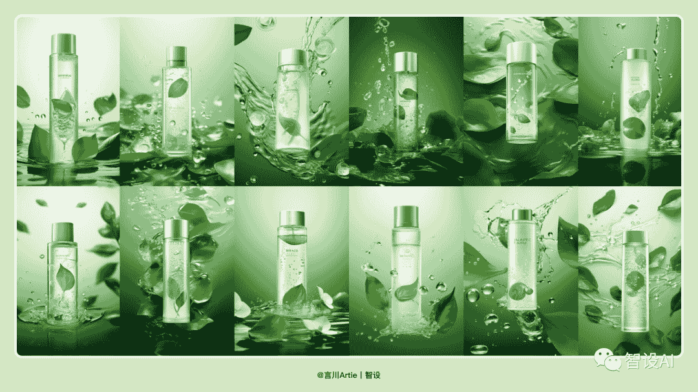

（图像权重 --iw 2）

上图为两种不同权重参数的对比（默认权重以及iw2 ），在此案例的画面效果区别不大。到这一步，Midjourney暂时就可以退下了，我们只需要挑选上面合适的图片进行后期优化即可。

04、PS Beta智能合成优化

把产品初步叠加上去，盖住AI原有的产品即可。

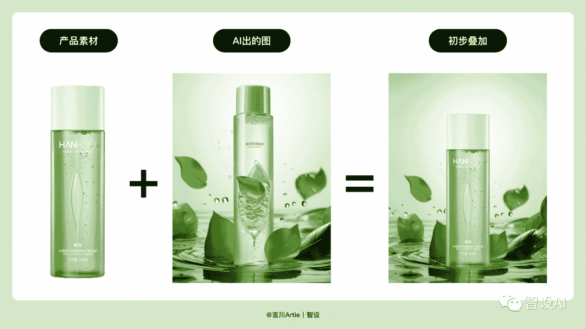

使用“创意式填充”融合产品底部与水面的接触面，最后整体润色调整一下，那合成部分即可完成。

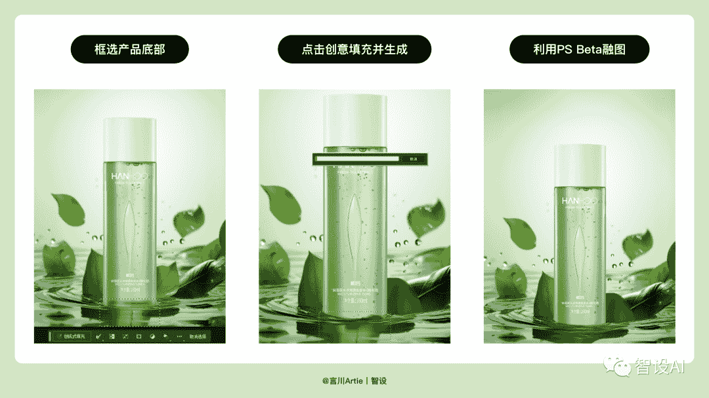

使用Midjourney制作电商产品海报到这一步就结束了，主要的思路就是通过Midjourney场景，然后把自己的产品合成上去。上面所写的控制Midjourney出图效果都是为了最后一步，合成。如果没有做这些控制 的步骤，只是生成一些背景素材，那么我们后期合成阶段会很繁琐，效率会大大降低。

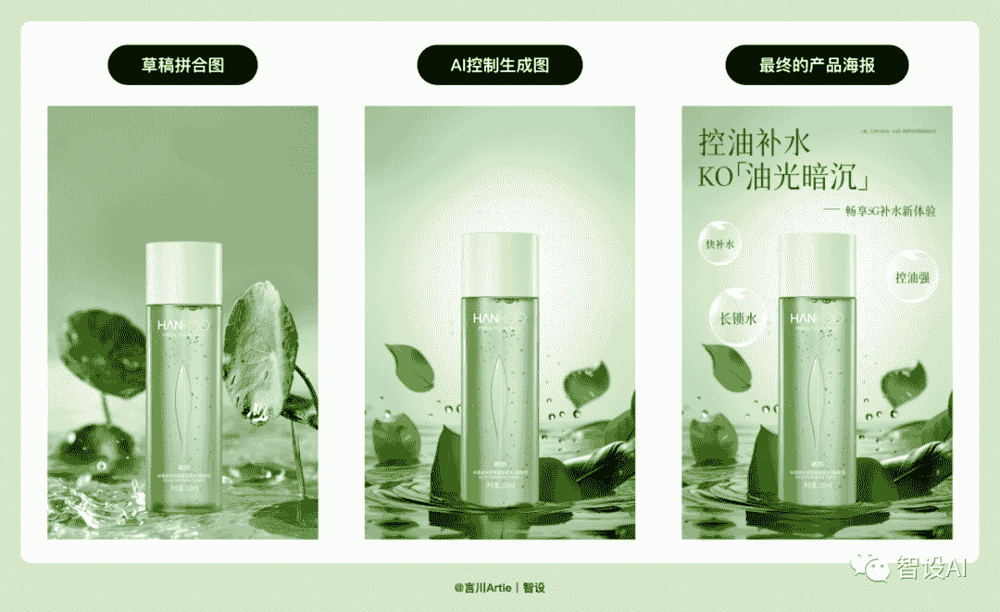

目前使用Midjourney做产品海报大致就是这个流程，最终还是把它当作素材库来使用，这也是替代了我们传统设计中，自己寻找素材的工作，在效率以及质量上表现还是很强的。

我们来看看StableDiffusion在产品海报方面的应用吧。

# 三、StableDiffusion制作电商产品海报

接下来我来介绍StableDiffusion的绘图操作。下面会使用“图生图-重绘蒙版”和“controlnet插件”功能。此类基础参数信息我在以往教程里详细介绍过，本篇文章不多做解释。

**01、图生图前期准备**

先使用PS软件准备两张图片，一张黑白的蒙版图以及产品白底图。把产品在图中的位置摆放好，然后创建一个黑色产品区域，两张图的产品位置需要在同一个地方。

图生文的蒙版重绘功能是把蒙版区域或非蒙版区域重新绘制（在SD中可选择重绘内容），可以这么理解：白色为蒙版区域，黑色为非蒙版区域。如下图：

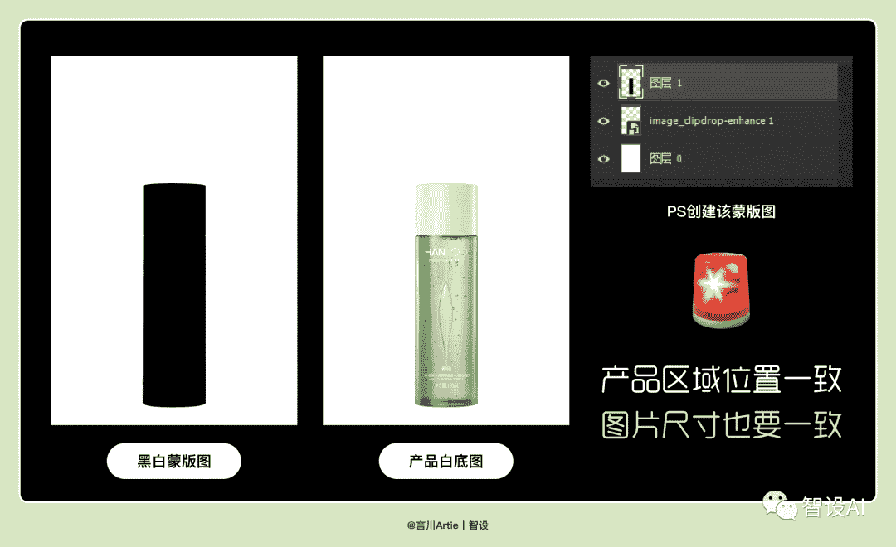

准备好模型及lora，大家可以在哩布哩布AI上找到本次案例模型，国内版安全着呢。

**模型： **majicMIX realisticV6

**lora： **Water Realflow

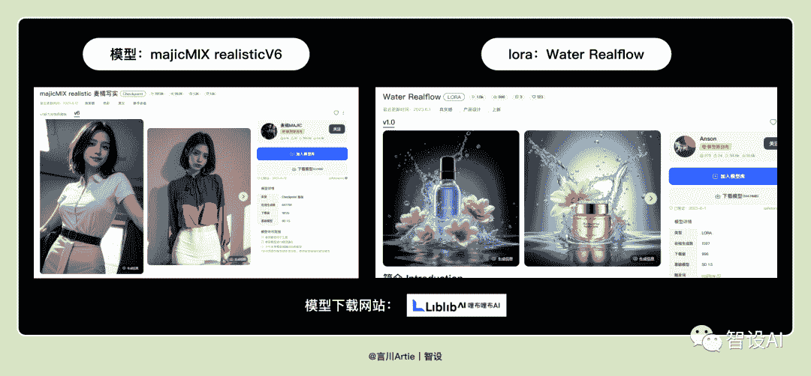

**02、图生图重绘蒙版**

使用StableDiffusion的重绘蒙版功能上传图片，切记上面为产品图，下面为蒙版图。

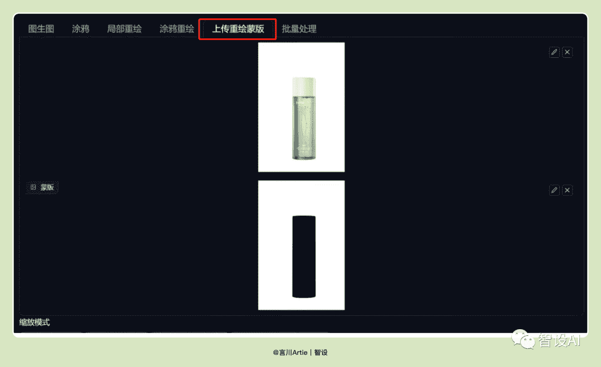

下方参数大家如果不会调整可以先跟着我的调整一遍。

**切记:**

1、蒙版模式要选择“重绘蒙版内容”（上面解释了白色为蒙版区域，黑色为非蒙版区域，可反向操作）；

2、重绘尺寸与上传图的比例一致。不然会出现产品拉伸或收缩；

3、重绘幅度拉满是因为我们上传的是白底图，需要SD完全给我们重绘白色区域。如果我们上传的是有背景的图，可以降低重绘幅度。

**其他参数看效果调整**

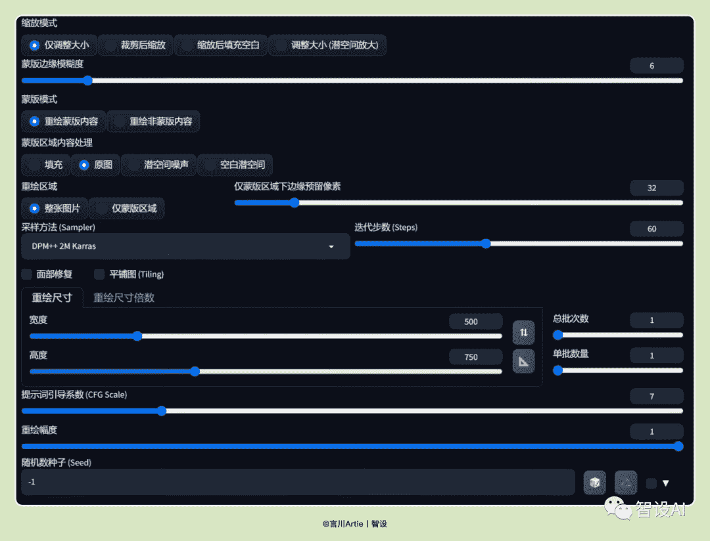

把模型、Lora、正反关键词填上。

**正向关键词：**

water,((green)),drop of water,plant,((spray)),(rock:0.6),Best quality,ultra high res,masterpiece,in summer,landscape,rock,realflow,,

水，(绿色)，水滴，植物，(喷雾)，(岩石):0.6，最佳质量，超高分辨率，杰作，夏季，景观，岩石，realflow

realflow为该Lora模型的触发词

**反向关键词：**

lowres,bad anatomy,bad hands,text,error,missing fingers,extra digit,fewer digits,cropped,worst quality,low quality,normal quality,jpeg artifacts,signature,watermark,username,blurry,orange,lens_flare,

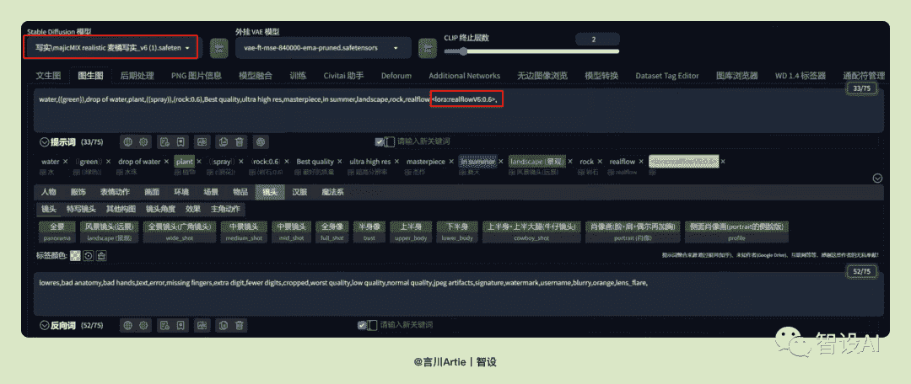

（这里要注意要加上Lora触发词，模型下载网站作者有写）

先跑一批图出来看看效果，显存不大的调整总批次，不要调整单批数量。效果还不错，这一步相当于是以产品为主去生成场景，Midjourney则刚好相反...

同样，StableDiffusion也有随机性，我们还是需要抽卡，然后挑选合适的图片。

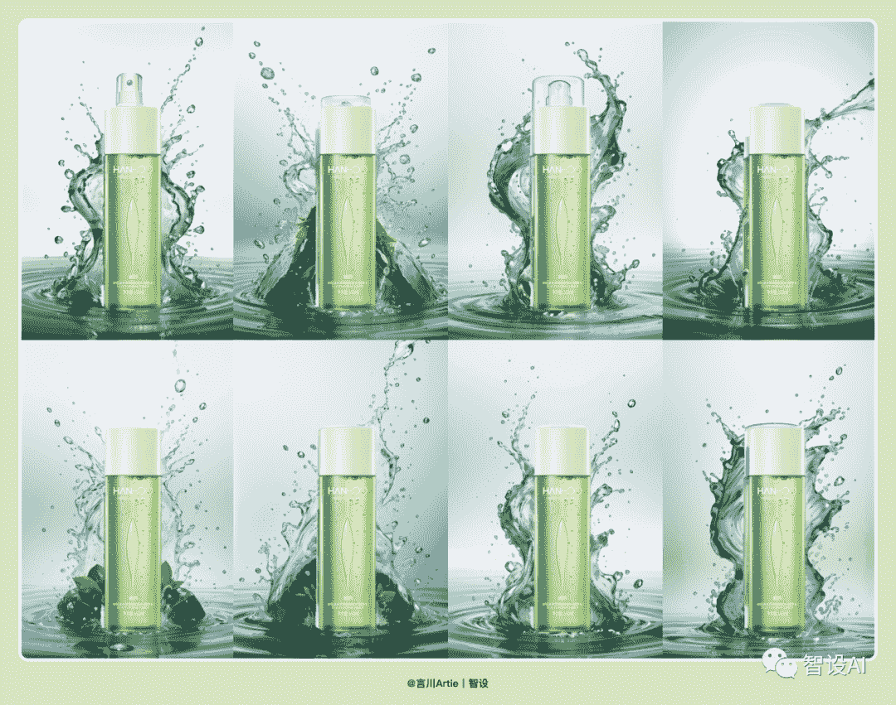

**03、前期AI优化**

在上面生成的图可以看到，背景生成没问题，但是产品并没有融合场景中，接下来需要借助controlnet功能进一步优化。

在controlnet上传我们上面生成的图，预处理器选择“tile_resample”，模型选择对应的“tile”模型，勾选“启用、完美像素模式”即可。

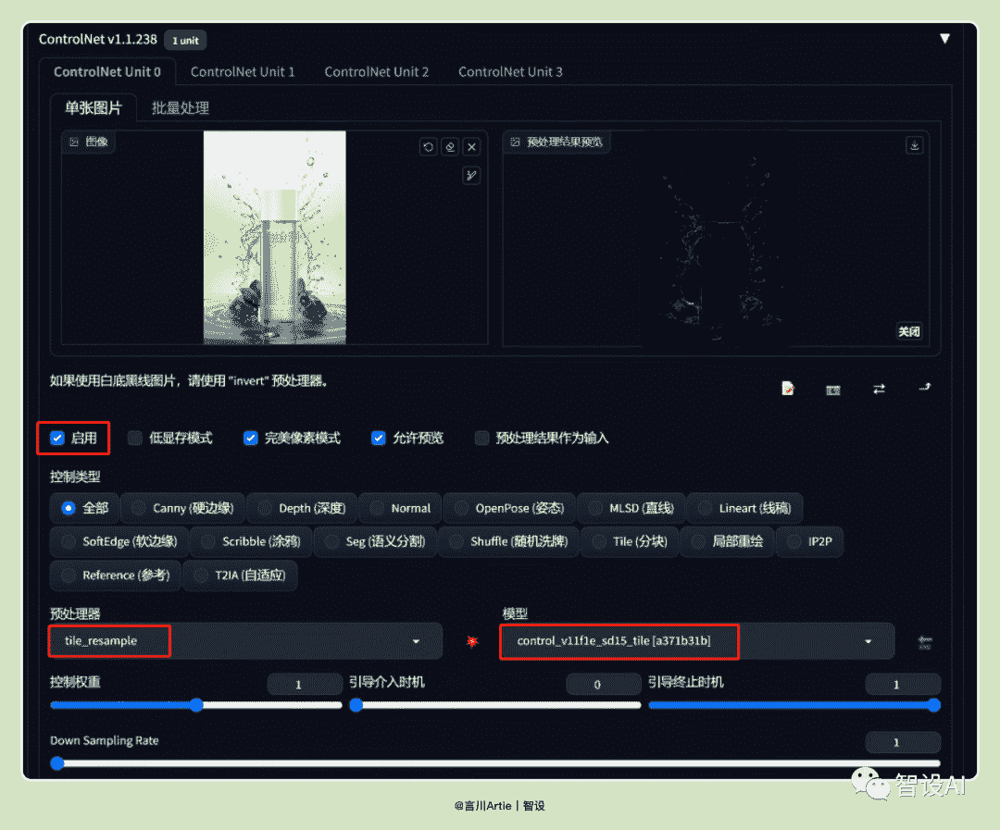

我们就得到了这些图片，会发现，产品已经面目全非了，但是问题不大，这一步只是让我们的产品与背景相融合，细节之处后期PS优化。

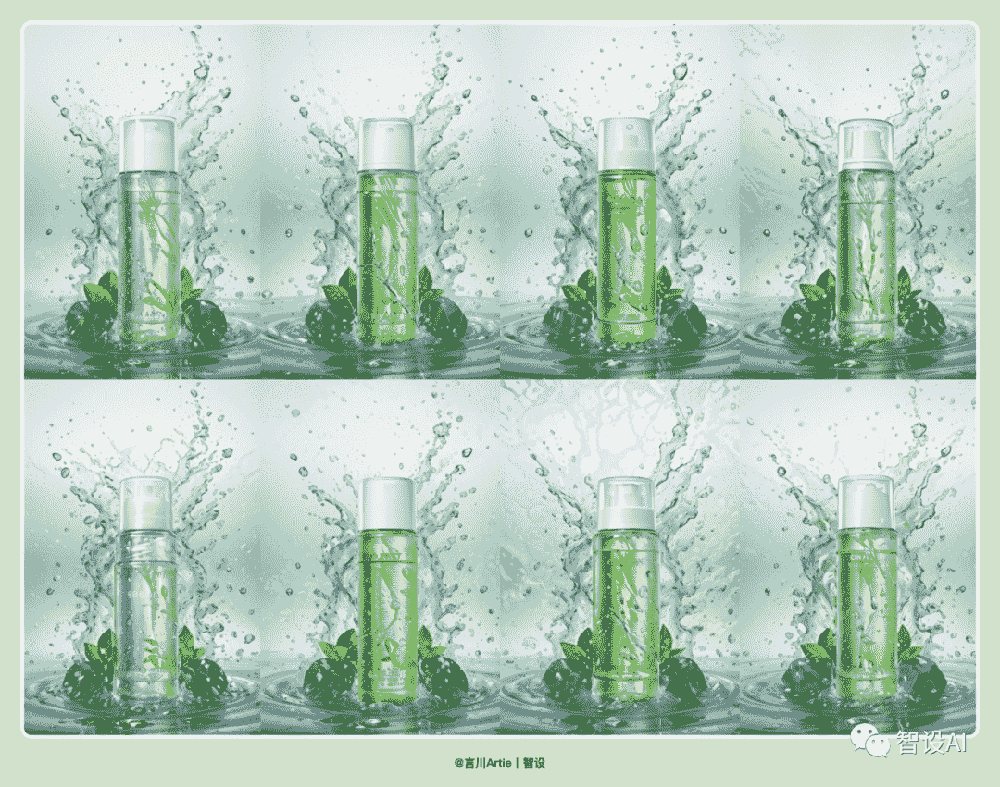

**04、后期PS合成优化**

把图生图生成的图片与controlnet优化的图片融合一下，最后排版这张海报就做出来了。

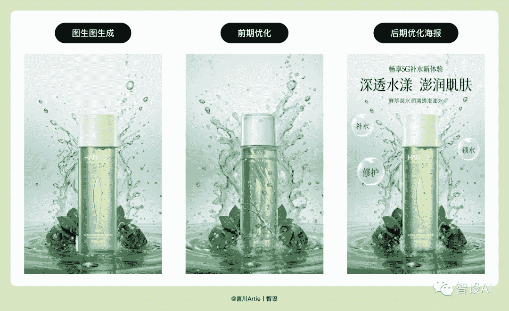

当然了，用StableDiffusion生成这类海报有很多方法，我在写这篇文章中至少想到了3种不同的生成方式，比如可以直接用Controlnet操作，效果也是很棒的。这次用StableDiffusion的操作案例就先到这，后续再给大家分享分享。

# 四、其他制作电商产品海报的AI工具

除了上述最热门的两款AI绘画工具以外，在电商领域也有其他垂直AI绘画工具。

**01、Flair工具**

比如这个Flair网站

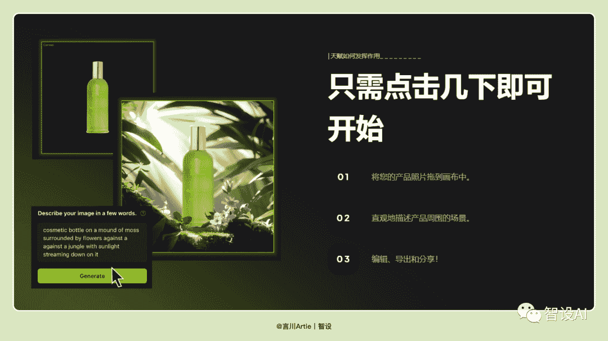

这款软件是专门针对产品海报开发的一款AI工具，用户只需要上传一张透明的产品图，通过关键词，或者是它自带的一些模板就可生成，非常的快速方便。

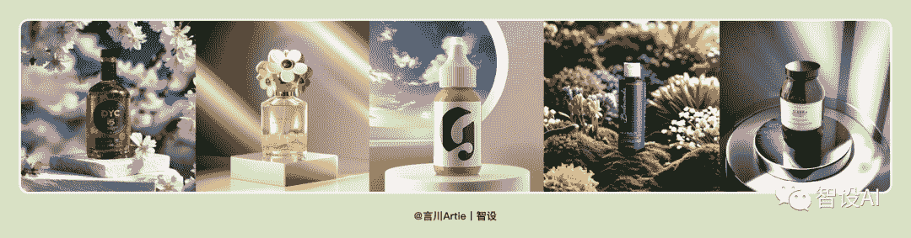

新用户可免费生成30次，大家可以跟我一起试试这款AI软件：

我们先上传一张产品上去，按照步骤上传即可：

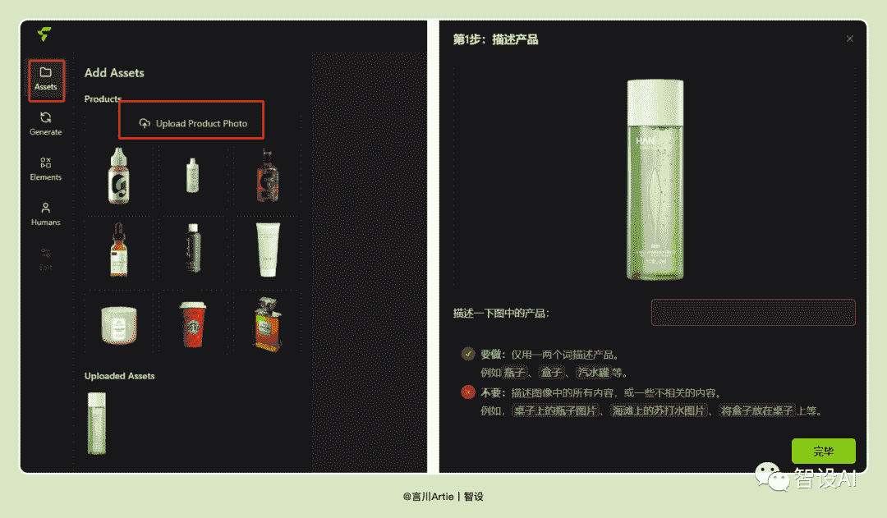

可以选择官方的模板生成，效果真不错，看我上面写了一大堆教程，这工具1分钟就搞定了，啪啪啪打脸🥲🥲

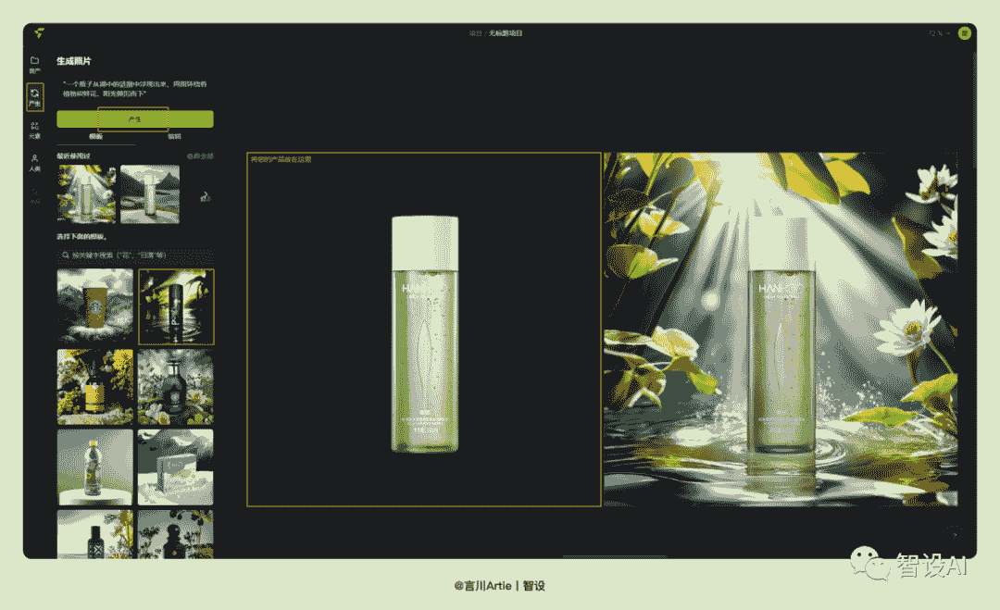

这个工具还可以手动添加一些元素，然后生成....也可以自己上传元素，要是不收费该多好呀!

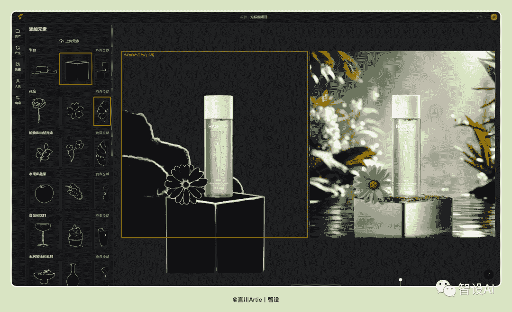

手也可以添加，这才是人工智能呀（ps：图中我随意生成，大家可以深入研究试试）

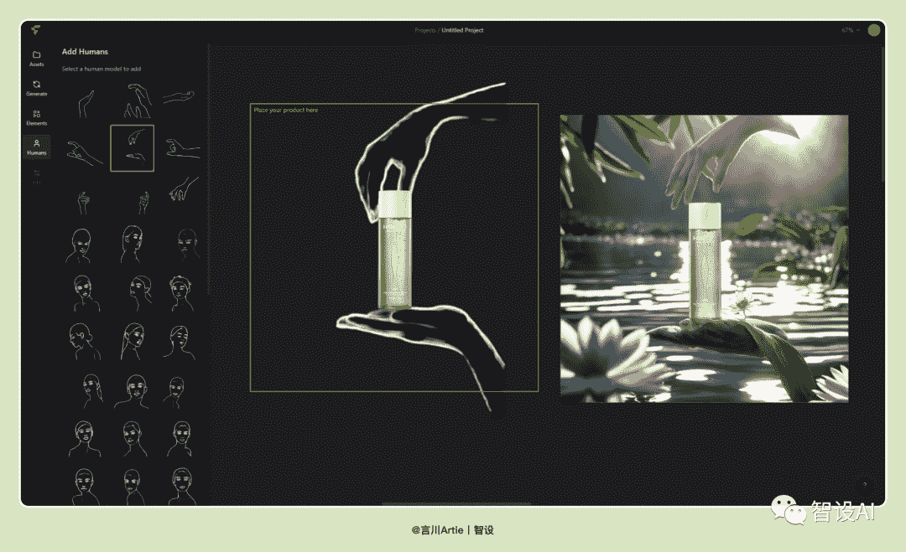

这款软件能用，但是大家也不要抱有很大的期待，简单的场景好生成，负责的可就不一定了哦，反正免费30次，大家去玩玩吧。

**02、美图秀秀AI工具**

现在美图秀秀也有这个功能，每天15次免费次数，冲，不用白不用！

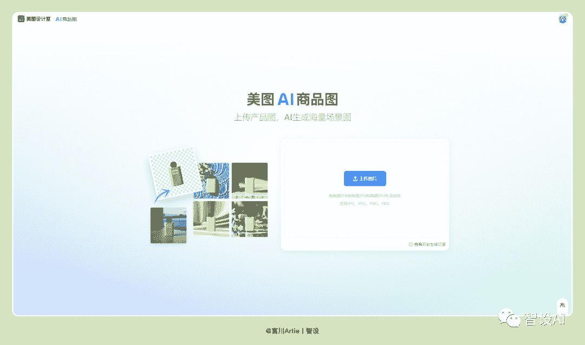

上传图片就给我们生成了这些场景图，也是有模板的，不过与Flair对比还是有一定的差距，不论是出图效果还是功能，期待后续的优化！

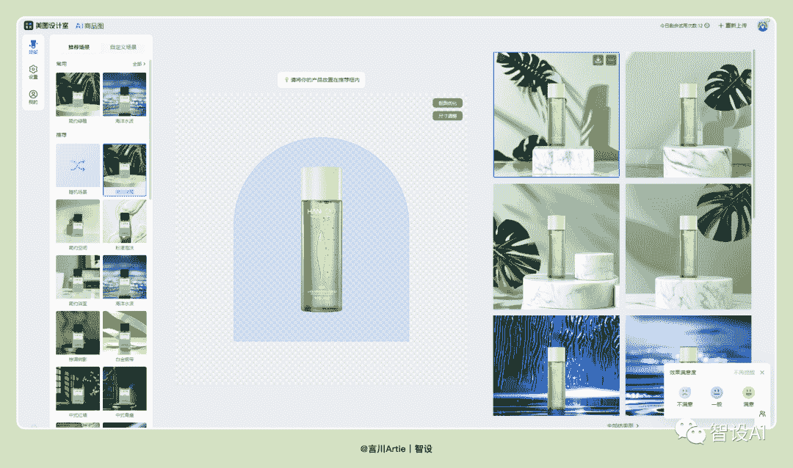

此类电商AI工具有很多，大家在网上一搜一大堆，我这里只列举两个出来，没有任何商业行为，纯个人分享哦~

# **五、总结**

本次案例教程到此结束，主要目的是为大家分享AI工具在电商产品设计中的运用，列举了一些操作方式，扩展一下商业化思路。同时也是帮助AI入门的同学提供一些教程指导，让大家尽快把AI融入到工作流中，毕竟现在市场有多卷大家也很清楚。最后来个官方化的总结：

AI技术是手段，创意是核心，下期见~

---

<https://my.feishu.cn/sync/CV7edZp1nspUQobYJhicxeP7nrb>