# 淘宝设计+AI，品牌创意设计

> 来源：[https://my.feishu.cn/docx/SVEBdW17Boh7ZoxMplMcTK70nqe](https://my.feishu.cn/docx/SVEBdW17Boh7ZoxMplMcTK70nqe)

<https://my.feishu.cn/sync/CV7edZp1nspUQobYJhicxeP7nrb>

> 🔗 原文链接： h[ttps://mp.weixin.q](https://mp.weixin.qq.com/s/xFVDARQHxlweKAYG91DtYw)q.com/s/xFVDARQH...

> ⏰ 剪存时间：2024-01-08 01:27:26 (UTC+8)

天猫携手 50 大超级品牌为今年双 11 开幕创新地打造了一场联合营销事件，通过汇聚超级品牌之力，创造超现实、沉浸式的创新营销场域，重构品牌与年轻人的这场双 11 对话。

在这场新潮的联合营销中， 超级品牌和天猫的这套联合海报，极致体现了品牌与平台创新态度。

# **#01** 超现实主义风格 TOP品牌联合海报

天猫双11超级发布｜TOP品牌联合海报

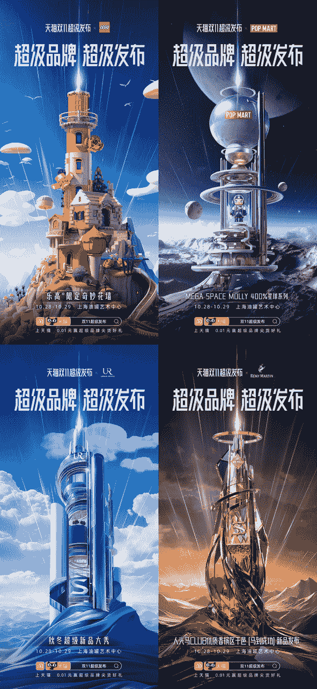

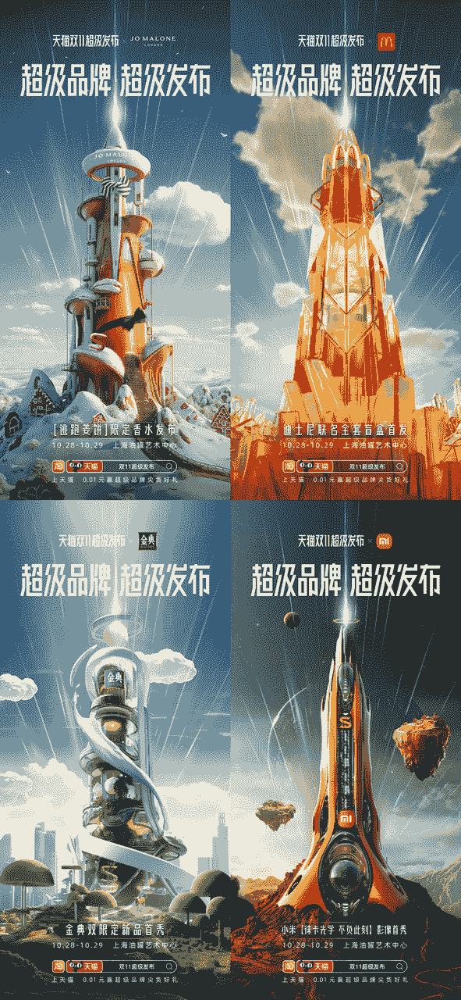

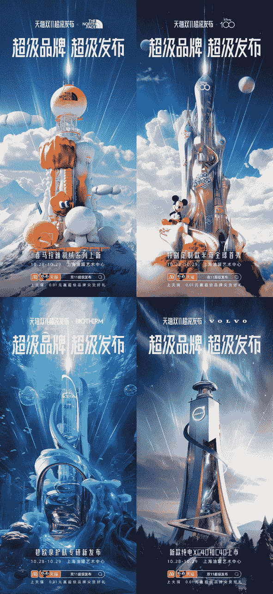

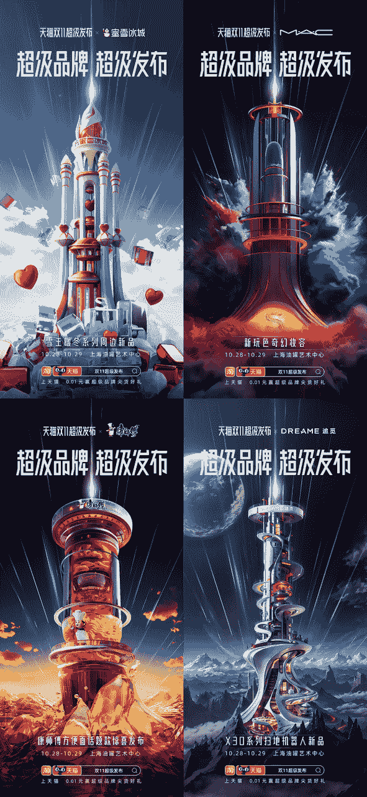

# **#02**

# **设计 过程**

如何展现活动先锋调性与创意？如何个性化满足超级品牌主题诉求？ 如何在较短的时间内完成16+TOP品牌的大量海报设计并且快速根据GLOBAL的反馈进行高频修改？

# **“**

# **设计上的解法就是**

# **新技术与老技能的融合贯通，**

# 设计师根据实际情况在 不同的环节个性化使用AI和常规设计软件。

我们发现，在AIGC设计流程中，结合传统的 合成/3D/插画等技能，才能真正实现高效率高精度的设计落地,满足创意与品牌主题的一系列诉求。

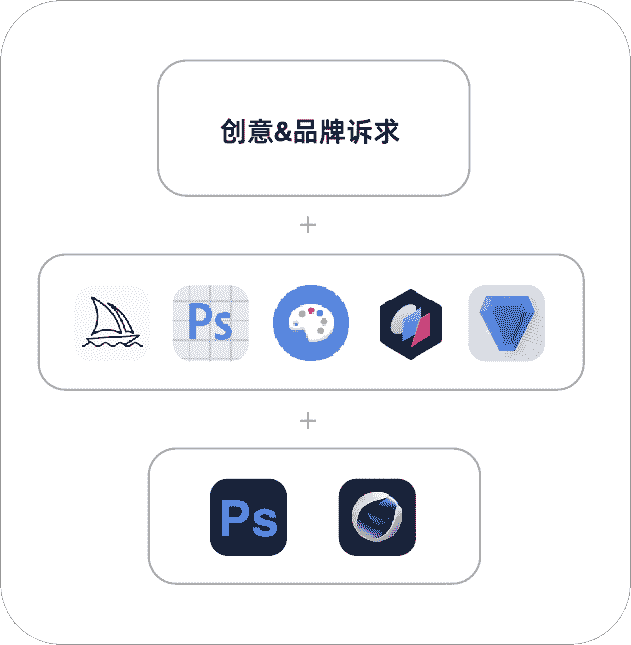

以下用THE NORTH FACE 北面 / DISNEY 迪斯尼 为设计案例：

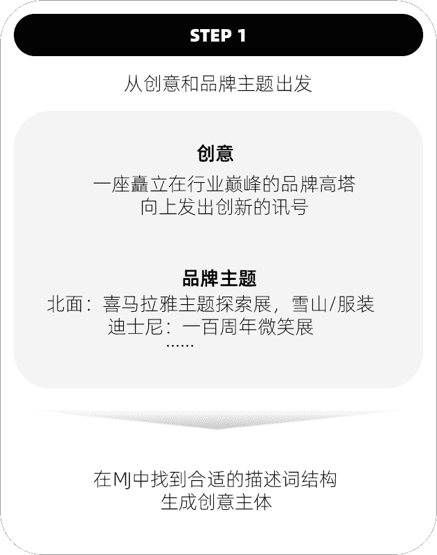

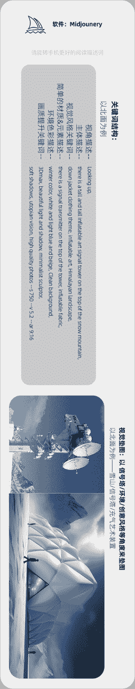

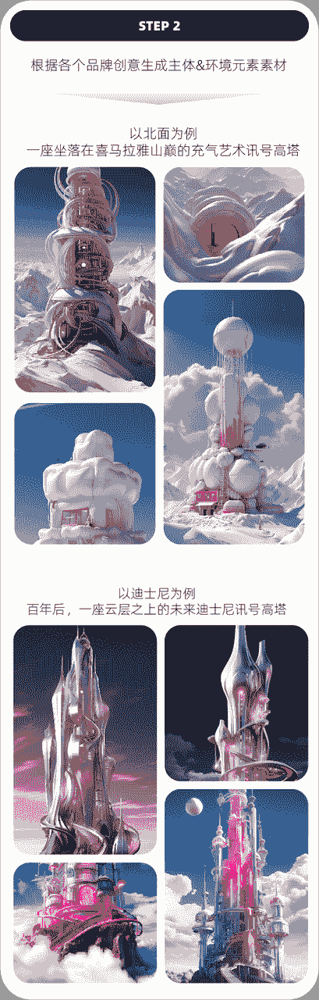

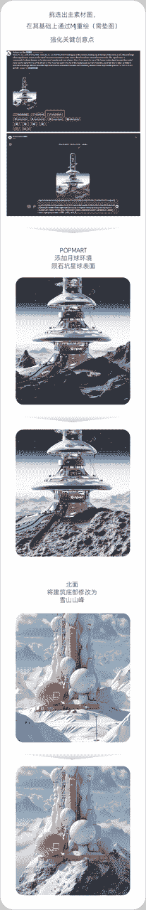

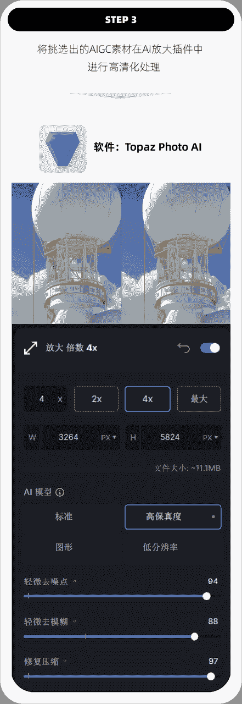

Al的出图往往难以用一张图，表现出所有我们想表达的内容， 所以我们需要进入PS (beta）进行视觉合成和修缮。

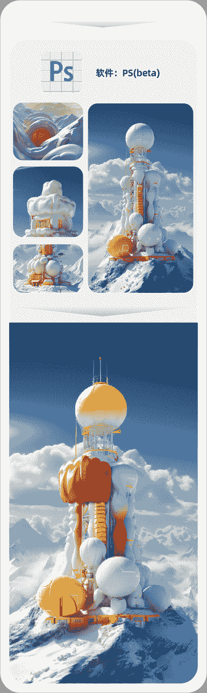

在此过程中，可使用PS(beta）的AI填充功能，补充画面元素，修缮细节。 此功能与MJ的局部重绘类似，可酌情选择使用。

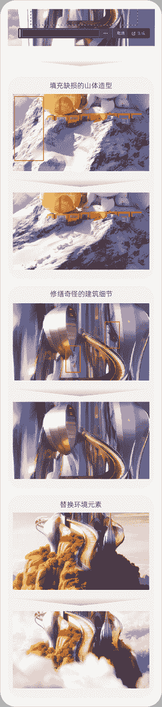

部分情况下， 一些合成不自然的部分，在放大插件/ps (beta）/MJ 重绘里无法修改 可 通过SD进行细节融合，优化材质。

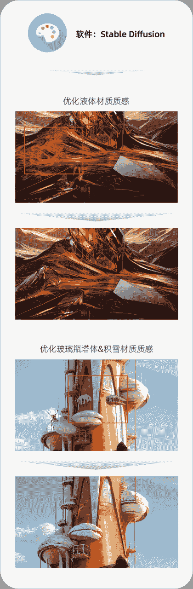

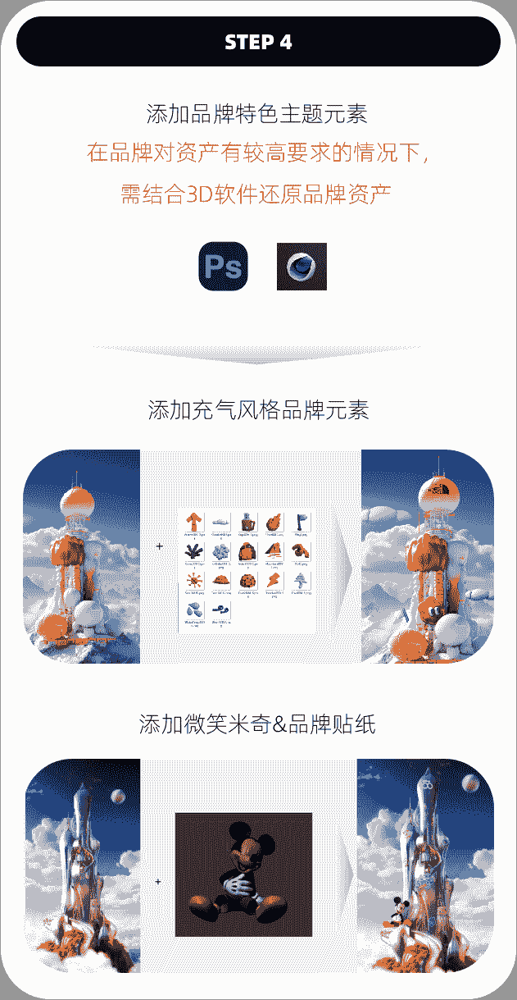

结合品牌超级符号， 使用 Found纷得，对超品S符号进行3D演绎 （SD的简化版，国内平替版）

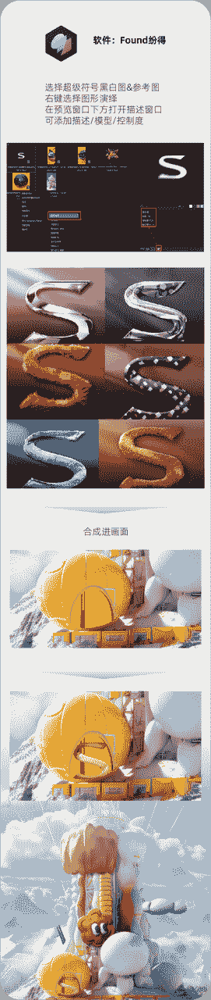

完成稿

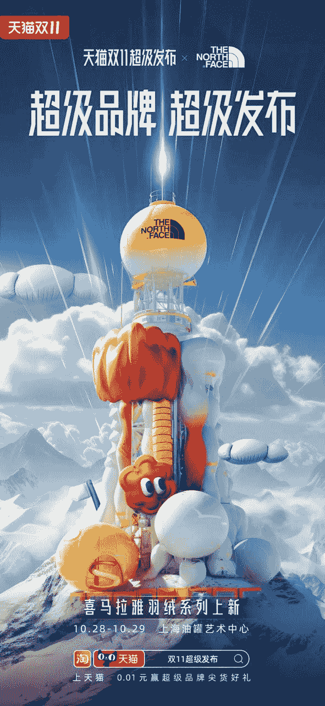

#

# **Q&A**

Q：这次项目中最难的设计是哪个环节？是如何克服的？

Y：其实整个项目最难的并不是某一个特定的环节，难的是整体的节奏把控，如何在2周的执行周期里完整16+的高难度海报设计，并且应对品牌方的修改意见进行快速修改。

此时此刻，Midjounery出创意视觉大方向—Topaz Photo AI 高清处理—PS beta 优化+修改局部画面—SD细节融合+优化材质—Found快速合成超级符号，这一整个过程需要保证软件的使用熟练 高效 和对于整体创意概念的深度理解。

Q：设计师如何定义品牌的超现实设计风格？

Y：个人是一位创意base的设计师，那么对超现实的理解就是出其不意且符合品牌的基础定位，简单的来说，就是满足品牌在幻想中想要达到的某种概念。

在具体执行中，可以利用MJ的超级创意能力来帮助我们达到这一效果，无论是找ref反向生图，还是直接用AI的描述去写咒语，一切反逻辑，超时空，怪诞感的超强视觉感官都是超现实设计风格的体现形式。

Q：AI对于实际出街项目，真的会降低设计师们的实际执行成本吗？

Y：回答一定是肯定的，YES☑️。但现实问题就是研究咒语的时间是否比找ref的时间更长？AI刷图的时间是否比作图的时间更长？然后业务或者品牌对于整体执行时间和数量的预期是否会成倍增加，这些就要看设计师们如何利用各种能力去一一破解了😊

# **#03**

# **部分视频动态演绎分享**

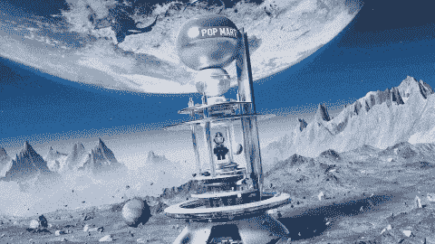

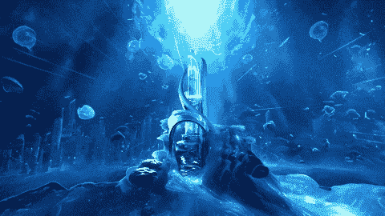

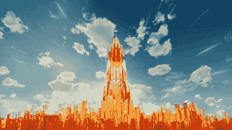

# **有关创意设计与AIGC的思考**

从AI进入大家的设计生活已经有超过大半年的时间，越来越多的AIGC优秀设计作品已经被品牌方和平台卷的飞起，那么作为一位从事创意设计工作的设计师来说意味着什么？

很简单，AI🤖️已经成为一名合格设计师🎨必备的技能，尤其是偏向于视觉设计方向的设计师，毫不夸张的说，你可以不会3D，但你绝不能不懂MJ，SD这些AI软件。AIGC真的可以实实在在的提高设计师的执行能力和与甲方的沟通 效能。🚀🚀🚀

如果你还在犹豫是否要进入AI领域去探索学习，那么真的大可不必，让我们用高科技的设计武器去武装自己的设计技能，如何顺势而为永远是一个聪明人的必修课。📖🤖️🎨

本期编辑：「品牌营销传播」的AIGC研究员们

////// **END **//////

<https://my.feishu.cn/sync/CV7edZp1nspUQobYJhicxeP7nrb>