# 淘宝AI试衣间产品功能演示

> 来源：[https://my.feishu.cn/docx/Ohkddf8YuoAT8jxcpkXcu5hxnzd](https://my.feishu.cn/docx/Ohkddf8YuoAT8jxcpkXcu5hxnzd)

<https://my.feishu.cn/sync/CV7edZp1nspUQobYJhicxeP7nrb>

> 🔗 原文链接： h[ttps://mp.weixin.q](https://mp.weixin.qq.com/s/mZiNmepoWddYaLbEaap1Ow)q.com/s/mZiNmepo...

> ⏰ 剪存时间：2024-01-08 01:29:03 (UTC+8)

最近，淘宝新上了一个叫「AI试衣间」的功能，和以往的虚拟试装有什么不同之处呢？

线上模特图的生产方式，一直以来在成本和灵活性上限制着服装上身效果表达，同时由于模特和用户之间的身材样貌差异，用户通常只能脑补服装实际上身效果，这导致用户难买到合身的商品。

但在刚刚过去的淘宝新势力周，通过对AI大模型的训练和应用，算法从模特姿态、背景风格、装饰元素等多个维度进行效果升级，提升了合成真实性和美感，再结合用户脸型、身材数据，淘宝AI试衣间给用户展现了一个区别于以往的试衣体验。

2023新势力周AI试衣间

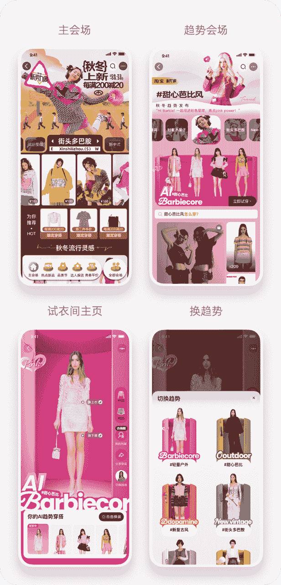

本篇通过对淘宝AI试衣间的设计过程拆解，探讨AI在服饰领域的应用和展望，接下来让我们看看具体怎么做的吧～

# **试衣间设计目标和策略**

#

线下场景中，用户通过逛店、试穿来买到合适的商品。

对应用户心理需求的映射，我们把线上试衣间的设计目标总结为，通过工具化产品满足用户线上购买服饰的合适性需求和发现性需求。

在满足合适性需求方面，结合AI模型、用户数据和服饰标签，最终达到贴近用户形象特征的效果。

在满足发现性需求方面，通过强化套装和单品的互动感，提升试穿效率，进而体验更多商品。

# **#01**

# **满足用户的合适性需求**

**模特合成贴近用户形象特征**

用 户形象通过人脸和体型综合展现，在产品设计中，为了提高用户人脸和身型数据录入的完整性 ，分别设计了主动和被动触发形象管理面板，方便用户在任何时候调整补充形象数据。

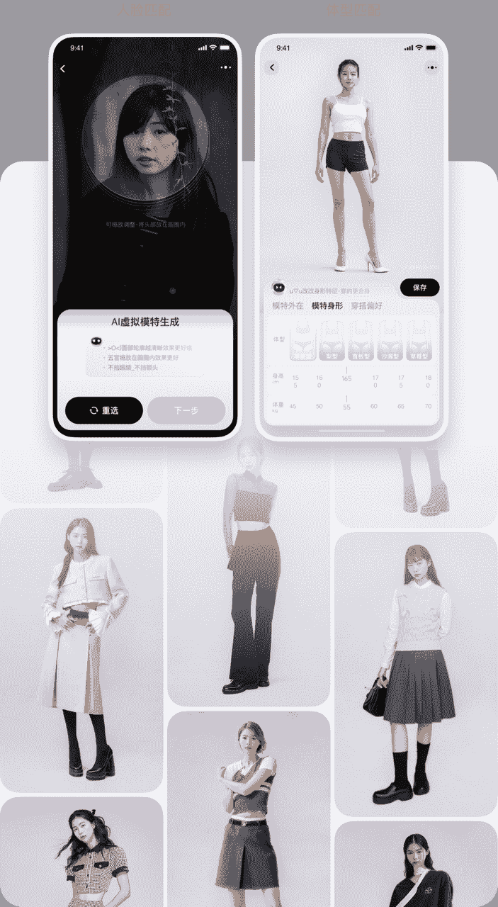

# **01. ****脸部特征**

脸部特征是用户感知模特是不是“我”的首要判断依据，因此脸部特征的像与美是模特合成的基本要求。

在脸部特征的塑造上，设计师通过对多种合成方案亲测，从光线、角度、发型、表情四个维度定义AI虚拟模特基础面容，在用户未录入人脸之前，基础面容作为默认模特面容展现，在用户录入人脸之后，再叠加用户面容经过算法合成进行实时展现。

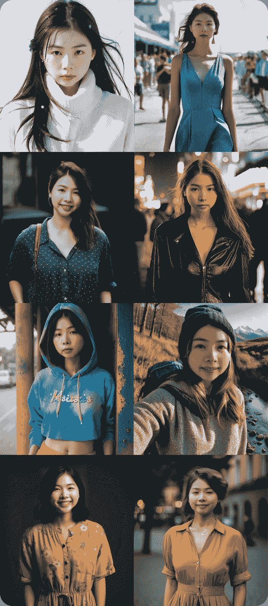

# **02. ****身型特征**

具备脸部特征之后，接下来需要对体型进行匹配合成，体型表达的准确性是服装上身效果真实与否的关键。

为了体型表达的准确，我们需要告诉AI两个信息，一是让AI学会判断用户对应的体型分类，二是让AI理解对应体型特征，最后需要对体型特征进行适当的美化放大，以凸显体型上身效果的视觉感受。

基于对中国男性女性身材BMI分布以及主要身型数据的分析，我们梳理出核心身型分类，然后根据不同身高体重段位的BMI标准对每个身型的三围进行微调，以明确身型特征差异，例如同样都是身高体重为170cm/50kg的女性，梨形身型和倒三角身型在腰胯部的数值差异。通过对肩、胸、腰、臀、手臂、大腿、小腿全方位的差值定义，最终AI结合设计师输出的数据，实线人物模型贴合用户。

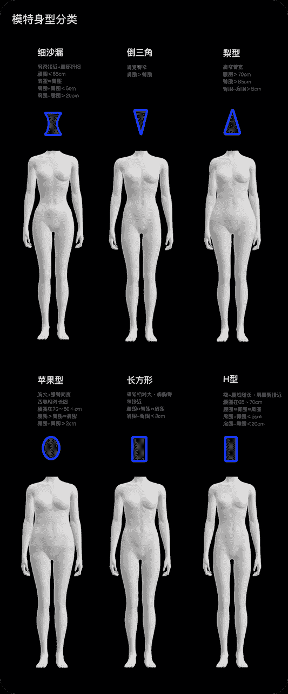

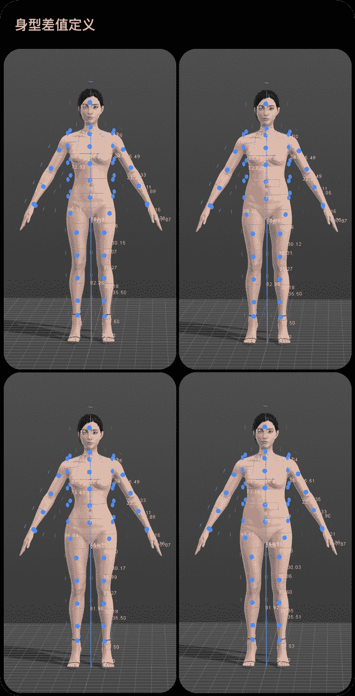

# **03. ****偏好特征**

在贴合用户形象特征的第三个方面，需要通过服装来准确表达用户人设。

过去的技术方案体系，通过固定模版的搭配方式，可以实现不同动作和穿搭的组合，但因为模版数量限制，合成效果多样性一直难以突破。

因此针对不同服饰风格，我们分别从模特动作和搭配方案收集大量素材提供给AI，让AI学会理解不同风格品类穿搭规律，进而针对不同服装进行动作和服饰内外搭配的展现，提升上身效果的多样性。

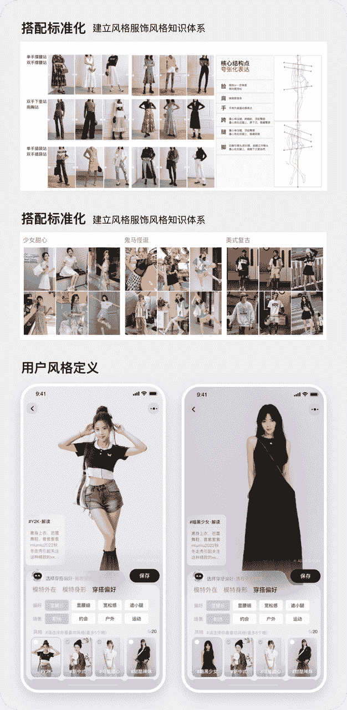

# **04. ****图片质量**

最后，定义完人物形象，还需要基于用户界面的布局和展现效果，对人物大小、位置、输出质量建立体验标准，其中输出质量分别从光影、清晰度、形体畸变、服装合理性四个维度对模特进行检查，最终符合展现标准的图才会在用户端展现。

# **#02**

# **满足用户发现性需求**

**强化搭配互动感知**

# **01. ****框架选型**

在满足用户合适性需求的前提下，我们开始思考用什么样的容器和交互方式来承载内容。

框架的选型我们针对AI的交互特性设计了两种方案，从内容的准确性出发，对话式交互框架通过对用户意图的理解，能够帮助用户准确定位到匹配商品，但这种框架更适用于搜索这种目的性强的导购场景，不利于达成高频逛店的体验目标。

因此，从发现性优先的角度来说，我们认为以商品组合为主的选择式框架更为理想。通过对热点服饰内容的组合，给用户营造一个自由搭配的试衣空间，让用户轻松愉悦的逛起来。

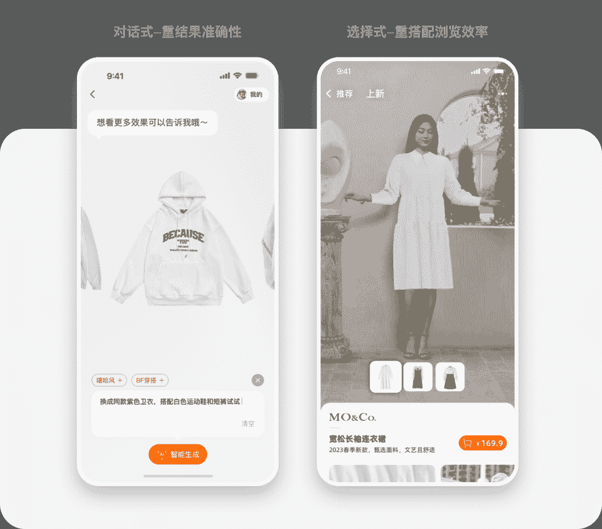

# **02. ****框架设计**

设计方案上，纵向以强调搭配套装发现性为主，根据用户进入试衣间的浏览顺序，自上而下从当前套装到更多套装分层展示，同时在更多套装面板上方设计「换套装」主行动点和AI机器人作为行动强化引导，整体来促进用户试穿更多，达到内容发现广度提升的目的。

在内容发现深度方面，当用户对某套搭配比较感兴趣时，可以点击对应服装上的换装锚点进行单品替换，通过对上下身单品的多样性组合，进一步提升单套搭配风格的单品发现性，让用户试穿更多垂类商品。

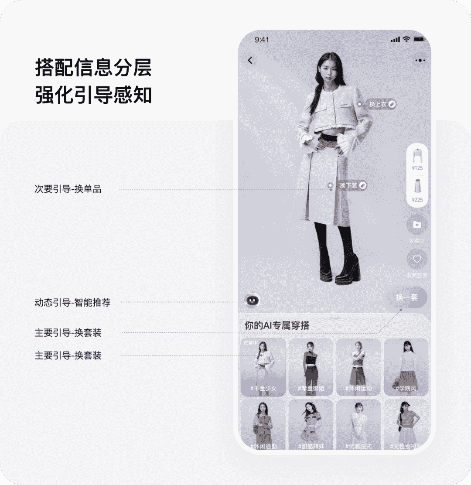

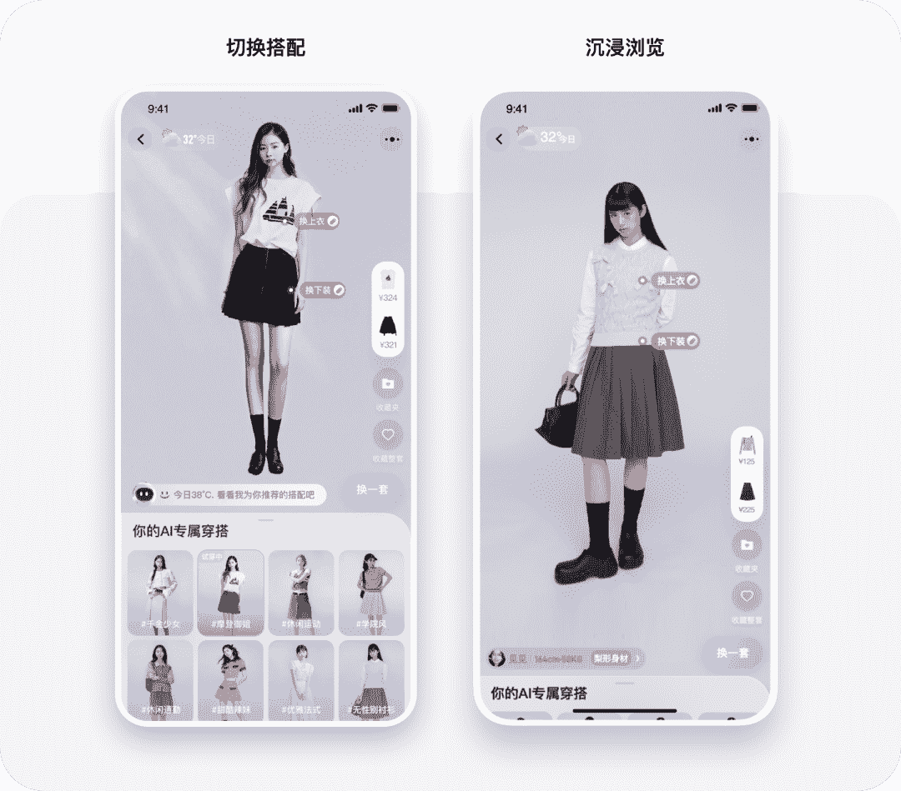

在核心框架定义完成之后，针对试衣间工具属性，还需要让用户能够准确控制内容偏好和内容组织。

在偏好方面，通过AI机器人结合用户行为进行动态判断，当用户对内容点击或换装动作较弱时，判断用户对内容兴趣感较低，此时动态展现修改穿搭偏好的入口，引导用户调整偏好选项，进而推荐能命中内心的商品，给用户传达人性化的温度和情感。

在组织方面，通过试衣间衣橱的功能设计，真正把试衣间作为用户试穿、管理个人服装的中心场景，让试衣间能够自成闭环。

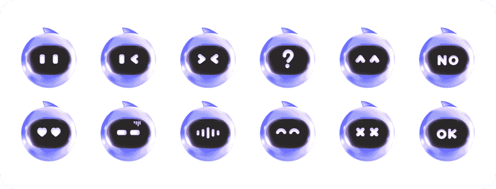

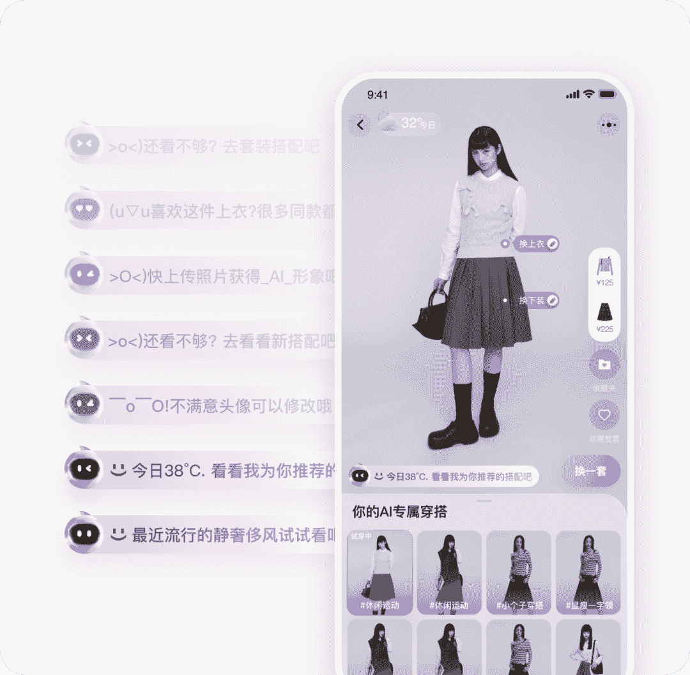

最 后，在链路和营销场景表达上，结合场域目标，分品类、风格进行框架包装和能力分发，让试衣间实现在不同场景解决用户不同问题。

AI试衣间新势力周7大趋势主题延展

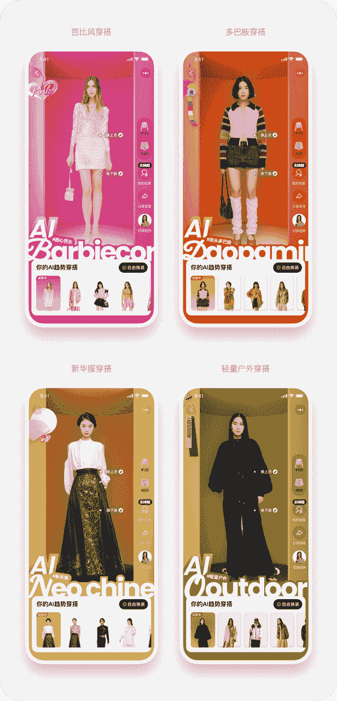

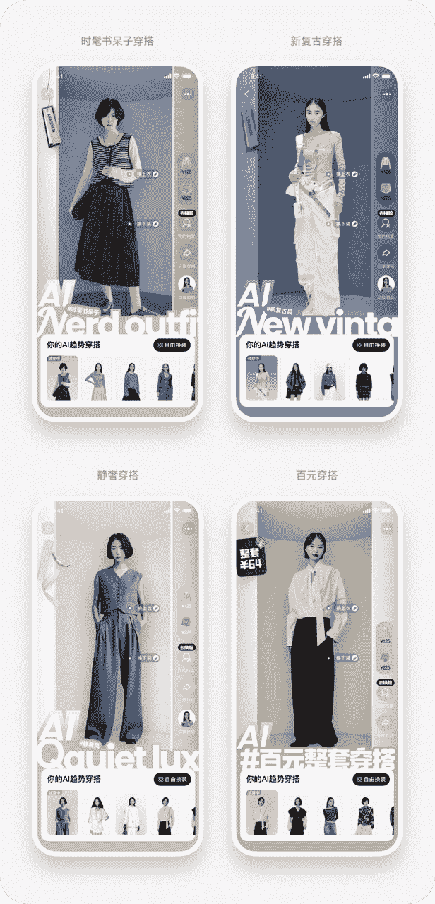

# **AIGC未来应用**

AI模型每天都在进化，结合业务场景我们初步浅尝了AI能力带来的体验变革。

过去，不同品牌间的跨店穿搭效果实现成本极高，只有在核心大促活动中才舍得投入经费制作，曾经被渲染为稀缺性营销内容。 但是今天，AI打破了内容的场域壁垒，内容生产方式正在被重新定义，稀缺的内容变成日常，相信AI能力持续升级后，效果将会无限逼近真实。 在技术升级的浪潮下，AI内容的体验设计同样有无限可能，未来的服饰场景下还有哪些创新，期待我们共同探索。

本期编辑：「服饰运动快消设计」

////// **END **//////

<https://my.feishu.cn/sync/CV7edZp1nspUQobYJhicxeP7nrb>