# 淘宝用AI生成H5活动设计物料

> 来源：[https://my.feishu.cn/docx/Pn2Qd3TCVoPF1zx5zaPcH979n5g](https://my.feishu.cn/docx/Pn2Qd3TCVoPF1zx5zaPcH979n5g)

<https://my.feishu.cn/sync/CV7edZp1nspUQobYJhicxeP7nrb>

> 🔗 原文链接： h[ttps://mp.weixin.q](https://mp.weixin.qq.com/s/5L_lzZIX4h2h07YohQSsYw)q.com/s/5L_lzZIX...

> ⏰ 剪存时间：2024-01-08 01:33:17 (UTC+8)

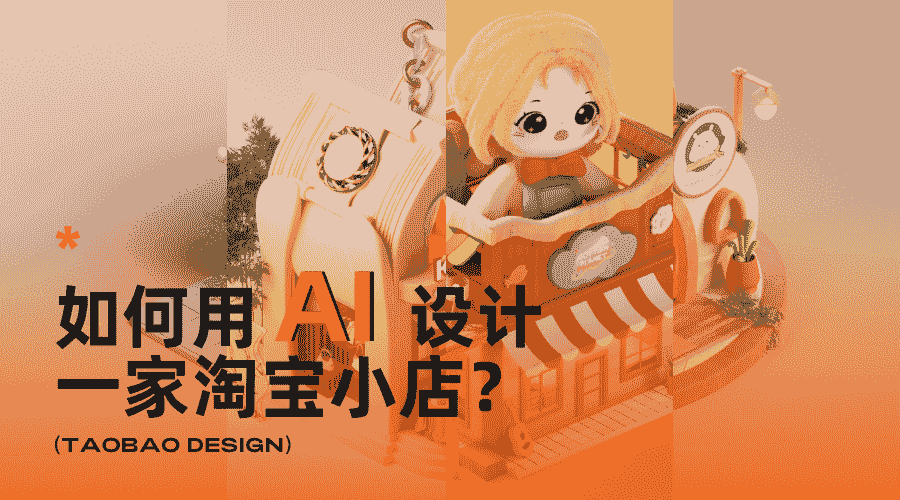

# **#引言 **

# **INTRODUCTION **

**「淘宝一千零一店」作为淘宝**重要的其中的一个品牌IP**，核**心定位为 “特色店铺的内容化IP” ， 线上产品以- 沉浸式「特色3D小店🏠」和「特色店主 🧏 」 为设计亮点 ， 赢得比较深入的用户心智和IP差异化 ， 但是高频次的运营迭代 ， 带来了海量的工作量 ， 设计师需要付出超额的精力来完成运营需求。真的是要累死宝宝了👶🖤。

鉴于AI绘图具有 **「高效快速、低成**本、海量输出」 的特性 ， 而商业营销活动也带有 「高频、快速」 的特点 ，所以 我们把运营设计需求以 制作类型分为A、B两个类型 ， 其中A类型对应的是「特色店」的3D店铺设计 ， B类型对应的是「特色店主」的3D人物设计。

目前使用创意发散性相对较高的M idjourney ， 现已经基本可以完成大部分的创意设计。

**▼ **物料制作类型

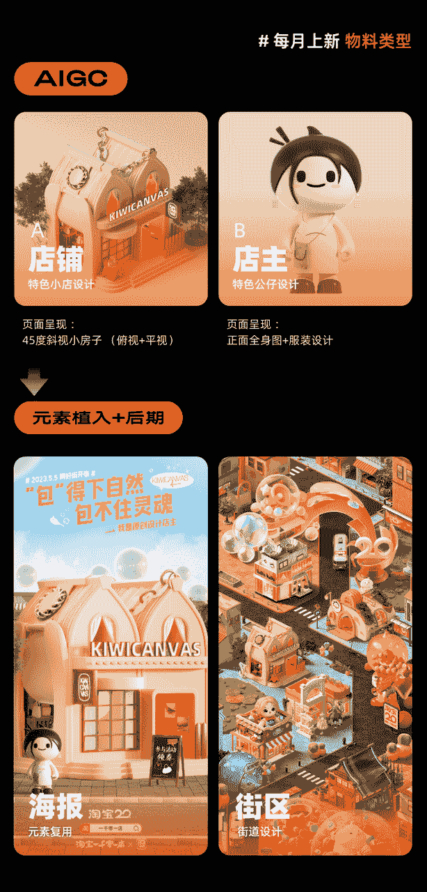

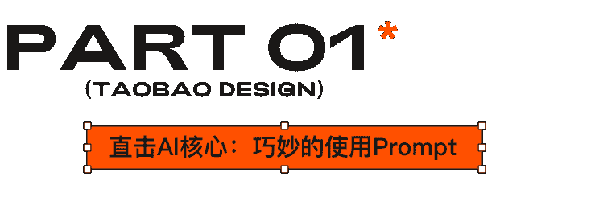

##### **首先我们拿到需求后，利用MJ，将P**rompt「关键词结构」拆解成四个部分：

**▼ **关键词结构

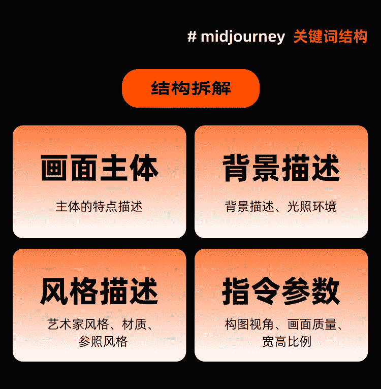

拆到具体案例里，又将其分成三步：

**Step1- **将关键词对应拆解到不同的模块里 ， 比如「一木一叶造景」是一个主打真实水缸造景的店铺 ， 将** 1-鱼缸 + 2-纯色背景 + **3-蓝绿色系&写实 + 4-视角/比例等 ， 具体关键词highlight出来 ， 组成词条 ， 使用MJ进行输出；

**▼ **关键词结构拆解

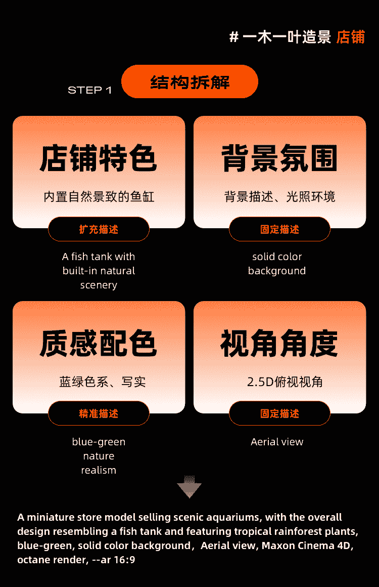

**Step2- ****当得到对应的词条 ， **可能无法立刻得到满意的图片 ， 需要进行 关键词调整+大量喂图 ， 最终得到我们想要的效果图；

**▼ **关键词调整+喂图 **  **

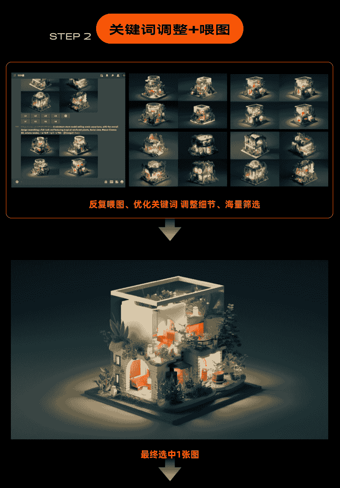

**

Step3-** 拿到效果图后 ， 我们会交接给3D设计师进行模型重建 ， 进一步沟通细节优化，让店铺的特色更加鲜明 ，例如：将店铺二层加入水的设计 ， 突出水族箱的店铺特色，将杂乱无章的草、内置装置进行规整，保持画面的统一和谐。

**▼ **3D优化细节

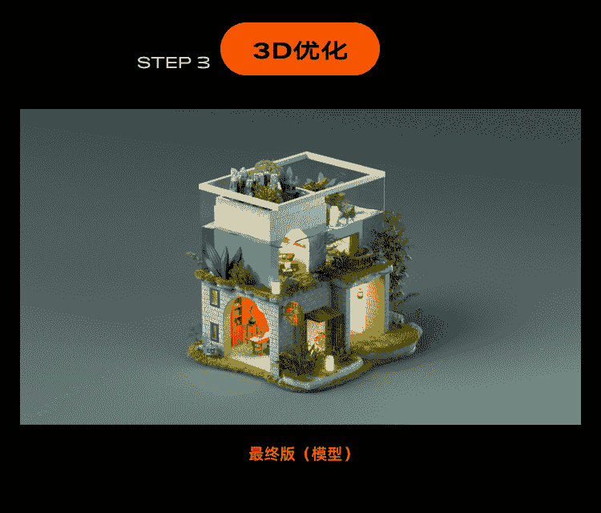

**▼ **特色店主（公仔）- AI制作思路

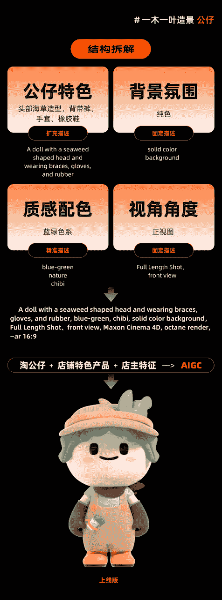

前面铺垫了这么久，是时候放硬菜了 ， 我们第一次开始尝试是在五月份的街区，在618期间逐渐开始大胆使用 ， 不仅大大的节省了我们的时间 ， 并且也获得业务方的好评 ， 可谓是双赢。话不多说 ， 上图🙋。

**▼ **类型A ：特色店铺 - AI设计

**▼ **618期间 ，AI出图细节更多更具体，部分甚至已经达到可直接商用的标准。

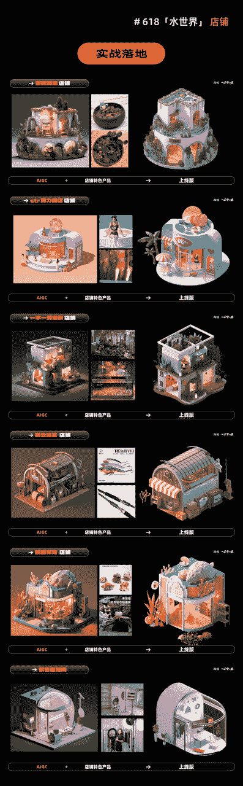

**▼ **类型B ：特色店主（公仔） - AI设计

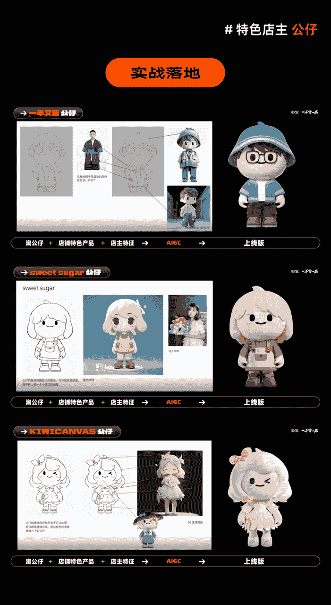

**▼ **最终物料呈现

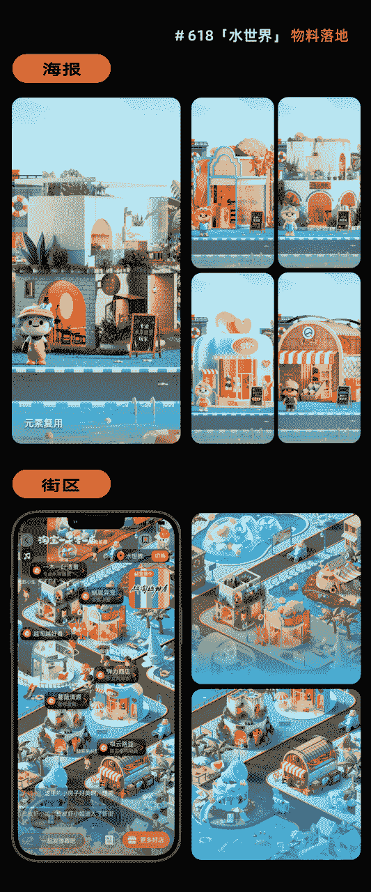

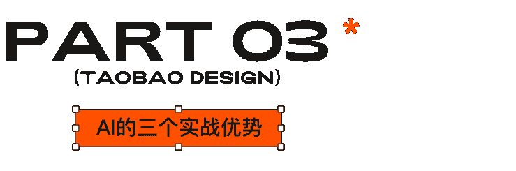

##### **1- 内部提案优势**

每月的运营活动，内部创意设计师需要与市场部多轮的创意提案（🤫多轮battle及撕逼），有了AI辅助后，创意设计师可以更聚焦的完成创意提案。

##### **2- 设计流程节省优势**

**方**案确定后，使用MJ流程直接变为： 创意 - AI - 3D建模，单套店铺从AI到落地只需要4个工作日（原先从创意-插画-3D至少需要8个工作日） ，不仅节省了插画的预算费用，也大大加快了工作进度。

##### **3- 与3D设计们沟通成本优势**

MJ的呈现已经可以非常具体还原bef的呈现效果，对于内部沟通简化上有了质的飞升。👇

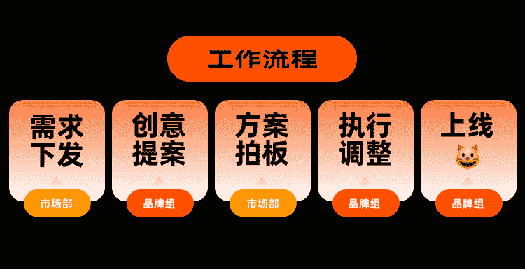

在**A**I不断冲击的当今，对于商业设计师来说也需要迅速的转型和适应环境。在随着深入的研究各种AI工具，AI有可以做的也有做不到的， AI适合做一些具体的、变量少、相对创意要求没那么多高的设计需求， 我们要能实时的改进美术执行方向，才能立刻看到不同效果。 但是对于创意要求极高，变化大需求，AI只能做前期辅助（比如大型KV，视频类、产品交互类）并不能100%承担设计效果，对于高阶的设计师来说，AI其实是更好用的手。

在未来更多产品形态与活动变化中，我们也将会挖掘AI使用场景。更大释放AI的使用能力。

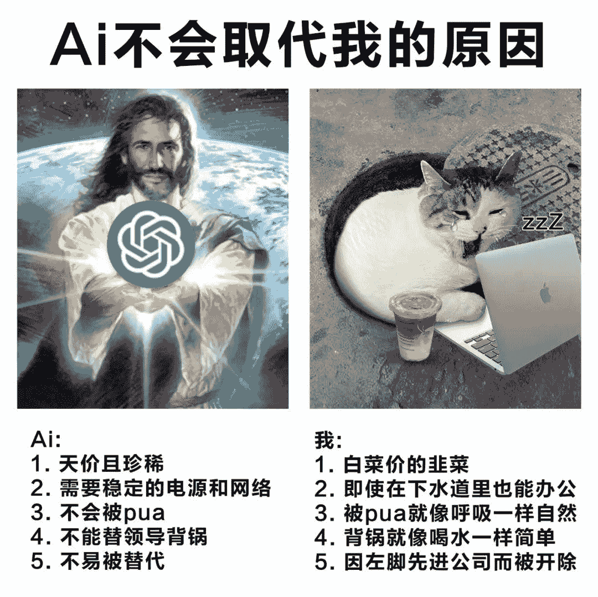

最后，和各位设计打工人共勉👊，将AI变成我们更多可能性的得力助手，加油 ！！

本期编辑：「一千零一店」设计小伙伴们

////// **END **//////

<https://my.feishu.cn/sync/CV7edZp1nspUQobYJhicxeP7nrb>