# 借助AI辅助完成界面UI/UX设计

> 来源：[https://my.feishu.cn/docx/Kf1XdjG6Eo34RIxEl9Rc3BSJnYd](https://my.feishu.cn/docx/Kf1XdjG6Eo34RIxEl9Rc3BSJnYd)

<https://my.feishu.cn/sync/CV7edZp1nspUQobYJhicxeP7nrb>

> 🔗 原文链接： h[ttps://mp.weixin.q](https://mp.weixin.qq.com/s/WrXaDioG2goIcBTjft-VwA)q.com/s/WrXaDioG...

> ⏰ 剪存时间：2024-01-08 01:34:41 (UTC+8)

「从技能维度分析，你会UI/UX设计吗？」

「UI/UX设计这些能力...」

设计界的风总是一波未平一波又起，从区块链到元宇宙，最近因为ChatGPT的热议，又让 设计师到底会不会被AI取代的讨论甚嚣尘上。

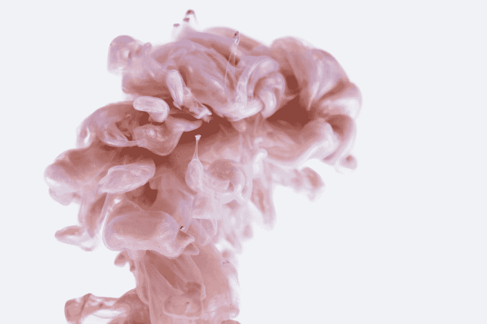

▴ credit: Pawel Czerwinski on unsplash

# #01

# **它会设计界面**

对于AI来说，比起频繁出错的人物手指绘图，UI/UX界面的数据更加好分析，框架、组件、易用的按钮位置等等，都是AI构建界面的依循逻辑。

像Midjourney原先由AI 艺术项目实验室打造出来的生成艺术工具，在席卷插画界的同时，也有不少UI/UX设计师探索从输入文本到图像生成界面的应用方式。

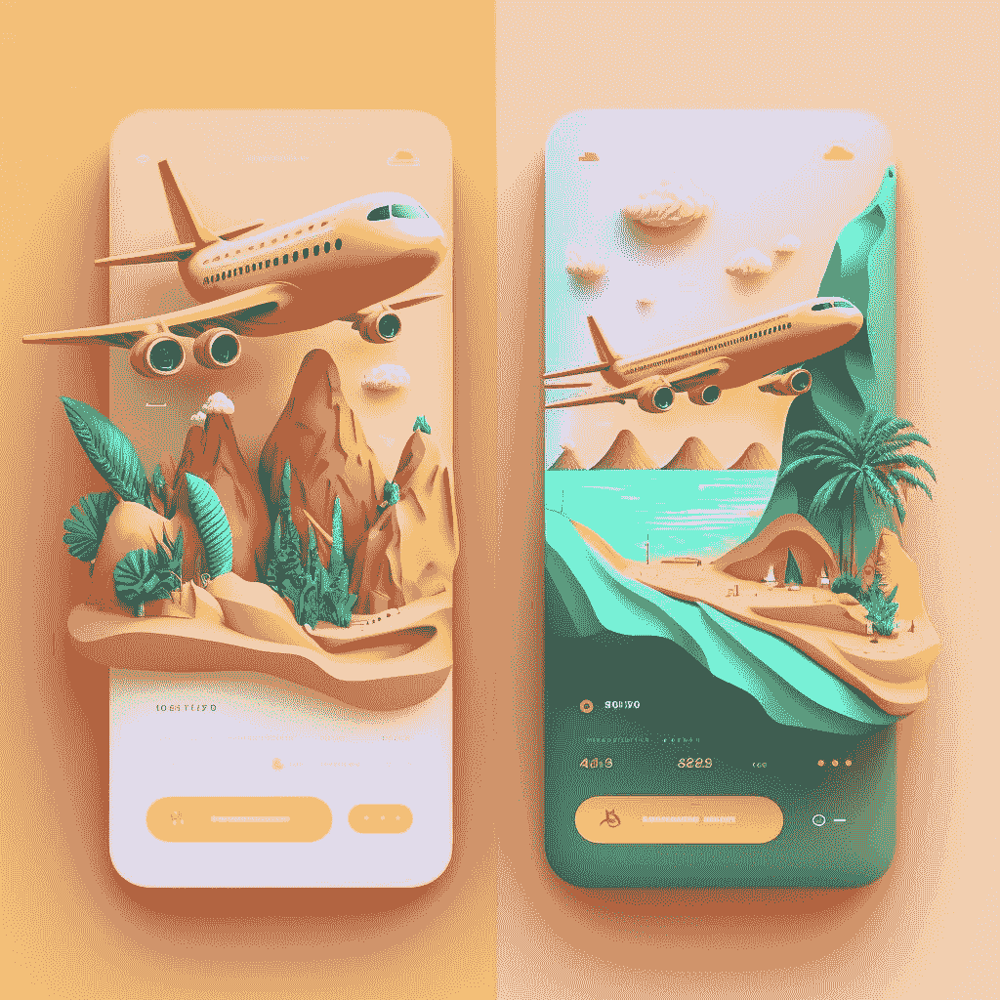

▴ 旅游APP由 Davis Taylor Brown 基于AI生成

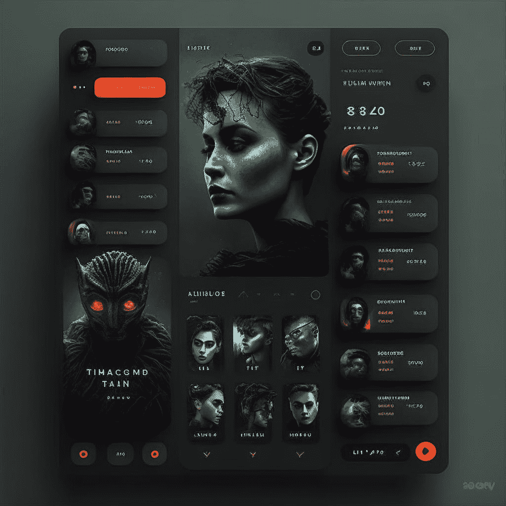

▴ 电影APP由Davis Taylor Brown基于AI生成

当然，AI是基于现有的数据库，各取所长输出符合指令的图像，这涉及到版权问题。

但这类型仍在发展早期的工具已经明显地展现出潜力，设计师在灵感启发、概念探索阶段使用，能够轻松生成并快速获得视觉创意的各种参考选择，过去可能需要一周甚至更多的调研时间。

现在，只要按下按钮，8小时的工作缩短成喝口水的时间。

作为**UI/UX设计师，我们可以通过Midjourney**提供的各种广泛界面启发创意、参考视觉、测试框架等等，当然在方案收敛阶段，作为人类我们仍旧要重新绘制成可交付的界面档案，并 确保方案符合商业目标以及“以人为本”的有效易用原则，来向最终使用者呈现出原创、好用的体验。

看到这里，作为设计师的你是不是喘了口气？

等等，这里有个Figma插件呢。

与Midjourney生成艺术图像不同，Galileo作为UI/UX设计师常用工具Figma的插件，可以直接通过适当文字指令生成可编辑的界面档案。虽然现在仍未开放试用，但通过前Dropbox CEO的背书获得了设计界大量的关注。说不定哪天你的产品经理都开始用上了呢。

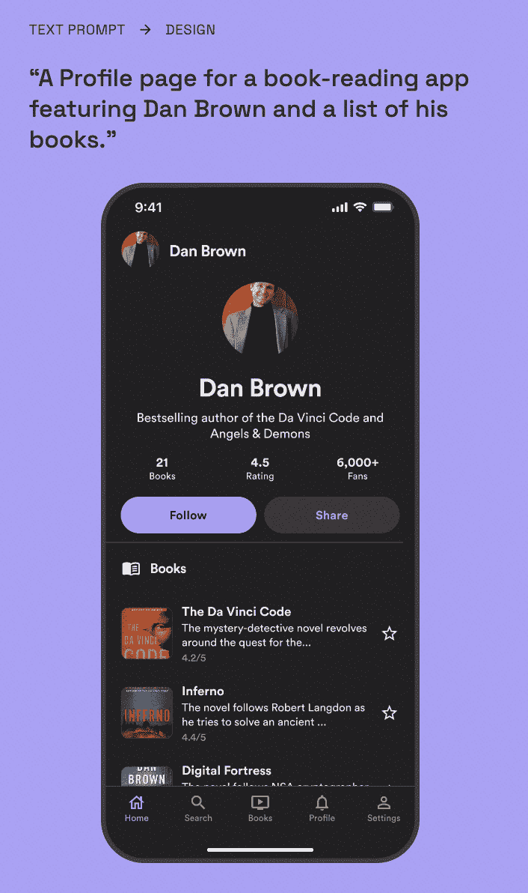

▴ www.usegalileo.ai

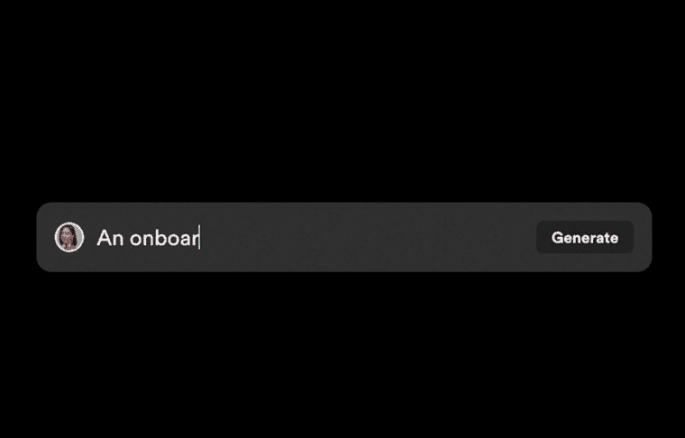

▴ www.usegalileo.ai

除Galileo以外，Figma社区萌生大量AI应用，当下习以为常的基本功训练，很有可能将被浓缩成工具指令。

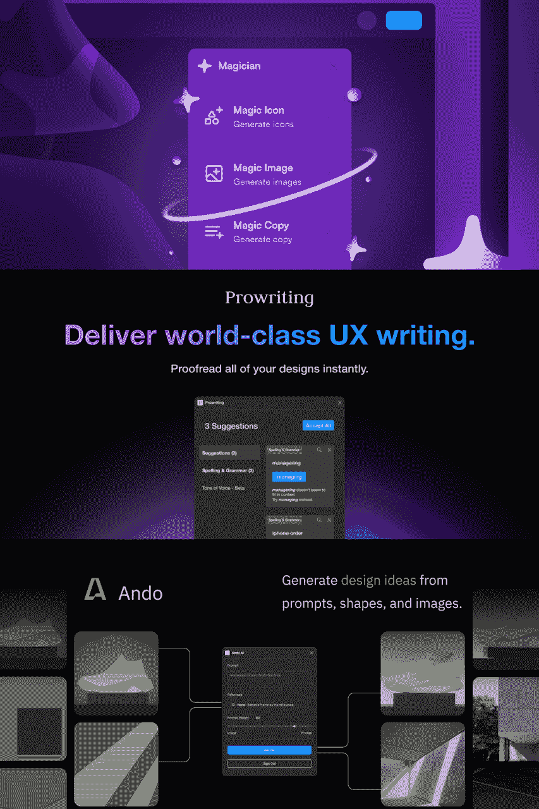

▴ AI画图标、写文案、生成图片

# #02

# 它会做设计迭代

连梦龙的母公司都在使用 **AI做设计迭代。**

你可能在超市买过卡乐比这个牌子的薯条零食，但你应该不知道，看似挺传统的实体设计行业也受到AI的影响。

Plug AI是2014年由市场调研公司与包装设计公司合并转型为数据服务的公司，卡乐比通过其研发的“Package Design AI”系统，经过眼动分析以及消费者满意度预测，调整包装设计师原版设计（下图右侧黑字版本）。经过调整后正式推到市场上，达到了超过一倍的销售额增长，吸引雀巢、森永、联合利华（梦龙为其旗下品牌）等大公司使用。

该公司目前正预计推出品牌设计、品牌识别到应用拓展的服务。

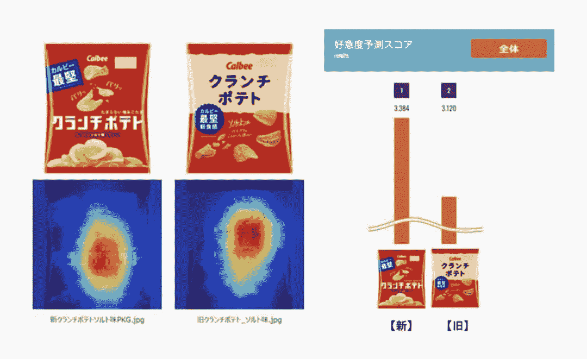

▴ Plug AI为日本零食大厂提供的测试服务

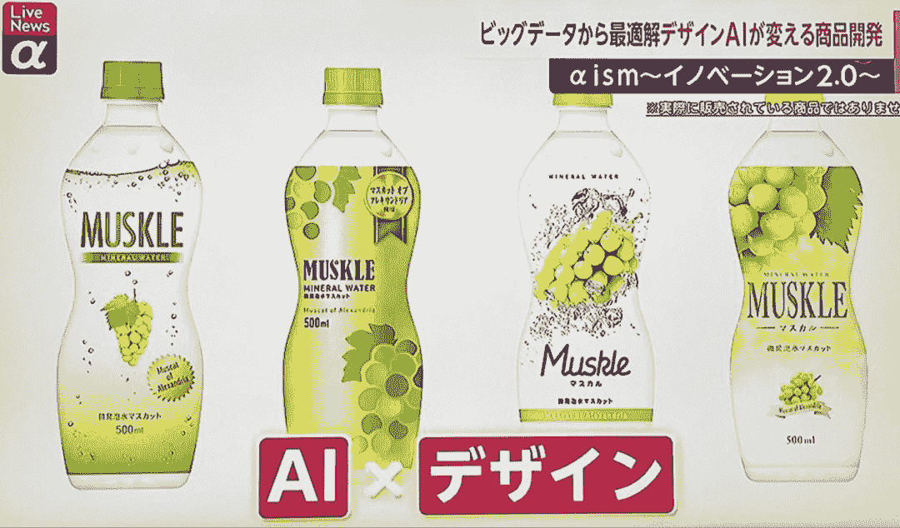

▴ Plug AI基于千万笔数据已可分析生成包装设计

# #03

# 它符合商家需要

缓一缓，上面的UI/UX介面跟包装设计AI工具，都需要设计师最终调整，更多是对设计起到较大的参考意义，设计师还不用太担心会被取代...

真的吗？虽然确实部分设计师是不会失业，但是 AI真的会促使一大批设计师转型。 为什么会这样？你看看下面这家公司提供的服务就了解了。

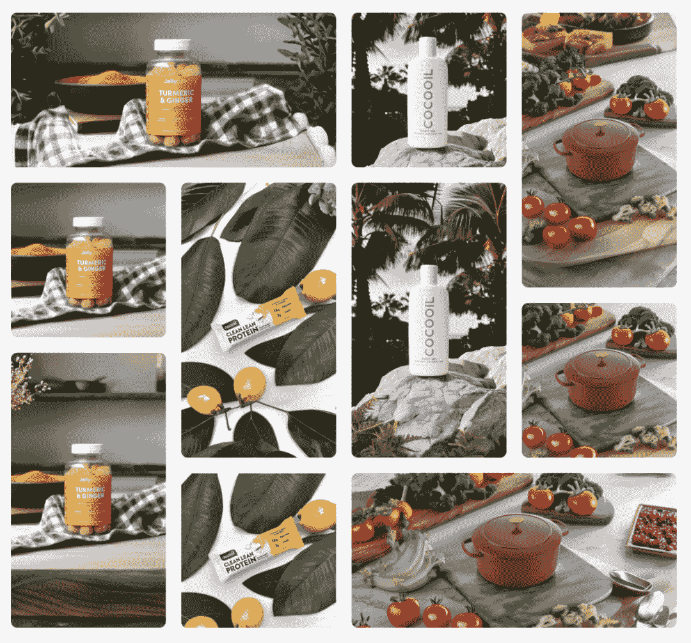

▴ pebblely关于数十种渠道尺寸拓展范例

Pebblely与Midjourney都是通过文字指令输出图像的AI服务，但与Midjourney最大的不同在于， Pebblely满足了商家对终端宣传渠道图片质量的要求。

通过提供产品PNG搭配你想销售的氛围及元素描述，就可以合成多张光影、透视都合理，精致度达到可以直接使用的图像， 如上图呈现，对于不同渠道尺寸的差异都在Pebblely的服务范围内。

AI极大的压缩了劳务性质的工作内容，比如对静态产品图项目，摄影师不需要花费大量时间布景；对电商店铺设计师来说排版、拓展似乎也是一瞬间的事情。

#

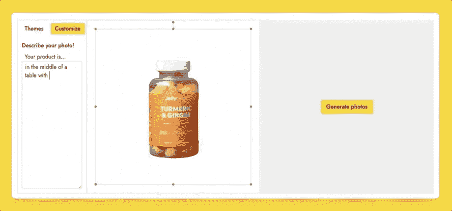

# ▴ pebblely.com

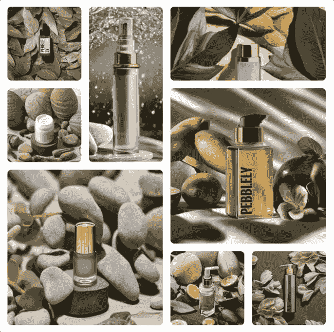

# ▴ pebblely.com

#

# **#04**

# **它能满足99%的人**

对大众消费市场来说，绝大多数人接收到的信息是文字、图像、界面、视频等实际媒介，他们不会去关心当下消费的内容背后的选题、切入点等，这些需要人类费心思的部分。

我们可以在博主所长bibabo《指南｜4个免费AI，不露脸也能做颜值博主？》视频中看到，他演示了如何通过ChatGPT、Midjourney、D-ID、Mubert四个免费对公众开放的AI工具从脚本、台词、形象、配音生成、音乐生成，输出一个带配乐的虚拟人谈话视频。

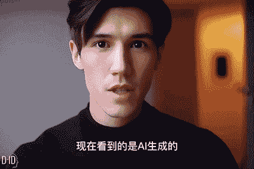

▴ credit: 所长bibabo on xhs

这感觉已经比起许多博主更显得专业吧，而且人们通过这套流程可以低成本大量输出观点，甚至会有不明所以的人们误解，对社会带来一定的冲击。

而我们从本文提到的AI工具来看，AI生成绝对已不是科幻小说内的幻想。

# **“ **人工智能是人类需要做出的最后一项发明 。 Machine intelligence is the last invention that humanity will ever need to make.

- Nic Bostrom，牛津大学人类未来研究所的创始主任，以研究人类增强伦理学、超智能风险闻名的瑞典哲学家。

从Bostrom的观点来看，似乎认为人们的创新能力将终结在人工智能真正被发明出来的那一刻。

而联合国教科文组织也提到了，继互联网和移动互联网引发第三次工业革命之后，以大数据驱动的人工智能技术正在推动第四次工业革命，这可能会撼动全球平衡。

# **结. 但AI不了解人类**

AI没办法创造新东西，它是规律跟分析的产物。

如果对需求理解得不清晰，对AI下的指令偏差的话，即使在1小时内能生成数千套方案，也是不能满足人们的需求，达到提升体验的目的。

作为设计师我们不能抗拒时代与科技的巨轮，就如同百年前驾驶马车的车伕，难以设想到现在几乎人人都可以考取驾照开车上路。

AI无法直面一位连自己都不清楚自己想要什么的用户，而设计师的存在就是以人为本位，挖掘并定位用户痛点，并以美观简单的方式解决问题。AI有知识但不等于有智慧。

我们不会被取代。

工欲善其事必先利其器，设计师可以利用AI降低劳务性工作，为真正需要钻研的问题费功夫，或许是商业理解、或许是团队管理、更可能是 创造一个从0到1的新鲜事物。

# “ 重要的是ChatGPT是个工具，它的输出应该是提供人们作为进一步完善和编辑的起点，而不是直接用于最终设计。 It’s important to note that ChatGPT is a tool, and its output should be used as a starting point for further refinement and editing, rather than being used directly in a final design.

- ChatGPT它这么说 。

本期编辑：Hales Tsai

////// END //////

<https://my.feishu.cn/sync/CV7edZp1nspUQobYJhicxeP7nrb>