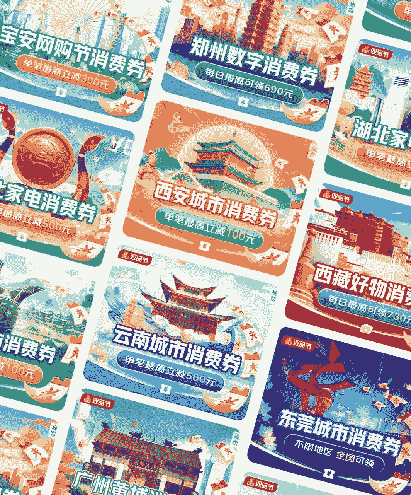
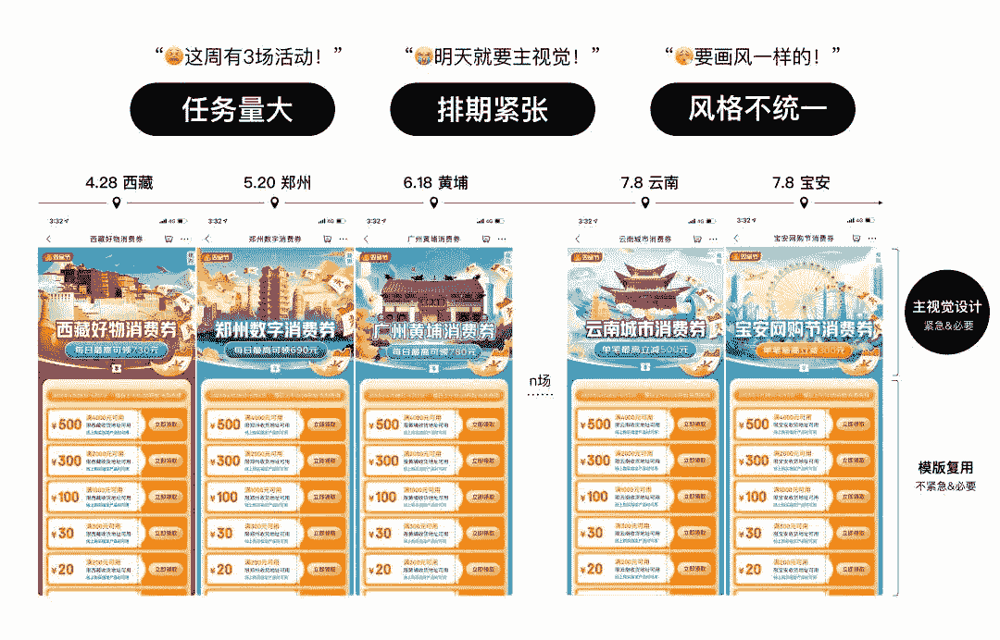
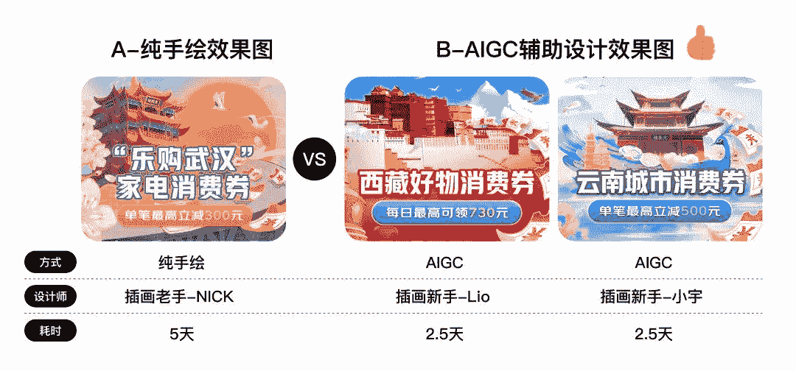
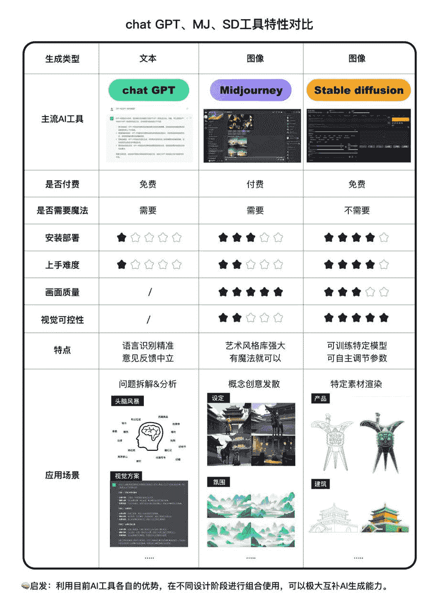
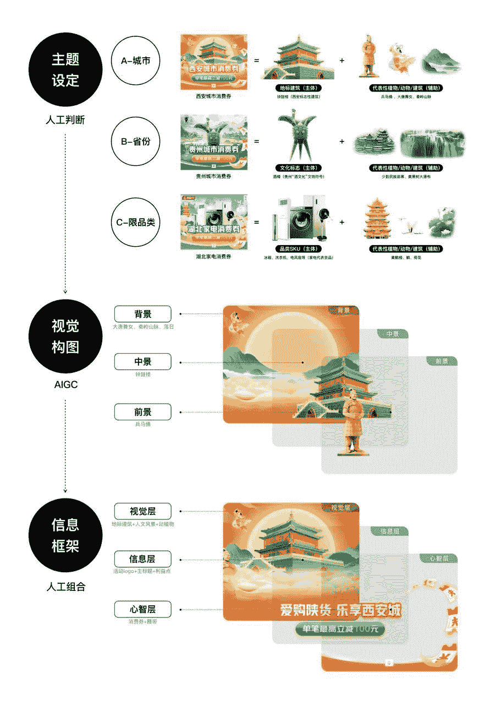
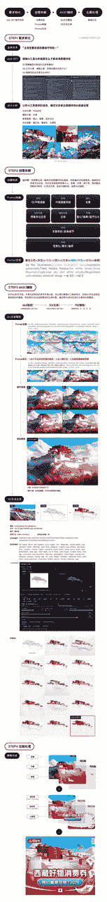
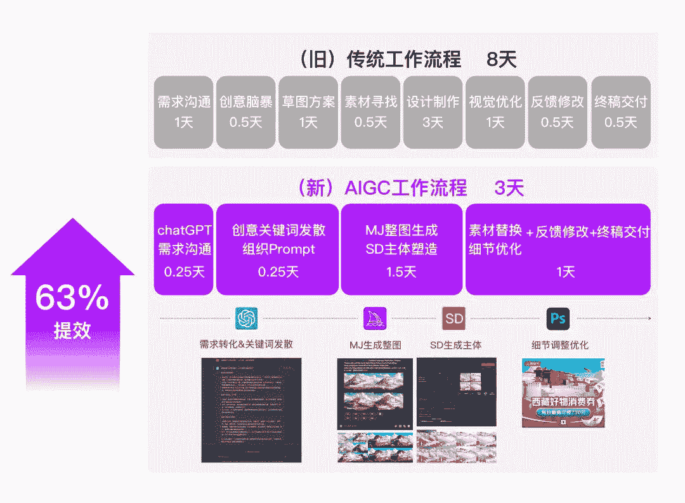
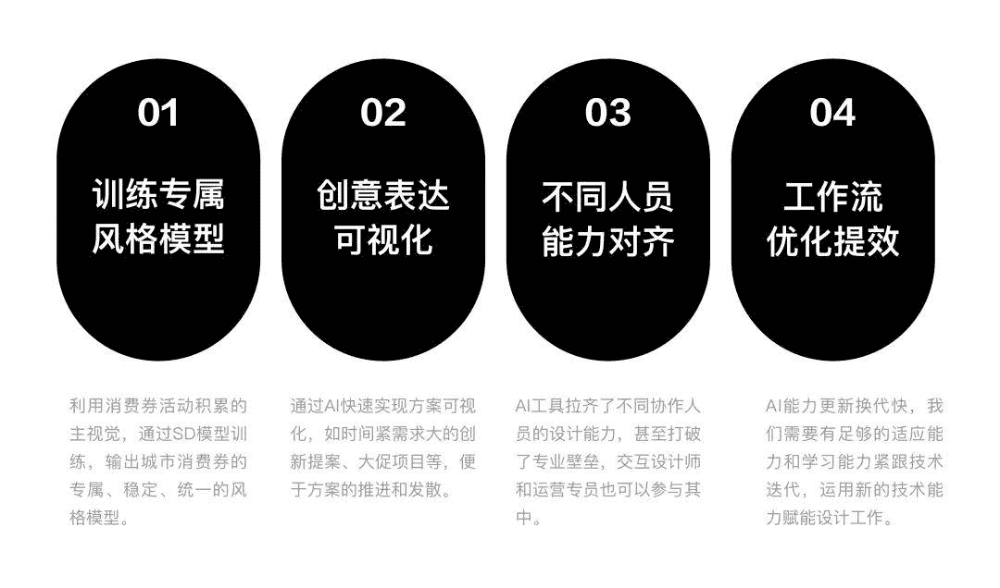

# 京东城市消费券项目AIGC实践

> 来源：[https://my.feishu.cn/docx/Pyc0dgDOho8LyIxuTk2cN1tCn7d](https://my.feishu.cn/docx/Pyc0dgDOho8LyIxuTk2cN1tCn7d)

<https://my.feishu.cn/sync/CV7edZp1nspUQobYJhicxeP7nrb>

> 🔗 原文链接： h[ttps://mp.weixin.q](https://mp.weixin.qq.com/s/WiY6AyM_89MNsLu4ibn-QA)q.com/s/WiY6AyM_...

> ⏰ 剪存时间：2024-03-14 16:02:14 (UTC+8)

随着AI图像生成技术的高速发展，以Midjourney、Stable diffusion为例的AI工具引起了大家广泛的研究和应用浪潮，也印证了早期流传在AIGC圈的一句话“任何行业都值得用AI重新做一遍”。面对时代趋势，团队早在22年底就开展了AIGC在「电商行业领域」的研究和探索，旨在运用新技术帮助团队提升工作效率和质量，高效地解决业务难题。

**01 业务背景**

23年初我们团队接到城市消费券的业务需求，业务同学希望快速推动支付券向东券转移，通过产品及活动页面运营，以及技术上对核销率的监控等手段，优化消费者体验，同时提高消费券核销率。留给我们设计团队的难点:1.【高频次运营活动】全年预估活动场次达到60场，单期活动所需素材量大，平均每周都会有1场活动上线，需要团队内多名不同能力设计师的协同配合；2.【消费券心智较弱】用户无法第一时间了解到活动城市、活动力度等有效活动信息。在城市消费券项目中，团队大量工作主要在主视觉设计上。综上需求难点，AIGC刚好可以解决城市消费券KV“任务量大”“排期紧张”“风格不统一”的问题。

**02 AI技术探索**

为验证AI技术在实际项目中的落地可行性 ，前期团队做了大量的对比测试，邀请插画设计熟练度不同的设计师进行对比。发现加入AIGC辅助设计后，不仅可以解决了“要好看”“明天要”的焦虑，还可以“感觉是一个风格”。

我们对市面上流行的AI工具进行了学习探索，发现不同AI工具存在很大的区别，各有优劣势，让我们用一张图来看看他们的区别：

**03 解决方案**

由于城市消费券业务的特殊性，经常存在城市和省份之间代表主体元素“冲突”的情况，例如：武汉消费券和湖北消费，黄鹤楼是武汉的标志性建筑，可是用黄鹤楼代表湖北，会存在一定认知风险，会造成部分用户误以为是武汉消费券，只有武汉地区可领，而导致用户流失。另外，有时业务方还会有一些品类的诉求，所以我们进一步对视觉主体进行规则设定，来解决消费券整体的统一性和彼此的差异性：a、城市：地标建筑（主体）+代表植物/动物；b、省份：文化标志（主体）+代表植物/动物；c、限品类（根据业务诉求）：品类SKU堆图（主体）+代表植物/动物。

**AIGC帮助了我们什么？**

在城市消费券项目中，借助现阶段AIGC能力，帮助团队解决了“快速出图”和“风格统一”的问题，得到以下几点启发，并希望可以借鉴到其他业务线中，更高效地赋能我们的业务。

<https://my.feishu.cn/sync/CV7edZp1nspUQobYJhicxeP7nrb>