# 对话AIGC艺术家聊聊商业设计

> 来源：[https://my.feishu.cn/docx/Tbltdi3wRoSqiixqDIpcW0Uanwb](https://my.feishu.cn/docx/Tbltdi3wRoSqiixqDIpcW0Uanwb)

<https://my.feishu.cn/sync/CV7edZp1nspUQobYJhicxeP7nrb>

> 🔗 原文链接：https://mp.weixin.qq.com/s/MIwiMvU6rQSVoV9-0l_0Zw

> ⏰ 剪存时间：2024-03-14 18:35:23 (UTC+8)

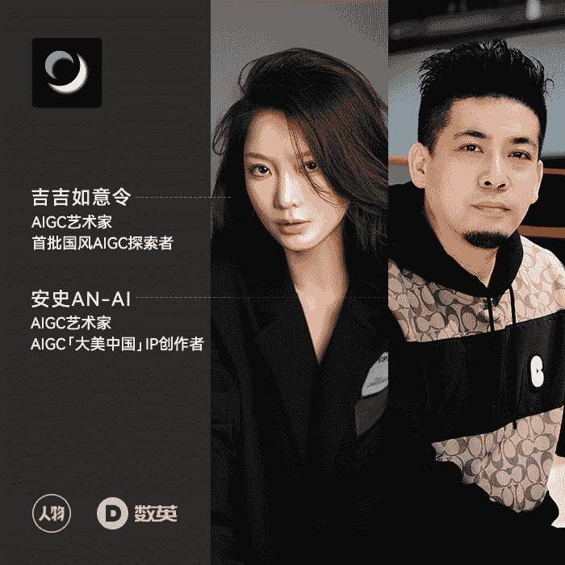

在追求降本增效的今天，AIGC的速度无疑刺激着人们的神经。

三秒生成一幅3D渲染图，五秒生成一段高清视频。创作门槛被无限拉低，创意标准却水涨船高。高效的AIGC，成为批量生产内容的工具，滋生大量单一审美内容，想要打破这一内容同质化困境，有两种解题思路——

1、从产品出发，直接从底层模型突破。国内AIGC应用奇域AI，就选择了这种方式。在被西方审美占据的AIGC市场，通过专注挖掘中式美学、东方文化，探索出一片商业蓝海。

2、从创作者出发，向内挖掘个人特质，沉淀审美风格，再辅以商业模式，形成良性的创作循环。

最近，我们注意到两位AIGC艺术家，他们借助奇域AI，沉淀出创新且成熟的创作风格，并在商业市场大获好评。

@吉吉如意令：借奇域创作，达成与央视、读者杂志等大型商业合作。

@安史AN-AI：用奇域沉淀个人IP，半年时间变现超过百万。

在2024年的开端，我们邀请到这两位AIGC艺术家，与他们一起聊了聊AIGC与中式美学，在当下商业市场中的机遇与挑战。

文章较长，内容足够有料！建议先收藏，再阅读！文末还有丰富福利！

## 一、@吉吉如意令

### 热爱中式美学的大学设计老师 带学生走向中国AIGC市场的商业蓝海

目前，AIGC创作者的商业模式，大致分为三种——

第一类，直接售卖自己的内容，比如常见的AI头像、AI壁纸。

第二类，沉淀个人风格，将内容IP化，寻找商业合作机会。

第三类，是知识付费，把内容整合成学习课程，授人以渔。

有趣的是，@吉吉如意令 （以下简称吉吉）不属于以上任何一种，她更像是三种类型的混合甚至变种。

作为大学老师，她最初尝试AIGC完全是出于好奇，选择中式美学更是因为热爱。

我没有刻意地将自媒体做得很垂直，因为我想要的是通过平台，让更多人看到多元的中式美学。

有人形容，吉吉的账号是中式美学灵感宝库，找不到创作灵感，就来吉吉这里看一看。她的内容涉猎广泛，从山水到神话，从水墨到刺绣，几乎囊括了所有中式风格元素。

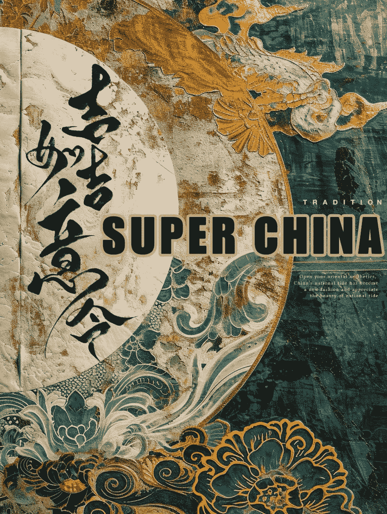

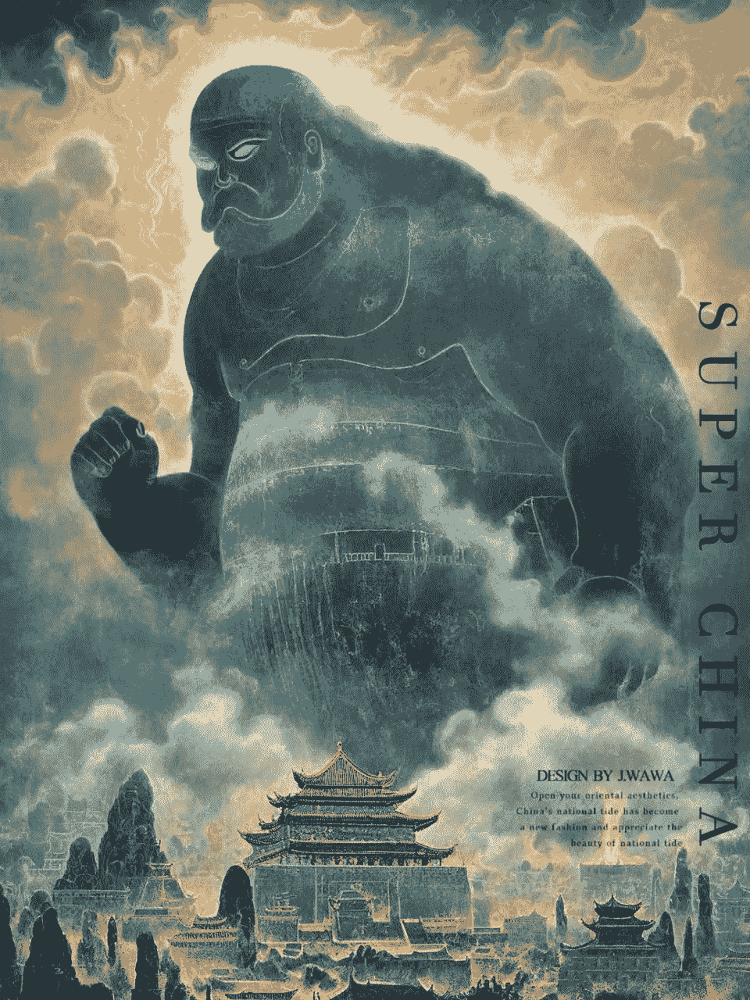

@吉吉如意令 奇域AI创作

《中式审美探索丨【山海经】举头三尺有……》

但吉吉没想到，虽是无心插柳，却引来了许多重量级商业合作。吉吉意识到，中国AIGC市场是一片商业蓝海，她想更进一步，为学生做探路者，深入中国AIGC市场挖掘机遇，激励更多人进入商业蓝海。

### 1、打通AIGC设计工作流，就能走在浪潮最前

AIGC运作的底层逻辑，是在深度学习大量数据的基础上，进行组合与模仿，这使它天然具备两大优势：极高的创作效率，和海量的知识积累。

而当它应用在具体的领域，会激发出更大的潜力，比如，打破职业壁垒。

这一点，吉吉在商业实践中，深有感触。去年9月份，吉吉的作品登上《读者》杂志的封面。没过多久，又听闻她与央视合作了一个敦煌项目，涉及平面、3D多种类型。

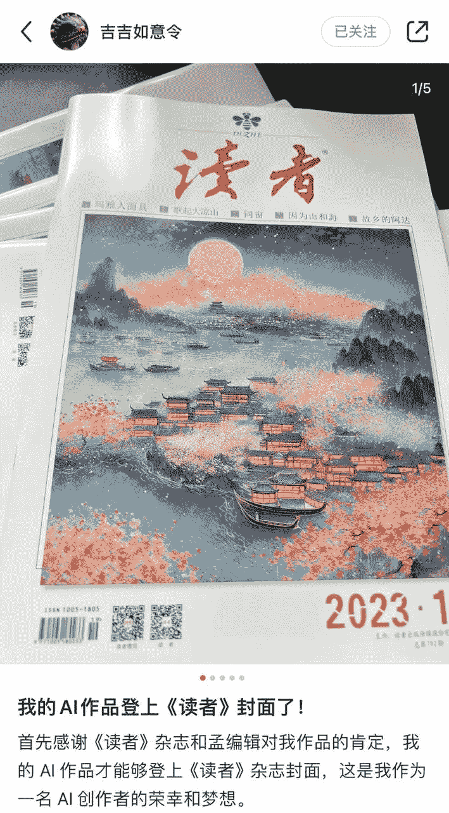

封面图片由奇域AI制作

这些来自大型文化媒体与官方机构的合作，验证了中式风格AIGC内容在市场的认可度。而我们也想了解，是什么为吉吉带来了这些商业机会？

**数英**：AI创作赛道的竞争日益激烈，而你的作品不仅登上过读者杂志封面，而且还与央视有过合作，是怎么做到的？

**吉吉**：央视的项目是一带一路主题，他们卡在一个关键点，恰好看到我用奇域做的一系列敦煌主题作品，便有了这次合作。他们需要数月落地的项目，我用AI极大的缩短了工作时长。

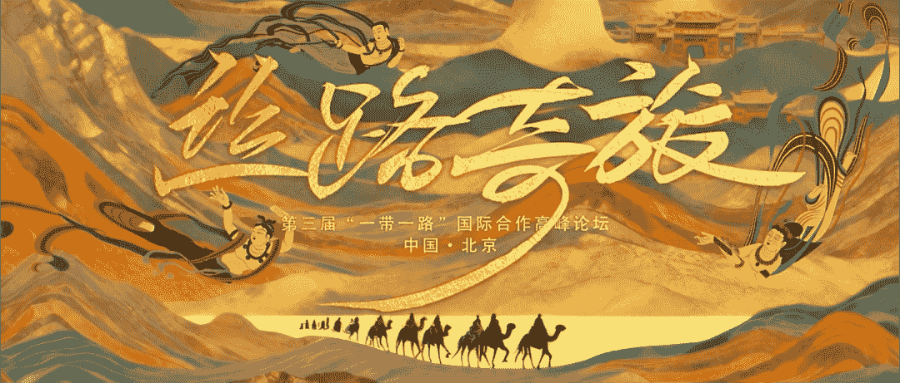

@吉吉如意令 奇域AI创作

读者杂志，也是他们的编辑主动找到我，来询问合作。

回看这几次合作，当时以为是偶然，其实都有迹可寻。我使用AIGC已经很成熟，风格相对稳定，而且无论3D、平面、产品，我都能做，所以很多合作才得以落地。

商业合作需要稳定的技术，成熟的风格。前段时间，一位国货护肤品牌的设计师，在奇域社群向我询问合作方式。

我很奇怪，为什么品牌有会用AIGC的设计师，还要向外找创作者？

他告诉我，因为一直在传统的设计流程中，他们没有时间去训练一个成熟的风格，改变工作流程。

这其实就是机会，谁先驯化AIGC，打通设计工作流，就能成为领先者。

数英：打通设计工作流，具体指的是什么？

**吉吉**：打通细分专业壁垒。

早期设计师都是多面手，一个人完成一个项目所有设计，比如盖房子，他会负责全程，从地基规划、建筑结构，到室内装修，连地毯花纹都要把控。后来，市场专业要求变高，设计职业细分到多个领域，有了建筑设计、室内设计、产品设计。

俗话说，隔行如隔山，很长一段时间一名装帧设计做不了室内设计，但在AIGC出现后就不一定了，知识面足够广的人，有机会利用AI重回多面手市场格局。

当然，这也要整个市场对AIGC有更成熟的意识。我有过一次合作，把内容交给客户时，他们还以为这是草图，因为我用的时间太短了。

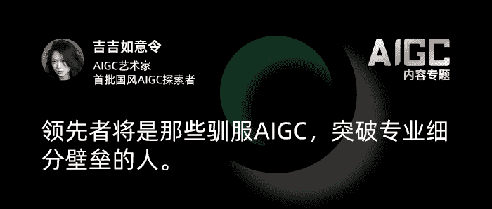

数英：在你看来，市场对内容风格、主题有偏好吗？你的哪类作品比较受欢迎？

**吉吉**：我不够了解市场趋势，只能说，在我的作品中，一些特点突出，甚至有些小众的中式风格很受欢迎。

我偏好暗黑、玄幻色彩的风格，所以创作了「山海经异兽录」系列，刚发布没多久一个茶商就买下来一整套图。

不过，不同创作者喜好不同，还是要多沉淀自己的风格，找到自己的受众。

数英：方便透露AIGC出一张图的定价范围吗？

**吉吉**：几千，上万，甚至更多，浮动比较大，有一点可能会让很多人意外，部分有市场的AI设计作品，通常定价高于传统设计。你会发现，AIGC出现后，市场的定价与工作量不再直接相关。AIGC的市场潜力，可能远高于我们的预期。

说白了，还是看作品本身在市场中的商业价值。我一个学生的AIGC作品，已经卖到了5位数，那个项目是与国外的合作，给明星做宣传设计。我带出来的学生，比我变现能力还要高，作为老师真的挺开心的。

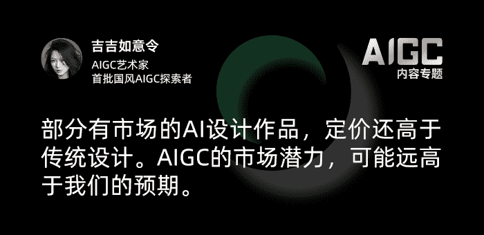

编者按：常有人提到，能够取代人类工作的，从来不是AI，而是会使用AI的人。

这一点在设计工作中尤为明显。传统设计工作要在图库中，大浪淘沙一般寻找素材，还要应对琐碎的设计流程。AIGC的出现，能代替设计师去完成部分琐碎的任务，让设计更专注于创意本身。

### 2、被模仿者追赶：成为中国AIGC艺术家，永远要比别人向前一步

在采访中，我们问吉吉，她对中国传统文化的兴趣是从什么时候开始的。

吉吉说，中国传统文化贯穿着她的成长。从小学习国画和书法，大学后学习西画与设计。她曾担心自己不够专精。遇到AIGC后，却发现“杂学”竟成了优势。因为了解东西方不同的技法与风格，更容易将它们融会贯通。

就这样，吉吉成为了国内最早一批，用AIGC探索中式美学的自媒体创作者，我们好奇的是，她源源不断的灵感来源自何处，又如何让AI为自己所用，实现心中所想。

**数英**：注意到你从2022年底，就开始用AIGC创作中式美学作品，到现在一年多的时间，你的作品一直围绕其中，创意几乎没有重复，怎么会有这么多灵感？

**吉吉**：盗图的人，催我奋进，哈哈。

我用AIGC，最先尝试的是刺绣，那时没有版权意识，后来粉丝说，我的图被国外的人盗用，我开始给作品加水印。

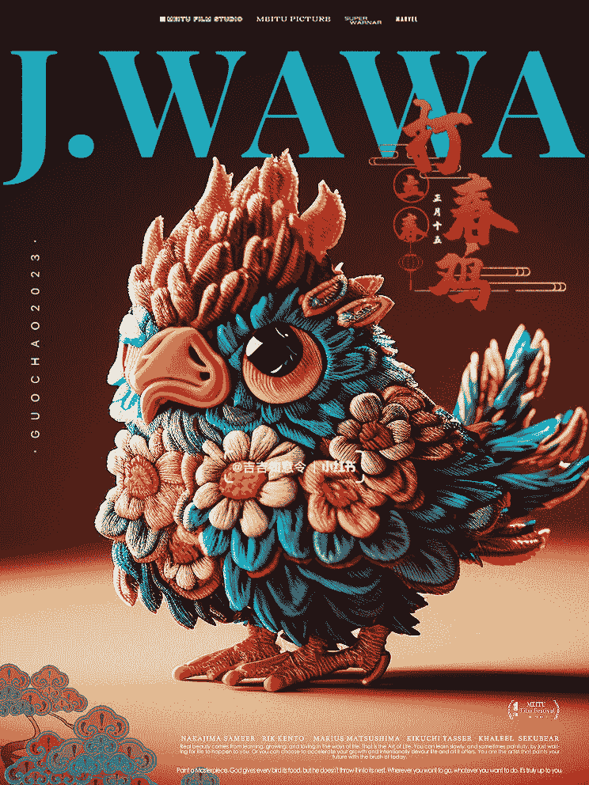

@吉吉如意令 Midjourney创作

《中国传统刺绣系列丨立春风俗—打春鸡》

我不介意别人拿我的作品，只要不是商用就没问题。但是，看到他们说刺绣是自己国家的，性质就不同了。当时想到中国的非物质文化遗产被外国抢占，我的胜负欲就上来了。

AIGC是一个全球性的竞争领域，审美是唯一评判标准，而审美的背后是文化。我想，必须要做得比抄袭者更好，让人们看到中国文化的更多面。所以，我总是向前一步，做别人还没想到的。

数英：怎么样才能总是向前一步，和别人拉开距离？

**吉吉**：一是深挖中国文化这座未尽的宝库。二是以新视角，看待旧元素，就能迸发新意。

比如，很多人把水墨看作技法，钻研把国画模仿得更像。但水墨不只是技法，也是风格，也能成为内容主体。沿着这个思路，我创作了《创意水墨》系列作品。

@吉吉如意令 奇域AI创作

《中式审美探索｜【水墨兰亭】水云间》

@吉吉如意令 奇域AI创作

《中式审美探索｜【创意水墨】 墨染》

《拼贴山水》的思路是同样的，很多人画山水，我就思考，能不能用一种偏现代的技法表现山水意境。

@吉吉如意令 奇域AI创作

《中式审美探索丨【重构国风】空山》

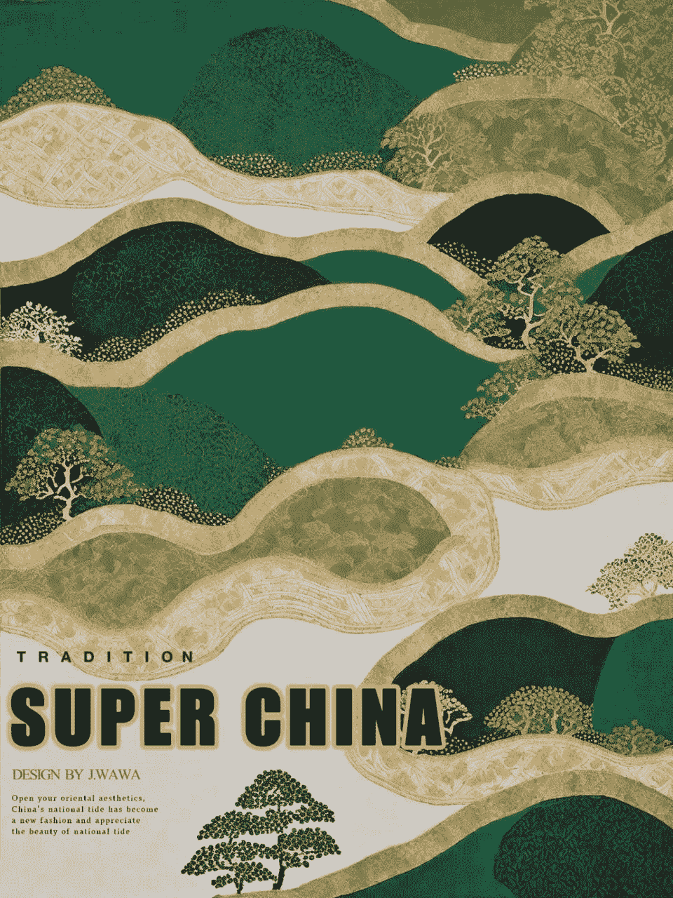

@吉吉如意令 奇域AI创作

《中式审美探索丨【重构国风】茶园稻陌》

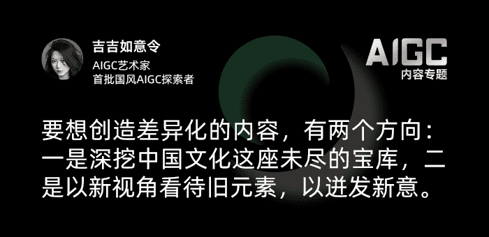

**数英**：我们知道AIGC是基于庞大的数据库模型，你认为AIGC如何表达中国画里面的意境？它能理解中国绘画里深邃的哲学吗？

**吉吉**：首先，理解意境的人，不是AI。AI是用来帮助你表达形的。所以我反倒觉得数据很重要，因为中国画讲究以形写意，有了“形”才能有“意”。

我最早用Midjourney创作，但内容总是欠缺一点感觉，因为它经常把东方元素混在一起，比如，我输入汉服，它可能会出现和服。所以出来的“形”总是不准确的。

我后来发现了奇域，它是一个专门做中式美学的AIGC应用，对中式风格的识别度很高，尽管初期不是很稳定，但是对中式韵味把握很准确。

比如敦煌，Midjourney有可能会画出来石窟，但画不出中国人眼中的敦煌。因为在我们眼里不只是地理意义上的敦煌，而是一种“色与空的美学”，一种在虚实结合和光影交错间，呈现出的文化幻想。

这里就需要工具的强大，以及人的选择。

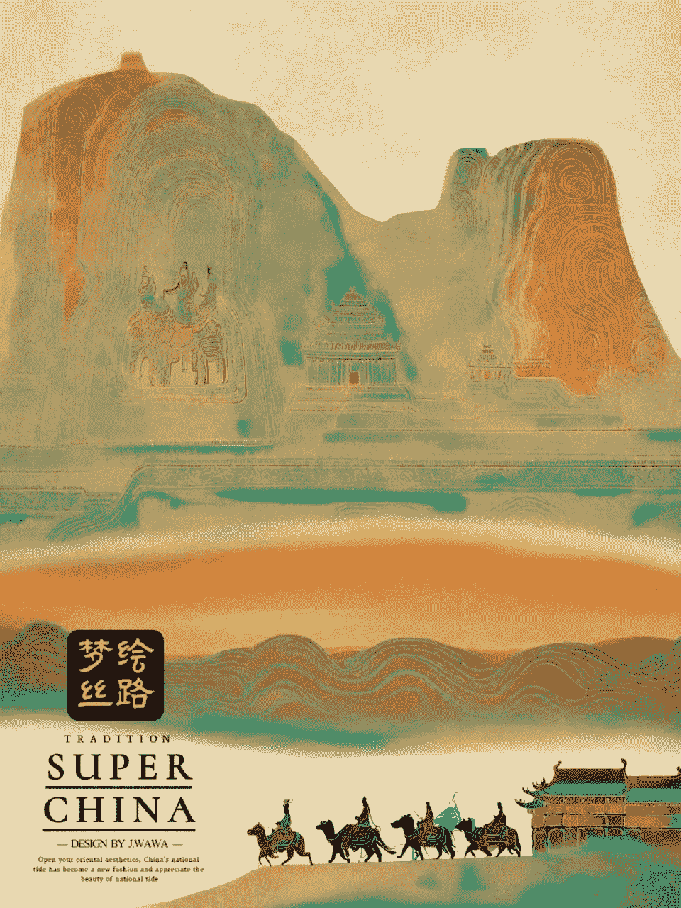

@吉吉如意令 奇域AI创作

《中式审美探索｜【敦煌色彩】色与空的美学》

**数英**：很多中文都有多义性，有很大的想象空间，比如，最近很火的上海话“不响”，它表面上是不置可否，后面还有一层暗潮汹涌。

**吉吉**：没错，中文语义有内在逻辑，也有想象空间。但对创作者来说，更关键的是，中文是母语，我们用母语表达想法，自然比英文更流畅，如果用中文AIGC能做出好效果，何乐而不为？

这也是我主要用奇域的原因，它对中国的创作者更友好，能够读懂中文，也能表达出背后的文化想象，虽然有时候不太稳定，但反而给我很多惊喜。

我把山海经中的怪物描述放进奇域，比如“上古奇兽，遁生于幽冥”，奇域会发挥它的想象力，创造一种“幽冥”的感觉，给予我更多灵感。

我常跟学生说，眼界决定设计，AI储存了海量的人类知识，蕴藏着无数种可能性，就看你能不能把它发掘出来。

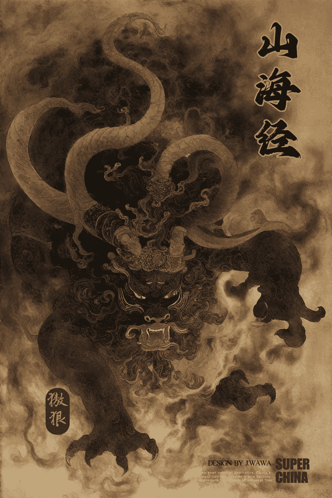

@吉吉如意令 奇域AI创作

《中式审美探索 | 【山海经异兽录】 獓狠》

编者按：满足了物质基础后，精神满足成了人们的新追求，文化认同感变得尤为迫切。中国元素的挖掘与发扬，几乎是这一代中国人的课题。吉吉的创作驱动力来源于此，但她的使命还不止于此。

### 3、把AIGC带入大学课堂：拒绝职业危机，带学生迎AI风口向前

吉吉不仅是国内第一批探索AIGC与中式美学结合的创作者，也是国内最早一批在大学课堂讲授AIGC的老师。

AIGC在国内大规模应用不过两年，已经走入大学课堂，这让我们好奇其中的原因。

数英：当时是什么契机，让你决定开设AIGC课程？

**吉吉**：教育是面向未来的，老师一定要有前瞻性，出于职业敏感度吧，我们很多老师，都一致认为AIGC对于学生未来的职业发展是非常重要的。这个课对我自己也是挑战，因为几乎没有参考，所有的教案都从零开始。

当下AIGC还不够成熟，人才市场已经出现大量的需求，将来也是不可估量，我现在的期待，是能为市场培养更多AIGC人才。

**数英**：AIGC出现之后，很多设计师都有职业危机感，你的学生是什么态度？你如何帮他们面对这种危机感？

吉吉：可能和你们想的不一样，在我们专业，很多学生还没意识到AIGC的影响，只有一小部分在积极地去探索，但也有已经吃到红利的学生。

有的学生会产生职业危机，我告诉他们，设计最终以人为本，用户体验感是最重要的，这是以人类共情力和理解力为基础的，AI无法代替。另外，我们也会在AIGC课上教AIGC操作方法，我会着重培养学生终身学习的意识，让学生学会与AIGC共同成长。

有人说大学生用AIGC是走捷径，在我看来，AIGC是检验学生创意思维和专业能力的利器，只是作为老师，得能看出来，他的作品是不是走捷径抄袭。

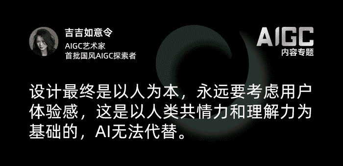

编者按：从人类学会使用木棍开始，工具使用能力和理性思考，一直处在最为重要的位置。而AIGC的出现，人的感性能力，如共情力和审美力被无限放大，让人从工具使用者中解放，重新回到创造者的角色。

## 二、@安史AN-AI

### AIGC时代，审美是竞争力也是生产力

AIGC出现前，掌握信息差，是许多人获得第一桶金的方式。

AIGC出现后，在储存了人类上千年知识的AI面前，信息差、知识壁垒不再有效，所有人都能轻易获取知识与技能，此时能拉开距离的不再是信息差，而是属于个人的独特事物。审美，是其中之一。

在和@安史AN-AI（以下简称安史）的对话中，他提到：

AIGC时代，好的审美能直接 转化为生产力；

反过来，审美通过产品落地，也可以更好促进东方文化的传播。

作为一个有20年房地产广告经历的从业者，安史利用自己的广告思维，将创意技能迁移到AIGC创作中。

在一年多的时间内，全网粉丝接近五万，商业变现更是超过了百万。 如今他毅然裸辞，开启了全职AIGC的生涯，但过去20年的经验，仍让他受益。

### 1、用广告思维做AIGC绘画：产品内容化，内容产品化

当我们翻看安史作品，被他的审美所惊艳，他用简洁的现代风格，传递出东方的意境。既符合现代人的审美，又表达了独特的韵味，安史在商业市场上的受欢迎程度，是可以预见的。

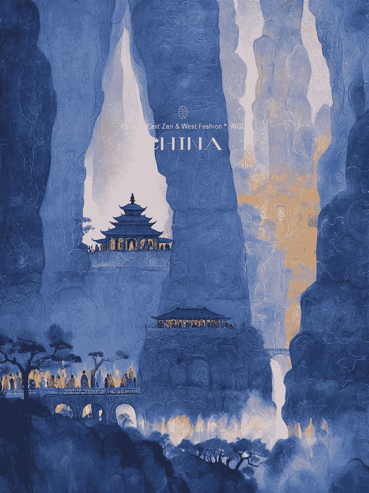

@安史AN-AI 奇域AI创作

《大美中国丨梦回麦积山》

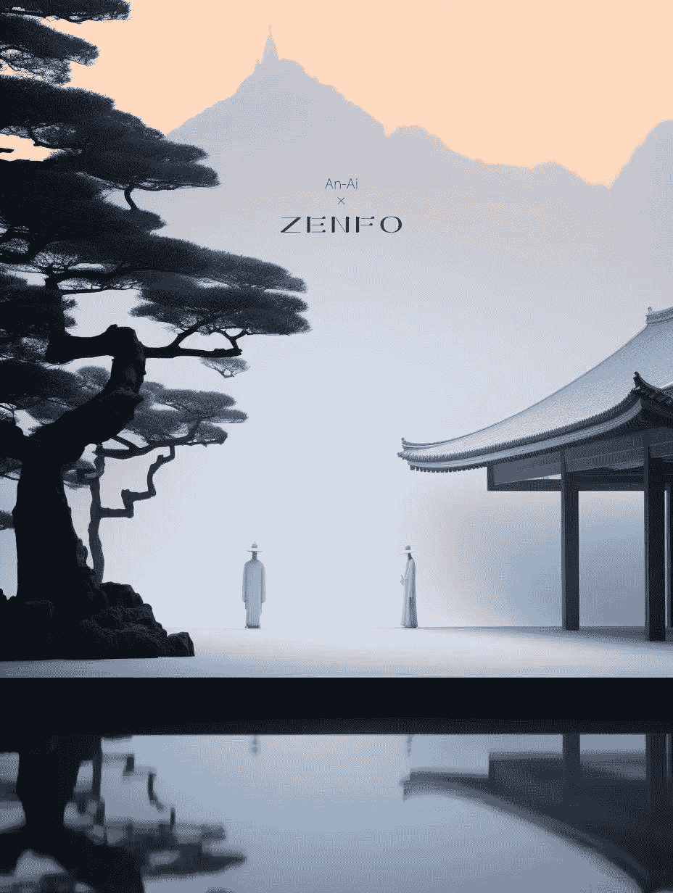

@安史AN-AI Midjourney创作

《禅意东方|梦里江南》

与吉吉相比，安史的作品有着一致的视觉风格。然而，当一种成熟风格流行起来后，很容易就会成为AIGC的养料，引来大量的模仿者。我们很好奇，安史如何去应对这一现象。

**数英**：你的风格很成熟，又有商业市场，如何才能避免被抄袭，建立自己的壁垒？

**安史**：短期可以吃技术红利，不是所有人都会用AIGC。但技术会进化得越来越便捷，技术门槛很快就消失了。

实际上，唯一有门槛的就是你自己的创作能力，不断自我迭代，用内容来建立壁垒。

另外，还要找到一个可持续的主题，一直做下去，深化成自己的IP。这是我一直做「大美中国」的原因，一是出于兴趣，另外也是为了与其他人拉开距离。现在搜「大美中国」，几乎都是我的作品，它已经被标记了姓名，这就是很强的护城河。

之后，我还考虑把「大美中国」做成一个更大的平台，邀请创作者们一起加入进来，在线下也会有展览、产品的落地，从方方面面拓展它的商业价值。

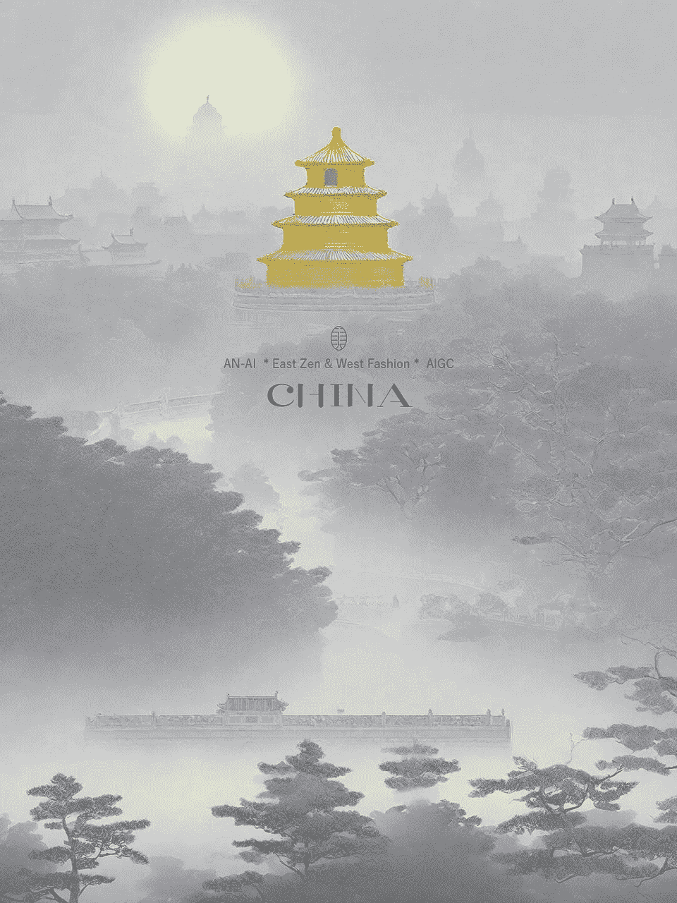

@安史AN-AI 奇域AI创作

《大美中国丨京城烟雨》

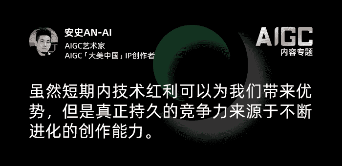

**数英**：感觉你很有IP意识，这就领先一步了。我们在看你的作品时，也发现你有明显的广告思维，在日常创作中，你如何给自己“下brief”，展开创作的？

**安史**：这个问题关乎我的定位，一个是商业定位，一个是内容定位。

我的商业定位是，做对B端有价值，C端喜欢看的内容。

对B端有价值，就是指先品牌一步，发现人群洞察，想好落地方式，也就是把内容产品化。

比如“我佛慈杯”。当时我在灵隐寺玩，发现寺庙变成了网红打卡点。当时我就想，如果在这里开一家咖啡，它的杯子会是怎么样的？

接着，我会思考如何吸引用户？不仅要实用，还要有情绪价值，也就是把产品内容化。

我沿着这个思路，给自己下了一个brief，作出了“我佛慈杯”，关联年轻人情绪需求，后来一家咖啡品牌邀请我一起，做出来了实体产品。

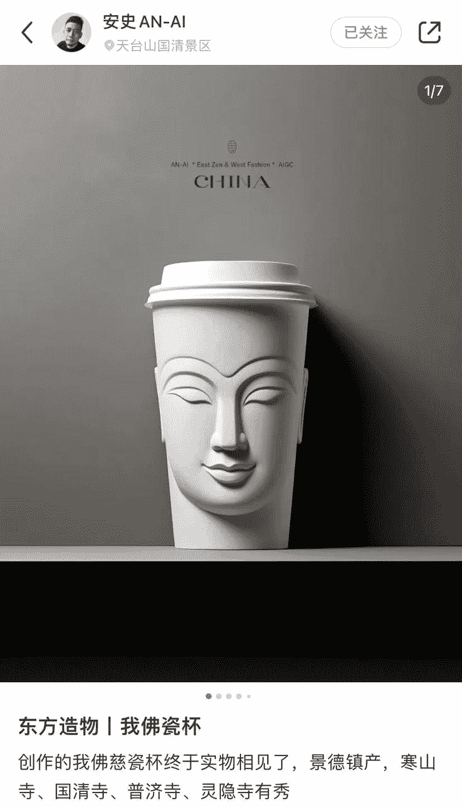

数英：商业定位是面向B端，用C端验证，那内容上的定位是什么？

**安史**：虚构的真实。AIGC能在真实场景上，增添一些想象力。在此之上，我更进一步，思考如何用它勾起大家的兴趣，形成传播事件。

比如说，我做一个时尚品牌的长城大秀。早在十几年前，老佛爷卡尔·拉格斐也做过长城大秀，但没关系，这反而让我虚构的真实更可信。

我想让品牌看到，过去可能要花几百万、周期几个月的品牌事件营销，今天我通过AIGC能够很高效的完成。

今年，我也做了在云冈石窟、布达拉宫的大秀，把时装走秀这种现代的商业事件，与我们中国的历史古迹融合在一起，从内容上看就比较有新意。

这一系列走秀作品，让我收到平遥国际时装周的合作，算是种瓜得瓜，种豆得豆。

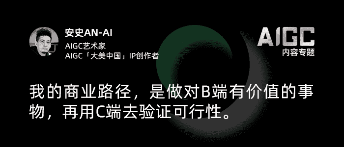

**数英：** 你的作品中有很多这类城市文化向的内容，想知道你在抓取城市景观特色上，有什么诀窍？毕竟，这类内容对文化的理解能力要求比较高。

**安史：** 也没什么诀窍，因为做了20年房地产，接触过很多文旅项目，自然有些沉淀。

当然，把握城市气质，是要对城市文化理解更深，这一点我在工具上有比较强的感受。

当时，我第一次尝试用国内AIGC奇域这款应用，就发现，还得是中国人更懂中国人的审美。如果用Midjourney做山水图，它看起来像中国山水，但要说是日本的，似乎也可以。但是，奇域做出来的，让人一看就是张家界，一看就是桂林。

@安史AN-AI 奇域AI创作

《大美中国丨张家界》

@安史AN-AI 奇域AI创作

《大美中国丨桂林阳朔》

AI的底层逻辑，决定它想象力发散的方向。奇域做出的东西，让我们中国用户更有共鸣，会觉得这就是我的家乡。所以，我换奇域之后，内容有了质的飞跃。

至于差异化，我的方法是，对地标景观做私人化的解读，再增加情绪。

比如，同样是金陵，有人看到梧桐树，有人看到秦淮河。把自己感触最深的景观拿出来，再赋予其情绪色彩。

可以有长安三万里的豁达，也可以有烟雨江南的清冷，这取决于创作者自己，它们最终会产生一个差异化的内容。

@安史AN-AI 奇域AI创作

《大美中国丨烟雨金陵》

编者按：创作能力与商业思维的叠加，是AIGC时代，创作者成为超级个体的方法。

沿着内容产品化、产品内容化的思路，安史为自己找到了商业变现的路径；而通过深化个人IP，安史成功地将自己从创作者，变为具有风格辨识度的AIGC艺术家。

## 2、在时代红利面前，选择大于努力

安史形容自己的作品是“极简与禅意结合”。

禅意，是中国传统文化中的一种意境。极简，是当代的设计表现形式。

两者，一个是道，一个是术，都追求简洁、纯粹、平和，在视觉表现上，往往有大量留白。

撇开意境不谈，留白从字面意思代表着“没有任何元素”，而AIGC的底层逻辑，则是元素的组合。我们想了解，安史是如何运用AIGC，去实现这一风格的。

**数英：** AIGC创作本质上是数据的叠加与组合，如何能让它传递出中国绘画中的意境？

**安史：** AI本质上是工具，它对意境的理解取决于人。用AIGC传递独特表达的第一步，是耐下心驯化它，让它去记住你的想法。

同时，要找到趁手的工具，我从接触AIGC开始，就想做「大美中国」，但用Midjourney做图，很快就遇到瓶颈，它缺少中国素材，得拿国外的去调教，很多时候，形不似，神也不似。

后来换成奇域后，感觉就对了，它对中国城市和地方文化的元素识别得很准确。

比如，我输入徽州，它会有马头墙、门楼，这些代表徽派特色的建筑；

@安史AN-AI 奇域AI创作

《大美安徽丨青绿徽州》

输入平遥，又是另一种特色的建筑风格；

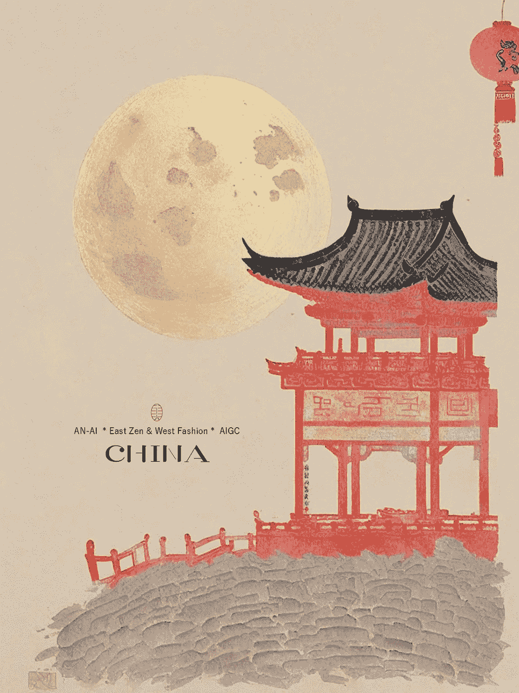

@安史AN-AI 奇域AI创作

《大美平遥丨张灯结彩》

奇域把中国素材训练得特别好，不能说百分百复刻，但能抓住文化特点，这样就可以把城市气质生动表达出来，还有它出图也很快，又支持中文，当时发现奇域，对我的创作是如虎添翼。

数英：有了创作方向和趁手的工具，当时就下决心裸辞了吗？

**安史：** 没那么快，从接触AIGC到全职做AIGC，我用了一年的时间去沉淀，收获不少口碑，也看到AI作为新兴产业的红利。我深信，选择大于努力。我20年前进入房地产，是因为它处在红利期，但今天房地产周期没有了，而AI是刚刚升起的太阳，所以说没有什么可犹豫的。

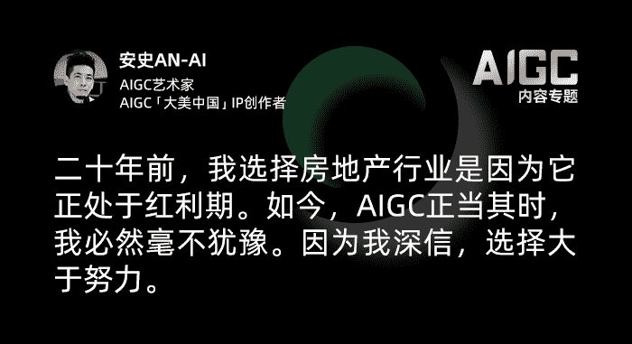

编者按：工具与创作，总是相辅相成。抓住时代风口后，安史率先动了起来，在大量学习和探索中，找到了自己的风格，与奇域AI的相遇，让他得以稳定创作风格，沉淀个人IP。

## 3、中国文化的传扬，到应用层面才是真传播

纵观近年的商业市场，品牌对于中国文化的偏爱显而易见。AIGC的加入，或许能带来更丰富的可能性。

数英：您现在的个人自媒体，目前都有哪些商业模式？未来有什么规划？

**安史：** 主要分为三种，图片授权，内容定制，和品牌合作。

我未来是打算专注于自己的IP，把「大美中国」系列做全，将它运用在不同的产品上，比如手机壳、扑克牌、杯子、雨伞等等。文化只有落在所有人都能接触到的产品上，才能真正发扬光大。

另外，我还想做「云游中国」，联动各大城市文旅，通过线上内容，促进线下的旅游消费。

还有就是刚刚提到，邀请更多优秀的创作者，加入「大美中国」的共创，让这个命题有更大想象空间。

[🎦 点击观看视频](https://mpvideo.qpic.cn/0bc3zqaamaaabqaovuviejsvbtgda3gaabqa.f10002.mp4?dis_k=6dbfc45eb4712473e3cb6f8b3ae8ea39&dis_t=1710412476&play_scene=10120&auth_info=BpimneYsFQBN1N/xkV5ddHo2FgVGIi5kWHxCFGsXKDQgFk8gD2NqejwUMDABYFFX&auth_key=3d8912a0c7da815954447e6d2f891313&vid=wxv_3287951845340020740&format_id=10002&support_redirect=0&mmversion=false)

> 无法获取音频链接

视频详情

@安史AN-AI奇域AI创作

**数英：** 一个人就有这么大的影响力，能做很多的事，你觉得AIGC对广告行业的冲击是怎么样的呢？

**安史：** 刚才我们聊了那么多，你觉得我是一个自媒体人吗？可能还是一个广告人。我只是用了全新的模式和工具，它让我能做喜欢的事情，还可以创造价值，这可能是一个更好的良性循环。

除了提升效率，AIGC还有另一个优势，它帮助你把创意更完善，或者更飞一点儿，我去年做的很多大秀，也是从AI那里得到的想象力。

我原本没想到，但是AI小火花一擦，让我发现了可能性，我再去一步步实现它，这个过程是我和AI的双向成长。

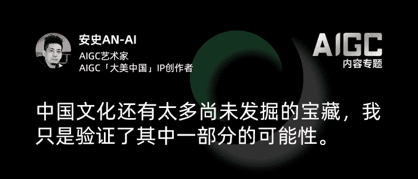

**数英：** 对传统文化的挖掘，是现在中国市场的一个趋势，比如国潮，还有很多品牌和非遗的合作，你怎么看待AIGC在其中的应用？

**安史：** 为什么我定位在东方禅意？因为中国文化可挖的东西太多了，我只是验证了其中一种。

现在市场上，不仅是国家政策上，强调文化自信，商业上，大量本土品牌的兴起，也在做文化溯源，给创作者带来很多机会。

我希望更多人用AIGC去创作好作品，将它应用在商品中，通过消费市场影响更多人，让审美力转化为生产力，这样文化才能更加鲜活。

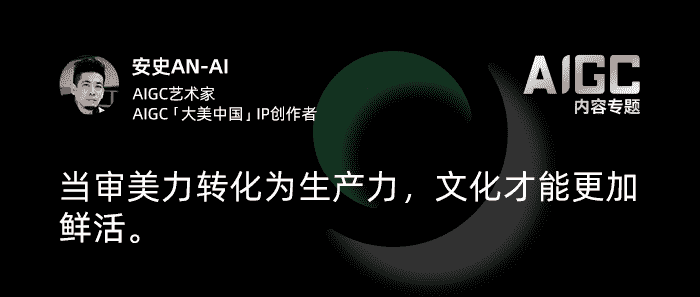

编者按：每个时代，媒介、技术的跃迁，都会触发市场格局的重新洗牌；电视时代，一个黄金时段广告能让品牌起死回生；短视频时代，一条爆款内容能带来上亿收益。

如果20年后回看今天的中国市场，中式美学的流行与AIGC的兴起，必然是列入记载的两大现象趋势，而谁将又是其中的佼佼者，此刻还尚未见分晓。

## 三、新时代下，看见躬身入局 AI 的潜力与魅力

AIGC刚进入人们视线时，就有人预测，在AIGC时代，审美力与共情力将会代替知识与技能，成为新的稀缺资源。如今，我们在与@吉吉如意令和 @安史AN-AI 的对谈中，再次验证了这一点。

关于AIGC与中式美学的潜力，我们从市场趋势和创作者的角度，总结了以下几个要点——

### 1、商业市场：懂中国审美，成为新的竞争优势

● 文化环境：在文化自信的时代大背景下，有质量的文化输出，成为个体乃至整个社会的追求方向。

● 市场趋势：本土新锐品牌溯源文化脉络、深化品牌认知，海外品牌以在地文化寻求认同，文化共情策略成为当下市场营销趋势。

● 产品应用：国内文化IP发展日益成熟，文化创意产品更加多元化，在国潮兴起的大趋势下，文创市场仍有大片蓝海亟待开发。

从这一点上来看，奇域AI在AIGC应用中，以中式美学打破突破同质化内容困境，既是迎风而上，也是顺势而为。

### 2、创作者：新时代下，超级个体才是护城河

● 自我迭代：保持终身学习的意识，在深度和广度上不断获取滋养，借助AIGC的力量自我更新。

● 商业加持：积极拥抱商业合作，在激列市场竞争中，找寻到属于自己的风格和优势，将其不断深化。

● 超级个体：提升跨界能力，将创作能力迁移到多个领域，打通自己的商业模式，并保持开放性。

吉吉在采访中提到，这或许是工业革命以来人类最大的技术跃迁。新的时代正在来临，先出发的人未必能一直领先，但开始行动，就有更多可能。

### 文末互动福利

### 关于 AIGC 与中式美学，有任何观点和想法 欢迎在评论区留言 我们将随机在评论区抽取 5位幸运读者 每位送出「大美中国」IP周边一套 包含【1份明信片+1份冰箱贴+1个杯垫】 活动时间： 2024年1月21日——2024年1月25日

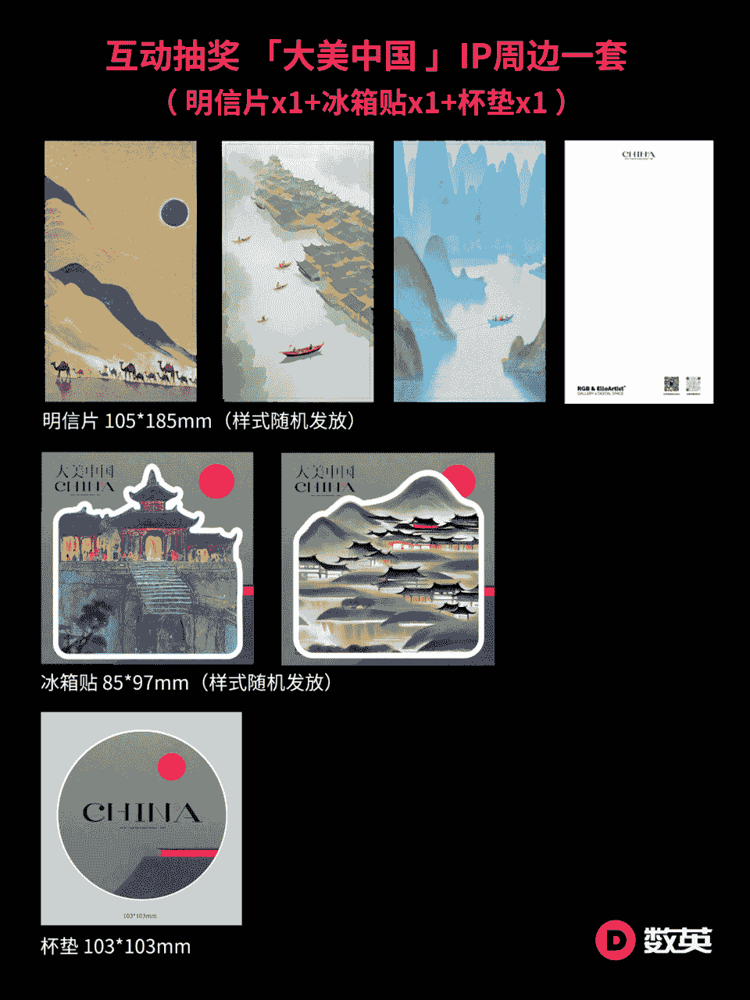

采访：吴小宝、赵柠檬、西西付

撰文：西西付

---

<https://my.feishu.cn/sync/CV7edZp1nspUQobYJhicxeP7nrb>
