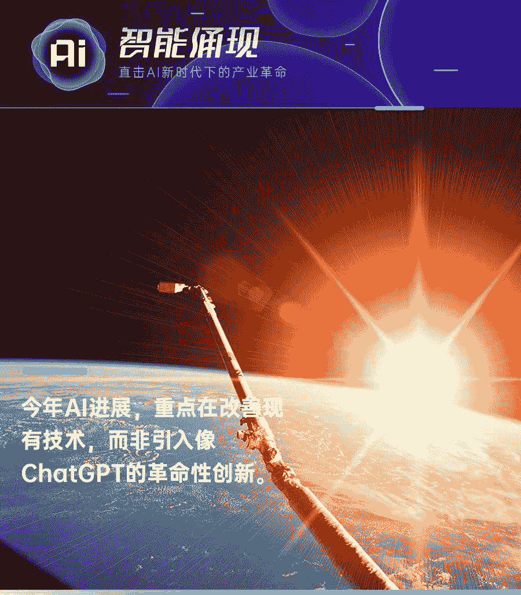
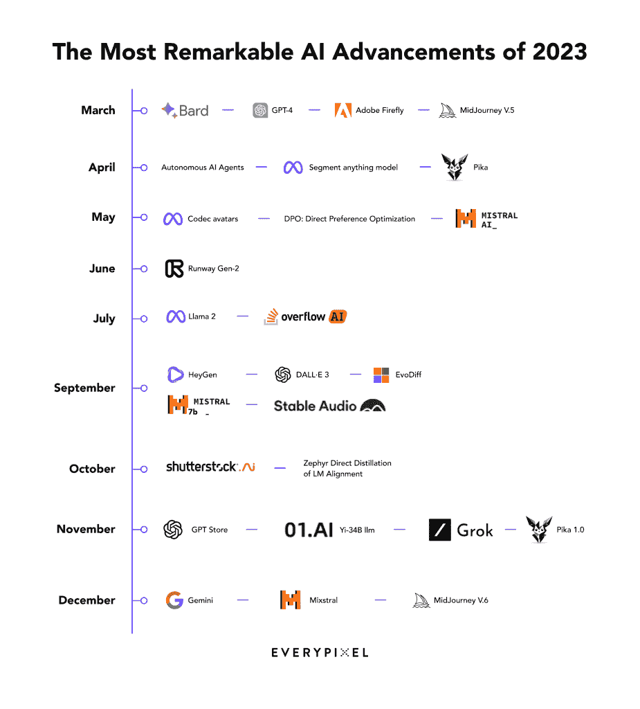
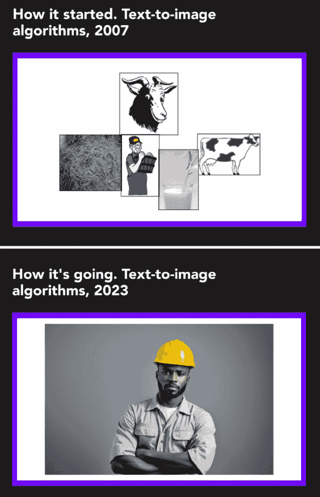
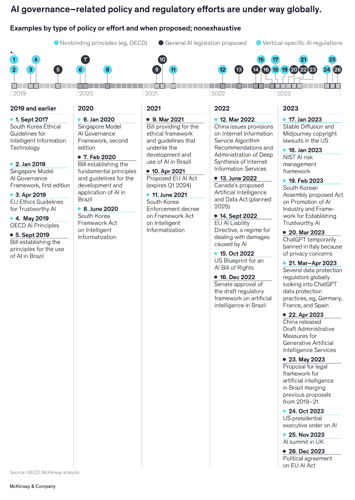

# 2023年，激动人心的AI之年

> 来源：[https://my.feishu.cn/docx/RUYLdVoEGoZ4KgxnsLccWzDSnQA](https://my.feishu.cn/docx/RUYLdVoEGoZ4KgxnsLccWzDSnQA)

<https://my.feishu.cn/sync/CV7edZp1nspUQobYJhicxeP7nrb>

> 🔗 原文链接： h[ttps://mp.weixin.q](https://mp.weixin.qq.com/s/nzeHh9m7XIdkq1hp0-S2EQ)q.com/s/nzeHh9m7...

> ⏰ 剪存时间：2024-03-14 18:36:03 (UTC+8)

**文 ****｜ **Everypixel Journal

**封面来源 ****｜ IC photo**

2023年是AI领域的关键年份，从GPT-4发布到各类AI图像、视频、文本生成工具的出现，生成式AI引来爆发增长。今年AI领域有太多激动人心的时刻，正值年末，我们来一起回顾过去一年的AI圈。

本文编译自 Everypixel Journal ，Everypixel是一个用AI算法来搜索和分析图片的工具，Everypixel Journal作为其一部分，主要提供行业洞察、技巧教程以及关于图片使用和视觉趋势的观点内容。本篇文章包括从AI进展，再到图像、视频、文本等多模态领域，还有一些公司联手/合并的关键时刻。

文章主要关注软件侧，因此对于Apple Vision Pro并未收录。接下来，让我们一起来回顾AI充满想象的2023年。

## **这一年，AI的进展**

在今年的AI进展方面，重点在于改善现有技术，而非引入类似于去年的ChatGPT或图像生成器那样的革命性创新。虽然没有令人震撼的效果，且真正的通用人工智能（AGI）尚未实现，但今年标志着从之前的重大突破向更强大的未来过渡的中间阶段。为了展示这种发展趋势，我们制作了一个视觉时间线，强调了今年在AI领域最为显著的进展：

## **图像生成**

**Adobe Firefly**

Adobe Firefly和Generative Fill推动了多样化视觉内容的创作，如插画、艺术构思和照片编辑。集成到Photoshop中的Adobe Firefly使AI技术普及化，让更多用户能够轻松使用。其发布的文本效果功能也是一个重要进展，它允许用户给文字和短语添加风格或纹理。

**Midjourney**

Midjourney V.5模型在图像生成领域达成了重要里程碑，展现了更高的效率、连贯性和分辨率。它的最新alpha版本，Midjourney V.6进一步增强了功能，比如更精准地响应用户输入（prompt）、提高了模型的知识水平和简易的文本绘制能力。

**DALL·E 3**

基于ChatGPT的 DALL·E 3简化了图像生成过程，避免了复杂的用户输入（prompt）设置。此外ChatGPT还推出了一项功能，帮助用户优化输入内容，并根据反馈调整图像。

**Shutterstock.AI**

知名库存图片平台Shutterstock.AI加入了AI功能，使用户能将输入内容转换成可授权的图像Shutterstock在推动伦理AI方面迈出了重要一步，对贡献的艺术家给予认可和奖励。

△文本到图像算法的演变，2007对比2023

## **视频生成**

**Stability AI**

Stability AI推出了Stable Video Diffusion，这是一个具有里程碑意义的视频生成（generative video）模型，可在GitHub上开源访问。类似于AI图像生成的趋势，Stable Video Diffusion模型很可能在AI生成视频领域发挥核心作用。

**HeyGen**

这家AI创业公司推出了一款用于语音克隆的工具，能够调整视频中的唇部运动并进行语言翻译。

**Runway Gen-2**

Runway发布了Gen-2模型，使用户仅需通过文本提示、图片或其他视频即可轻松生成完整视频。

**Pika和Pika 1.0**

在首次发布时，Pika吸引了超过五十万用户，每周生成数百万视频。在Pika 1.0中，升级后的AI模型使用户能够以多种风格（包括3D动画、动漫、卡通和电影）创作和编辑视频。

Meta 的像素编解码头像（PiCA）

Meta的 Pixel Codec Avatars（PiCA）模型为视频中的3D人脸提供了更加逼真的远程传输体验。

## **文本生成**

**Bard和Gemini**

谷歌的Bard为聊天机器人注入了仿人类的情感和情绪。Bard聊天机器人采用多模态数据集训练，而谷歌的Gemini以“最有能力”的AI模型身份崭露头角，成为与OpenAI的ChatGPT齐名的竞争者。

**Grok**

埃隆·马斯克的创业公司xAI展现了其对AI发展的承诺，并有可能与OpenAI竞争。他们推出了“Grok”，一款具备幽默感、反叛特质，并能通过X平台获取实时信息的聊天机器人。xAI承诺，Grok能回答其他AI系统所回避的敏感问题。

**OverflowAI**

Stack Overflow的OverflowAI通过提高知识整理效率，使得用户能在Visual Studio Code和Slack中快速找到AI推荐的相关答案。

**Llama 2**

Meta推出了Llama 2，这是其开源大语言模型 (LLM) 的升级版，性能更优。Meta还对这一模型进行了针对对话场景的优化，使其在大多数标准测试中超越了其他开源模型。

**GPT-4**

OpenAI的GPT-4现在能够处理图像输入，生成标题、分类，实现听取和对话互动，还支持实时网络浏览。OpenAI还进一步扩展了插件支持，促进了一个丰富多彩的开源竞争环境。GPT-4标志着OpenAI向通用人工智能 (AGI) 迈进的新篇章。

**Mistral 7B**

估值大约20亿美元，Mistral AI在今年推出了Mistral 7B，一个具有挑战性的大语言模型，旨在与GPT-4和Claude 2竞争。Mistral AI采用开放技术策略，允许用户免费下载该模型，以促进技术共享和创新。

**Mixtral 8x7B**

Mistral AI同样推出了Mixtral 8x7B，这是一个高质量的稀疏混合专家模型（SMoE），具备开放的权重参数，拥有总计46.7B参数，这标志着模型在提高真实性和减少偏见方面开放性的一大步。

**Yi-34B llm**

今年估值达到10亿美元，由李开复创立的01.AI发布了Yi-34B，一种开源的神经网络模型，它以远超竞争对手的参数数量取得了优越性能，特别强调了其在成本效益方面的突出表现。

## **其他技术性进展：**

这一部分暂无具体内容，但预示着AI领域还有更多激动人心的发展。

**物体分割模型 (SAM) **：

Meta AI推出了SAM，这是一个强大的分割模型，能够在无需额外训练的情况下提取图像中的物体，展示了其出色的适应性。SAM在大型数据集上的训练证明了它在物体分割方面的高效能力。

**直接偏好优化 (DPO)**

DPO的出现标志着一种稳定且高效的方法，用于微调大规模无监督的大语言模型（LLM）和教授文本到图像模型。DPO能够在不依赖复杂的基于人类反馈的强化学习 (RLHF) 的情况下实现精确控制。

**Zephyr直接蒸馏LM对齐**

Zephyr-7B是直接偏好优化 (dDPO) 的成果，它为带有70亿参数的聊天模型树立了新的标准，通过减少训练量提高了意图识别的准确性。

**自主AI智能体**

自主AI智能体的兴起，标志着向高级自主AI系统的重大转变。这些AI智能体被视为通用人工智能（AGI）的雏形，它们能够根据用户的目标自动生成任务和指令，并自主完成直至达成目标。

**EvoDiff**

微软的EvoDiff是一个开源AI框架，专注于快速且成本效益的蛋白质生成，有望在治疗和工业应用领域带来突破。

**Stable Audio**

Stability AI发布一款可以根据简单文本提示生成短而高质量音频片段的工具。

GPT商店，版权屏障，ChatGPT机器人构造器

OpenAI推出GPT商店来销售定制化的GPT机器人，版权屏障用于承担版权侵权索赔的法律费用，以及一个无需编程的平台，用于创建定制化的ChatGPT版本。

Stability AI开源其大语言模型 (LLM)

Stability AI已开源其模型，包括StableLM-Alpha和Stable Vicuna。这些模型在文本和代码生成方面表现卓越。特别是Stable Vicuna，它是首个采用人类反馈强化学习 (RLHF) 训练的开源聊天机器人。另外，Stability AI还推出SDXL Turbo，这是一款能实时将文本转换为图像的生成模型。

## **行业领头羊，合作联手**

在2023年这个充满活力的年份，行业领头公司间形成了一系列影响深远的合作关系，这些合作正在塑造未来的发展方向。以下是今年在AI领域具有里程碑意义的几个重要合作和联合：

Stability AI和Init ML

Stability AI通过收购了Init ML，这是受欢迎的编辑应用ClipDrop背后的关键团队，其目的是将Stability AI的先进技术融入到ClipDrop的生态系统中。这次合作已催生了SDXL Turbo的开发。

Runway和Getty Images

Runway与Getty Images建立了战略合作伙伴关系，共同推出了一款新的视频生成模型RGM（Runway和Getty Images 联合模型）。这一模型结合了Runway的AI技术和Getty Images庞大的授权创意内容库。这一合作旨在彻底改变内容创作的流程，帮助企业制作符合品牌特色的高质量定制视频。

**Snowflake和Neeva**

作为数据仓库平台的重要玩家，Snowflake收购了Neeva，这是一家以利用生成式AI改善搜索体验而知名的初创公司。Neeva最近结束了其基于订阅的、无广告的搜索引擎服务。Neeva的创始人也承认了让用户尝试新搜索引擎的难度。

Shutterstock和OpenAI

Shutterstock和OpenAI确定了为期六年的深化合作关系。OpenAI获得了Shutterstock高质量数据的使用权，以此来丰富其模型训练的数据集，包括多种图像、视频和音乐资源。Shutterstock则继续利用OpenAI的技术，推出了Shutterstock的AI图像生成工具。

## **AI法律现状**

2023年的AI法律领域正经历着快速变化，面对不断出现的新挑战和持续的争论。关于版权、公司政策及更广泛的监管框架的讨论正在塑造AI法律领域的发展方向。以下是今年最重要的法律议题：

**欧洲AI法规**

欧盟推出了全球首个全面的AI法规，对AI的应用进行规范。这项法规根据AI系统潜在的风险进行分类，并据此制定了相应的规定。虽然AI法规已经初步达成一致，但其实施面临延迟，预计将于2025年开始执行。

美国版权局拒绝对AI创作内容登记

美国版权局明确表示，拒绝对由AI算法Midjourney创作的图像进行版权登记。这一决定成为先例，表明完全由AI创作、无人类参与的艺术作品不适用于版权保护。此外，美国版权局还发布了关于AI协助创作作品的指南，明确了人类利用AI工具创作的作品可能符合版权保护。该指南指出，需要根据人类在创作过程中的作用是否起到决定性因素来评估这些作品。

McKinsey公布了一幅内容丰富的图表，全面概括了2023年人工智能（AI）治理领域内最关键的政策和监管动向。图表以直观的视觉形式展示了2023年对AI法律框架塑造做出的显著贡献。

△2023：人工智能之年，来源：McKinsey

## **AI圈的争论**

2023年，人工智能领域的辩论和讨论异常活跃，涉及到许多不确定性和该领域不断变化的规则。随着行业自身的发展，这样的辩论变得在所难免，预示着未来将有更多引发深思的对话和挑战。以下是今年最为引人注目的几场辩论：

**对ChatGPT的企业限制**

主要的金融机构，包括摩根大通、花旗集团、美国银行、德意志银行、高盛和富国银行等，已经限制了ChatGPT的使用，原因是出于对安全和隐私的担忧。这反映出一个更广泛的趋势：众多公司开始向员工发出警告，提醒他们在企业环境中使用人工智能应用时要考虑到相关的法律问题。

**OpenAI对低薪工人的聘用**

《时代》杂志的调查揭露了OpenAI与Sama的合作，在肯尼亚雇佣低薪工人来筛选ChatGPT的敏感内容。这一事件引发了人们对工人待遇以及内容审核对心理健康影响的伦理关切。

**OpenAI高层动荡**

Sam Altman的暂时离职和迅速回归上个月成为热门新闻。Sam Altman由于与董事会的沟通问题而辞去OpenAI的领导职务，接着发生了一系列领导层变动。临时CEO Mira Murati和大部分员工都支持Altman重返领导岗位。这一意外事件引起了广泛关注，也让人们对这次领导层变动的真正原因及其对未来的影响产生了疑问。

**Adobe终止收购Figma**

Adobe计划以200亿美元收购Figma的消息引起了监管机构的关注，欧盟委员会和英国竞争与市场管理局因可能存在反垄断问题而开始调查。这项拟议的交易不仅仅是设计层面的问题，Adobe在客户数据平台方面的主导地位也让许多首席信息官 (CIOs) 担忧它可能对云计算软件的消费产生重大影响。但由于在欧洲和英国难以获得反垄断审批，Adobe最终放弃了这项交易，并向Figma支付了10亿美元的终止费。

AI作品在世界摄影大赛中以引发轰动

摄影师Boris Eldagsen在索尼世界摄影大奖中引发轰动，他提交了由AI创作的艺术作品。Eldagsen拒绝接受奖项，这激发了一场关于AI生成图像是否适合参加传统摄影竞赛的讨论，这也挑战了人们对于摄影作品真实性和创造性的传统观念。

参考来源：

[1] https://journal.everypixel.com/2023-the-year-of-ai

[2] https://baoyu.io/translations/ai/2023-the-year-of-ai

<https://my.feishu.cn/sync/CV7edZp1nspUQobYJhicxeP7nrb>