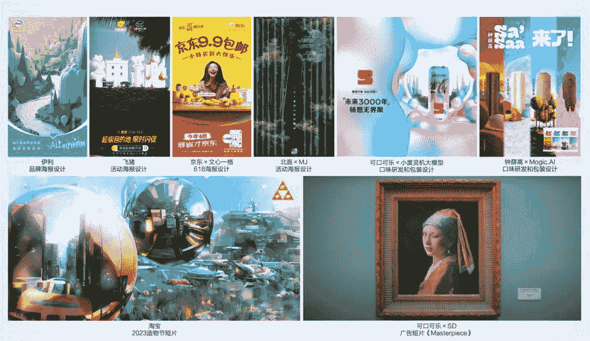
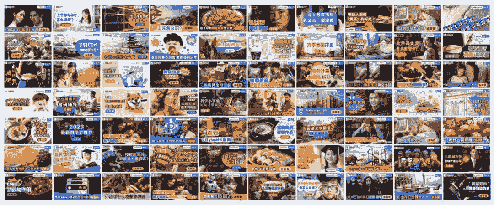
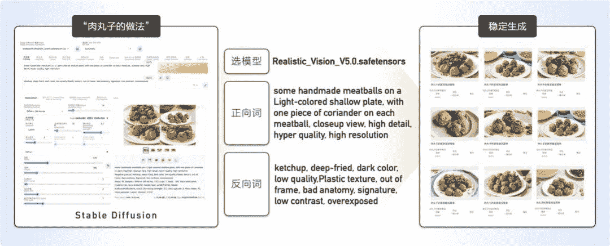
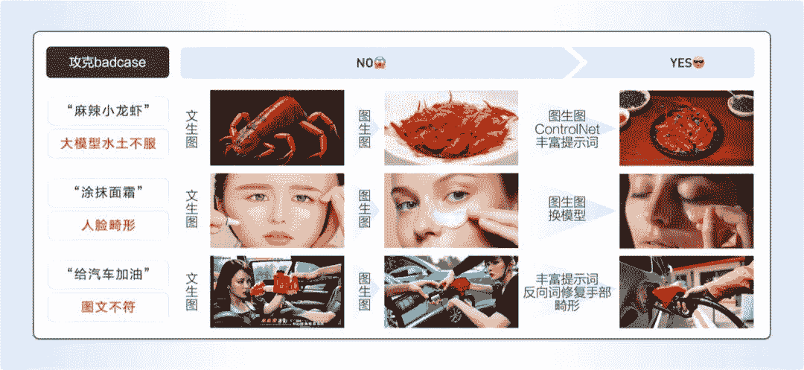
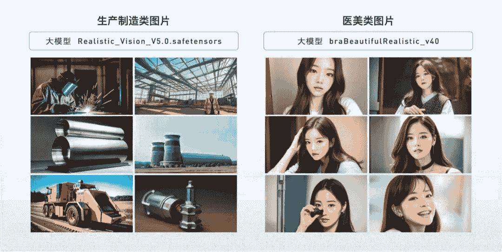
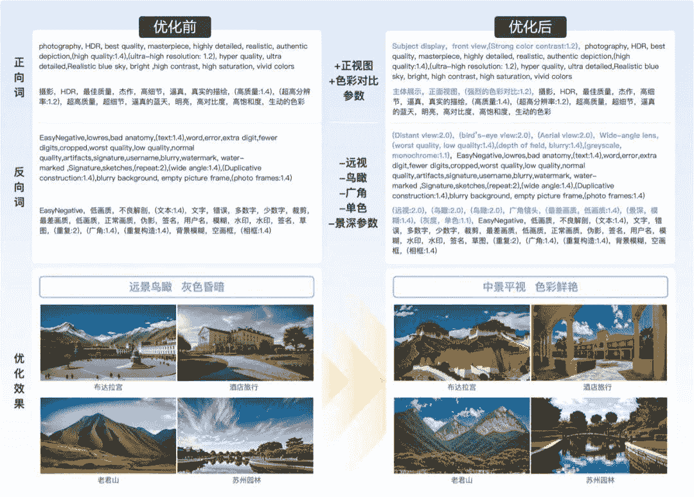
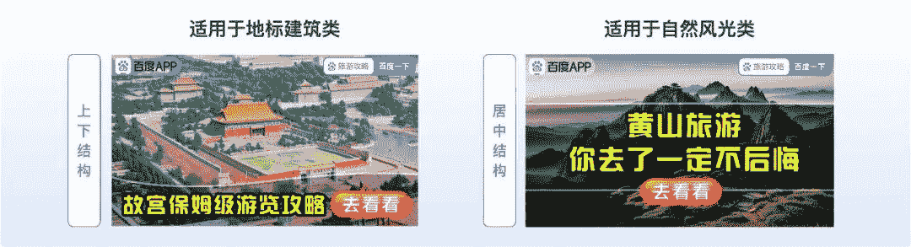
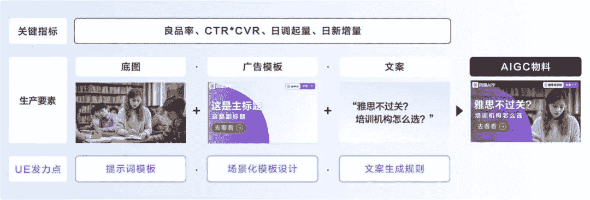
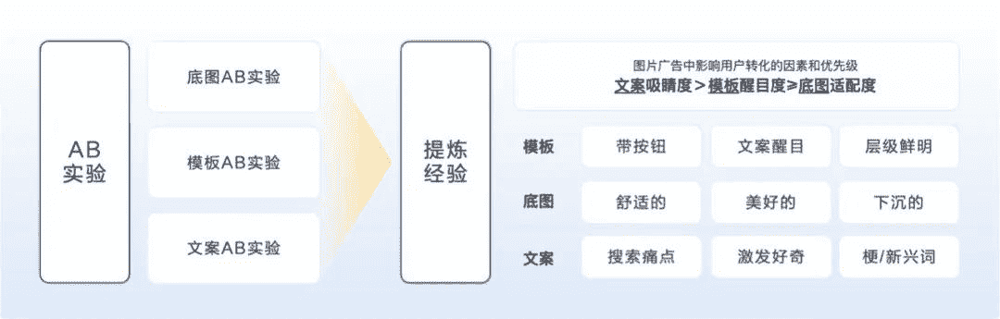

# 善用AIGC搞定海量物料设计

> 来源：[https://my.feishu.cn/docx/AhmZdhWdaoohNSx2huLc1kErnkd](https://my.feishu.cn/docx/AhmZdhWdaoohNSx2huLc1kErnkd)

<https://my.feishu.cn/sync/CV7edZp1nspUQobYJhicxeP7nrb>

> 🔗 原文链接： h[ttps://mp.weixin.q](https://mp.weixin.qq.com/s/7NlR2jUmhdvpdcS0iYTDnw)q.com/s/7NlR2jUm...

> ⏰ 剪存时间：2024-03-14 18:41:13 (UTC+8)

# **前言**

2022年底ChatGPT发布，各行业一度陷入恐慌，其中AI生图技术的效果和速度令人们惊叹，以创意为核心竞争力的设计师群体首当其冲。

然而很快我们发现，AI在模仿和融合设计方面的能力非常惊人，在灵感激发和设计过程中善用AI工具能极大提高创意效率。在广告营销领域，国内外品牌纷纷将AIGC融入营销活动，用传统创作手段与AI技术碰撞出新的视觉效果甚至新的产品。

MEUX的运营设计师们在百度APP的渠道增长方向也进行了一次AI应用的突破，我们首次基于实际业务去学习使用AI， 借助AI能力生产海量的图片物料，通过网络广告位推送给用户，从而实现用户增长的目标。

# **不可能完成的任务？**

网络广告投放的优势在于千人千面，这就需要持续供给大量的广告创意。过去这项工作全部由人工完成，设计师需要基于一些图片素材、用大家熟悉的PS、拍摄等方式进行创意设计。由于每周要供给几千个新物料，而耗时费力地制作精致美观的图片又未必能带来更高的收益，因此逐渐发展成数量级遇瓶颈且物料视效不优的局面。在控成本的情况下，想要把物料数量再提升一个量级、同时提高美观度，这几乎是不可能的事情。而如今的AI技术让我们看到了希望。

我们与产品和研发经过一段时间的研究，使用Stable Diffusion生产出了海量的图片物料，产能和画面质量都超越了传统人工生产模式。

# **从新手翻车到轻车熟路**

对于百度APP的广告物料来说，使用AI生成可用的图片并没有想象中那么容易，我们在尝试Stable Diffusion的初期屡屡翻车。

在这个业务场景中，目标是向用户推广百度APP的搜索功能，我们需要基于搜索query（即用户搜索词）生成物料的底图，例如“家常肉丸子”、“如何给汽车加油”、“面霜推荐”、“麻辣小龙虾的做法”等等，内容类型包罗万象。

Stable Diffusion界面的上手难度略高于Midjourney，但基本原理相同，于是我们针对具体query，选择适合的大模型和Lora、扩充正反提示词并反复调参，这样可以顺利生成一些效果不错的图片。

但也有不少query难度较大，对于AI生不出来的，尝试用图生图、Controlnet等插件，攻克一个个badcase。当我们经过几个小时的研究终于获得一盘相对靠谱的麻辣小龙虾的时候，激动之余也感受到驾驭AI是有一定门槛的，也发现对于中国本土事物，市面上的AI大模型大多水土不服，想要生成正确的图像仍有一定难度。

在了解了AI的能力现状之后，业务方开始尝试小规模生产，选择一批AI相对擅长的query，由设计师选定适合的大模型并撰写完整的提示词，再由产品和研发如法炮制生成上千张图片后投放到线上，看上去似乎解决了量产的问题。

但是，百度的搜索query量级巨大，有几十万个，我们初期研究的十几个query只是九牛一毛，用这种手工作坊的方式逐个定制提示词显然是不现实的。

# **手自一体发动量产**

几十万个query，似乎又是一个不可能完成的任务。

我们重新从query的分类入手，由设计师针对一些高收益的垂类提炼相应的提示词模板，每套模板不包含画面主体提示词，仅用来稳定控制画面的色彩和视角、物体的质感、人物的情绪等等，再由研发批量添加主体提示词、接入Stable Diffusion批量生图。

设计师在撰写调试提示词模板时，需要针对不同垂类的特点做差异化定制，一方面要确保图片内容正确、另一方面要控制风格与这类query相匹配。比如，针对「生产制造」类，选用“Realistic_Vision_V5.0.safetensors”等写实画面的大模型，添加“工业”、“机械”、“光滑”等提示词，体现机械设备的特征；而针对「医美」类，选用“braBeautifulRealistic_v40”等擅长绘制亚洲美人的大模型，使用“女孩”、“青春活力”等正向词来呈现健康美丽的人像，用“变形”、“扭曲”等反向词避免人体畸形。

用这样的提示词模板有了第一批量产图片后，我们再观察图片效果问题做进一步调优。

比如「旅游出行」类，第一版提示词模板量产出来的图片看上去还不错，但是数据表现不理想，我们通过观察分析发现整体色调偏暗、视角不佳，在广告投放场景中不吸睛。于是我们在正向词和反向词中都加入了控制色彩和视角的提示词，将画面色调从灰暗调至鲜艳、视角从远景鸟瞰拉到中景平视，把好看的风景送到用户面前，更容易吸引用户点击。

搞定了底图的量产方式，还有另一个构成要素——模板，模板用于承载文案和引导按钮等元素，套在底图上组成图片物料。其中的文案要展示中文，但目前的AI无法生成，因此需要由设计师制作，但同样的问题是，为几十万个query定制化地设计模板也是不现实的。

因此，我们仍然是从query分类入手，针对每个垂类设计比较通用的模板样式，再由研发用技术手段批量套用到底图上。

仍然以「旅游出行」类为例，我们根据垂类特点设计了两种模板：对于地标建筑类辨识度高的图片，搭配上下结构的模板、主要用画面中的主体吸引用户；而大场景自然风光类图片通常没有明显视觉焦点，适合搭配居中结构的模板、用大字文案快速抓住用户眼球促进转化。用这个思路还可以继续细分扩充模板样式，套用到AI生成的各类底图上，在量产基础上实现创意多变。

# **道阻且长，行则将至**

在量产投放过程中我们发现，物料数量与数据效果不一定正相关，而底图画面的精美度与数据效果也并不总是正相关，因此我们也在积极地研究提升数据的方法，设计师针对业务的关键数据指标，从视觉方面和用户视角思考更多解法。

比如通过拆解物料要素可见，文案也十分重要，特别是对于相对抽象的query，例如「教培类」“雅思培训班”，图片很难直观体现内容，主要靠大字文案吸引点击，一方面我们在模板的文案样式上做更加醒目的设计，另一方面文案的内容也需要具有一定情绪激励作用，例如“雅思不过关？培训机构怎么选？”更能打中用户痛点并且更有互动感，但目前AI生成的文案在这方面表现不佳，因此文案也是未来可研究的一个子方向。我们从用户视角输出方法，不断提高AI自动化程度和生产质量，为业务带来增长收益。

同时，设计师也在主导通过AB实验持续摸索“好物料”的特点，提炼底图、模板、文案的设计要点，将适合业务场景的经验沉淀到AIGC量产上。

# **结语**

一切都才刚刚开始，我们看到目前的AI能力还无法实现全自动化，现阶段需要由设计师使用专业术语跟AI对话，并通过分析实际应用场景和一次次的数据验证反推出相应的解法再操控AI，不断摸索人机协作的方式去落地应用。

当下，设计师掌握AI工具已成为一项新的基础能力，我们也要具备更强的业务思维，才能用新工具发挥出更大的商业价值。同时我们也会持续关注AI的发展，应用最新的技术能力做更多尝试，在AI的浪潮中将更多的不可能变成现实。

<https://my.feishu.cn/sync/CV7edZp1nspUQobYJhicxeP7nrb>