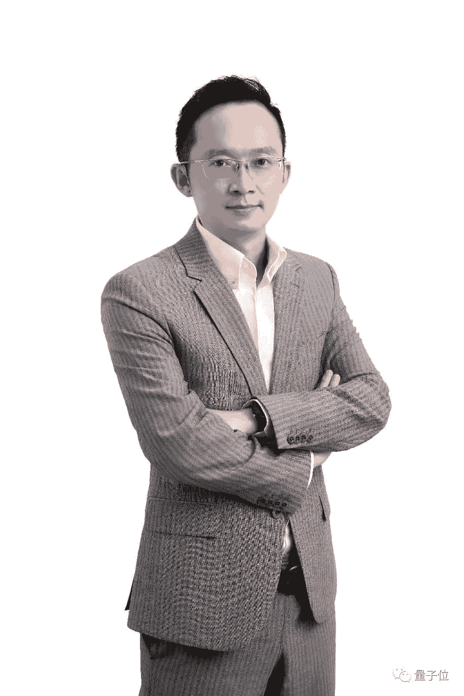
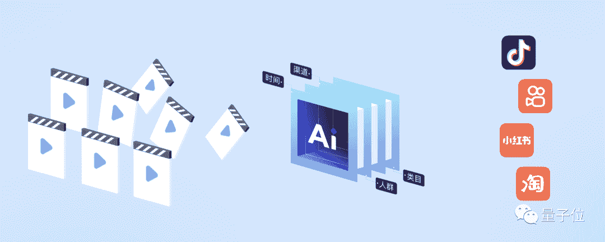
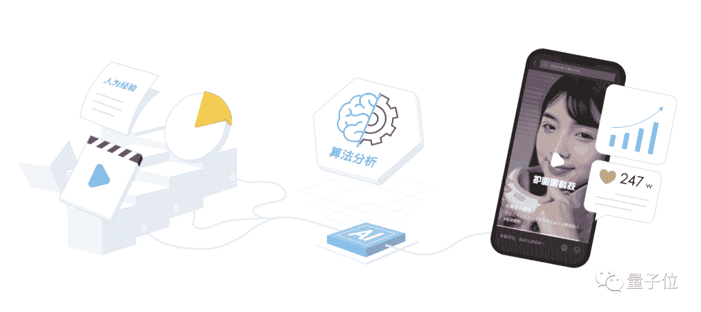
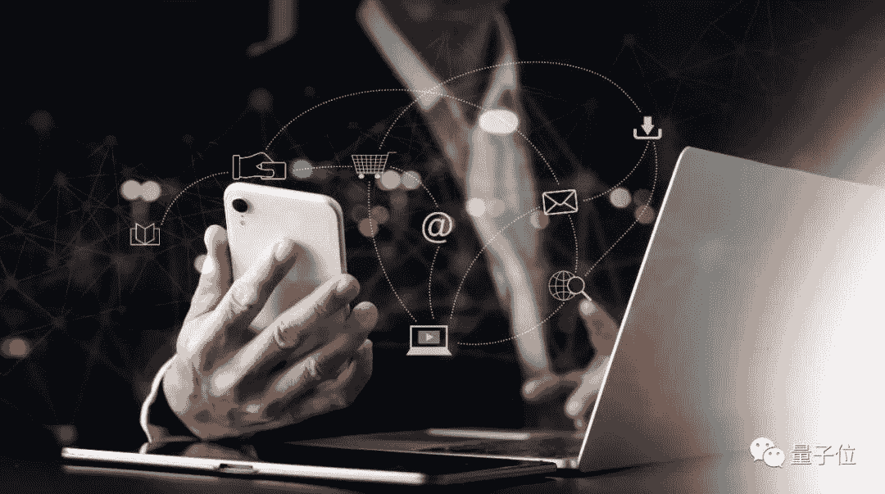
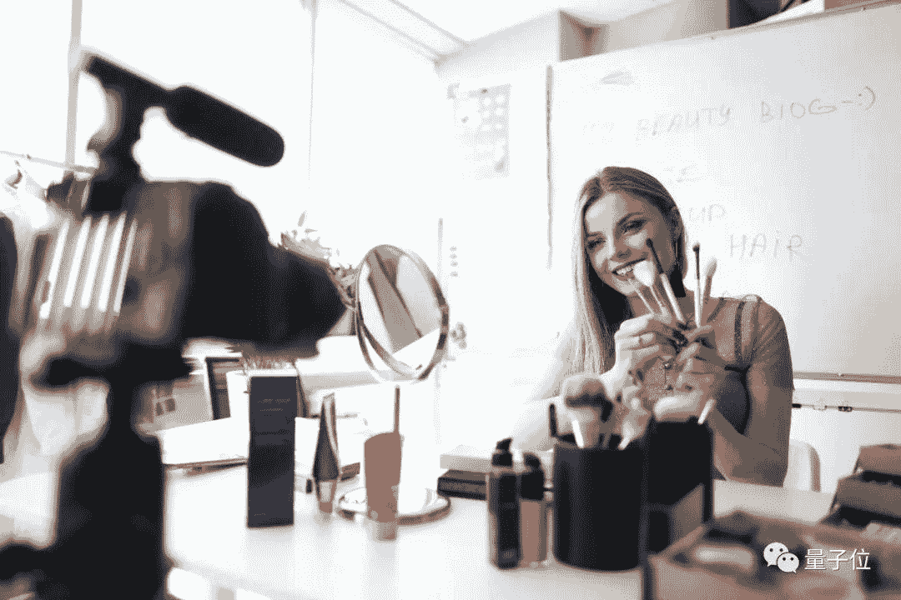
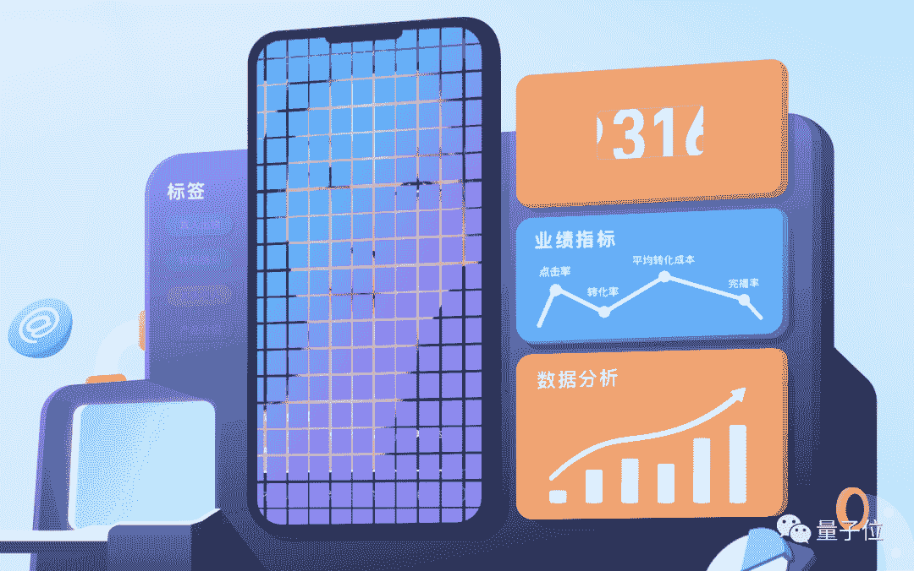
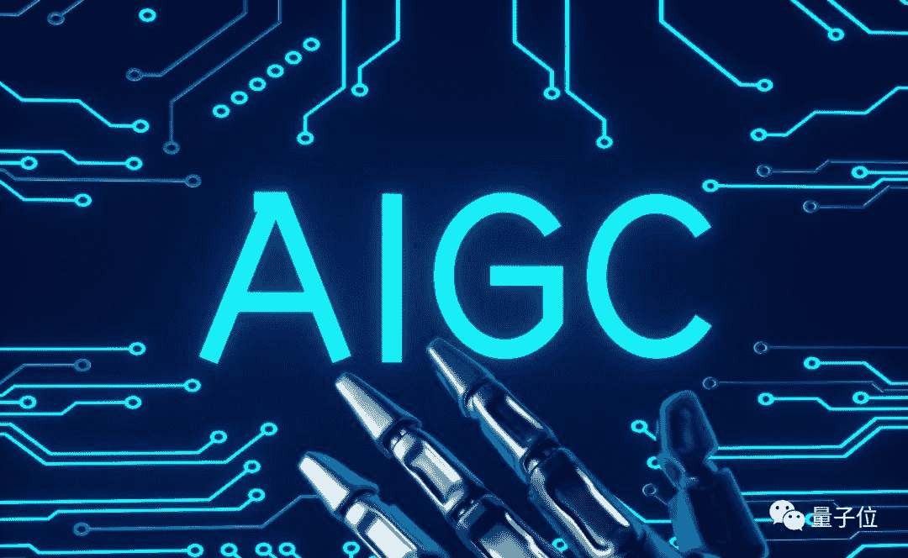
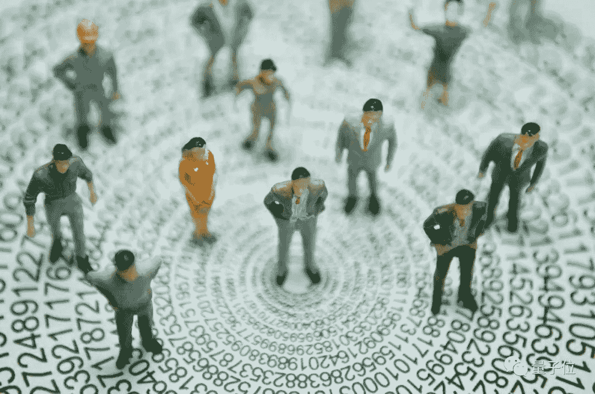

# 一个广告营销人的AIGC自白

> 来源：[https://my.feishu.cn/docx/A945dGySaoNxrkxCfzBcsshfnLR](https://my.feishu.cn/docx/A945dGySaoNxrkxCfzBcsshfnLR)

<https://my.feishu.cn/sync/CV7edZp1nspUQobYJhicxeP7nrb>

> 🔗 原文链接： h[ttps://mp.weixin.q](https://mp.weixin.qq.com/s/coAIkBmvw5ardB69XzhDVg)q.com/s/coAIkBmv...

> ⏰ 剪存时间：2024-03-14 18:43:42 (UTC+8)

> 预计未来 **至少一半 **的广告营销业务将与AIGC相关。

这个观点来自一位进入营销行业20多年的从业者。

从**他的视角看来，AIGC正为广**告营销行业打开新的大门，并且，下一个关键节点可能很快出现，标志性事件就是 出现AI驱动的广告营销公司 。

毫无疑问，对于广告营销行业来说，AIGC带来了技术、知识和工具的冲击。

它在产业链中起到的是什么样的作用？对行业的整体格局会有什么样的改变？面对这个挑战和机遇，国内创业公司可以从哪些点切入？目前国内外头部的营销公司对AI的布局大概是什么样的形式？

**带着这些疑**问，量子位智库和AI **nat**ive营销公司 奥创光年 的联合创始人、COO 杨海 进行了对话，对行业内外最关注的问题进行了探讨。

为了完整体现奥创光年在AIGC广告营销领域的思考、实践和分享，在不改变原意的基础上，量子位智库将对话内容进行了整理和编辑。

## **对话公司：奥创光年**

**奥创光年 **成立于2021年，是一家AI native营销公司，主要提供营销策略洞察、AI内容制作、AI智能投流到DAM内容管理的全链路营销解决方案。

现有产品有Mogic Content AI Studio& Mogic Copilot等。

其实现的AI自动化内容生产、管理及投放等，能够帮助企业在营销层面降本增效，平均为客户公司提升10%的ROI。

当前奥创光年已成功服务阿里巴巴、百事、欧莱雅、联合利华等百余家品牌集团和电商平台，2022年营收额为数千万元。

**对话嘉宾 **：奥创光年联合创始人、COO 杨海

杨海，奥创光年联合创始人、COO。

进入市场营销行业20余年，曾担任百事可乐市场总监、阿里巴巴担任新零售市场及战略负责⼈、雅诗兰黛集团副总裁。

以下为对话实录

## **AI浪潮冲击前的广告营销行业？**

**量子位智库 **：请问您怎么看待营销行业？

**杨海 **：我在营销行业做了20多年，之前会把营销讲做叫Art and Science，就是所谓的艺术跟科学的一个结合。当年我入行的时候，大家对这个事情很重视。

其中的“Sicence”，更多是在如何把创意更好地进行延展，以及更好地让创意产生更好的投放效果。

实际上我们觉得， 这一轮AIGC一定程度上已经在让“Science”影响创意 ，关于内容的生成、内容创意的应用方向也越来越涉入其中。

**量子位智库 **：奥创光年站在营销领域的哪个细分赛道上？

**杨海 **：我们公司有个slogan，叫做“让人类智慧聚焦创造”。

本质上，我们觉得用科学方法论能够指引内容的生产和创造，让营销这件事情变得更高效、更有效果，这也是我们一直想要追求的事。

我们主要是做内容营销加部分品牌咨询，咨询会涉及到帮品牌来定位，怎么来做好这个营销这件事情。我觉得关于数字化营销这件事情的占比会越来越大。

**量子位智库 **：广告营销发展历程中，重要节点有哪些？

**杨海 **：我20多年前入行的时候，可能一年只要拍三条广告或者最多四条广告。一个季度要发一条广告，然后剩下的就是做媒体优化，做一些渠道的物料，基本上我一年的工作就完成了，所以大家很多时候在做很多准备工作。

后来开始做数字化，当中更多的是如何通过曝光这样的方法来做好传统业务的一些认知和教育工作。

再后来延展出了电商，就会涉及到如何做好线上、线下的组合和设计，同时，因为电商本身它既是一个销售渠道，也是一个品牌认知的教育渠道，所以大家也会思考如何做好“品”和“效”两部分的传播。

再后来的话，包括抖音、📕、阿里这样的平台会越来越多，所以会 涉及 渠道线上的各方面如何做好整合，这个时候人力上就会比较吃紧。

**量子位智库 **：这个时期为什么会有这样的痛点？

**杨海 **：因为每个渠道的特征不一样，面对内容的需求不一样，特点也不一样。所以让一个人完全了解全渠道的这个点，其实是一个蛮大的挑战。

**一般品牌公司都会让一个人盯**一个渠道。但实际存在一个挑战，就是 渠道和渠道之间会比较割裂 。

A渠道和B渠道的人对品牌的认知，包括对产品的认知会有不一样的理解，导致大家在各个渠道上面可能看到的产品或者通调都是完全不一样的，这样会让品牌在源头做的工作受到很大制约。

**量子位智库 **：面对这些行业痛点，奥创光年是怎么应对的？

**杨海 **：我们公司出现的原因，就是现阶段信息多，渠道被碎片化，关于品和效有很多不一样的角色。

短视频营销时代，每个渠道中素材的保鲜周期通常就只有三五天，品牌出街频次和内容制作需求非常高。其实当中一定程度上靠人跟人之间的沟通来传递信息，在品牌调性的一致性上、内容的更新迭代周期上，一定就会受到很多瓶颈跟障碍。

所以我们侧重在这个上面做了很多工具，后来也和AI做了很多结合，创造了一些新场景。

这部分就是 **把原来一些碎片化、琐碎的工作进行集成，帮助大家做新的工作**流的设计，让大家在营销链路上变得更通畅 ，所以人能够驾驭好多个平台，不同的人群起到不同的效果。

## AIGC将如何冲击广告营销行业？

**量子位智库 **：您认为广告营销行业何时会进入下一个关键节点，具体表现是什么呢？

**杨海 **：我们觉得 下一个关键节点可能是出现AI驱动的公司 。

奥创光年创立的时候，就坚信未来无论哪个行业，好的公司都是AI公司。

所谓好的公司，就是看你有没有能力运用好AI这个生产力，把它变成工作流中的很大一部分。

我们开始对外合作的时候，先是和创新型品牌，后来主要接触大型、集团性品牌。去年开始集中合作的都是头部大型企业，他们本身在这件事情上有足够多的决心和资源，也愿意来做很多新的场景的尝试。

今年开始，我们陆续也跟一些营销行业的代理公司做一些讨论。

**量子位智库 **：这些代理公司想要合作是看到了哪些机会点？又是怎么进行合作？

**杨海 **：因为代理公司其实在做数字化转型，或者在AI上面发力。我觉得AI现在是大家看到唯一能够产生突破型差异竞争优势的唯一通道，所以大家在这上面有很多的投入。

代理公司有很多跟我们合作的方式，比如怎么更好地用好AI来做好一些工作。

我觉得 整个生态所有环节中，平台本身、品牌等重要角色已经开始参与进来 。如果创意代理公司也参与其中，慢慢就会形成一种新的工作流，一种新的方式。接下来一旦有比较规模化的生意和新链路产生，它就会变成一种行业的标准化方案。

**量子位智库 **：您认为目前广告营销行业发展面临的主要冲击点有哪些？

**杨海 **：我觉得是三点。

一个是 **技术的冲击 **。我觉得现在AI这一波冲击对品牌公司是很厉害的。其实这几个月，每个月都能见一个跨国企业的CEO或者Chairman，他们本身对这件事情的需求和利益程度，比我想的其实要着急很多。

因为大家觉得现在你谈论AI，就相当于10年前在谈论要不要搞电商一样，它是影响你整个业务结构以及工作流程的很重要一点。

第二个的话，我觉得是 **knowhow的冲击 **，今天我们一旦学习了新的东西，如何把它变成你工作中的一部分，以及如何运用好，应该是整个组织架构上面做承接的一件事情。

第三个是 **要适应AI时代的新工具 **。技术和产品伴随的习惯需要不断迭代，以适应新技术带来的冲击，还有怎么运用好新场景配套组织的挑战，也有新工具如何运用到新场景中的挑战。

**量子位智库 **：您预计领域在3年内市场规模会达到什么数值？其中与AI/AIGC相关的业务占比预估有多少？

**杨海 **： **肯定会很快过万亿 **，但三年内的规模还是和整体状况有关。

如果将来大家都以AI中台作为核心投放，乐观地说，至少一半以上的业务都会与AIGC有关，如果考虑独立的场景占比，我觉得至少在20%-30%以上。

## **AIGC如何改变广告营销格局？**

**量子位智库 **：AIGC对行业的整体格局会有什么样的改变？

**杨海 **：现在营销服务上有代理商，也有平台和品牌。

过去有些 **代理公司 **纯粹在做中介的活，比如说链接客户，以及投放的垫资。其实一定程度上需要他们在中间环节给大家提供一些增值性服务。能帮助品牌通过你的产品能力更好地了解平台、消费者，做好内容生成，上述角色就会变得越来越需要。所以我觉得中间代理商都要去了解如何运用好新的工具。

就 **品牌侧 **来讲，有些品牌会选择去中介化，那中介能力在新渠道下就需要一些新工具来帮助他更好地运用在新的一些场景。

对于 **平台 **来讲，原来做“品”的现在都要做“效”，原来做“效”的现在也都要做“品”，**原来有种草能力的现在可能需**要能有商业能力，原来有商业能力的需要有更多种草能力， 自闭环的要求也会越来越大 。

## AIGC如何变革广告营销产业链？

**量子位智库 **：AIGC在广告营销产业链中起到的是一个什么样的作用？是会重塑整个产业链，还是只是在每个环节中赋能？

**杨海 **：肯定是 **先从赋能开始 **。

就像奥创，我们从内容定位开始，然后在渠道层面做内容生产 （因为每个渠道上面内容需求是不一样的，基于对渠道的了解帮对方再做生产） ，这当中我们也做合作了很多场景，数据回流是属于扎根AI这个大基座后，生长出来的场景。

我们还看到AI将来可能会产生一些新场景，比如说 数字人直播，它就可能是完全基于AI驱动 。继续训练它，它可以自驱动24小时不停卖货。这就能让一些品牌无论是私域环节和公域场景，都可以不断通过这种方式来进行交互，最后就能变成一个独立的场景。

**量子位智库 **：在产业链中广告主、代理商/投放平台以及消费者，哪一端会最先受到冲击？

**杨海 **：我觉得 **广告主受到的影响会比较直接 **。那我们来说，ToB业务会受到比较直接的影响。因为它对效果和商业的理解，包括有多大的成本来驾驭所有的新营销平台。

ToB也是我们目前为止的目标客户。

**量子位智库 **：AIGC对于营销服务商或者投放平台的冲击如何呢？

**杨海 **：平台原来自己肯定也在做AIGC，所有的大厂现在都在做自己的AI模型，但它一定程度上是一个自闭环，所以当他们的品牌主会用到AI，就可以外化成品牌合作的能力。

这当中需要类似于我们这样的供应商帮助大家做好产品价值，因为平台所有的东西都是标准化的，但是品牌的需求有差异化，需要很多行业型的解决方案。

**量子位智库 **：最后想了解一下，AIGC对于消费者有哪些影响？

**杨海 **：我觉得商业场景当中，消费者无非就是更好地被这个产品影响、触达，然后更快找到自己需要的产品。

这种交互形式我觉得短期内不会有太大的变化。

当然将来直播间有虚拟场景，商业端也比较成熟了，消费者的体感就再会产生一些具体的变化。

## AIGC如何改变广告营销的竞争格局？

**量子位智库 **：一般会把市面上的广告营销相关的企业怎么分类？按业务场景分，或者是按目的、渠道这样分？

**杨海 **：其实每家公司会分得不太一样。以后我们自己精细化的话，不会把工具作为分法，像是有人专门做图文，有人专门做图片。做营销这件事，我们觉得按照工具划分会比较受局限。

我们想做一个整合性的营销AIGC解决方案给大家。 像我刚才讲的，客户在新场景中需要更多的组织配套。不能因为你提供的功能或者产品有限，导致消费者做成一件事还有跟不同生态合作才能整体转型，这样的话效率是很低的。

将来我们会分的主要是行业，因为行业的knowhow会有差别，包括供应链的情况、对生态的理解，我们会按照这个角度来做一些区分。

**量子位智库 **：目前国内市面上的大厂或者创业公司，有您比较看好的公司吗？为什么？

**杨海 **：国内大模型还在起步阶段，谁有优势现在还不好说。我觉得对标国外的大模型来讲，成熟度还没有那么完整。

但我觉得国内肯定是要有大模型平台出来，所以我还蛮期待他们有更多的表现以及更多能力的展现。

**量子位智库 **：现阶段，AIGC广告营销领域国内竞争状况如何？

**杨海 **：在今天来讲，国内不是零和竞争，大家面临是国际型竞争。比如我们服务的很多国际品牌，别人可以在国外有新技术、有场景，引进运用到国内市场。

我们现在主推用国内想法影响国外品牌， 其实其他领域已经有品牌在这么在做了。

## AIGC如何变革广告营销生产流程？

**量子位智库 **：广告营销的整个工作流程，奥创光年大概分为哪几个阶段？

**杨海 **：我们一般有四个模块。

第一个是 **内容的策略洞察 **，这个涉及到到底怎么做这件事的内容。

第二件事情是关于 **内容的生产自动化 **，怎么把它做出来。

第三块的话是 **内容的投放优化 **，这是智投一体的一个闭环。

还有一个底座是关于 **整个的内容资产管理 **，它不仅仅是单一文件文件型的，更多的起到了类似网盘的效果。

但我们现在也帮品牌做私有化模型，帮他们来看过去的资产、VI 能怎么利用模型，这样的话能够让内容可分析、可沉淀，能够更快地产生一些效果。

**量子位智库 **：上面四个模块，AIGC都会起到作用吗？还是说会带对某一个模块起的影响是最大的？

**杨海 **：都有作用。 相对来讲，AIGC的表现力在智能内容生成最突出。 剩下的三个模块是生成式内容辅助 他 们来做事。

举个例子，投放计划依然还需要自动化，但是内容生成带来批量性的可能性，让投放优化的手段多了很多；然后关于洞察，其实也是把我们对内容数据的理解作为底座，再进行行业的数据分析，指引内容应该怎么来定位、生成；内容资产化管理的话，是基于在内容模型上理解品牌和行业的所有内容，再做内容标签的识别，进行管理。

所以内容生产这个模块是纯AIGC的模块，剩下三个AIGC是场景提效的重要组成部分。

## 当下国内外营销公司的AI布局与产品变化

**量子位智库 **：据您了解，目前国内外头部的营销公司对AI的布局大概是个什么样的形式？

**杨海 **：国外短视频赛道没有国内做得好，他们基本上都聚焦在图文。几个大厂，像Google都在做自家放体系的AI，一些生态公司更多地是帮助品牌更好地跟大厂对话。

短视频的话，我觉得很有可能是中国公司先跑出来。因为 短视频起源就是中国，跟AI做结合是今天所有人都在做的事 。而且今天一些头部的营销公司，其实现在日子也不好过。

**量子位智库 **：国内头部营销公司的产品形态和场景相比以往发生了什么变化吗？

**杨海 **：一方面品牌越来越强，平台越来越强，中间其实是被挤压的，所以他们也急需一些新场景、新能力去更好地服务上下游。这部分我觉得是大家目前为止看到的比较大的一个机会。

但传统公司面临一个比较大的挑战，他们原来的 人才储备以及技术上的投入其实并没有那么高 ，面对转型，要求其实蛮高。

## **新的创新创业机会？**

**量子位智库 **：在您看来，AIGC+广告营销赛道，国内创业公司可以从哪些点切入？

**杨海 **：首先，创业公司要能够 **熟练地运用好AI **。现在很多声称自己在做AI，实际上只是在表层解读大模型的一种方法。

能在哪些场景更好地服务自己的用户，大家想得不是那么透彻。

所以我觉得首先可以靠AI在内部提效，让原有产能进一步提升。

第二个的话， **在AI上面多挖掘一些营销场景 **，更好地服务好客户。

**量子位智库 **：奥创光年在各个流程中用AI代替人力，具体能降低多少成本或者是提高多少效率？有没有实际例子可以分享？

杨海：我们本身就是做AI这件事情，所以没有before和after。

但是做同样一件事，比如在生产效率上，和跟传统制作有指数级的差别。一天的生产量，我们至少是传统制作的数倍以上。

**量子位智库 **：奥创光年做AIGC+的过程中，遇到了什么样的挑战或者是想法的验证，最后都有了什么样的成果或者案例？

**杨海 **：我们内部最大的挑战是一个持续进化学习的过程，这个对大家的要求会比较高。

然后对于品牌那边，我刚才讲过其实最大挑战就是组织化的配套，以及是说品牌那边对于这件事情上上下下的共识度，这上面要求会比较高一些。

— **完 **—

<https://my.feishu.cn/sync/CV7edZp1nspUQobYJhicxeP7nrb>