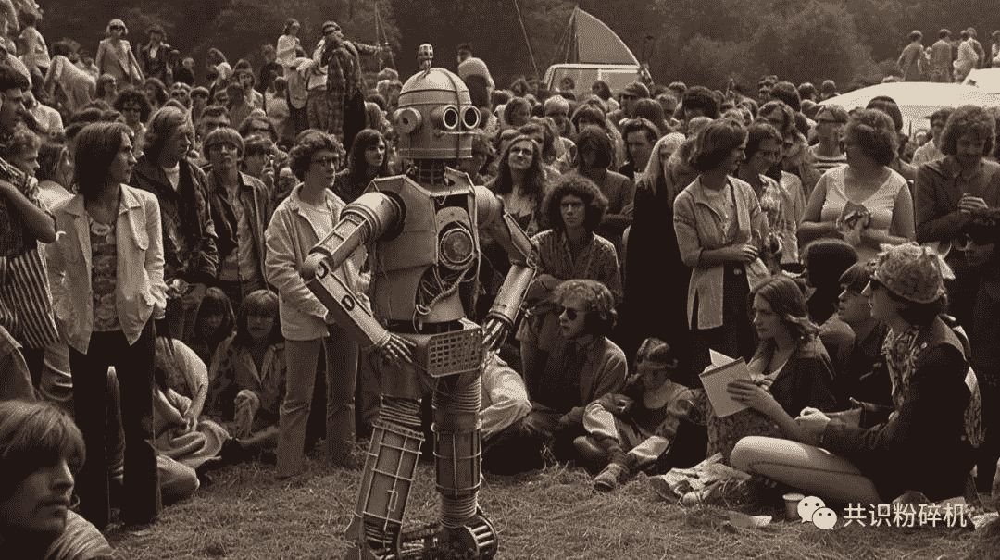
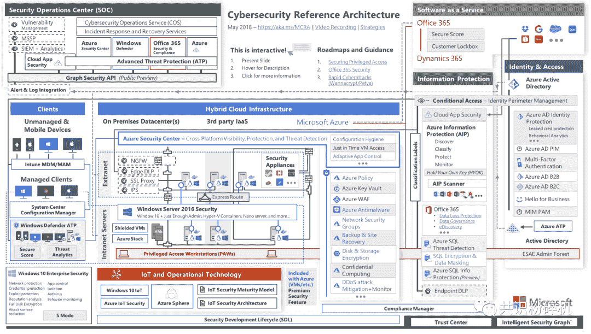

# 聊聊AI正在如何颠覆SaaS软件

> 来源：[https://my.feishu.cn/docx/Sjbvdc1ddoUgJ3xMcD4cjxBJnbE](https://my.feishu.cn/docx/Sjbvdc1ddoUgJ3xMcD4cjxBJnbE)

<https://my.feishu.cn/sync/CV7edZp1nspUQobYJhicxeP7nrb>

> 🔗 原文链接：https://mp.weixin.qq.com/s/-f0GwSAOl4_o-4J_--S9XQ

> ⏰ 剪存时间：2024-03-14 18:45:27 (UTC+8)

文：小熊猫 波太金

相比A股的千帆竞发，美股投资人能炒作的大标的只有英伟达与微软。

“软件在AI时代还有没有价值？”除了灵魂拷问，现在还找不到共识。

但如果将一场变革当做赛跑，从现在起的每个月都可能有人掉队。

（文章仅代表我们的看法，如果有不同意见请尽情拍砖，或者拉到文末参与讨论会）

## 1 历次科技变革变革了谁

---

自小型机发明后，我们经历了3次大的科技变革：PC互联网时代，移动互联网时代，以及离我们最近的云计算时代。

PC互联网时代，是过去三次变革中最剧烈的，也是创业者大获全胜的时代：

+ 小型机时代的巨头公司，IBM、DEC、HP、SUN、微软、Oracle中，硬件的一批公司都在互联网初期错过了形态的变革。

+ IBM、Oracle凭借其软件基因，适应了新兴客户。而微软在PC互联网时代最先理解了流量和产品生态的逻辑，在20世纪的倒数第二天，成为了全球最大的上市企业。

+ 这也是创业者大获全胜的时代，诞生了Amazon、Facebook、腾讯、阿里，这些全球最大的科技企业。

移动互联网时代，巨头们几乎全部安全闯关，只有中国的创业者真正威胁到了巨头生态：

+ 相比小型机到PC互联网，移动互联网的变革没有改变内在产品逻辑，也没有改变巨头们信奉的流量至上。除了微软在移动互联网时代迷茫过，手机、搜索、浏览器的三板斧都不奏效，其他巨头都顺利过渡到了移动形态。

+ 美国创业者，在软件、支付、打车、娱乐都咬开了一道小口子，但没有人能威胁到社交、电商、搜索的核心圈。

+ 中国创业者抓住了电商、地推和短视频的三次大机遇，跑出了堪比腾讯和阿里的新巨头。

云计算时代，是最考验认知的，硬件包袱轻的公司都顺利过关：

+ 与先前两次变革不同，云计算初期的认知呈现明显的两极分化。就像2010年，马云、马化腾和李彦宏对云计算有完全不同的认知一样，在美国也同样如此。最适合发展云计算的巨头IBM，因为硬件业务的影响暂停了“Blue Cloud”，直到2013年才匆匆认定云计算的大方向。而Oracle则掣肘于其过去的一体机策略，初期未能下定决心牺牲硬件利益。

+ 与互联网变革相比，云计算给了巨头们更长的适应时间，2B业务不是一蹴而就的，微软和谷歌都没有第一时间跟上`AWS`的脚步，但很快通过自身优势，分别找到了系统级打法和`Data Driven`。其中微软更汲取了移动互联网时代转型的教训，大刀阔斧通过KPI进行组织重构，后来者居上。

+ 而如果我们寻找共性的话，不难发现IBM、Oracle、SAP面对的客户都是当时最大、利润最厚的客户，但同时也是上云最慢、决策最保守的客户。因为大客户需求最晚迭代，也造成了这批最该进入云计算的巨头们，错过了新兴客户上云的机会。

## 2 软件行业的上一次变革

---

云计算时代前的老软件公司，大多数靠踩着IBM、Oracle、SAP、BMC的尸体成功上云，而粗看他们共性的话是因为云计算只改变了交付方式，并没有改变产品本身的方法论：

+ `CRM`击败了IBM和Oracle，成为了公认第一的`CRM`软件。

+ `WDAY`击败了IBM和Oracle，成为了公认第一的`HCM`软件。

+ `TEAM(Atlassian)`击败了IBM，以及迭代更慢的`Basecamp`，成为了公认第一的项目管理软件。

+ `NOW`击败了BMC、IBM和`ORCL`，成为了公认第一的`ITSM`软件。

+ `DT`、`NEWR`击败了IBM与`AppDynamics`，虽然后面被`DDOG`反超，但也曾经辉煌过。

而在客户需求大幅变化的安全行业，则出现了明显的新老更替：

+ 杀毒软件时代的赛门铁克和`Mcafee`，没有适应云环境下`Endpoint`的技术升级，被后来者`CRWD`颠覆（联网共享的安全信息，即威胁情报）。

+ 而防火墙行业则因老的内网部分仍然存在（只不过上了私有云），虽然信息化加强仍然增长，导致防火墙仍然有需求。而也可以明显看出`PANW`成功拥抱云（针对公网推出类似于`ZS`的`Prisma`和增加`SASE`产品线），`FTNT`也积极补充混合云架构的相关产品，业务在新的架构下逐渐得以发展，反应慢的`CheckPoint`等则被落在后面。

而因为云时代大幅改变了数据仓库的运行逻辑（计算存储分离，通过云化架构提供计算和存储的弹性），使得云数据仓库的效率有了数以十倍级别的提高，`TDC`、`Cloudera`、`Hortonworks`等上一代架构也遭到了淘汰。

相比互联网的变革，云计算时代给了软件公司更多的容错空间：

+ 客户环境和需求的改变决定了软件形态的变化，相比IBM、`Oracle`，与新兴客户更多合作的软件公司更加敏感。

+ 相比竞争激烈的行业，绝对份额领先的公司有充分的时间摸索转型，例如`Office`、`TEAM`、`Oracle`的`OLTP`业务。

+ 而软件行业的变化也远不如消费互联网那么陡峭，大公司可以收购小公司补课，例如`CRM`超过一半的业务都是收购而来，`ITSM`和监控领域的发展中也不断有着各种收购，而到了大公司例如`AWS`也通过收购`ParAccel`整合了`Redshift`，补齐了数据仓库能力。

## 3 AI时代不缺态度，只缺认知

---

如果说上一次云计算变革，巨头们的差异是差在态度和认知上，行动得早的巨头最快跑出来公有云，行动得快的`SaaS`最快吃掉`Legacy`对手的份额。

那这一次`AI`变革完全不缺态度：

+ 相比云计算是个15年的新概念，`AI`最早的神经网络概念在80年就被提出了，之后不光出现在各种商业案例中，甚至出现在各类科幻电影里。

+ 如果说15年前的科技公司判断错误云计算是因为认知不足，越早`Cloud First`的公司越有先机，那现今所有公司都明确`AI First`。

+ 云计算变革时期，`Legacy`业务以及组织架构成为`Cloud First`推进的阻碍，例如`Azure`的早期就栽过跟头，但如今甚至到业务层都明白拒绝`AI`可能未来这个部门就没了。

上周 Elon Musk发起的“暂停`GPT-4` Level研发倡议”，虽然其中的不少签名最后被证明造假，但也恰好说明了所有人的预期都非常一致，`AI`将快速改变世界，但是安全问题需要被立刻讨论。

所以相比上一次的云计算变革，如今的科技公司们不缺态度，只缺认知，因为大多数人都不知道那个眼前一亮的产品应该长什么样。

## 4 是否被颠覆看你站在哪一边

---

为了理清所有`SaaS`公司在这场`AI`变革中的位置，和紧要度。我们将`SaaS`企业分成为四类：

+ 人调用软件：基础设施、计算引擎的作用高于方法论的价值，例如数据库、游戏引擎、安全。在`AI`时代，人调用软件会逐渐演变成`AI`调用软件，软件还在，只是人的作用大大弱化了。

+ 软件梳理流程：软件的存在是为了将人类的工作结构化、流程化，并辅以方法论的`Best Practice`，例如`ERP`、`CRM`、`HCM`、项目管理。在`AI`时代，对人类分工的影响会越来越大，`Workflow`的变化，甚至人类被`AI`替代，将使流程`Best Practice`发生翻天覆地的变化。

+ 翻译工具（自然语言与机器语言之间的翻译，自然语言与自然语言的翻译等）：各类低代码工具，或者计算引擎较为简单的工具，例如`RPA`、图像创作、部署。在`AI`时代，过去的中间态工具，将完全变成`AI`闭环，人类只要输入自然语言甚至一个“目标”，翻译工具的价值将进一步弱化。

+ 资源类：`AI`的朋友，不会被`AI`颠覆，比如说电力资源，网络资源。

而如果我们审视上面四类产品，不难发现软件公司们在未来会很明确的划分为“为`AI`打工的公司”和“被`AI`改造的公司”：

+ “人调用软件”中的底层能力和“资源类”产品都为成为`AI`的好帮手，`AI`提高生产力后，也会逐渐提高帮手们的使用效率。

+ 而过去离人类更近、离流程走得更近的“软件梳理流程”，则会因为劳动力结构的变化，以及流程`AI`化，被大幅改造，这中间有危机也有机会，但更多属于还看不清。

## 5 人调用软件：数据库

**产品结构改变的风险：低**

**被微软颠覆的风险：低**

**被创业公司颠覆的风险：低**

抵御`AI`变革的关键：性能→性价比+准确性

**代表公司：SNOW、MDB**

我们对数据仓库行业的完整看法请见《Snowflake与数据仓库正在经历的大飞跃》。

在`AI`时代，数据库的使用流程将会发生大变化：

+ `AI`将很快对齐能力，完成目标到`Query`的拆解，并且生成`SQL`/`Python`/`Java`等各类数据库可以使用的语言。相比上下文逻辑复杂、有非常多前置条件和理解难度的应用编写环节，数据库语言代码量简单，对上下文的要求低，未来很可能被`AI`大幅替代。

+ 这意味着数据库查询的门槛，尤其是数据仓库查询，将变得比Excel的门槛还低。不再需要熟练`SQL`等语言，在未来互联网中的各个职能，包块产品经理、运营、市场、销售，都可以通过自然语言完成交互。

而`AI`大模型，在可预见的未来，更多还将作为拆解目标进行查询的工具，无法替代数据库类产品：

+ 虽然通过预训练，大模型可以将数据库中存储的向量化为参数，但是通用模型相比专用模型，性价比会显著降低，在更新数据的同时还需要进行增量训练。

+ 大模型更多使用向量数据，通过预训练向量化，或者以`Embedding`的方式接入向量数据库。向量数据是将结构/非结构化数据抽取成特征值，在还原时会丧失准确性，打个比方“将向量化的一只波斯猫，还原只能得到波斯猫，但得不到那一只波斯猫”。大多数需要准确性的数据库场景无法被替代。

+ 这也使得大模型直接平替数据库，在性价比和准确性上相对大模型+数据库，都不具有优势。

而一部分不要求准确性的数据库场景，则可能直接大模型化：

+ 例如搜索引擎可能用到的索引数据库，存储的是索引关联。

+ 例如一部分主要为了训练进行存储的数据湖场景，可以直接平替进向量数据库。

未来怎么看待机遇与危机：

+ 当一家数据库公司开始明确提到`AI`解放了分析的生产力，用户数和`Query`出现大幅提高时，这意味着`AI`带来的Beta机遇开始了。

+ 当一家数据库公司进入向量数据库领域，并且计算引擎不输给目前领先的`Pinecone`、`Zilliz`，这意味着他进入了`AI Infra`领域。

+ 当大模型的查询性价比能接近数据库公司时，这意味着整个行业的底层逻辑出现了变化，至少在现在风险还很低。

## 6 人调用软件：Log/Search

**产品结构改变的风险：中**

**被微软颠覆的风险：低**

**被创业公司颠覆的风险：高**

抵御`AI`变革的关键：性能

**代表公司：ESTC、SPLK**

如果我们抽象去理解`Log/Search`公司的工作：

+ 可以理解成有一个仓库，仓库每个门/区域上面挂着一块牌子/标签，说明这一块会放着什么。然后新的货物进来，仓库经理就会根据手上拿着的带着标签的仓库平面图找到对应的区域，把货物放进去。

+ 接到上级的出库的指令后（`search`），比如说“苹果六箱”，则先在这张图上面找到放苹果的位置（`URL`），然后把这个位置告诉叉车。所以这个东西的核心就是那张平面图，能够快速找到对应的东西的位置。

在`AI`的影响下：

+ 结构变了，可能看不到那张图了。标牌的部分变成了一朵巨大的云（模型），所有仓库存的东西都会被云吞噬，成为云的一部分（训练成参数）。

+ 当需要信息的时候，云会按一定的组织形式（相关性）组成输出的东西，然后吐出结果。

+ 但目前为止，`Log`数据因为数据密度过低，以及对准确性仍有一定的要求，彻底改变为向量化存储的意义还不大。

未来怎么看待机遇与危机：

+ 原来仓库的物理存储空间可能暂时还是需要的，但是作用只剩下等待被云吞没之前的缓存，如果云吞的足够快，那么缓存的空间就需要的越少，直到没有。

+ 云吞的东西还是有偏好的，比如高性价比的加工成向量，然后缓存可能是一个新的需要。

+ 短期来看，目前的架构尚满足使用，还没有出现明显的性价比很低的情况，所以影响更偏`long-term`，即当前出发数据、模型变得非常大，对底层`infra`性价比的要求才会上去，会促进新的架构的`infra`的出现。

## 7 人调用软件：安全

**产品结构改变的风险：低**

**被微软颠覆的风险：高**

**被创业公司颠覆的风险：低**

抵御`AI`变革的关键：集成+数据->解决问题的方法论+自动化

**代表公司：PANW、FTNT、CRWD、ZS、S**

安全体系分成攻、防两种，其中防又分成三部分。

防御体系：被动处理威胁：

+ 终端：PC上的杀软，主机（包括服务器、虚拟机、容器上的`pod`节点）上的安全`agent`等。

+ 网络：支撑人对机器，机器对机器的访问和信息传输，这里面有很多安全设备/能力，比如说`VPN`，抗`DDOS`，防火墙，`WAF`，`ID/PS`等等。

+ 管理平台：将终端和网络上的数据汇总，进行威胁的综合判断，然后做出告警和自动处理。

进攻体系：主动发现威胁，比如说代码检测，红蓝对抗，`API`安全等等，预先发现系统中存在的问题和漏洞，进行修补和改善。

在`AI`的影响下：

+ 在防御端会进入系统级整合阶段。这几年的趋势一直是整合，因为客户用的安全产品类型太多了，较多客户存在10-20种以上的安全设备，这样就给安全运维造成了非常大的难度。而本身安全也是要靠防御体系综合处理安全问题的，那么在`AI`的作用下（相当于原先都是四肢，人来充当脑子调度四肢，作出防御，现在变成了`AI`成了脑子，可以调度四肢），对于系统整合性，内外部数据驱动更加看重。

+ 在进攻端：本质是个代码级上下文理解和模式识别的东西。除了极少数的顶尖“黑客”因为具有创造性的发明和发现能力之外，大部分应该都可以被机器所替代。

未来怎么看待机遇与危机：

+ 微软是安全领域产品最全，体系最完整（参考下图），收入最多的超级巨无霸玩家，从防守侧的安全软件来看，除了微软不做的硬件防火墙和一些网络设备之外，几乎都有覆盖。而且目前微软通过`OpenAI`，可能是安全厂商中最先给自己的体系配上脑子的公司，所以在防守端除了做硬件防火墙和网络设备的公司，都有可能被微软的安全全家桶“锤”。

+ 进攻端，微软可能因为`Github`+`Copilot`能力，充分实现代码级安全处理的智能化和自动化（甚至是在生成代码时候就自动处理了安全问题）。

## 8 人调用软件：ITSM

**产品结构改变的风险：低**

**被微软颠覆的风险：低**

**被创业公司颠覆的风险：低**

抵御`AI`变革的关键：集成全面+数据->解决问题的方法论

**代表公司：NOW**

`ITSM`产品可以分成三层：

+ 底层是`Agent`，集成企业端的硬件和各类`SaaS`软件，采集数据和使用习惯。

+ 中层数据库，将采集到的数据进行沉淀。

+ 顶层是`Bot`，第一步做分类与整理（将对应的问题找到答案），第二步自动化，自动化向IT部门，再自动化向保障使用者。

在`AI`的影响下：

+ `ITSM`的头部厂商仍然有集成优势，底层+中层结构不会改变，特别对于各类`Legacy`系统，可以有效抵御`AI Native`创业公司的进攻。而`ITSM`厂商也早就开始引入了`Bot`，并围绕这个迭代了产品进化。

+ 顶层`Bot`会迅速变化，过去的分类整理将完全以自动化方式实现，并且`AI ITSM`会更加实时，及时发现问题。

+ 相比新兴的`AI Native`公司，更看好现有公司依靠集成+数据，在`AI`模型下取得局部优势。

未来怎么看待机遇与危机：

+ `ITSM`公司将很可能推出加价版本的`AI`服务，一旦推出一定会增加收入（相当于在原来问题分级分类中，把原来一部分需要人类处理的问题进一步变成机器可以处理的问题，对于客户来说可以进一步压缩处理人员的成本，对于提供软件服务的`vendor`来说产品能够解决的问题更多）。

+ `Twitter`上`HCP`的合伙人有讨论过`AI`能自动接接口，还会`Debug`……需要观察`AI Native`公司在集成上会不会更便捷，短期目前看不到风险。

## 9 人调用软件：AdTech

**产品结构改变的风险：低**

**被微软颠覆的风险：低**

**被创业公司颠覆的风险：中**

抵御`AI`变革的关键：集成全面+数据->聚合`SDK`，更全的脱敏用户数据

**代表公司：U、APP**

在`AI`的影响下：

+ 生成式广告成为现实，制作文本和图片素材的门槛大幅降低，并且可以实时针对千人千面数据进行调整。

+ 生成式广告将会直接量化出点击率的提高程度，不用对任何人收费，就可以提高变现效率。

+ `Ad Tech`公司将进入生成式广告效率的技术迭代战争，但战争中没有被拉下的公司都会有效率提高。

未来怎么看待机遇与危机：

+ 谁先推出生成式广告，谁就能抢得先机

## 10 人调用软件：游戏引擎

**产品结构改变的风险：低**

**被微软颠覆的风险：低**

**被创业公司颠覆的风险：低**

抵御`AI`变革的关键：性能，生态

**代表公司：U、RBLX**

游戏引擎类似于数据库，有极高的引擎壁垒和专用优势，大模型很难走到替代底层的阶段。

## 在AI的影响下：

+ 开发游戏将可以直接使用自然语言，对上下文的要求不高使得开发效率大幅度提升，目前多家游戏公司都已经走入应用阶段。
+ 除了语言能力的转换，图像大模型也可以直接嵌入到原画生产中，进一步提升游戏公司的开发效率。
+ 大幅度降低SMB开发者的开发门槛，长尾游戏生成效率显著提高。
+ 接入OpenAI的AI功能后，在Knowhow和与训练数据上优于OpenAI的原始功能，可以直接上量商业化。

## 未来怎么看待机遇与危机：

+ 很难看到竞争者颠覆，预计在商业化上都会有增量。

# 11 还有哪些人调用软件

---

### 身份管理：

OKTA目前是也将很可能长期成为OpenAI的供应商(Auth0)，用以补齐OpenAI一部分相比Azure OpenAI服务中在CIAM的身份管理劣势，但如果Azure OpenAI服务渗透率快速提高，则也会反向影响OKTA在现有企业中的渗透率。相当于Azure利用整套方案的完整性，绑定推销身份认证能力。

### 中间件：

例如CFLT的产品Kafka，AI无法改变Kafka的形态，但代码量的快速提高→应用量提高→数据量提高，将可能为Kafka带来应用环境的Beta增长。

### CDP：

例如BRZE、TWLO Segment以及Adobe Experience，AI无法改变获取数据（集成埋点）以及咨询的过程，但类似于生成式广告，素材的制作成本会进一步降低。

# 12 软件梳理流程：ERP/HCM/CRM/FIN

---

### 产品结构改变的风险：高

被微软颠覆的风险：低（CRM中）

被创业公司颠覆的风险：中

抵御AI变革的关键：方法论

代表公司：CRM、WDAY、HUBS、INTU

ERP/HCM/CRM我们都可以简单概括为流程类软件。

流程类软件过去为客户提供了几重价值：

+ 将流程具象成软件，从简单的报销、考勤，到复杂的特殊场景，例如中国地产周期中出现的“三道红线”，具体到录入数据→什么数据反应了什么现象→需要什么部门参与→参与要做什么。
+ 为客户提供Best Practice，例如CRM系统在对接客服时，提醒客服如何提高工作效率，以及该采用什么话术。
+ 同时流程类软件也是客户数据最大的沉淀来源之一，沉淀的数据再接着进入数据仓库。

## 在AI的影响下：

+ 流程将直接抽象成对大模型Prompt的过程，更多的流程操作会通过对话完成。
+ 这将很可能使得流程类软件的交互界面大幅更改，只是我们现在还不知道到底什么样的交互界面最优。
+ 方向是以AI为判断的核心，人逐渐成为辅助和接受AI的指令和分配的任务，在这个过程中人之间因为需要多组织、部门的协同管理软件的工具部分被大幅度简化。

## 未来怎么看待机遇与危机：

+ 市场上已经有新的AI Native公司，例如OpenAI前VP创业的Adept正希望改变流程化类公司，AI Native公司在训练模型到交互界面，很可能包袱更小，迭代更快，并且从要求低的SMB客户优先入手。
+ 流程类软件公司需要快速进化出新的版本，不仅仅停留在Salesforce Einstein级别，未来一定是大改动而不是小修小补。

# 13 软件梳理流程：项目管理

---

### 产品结构改变的风险：高

### 被微软颠覆的风险：低

### 被创业公司颠覆的风险：中

### 抵御AI变革的关键：方法论

### 代表公司：TEAM

TEAM的Jira套件是市面上几乎垄断的大客户项目管理解决方案，在项目管理的流程中Jira相比其他产品有很大的优势：

+ Jira有最丰富的字段，字段堆叠形成事项，事项堆叠形成任务。这使得Jira在项目管理中有最高的灵活性，每一个字段的设置都有精妙之处。
+ Jira几乎已经成为了敏捷开发的代名词，市面上几乎所有的敏捷开发生态资料都是围绕Jira的。
+ 一旦客户使用Jira，就会进而集成各类DevOps软件，这使得Jira成为DevOps的中心，并将客户的整个开发流程在Jira中具象化，非常难以迁移。

## 在AI的影响下：

+ 最直接的反映是大概率程序员的数量会随着生产效率地陡峭提高，而出现短时间的停滞，最终是否能走出L形图困境，需要看需求是否也会大幅爆发。
+ 过去Jira的灵活优势，在工种复杂环境下非常明显，当项目经理管理的项目中有20个工种时，项目经理可以凭借高度灵活的Jira最有效的减少资源浪费并且做出及时调整。但当工种减少到5个时，Jira的字段优势也不再明显。
+ 当AI可以完成“多数项目经理的工作”，可以完成“产品经理的多数需求拆解工作”，可以完成“程序员的部分编程工作”，新的开发Workflow肯定会改变。打个比方，在《流量地球》中，如果没有Moss的指导，地球不可能以如此快的动作完成1万台行星发动机的搭建，Moss在这个项目中就是中心化的项目经理。

## 未来怎么看待机遇与危机：

+ 与流程类软件一致，类似Adept的创业公司也正在考虑重塑项目管理流程。
+ 未来一段时间可能会陆续有公司提到“GitHub Copilot如何提高公司的开发效率，以及公司将如何优化开发人员数量以提高利润率”，这在港股中已经有了先例，我们熟知的SaaS公司微盟已经提到了如何通过Copilot在未来优化人员。
+ TEAM作为古董级软件公司，顺利度过了移动互联网和云计算的两次变革，现在Jira也几乎是大客户唯一可选的方案，这使得Jira有充足的时间自我改变，未来也更有可能是自己颠覆自己的角色。

# 14 软件梳理流程：监控

---

### 产品结构改变的风险：中

### 被微软颠覆的风险：低

### 被创业公司颠覆的风险：中

### 抵御AI变革的关键：方法论+Full Stack数据

### 代表公司：DDOG、DT、NEWR

我们对监控领域的完整看法请见《DevSecOps：开启混乱纪元》。

我们不将监控领域归类到“人调用软件”，是因为监控软件的核心价值在于梳理了IT系统管理的一些经验和工具。底层的架构层，大部分的监控软件已经有充分的同质化趋势，各家公司可以采用Elastic以及各种开源方案，或者直接搭建在Snowflake与Databricks之上。

与ITSM类似，监控软件的差异化体现在应用层：

+ 监控与ITSM类似，可以分为应用层+数据底座，数据底座解决的是采集数据到沉淀/查询数据的过程，应用层提供的是解决问题的方法。
+ 监控公司将过去的解决方案抽象成方法论，提供了解决问题的步骤，并将其中的部分自动化。
+ 同时为了提高客户DIY解决问题的效率，在应用层提供了大量的工具集。

## 在AI的影响下：

+ AI Ops的概念将快速实现，过去DT与DDOG都在AI Ops上做了大量的尝试，未来将随着AI更加智能加速落地，不光可以更快的解决问题，还可以更加实时的解决问题。
+ 随着AI Ops的影响，所有监控公司的应用层价值都会变薄，工具集作为变种的低代码工具也会逐渐失去价值。进一步推演，可能后面就不需要那些方便人类理解问题的Dashboard，数值分析结果等，变成机器根据数据匹配规则，然后套用解法，直接对问题进行处理，进行自我调节的闭环中（Self-adaptive Systems）。
+ 监控公司需要更快的提高在AI Ops的局部优势，将方法论形成AI Ops的效率提高，对各家公司的影响会直接取决于AI Ops的能力强弱。
+ 创业公司相比以前会更加有机会，代码量比以前更低了，前两年因为数据底座的搭建门槛降低（Grafna，Snowflake/Databricks），跑出来了一批监控公司，而如今他们在AI Ops大幅改变未来交互的时代，也有机会加快追赶的步伐，行业一定会变得更加卷。

## 未来怎么看待机遇与危机：

+ AI Ops成为未来监控软件的焦点战，DT在AI Ops中走得最前，之后是DDOG，但DDOG可能因为其更加Full Stack有训练优势。
+ Grafana等创业公司的增长速度惊人，在AI变革下，他们与上市公司的差距进一步缩小，包袱更小，创新的胆识更强，密切关注其弯道超车的能力。

# 15 还有哪些软件梳理流程

---

### 协同：

MDAY、ASAN等公司的产品结构可能会出现大幅变化，类似于Office Copilot级别的变动，会使得交互界面出现大改动，需要等待让人眼前一亮的产品。并且同时还会面临Office+Teams+Loop组合更激烈的竞争。

### 客服：

类似于ZEN、FIV9等公司也将出现交互界面的大改动，工单场景和Call Center场景的很多需求都将通过对话的形式完成，考虑到所有人都可能是OpenAI的使用者，同质化会更加明显。

# 16 翻译工具：图像创作

---

### 产品结构改变的风险：高

### 被微软颠覆的风险：低

### 被创业公司颠覆的风险：高

### 抵御AI变革的关键：方法论+Full Stack数据

### 代表公司：ADBE

相比于Offce、游戏引擎、数据库，ADBE依赖的图像渲染引擎难度没有那么大，更多是作为图像创作的可视化工具出现。

## 在AI的影响下：

+ MidJourney等创业公司会直接跳过引擎层的建设，变成自然语言的图像创作/修改工具，未来图像的微调也可以很快通过AI实现，不再依赖可视化。
+ 如今的大模型图像生成没有图层和矢量图的概念，这使得大模型生成的图像看起来“没有那么好编辑”，但未来大模型图像会很快拆解出图层和矢量图，甚至图层和矢量图在未来也不那么重要。

## 未来怎么看待机遇与危机：

+ Midjourney等图像大模型的迭代成为最关注的焦点，当能拆接触图层和矢量图时，就意味着行业底层彻底改变了。
+ 图像大模型的壁垒和参数要求要远低于GPT大模型，ADBE有追上的机会。

# 17 翻译工具：RPA

---

### 产品结构改变的风险：高

### 被微软颠覆的风险：高

### 被创业公司颠覆的风险：高

### 抵御AI变革的关键：集成全面

### 代表公司：PATH

RPA行业目前正处于混沌局面，所有人都知道RPA行业未来会直接改名叫AI，并且能清晰地想象出改变后的产品将如何工作。

## 在AI的影响下：

+ RPA低代码工具将迅速AI化，目前卡在了集成上，但显著的更高效率会使得集成推进得很快。
+ 微软在这个行业会显著地更加有优势，本身产品的价格就远低于同行，并且有更多的提前量做AI化。

# 18 翻译工具：部署

---

### 产品结构改变的风险：高

### 被微软颠覆的风险：低

### 被创业公司颠覆的风险：高

### 抵御AI变革的关键：易用性（对还涉及人的部分）+自动化（尽量让机器去做）

### 代表公司：HCP

HCP的拳头产品Terraform靠声明式语言打赢了Ansible，其中最重要的差别是IT工程师使用起来更加方便，但AI会将声明式语言变得更加简单。

## 在AI的影响下：

+ 声明式语言将很快变成自然语言，易用性在AI面前更加平等。
+ HCP不得不依靠后端，以及与Valut等产品的联动找到差异性。

# 19 人从软件梳理流程变成AI调用软件：代码库

---

### 产品结构改变的风险：高

### 被微软颠覆的风险：高

### 被创业公司颠覆的风险：低

### 抵御AI变革的关键：AI成为核心竞争力

### 代表公司：MSFT(GitHub)、GTLB、TEAM

代码库产品在过去主要承担的是分类与存储的功能，代码及安全能力，以及与CI/CD其他产品的集成，在未来这些很可能都不是最重要的。

## 在AI的影响下：

+ 代码库将很快变成“写代码的工具”，而GitHub Copilot作为在AI浪潮至今，最让人兴奋的应用级产品，将继续保持对行业内其他代码库公司的领先优势。
+ 成为“写代码工具”的代码库将成为整个Dev流程的核心中的核心，在未来渠道项目管理工具的核心地位，AI未来将有开发流程的“派单权”。

# 20 从现在开始赛跑

---

在这场AI快跑中，微软作为Fullstack SaaS供应商，通过与OpenAI的合作已经取得了半年到一年的优先AI试用权，并且靠着时间优势，已经发出了Copilot全家桶，并且还在以每周一个发布会的疯狂速度快速迭代。

但对于其他SaaS公司来说，也有非常大的机遇：

+ 所有公司的起跑线都没那么远，微软就算领先了半年到一年，到目前为止也只有GitHub Copilot称得上无比惊艳（在我们眼中比Office Copilot更加惊艳），并且让人联想到了产品终局，所有公司都有机会先找到Best Practice。
+ 谁最先抛开过去的包袱，找到“为AI打下手的方式”，而不是要“与AI争夺Best Practice”，谁就能抢夺先机。
+ 未来十二个月，所有的科技公司都会尝试找到与AI共存的方式，每天都是赛跑。

当然，在最新GPT4论文中，OpenAI提到GPT4依赖更少的标注，大厂在设计问题提高机器Alignment上也越来越聪明。这也使得AI很可能从现在开始进入技术大爆炸时期，软件行业的迭代速度不一定赶得上AI的迭代速度……

<https://my.feishu.cn/sync/CV7edZp1nspUQobYJhicxeP7nrb>
