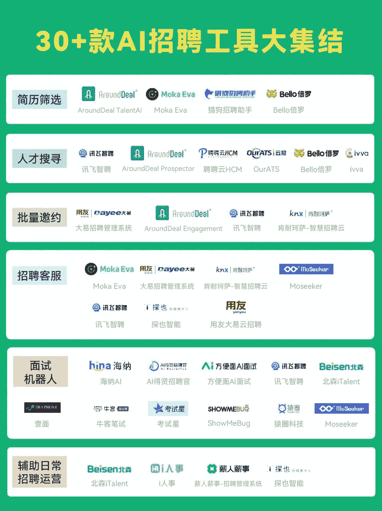

# 30+国内AI【招聘工具】盘点

> 来源：[https://my.feishu.cn/docx/Cr6gdRrI2oMFL5xn1oZc9WMSncg](https://my.feishu.cn/docx/Cr6gdRrI2oMFL5xn1oZc9WMSncg)

<https://my.feishu.cn/sync/CV7edZp1nspUQobYJhicxeP7nrb>

> 🔗 原文链接： h[ttps://mp.weixin.q](https://mp.weixin.qq.com/s/6vmty3rqUfEsP0gREb_6YQ)q.com/s/6vmty3rq...

> ⏰ 剪存时间：2024-03-14 18:45:56 (UTC+8)

「热门盘点」

# 简历筛选

1） AroundDeal TalentAI智能推荐候选人

链接： https://www.arounddeal.cn/products/ai

定价： 个人版 基础版39$ / 高级版99$; 也提供企业定制版

产品介绍： 浏览器插件，支持用户输入岗位 JD、AI在10秒内精准推荐候选人。AI 智能推荐支持输入海外岗位要求和国内岗位要求，都可以获得高度匹配的候选人名单。

其中，针对海外候选人，还提供电话邮箱等联系方式，中国大陆地区候选人不提供联系方式，港澳台提供。

2）Moka Eva

链接： https://www.mokahr.com/eva?utm_source=baidu&utm_medium=%E6%8B%9B%E8%81%98%E7%B3%BB%E7%BB%9F_PC&utm_campaign=PC&utm_term=ai%E6%8B%9B%E8%81%98%E5%B9%B3%E5%8F%B0&e_keywordid=678785746509&sdclkid=ALfG15ez152iAJDibOf&bd_vid=10239549385820361540

定价： 企业版

产品介绍： Moka Eva是基于大语言模型的新一代AI原生的HR SaaS产品。基于Moka招聘和Moka People的基础能力，Moka Eva无缝集成到HR日常工作的各类场景中，10倍提升HR的工作效率。Moka Eva可以帮助HR用AI筛简历，给候选人定制面试题，帮助面试官自动写面评，还可以回答员工日常的人事问题，自动化完成证明开具等请求，并能将以往要花费数周时间的数据统计和分析的工作简化到几分钟。

3）猎狗招聘助手

链接： http://www.ailiegou.com/

定价： 企业版

产品介绍： 猎狗招聘助手，是国内首款运用AI、大数据与云计算等技术，结合SaaS产品模式开发的智能化招聘管理协作工具，能为企业提升招聘效率，降低招聘成本。智能全网简历识别全国主流招聘网站、地方性招聘网站简历智能识别，转化为统一模板，并支持多份简历同时横向查看对比，帮助招聘人员更好的选择候选人。

4）Bello倍罗

链接： http://www.onebello.com/

定价： 企业版

产品介绍： 猎狗招聘助手，是国内首款运用AI、大数据与云计算等技术，结合SaaS产品模式开发的智能化招聘管理协作工具，能为企业提升招聘效率，降低招聘成本。简历解析：基于自主研发的自然语言理解框架及布局分析引擎，结合特有的招聘知识图谱，大幅提升企业招聘管理效率。简历特征指纹查重：借助倍罗强大的简历解析及知识图谱技术,给每份简历创建一份唯一的指纹信息,帮助企业告别简历重复购买,猎头重复推荐等，每年可节省数十万到数百万的费用支出。多级指纹：倍罗的简历查重基于「多级指纹」的原理，即根据不同字段内容组合唯一标识一个人的不同置信度来综合判重，并可支持通过配置文件修改定制查重策略的的规则部分。

#  人才搜寻

1）AroundDeal Prospector全球候选人信息智能搜索平台

链接： https://www.arounddeal.com/products/prospector

定价： 个人版 基础版39$ / 高级版99$; 也提供企业定制版

产品介绍： AroundDeal 在线智能搜索平台是基于 AroundDeal 1.2 亿全球候选人信息库搭建的，拥有全球（除中国大陆地区以外）247 个国家和地区、1.2 亿联系人的信息（包括港澳台），其中包括联系人的电话、企业邮箱、个人邮箱、领英链接、facebook、 Twitter 等多达五种以上的联系方式。

AroundDeal 全球候选人库的亮点在于：1.智能搜索，几分钟内锁定目标候选人 2.轻松获得电话邮箱 3.数据准确：信息库每日更新验证，确保大部分信息的准确率（准确度控制在 95%以上）4.数据合规：完全遵守 GDPR、CCPA 等全球各国本地法律法规 5.数据来源：数亿社媒用户公开信息、数千万网页数据收集、数百万国际展会名片以 及数十万海外共享社区 6）AroundDeal 目前在全球有 10 万用户体量，在国内也有华为云、阿里云等大型出海企业级客户。

2）Bello倍罗

链接： https://www.belloai.com/

定价： 企业版

产品介绍： 倍罗寻才

招聘业务系统(HR版/猎企版)招聘降本,招聘者增效。特色功能，所见即所得。简历自动入库,各大招聘网站浏览下等过程尽在掌握,快速完整积累企业人才资源储备。人效仪表盘：KPI+业绩四象限图标,成员表现一目了然。智能查重：独创多级指纹技术,多人协作不再重复购买简历,大幅节省成本。聚合快搜：一键跨站搜索,内外部人才库一起搜,快速精准找到候选人。（如：BOSS直聘；脉脉；猎聘；前程无忧；拉勾）高精度导出推荐报告：节省大量手工排版时间。

3) 聘聘云HCM

链接： https://www.pinpin.com/?source=kaifain.com

定价： 企业版

产品介绍： 聘聘云HCM为客户提供专业的十五朵人力云和三大AI工具一体化解决方案，涵盖先进人力资源部门的三个模块，大招聘云模块：猎头云 招聘云 背调云 薪调云 测评云 考试云 外包云 智库云 人才管理模块：继任云 学习云 咨询云 人事管理模块：人事云 薪酬云 假勤云 绩效云，三大AI工具引擎：简历π解析 简历π搜索 简历π推荐。聘聘云HCM是一款可以私有化部署的智能人力资本管理平台，提供私有化部署和SAAS两种部署方式，实现基础人力数据采集与建模，并可以使用PPY PAAS平台二次开发。

4）OurATS

链接： https://www.ourats.cn/solution.html

定价： 企业版

产品介绍： OurATS智能招聘管理系统社招、校招、内推、猎头、移动招聘等一站式管理，多方协同、自动化跟踪、智能大数据分析，专业而高效HR自主流程，简单灵活；智能机制，全员高度自助，减少99%的配置和维护，HR专注业务。48个维度强大的复合搜索能力除常规姓名、电话、任职公司、教育背景、年龄、性别等搜索条件,还支持更多维度。40+个维度人才画像：快速掌握人群特征，智能引导人才挖掘方向，识别企业/面试官用人标准和偏好，洞悉竞争对手人才策略。

5）讯飞智聘

链接： https://zp.xfsaas.cn/

定价： 企业版

产品介绍： 讯飞智聘 用AI改变传统招聘一站式Al招聘管理平台，创造更公正美好的招聘体验。

6）ivva

链接： https://www.ivvajob.com/default/index

定价： 企业版

产品介绍： 自动化的招聘管理系统覆盖了社招,校招,🛰️招聘,猎头,内部招聘等招聘场景。覆盖了🛰️,企微,钉钉,飞书等移动IM办公系统。从简历获取到人才库沉淀,数据报表分析,让HR更高效的完成招聘工作,让管理者更清晰的看到招聘数据。

# 批量邀约

1）AroundDeal Engagement邮件批量群发

链接： https://www.arounddeal.com/products/engagement

定价： 个人版 基础版39$ / 高级版99$; 也提供企业定制版

产品介绍： 找到候选人后，你不需要花费大量时间和潜在候选人沟通，使用AroundDeal邮件自动群发功能，即可通过自定义邮件队列模版，给潜在候选人们批量群发多封邮件，再针对有意向的候选人回复，进行针对性地跟进。节省招聘者大量初期沟通的时间。AroundDeal 还提供 50 封精选英文沟通话术和邮件模版，帮助招聘者收获高回复率，快速推进招聘工作。

2) 大易招聘管理系统

链接：https://www.dayee.com/html/recruit.html

定价：企业版

产品介绍：提供智能化招聘管理系统，将信息技术、AI技术与人力资源管理相结合，推动招聘效能提升。

3）肯耐珂萨-智慧招聘云

链接： https://www.knx.com.cn/product/aitx/

定价： 企业版

产品介绍： 基于PaaS平台，利用AI+BOT+大数据技术，实现招聘全场景、全过程及结果的管理，招聘生态应用无缝集成，实现招测一体化，帮助企业优化招聘管理流程，沉淀招聘流程数据，招聘提质增效，有效降低管理成本。

4) 讯飞智聘

链接： https://zp.xfsaas.cn/

定价： 企业版

产品介绍： 讯飞智聘是一款全流程AI招聘管理平台，实现高效的企业与候选人连接，创造更公正、更美好的招聘体验。

# 招聘客服

1）Moka Eva

链接： https://www.mokahr.com

定价： 企业版

产品介绍： Moka Eva是基于大语言模型的新一代AI原生的HR SaaS产品。基于Moka招聘和Moka People的基础能力，Moka Eva无缝集成到HR日常工作的各类场景中，10倍提升HR的工作效率。Moka Eva可以帮助HR用AI筛简历，给候选人定制面试题，帮助面试官自动写面评，还可以回答员工日常的人事问题，自动化完成证明开具等请求，并能将以往要花费数周时间的数据统计和分析的工作简化到几分钟。

2）大易招聘管理系统

链接： https://www.dayee.com/html/recruit.html

定价： 企业版

产品介绍： 提供智能化招聘管理系统，将信息技术、AI技术与人力资源管理相结合，推动招聘效能提升。

3) 肯耐珂萨-智慧招聘云

链接： https://www.knx.com.cn/product/aitx/

定价： 企业版

产品介绍： 基于PaaS平台，利用AI+BOT+大数据技术，实现招聘全场景、全过程及结果的管理，招聘生态应用无缝集成，实现招测一体化，帮助企业优化招聘管理流程，沉淀招聘流程数据，招聘提质增效，有效降低管理成本。

4） Moseeker

链接： https://www.moseeker.com/

定价： 企业版

产品介绍： 基于人工智能的一站式招聘数字化系统,功能涵盖智能招聘管理系统、🛰️招聘、内推、Al面试、智能招聘助理、雇主门户建设人才库管理、全渠道集成等,通过数字化、AI智能化和社交裂变赋能企业更快、更准、更省地找到所需人才。

5) 讯飞智聘

链接： https://zp.xfsaas.cn/

定价： 企业版

产品介绍： 讯飞智聘是一款全流程AI招聘管理平台，实现高效的企业与候选人连接，创造更公正、更美好的招聘体验。

6）探也智能

链接： https://www.taient.com

定价： 企业版

产品介绍： TAIENT（北京探也智能科技有限公司）是一家AI驱动的新型招聘科技企业，运用先进的自然语言处理、知识图谱和深度学习等前沿技术，结合数十年技术和人力资源相关从业经验，为企业提供基于AI的数字化招聘和人才运营解决方案，助力企业降本增效，获得人才竞争优势，实现人力资本增值和战略转型升级。

7）用友大易云招聘

链接： https://www.yonyou.com/subject/gd-rl-szrl

定价： 企业版

产品介绍：

招聘客服机器人：7*24小时代替HR执勤,解答候选人疑问,打造有温度的问询阳

智能推荐：根据大数据分析匹配度和推荐理由,实现职位JD与简历高效匹配

智能面试机器人：直观了解候选人状态,为复筛提供参考

智能外呼机器人：批量邀约面试、通知提醒,释放HR事务性工作时间

总体来说，用友人力云的价格相对较高，但其功能强大、可定制性高，适合大型企业和中小型企业使用。

# 面试机器人

1）海纳AI

链接： https://www.hina.com

定价： 企业版

产品介绍： 海纳AI是一家智能招聘专业服务商，招行、中兴、顺丰、沃尔玛等5000多家公司已使用海纳AI面试、在线考试、视频面试系统完成超过500万场在线面试，抢人快，到面高，省时省力，统一标准，快速积累视频化人才库。

2）AI得贤招聘官

链接： https://airecruitas.com

定价： 企业版

产品介绍： AI得贤招聘官是一款智慧招聘管理系统，区别于传统的智能招聘ATS，AI得贤招聘官具有AI多模态算法核心，能够替代人类面试官对候选人的核心价值观，通用素质，潜在领导力和专业素质进行基于视频面试的判断。以全球领先的AI多模态算法为基础，基于候选人的胜任力，知识和技能进行人岗匹配。

3）方便面AI面试

链接： https://www.elihr.cn/

定价： 企业版

产品介绍： AI+招聘面试管理，依托“AI+视频”面试，助力企业打造独有AI岗位模型，精准筛选候选人，提高批量人才质量，从而提高企业价值。从简历筛选到offer管理的招聘流程线上自动化，各模块100%可配置，帮助HR提升招聘效率。

4）讯飞智聘

链接： https://zp.xfsaas.cn/

定价： 企业版

产品介绍： 讯飞智聘是一站式AI招聘管理平台，以AI能力赋能招聘全流程，高效链接企业与候选人，创造更公正美好的招聘体验。

5）北森iTalent

链接： https://www.beisen.com/product/hrsaas/

定价： 企业版

产品介绍： 人才管理全生命周期，选、用、育、留一体化，北森一体化HR SaaS---iTalentX，整体构建于北森PaaS基础设施之上，打通人力资源管理所涉及的全流程，提供整套云原生、标准化人力资源解决方案，提升组织和人才洞察力，提效人才选用育留，赋能企业从人力成功走向业务成功。

6）壹面

链接： https://www.1mian.com/

定价： 企业版

产品介绍： 人工智能面试工具。是国内从事“AI+招聘”领域顶尖的人工智能应用公司。目前滴孚旗下的AI面试产品“壹面”、“HireBot”等，已经成为同类竞品中的佼佼者，被诸多中大型企业熟知和使用。公司总部位于上海，并在北京、深圳、成都设有分部，同时在浙江嘉兴设有人工智能产品展示中心。

7）牛客笔试

链接： https://hr.nowcoder.com

定价： 企业版

产品介绍： 数智化校园招聘平台，基于900w+优秀青年科技人才活跃的交流求职社区，为企业提供数智化校招整体解决方案，助力校园招聘更高效，人才战略更成功。

8）考试星

链接： https://www.kaoshixing.com

定价： 企业版

产品介绍： 考试星-智能防作弊在线考试系统，是基于SaaS、AI、人才数据为各类型组织提供一体化在线考试培训解决方案的科技企业。主要基于SaaS、AI、人才数据为中大型企业 提供形式不一的考试解决方案，致力于为企业搭建稳定高效的全流程智能防作弊的在线考试体系，能够满足招聘笔试、无人严肃面试、认证考试、岗位晋升、竞赛考试、日常考试、严肃考试等多种考试场景。

9）ShowMeBug

链接： https://www.showmebug.com/solution/campus-recruitment

定价： 企业版

产品介绍： 一款数字化驱动的可记录、可分析、可复盘的技术评估和在线 Coding 面试平台。通过在线笔试、在线面试两大场景，ShowMeBug可以高效满足大批量校园招聘和社招人才筛选，并且已经集成主流的ATS系统，让企业的技术招聘工作更规模化、自动化、智能化，助力企业快速精准甄选技术人才，目前注册⽤户超 10 倍高速增长，已覆盖6000+大型和高成长型企业 。

10）猿圈科技

链接： https://www.oxcoder.com/

定价： 企业版

产品介绍： 猿圈是目前国内领先的AI在线考试和AI在线面试一体化解决方案供应商。自2020年始，基于特殊的市场环境和激增的线上笔面试需求，猿圈在不断优化现有产品的同时，首次实现将人工智能与在线笔面试相结合，研发出可以实现AI+组卷、AI+监控、AI+分析的在线考试平台，让线上考试更加严谨、公平、公正。

11）Moseeker

链接： https://www.moseeker.com/

定价： 企业版

产品介绍： 基于人工智能的一站式招聘数字化系统,功能涵盖智能招聘管理系统、🛰️招聘、内推、Al面试、智能招聘助理、雇主门户建设人才库管理、全渠道集成等,通过数字化、AI智能化和社交裂变赋能企业更快、更准、更省地找到所需人才。

# 日常招聘运营

1）北森iTalent

链接： https://www.beisen.com/product/hrsaas/

定价： 企业版

产品介绍： 人才管理全生命周期，选、用、育、留一体化，北森一体化HR SaaS---iTalentX，整体构建于北森PaaS基础设施之上，打通人力资源管理所涉及的全流程，提供整套云原生、标准化人力资源解决方案，提升组织和人才洞察力，提效人才选用育留，赋能企业从人力成功走向业务成功。

2）i人事

链接： https://www.ihr360.com

定价： 企业版

产品介绍： i人事，HR全模块+业务绩效数字化产品及服务专家，在产品能力上，i人事不仅实现企业人力资源全模块一体化智能管理，打造人才‘选用育留’管理闭环，更是创新性地提出‘HR 系统+业务绩效’的模式。在这种模式下，i人事的目标，不仅仅是助力客户HR部门数字化，更是通过“业人一体”真正落地，以组织绩效为目标，用业务绩效作为抓手，盘活企业管理、赋能业务增长和组织进化。

3）薪人薪事-招聘管理系统

链接： https://www.xinrenxinshi.com

定价： 企业版

产品介绍： 薪人薪事是一款专业数据化人力资源SaaS产品，以智能数据为基础，致力于帮助企业提升人力资源管理水平。系统秉承“信息提升效率、数据洞见未来”的设计理念，以充分、准确的分权限信息传递为考量，去除传统软件中诸多无效繁杂的流程，以及时、丰富的数据分析为洞察依据，帮企业摆脱只能靠传统经验决策的窘境。

同时，系统运用机器学习、大数据和区块链等高科技手段，科学构建企业、组织、员工三层效率模型，结合“人力+财务+业务”多个工作场景，建立智能数据中心，通过数据建模、模型诊断、选择最佳实践等手段，实现以业务精化循环为基础的企业科学管理，全面提升协作效率，组织建设效率和个人价值转化效率，达成提高人效的目的。

4）探也智能

链接： https://www.taient.com

定价： 企业版

产品介绍： TAIENT是一家AI驱动的新型招聘科技企业，运用先进的自然语言处理、知识图谱和深度学习等前沿技术，结合数十年技术和人力资源相关从业经验，为企业提供基于AI的数字化招聘和人才运营解决方案，助力企业降本增效，获得人才竞争优势，实现人力资本增值和战略转型升级。

<https://my.feishu.cn/sync/CV7edZp1nspUQobYJhicxeP7nrb>