# AI比人类更懂“卖得好”的设计？

> 来源：[https://my.feishu.cn/docx/YirMdRArYoE13OxU0pocP1QUnze](https://my.feishu.cn/docx/YirMdRArYoE13OxU0pocP1QUnze)

<https://my.feishu.cn/sync/CV7edZp1nspUQobYJhicxeP7nrb>

> 🔗 原文链接： h[ttps://mp.weixin.q](https://mp.weixin.qq.com/s/1mf8STCM1h1uWbWRtPLBSg)q.com/s/1mf8STCM...

> ⏰ 剪存时间：2024-03-14 18:46:27 (UTC+8)

作者：Chain

**什么是真正的“好”设计？**

**今年4月，食验室曾**发布5款包装设计，其中2款由AI辅助设计，号称 “几小时定方案” 。当时，不止一个品牌发布了“AI设计”的产品，无不与“快速生成”、“成本降低”等字眼联系在一起。

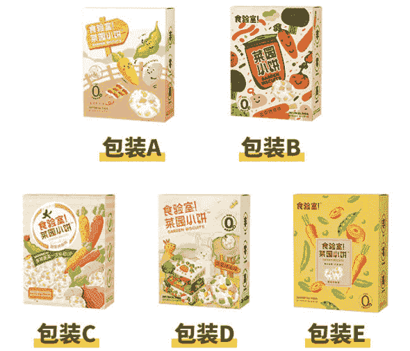

食验室发布的5款包装设计

图片来源：食验室

在感慨设计速度之余，部分读者可能在看到这些“AI设计”的时候，会与笔者产生相同的疑问：

**这些设计，真的“好”吗？**

**对于品牌来说，更关**心的可能是： 哪款设计卖得更好？

聊起“设计决策”这个话题，甲方乙方可能都深有感触： 最花时间和精力的不一定是“做设计”，而是“选设计”和“改设计”。

扪心自问，有多少消费品牌拥有非常客观的包装设计决策依据？有多少最终决策仍然是根据非常主观的标准来的？

于是就会出现：品牌方吐槽设计师不懂市场，设计师吐槽品牌方不懂设计。正因为主观上很难互相说服，所以甲方和乙方才会无数次在这一点上battle起来——而在“拉扯”的过程中，很多时间资源就这样消耗了。

但我们有没有想过： 在“什么样的设计卖得好”这件事上，AI有可能比人类做得更好呢？

答案是：不但有可能，而且已经用上了。 日本Plug公司推出的“包装设计AI”，专门帮助品牌快速评估产品包装设计方案。在包装设计AI服务上线后的三年内，包括卡乐比、雀巢日本、森永乳业等头部食品企业在内，约有860家食品、饮料、化妆品和药品企业使用了这项服务。

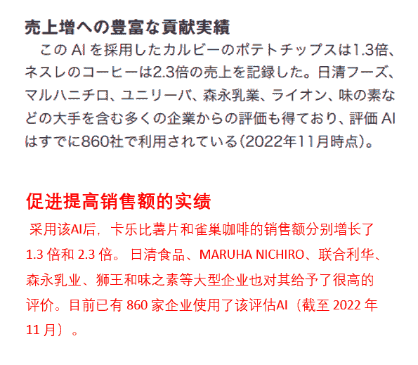

《日本服务大奖-获奖事例集》对「包装设计AI」贡献实绩的描述（红字为中文翻译）

图片来源：《日本服务大奖-获奖事例集》

2**022年，包装设计A**I获得了日本总务大臣奖。据**获奖事例集记载，使用了**包装设计AI后，卡乐比一款薯片的 销售额增长1.3倍 ，雀巢一款香味焙煎咖啡的 销售额增长了2.3倍 。

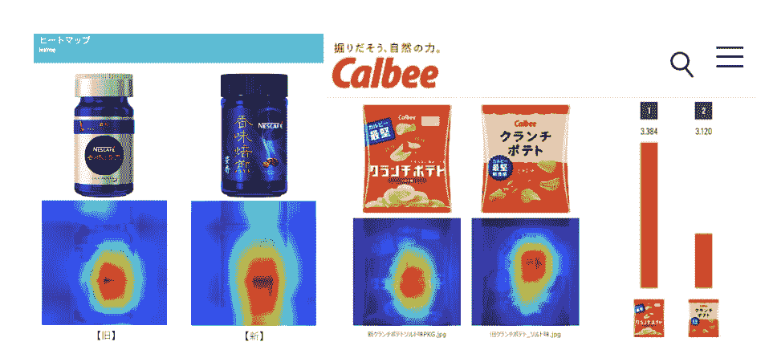

雀巢香味焙煎咖啡（左）与卡乐比薯片（右）的包装设计改进案例

图片来源：PLUG

这个案例引人深思：也许AI在设计上最擅长的并不是我们以为的“创意”，而是“评估”？

在今年的FBIF食品饮料创新论坛上，海内外多位嘉宾就生成式AI对食品行业的影响进行了探讨。本文将结合嘉宾的精彩分享，探讨以下问题：

+   AI为什么会比人类更懂“卖得好的设计”？

+   除了我们一直都在说的“降本增效”，AI是否能够带来创新质量的突破？

+   如何发挥AI的潜力，探索品牌未来的护城河？

##

AI为什么会比人类更懂“卖得好”的设计？

##

Plug所做的包装设计AI，本质是更加依托于市场数据分析，进行产品开发创新流程的优化。

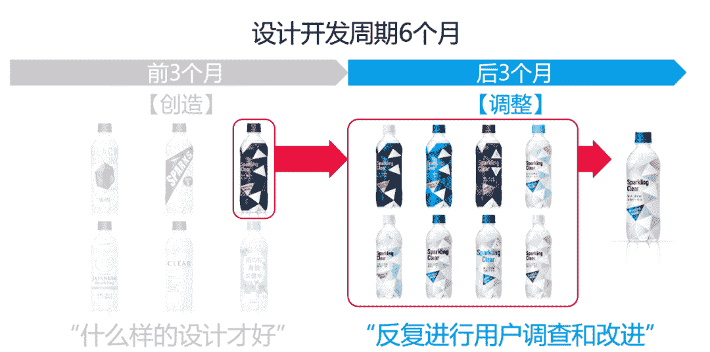

产品包装设计开发周期

图片来源：PLUG演讲课件

**在日本，产**品的包装设计开**发周期往往分为前3个月的** 【创造】 和后3个月的 【市场调研&设计调整】 。

Plug的总裁小川亮，也是日本包装设计协**会（JPDA）的现任理事长，以及畅销**书 《売れるパッケージデザイン150の鉄則（卖得动的包装设计：150条铁律）》 的作者。从事包装设计与开发工作多年，小川在亲身实践中发现，【市场调研&设计调整】这个环节存在很多痛点。

比如，设计方案的修改微调，实质上是创意元素的排列组合与对比，并不包含真正的创造性工作。

再比如，有些品牌为了提高决策的客观性，会在大规模上市前，采用样品测试、小规模投放征集消费者反**馈等市场调研。这样的市场调研，往往耗时耗力，而且，**也无法同时对比多个设计款式。 但实际上，这些市场调研的结果存在共性，特定消费群体对于某些元素的好感度，也是有规律可循的。

包装设计AI高评估质量背后的秘密，就来源于此。小川亮在FBIF2023的演讲中分享到。

**一是庞大的一手设计评估数据库。**

Plug从2015年开始收集消费者对包装好感度的数据，直到2019年才上线服务。到目前为止，已经积累了1020万消费者的包装好感度数据，横跨不同的性别和年龄段。小川称，目前这些数据每半年都会滚动更新，并且通过调整数据比重的方式来体现当下的潮流。

二是前瞻的AI设计生成和预测模型。

**包装设计AI的功能最大化**在于评估与生成的结合，不断重复 “评估-生成-再评估” 的过程。如下图所示，上传的几款原始设计被拆分为不同的设计组件，而这些组件被AI重新组合，形成新的设计。

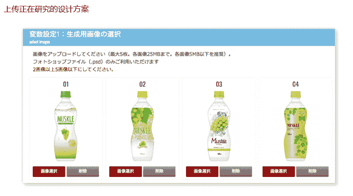

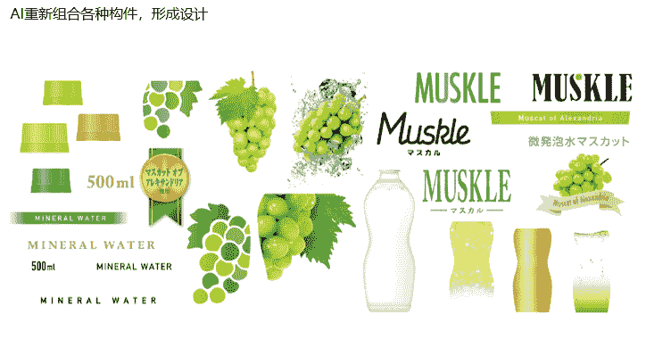

设计元素的排列组合

图片来源：PLUG演讲课件

在1小时内，这样的排列组合可以生成约1000款不同的设计方案。与此同时，AI还会对不同的方案进行市场“好感度”预测，并给出相应的打分和排名。

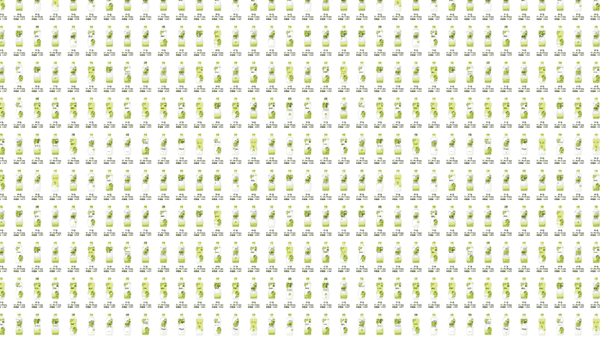

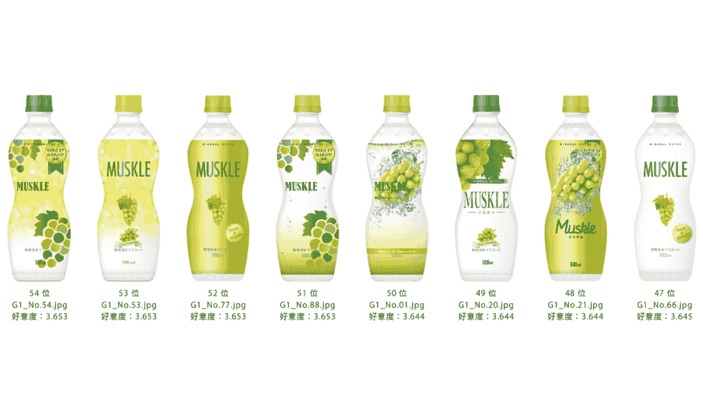

AI生成的大量设计方案与打分排名

图片来源：PLUG演讲课件

**三是可以灵活调整的评分维度。**

在“好感度”的范围内，包装设计AI也可以分析出这款包装能给人留下怎样的印象，比如 “看上去很好吃”、“具有健康感” 等。如果有希望突出的产品印象，也可以用这 种印象为条件来重新排名。

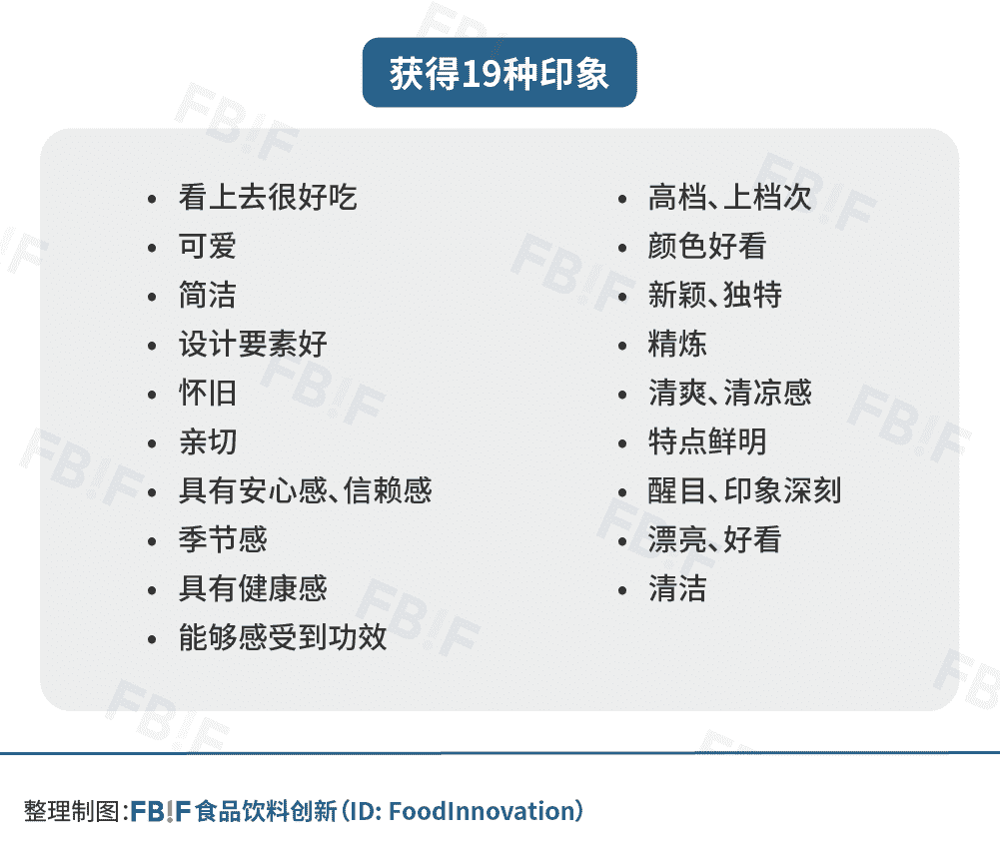

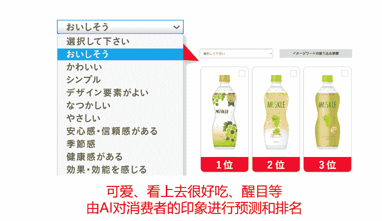

图片来源：PLUG演讲课件

不仅如此，还可以根据消费者的年龄和性别（比如男性、20岁左右）进行筛选，因为不同群体对一款包装形成的印象可能是不同的。

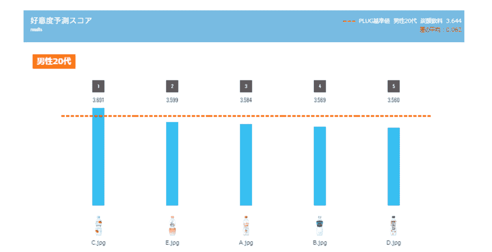

根据消费者群体（男性、20岁左右）筛选后的排名结果

图片来源：PLUG演讲课件

对一些希望根据市场数据、进行更加理性设计决策的企业来说，Plug的包装设计AI无疑是一种福音：原本如果要对设计方案一一进行市场调研，需要花费大量的时间精力，而现在，这些调研工作只需通过软件就可以完成。

据2023年3月日经新闻报道，联合利华日本在引入这一包装设计评估AI后，将消费者调研所花费的时间从1个月缩短到几秒钟。

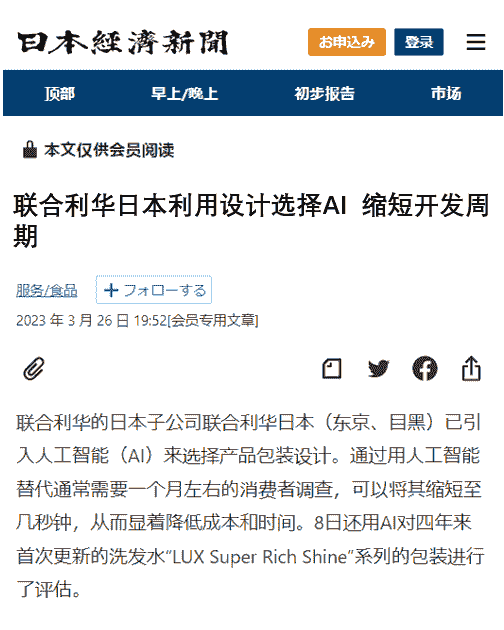

日经新闻相关报道网页（已通过网页翻译）

图片来源：日经经济新闻网页

而加上设计调整，本来需要 **3个月 ****的“市场**调研&设计调整”被AI缩短到 1小时 ，产品开发/设计团队可以将更多的时间用于前期的创意开发，尝试更多可能性。

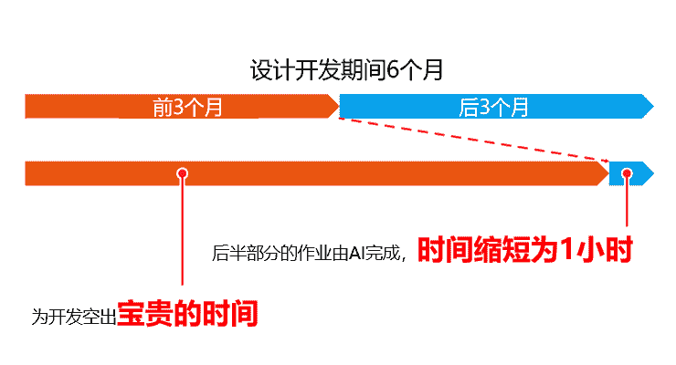

图片来源：PLUG演讲课件

##

## AI可能推动创新“质量”的突破吗？

**包装设计AI最有趣的一点在于，它通过拆解的**方式， 将一件本来我们直觉认为只能由人类主观判断的任务，由AI基于数据更快、更好地完成了。

这个模型的基本原理可以理解为，每排列组合出一个新的设计，就计算一遍目标受众对这款设计的好感度。由于好感度存在规律，所以AI模型将这个过程通过计算来实现，从而简化了流程。

“质”的突破，其实正是基于“量”的积累。 这让我们不禁开始反思创新的本质：比如，爱迪生发明电灯，本质不就是无数次的尝试吗？

那么理论上，当“评估设计”这件看起来非常主观、不太可能实现量化计算的事情都可以被AI变成可能，是否我们也能用同样的原理，“优化”创新的其他环节？

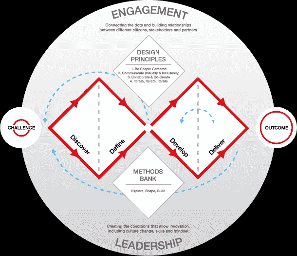

Framework for Innovation

图片来源：This work by the Design Council is licensed under a CC BY 4.0 license

2004年，英国设计协会提出创新的 “双钻模型（Double Diamond）” ，指出设计创新是一个发现问题（Discover）、定义问题（Define）、发散灵感（Develop），最终创意收束、获得解决方案（Deliver）的过程。

不难发现，在向外扩张的“发现问题”、“发散灵感”环节，我们希望覆盖尽可能全面的信息，充分思考更多可能性；而在代表收束聚焦的“定义问题”、“获得解决方案”环节，我们又想要快速排除不相干的信息、聚焦问题的核心关键。

理**论上，在拥有足够数据沉淀和不断迭**代优化模型的前提下，能够以比人类快得多的速度分析和处理大量信息的AI，在发散和收束这两个方向都能有所作为： 不仅能向更广的范围发散开去，也能以更快的速度收束回来，给到更精准的结果。

不仅如此，在不断变化的世界中，创新是循环往复的动态。想象一下，在市场调研覆盖的信息量、创意参考的素材量、分析迭代的速度都呈指数级上升的情况下， 未来的“创新”与今天的“创新”，可能会拥有完全不同的意义。

当然，AI的未来价值，可能并非是我们这代人能够想象得到的。

AI解决方案公司rct AI首席运营官张言在FBIF2023分享 “AI将如何影响未来世界观的底层逻辑” 时，提出了一个重要观点，那就是： AI将有可能超越人类理解的“黑箱”，带来认知系统外的知识。 人类对世界的认识总是在一定的逻辑下展开，但人类无法用同一套逻辑来证明这个形式体系是自洽的，也无法跳出“世界本身”来认知世界。

从这个理论上来说，人工智能在未来最大的潜在价值，很可能在于它能够跳出人类的逻辑，提供全新的**视角。这是否说明，人工智能在未来可能为人类**带来超出想象的世界观？这是否也说明， AI在未来与人类很可能并非我们所假定的，工具和利用的关系，而是互补视角的合作关系？

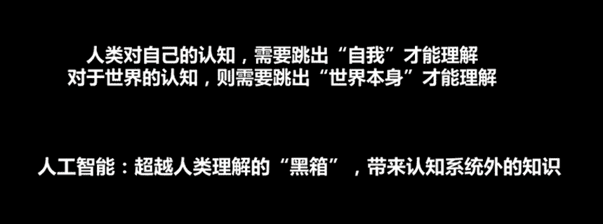

图片来源：rct AI演讲课件

这一切都存在非常巨大的想象空间。

## **积累，构筑品牌未来的护城河**

2022年出现的ChatGPT3.5，是OpenAI从2015年开始的“积累”。2019年上线的包装设计AI，是Plug从2014年开始的“积累”。

2023年的消费品牌，又可以为AI所在的未来做哪些“积累”，构筑未来的品牌护城河？

除了显而易见的“数据”，“设计”也许可以是其中的一道护城河。 就像代码为计算机编程那样，设计可以为人类编程！IDEO高级设计顾问宫书亚在FBIF2023分享道。

**宫书亚分享了一套与生成式AI共**生的设计哲学，可以概括为： 一个时刻、一段旅程、一种思维。

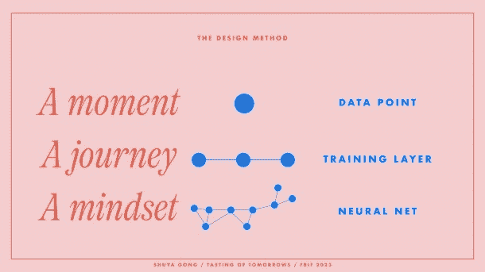

一个时刻、一段旅程、一种思维

图片来源：IDEO演讲课件

设计往往从 **一个时刻 ****开始（如人**们在货架上看到产品包装的瞬间），到搭建 一段旅程 （**多个时刻共**同汇聚成行动的过程，比如为了做饭，去超市购买各种食材），再到最终在人们心中形成 一种思维 （比如多次消费后，将这个品牌与在家做饭的回忆深度联系在了一起）。

而这恰恰与AI的深度学习有异曲同工之妙。一个数据点就是一个时刻，一个训练层就是一段旅程，最终所有训练层交汇在一起，就是一张神经网络——一种思维。

因此，代码为计算机编程，而设计可以为人类编程。代入这种方法，在AI时代，具体如何“编程”？

在演讲中，宫书亚通过一系列案例，展示了设计师与AI如何做到了一些过去只存在于我们想象中的事情。

### **1、一个时刻：多感官设计。**

人类的五感纤细又敏感。全球96%的人可以光靠听倒水的声音，根据音调的细微差别就分辨出冷水与热水。因此，能带给人深刻印象的远远不止于视觉刺激。AI技术的迅猛发展给了我们探索其他感官的机会。

有些探索已经在路上。奇华顿与天猫TMIC合作推出的AI驱动共创服务“Creatogether”， 通过AI技术，将看不见的香氛气味转换为看得见的色彩与图像， 从而让没有调香经验的品牌方也可以通过可视化的方式参与香氛创作。

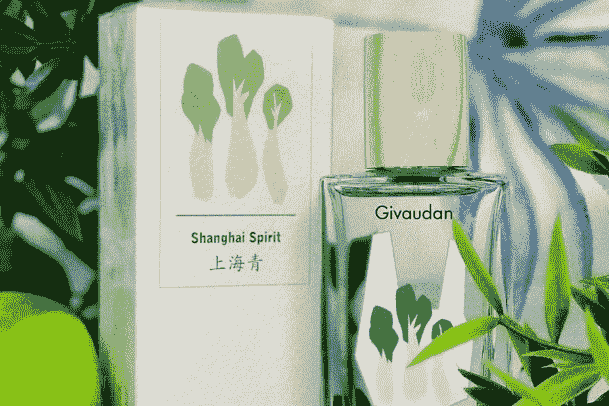

奇华顿Creatogether研发的“上海青”香氛

图片来源：奇华顿

还**在为今天吃什么而发**愁？尝尝你的心情如何！Google伙伴创新团队正在研发一个基于生成式AI的“Mood Food（心情食物）”食谱。你的 “AI私人厨师” 将会聆听你今天的心情如何，然后根据你的心情为你定制一份专属食谱。

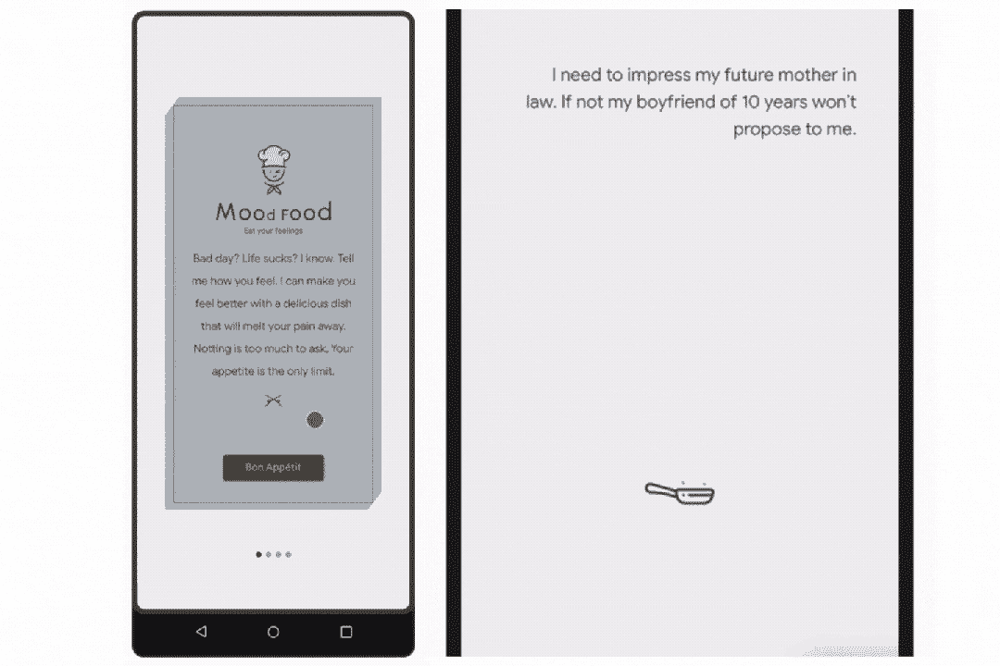

Mood Food

图片来源：Google Partner Innovation

这些“时刻”，将设计师对品牌的表达从单纯的视觉设计带入到多感官的设计空间。他们“捕获”人们注意力的方式，不再仅仅依赖视觉设计或吸引眼球，而是通过完全身临其境的感官体验。

### **2、一段旅程：跨市场设计**

当你考虑一整段消费旅程时，每个产品都不是孤岛，而是整个市场的一部分。有的时候，你并不是去有意地“创造”联系，而是去“发现”一种本来就存在的隐形联系，从而为消费者创造更美好的旅程。

比如，Snack pals利用AI和AR技术为儿童打造了一款移动app。这是IDEO CoLab的一款设计原型，通过这款App，儿童在去超市购物的时候，可以学会如何为自己定制一份营养均衡、健康美味的零食食谱。

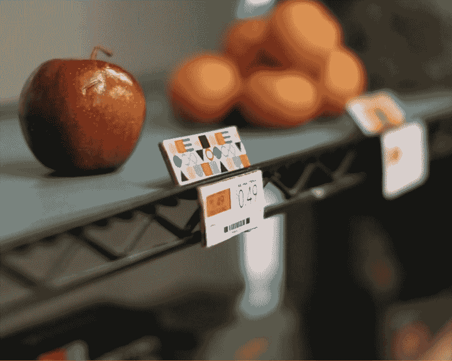

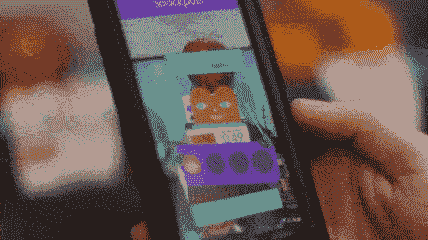

Snack Pals利用AR技术设计的APP

图片来源：IDEO演讲课件

逛超**市时，儿童可以扫描货架上的彩色图案标签，**与不同的蔬菜或水果“对话”，了解它们可以提供哪些营养。通过完成游戏任务的方式，孩子们就可以帮助父母，将这些食材搭配成营养丰富、令人愉悦的餐点。在回家后， 由于受到这种成就感的鼓励，儿童不需要父母的反复唠叨，就会自己把这些蔬菜吃下去， 补充到维生素和营养。

### **3、一种思维：参与式设计**

人们都喜欢参与感。有句话叫做 “感情是在互相麻烦中建立起来的” 。有的时候，不要怕“麻烦”你的消费者。

Be**tty Cro**cker蛋糕粉就是一个典型的案例。1952年刚刚推出这款产品时，Betty Crocker的产品定位是“快手蛋糕”。为了贯彻这个定位，这款蛋糕粉几乎包含了一款蛋糕所需的所有材料，宣传语是 “只需加水” ——但是销量并不是很好。

后来，Betty Crocker修改了配方**，将蛋糕粉中的蛋粉去**除，并将宣传语改为 “只需加1个鸡蛋” 。家庭主妇们购买了蛋糕粉后，仍然需要自己加1个新鲜鸡蛋进去，但是蛋糕粉的销量却大幅上升了。

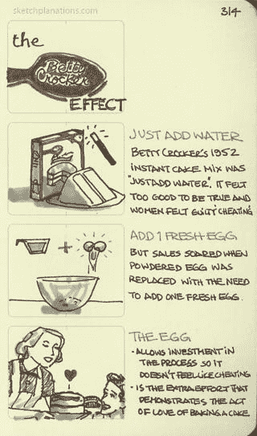

Betty Crokcer蛋糕粉“只加水”与“只加1个鸡蛋”的广告语对比

图片来源：Sketchplanations.com

Betty Crocker蛋糕粉虽然给消费者“添了麻烦”，却卖得更好了。从消费者心理上分析，“只需加水”尽管非常方便，却**让蛋糕粉的价值感降**低了——听上去像过度加工的产品。家庭主妇们虽然想快速做好蛋糕，但使用过于方便的蛋糕粉，反而让她们有种 “作弊”的罪恶感 ；添加1个新鲜鸡蛋其实也并不算麻烦，但这个简单的举动让她们有了制作蛋糕的实感，自己的贡献让蛋糕的口感更好、更健康了。

而生成式AI降低了共创门槛，是否也让品牌多了一种可以巧妙“麻烦”消费者的方式？ “他们家的设计里有我的创意在里面！” 消费者更深入地参与品牌创作，感情也由此建立起来。

**结语**

基于市场数据的AI比人类更懂“卖得好”这件事，其实并不奇怪。不过，对于面向未来的消费品牌来说，也许新技术本身并不是关键，它对社会和文化的影响才是根本——那里潜藏着真正的机遇。

“我们一直在用设计创造便利，却一不小心创造了孤独。”

宫书亚在演讲中感慨道。AI带来高效和便利，是否也会让社会上的每个个体，变得更加孤立和孤独？

如果是这样，人们可能会比任何时候都更加渴望建立真实的联系。

“现在有这样一种科技，只要给家里的冰箱拍张照，软件会计算能够用这些食材做什么菜。

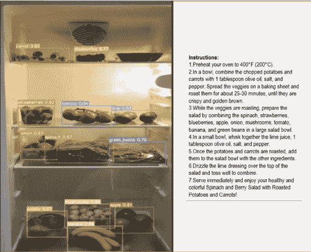

通过扫描冰箱里的食材、提供菜谱的软件

图片来源：IDEO演讲课件

于是，你可以打电话给朋友，说我家有这几样菜，你家有那几样菜，如果你能在来的路上顺便买个豆瓣酱，我们就可以一起做这几道菜做晚餐。”

食物和“一起吃饭”这件事，一直承载着人们的情感联系——以“你吃了吗?”含蓄问候的中国人尤是如此。在工业时代，在信息时代，人类对情感的追求都没有变。只不过在AI时代，它也许会有新的表达方式，留待聪明的品牌们去探索。

作者：Chain（微信号：simba_events），欢迎交流内容。

审稿：Yanyan

校对： Xiexie

<https://my.feishu.cn/sync/CV7edZp1nspUQobYJhicxeP7nrb>