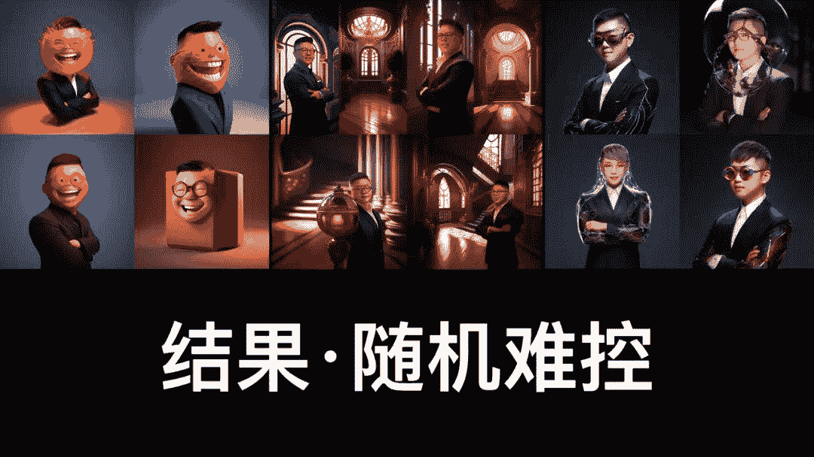
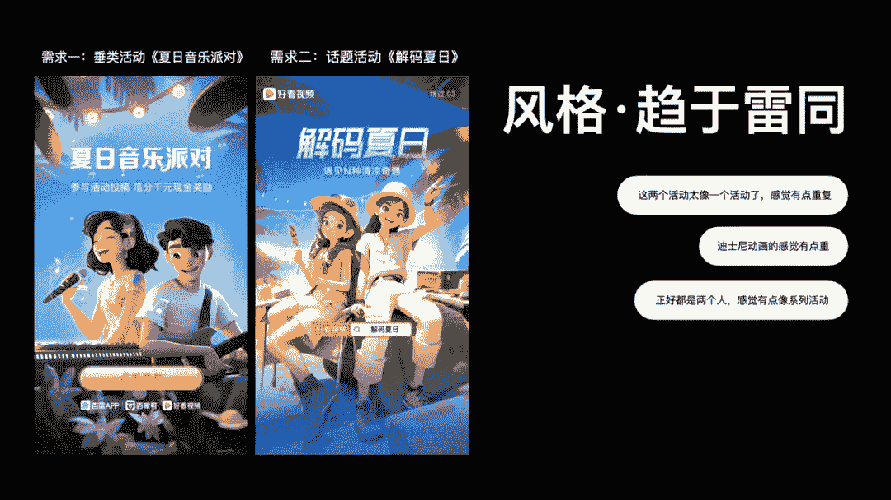
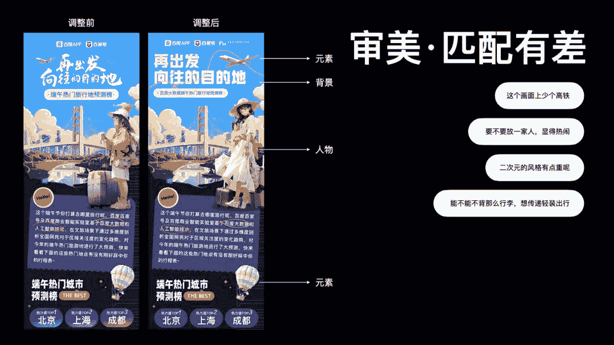
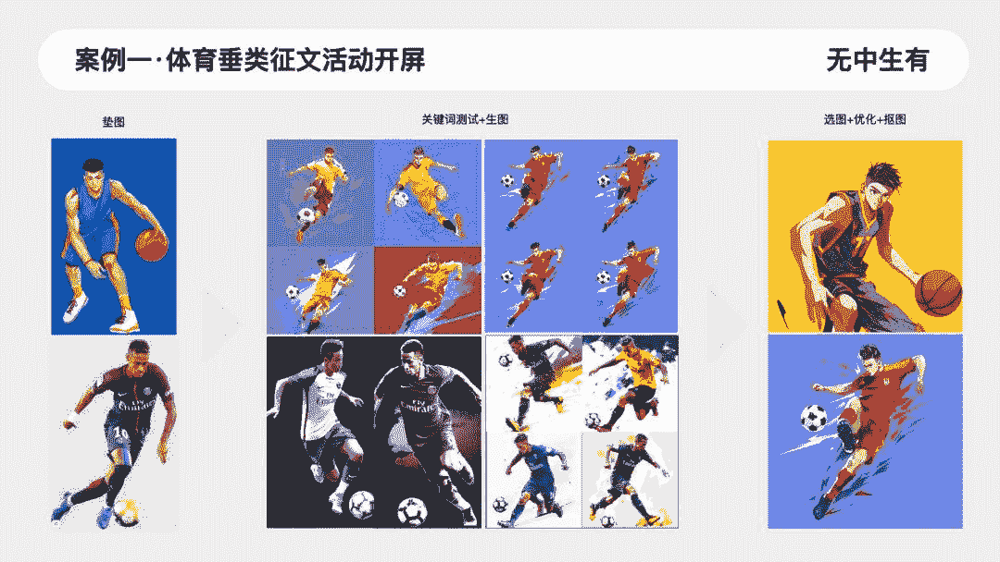
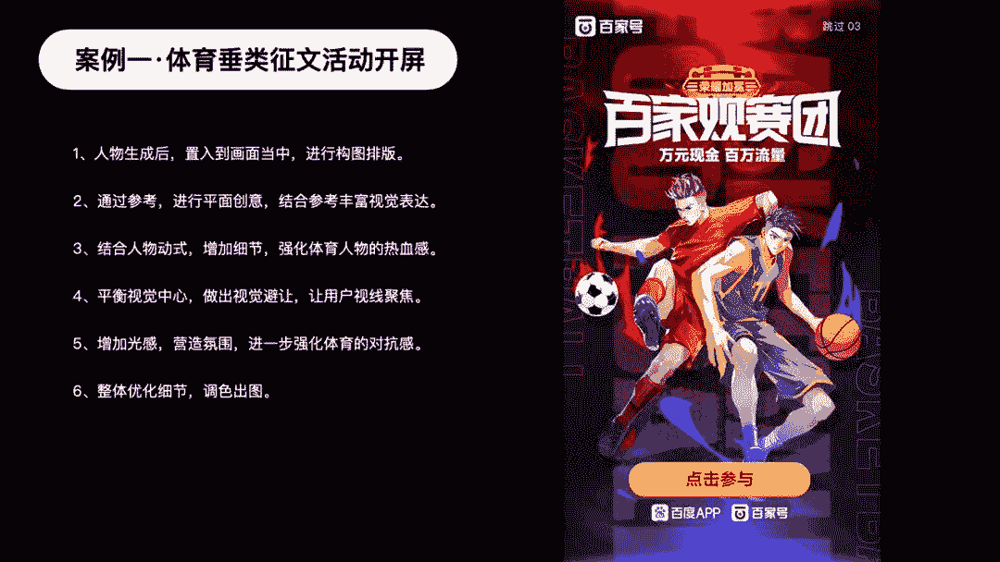
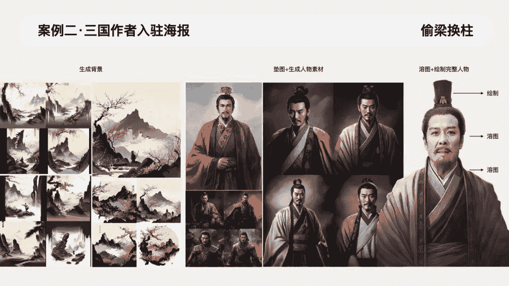
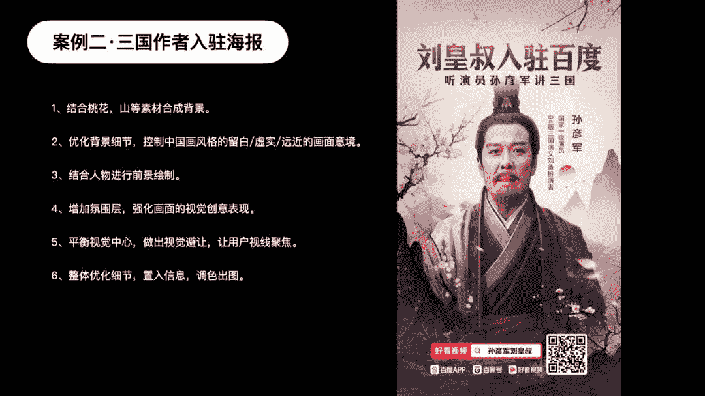
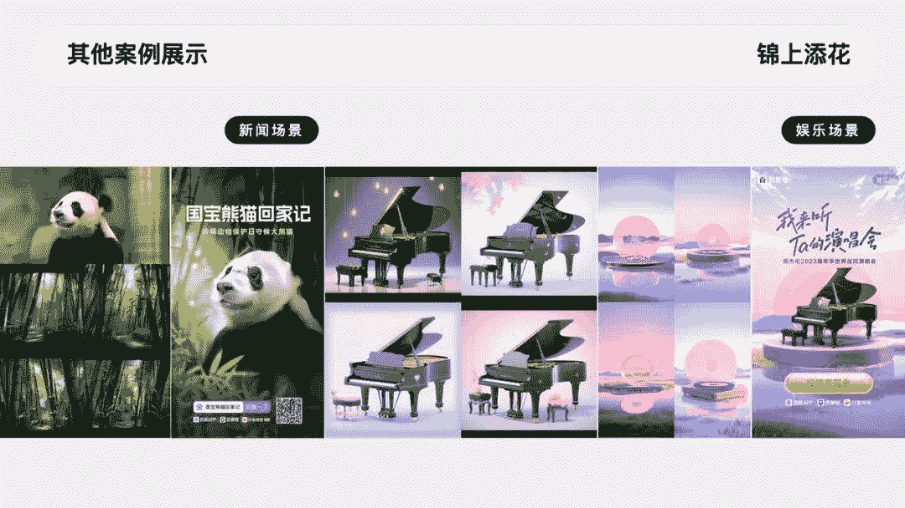

# 百度AIGC实践，玩的就是创意

> 来源：[https://my.feishu.cn/docx/RmI1dSL2WoKimAx5ofic46qOnUf](https://my.feishu.cn/docx/RmI1dSL2WoKimAx5ofic46qOnUf)

<https://my.feishu.cn/sync/CV7edZp1nspUQobYJhicxeP7nrb>

> 🔗 原文链接： h[ttps://mp.weixin.q](https://mp.weixin.qq.com/s/uhR7hGBFpmSAkvoqgKXBsA)q.com/s/uhR7hGBF...

> ⏰ 剪存时间：2024-03-14 18:47:50 (UTC+8)

面对AIGC生图时代的到来，

我们每个人都会看到它的强大和野蛮，

开始疯狂的学习和收集咒语，可真正用到实际项目中，却总是让它给我们上一课，得不到想要的图；

下班后，还时不时的会想，是不是突然有一天会被它完全替代，丢失自己，从而彻夜难眠。

叮叮，同学请看这里，面对时代的变化，我们要学会迎接AI，驯化AI，让AI成为我们的小跟班。

**实际项目中的痛点：**

**1、结果·随机难控**

AI生图是结合设定关键词来生成的，同一组关键词得到的图不同，没有规律的关键词更难控制可用性。

**2、风格·趋于雷同**

对于风格的把控，与关键词的设定要求较高，在创意表达/风格设定/调性差异都要做到全局预览，面面皆到。

**3、审美·匹配有差**

结合具体需求，前期与需求方预沟通变得更重要，除了明确业务诉求，了解用户和场景等，增加了主观的审美喜好共识，情感表达的准确性。

看到这里，此时耳边响起业务方的声音：要不我来试试？或许生成的比你更好，因为我更了解我的需求？你只能哭笑不得，口吐芬芳。

我们要驯化AI！！不能再等了！！

所以不要偷懒直接去生成，回归设计师的创意为先，让AI成为我们的小跟班。

以下会以4个案例进行拆解，怎么去通过AI的手段帮我们实现创意。

# 【AI大法第1招 · 无中生有】

# **案例：体育垂类征文活动开屏**

选择垫图的方式进行生成，分别尝试插画和真人进行垫图，选择更好的插画风格进行优化。

# 【AI大法第2招 · 偷梁换柱】

# **案例·三国作者入驻海报**

面对需求中只有一张人脸低像素的图，再一次开启AI生图。

背景生成，三国杀刘备形象垫图，选择更合适的上半身，配上衣服，以及头冠（画两笔吧，这都AI生成就别做设计了）。

两个案例过后，你会发现，用AI帮我们解决创意中遇到的卡点，它反而及我所需，不错～

为了更好的驯化AI，我们还要进一步的成为武林高手，懂得收放自如，能用才用，深不可测，隐于乾坤

# 【AI大法第3招 · 能用才用】

# 案例·《如果人们看的见》短剧IP之官宣海报

围绕《如果人们看得见》为IP的系列短剧，传递社会责任感，分别推出5个视频短剧： 《网络文明用语》《家庭暴力》《保家卫国》《AI诈骗》《网络暴力》。

为了更好的通过平面海报传达视频内容和理念，我们设定了设计目标：

分别输出了对应的5张海报，其中只有前三张用到了AI生图的能力来传达创意。

我们从需求本身出发去看一下，如何让AI帮助我们实现创意。

写标题时的思考，帮助我们打开创意之门的切入点，对应去理解如果人们看得见？看得见什么？

其实对应看见什么就是短视频想要传达给用户的核心理念；

进一步拓展创意的思考空间，切换视角，变换空间，帮助设计师在创意中找到更多可能。

镜头距离的变化，以及人物回头对视，眼神定格 的状态 ，形成视线引导，有一种漫威电影的时间静止的画面感。

通过金鱼来传达美好的，自由的寓意，动静结合。（这里飞鸟、白云、鲸鱼、蝴蝶、萤火虫等等都可以进行诠释）。

第二张选择杜绝沟通的冷暴力过程作为画面，裂痕中崩裂出玫瑰花，诠释着《如果人们看得见》曾经的美好和浪漫，还会发生暴力么的灵魂质问。

第三张海报的丝绸，是用AI生成的国旗，体现一些红色文化和国家荣誉。（这里是为了尝试丝绸质感是如何生成的）。

第四，五张都没有用，因为故事感，冲突感都满足。

第四张小女孩的恐惧的眼神引导，强化了AI诈骗的恐惧，弹窗多对应泛滥，创意故事感清晰，构图纵深感张力突出。

第五张第一人称视角，持续关注着事件的发展，面对两个场景，时不时觉得自己也正在经历着网络暴力的发生，临场感十足，故事性不言而喻。

# 【AI大法第4招 · 隐于乾坤】

# **案例·5部单个短剧的官宣海报**

这五张都用了AI的方式，不知道能不能看的出来，如果看不出来，就说明AI已经被创意隐于乾坤。

《人间滋味》通过美食链接，选择体现人气的视频素材，前景放置AI生成的美食插画，和写实真人场景形成风格差异，强化通过虚拟美食“窗口”看见“人间滋味”的感受。

《缺心眼子创天涯》素材只给了作者的写真，视频中语言对白较多，截图素材很难诠释主题；创意出发点就是通过好看的作者照片和AI。

生成的无厘头素材进行拼贴，形成强烈的趣味感，和视频中无厘头的拍摄手法相得益彰。

《你我的职场》、《加油爸爸》同样只有人物，但好在主题带有强烈的场景主体词，通过故事的发生地点，AI生成场景，强化氛围，帮助我们实现创意。

合作方原海报和剧集名《爸妈其实我很累》不扣题，好看是好看，但没有感觉到《爸妈其实我很累》的冲突感和情感表达， 而我们通过蒙太奇的电影手法，把主人公打电话的皱眉特写，与父母的快乐时光进行拼接提升故事感，来扣题。通过AIGC的方式生成有时候想逃离城市的画面，仰望城市高楼大厦体现孤独的画面，进一步对故事进行延伸和丰满，让观者有更切身的共情。

**其他的场景案例：**

# **最后**

讲到这里，我们会发现，AI只是工具，不要过度依赖，所谓出神入化，只不过是你几年，十几年如一日对专业的勤学苦练，回归创意根本才是你自己。

结果不难控，难控的是我过于依赖AI，要的太多。

风格其实很多变，保持创意为先，借用AI帮我丰富实现手段。

审美也好匹配，最好的审美，是我用我的专业，呈现好的创意，满足你的需求。

AI在哪里？AI无处不在，只是被我驯化，潜于创意，隐于乾坤。

<https://my.feishu.cn/sync/CV7edZp1nspUQobYJhicxeP7nrb>