# 雀巢大促借助AI实现高效内容生产

> 来源：[https://my.feishu.cn/docx/IompdXHS4orcvFxHrmIcIr8LnTc](https://my.feishu.cn/docx/IompdXHS4orcvFxHrmIcIr8LnTc)

<https://my.feishu.cn/sync/CV7edZp1nspUQobYJhicxeP7nrb>

> 🔗 原文链接： h[ttps://mp.weixin.q](https://mp.weixin.qq.com/s/Rau185upruFF1tjix4aq6A)q.com/s/Rau185up...

> ⏰ 剪存时间：2024-03-14 18:54:57 (UTC+8)

# **1. 洞察**

**多平台内容需求增长****

如何保证高并发内容质**量

又到了一年的9月，Q3正式进入倒计时，营销、市场、运营人的加班季逐渐开始：国庆、双11 S级大促接踵而至……

从公域的电商、各大社媒到私域小程序、社群都有 大量级且时间线高度重合的内容生产需求 。

**目前有越来越多的品牌选择**跨平台运营， 全域经营已成为大势所趋 。企业深入布局新媒体矩阵，持续输出大量内容获得流量，从而进一步培养用户心智。

**另一方面，用户在愿意接受种草的**同时，也对同质化的内容逐渐“免疫”， 向 内容质量提出了更高的要求 。

于品牌而言， 如何在多平台大促到来之际，在保证内容量的同时，兼顾对外输出的创意质量 ，是一个亟待解决的问题。

# **2. 策略**

在质量与数量并行的节点使用AI工具

站在2023年双11大促前的关键节点，我们可以将目光投向今年的 「内容生产力新秀」—— AIGC 。

2023年，也被诸多的内容从业者称为「AIGC」元年：从全网关注的AI语言模型ChatGPT，到爆火的AI绘画与日新月异的图像生成模型， AI生成内容的效率与能力已经在不断突破我们的想象 。

事实上，就在今年的618大促期间，已经有多家品牌如农夫山泉、认养一头牛、维达等，在视觉设计中应用了AI工具/大模型。在保证内容输出质量的同时， 显著提升了前期方案敲定和后期素材制作的效率 。

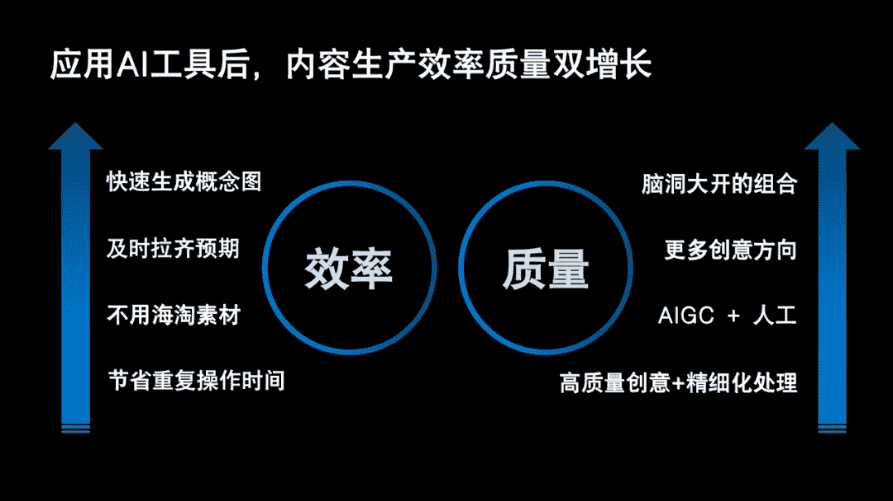

在要求高质量、高并发的内容生产节点，AIGC参与的工作环节、起到的核心作用包含：

**1. 生成前期创意： **快速生成概念图，可以直观感受色彩、风格和空间布局，方便双方快速拉齐预期、迭代确定方向

**2. 助攻后期制作： **高效率低成本地生成大量元素，节省设计师海淘或建模时间，减少素材购买费用

听起来有些抽象？没关系！在刚刚过去的818大促中，特赞 AIGC Studio 联合我们的品牌客户雀巢共同 打造、落地了AIGC助力多内容生产的解决方案 。

相信接下来的分享能给你一些参考和启发⬇️

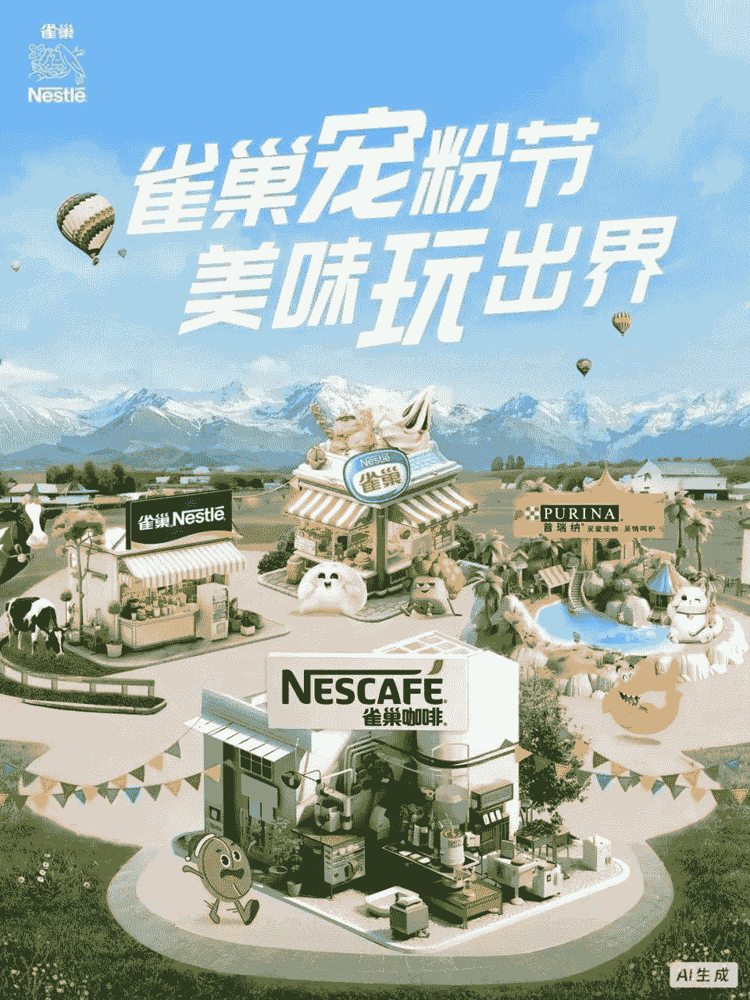

AI生成主KV

# **3. 解决方案**

雀巢818宠粉节 多场景Social海报

# **01**

**需求 & 难点**

本次需求来自我们耳熟能详的雀巢集团。成立于1866年，是一家致力于打造“优质食品、美好生活”的大型跨国公司。在全球范围内拥有超过2000个消费者喜爱的产品品牌，覆盖咖啡、奶粉、饮用水、巧克力和糖果、冰淇淋、调味品、宠物用品等品类。

818宠粉节 Social海报组合需求

雀巢818活动——【雀巢宠粉节 美味玩出界】是在8.18-8.28期间开展的集团Campaign。

**“雀”家军倾巢出动，联动旗下多个BU的11**款来自不同产地的经典产品， 用【好内容+好福利】打造出【无需假期 不用经费 11天11站畅玩全球】的活动概念 。

**具体内容交付物包含：**

1张主KV + 11张富有场景感的产品海报

素材计划在公域的社媒平台📕、🧣上进行分发，也会在私域的小程序、👸号中被应用。 营造欢乐宠粉的大促氛围，通过图文内容透传品牌故事，吸引粉丝互动与转化 。

**需求核心难点**

**亮点挖掘 **：**本次Campaign为雀**巢集团发起的集团宣传活动，而雀巢集团旗下产品品牌众多、覆盖品类范围广，如何从集团层面以品类进行聚焦， 寻找到每个品类的爆发点 是值得深思的。

**故事串联 **： 由于品牌众多，每个品牌都有独立的品牌故事，如 何通过创意的手段 将这些优质的品牌故事有效串联，同时又能契合社交属性 ，打造出多面化的雀 巢母品牌形象，是在这次项目中需要解决的。

# **02**

**设计策略**

**为解决以上难点，特赞 AI**GC Studio 与雀巢从两**方面进行破局**：

1. 找到内容上的突破点 ：与地域相关的品牌故事，通过 “溯源地” 这个概念将各个独立的品牌故事与产品有效且连贯地结合起来。

**2. 找到素材上的突破点 **：基于“溯源地”的概念，需要 在画面中体现 出多个国内外产地的好风光，让消费者们能身临其境。 但实际上，我们不可能去这些城市现场拍摄。 购买现有场景素材不仅价格昂贵，且角度、内容也不能完全满足要求。 因此，我们选择采用AIGC技术来创新性地生成场景 。

接下来，我们根据需求Brief对画面进行了解构，初步确定设计策略如下：

**主KV **：以3D质感的BU建筑 + 明亮的乐**园场景 + 不同产品线**的经典元素 诠释 宠粉、欢乐的购物氛围 。

**产品海报 ****：以原产地的典型地域元素 **+ 核心原材料 + 产品 诠释 产品RTB及品牌故事溯源 。

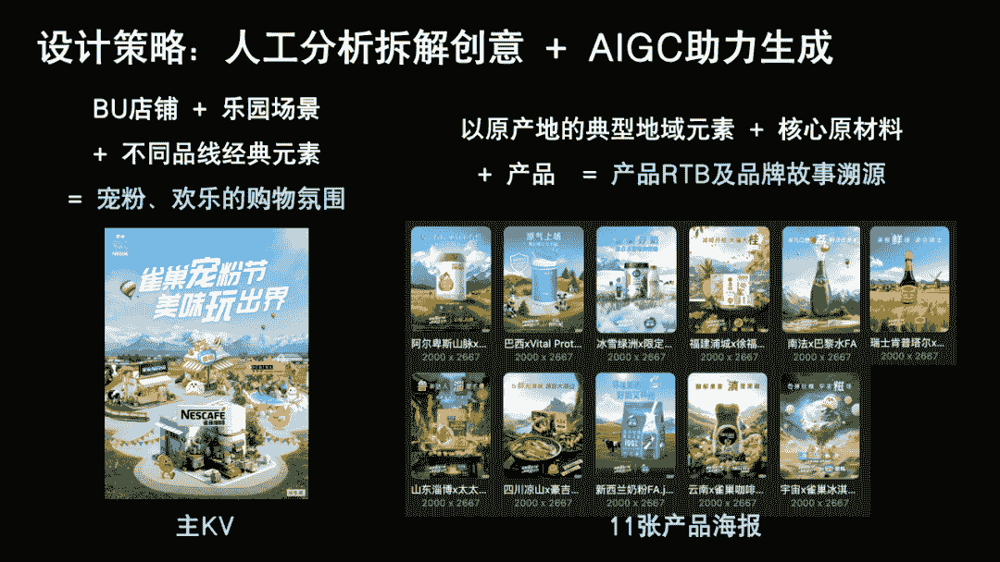

# **03**

**工作流：高并发多场景物料生成**

特赞的 AIGC Studio 通过 【人工 + AIGC + 人工】的“三明治”工作法 ，以人机协同配合的方式成功完成了此次多场景物料的生成。

**整体呈现效果符合客户期待，在📕**和🧣上也引起了一波不小的用户打卡热潮 。

**人工：PM 项目管理立大功**

在项目正式开始前，我们发挥“时间管理大师”的精神将人力安排到最优化，保证在20天内完成交付。

PM 制定出整个设计过程的Timeline，按照元素的复杂程度、生成难度，将12张内容物分为3批： 保证复杂度最高的主KV有足够的时间调整，同时也不耽误其他物料的进展 。

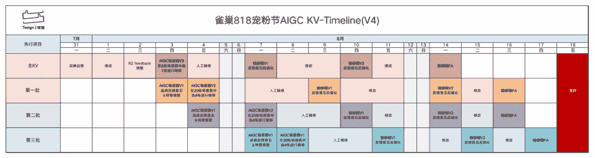

AIGC：多类型场景生成工作流分享

**有AIGC技术参与的工作流可以被抽象概括为**： AI生成多张概念图-确定方向-精修-添加产品及文字 。在多物料并行的情况下，这样的工作流 便于前期对齐预期避免从零返工，也能给设计师带来更多创意选择、提升单位时间内的产出 。

在这次的项目中，我们更充分地挖掘了AIGC在不同场景生产上能起到的强大助益⬇️

**1. 复杂场景的构建与拼装**

**场景生成挑战 ： **项目的主KV需要自然真实质感的背景，而构成前景图的5个乐园中的BU建筑则需要3D质感。

**AIGC解决方案：**

首先，我们将 reference “投喂”给AI学习，垫图生成了风格相似的多张背景概念图。

及时 **与客户对齐、选定最符合期待**的layout 。再对画面进行局部重绘，使背景中包含白云、远山等元素 ，同时具有真实照片的质感 ；

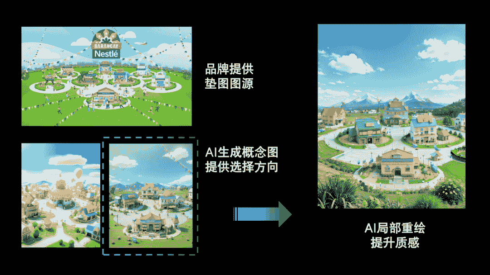

用输入关键词的方式代替3D建模与渲染 ，在关键词中添加“C4D、3D、oc渲染”，即可生成与reference 近似的建筑样式；

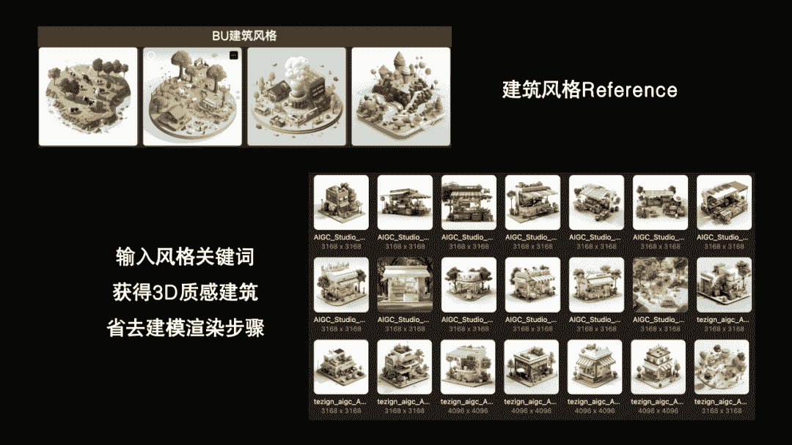

最后，我们通过 人工拼装、修饰光影、增删元素、添加产品和文字 ，就完成了这样一份元素复杂的主KV场景搭建。

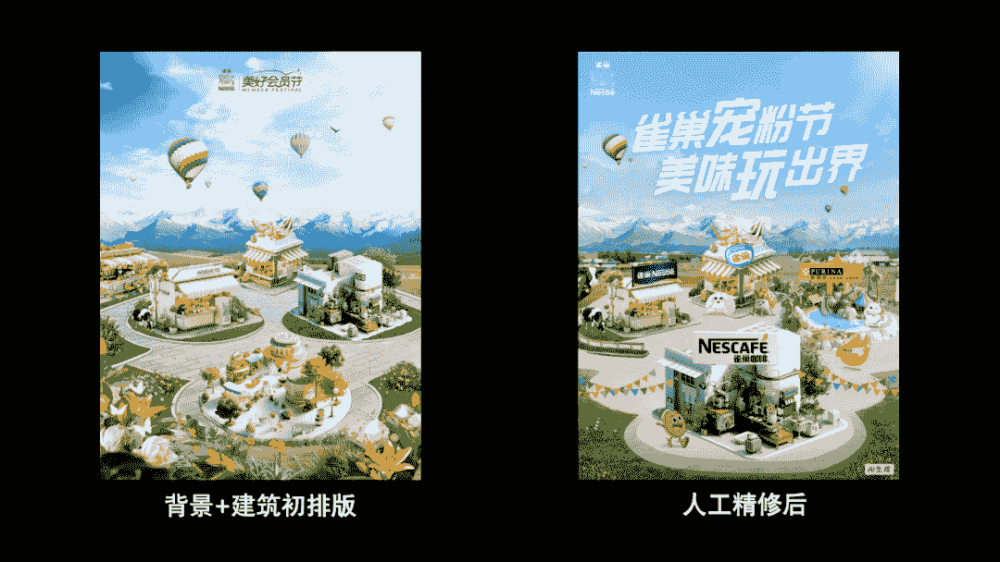

2. 足不出户，生成多地区自然场景

**场景生成挑战 ： **在处理 国内外多类型的自然/人文风景时 ，AIGC又是如何应对的呢？

**AIGC解决方案 ：**

虽然不能亲临现场，但我们可以 把标**志性的【自然景观+产品的核心**原料】提取出来 ， 再通过输入提示词来“作画” ，由此体现出“产品溯源”。

例如徐福记厚切浦城丹桂凤梨酥海报，我们将画面中所需的元素拆解为： 背景-武夷山和古镇、前景-丹桂之乡浦城的标志物“丹桂”、产品核心原材料-凤梨

再比如雀巢云南咖啡，我们将画面需求拆解为： 背景-云南的标志性景观梯田、产品包装中的视觉元素-缤纷的花果、咖啡豆

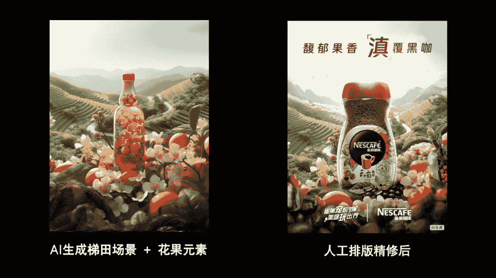

遇到相似度高的产品，如不同BU的牛奶、奶粉，在产地都是牧场的情况下，我们 先找出场景间的差异点，再把典型元素分别“投喂”给AI 。

例如 新西兰的牧场更强调绿草如茵和蔚蓝的天空、哈尔滨高纬度的牧场更侧重冰雪元素 。最终实际生成的效果确切体现出了场景的“差异化”。

**3. 虚拟场景的构建**

另外我们发现，除自然场景外，AIGC在生成虚拟场景方面更是一把好手。对于 需要想象力的抽象元素，比如宇宙、彩色星球，AIGC的脑洞能帮上大忙 ！

在雀巢雪糍的海报制作中，我们就成功将“冰淇淋星球”的想象呈现在了用户面前⬇️

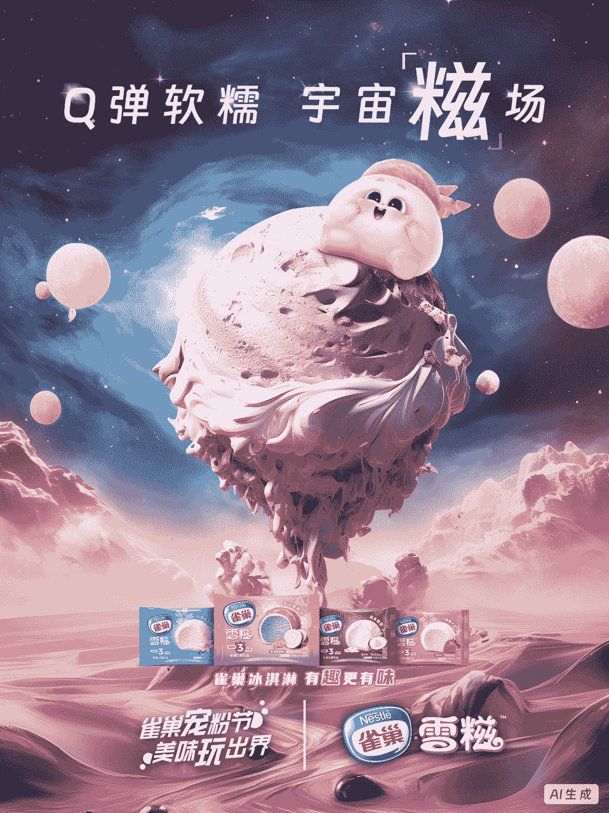

# **04**

**客户感言**

这已经不是我们第一次尝试用AIGC来生产内容了，但在此次项目中，它在“高压”之下的生产力还是让我们感到很impressed 。

AI工具高效率地解决了在大促期间多场景搭建的问题，后期人工处理又让质感有了提升。是一种既提高效率，又能吸引用户的内容生产方式。

后续我们也期待继续探索，AIGC在更多场景的应用潜能。

by 雀巢大中华大区 视觉设计负责人

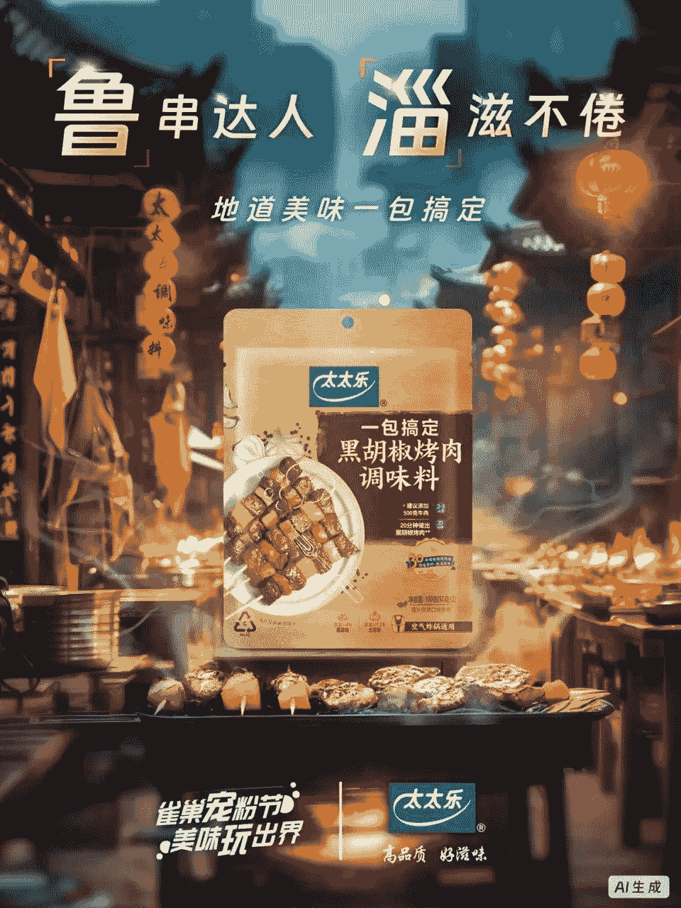

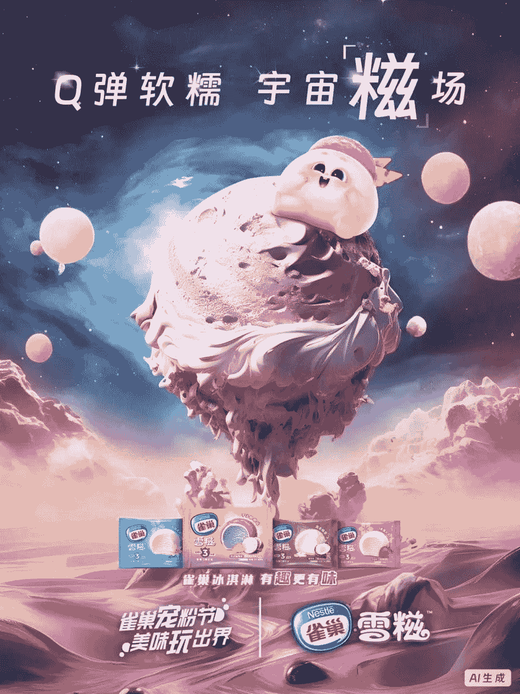

左滑解锁12张Social海报 <---

复盘本次Campaign的内容组合需求，我们能发现【人工 + AIGC + 人工】“三明治” 工作流对于内容 「数量+质量」要求双高的case ，有以下显著优势：

1. 前期：内容排期 保证交付时间

由专业PM负责梳理、把控内容生产进度

2. 中期：AIGC生产 高并发提升产能

Prompt engineer 把控生成调性，画面创意多元化、定制程度高

内容生产多线并行，支持灵活对齐、调整

3. 后期：人工精修 提升交付质感

设计师手动调整细节，确保内容交付质量

在密集的营销节点即将到来之际，不妨尝试应用AIGC赋能多物料生产工作流 —— 解 放生产力，带给用户更新、更有趣的视觉体验吧 ！

<https://my.feishu.cn/sync/CV7edZp1nspUQobYJhicxeP7nrb>