# 哈啰UED如何落地实践AIGC

> 来源：[https://my.feishu.cn/docx/TU9UdEphUoPpOdx4CLjcSEVinJe](https://my.feishu.cn/docx/TU9UdEphUoPpOdx4CLjcSEVinJe)

> 🔗 原文链接： h[ttps://mp.weixin.q](https://mp.weixin.qq.com/s/EVFxnPd1JXNx5EEL8mGWSQ)q.com/s/EVFxnPd1...

> ⏰ 剪存时间：2024-03-18 12:54:20 (UTC+8)

原创 哈啰骑行UED HelloBike Design 2023-10-18 12:21  上海

# **一、前言**

随着技术的不断迭代，AI技术的可控性进一步提升，AIGC可应用的领域越来越多，在文本、图像、音频和视频等多个领域都有广泛应用。用户可用自然语言与AI工具进行交互，革新传统办公方式，人力的重心自传统的重复性任务转为以创造性任务为主，降低冗长工作流程，提高生产效率。

**本文将从AIGC体系化应用角度聊一聊，互联网设计**团队如何推动AIGC工作流的应用与落地

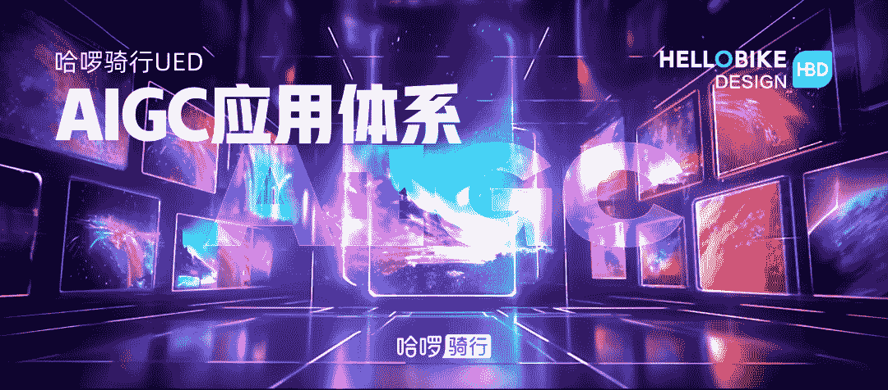

# **二、AI对设计的影响**

如何更好的利用AI工具帮助我们提升设计效率与价值，我认为现阶段AI工具可以从以下三个维度提升设计师的能力模型。

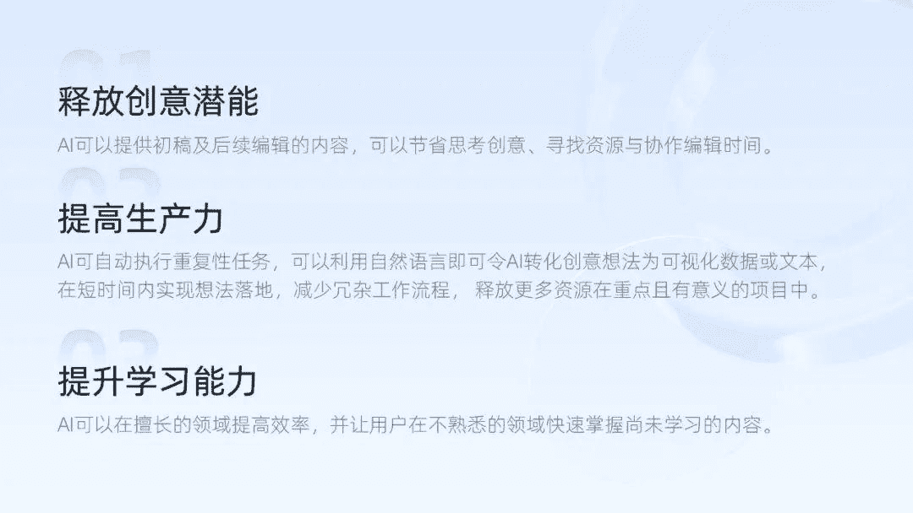

# **三、AIGC应用体系搭建**

我们认为只有稳定可控，流程可复用的AI才能真正的融入工作流程之中； 于是对现有工作场景进行梳理，结合不同AI工具的特点更有针对性的建立标准化AI工作流。 通过落地AI工作流，覆盖更多高频重复性的工作场景解放生产力，工作重心由重复性任务转为以创造性任务为主。

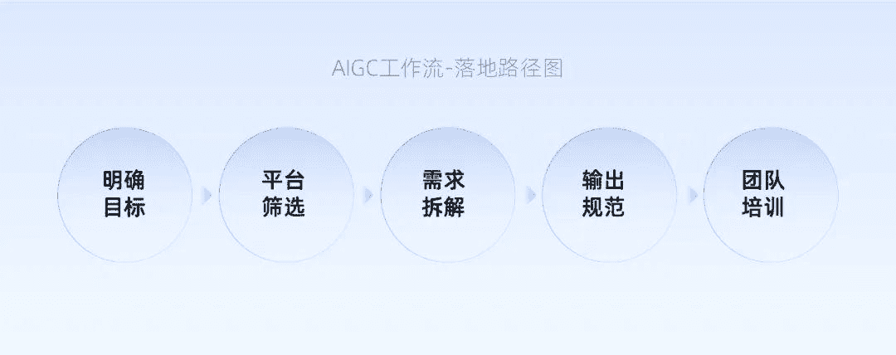

**3.1-目标&策略**

设计侧牵头推动AIGC应用体系落地，成立AIGC专项学习小组沉淀AIGC系列课程，提升设计专业影响力； 落地AIGC在设计工作流中可稳定、高效的运用方法，搭建AI素材库丰富品牌资产； 通过应用AI算法能力，搭建智能营销工具和自动化流程，简化营销活动的管理和执行。

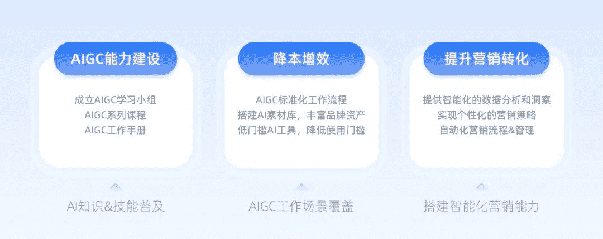

**3.2-平台筛选**

随着AI热度越来越高，市面上的AI工具也五花八门，对于AI工具的筛选我们主要分为2个方向：

方向一是主流工具的筛选比如： **Midjourney、Stable **Diffusion、ChatGPT等， 主流工具资金更加雄厚，技术能力也更加完善，将主流AI工具加入工作流中避免后期随意变换工具；

方向二是低门槛AI工具的筛选如： PPT生成、视频合成、一键抠图等， 通过沉淀低门槛AI工具包，赋能非专业人员在不熟悉的领域快速掌握尚未学习的内容。

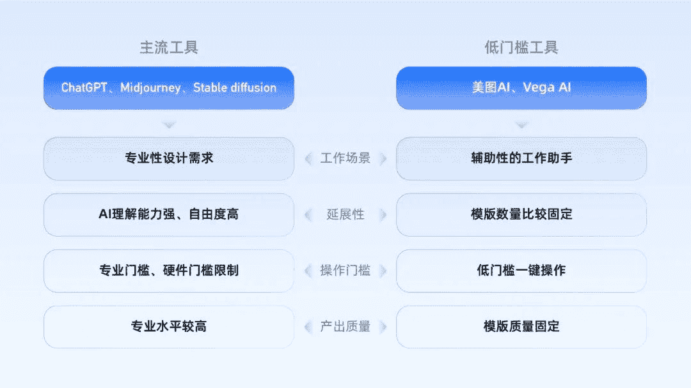

**3.3-需求拆解**

设计侧每周有大量日常、高频的设计需求，非常消耗人力且影响重点项目的资源投入。业务侧目前营销配置工具已有产品化模版但样式相对单一，点击率逐渐下滑，而运营素材的多样性能有效的解决用户的审美疲劳，提升点击率，但是需求量较大且多样性的设计需求又耗时耗资源。

基于这样的团队现状我们将从以下三个维度利用AIGC能力创造设计价值 ：

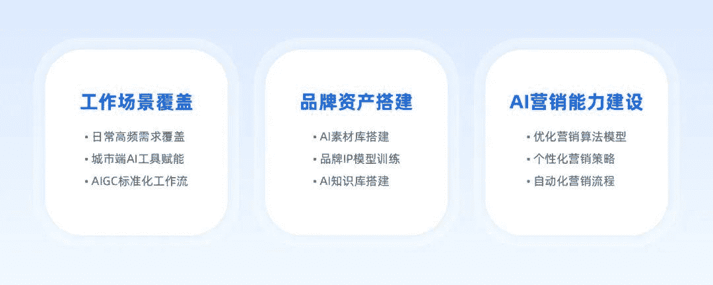

# **四、AIGC场景应用**

AI工具【低成本、批量输出】的特征，能够满足商业化运营需求【日常、高频】的属性，例如日常运营活动、品牌宣传物料、定制化车身设计、内宣物料等；所以我们想将AI绘图应用在商业化设计流程之中。尝试打破效率边界，利用低投入高产出的方式为团队提效。

基于工作场景的拆解，我们对于AIGC营销场景的应用主要分为4大类：

+   **1.运营活动： **基于哈啰骑行运营风格调性，模块化运营设计素材，沉淀标准化的AIGC运营设计规范；

+   **2.品牌宣传： **结合品牌设计资产，沉淀AIGC品牌设计素材；

+   **3.内宣物料： **利用AIGC覆盖内宣物料设计模版，释放设计资源；

+   **4. 业务赋能 ： ** ** **输出低门槛AI技能包，覆盖非专业人员的设**计**需求如：PPT、视频剪辑、表情包等；

+

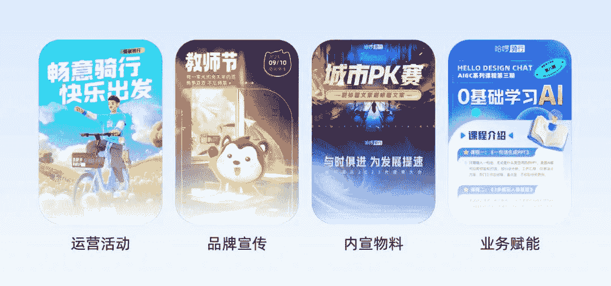

# **4.1-运营活动**

**01）模块拆解**

通过对画面元素的合理拆解，提炼AI可覆盖的素材生成，制定相应落地策略如：

**背 景层 ： **通过高质量的户外骑行场景体现运营活动的场景诉求，同时明确整体画面的设计风格符合品牌调性。基于Midjourney高质量、低门槛的特点作为背景层的主要生产工具；

**品牌元素层： **品牌元素是哈啰骑行重要的品牌设计资产，通过结合以往沉淀的品牌素材，利用Stable Diffusion的特定lora模型训练，丰富品牌资产；

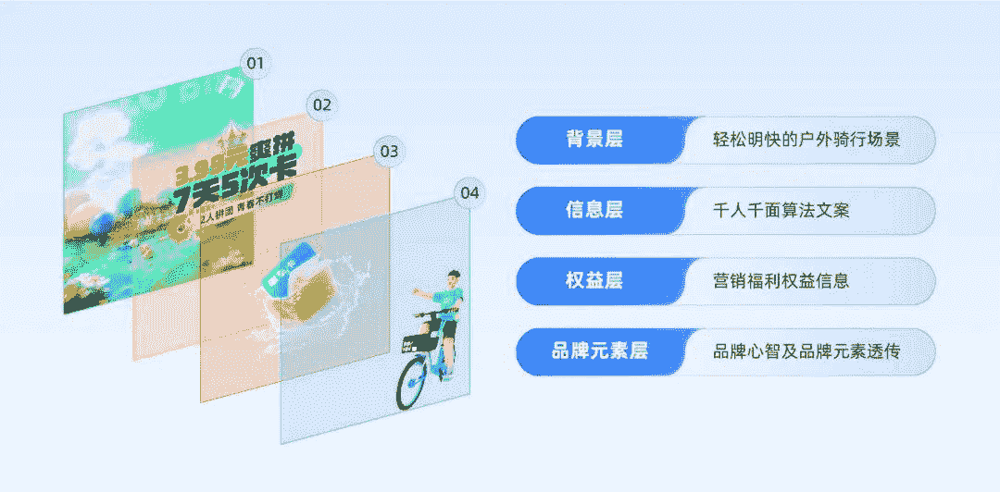

02）风格定义-Prompt模版化

提取哈啰骑行运营设计语言，通过prompt转化AI可识别的风格语言。 为了进一步提升AI生成画面的可控性及一致性，利用prompt模版化描述词减少试错成本。

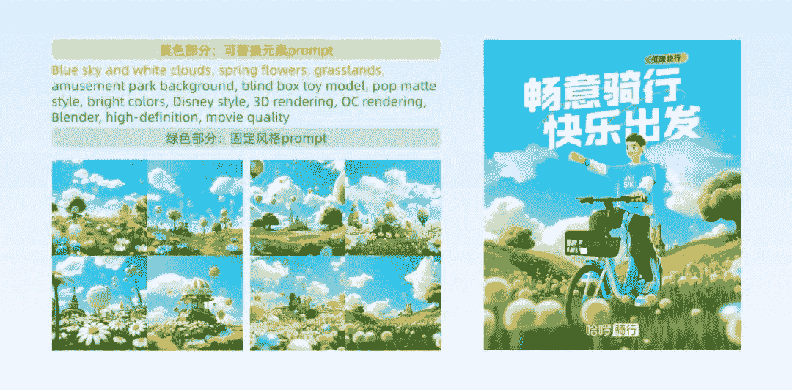

**03）Prompt模版库**

为了进一步提升AI素材的利用率，提高设计效率。通过搭建AIGC素材库，沉淀已有的AI素材；

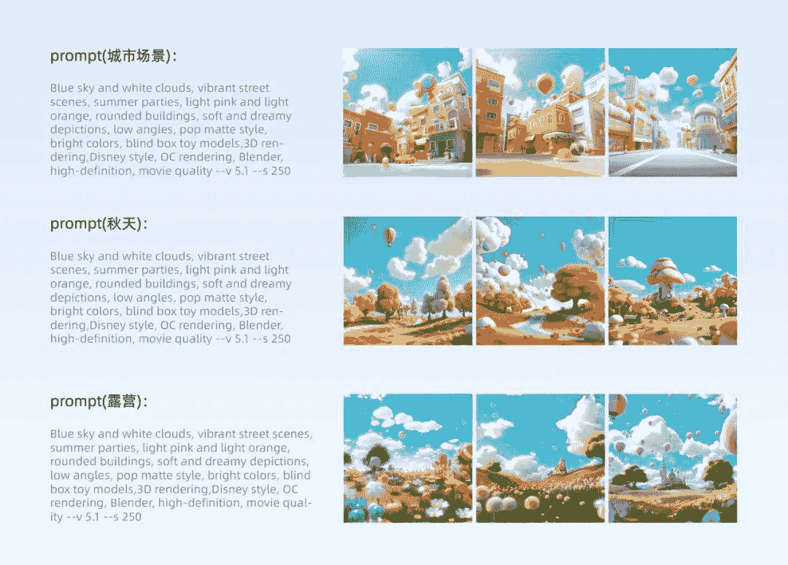

**04）设计流程**

**结**合AI工具落地可复用的AIGC设计流程 。 现阶段还存在部分设计人工调整部分，基于此我们也在同步开发智能化营销工具，实现更加自动化的营销流程，可以关注后续文章分享...

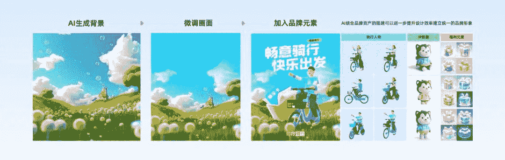

# **五、案例展示**

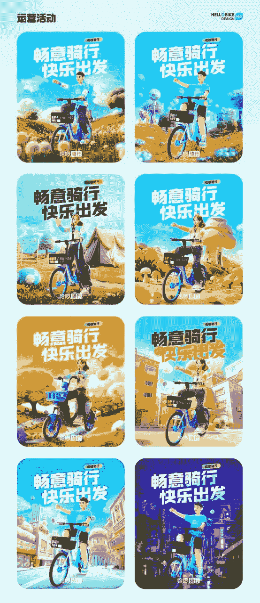

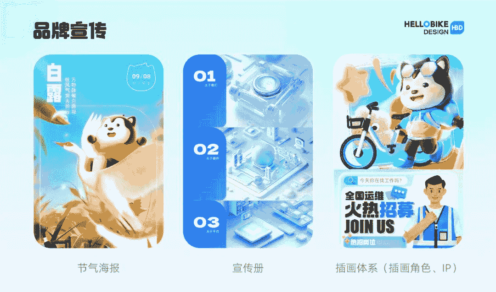

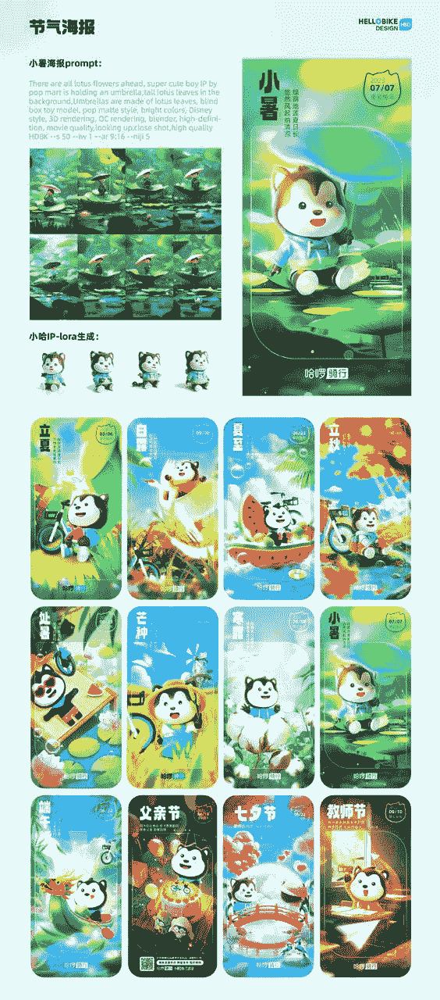

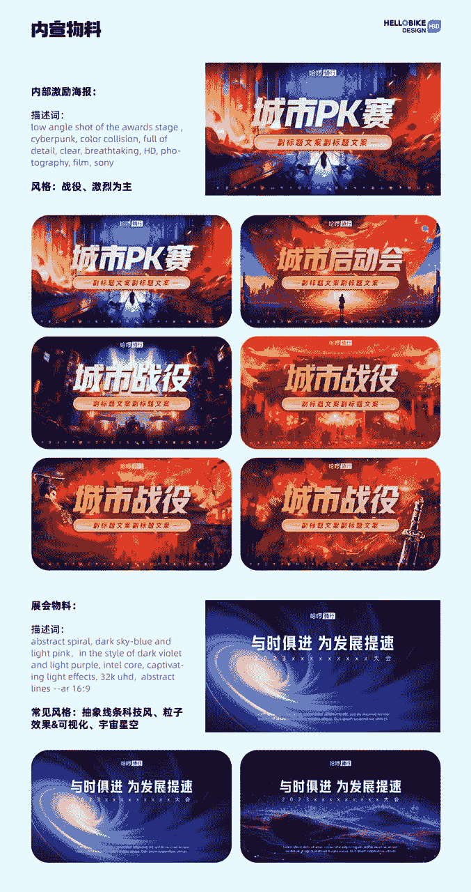

更多AIGC实战案例，敬请期待·····