# AI搭建品牌资产库实践

> 来源：[https://my.feishu.cn/docx/V1zDdKmGyoZzyCxfvbmcWXhOnjg](https://my.feishu.cn/docx/V1zDdKmGyoZzyCxfvbmcWXhOnjg)

> 🔗 原文链接： h[ttps://mp.weixin.q](https://mp.weixin.qq.com/s/dwfmAcPQFGDFl3QxAaKCkw)q.com/s/dwfmAcPQ...

> ⏰ 剪存时间：2024-03-18 12:55:49 (UTC+8)

> ✂️ 本文档由 [飞书剪存 ](https://www.feishu.cn/hc/zh-CN/articles/606278856233?from=in_ccm_clip_doc)一键生成

原创 哈啰骑行UED HelloBike Design 2024-01-11 19:42  上海

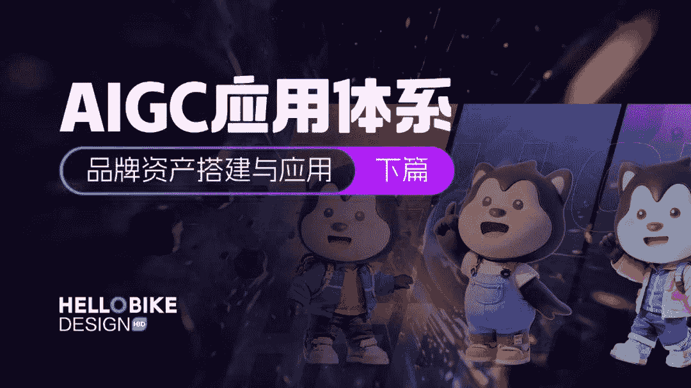

# **一、目标&策略**

随着AIGC的应用场景越来越多，AI工具的使用也为设计师提供了很大的帮助。目前AIGC仍处于发展阶段，在使用的过程中仍存在一些问题。今天将重点分享一下如何通过搭建AIGC品牌资产库来提升AIGC应用效果，帮助设计团队更好的落地AIGC应用体系。

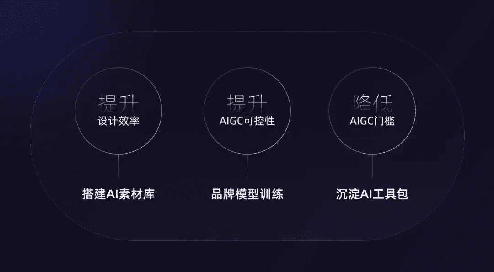

# **二、搭建AIGC素材库**

设计成员在日常工作中沉淀不同的应用场景，分场景搭建标准化AIGC工作流，搭建AIGC素材库可以更好的提高工作效率、提升AI应用效果，保证AI输出画面的可控性。

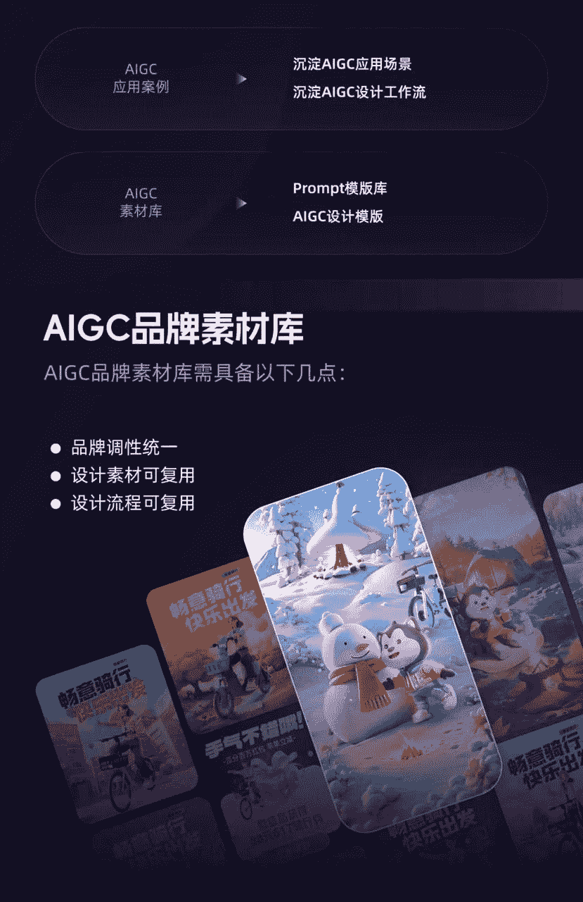

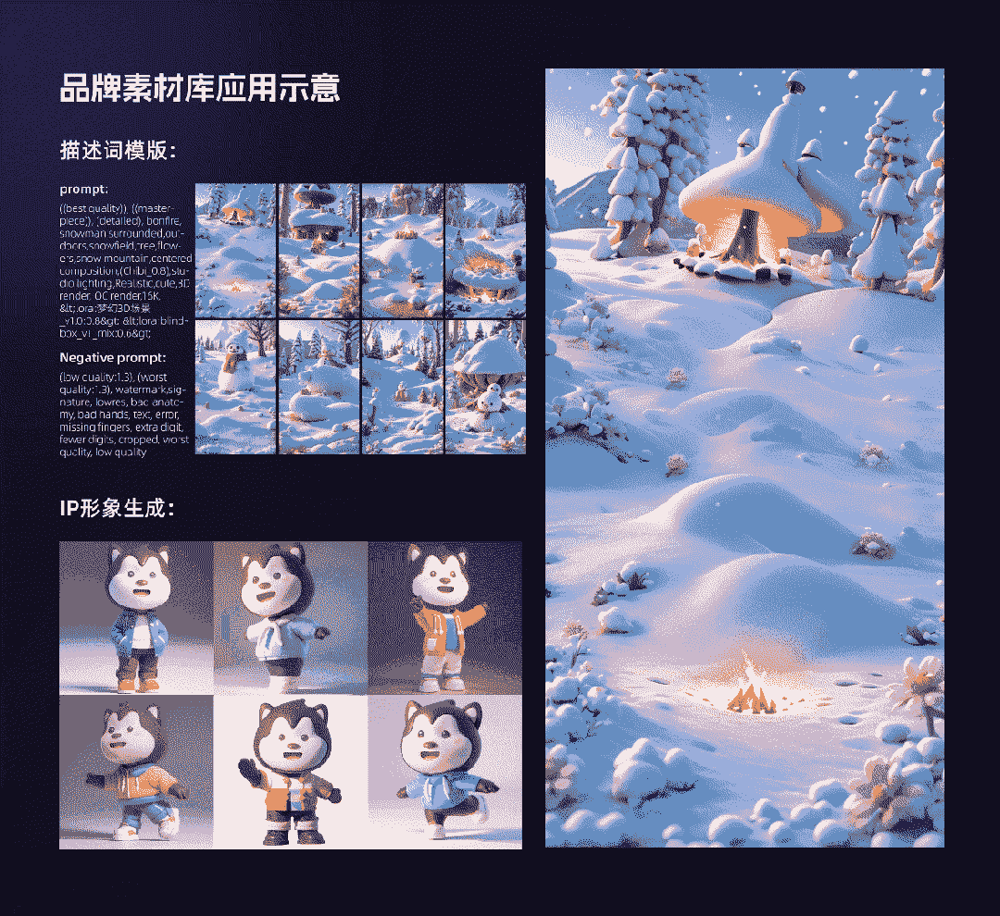

# **三、品牌lora模型训练&应用**

Lora模型可以在不修改SD模型的前提下，利用少量数据训练出一种画风/IP/人物，实现定制化需求，所需的训练资源比训练SD模型要小很多，非常适合品牌自有模型训练。

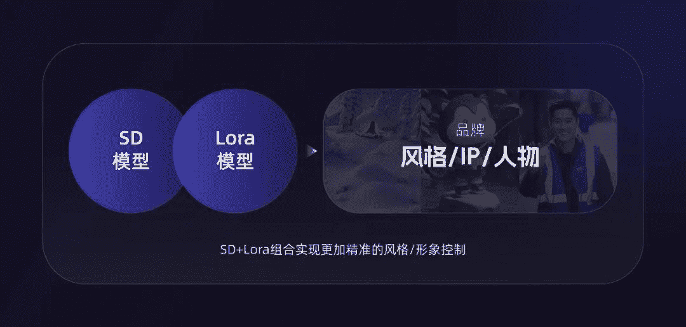

**3.1-IP模型训练 **

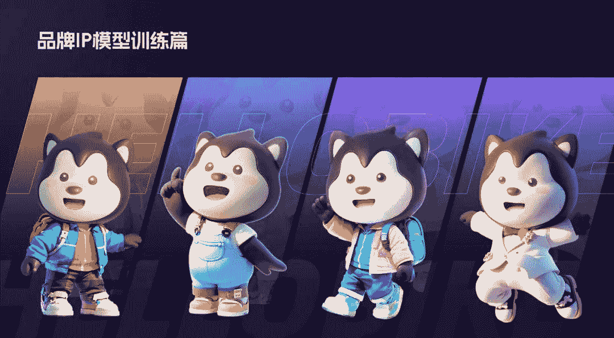

**品牌一致性： **保证模型还原度，生成能符合品牌IP规范的IP形象

**多风格拓展： **保证模型有优秀的泛化能力，生成适应不同的业务场景和媒体渠道的素材图

**应用与迭代： **根据实际应用的效果和反馈不断改进和优化模型，以适应不断变化的需求

**3.2-场景梳理**

基于业务场景梳理出品牌IP Lora模型可覆盖的应用场景，以确保模型可适应多元的业务场景，沉淀 更多的品牌应用资产。

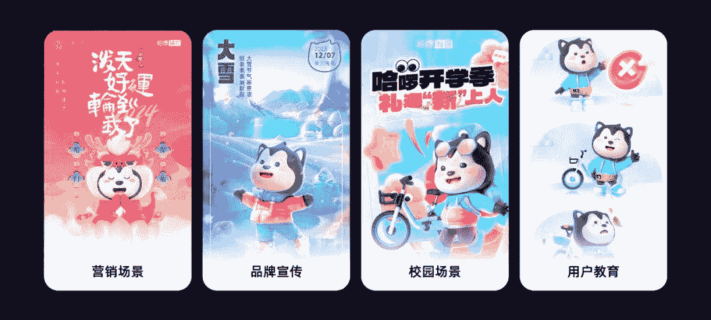

**3.3-训练策略 **

品牌IP模型训练是一个不断迭代的过程，现阶段很难一步到位训练出100%满意的Lora模型，所以需要不断迭代。 在应用的过程中不断丰富训练集，重复训练步骤迭代Lora模型以满足更多的应用场景。

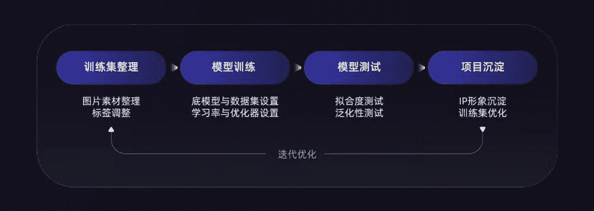

**3.4-Lora训练**

训 练集的质量是影响模 型生成质量的核心因素 ，训练过程中需要不断的调整训练集重复训练步骤，优 化模型生成效果以达到商业化应 用标准。

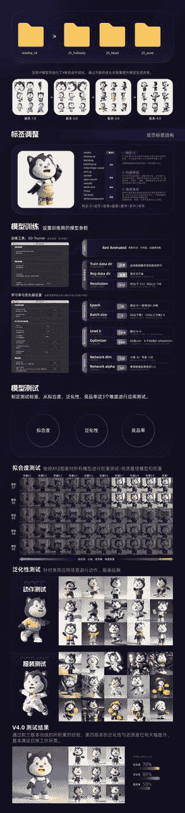

# **四、品牌应用展示**

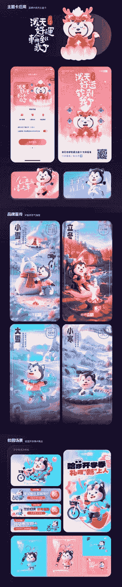

# **五、AIGC工具包**

为了更好的推动AIGC在各个工作场景的应用落地，通过搭建AIGC相关的知识体系沉淀在公司内网，帮助团队成员更便捷的获取AIGC相关知识。 除了AIGC设计相关教程我们还针对城市端一线员工提供了0门槛的AI工具包助力一线实现更多技能储备。 针对营销场景开发并落地AIGC智能营销工具实现更加智能的营销策略提升业务转化效果。

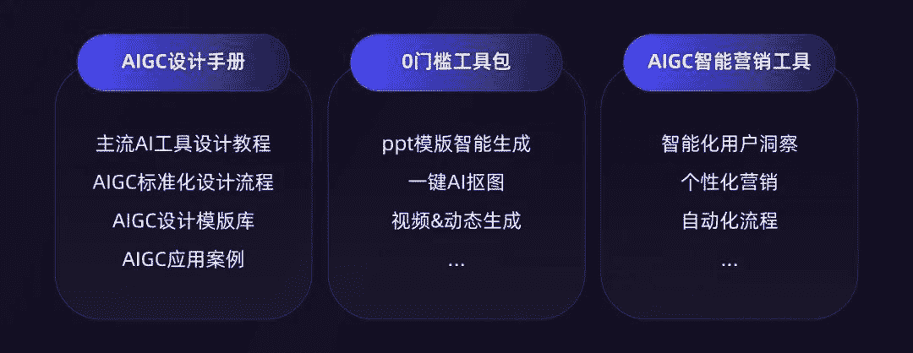

# **六、AIGC系列课程**

通过文档+视频的形式系统的沉淀AIGC相关知识体系。

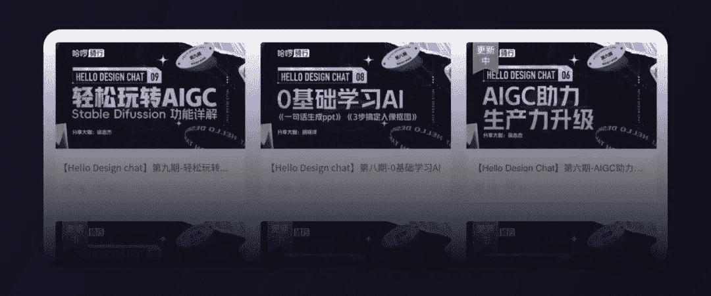

# **七、AIGC智能营销工具**

借助AI算法能力应用智能化营销工具，制作AIGC营销物料设计模版，AI自动化生成与投放。实现营销物料智能算法生成与投放，通过千人千面的营销策略提升营销转 。

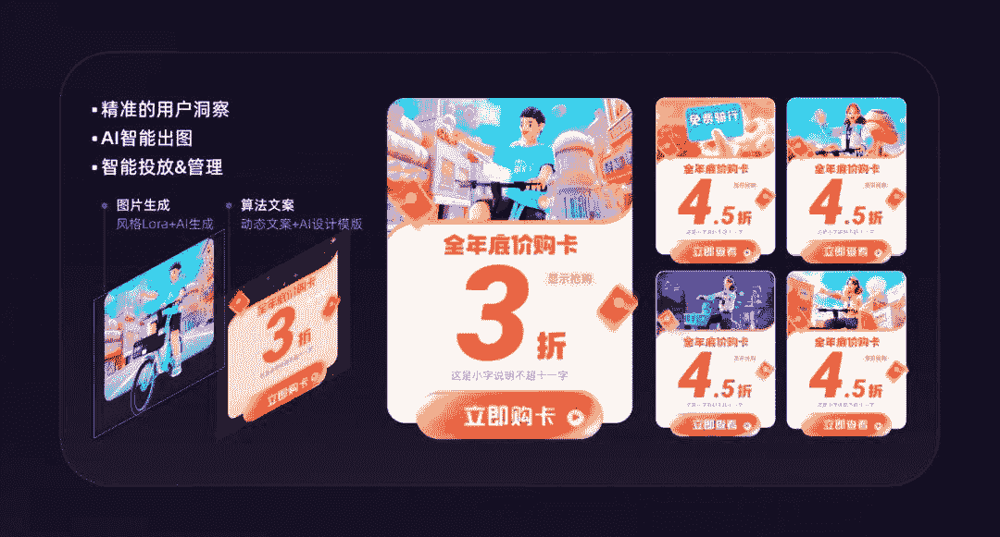

# **八、写在最后**

AIGC的应用目前仍处于发展阶段，不可避免的会产生很多的争议。AI更多的是帮我们实现设计想法的落地，消化重复性的搬砖工作，让设计师更多回归创造性的工作内容。