# AI辅助制作APP动态启动页

> 来源：[https://my.feishu.cn/docx/BSsHdHqQToyqM6xXWd2cWrs3nhd](https://my.feishu.cn/docx/BSsHdHqQToyqM6xXWd2cWrs3nhd)

> 🔗 原文链接： h[ttps://www.zcool.c](https://www.zcool.com.cn/work/ZNjgwMDQwNDg=.html)om.cn/work/ZNjgw...

> ⏰ 剪存时间：2024-03-18 13:08:37 (UTC+8)

> ✂️ 本文档由 [飞书剪存 ](https://www.feishu.cn/hc/zh-CN/articles/606278856233?from=in_ccm_clip_doc)一键生成

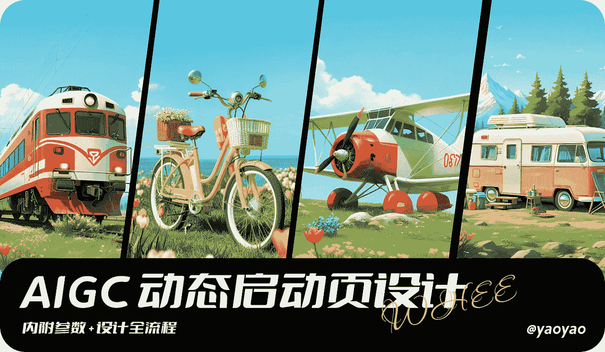

这是AIGC应用系列教程，之前给大家详细介绍了AIGC做海报和🛰️红包，这一篇给大家介绍AIGC辅助动态启动页设计的全流程！

目前AIGC在设计中的可行性相比去年更为广泛，在平面设计、运营活动、数字人、传媒广告视频，你可以利用AIGC制作个人头像，🛰️红包，绘本漫画，3D场景，动画电影，创意海报，角色设计，运营活动等等。这次利用AI设计APP动态启动页设计，会使用AI绘画工具和最新的AI视频工具。

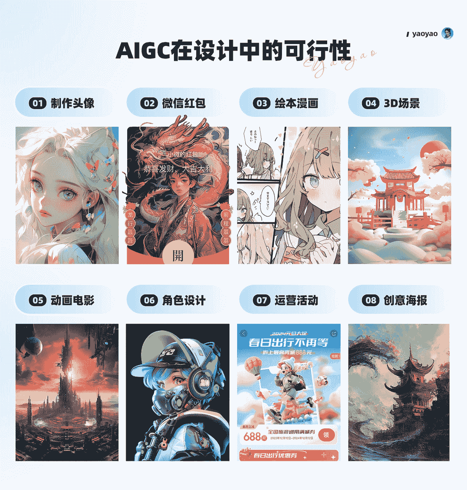

启动页也被称为闪屏页，是用户打开APP时看到的第一个页面。其主要功能包括：品牌展示、加载缓冲、运营活动推广、功能预告、节气氛围等。

在设计启动页时，需要拆解为画面视觉设计、活动主题文字排版两个部分的设计。

关键词提取：这次是设计「春日出行」运营启动页，可以收集春天、花朵、出行、美好生活等作为关键词的图片。

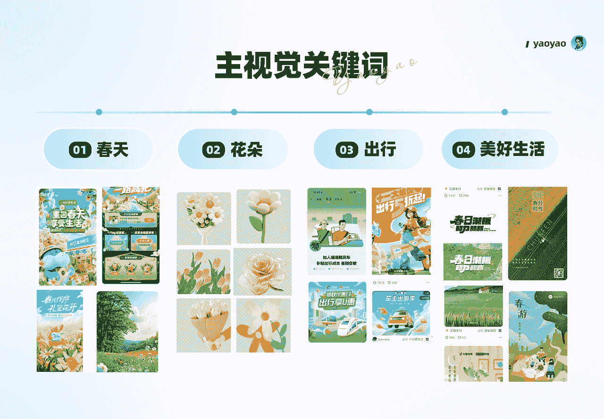

这次用到的主要是WHEE的文生图、AI提高画质、AI扩图来设计视觉主图，figma进行主题文字排版设计，AI视频工具来制作动态画面。更多AI视频教程可以查看我的👸号「姚十八设计」里面有系列教程。

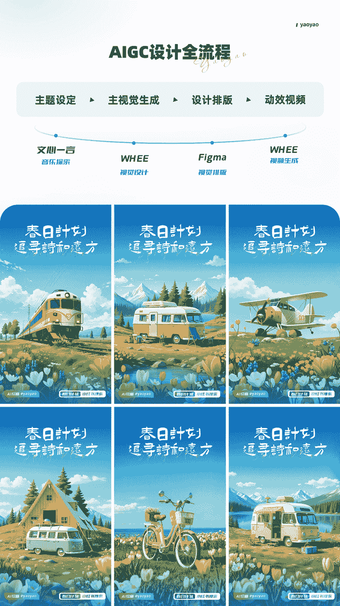

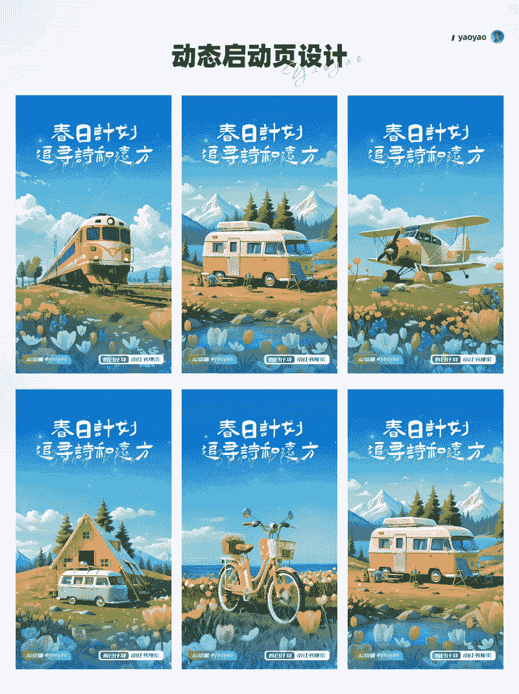

初步制定主题为「春日计划」的旅行主题，接下来使用AI工具帮我写主题文案，之前我在《四招搞定运营设计》中给大家介绍 ChatGPT 写提示词和文案，其实国内很多产品在写文案和策划上更加方便好上手，这次我使用「文生一言」大模型，写这次的主题文案。

在生成的主题中，我选择「春日计划，追寻诗和远方」符合这次以旅行为切入点的品牌特征，相比「探访古迹」、「穿越山水」「漫步云端」，「诗与远方」更具旅行地址的广泛性。

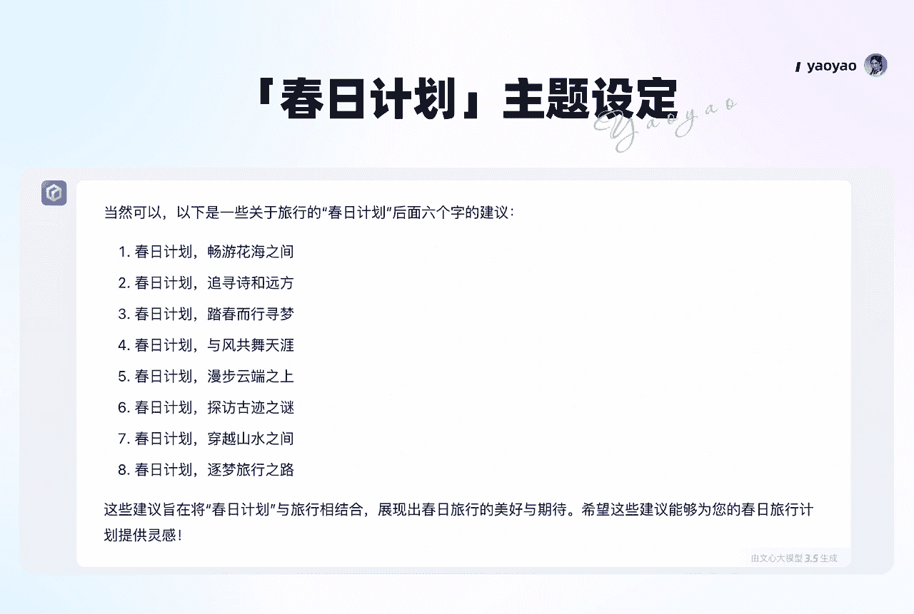

春日出行启动页，这次主要选择火车、周围是美丽的春光，整体画面是鲜艳明亮充满生机的感觉。这次控制提示词相同，选择不同模型生成的图片效果，比如：默认大模型、微距视觉、云朵模型、风景3D模型、风景山水画模型、3D春天户外场景，然后等待生成后，我选择「3D春天户外场景」啦。

提示词：一辆轨道上的火车，鲜花环绕，绿草如茵，梦幻般的视觉效果，明亮的颜色，大胆的形状，捕捉瞬间。具体参数说明可以查看我上一篇文章《AIGC辅助春节海报设计》里面有详细对比介绍。

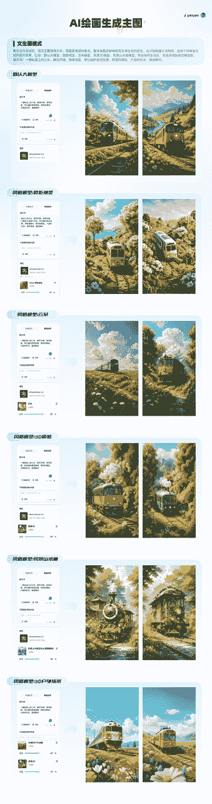

为了让画质更加高清，可以在图片左侧工具栏使用「分辨率提高」功能，可以看到图片分辨率直接从1280变为2560，直接翻倍。目前新出了「AI超清」功能，也可以提升图片分辨率，下次仔细说说「AI超清」功能。

提高画质之后图片左上角都会出现「超分」的提示，你就知道这个已经是超级高分辨率了，已经提升过分辨率的就不能再提高一次啦。

在生成图片过程中，当发现喜欢的图片周围画面缺失一块或者想修改尺寸就可以在图片左侧工具栏使用「扩图」功能。我希望生成的火车占据画面比例缩小，使用扩图功能生成画面的四周，不需要写另外的提示词，AI会直接帮你扩充图片内容。

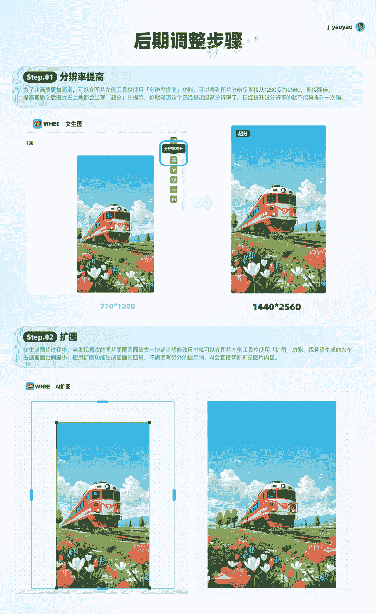

对生成的图片进行排版，分为主题文案排版、背景融合两部分。拉出渐变图层，进行视觉拼接和光感处理，把主题文案「春日计划 追寻诗和远方」配合英文「spring plan」一起排版后，把主视觉背景、视觉元素、文案等进行融合。

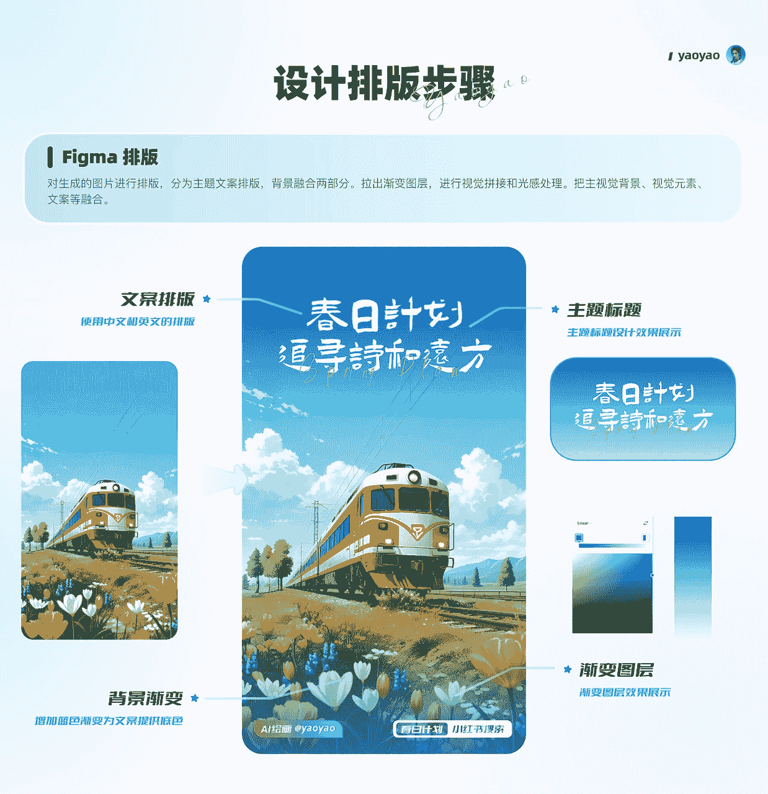

在AI绘画中，使用相同的提示词，替换主体「火车」替换为「飞机、大巴、自行车」等，保持画面风格一致性，在制作过程中可以使用提高分辨率和扩图功能对图片四周进行补充，这样就得到系列「春日计划」系列的主视觉图片啦。

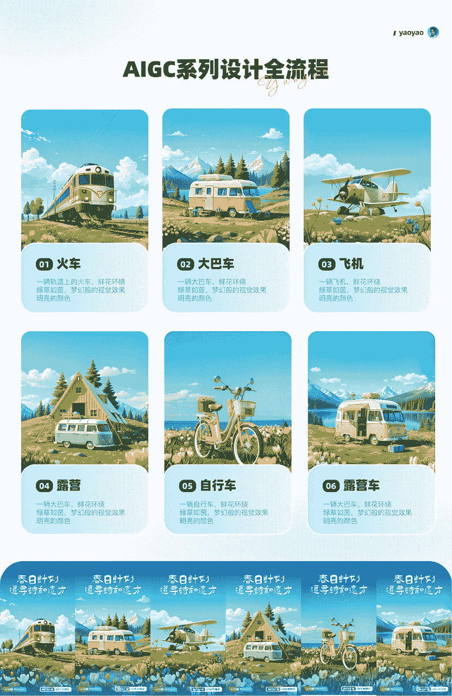

接下来重要的一步，使用AI视频来做动态效果，在AI创作工具中找到「AI视频工具」。

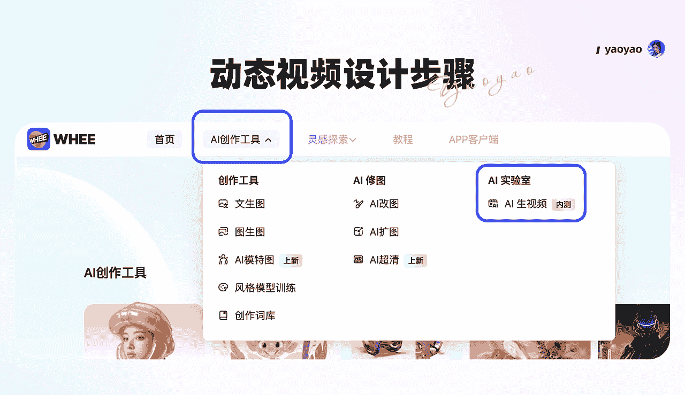

打开后可以看到两种模式，图生视频和文生视频。目前AI视频工具还在内测，图生文中很多参数无法调节，所以更加推荐大家先在AI绘画中生成完图片后，再使用「图生视频」来创作哦。

在主操作界面中，可以选择直接上传图片，把制作的「春日计划」图片上传进来。

提供修改尺寸的参数，点击「生成」等待就可以啦。右边可以看到生存的记录。可以看到生成的视频中火车驶出的效果还是很不错的！

可以使用默认参数，直接生成视频。如果你想让视频更加符合你的尺寸要求，可以修改为3:4、1:1、9:16、3:2、16:9等。在图生视频时，我的火车图为默认尺寸为9:16，分别修改尺寸参数为1:1、3:4、9:16和16:9，发现尺寸裁剪是正中心裁剪，所以需要裁剪尺寸的时候要注意画面的处理。

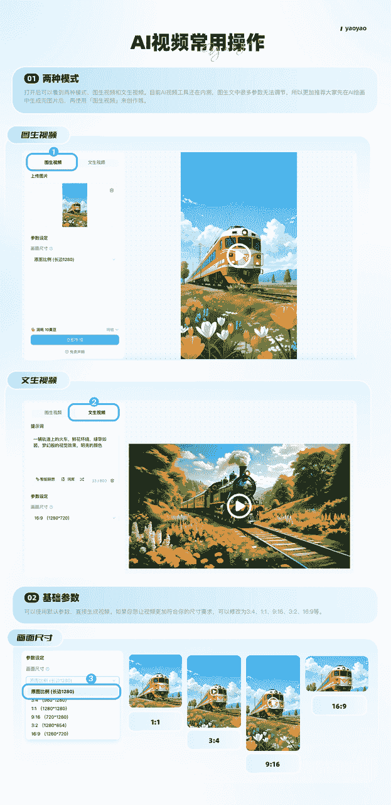

目前生成为4s视频，整体画质和控图效果都算稳定，对于启动页来说效果完全满足啦。

现在分别利用「图生视频」和「文生视频」生成两组效果进行对比。火车都可以完成正常行驶的动效，但是文生视频不能使用风格模型、不能放大分辨率、不能改图等，目前还是「图生视频」效果更好。

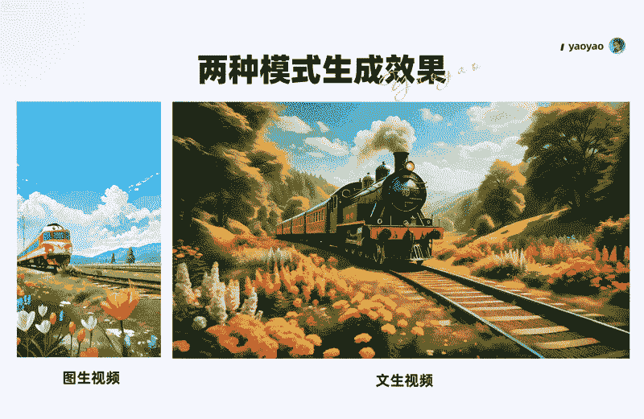

把AI生成好的视频和设计排版的图层一起放到剪辑软件中，把卡帧和模糊的视频剪辑掉，加入火车行驶的音效和春天鸟语花香的音效，至此动态启动页设计完成！

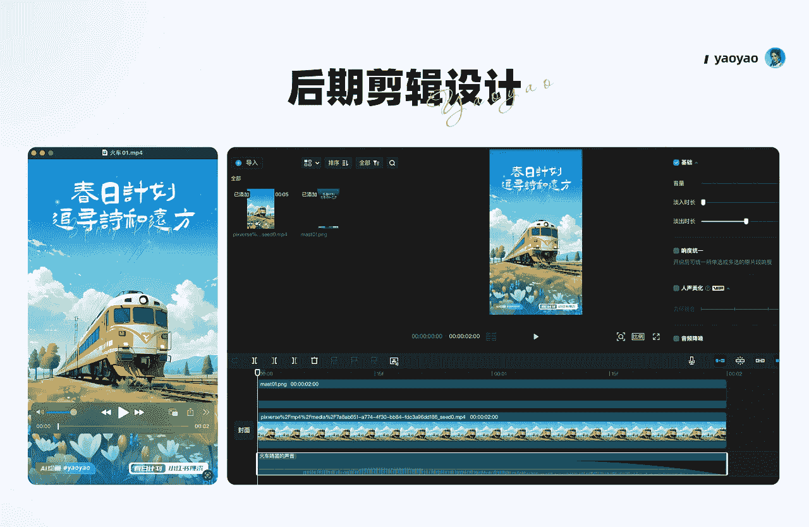

第一步使用AI生成图片：生成主视觉「春日计划」，确定提示词，主视觉元素等。对图片进行修改体高分辨率和扩图。

第二步使用设计工具排版：对主题文案「春日计划 追寻诗和远方」进行排版，加上渐变背景，融合整个图片。

第三步使用AI视频生成动态效果：目前生成为4s视频，整体画质和控图效果都算稳定，对于启动页来说效果完全满足啦。更多视频教程可以查看「姚十八设计」👸号里面系列教程查看。

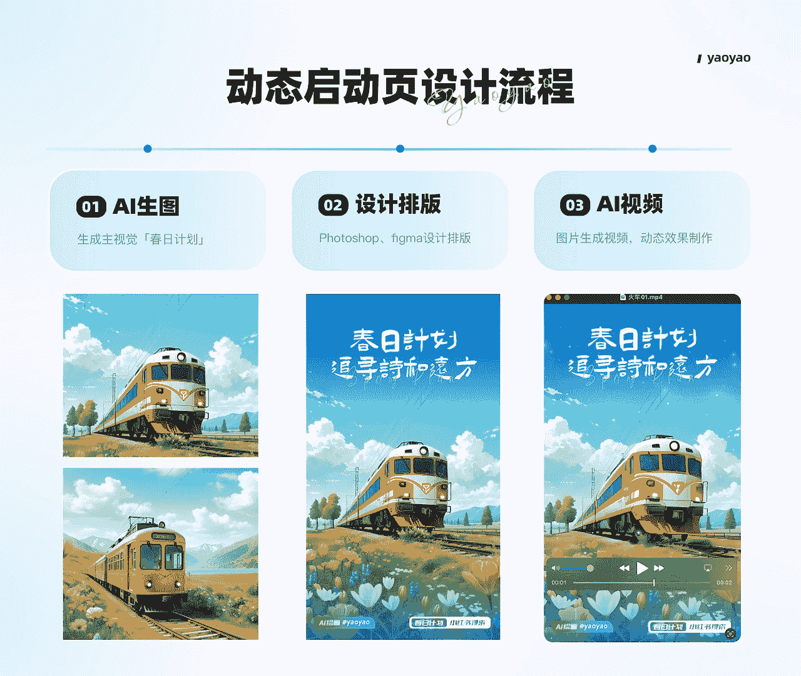

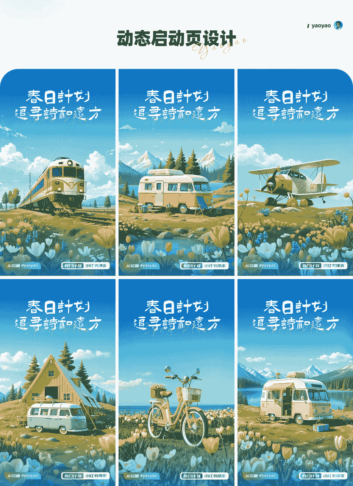

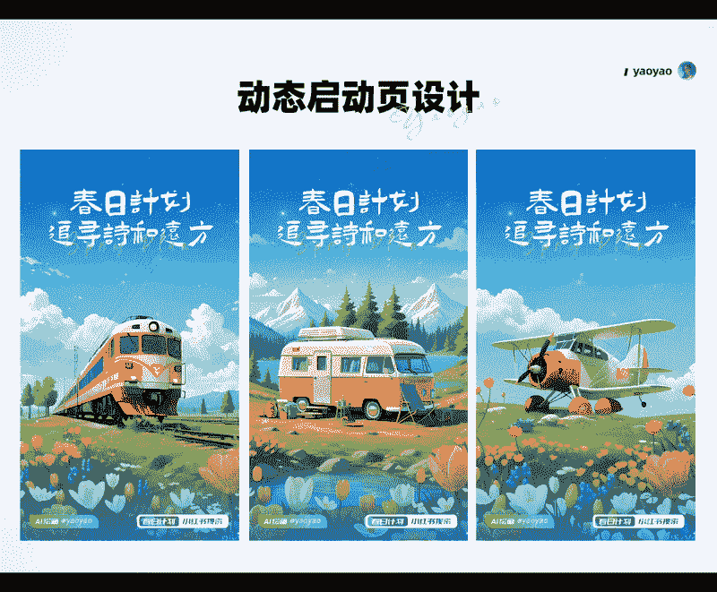

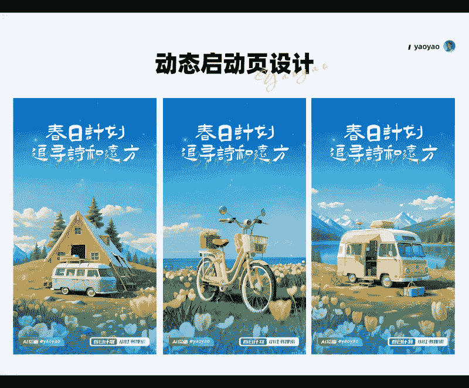

春天来袭，赶紧利用AI绘画和AI视频来设计动态启动页吧！操作简单易上手，让你轻松完成。

快来跟我一起学习AI绘画吧！让我们保持学习，2024年脱颖而出。

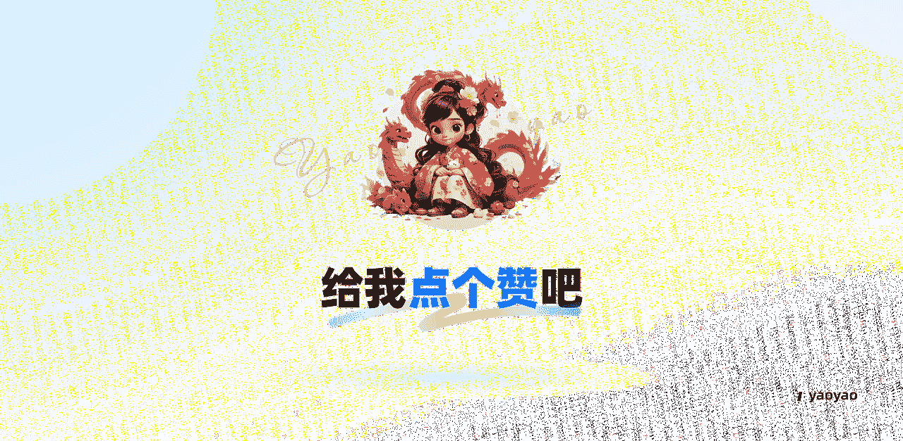