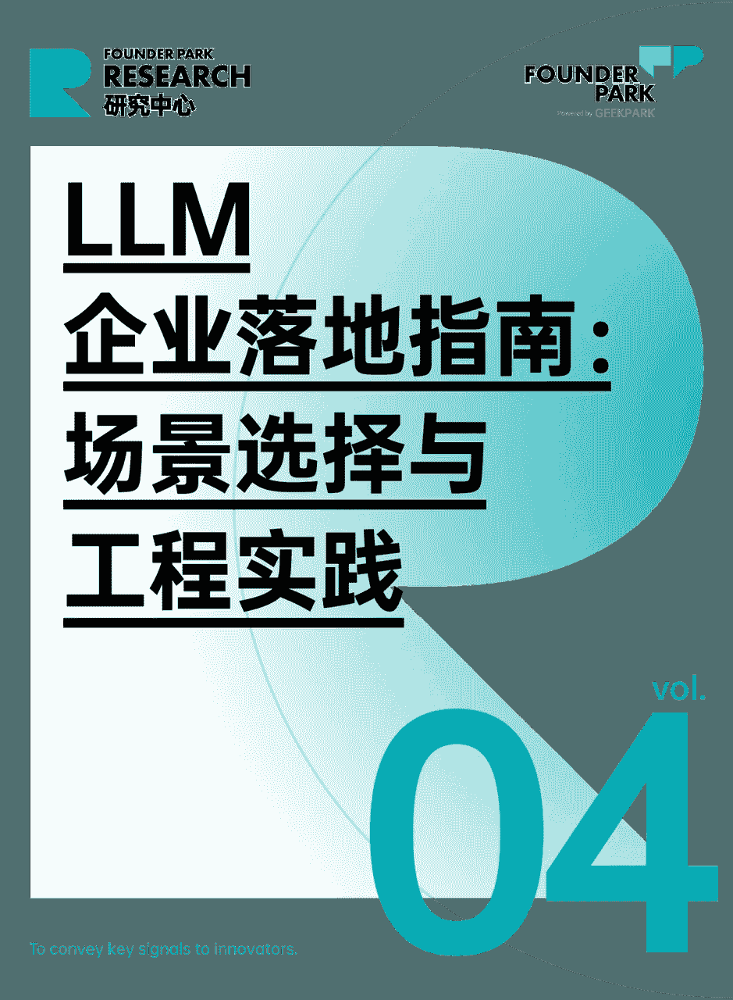
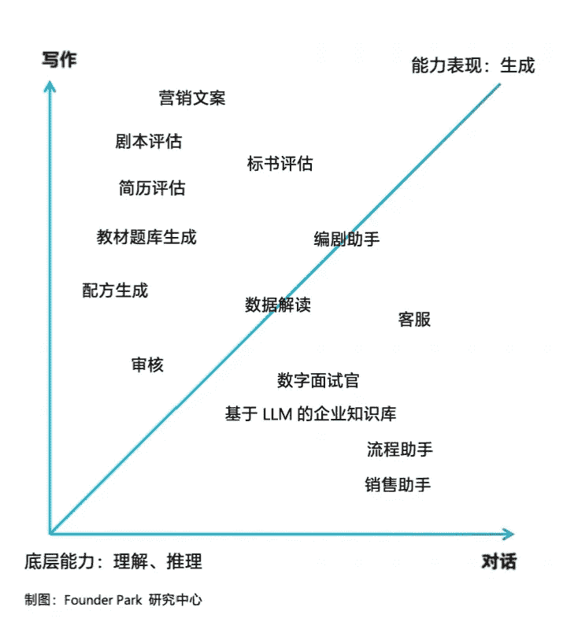
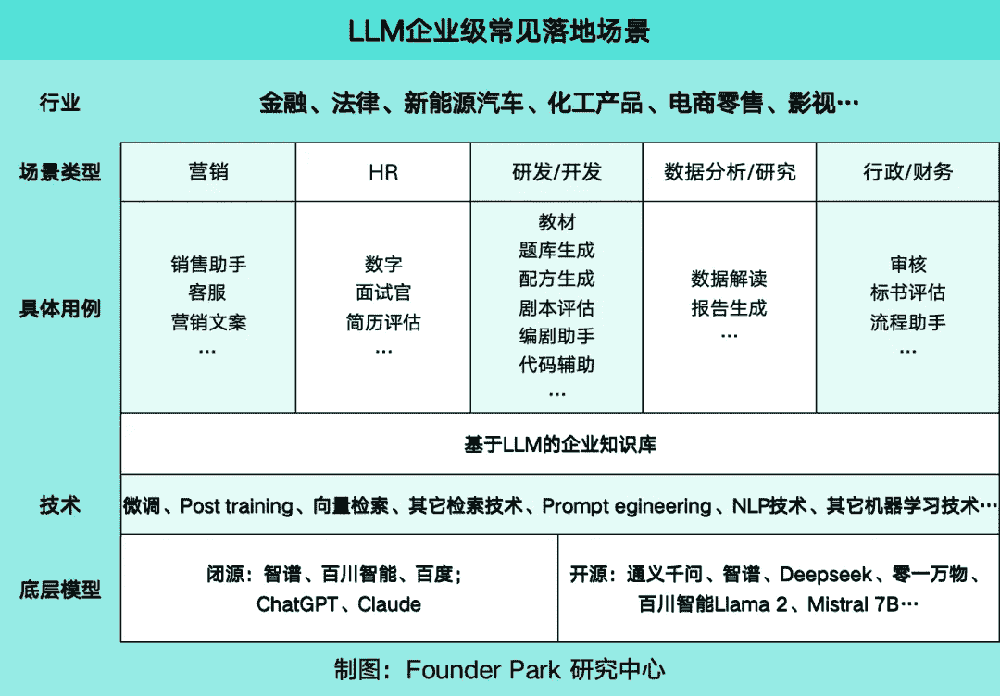
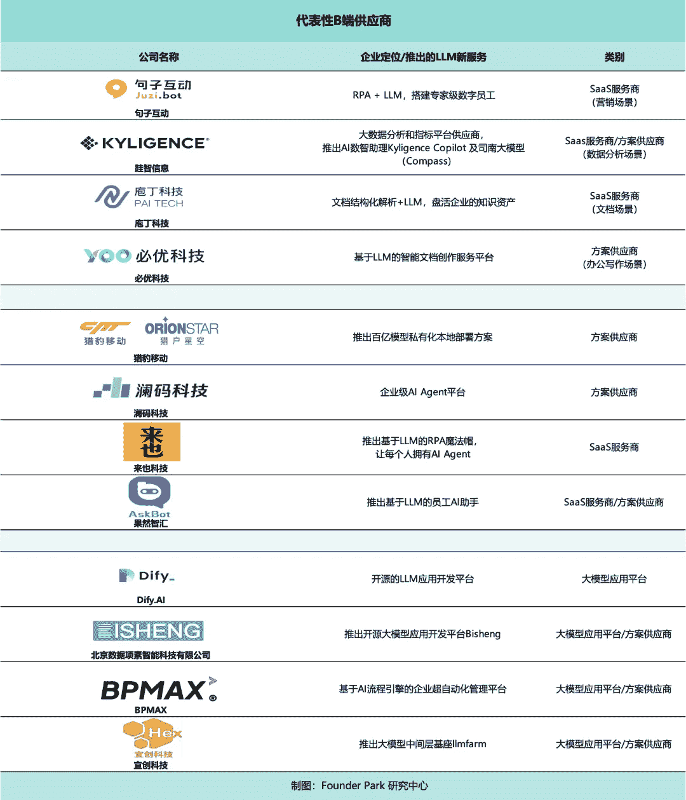

# 企业内部如何更好落地大模型？

> 来源：[https://my.feishu.cn/docx/Npsyd3nX4oyWDgxz0njcZtsknyb](https://my.feishu.cn/docx/Npsyd3nX4oyWDgxz0njcZtsknyb)

<https://my.feishu.cn/sync/CV7edZp1nspUQobYJhicxeP7nrb>

> 🔗 原文链接： h[ttps://mp.weixin.q](https://mp.weixin.qq.com/s/fiI1M0sBFoDDxalh8EfAlg)q.com/s/fiI1M0sB...

> ⏰ 剪存时间：2024-04-25 20:15:25 (UTC+8)

原创 FP 研究中心 Founder Park 2024-04-02 20:12  北京

在微软推出 Copilot 后，工作场景中如何落地 LLM 很快成为业内关注的重点。钉钉、飞书等办公软件也快速在最新版本中集成 AI 功能。

对于软件企业而言，在已有的软件上增加 AI 功能，并带来新产值，已经被 Notion、多邻国等产品所验证。除此之外，在企业生产场景中，集成 LLM 的能力，并为企业组织赋能，也成为人们关注 AI 落地的一个视角。

Founder Park 研究中心访谈了多位第一批尝试用新技术在企业内部搭建应用的实践者。我们观察到，随着大模型技术话题的广泛破圈，相较于以往的技术升级，来自不同领域、行业的企业都更有意愿进行在内部生产环境中尝试 LLM。

另一方面，应用落地的速度和质量，也与企业本身对技术的理解、技术实践能力、落地方式选择息息相关。这份总结性研究，希望为正在思考、探索 LLM 赋能生产的企业一份有价值的参考。

# Founders Summary

1.  在企业生产环境中，专家/岗位经验的数字化、最佳实践放大、初级员工快速赋能，是目前 LLM 能够带来价值的方式。

1.  难以描述规则、或缺乏过程性数据的需求，目前不适合 LLM 应用解决。从有独特数据积累、小切口功能入手，能更快积累实践的正向反馈，并为进一步加深 LLM 与业务结合奠定基础。

1.  LLM 的两端分别为输入和输出，无论是使用 Prompt 还是更重的 SFT 等手段，优质输入决定了优质输出。优质的输入包括但不限于：经整理的知识库文本、带有专家经验的 Prompt、保留了 Knowhow 的过程性数据/问答对。

1.  定义输入和输出的前提，是明确应用在工作流中承担的具体职责/功能。因此在场景侧，基于工作流提出具体清晰的需求，有助于应用顺畅落地。

1.  无论是效果实现，还是优化成本，需要一套综合技术组件灵活搭配，甚至是通用模型+特定功能小模型的组合。最先落地应用的思路，反而是在已有系统中集成 LLM 的能力，搭建之前难以实现的应用。

1.  由于 LLM 的概率模型属性，在应用实现工程上具有一定的黑盒性，因此应用实施效率，随经验增加，会越来越高。更有经验的实施方，也更容易实现优质效果。

1.  LLM 应用落地，需要自上而下和自下而上的视角相结合。LLM 应用即便不是一把手亲自推动，至少需要一把手有明确的意识；在具体选取应用的切入环节、应用形态上，最好由一线员工参与需求定义，产品初步上线时，员工愿意用、并持续反馈会让应用进一步优化。

## **01**

## **LLM 技术特点适合场景：**

## **内容创作与对话交互**

作为概率模型，LLM 的本质是预测下一个 Token，因此在应用中，尽管具体表现形式不同，目标的实质都是让 模型在特定语境中，预测的下一个 Token 准确率达到预期标准。

从通用角度而言，LLM 拥有语言理解和逻辑推理能力，落实到应用搭建中，可以表现为两种能力模式：写作与交互。

侧重内容写作能力，以写作内容作为结果交付。

常见用例有营销文案生成、报表生成。这些用例下，关键在于让模型 按照特定逻辑、风格、模式生成内容 。通过多种工程手段，最终可以将模型的能力调教成一个具有专业知识的写手，按照一定的规则输出内容。典型的例子如在电商领域，根据商品基本信息、促销的背景，生成符合电商平台规则、有 SEO 优化效果的促销文案。原先这样的工作，需要具备运营经验的业务熟手才能够完成。

代码辅助则可以看作是一种特殊的写作场景，coding 能力本身就是对模型评测的一项指标。作为应用功能，LLM 能够帮助快速补全代码、或者修正错误，相关应用还拓展了代码注释、代码运行。在企业内部代码与业务强相关而呈现相关特性，此在企业研发场景中，将模型能力做个性化适配，除了提升开发效率，规范统一格式，还能够整体上提升代码复用，也有助于企业代码资产沉淀。

目前局限在于，模型输出代码长度大约为 30～50 行，仅能实现一些代码片段，而实现更高级的软件工程能力，还需要大模型本身的能力升级。

工作执行需要进行对话交互，并且对交互质量有要求。

**常见用例有企业内部员工问答助手、客服助手**。这些用例中，关键在于 让模型根据交互的具体情境，解读信息。沟通的结果是信息、人、工作内容的进一步匹配 ，最终大多会被封装成 ChatBot、Agent 的形态。比如「分发 Bug」这样一个很具体的小功能，系统测试人员描述了具体遇到的 bug，由 Agent 读取内容、理解之后，再根据之前系统中运维人员维修 Bug 的历史记录，匹配最合适的运维人员，再开出工单，就是在现有系统中进行了信息的精准匹配。

在实践中，这两种能力模式往往会按具体需求组合使用。比如，在对话交互中，帮助业务人员生成所需要的报告；为了更好的交互效果，根据相关的文档抽取有针对性的信息，在此基础上进行话术写作。

## **02**

##

## **面向企业，**

## **LLM 可以带来哪些具体价值**

**L**LM交付的不仅是工具，而是整个流程中某一环节的工作结果。

应用落地，可以视作为模型提供 **具体语境 **、以及 **明确的行为规范 **。LLM本身的理解、推理能力，可适用于各个场景；将通用能力封装为针对具体岗位、环节所需要的能力，其原理是将生产环节的know-how 与通用智能叠加。

在实际企业生产环节，如果想落地应用， 专家/岗位知识数字化、高质量过程性数据 是两种可行的思路。

可以通过整理知识库，来实现专家/岗位知识数字化。比如落地最快的客服环节，因为有明确的话术规则、对答规范，而LLM还可以在此基础上实现自然交流。

一些职能或岗位的技能或know-how，难以通过清晰的语言描述，但是会存储在工作流程的文件中，比如项目策划的需求、初稿、定稿；HR对于简历的分析与评价；优秀销售和客户的交流记录，通过这样的过程性数据输入，模型能够汲取其中的能力，并进行模仿。

**模型对于生产环节带来的价值增量，则可**以从风险规避、开源、节流三个维度来衡量。

**节流 **：多人、重复劳动、流程明确的场景，可以通过 AI 承担部分工作、放大单人能力，来减少人力成本；或者在成本管理视角中，LLM 能够提供更灵活的数据看板，对运营数据进行分析，典型的场景如云成本管理。

**开源 **：主要集中在营销场景。LLM 能够提供更优质的互动和沟通，销售线索跟进、售后（复购）均可以利用 AI 来实现更多的潜在转化、促成交易，从而增益收入。

**风险规避 **：企业经营中涉及法律合规、生产安全检查等场景，LLM 可以依据规则，对相关文件、合同实现更灵活高效的查验、审核功能，规避风险，避免损失。

从效果角度而言，大模型带来的价值增量与应用成本之间的差值越大越好。

理想情况下，应用带来价值增量可以通过指标进行衡量，也更利于项目落地。例如，销售场景，从使用大模型前后的复购率等指标的变化，可以估算出对于销售额的贡献；在招聘场景中，可以对比使用大模型前后的简历采纳率变化，估算出节省的人力成本；云成本管理的场景中，节省的成本也可以被明确感知。

大模型落应用地需要一把手工程推动。如果能够有效辅助管理层决策，也是落地的潜力场景。用 LLM 的对话能力，可以将企业的不同数据库打通，让管理层便捷地针对性调用、分析具体数据，高效提供决策的背景信息。

## **03**

## **部署应用成本已大幅降低**

在优质开源模型出现后，闭源模型在能力上并没有显示出明显代际差异，因稀缺性带来的议价能力也随之降低。2023 年，就千亿参数模型的私有部署方案而言，价格经历了由千万元到百万元级别的下降。可以免费获取的开源模型，降低了项目花费的门槛。

其次，从性能与成本的平衡角度考虑，在达到性能要求之后，选择最具性价比的工程方案即可。如果需要本地部署模型，成本主要来源于采用的模型大小，以及是否进行微调。

私有部署模型不需要追求参数规模，而是在效果达标前提下，追求最优成本 。模型参数规模越大，私有部署的算力门槛就最高，方案的成本也随之增加。随着落地经验增加，业内经验逐渐显示，配合工程化能力，百亿参数规模的模型能够在具体的场景上，接近 GPT-4 的表现。

选用量化模型能够进一步降本地部署的算力门槛 。模型量化能够在保证大部分推理效果的情况下，减少显存占用和运算量。在应用部署的时候，根据情况选择量化版本的模型，这样能够用较少的算力实现部署，也能让使用过程中的推理成本进一步降低。在访谈中，问答功能上，有企业表示，通过自己优势的语料积累，采用 13B 的 Int8 量化版模型进行微调，能够超过 GPT-3.5 的表现。

以常用的 13B 模型为例，FP32 全精度、FP16 半精度、Int8 精度部署方案对于显存的要求分别为 52G、26G、13G。对应需要的算力资源分别为 2 张 A6000、单张 A6000、单张 A10，对应的成本区间约为 7 万、3.5 万、2 万。

**微调不一定是必选技术。 **相比 Prompt、RAG，微调显然需要调动更多算力。对私有化方案，微调也不一定是必要的技术工具，在一些案例中，高质量的本地知识库结合 Prompt、RAG 方案也可以取得理想效果。有供应商表示，在营销客服场景中做的方案，只有需要实现特定表达风格的情况下，才需要采用微调。

在访谈中，对于微调，在具体用例中，是否需要微调也和工程方案、是否调用更强能力通用模型 API 等因素相关。

如果企业尝试自己搭建应用，模型调用和测试是一个容易被忽视的隐形成本 。有尝试自己搭建应用的企方表示，调试各种模型做测试，就占到了成本耗费的最大部分。也有供应方认为：市面上大模型太多了，企业花费过多时间试用，这也导致技术落地速度不及预期。

大模型的黑盒性质，也带来工程方案的随机性，并且高度依赖经验。有做了半年以上方案落地的供应商表示，在许多尾端的实现细节上，「只能踩坑，不过随着经验变多，踩坑之后拔出来的速度也会也快」。

**两种成本模式： **** **

从技术门槛、时间人力成本上考虑，复杂项目，采购供应商的服务或方案是一种选择。根据多方调研，我们总结了目前市场上 B 端项目收费情况。费用主要分为算力成本、人力成本，主要是否部署本地模型（及模型规模）、实施复杂度等因素影响。如果涉及调通用模型 API，则随之产生 Token 费。

**购买本地部署+方案搭建 **：

简单问答类应用，使用 13B、14B 的免费开源模型进行部署，包括 GPU 算力费用，价格大约在 30 万起步。

复杂类应用如涉及数据分析类，需使用 30B 及以上免费开源模型进行部署，包括 GPU 算力费用，价格在百万元以上。

如果购买 Saas 化解决方案 ：

主要分为实施费、产品使用年费/人头费、咨询费、Token 费；如调用外部通用大模型 API，按照 Token 量付大模型调用费/流量包。前期产品梳理、数据治理工作量较重的项目，也会收取咨询费。

这种形式下，如不涉及本地模型部署，起步价更低且更灵活。有供应商表示，在理想状态下，涉及到前期数据治理、百亿参数模型微调、复杂配套工程，100 人到 500 人左右的企业，预算范围为 500 万以内。

未来，随着算力层 Infra 成熟、端侧模型性能提升、大模型 Token 价格进一步降低，应用成本还会进一步降低。

##

## **04**

## **基础实践经验总结**

没有大模型不行，只有大模型万万不行

将通用智能引入具体的工作环节中，就像将高压电引入单户单室，实现的方式是一套技术组合。这其中涉及到不同的工程技术，除了微调、Post training、向量检索、Prompt egineering、也包括其它检索技术、传统 NLP 技术等。

如何有效组合不同技术工具，源自实践中所形成的经验积累。有供应商就认为，「技术落地的过程中，形成恰当的应用组合框架，才会产生更大的壁垒」。

在访谈中，多位供应商表示， 一套有效的方案中，含大模型不宜过高，甚至可能只占到 20%～30% 。实施方的经验差异，往往体现在模型选型、技术组合选择、及工程细节处理等方面。

数据安全和幻觉，通过配套工程来满足需求

B 端落地普遍关注的幻觉、数据隐私问题，主要通过恰当的技术组合来解决。因为 LLM 的本质是一个概率模型，因此在工程实施过程中，通过增加规则限制、RAG 技术、上下游流程把控等不同的方式，将回答正确率达到要求即可，在必要场景中，遇到 corner case 可以通过拒答，最终实现 0 误答率。

企业本地部署的知识库、微调模型，保证了大部分数据循环在本地发生。涉及运营的关键数据，由本地模型（通常是经过微调的小模型）直接处理；如果需要使用大模型的推理、阅读与写作能力，调用外部 API 时只会外流局部、零散的不敏感数据，也在企业的接受范围内。

**针对性任务进行微调才能够落地**

由于通用模型不具备领域知识，在行业应用最初，「垂直行业大模型」被认为是解决方案。即通过领域相关数据进行微调，这样模型既拥有通用智能，也具备垂直领域知识。但实践表明，这样面对发散性场景微调，对应用落地效用不大。

这好比拥有了行业百科全书，并不等于具备专家技能。如果企业期待「内部微调一个垂直模型，每个岗位添加几行 prompt，就能够变成专属 GPTs」，则难以在生产场景搭建应用。需要在定义好具体需求基础上的微调，才能体现效用。而进行微调，就需要定义模型的在特定语境的问题下，给出的「标准答案」是什么，并准备好问答对

比如，在招聘领域中，面对批量招聘的岗位，在简历初筛过程中，由大模型对简历进行阅读，并给出评价供 HR 进行进一步筛选。这就是一个具体的功能需求。

**梳理面向任务的数据是关键**

在成功的企业实践中，产品最终交付的往往是某一工作环节的生产力，即执行具体任务。而大模型具有通用性，将模型的通用性与具体专业知识有效结合，就需要让模型去理解某一类型的数据。这些就是「面向任务的数据」，它们的内容、格式、质量等要求，与工程方案紧密结合。

准备好这一类数据，既需要有工程经验的实施方，也需要对业务本身的理解。定义、梳理好这部分数据，需要企业与技术供应商之间的良好协作，SOP 的梳理和打磨也是前提。

不过一个显著的变化是，在 LLM 时代，传统 NLP 知识标注的工作大大减少了。相关从业者表示，「以前工程师需要帮企业做专家知识库，今天大模型本身可以做一部分。」由于 LLM 具备了理解和推理能力，也就具备了在数据中直接读取知识、并使用的能力。

## **05**

## **应用深入，**

## **还需解决哪些问题**

**跳出 ChatBot、Agent 的**维度，站在 Workflow 角度看应用

有从业者表示：当 ChatGPT 展示了对话界面之后，所有做企业级产品的人第一反应是在原有的功能上增加一层 Bot。但这样的结果常常是给用户增加了工作量。在一些情况下，用户还需要养成和 ChatBot 交互的习惯。

当微软定义了 Copilot 的应用范式之后，人们开始纷纷思考在企业内部的岗位中增加 Copilot，当 Agent 概念被 OpenAI 强调之后，人们也开始思考企业场景中如何增加 Agent。从功能实现的角度来看，ChatBot 是一个交互的触点；而 Agent 则是结合上下文、按照特定规则进行落地判断和动作执行。

如果思考大模型如何在企业工作中发挥价值， 日常工作的 Workflow、数据流转或许是更适合的视角 。比如，日常的 Workflow 中，有什么部分是可以被 LLM 接管的？如果大模型需要处理部分企业数据，这部分数据在业务里发挥的价值，处于价值链的什么位置？目前的运作模式，哪些环节可以替换成大模型？

**建立数据反馈视角的产品优化思路**

围绕产品的数据循环，是应用能力提升的前提 。在访谈中，多位从业者都提到了产品的打磨和优化这一过程，无论打磨的节奏如何，在初代 Demo 上线后，需要专家/一线员工在使用中给予反馈，持续优化。有人表示，即使上线只是一个「30 分的 Demo」，定义好测试集，以及模型反馈的标准，提升到 90 分是完全可控的。

产品的探索和深入，也需从数据反馈和数据回路设计的视角去思考。有 B 端产品开发者表示，尽管目前使用产品中的数据反馈，尚未形成数据飞轮，但够提供如何优化产品的 Knowhow。单点的功能能够产生的价值毕竟有限，在产品设计中考虑「整个知识的生产、流动，在产品体系内去完成」，才能够更好地与原有的工作流结合，给生产带来更多价值。

基础模型的能力和成本还需优化，才可以支持大规模使用

大家普遍觉得目前国内的模型能力 更接近 GPT-3.5，离 GPT-4 还有一段距离 。应用搭建者对于 LLM 能力感知最敏锐，对于模型能力的具体期待，主要是整体能力的提升、以及稳定性。

有从业者表示：模型虽然能够实现比较好的生成质量，但是表现并不稳定，30% 的情况下会出现比较差的结果；使用过国内外模型的应用搭建者表示：对比 GPT-4 和 Claude，国内模型的指令跟随能力有明显差距，这就需要写更复杂的 prompt，在模型指令跟随性较弱的时候，对于结果的控制就需要多几个交互来回，实现理想的生成结果，Token 的消耗量增加，就增加了执行任务的成本。整体的推理成本降低，也是大家所期待的。

Founder Park 研究中心过往文章：

Vol 01： 2024 年，中国的投资人们如何投 AI？

Vol 02： 拿钱、增长、TMF，大模型应用层创业的 13 个 Tips

Vol 03： 10位拿到钱的AI创业者：他们的焦虑、预判和规划

如果你是 AGI领域的创业者或者投资人，对投融资话题感兴趣，欢迎与我们沟通交流。

<https://my.feishu.cn/sync/CV7edZp1nspUQobYJhicxeP7nrb>