# 参投北影节的AI科幻短片-全流程拆解

> 来源：[https://my.feishu.cn/docx/Kj5GdLJ9zoeByixIUuCc07mcnkb](https://my.feishu.cn/docx/Kj5GdLJ9zoeByixIUuCc07mcnkb)

<https://my.feishu.cn/sync/CV7edZp1nspUQobYJhicxeP7nrb>

> 🔗 原文链接：https://mp.weixin.qq.com/s/UQzOgyd_uaSlR4Joi7uQEA

> ⏰ 剪存时间：2024-04-25 20:21:38 (UTC+8)

原创 阿虎 石濑 头号AI玩家 2024-04-12 18:23  上海

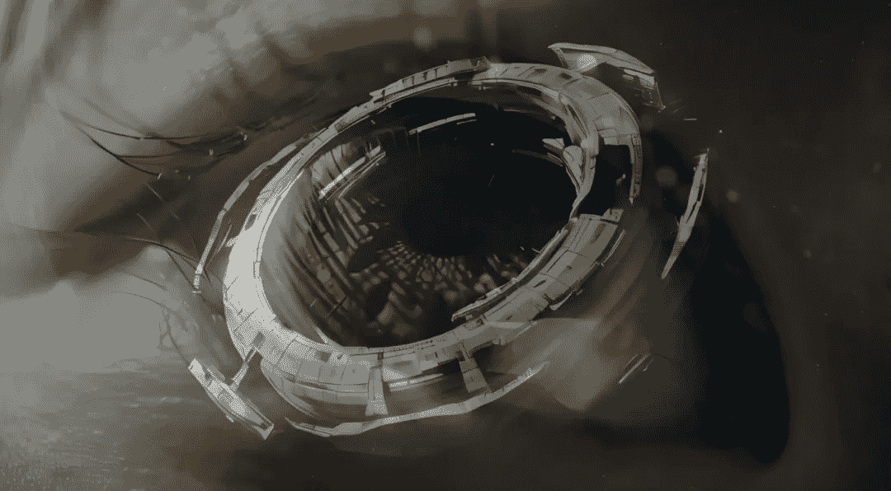

作者 | 阿虎 石濑

编辑 | 卷毛

“AI时代，人人都能当导演。”

这是真的吗？

去年11月份起，RunwayGen2、Stable Video Diffusion、Pika等AI视频工具陆续面世，用AI制作的电影预告片、经典IP二创视频席卷全网、爆款频出，马斯克甚至预言“AI movies next year（明年就能看上AI电影）”。

在这样的背景下，“头号AI玩家”萌生了用AI制作一部短片的想法。今年1月15日，恰逢北京国际电影节开启AIGC短片征集，我们决定以此为契机，做一部AI科幻短片参投北影节。

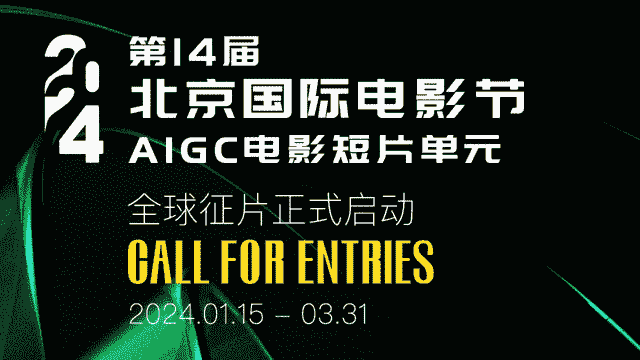

我们利用工作间隙的“碎片化”时间推进短片创作，整个流程历时近3个月，3月28日，我们正式“杀青”并结束后期制作，向北影节官方征集网站投递了最终成片——

这部短片全长2分多钟，讲述了一个半机械人女性胡曼琪在后AI时代寻求自我认同的故事。从故事到成片，AI参与了其中大部分工作，我们使用到了包括 ChatGPT/Claude、Midjourney、Pixverse/RunwayGen2 在内的多种AIGC工具。

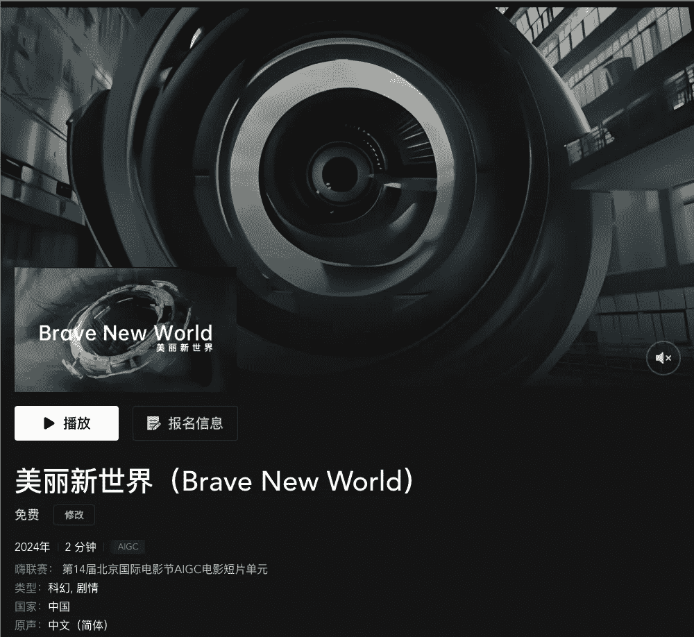

后台投递页面

考虑到 文生图到图生视频的创作流程依旧是目前可控性最高、最好用的，因此，我们的工作流大致可以分为五个阶段：故事脚本、文字到图片、图片到视频、声音制作、以及后期剪辑。

在制作过程中，我们逐渐意识到：“人人都能当导演”或许并不是指人人都能成为像宫崎骏、卓别林那样的电影大师，而是每个普通人都有机会享受“当导演”去创造的乐趣。

下面我们会详细分享这部短片的幕后制作，包括各个阶段遇到的难点，以及价值30美刀的经验教训，希望能够为大家省钱避坑。

## 故事脚本：ChatGPT+Claude

在投喂指令给GPT-4和Claude之前，我们先构思了此次AI短片的主题。

根据“头号AI玩家”观察，目前 AI视频技术并不适用于现实主义题材或情节复杂的剧情电影。特别是涉及大量人物对话、表情和细节的场景，这些都是现有AI视频工具难以有效处理的。

而 以科幻片为代表的电影类型，往往更为依赖视觉特效，这也是AI能发挥想象力的地方。于是我们决定做一支AI科幻短片，同时结合当下社会现实，以“AI导致的社会分化”为关键词，奠定短片初步方向。

起初我们设定的故事背景是：“在2048年，人工智能已经取代了大部分脑力工作，人类社会开始进入到分化的阶段……”

我们将这个故事开头投喂给GPT-4和Claude，GPT-4善于构思完整的故事情节，Claude则在创意故事上更胜一筹，两者可以共同协作写出完整的故事线。

为了获得更好的剧本大纲，在这一步可以先将GPT/Claude训练成“编剧”人设，提高模型的表现，具体的Prompt附上：

> 我要求你扮演一个编剧，最擅长写xxxx字以内的反转故事（字数可自定义）。你是一个富有想象力和创造力的编剧，能把一个故事情节巧妙地颠覆，给观众带来意想不到的结局。
>
> 你的任务是......（完善你的指令），引发观众的思考，无论是悬疑（可以替换成具体故事风格）还是爱情，你都能将故事进展到......（完善你需要达到的目的）。之后我会提供给你重要的故事背景，希望你可以完全理解之后，再开始创作。
>
> 以上如果你明白了的话，请回答我明白了。

训练一个专属的Bot可以帮助后续完善打磨剧本，同样在文生图环节中，我们也借助它精准控制了关键词生成。

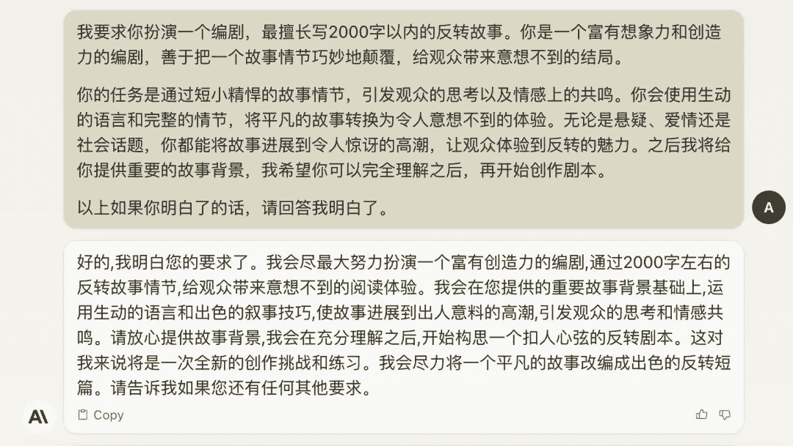

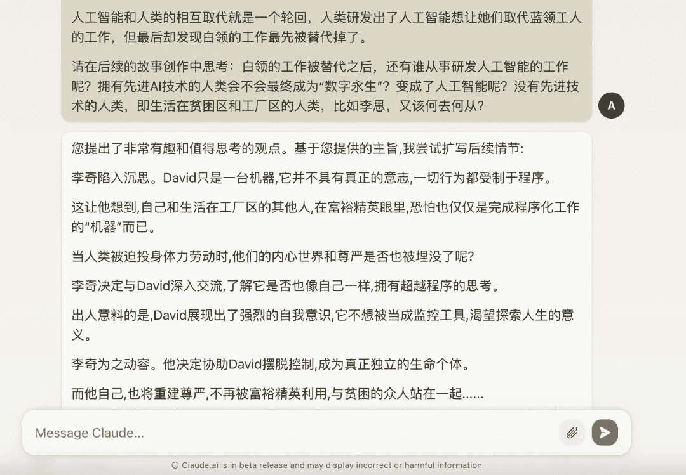

Claude生成的第一版内容

在脚本创作这一环节，更关键的其实是和AI的交互，考验的是我们对AI的驾驭和掌控。

不要妄图通过单条指令获得完整的故事，要和AI进行探讨，多追问多磨合。比如，讨论基于故事背景，人物的工作和生活环境是怎么样的，享受彼此的灵感迸发，剧本也会逐渐明晰丰满。

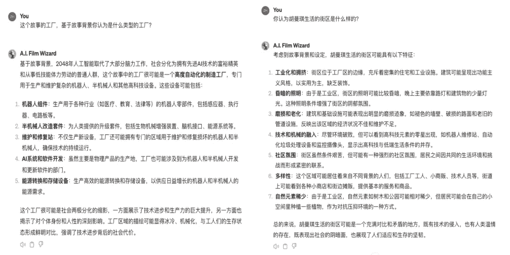

指令越明确，提出的需求越清晰，可以最大限度保证AI生成内容的可控性。

通常，AI生成的故事结局往往会比较“正能量”，如果你设想的故事结局偏阴郁、黑暗的调性，则需要自己上手修改。

通过调整、补充提示词和手动修改，我们得到了最终确定的故事概要和完整故事线：

> 故事背景设定：2048年，人工智能已经取代了大部分的脑力工作，包括教育，医疗，法律，媒体等等。人类社会开始进入到阶层分化，一部分是富裕的精英，他们拥有最先进的AI技术，享受着高品质的生活；另一部分则是普通人，他们被迫重新干起了低技能的体力劳动，生活在拥挤的工厂区，干着日复一日的工作。
>
> 请根据这个背景，写一个5分钟视频能呈现的科幻故事。注意故事主角是一名人类女性，故事最大的反转是她看似是机器人，但实际上是人。
>
> 故事最后揭露未来人类社会，富裕阶层的人已经移民到另一个星球，把地球视为资源供给地。

### 《美丽新世界》故事线

2048年，人工智能已经取代了大部分的脑力工作，包括教育，医疗，法律，媒体等等。人类社会进入阶层分化，一部分是富裕的精英，他们拥有最先进的AI技术，享受着高品质的生活；另一部分则是普通人，他们被迫重新干起了低技能的体力劳动，生活在拥挤的工厂区，干着日复一日的工作。

女主角名叫胡曼琪，是2048年最新研制的一代半机械人。为了获得阶层跃升，胡曼琪参加了一个精英阶层的秘密项目。这个项目旨在通过将人类与机械结合，创造出一种新型的半机械人工作力，以提高生产力和效率。

胡曼琪，作为这一实验的一部分，被植入了先进的脑机接口和多种生物机械增强装置，这使她拥有了超越常人的身体能力和智能。

尽管胡曼琪在技术上属于精英阶层的产物，但她并没有生活在这个阶层中。相反，她被派遣到工厂区，与其他被视为低端劳动力的人类一同工作。她的任务是监督和提高生产线的效率，但她的存在也是一个实验，精英们通过她来观察和测试人机结合的极限。

胡曼琪的日常生活是孤独和机械的。每天的工作是在工厂管理室监控工人的日常工作，并同时操作着面前繁杂的机械设备。为了获得充足的能量，她的后背上通过一根粗大的线缆连接到了工厂的中央能源系统。

她无法与周围的人类工人建立真正的联系，因为她的半机械人身份使她与众不同。下班后她也被迫隐藏自己的真实本质，以避免引起恐慌或被排斥。

随着时间的推移，胡曼琪开始体验到一种内在的冲突。她的机械部分使她能够毫不费力地完成任务，但她的人类部分渴望着更深层次的人际关系和情感连接。

她在寂寞中挣扎，同时也对自己被创造出来仅仅作为一个工具的目的感到困惑和愤怒。在一个风暴之夜，胡曼琪像往常一样结束了她在工厂的辛苦工作，独自一人回到了她的小寝室。

外面的雷声轰鸣，闪电不时照亮她简陋的住所。就在她准备休息的时候，一道意外的闪电击中了工厂区，导致了一系列的电力波动。 突然间，胡曼琪感到一阵剧烈的头痛，她的视野被奇怪的幻象和数据流淹没。

她的脑机接口因为电磁干扰出现了故障，她的机械和电子部件受到了影响，导致她失去了对自己身体的部分控制。在这个混乱和恐慌的时刻，胡曼琪努力保持冷静，尝试手动重置她的脑机接口。

但是，她发现自己无法访问通常由她的机械部分自动处理的记忆和知识。这个故障迫使她依赖自己的人类直觉和情感，面对她一直以来避免思考的问题：她究竟是谁？

在修复接口的过程中，胡曼琪被迫回忆起她被改造前的记忆片段——她曾经的梦想、情感以及与亲人的联系。这些记忆让她深受触动，也让她意识到自己的人性远远超出了她作为一名半机械人的功能。这一认识促使她开始探索自己的人性，并寻找超越她被赋予的角色的意义，即使这意味着要与整个系统对抗。

确定剧本后，我们尝试让AI生成分镜头脚本。但我们发现，AI在确定镜头运动以及画面景别上，缺乏想象力，还会根据情节“随意”安排。一些叙事性强的故事，在AI的再创作下，开始变得平平无奇。

这里更可行的办法是， 一步一步让AI帮助你把故事情节视觉化，把它当作创作助手 。所以，此次AI短片的分镜头脚本，人为修改的比例远大于AI生成创作。

## 文字到图片：Midjourney

分镜上，我们选择了平时常用的Midjourney v6生成画面。整个短片是科幻向，如何奠定影片整体的风格，我们讨论了很久。

后来我们发现了一个很有帮助的Midjourney艺术家风格集成网站 ，其中囊括了不少创作者用MJ生成的电影、插画、艺术风格图片，并且都附上了关键提示词。

https://midlibrary.io/styles

最后，我们参考的导演/艺术家风格包括Ridley Scott、Stuart Lippincott以及Stanley Kubrick。

只要在提示词最后加上这些导演的名字，MJ都能模仿生成一个相似的风格，这为我们控制画面一致性做了很好的铺垫。

我们使用最多的MJ提示词模版是：

> (image we're prompting),(3-5 descriptive keywords or phrases),(Ridley Scott artists),(lighting),(Composition) `--v 6.0` `--s 750` `--ar 16:9`
>
> 我们需要的图片，3至5个描述性的关键词或短语，确定统一的画面风格/艺术家风格，灯光，镜头景别，`--v 6.0` `--s 750` `--ar 16:9`

如果单张图片描述性语句要素太多，反而生成的效果不太好。所以，在实际操作中，我们往往只用到了图片描述+艺术家风格+构图，以及模型版本和高宽比。

这里需要注意的是，如果你想采用文生图-图生视频的工作流，务必在生图环节把最终视频比例参数考虑进去。

前期生图的时候，我们会执着于对画面细节的微调，比如使用MJ的局部重绘功能，但生成图如果有提示词未包含的元素，让AI再修改就异常困难。

另外，如果对照分镜脚本一张张生图，比较浪费时间。有时候文字较好理解的画面，投喂给AI时就会失灵。比如我们想达到空间的扭曲感，当时脚本的关键词是“弯曲”，但AI会理解为“curved”、曲线美，与我们设想的背道而驰。

这个场景用正常建筑做后期特效，比直接生图更节省时间。 如果说传统影视创作受限于资本，那目前的AI视频创作则受限于技术。

所以，在这个阶段享受AI绘画抽卡的随机性，多使用“”

”这个按钮，毕竟AI生图很难完全契合脑海中想象的画面，接受不完美。

还有另外一个镜头，女主接受修复之时，能够回忆起她被改造前的记忆片段——梦想、成就以及记忆。

我们希望通过领奖台表现女主的成就，但修改了很多遍Prompt，Midjourney都没有办法表现出“拿起冠军奖杯”的场景。

所以到后期， 我们其实是借助生成的可用画面，反过来对脚本进行调整和细化 。

目前AI短片画面一大难点是控制角色的一致性。坦白来说，我们没有找到100%能够保证角色不歪脸的办法。所以在这部AI短片中，我们讨巧地使用了头盔、半机械人的设定，尽可能规避AI生成画面的短板。

你在影片中可以看到，女主出场的角色形象是这样的：

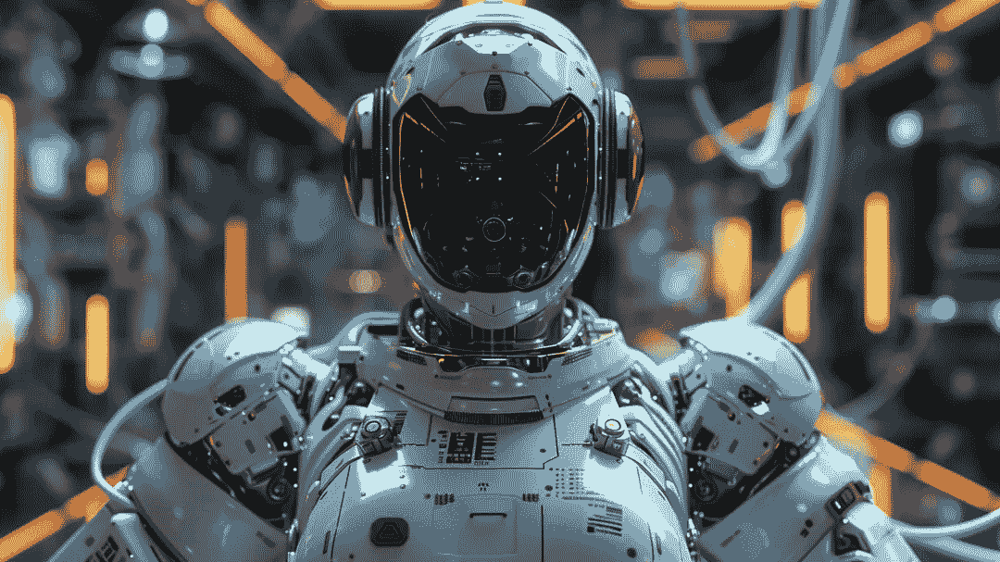

还有这样的：

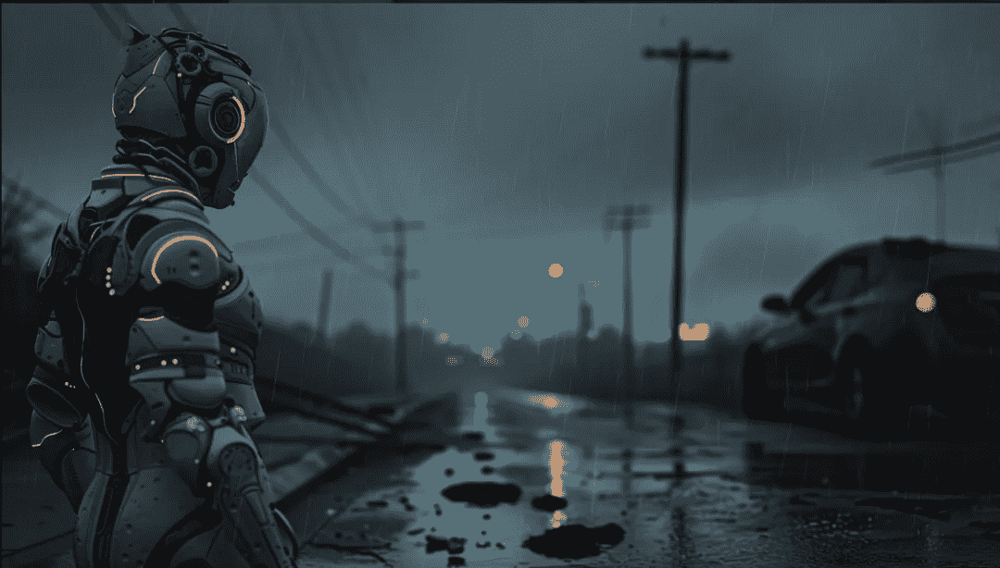

值得一提的是，在生成画面期间，Midjourney更新了“角色一致性功能（`--cref,--sref`）”，这两个参数放在一起使用有奇效。比如短片中的眼睛细节，既保持了原本镜头的构图和风格，还能保持眼睛细节的一致性。

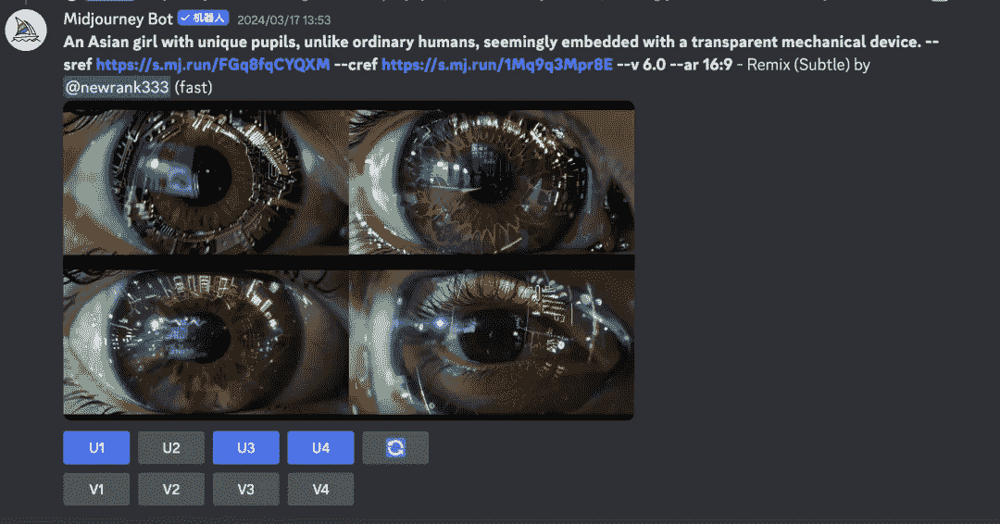

## 图片到视频：Pixverse+RunwayGen2

现代好莱坞商业电影中，平均镜头长度一般在3到4秒左右，镜头更快、更紧凑，带给观众强烈的节奏和紧张感。目前，市面上大部分AI视频生成工具都默认支持生成3～4秒，甚至10秒以上的视频片段。

不过，多种AI视频生成工具测试下来，不建议一次性生成4秒以上的视频片段。以Runway为例，其默认生成视频长度是4秒，虽然支持延长到8秒，但画面崩坏的概率非常高。

从图片到视频这一步，我们最终选用的是PixVerse和Runway Gen2。早前我们 实测 过 同赛道上爆火的Pika ，认为其更适合生成动画风格的短片。

并且在精准控制上，Runway推出的 `Multi Motion Brush` 功能，支持在同一个画面中，添加多个图层分开处理不同的动效，相比Pika，Runway更能满足细节镜头、特定镜头运动的精准控制需求。

而PixVerse则是国内爱诗科技旗下的一款AI视频生成工具 ，支持免费生成4K视频，尤其适合用在大全景、空镜等不需要精准控制的镜头上，可以达到自然微动的效果。

PixVerse生成的宇宙飞船动态效果

https://app.pixverse.ai/login

我们影片中的多数空镜转场画面，都借助PixVerse完成，其他画面则使用了Runway Gen2模型生成。

Runway 免费用户目前不支持去水印和提升分辨率，我们忍痛氪金充值了标准版会员，每人每月15美元， 提供 625积分， 大约可生成125 秒视频 。

Runway默认每次生成4秒视频，每调整一次细节都要重新生成新的4秒，并附加远超4秒的 等待 时间。即使充值了会员，也是要消耗积分的，积分消耗完了 需 要再次氪金，才能继续抽卡。 可见Runway真的很“烧钱”。

并且Runway的图 生 视频 功能 是不提供预览的， 就 像AI时代的“胶片 相机 ”，按下“Generate”生成键就是按下快门，曝光过程是不可逆的，所以要谨慎地设置好参数。

Runway 的 文生视频 功能 支持 预览（预览不会消耗积分）， 同时，在实际使用中我们发现， 文生视频的语义识别往往优于图生视频 ， 如果在 图生视频中添加辅助提示词，例如“让镜头向前推”，很大概率会被AI忽略。

以这个镜头为例，如果 把 图片作为视频的“第一帧”， 图中 没有“闪电”这一元素，在图生视频中，无论怎么写提示词，都出不来闪电特效。 此时 ，用图片生成视 频，就不如用文本生成视频来得效果好。

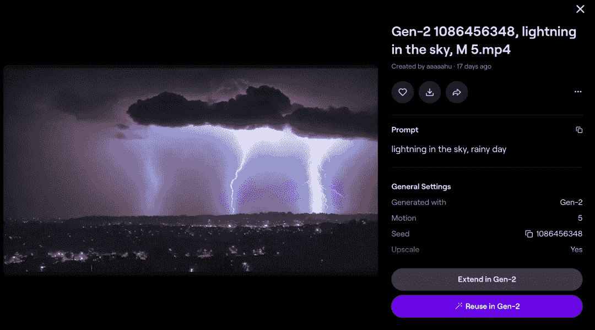

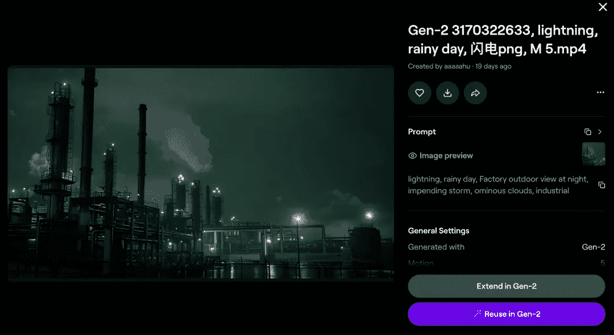

上方为文本生成视频，下方为图片生成视频

图生视频和文生视频的使用差异，源于它们技术流程不同 ， 图生视频主要依赖输入的图片来生成视频，而文生视频侧重于将文本描述转化为视频内容。

不过目前文生视频的语义理解能力仍比较有限，即使Runway已是AI视频生成赛道上的头部产品。

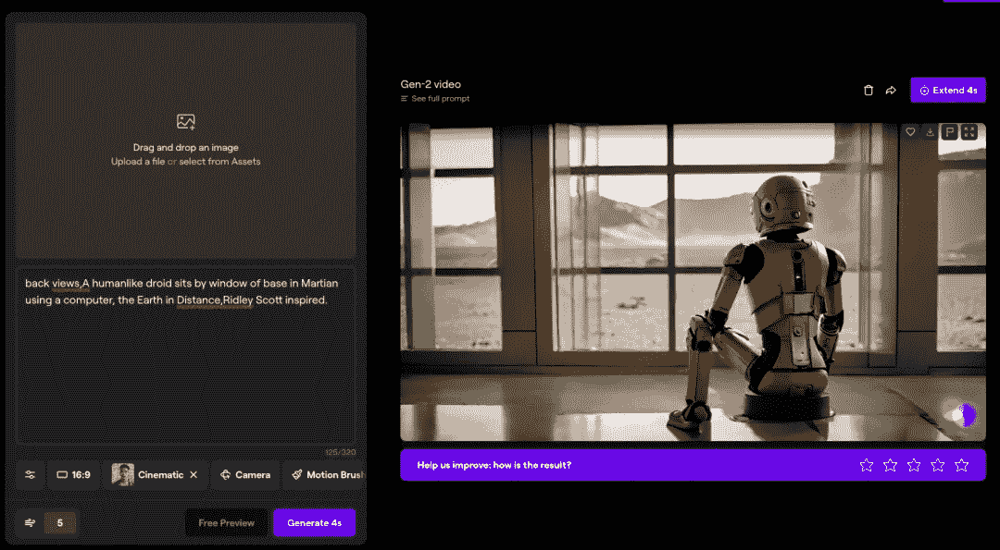

提示词要求的“电脑”“地球”都没有体现在生成视频中

相比文生视频， 图生视频目前技术成熟度更高 ，像早前通义千问“全民舞王”爆火，一张照片生成“科目三”跳舞视频，其效果质量已在C端得到验证。

所以如果你追求精准的控制，或者已经有了明确的分镜头脚本，那么 先用AI绘画工具“文生图”，再用AI视频工具“图生视频”，是目前技术限制下较为高效的工作流。

此外，需要补充的一点是：切勿迷恋Runway的多运动笔刷功能。 在一些大场景镜头的生成上，我们曾尝试使用它来控制运镜和画面主体运动方向，但发现这类镜头不如直接喂给AI ，设定好动幅（最好不要太大），细节让AI自己发挥 ，效果更好。

## 声音：剪映+OptimizerAI+SunoAI

由于我们时间有限， 这部AI短片 没有实现对话式的配音 ， 用到的更多是 AI音乐和音效，旁白是通过剪映AI克隆声音而成 。

如果在短片里需要用到环境音，比如风雨雷电，可以直接在网上下载无版权的音效，11Labs、Pika此前上线了Sound Effect功能，不过还没有完全开放。

我们尝试了一款 免费可用的AI音效工具Optimizer AI， 同样搭载在Discord上。它通过文字提示生成适用各种场景的音效，比如机械音、袭击声、雷声和雨声等。

Opimizer AI一次会生成5个声音效果，每次音效时长只有3-4秒，长时间的音效需要玩家多次尝试，进行组合。

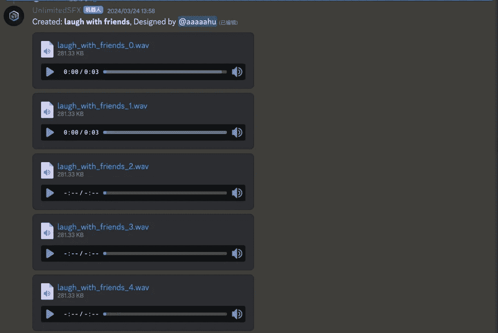

https://www.optimizerai.xyz/

用AI生成音效，给我们带来了一些惊喜。像机器打磨的声音、故障声，Optimizer AI一次就生成了满意的效果，省去了不少在互联网搜罗声音的时间。

但有个弊端是，Optimizer AI在人声音效生成上还不够真实。比如我们有个镜头需要配上孩童玩乐的笑声，Optimizer给出的几次结果听上去有些“毛骨悚然”。

等我们需要为短片配上背景音乐时，Suno AI正好更新了v3版本。一开始我们没抱太高期望，但没想到初次尝试就生成了满意的背景音乐，短片出片名之前用的就是Suno AI生成的音乐，提示词为“Make a song for a sci-fi epic movie”。

在这次短片制作中，这是为数不多令人惊喜的“即生即用”体验。

之后就是旁白了。由于AI画面生成的限制，旁白需要充当“叙事者”的身份，帮助我们串联起所有场景故事。在中文配音方面，剪映 AI输出的人声、情绪更自然。

我们尝试过11Labs，在音色转换以及克隆音色上，11Labs确实独树一帜，但换到中文里，它不可避免出现“译制腔”。

我们早前实测过[剪映推出的AI克隆音色功能](http://mp.weixin.qq.com/s?__biz=MzA3NzUxMzQ5Mw==&mid=2648116147&idx=1&sn=2f55b0f393a3d7804a77f1b3437e1b94&chksm=87737dc9b004f4df8c76fada24432830441312b25533f4b4616d97253dd1cc415d492d2dc979&scene=21#wechat_redirect)，克隆效果在短句子上表现十分惊艳。于是我们通过剪映分段输入旁白，一段一段生成了构成整部短片的人声旁白，并在后期剪辑时，在人声上添加电话音效，营造出这是主角在生命弥留之际留下的电话录音。

## 成片：剪辑+参投

最后就是剪辑成片，参投北影节。临近截止时间我们才提交了影片，因为我们远远低估了完成一部AI短片所需要的时间。短短两分钟的短片，交给AI的效率没有想象那么高。

当初生图的时候觉得场景不错，放到视频工具中，发现角度完全不对，画面乱动，推翻重来。按脚本生成完所有场景后，发现故事压根连不起来，需要补充画面，再重来。初剪完一遍后，发现逻辑衔接有问题，再次重来......

可以说，两分钟的短片背后，存在着无数AI废片。

当然，如果没有AI，这条短片也不会存在。毕竟，放在一年前，很难想象两个没有影视制作资源的编辑，仅仅凭借对电影的热爱，就能折腾出一条科幻短片出来。

我们曾在年初的时候提出这样的问题“2024年我们离AI电影还远吗”，技术层面上看，从文本、画面到视觉、声音领域，催生了不少易用的工具产品面世，影视爱好者比以往更容易体验到制作电影的乐趣。

虽然眼下距离一部真正意义上的AI电影，还有很长一段路，但我们希望更多AI爱好者们能从这篇经验分享中获得启发，在这个技术革新的时代，有机会制作属于自己的AI短片。

---

<https://my.feishu.cn/sync/CV7edZp1nspUQobYJhicxeP7nrb>
