# 万字复盘我的AI作品《Devices》

> 来源：[https://my.feishu.cn/docx/KvURdrzxio2yiPxgkmpcvGqfnGf](https://my.feishu.cn/docx/KvURdrzxio2yiPxgkmpcvGqfnGf)
>
> <https://my.feishu.cn/sync/CV7edZp1nspUQobYJhicxeP7nrb>
>
> 🔗 原文链接：https://mp.weixin.qq.com/s/tkcvmtybmj2xHkIaeIQypw
>
> ⏰ 剪存时间：2024-04-25 20:22:35 (UTC+8)

原创 然 多睡觉多学习就好咯 2024-04-05 14:21  上海

嗨，大家好，我是喜欢AI创作的晨然。

我的AI视频《Devices》在 VisonOS 开发者大会 中展示啦！这是我第一次有机会在这么多人面前展示AI创作作品。

本篇将毫无保留的分享 Devices 的完整创作思路，我会从 创作灵感、工作流解析、AI可控与不可控的经验思考 三个方面完整复盘！

我也免费开源我的工作流，回馈引我入门的开源社区，你可以在 文末链接 下载我的工作流。

《Devices》中我想探索的，就是AI原生内容的关键问题：

如何平衡可控性与不可控性？

如何做出AI“原生”视频？

如何结合传统视频工作流与AI工作流？

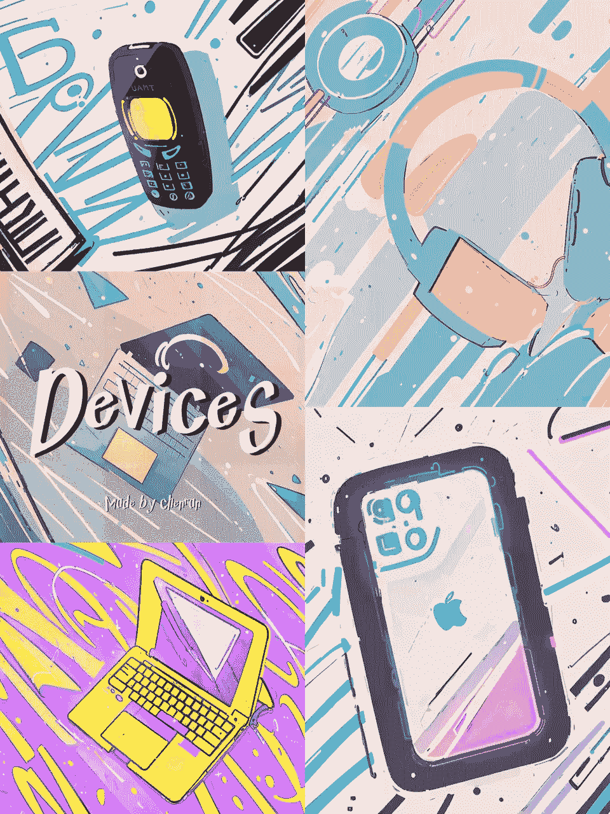

Devices 视频截图

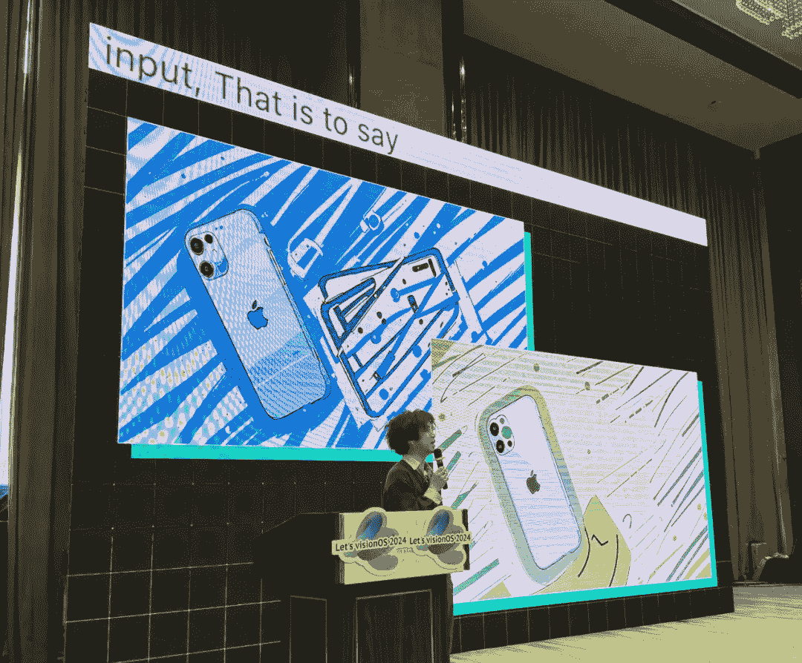

感谢 海辛 与 阿文 收录我的AI视频作为案例

**✨写在前面**

本篇适合任何对AI创作感兴趣的人，我写的会比较通俗易懂，小白可以看懂。

专业人士也可以获取一些创作思路灵感~

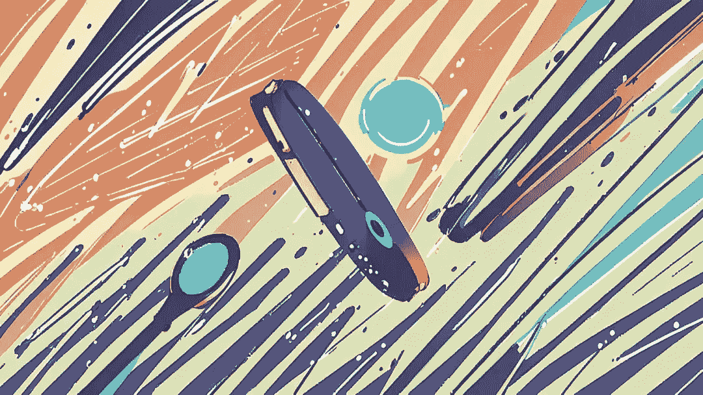

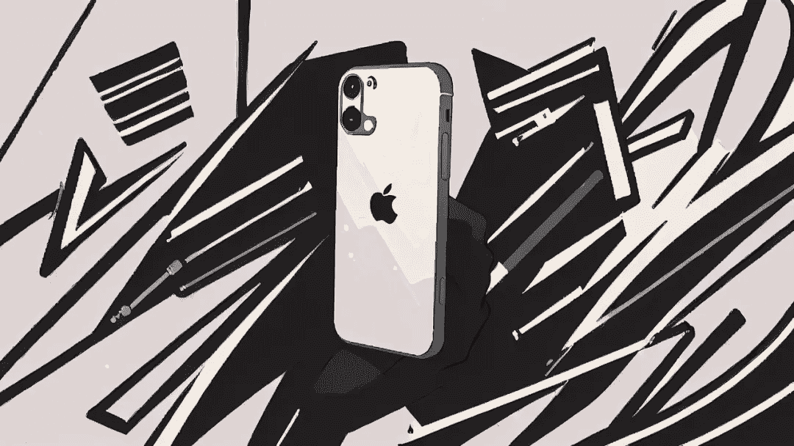

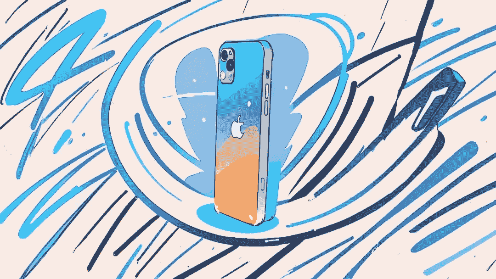

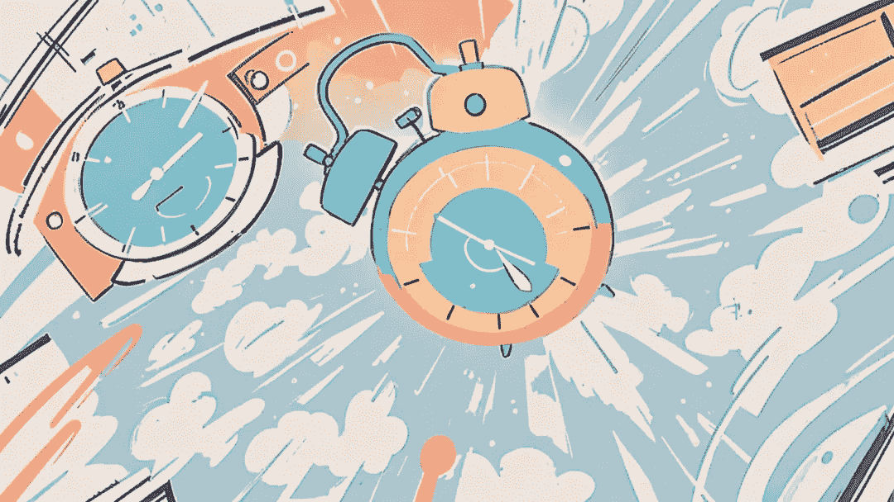

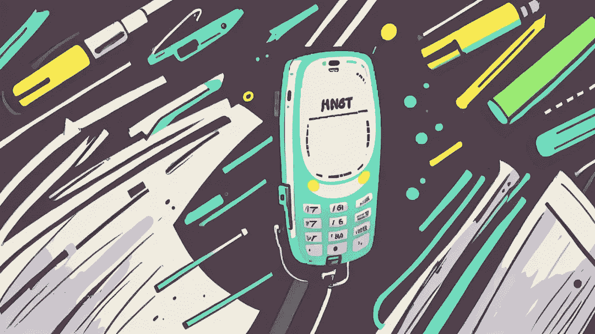

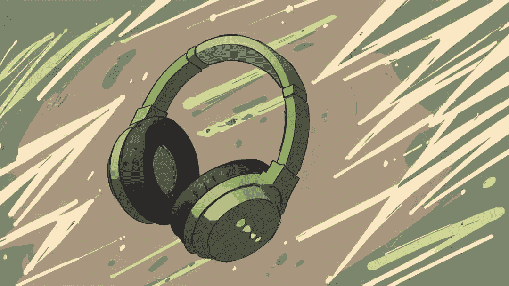

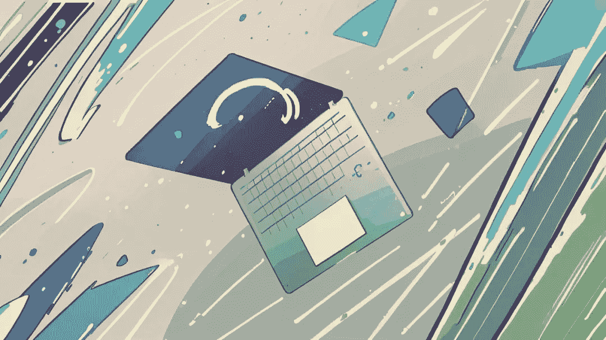

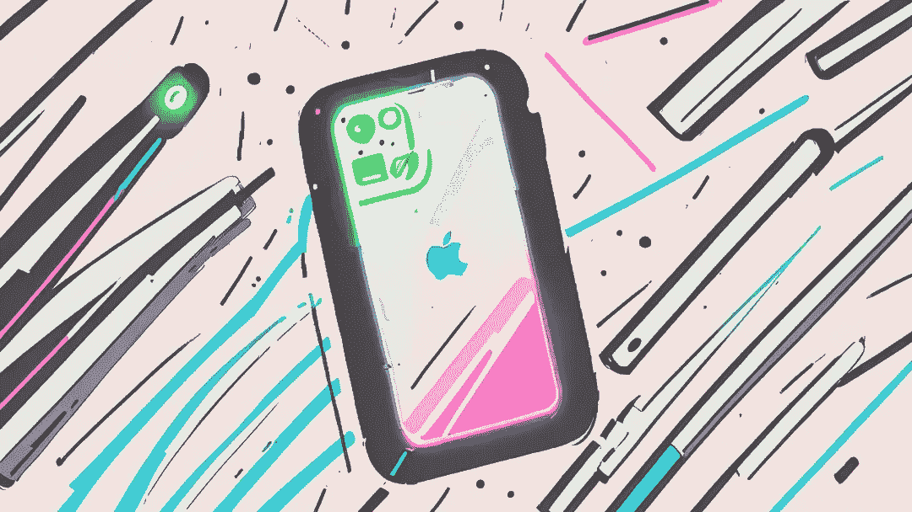

《Devices》中呈现了色彩缤纷的电子设备的变换，每一帧视频截图都美极了。

## 可控与不可控的权衡

简单来说，工作流用一句话总结：

使用Blender制作白模动画，导出深度图、线框图帧序列，使用ComfyUI进行风格迥异的渲染。

我一直在思考一个问题：

AI视频到底跟传统工作流制作视频的区别是什么？

其实两者各有优缺点，并不是替代关系。

+ AI内容速度碾压，接近零成本无限生成。
+ AI极其不可控，很难可控构图、一致人物。
+ AI画面粗糙，经不起细看。
+ 传统工作流（动画、电影）慢，极其可控，在制作之前即可预测内容。
+ 传统工作流成本高，需要规范流程由小到大制作。

AI与传统工作流各有优劣，我觉得思考如何使用AI替代传统艺术工业，不如思考AI如何迸发新时代艺术创作流程。

让AI做好AI擅长的内容，传统工作流做好传统工作流擅长的内容，两者结合，不谈替代。

我想，我这不是拍过微电影又会AI嘛，为啥不结合一下呢？于是，就尝试了一下利用Blender的可控性和ComfyUI的随机性制作AI原生内容。

传统工作流是在可控性中寻找创新的随机性，而AI工作流更多是在随机性中寻找可控性，那么最重要的问题变成了： 如何平衡可控性与不可控性？

这个思考会贯穿整个创作流程。

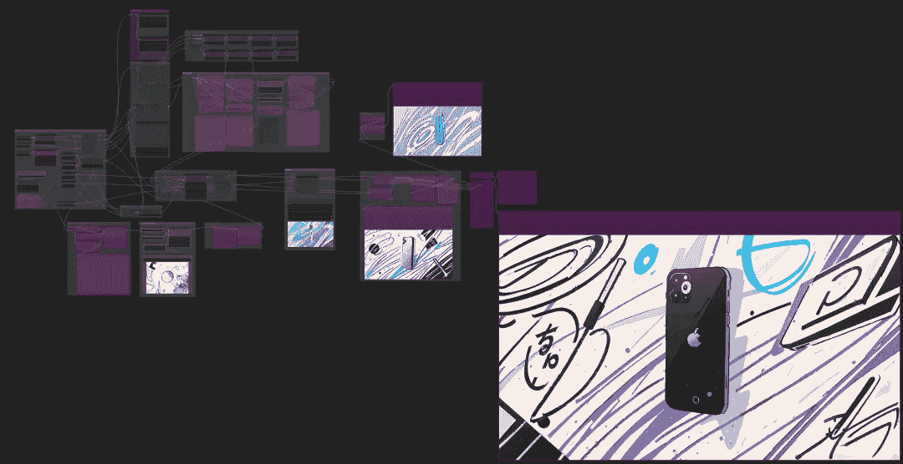

ComfyUI节点编排工作流

## 创作灵感

### 不要跟原有事物比较

我看过很多技术派大神，将传统的blender白模导出，使用ComfyUI工作流渲染，制作思路是使用blender等建模软件进行骨骼绑定、制作运镜和动画，导出白模等信息让AI“填色”转绘。

可以说 转绘 是最稳定的工业使用AI的工作流。

可是他们大多都是希望制作“原来就存在的动画”，

制作这个世界原本就存在的东西，会有一个问题：

观众会不自觉的将它与原有事物进行比较。

我们会有一套已有的评判标准：看习惯了日本动漫，经历了动漫内容制作越来越精良的变革（自从看了紫罗兰永恒花园我就很难再看以前的动漫），再看AI绘画会在想，这手怎么这样，这眼睛怎么这样，这没有灵魂等等。

但是我不想让观众产生比较的感觉，这应该是一个没有的审美才行。

AI应该制作AI 才能 制作的内容，这样观众才不会去第一直觉去比较它。

### 发挥AI优势

某个周末看到了OpenInterpreter发布新时代AI开源操作系统中，非常酷炫的在一个推镜头长镜头后，使用了变幻莫测、色块清晰、风格鲜艳的手绘动画，展现了人类历史中手持设备的变革历史，最终变成了手中拿的新时代硬件设备。

通过鲜亮的颜色变换和蒙太奇剪辑，在设备旋转过程中进行匹配跳剪，自然变幻成下一代设备，围绕OpenInterpreter的使用场景和功能进行描述。

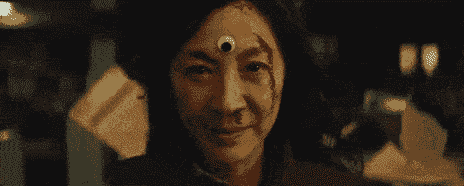

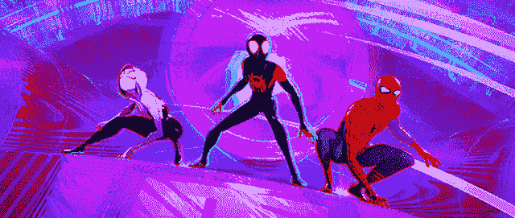

《瞬息全宇宙》与《蜘蛛侠多重宇宙》片段

风格很像《蜘蛛侠多重宇宙》和《瞬息全宇宙》的平行宇宙穿梭的时刻，特点在于：

+ 颜色鲜艳变幻，多用饱和度和不同色相
+ 风格迥异，手绘平面风格中使用不同剪纸制造“平行时空”感

变化的是风格，不变的是视觉焦点的主体。

多重宇宙的风格并不是最近几年才兴起的，只是电影工业生产力提升，可以更低成本制作多重画面。

这种风格需要每一帧时间戳制作完全不同的画面，所以人工成本巨高，效益还不高。

但这不正是AI最擅长的吗？

AI可以短时间生成大量图像，但都经不起仔细观赏，怎样利用好AI的“量”属性呢？

这就需要将AI无限生成的特性发挥到极致，不要让AI做稳定可控的多帧连续渲染，让它多变风格，发挥想象力和算力优势。

## 工作流详解

转绘是AI可控的最佳实践。

这个思路可以先看看YouTube大神使用Blender渲染白模，再用Blender中原生提取的线框和深度信息，在ComfyUI中进行动画的转绘。

其实转绘也不一定需要用Blender，用一张图动一下、一个视频，已经有很多工具可以完成线框提取呀、深度图提取啥的。这个可以去看看海辛和阿文老师一直以来的分享，给了我很多的灵感。

Blender建模的优势是：

+ 所有的运动更加可控，直接关键帧设置好物体和相机运动轨迹
+ 想要什么模型就给什么模型，社区里免费模型都很多！
+ 原生深度图和线框图！！！

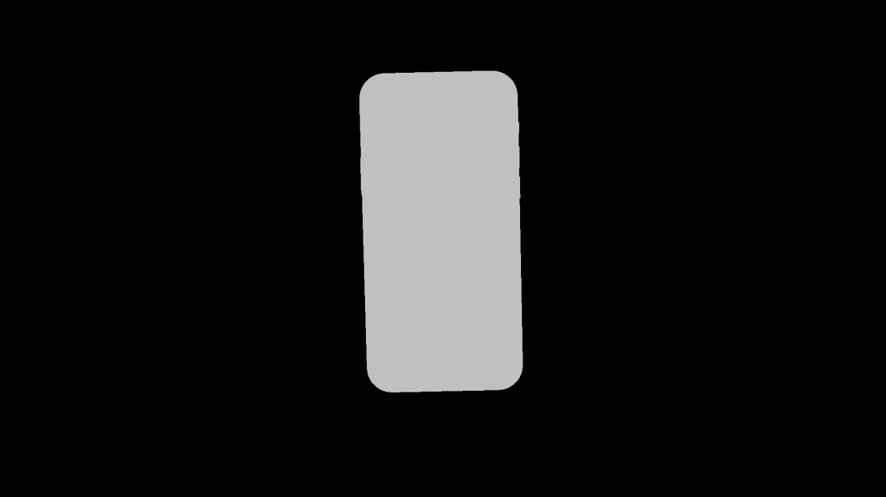

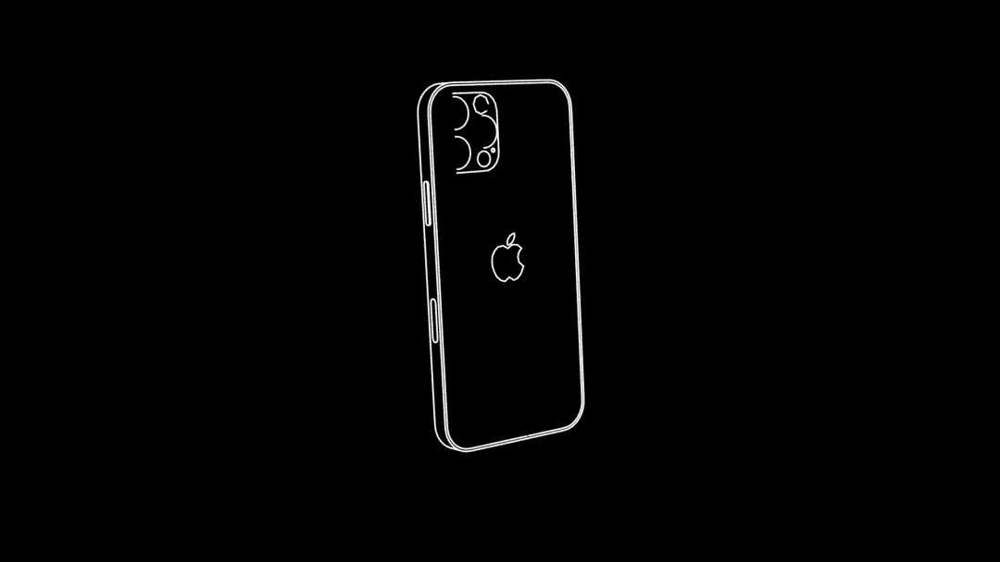

第三点是最重要的，因为Blender本来可以渲染的时候导出稳定的线框图和深度图等，不需要再在二次的利用其他模型提取一遍，二次提取很容易出现深度图闪烁问题。质量不高的Control信息当然也会体现在最终的渲染结果中。

剪辑思路采用`text-based`蒙太奇，即0-2s是旋转的Iphone，2s-4s是旋转的诺基亚……以此类推。这个对于剪辑的要求就不是很高。做的酷炫一点，可以参照OpenInterpreter的匹配剪辑思路，在旋转的侧面时进行跳帧，以相似物体形状进行转场。

所以， Blender动画制作 + ComfyUI转绘 + 蒙太奇剪辑 就是工作流核心。

### Blender动画制作

我不太会用Blender。几年前用过一段时间，但快捷键全忘了…所以还花了很多时间YouTube搜索教程哈哈哈。

建模用什么？

不需要建模！直接网上搜搜免费的模型就好了，我直接在网站中搜索的手机模型，有什么Devices就用什么！

我的模型在 TurboSquid 找的，点FREE筛选。

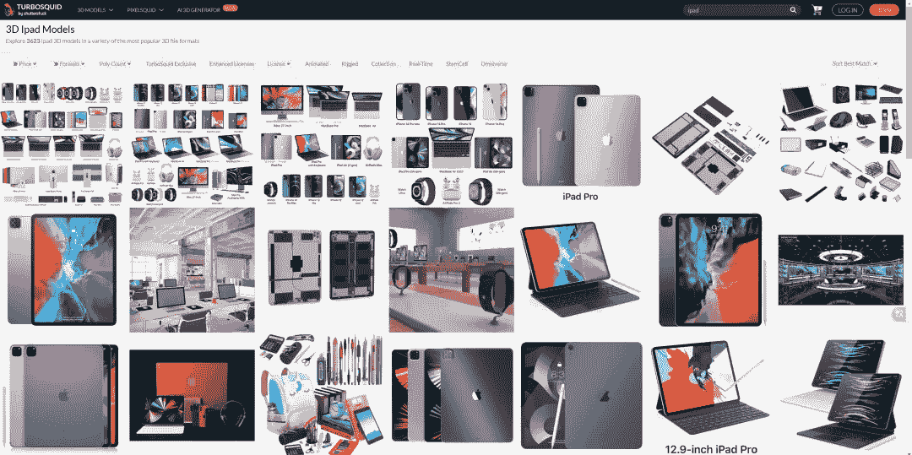

动画怎么做？

在第0帧设置一个xyz位置和xyz的旋转，在70帧设置一个变幻后的坐标和旋转，它就会自动加上动效了。而默认的Blender动画是会加上平滑曲线的动画，在开头和结束，会有一个加速启动和减速结束的效果。

这个效果并不适合蒙太奇剪辑。加速和减速，会减损最终剪辑在一起旋转的势能。

我想要匀速的效果，所以把动画改成了线形变换。

Blender中可以简单配置一下节点输出，在渲染的时候同时导出线框和深度图，之后我们就用这个图片序列即可。

帧数用什么？

动画中最终重要的参数是帧数。我观察到OpenInterpreter的帧数是30帧每秒，而每一帧静帧大约是2-4帧。意思是大约8帧每秒的画面。

为了利用视觉暂存的效果，我在ComfyUI中的最终视频合成就使用8帧每秒。

方便做实验，Blender的视频帧可以按照高帧率输出（例如30帧），一共渲染70帧的片段，基本就够了。

在ComfyUI中，选择跳帧选择原始图像序列中的图片，就可以完成帧跳跃的样子。

当然这些参数，都可以根据你的运动幅度去调整。

最好就是 Blender导出足量帧信息，ComfyUI再做帧数的实验。

需要什么信息？

白模渲染（后来发现没用上）、线框、深度图。

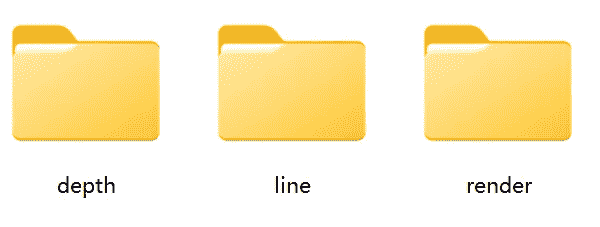

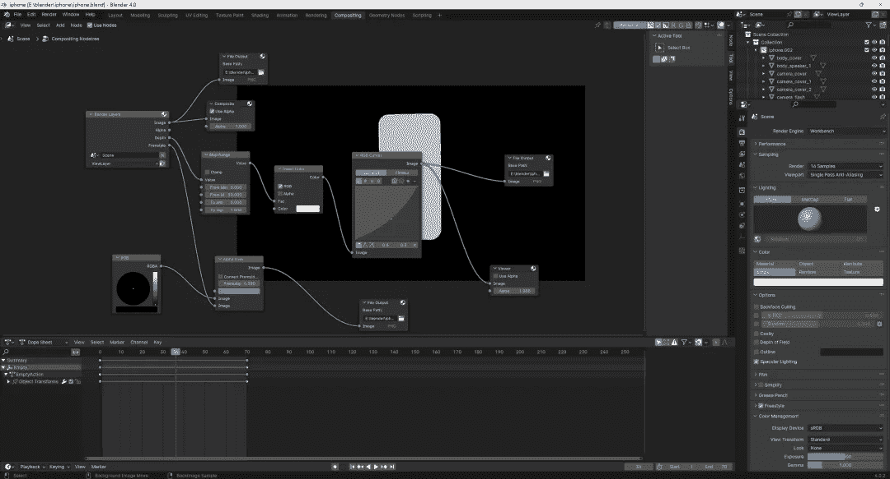

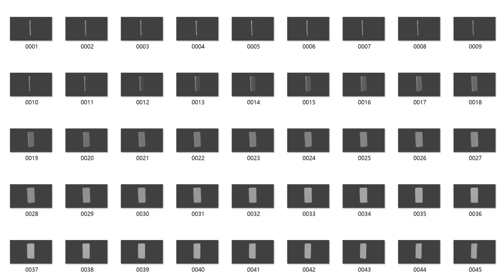

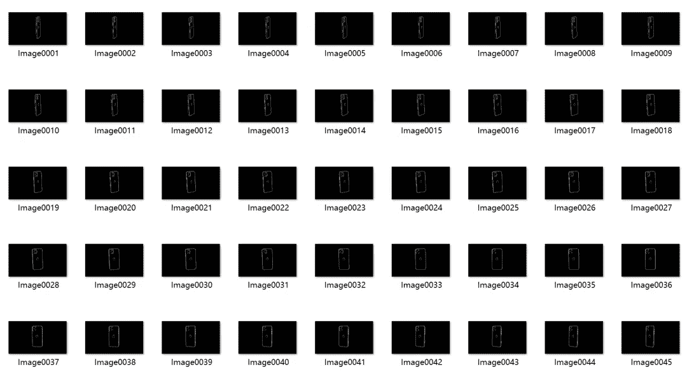

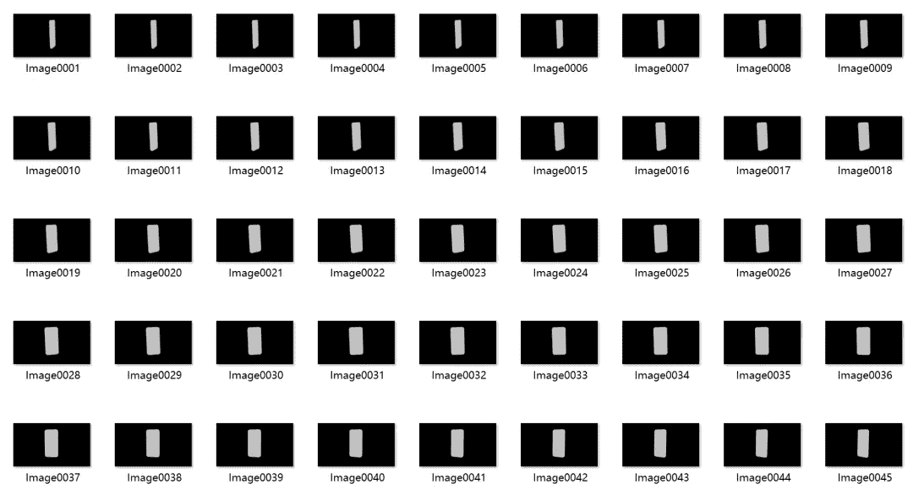

### ComfyUI转绘

其实ComfyUI的节点工作，就是低代码编排。如果按照模块化的设计，完全可以把它归为一个一个封装好的模块化函数，有自己的输入输出，有自己的单一职责。

我的工作流是基于大神的思路魔改的（加上理线，我真的很喜欢理线！），所以也免费开源给大家！

[Devices in MultiVerse] Prompt Travel WITHOUT `AnimateDiff`

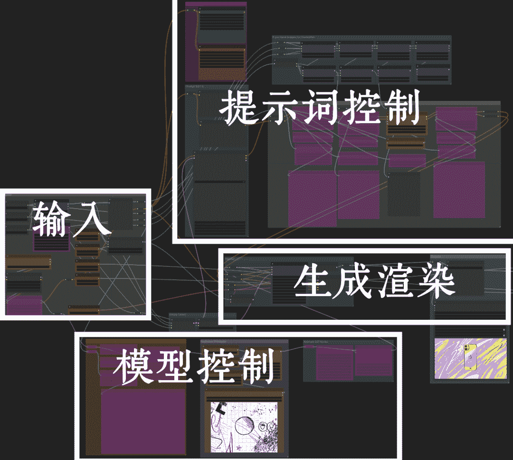

ComfyUI由于节点看起来很复杂，很容易劝退小白（我在使用之前就被劝退了），后来发现，对于一个标准的转绘工作流，其实只需要看清楚上面四个模块内容就可以了。

其中最重要的就是构思好自己的控制方式，用更改模型 model 或者更改提示词 prompt 。

控制的思路有两种：

+ 模型Prompt
+ 基础模型 + 风格化Lora模型
+ `IpAdapter`
+ `AnimateDiff`
+ 提示词Prompt
+ `ControlNet`模块利用图像的本来的线框、深度等信息
+ 文字提示词（正向、反向、Prompt Travel）
+ Latent Image

如果按照这两个思路，其实看任何视频转绘工作流都超超超清晰了。

模型控制的是风格：

+ Base Model有不同的模型家族，例如`sd1.0`和`sd1.5`生态就不一致。一旦修改一个生态，剩下的prompt、`animatediff`、`controlnet`都得做模型的适配，这点还是比较头疼的。我的做法就是无脑用最好看的生态。
+ Base Model等在 civitai 中找就行。
+ Base Model决定了最终绘制的大致风格，和对关键提示词的敏感度。
+ Lora可以理解为在基础模型上的修饰，比如基础模型可能决定了嘴唇的画法，Lora在这之上修改一下具体的细节。
+ Lora可以叠加！修改每个Lora的权重可以完成很多事情
+ `LCM` `Lora`可以加速。
+ `IpAdapter`可以学习到单个图片的色彩、风格、甚至服饰等要素，很强大。
+ `AnimateDiff`是用于动画平滑的，不做动画可以不管。

提示词控制的是语义：

+ Text Prompt就是大家熟知的用文字描述画面内容
+ `ControlNet`可以加上更多有用的语义信息
+ 深度图可以决定最终生图的位置关系和透视关系
+ 线条(lineart/canny)图可以决定生图的必须出现的线条
+ `OpenPose`可以决定生图的姿势
+ ……
+ Latent Image决定是基于什么图进行采样去噪
+ 直接使用原图进行采样，就会跟原图极其相似
+ 也可以使用empty latent image，这样就随机发挥

然后模型、提示词等模块的各种参数都丢给生成模块的`Ksampler`进行生成了。

一切的问题都变成了模块的选还是不选，而这个决策在于 “你想控制和不想控制什么” 。

后面的放大什么的，直接去YouTube找大神的教程视频Copy Paste适合工作流的即可。

我用的base model是 `flat-2d-animerge` , Lora是 `minimalist-anime-style`

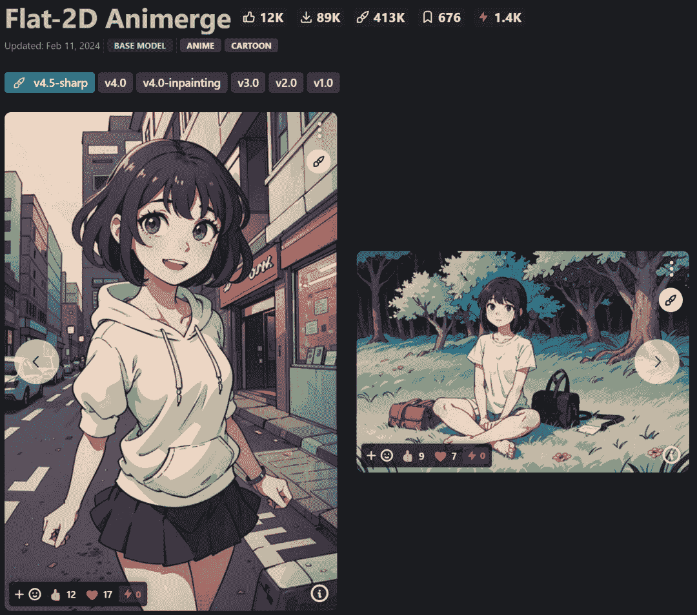

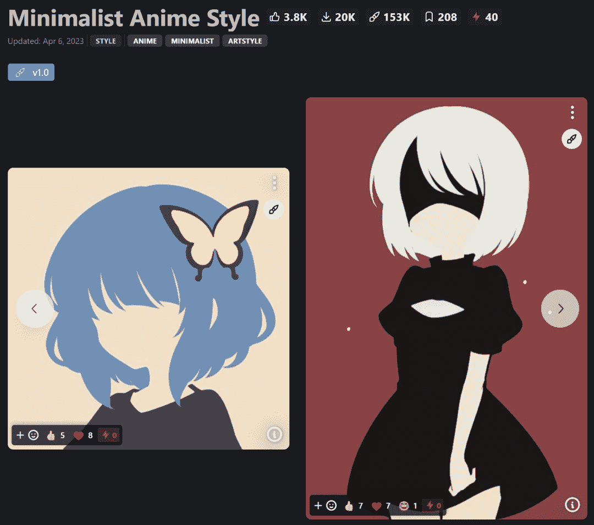

### 蒙太奇剪辑

`Text-Based`蒙太奇，就是依照文字的变幻（天然适配Prompt Travel）的思路进行剪辑，特别适合流动的配合音乐叙事。这也是老技巧了。这种叙事，可以让观众直接根据流动的音乐，理解文字信息即可。

图片只是文字的诠释，没有更多的潜文本信息。

剪映有很多好用的模版字体，为了让视觉不那么容易疲惫，我在几个片段后加上了一点文字特效让眼睛休息一下。

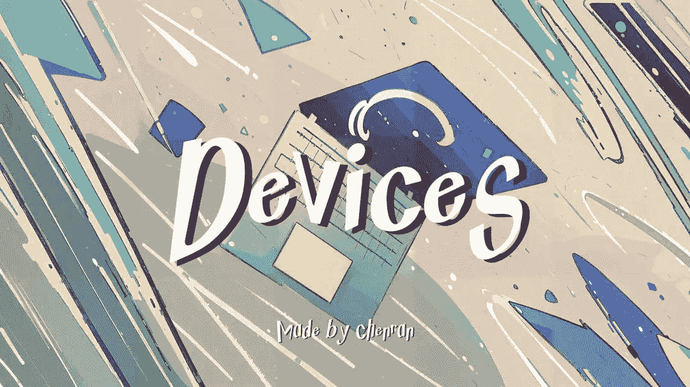

## 利用AI的可控与不可控

本片核心就是研究，怎么利用AI的可控，和AI的不可控。

AI最擅长的就是乱画（不是），所以我很想让它画一下泼墨风格的背景，利用线条和曲线的灵动感。

AI不擅长的就是可控的人像，要让它稳定的画一个人物，单帧的不可控性就有20%，动画就更加不可控…最后就会变成调参工程。

所以我选择Devices，尤其是常见的物体，不要选择它不理解的物体。这样提示词也可以很简单。

### 动画思路：关掉AnimateDiff平滑吧！

#### 放弃动画平滑控制

我想要的效果是瞬息万变，平行时空的感觉。

`AnimateDiff`的原理就是在采样的时候，以滑动窗口的形式进行窗口内的采样平滑，以完成视频的前后一致性。

它只是一个平滑工具，且有窗口限制。所以你会看到过了一小会儿，比如两秒后的视频和第一帧的一致性几乎就没有了，因为窗口后挪了。

我一开始做了一些加上`AnimateDiff`的实验，发现`AnimateDiff`的模型要对我选择的base model和lora进行适配，才能达到最优效果。然而直接使用，很容易出现“折叠”的多余线条或者流动的噪点。

对于创意片而言，这个可控反而阻碍了AI的发挥，你上的枷锁越多，就越难看。

`AnimateDiff`适合比较高帧率的平滑动画，达到30帧不在话下，所以关掉平滑之后，我只能把帧率调到8帧，让眼睛能够适应变化，意外的发现，好像视觉焦点放在不变的线条上，也是能看的。

#### 保持线条不变控制

最核心的控制模块在于深度图和线框图的利用。

变化的是背景和颜色，不变的是物体的线条轮廓，能让人在变幻的体验中，依旧能辨别出不变的物体和运动轨迹。

线框图我会调到0.8+，深度图视情况<=0.35。（记住，没有确切参数答案，对本视频片段适用）

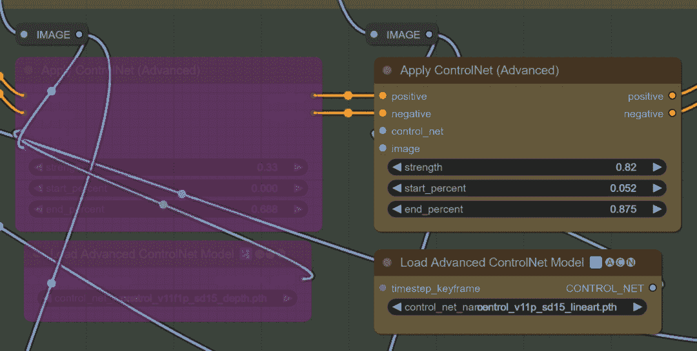

### 动画思路：试试Prompt Travel？

#### 变化的是色彩

Prompt Travel我第一次在这位大神 matt3o 的工作流中看见。

原理就是：

+ 设置时间戳，每个时间戳的提示词不一样。
+ 时间戳变幻之间会有线性插值，实现自然平滑的过渡。

举个例子。我的prompt travel中在第0帧设置了blue，在第3帧设置了red。

虽然我的prompt最终没有用于设置animatediff来进行平滑，意味着我每一帧本身就是独立根据单帧prompt来生成的，前后帧的prompt没有任何关系。其实不需要batch image也是可以完成这样的效果的，把每一帧当成独立的帧渲染即可。

Prompt Travel的好处就是，它会在我设置的0-3帧中线性的过渡。

意思是，在第2帧，会同时出现blue和red，例如出现blue背景的red iphone手机。

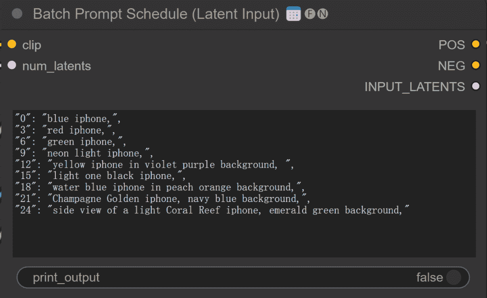

这样就可以实现单帧不能实现的线性颜色变化。

对了，颜色什么的可以让GPT帮你写，比如前四个是我有限的词汇量了，后面又有背景又有高级颜色的是GPT帮我生成的。

# 相邻颜色之间最好差异比较大，才能凸显 Travel 的感觉

## 不变的是规律与节奏

这一点是在OpenInterpreter的宣传片中拉片发现的，它其实没有那么多种的风格，是在固定的频率、固定的顺序和有限的风格中循环切换。看起来有很多的平行宇宙，有不一样的手绘风格，但太多的风格，反而容易对人的观感产生昏眩感，人的潜意识中必须要抓住什么不变的元素。

那就是变化色彩的规律，和变化色彩的节奏。

+ 在单个设备的两秒中，我保持了每隔3帧的变化色彩节奏。
+ 不同的设备，色彩变幻规律是一样的，都是按照上面提示词中描绘的色彩变化的。

这个达成的效果就如下图，单帧放出来就很能看清楚在做什么了！

人脑是很奇特的，即便你是没有意识到这是不变的，潜意识也会让你抓住这个规律，以至于每个设备变化之后，你还是知道它是从蓝色出发，三帧后到了红色，三帧后到了绿色……以此类推。

你可以现在带着这个解密思路再回去看看原视频，看看你是不是看出来了这个规律😏

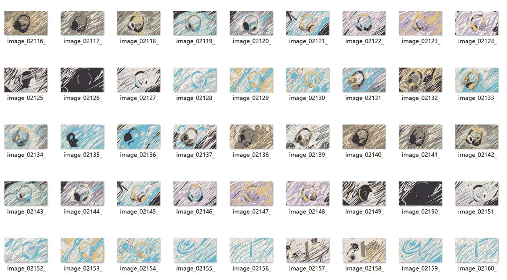

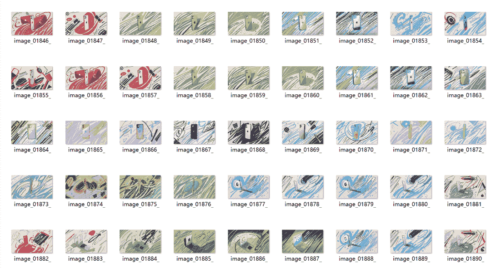

## 单帧思路：怎么又潮又好看？

做动画的一般流程是，固定`seed`种子开始做可控变量实验。此时可以把渲染的`steps`调低（也可以加上LCM LORA加速），确定好工作流之后，再加大渲染次数进行高清渲染。加上放大的几个节点就得到最终效果。

单帧必须先跑通！

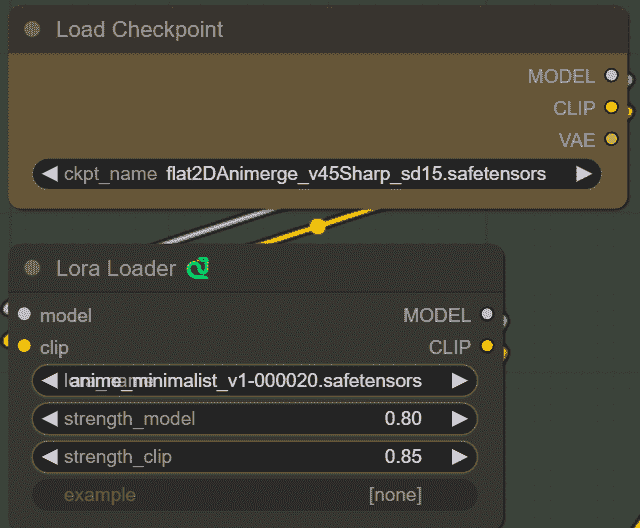

我一开始测试的有白板风格、各种草图Lora、各种base model。

最终选择了Flat2D的base model和sketchit / anime_minimalist 的lora。当然这个完全没有最终解，我后来发现由于我的sketchit lora的适配是sd1.0的，其实加上和不加几乎是一样的。而提示词和base model的适配影响大的多。

anime_minimalist我很喜欢，让所有的颜色变得更加扁平，没有三维的效果。

例如，我测试过加上whiteboard的提示词，发现背景板就非常的杂乱。

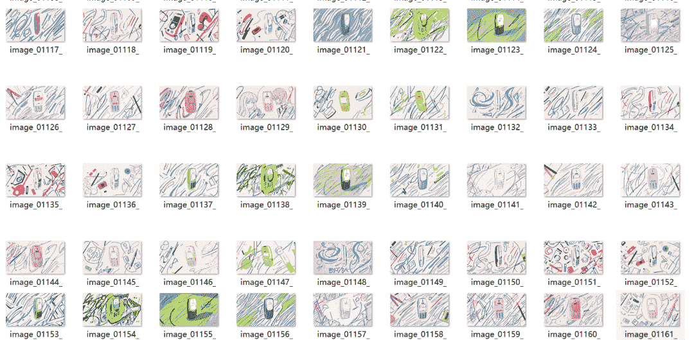

例如，由于Flat2D的模型训练中用了大量的动漫角色，而且肯定是用了大量的人物。（尤其是头）

很多时候我的提示词、ControlNet的图里面都没有人物，它还是会渲染出来人头（吓人）。

甚至有时候，会出现头发丝。背景图片中的曲线线条，很像是头发丝散落。其实本身就是按照这个特性，它才能把泼墨一般的背景画的很好的，线条其实就是“头发丝”中学会的知识，但也不要让它变得太像头发，会很吓人！

接下来就我讲讲我遇到的几个问题和解决思路。

### 线条不能多不能少

#### 错误尝试风格一：简约线条太少

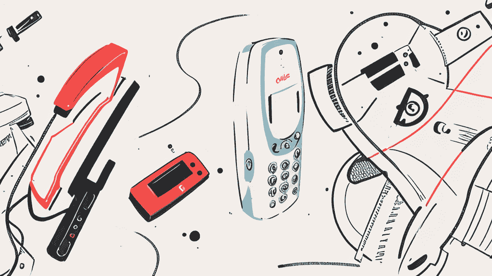

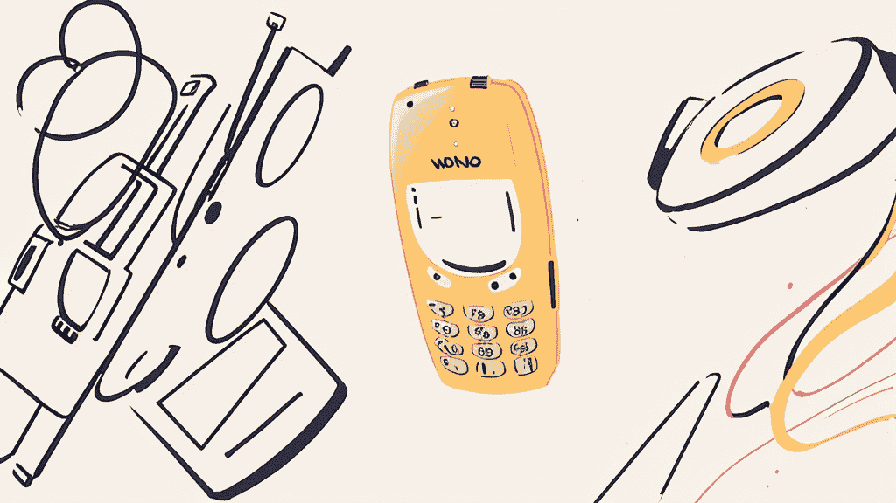

这个风格，每一帧都是很好看的艺术作品。但动起来就非常难以聚焦。

因为线条太多了，都是细线居多，甚至我的设备也只有线框本身和少量色彩点缀。视觉很难聚焦。

提示词用的是 one blue phone, hand drawing, (clean background), flat color

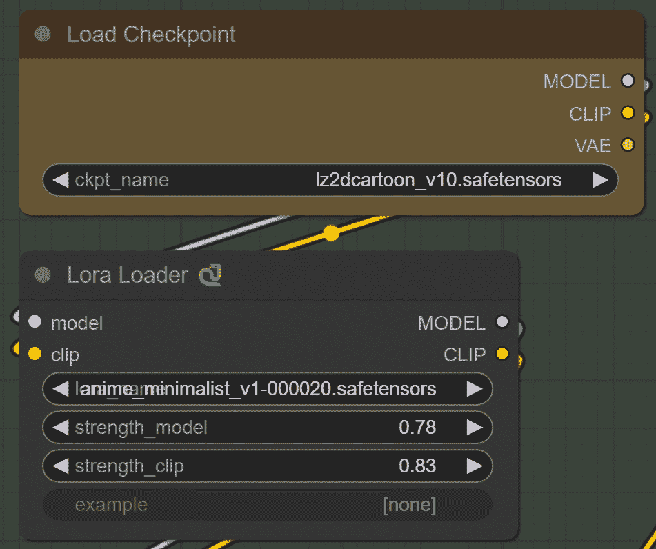

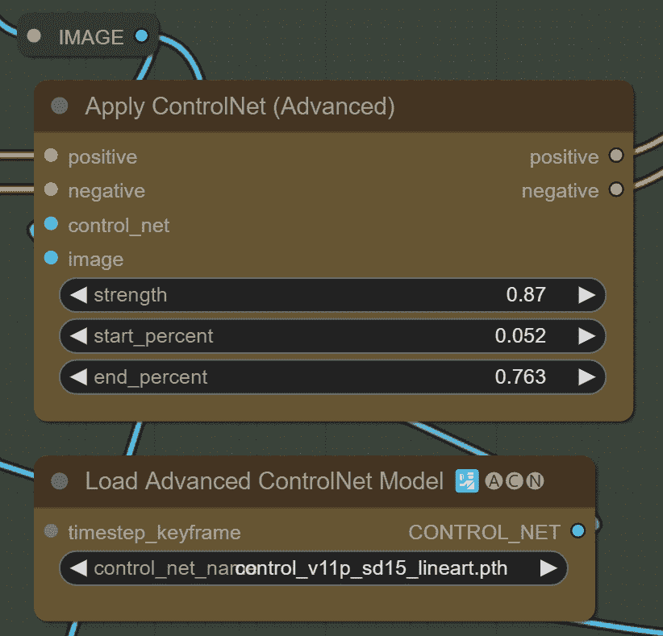

使用cartoon的base model，加上hand drawing关键词

#### 错误尝试风格二：背景线条太多

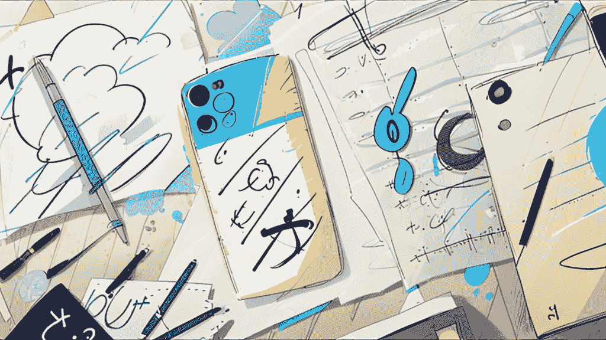

This content is only supported in a Feishu Docs

上面是我使用提示词 iphone on the desktop, clean background, sketch 作为背景的测试，采用了比较详细的背景描述。发现单帧确实是很好看，结果动起来太乱了。

因为背景里面也有跟主视觉物体相似的线条，因为桌面上一般都会有橡皮擦、铅笔、笔记本等物体，AI会主动脑补这些内容，所以 desktop 这个词被我禁掉了（笑）

#### 错误尝试风格三：线条颜色太多

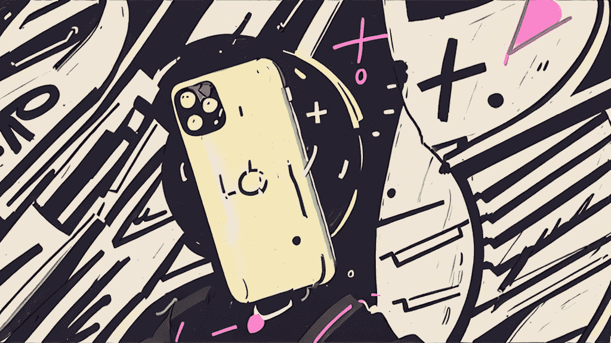

This content is only supported in a Feishu Docs

主要的提示词使用 iphone, hand drawing, (clean background) ，按理来说也该干净了，背景没有出现杂乱的物体了，但是线条非常的粗，容易出现人物雏形。

解决思路就是，加上提示词 flat color ，因为我的lora和base model都对这个词训练过。加上之后，背景颜色立马变成了单色调，不会干扰视觉了。

我还试过直接使用线框图直接作为`latent image`渲染，也有一种诡异的美感。

### 引入人物的严重错乱

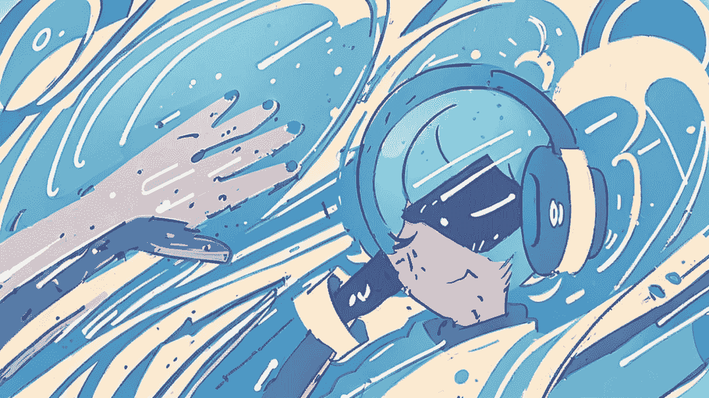

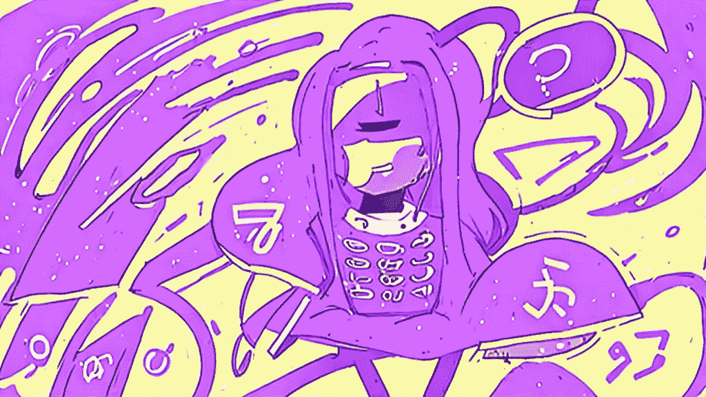

左图是我测试用手+耳机的动画，发现耳机太容易与人头关联起来，每隔几帧就会出现人物头像。而且由于我的负向提示词中写了 heads/head/human/people 等字样，出现的人物一般都不太成形态，出现如图所示的吓人模样。

解决方法是，尽可能使用与人不太相关的物体。然后在 负向提示词 中拼命加手、人、头等词语。出现什么不想要的，就测试加负向提示词。并且在正向提示词中添加数量词 one iphone 会消除一部分问题。

右图是我使用线框图和nokia等提示词的单帧渲染，即便是我开了很高的线框ControlNet系数，还是出现了人物模样。解决思路还是加大量的负向提示词，或者直接换正向提示词。

例如，这个背景比较杂乱，可能换成 clean background 或者明确指明背景内容，对于某些帧就很有意义。

clean background 这个词还可以添加一些权重，例如 (clean background):1.2 背景会更干净（但动画不好看）。

另外，每一个帧的信息都不同，需要对单帧进行略微适配。

### 背景出现主体无关的设备

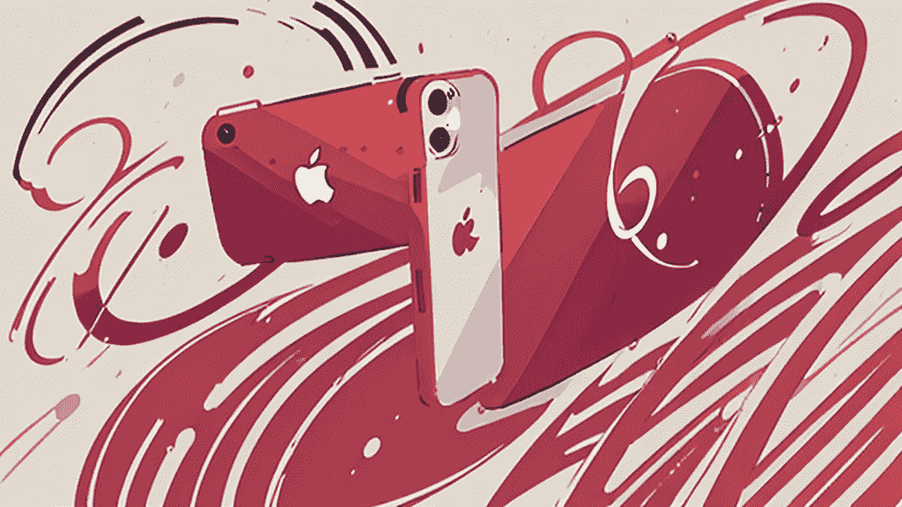

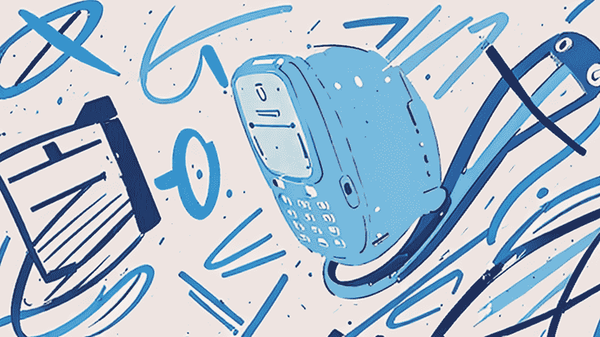

这是我最头疼也最经常出现的现象。有一些单帧，即便我已经调高了线框的控制程度，依旧出现了线框外“包裹”或者“延展”出去的不明残缺设备形状。

加上 one iphone 类似的数量限制并不能解决，模型对于数量提示词不敏感。（毕竟出现的也是半个）

（其实这个在流动的动画中看不太出来，如果只有一帧就还好！）

剖析原因，其实这个工作流中模型也依照了线框渲染了我想要的线条，“完成了我的任务”。问题在于在我没有控制的部分出现了“我不想要的内容”。说明我应该加大对于这几帧的控制。

再仔细看看图片，会发现，两个手机或者不明多余设备，在位置上里我渲染设备深度相似。

那加高深度图ControlNet的权重就好了！

因为利用深度图强调前背景的分离，就可以把设备“凸显”出来，因为遵循深度信息，就不应该在设备外层包裹更多内容。

但深度信息过多也不好，太过于可控会导致AI难以自然发挥。权衡+解决问题就好了！

我一般配置0.33深度图ControlNet的控制，达到分离效果即可。太强的深度图会让模型不知道画什么，它只能画远在天边的不成形的“云团”。

例如，下图是加上之后，nokia的背景和主体就分离的特别开。

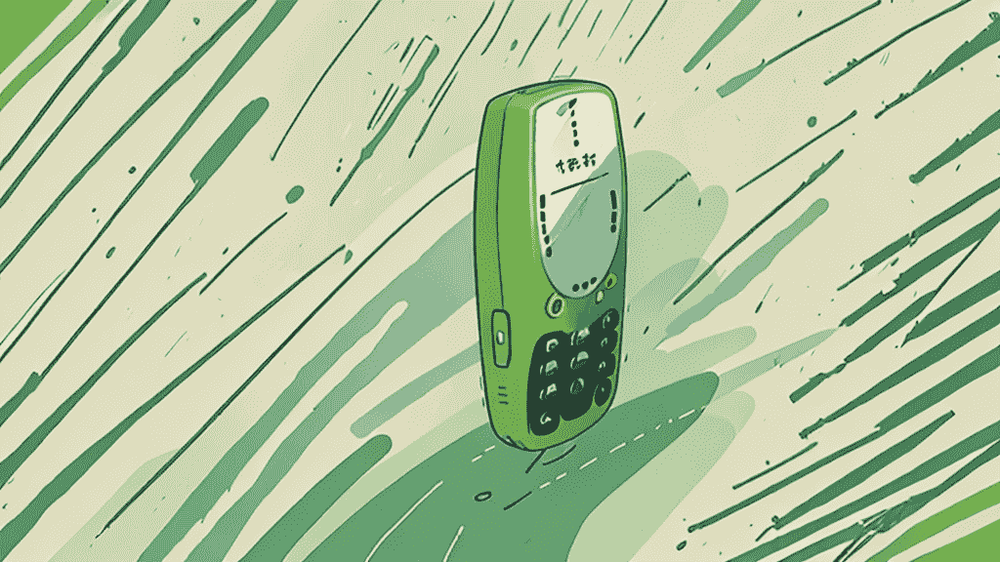

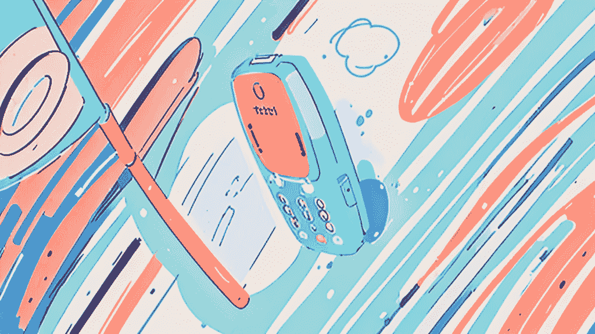

### IpAdapter控制线条风格

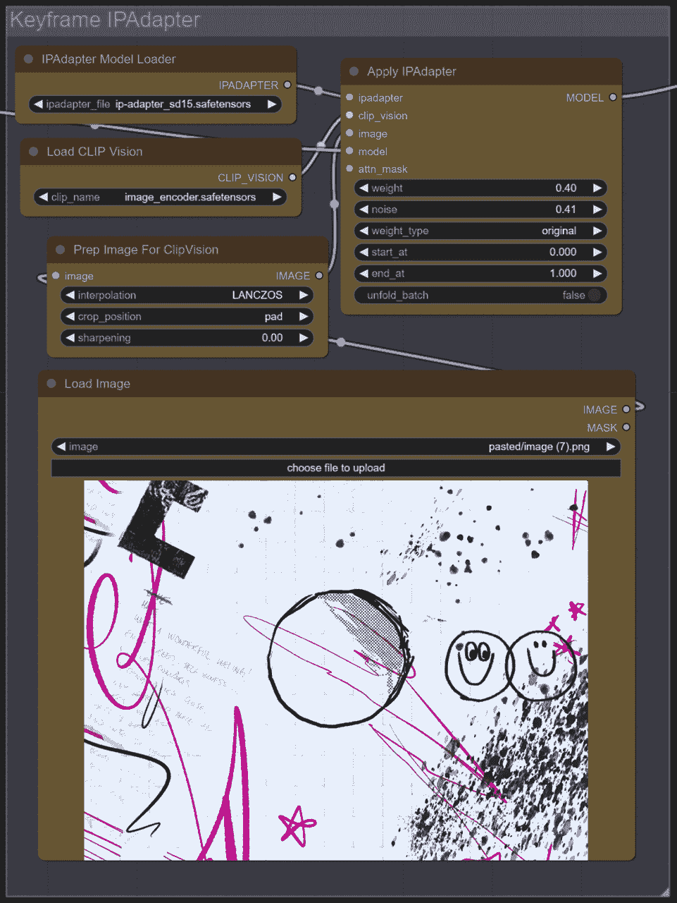

IpAdapter真的是风格迁移神器！我上面不是提过Lora我想加一些Sketch风格嘛，但是Sketchit是针对SD1.0训练的对我的SD1.5模型工作流基本不适应，很少能够改变风格。Anime_minimalist就很友好，可以做成扁平风。这些lora都可以做做试验看看效果。

但是IpAdapter，仅仅一张图就可以学到草图！

这张图是在OpenIntepreter宣传片中 随便 截的一张图做的测试，后来发现这张图就是我要的那张风格了（真的是实验科学，太随机了，这个work了…）因为我很喜欢这个里面的纸张的格子和潦草的线条。

但我不建议`weight`开太高，否则生图的颜色会太像参考图，我不希望只有黑色和粉色。

我选择了0.4（大多数时候）。

`noise`可以理解为，对`Prompt`放行的程度。

意思是， 你愿意让模型控制的多，还是提示词控制的多。

`noise`越大，提示词的比例越大。这又是一个控制与不控制的权衡。由于我希望有大量的颜色变幻，所以我开的比默认0.25/0.3的值高了一些，用了0.4

## 单帧思路：单帧放大就行

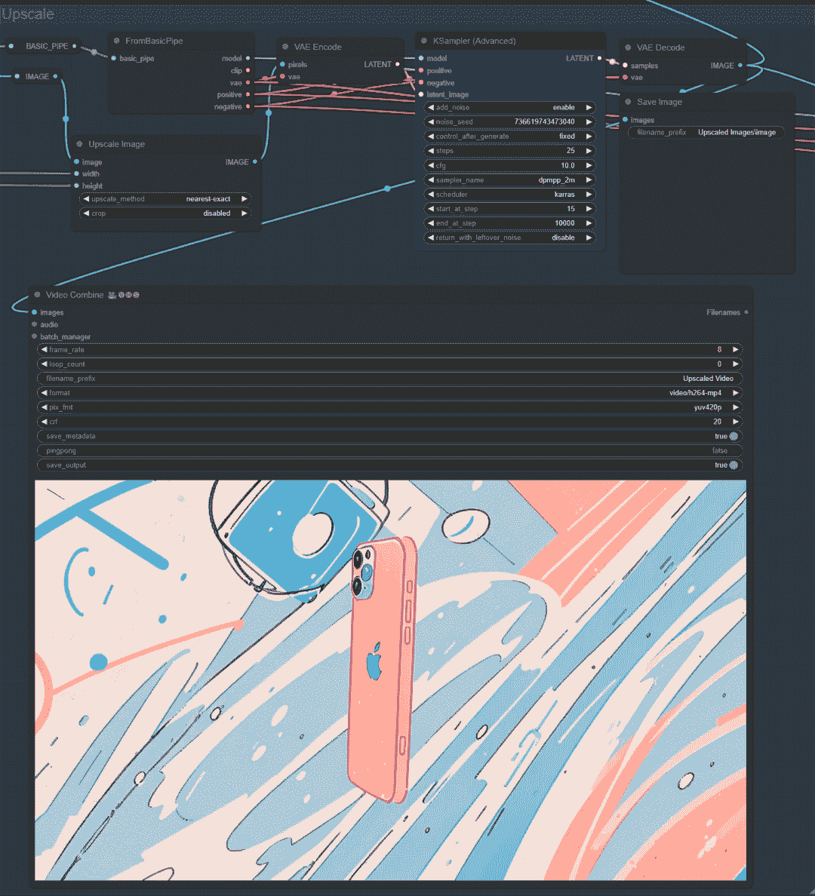

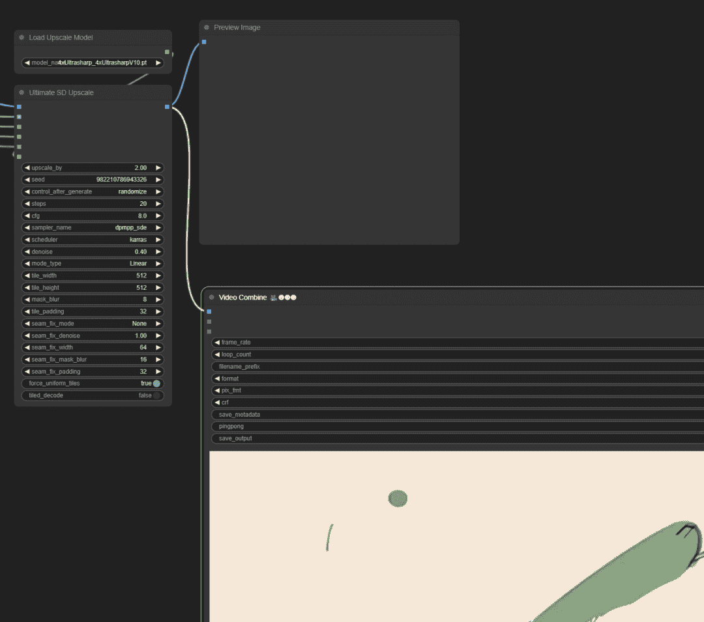

放大是最简单的部分，因为不涉及人物和视频平滑，只要保证颜色色块准确就可以，所以按理来说想要多大都可以。

一般思路是使用一些原生的模型放大技巧，再用第三方模型放大，再用GAN这种非SD路径的模型放大颜色，再用一些第三方软件放大。这个思路是顺序进行的，逐一离工作流渲染方式越远。

我随便挑了两个放大的技巧：

+ 使用渲染视频的帧放大后作为`Latent Image`再采样渲染一次
+ 使用 4xUltraSharp 等模型进行放大

我还想用GAN放大结果发现内存溢出了（已经到2k了！其实不用放大到4k了！）

## 彩蛋！一个美丽的错误

最开始的时候我发现视频渲染一直有一些残影，像是自动加上了打光一样的效果。

我仔细看了看，每次都出现在原来的运动轨迹中，我才意识到，啊！我设置的跳过首帧参数忘了改。

我的深度图和线框图控制的时候延迟了一帧！

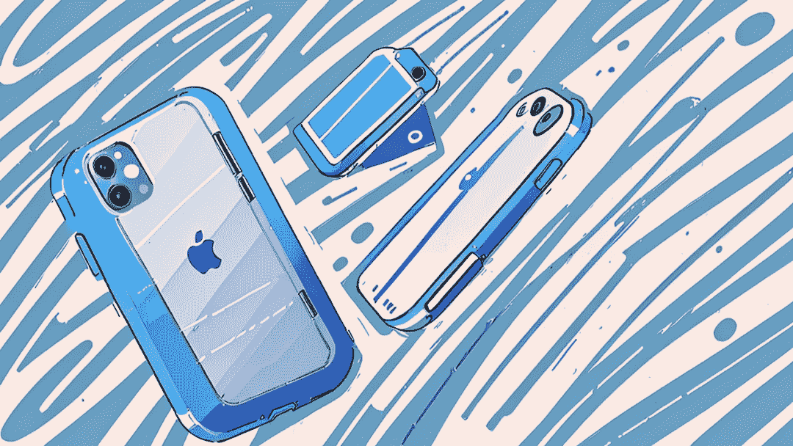

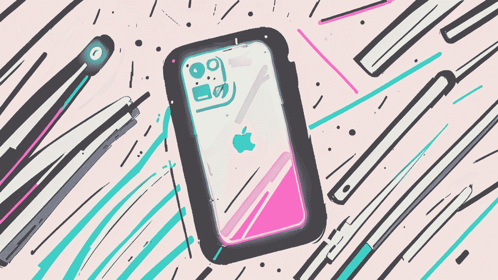

线框图控制了物体的形状不变，而延迟了一帧的深度图为了保证上一帧位置里面还存在一些物体，不得不渲染一个像是深色阴影的物体，就造成了残影跟随的效果。

这真是意外的发现，因为直接让我做残影效果我还不会做…真的是手笨也有意外的收获…

# 🪴把工作流串联起来

以上就把很多踩的坑都讲了一遍，总体来说，创作思路是比较清晰的，有了明确的可控与不控的审美准则之后，剩下的就交给AI就好了。

我的直觉是，控制太多反而不适合AI发挥。所以最小程度进行控制是AI创作中的小tip吧。

下面就是完整的流程串起来的样子。

## Blender白模动画

这个只是演示着玩，在ComfyUI中并没有使用到这个信息。

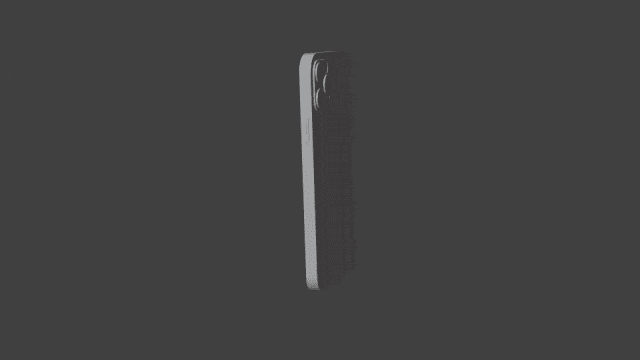

## 深度图动画

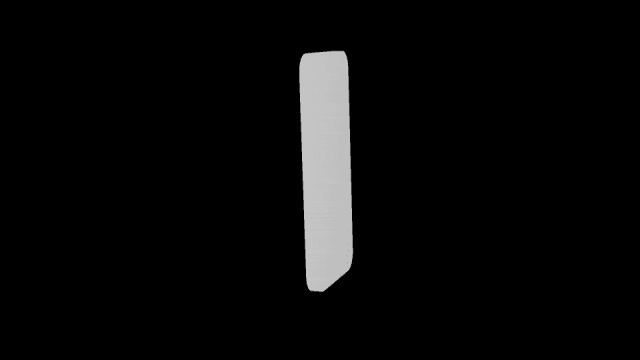

## 线框图动画

其实我都没有很精细的去debug为什么有的镜头不是完整的圆（blender设置问题吧），交给AI就好了！而且闪烁很快，其实不用太精细。

## ComfyUI转绘

# 😊结语

## 对AI的一些思考

Sora出来之后很多人说影视行业没了，我觉得完全不是。

这是一种新的艺术形式，就跟摄影出现后不会替代画师一样。AI有自己擅长的东西，传统工作流有它擅长的东西。对于使用工具的人而言，只是多了一种创作思路罢了。

“在xxx情况下，使用xxx更简单”。实现思路+1

就比如说这样的短片，要是纯粹AI生图去做，肯定做不出来，你怎么保证它可以按照你想要的方向去旋转？

还有如果只是用传统的方式，做这个短片肯定非常耗时，因为很多背景只是 `{placeholder_for_colors}` ，不需要精细处理。

而只是用AI+Blender做一个类似迪士尼的动画，效果也一定没有原来工业界的动画好看，仅仅是AnimateDiff的闪烁就会让人昏眩摸不着头脑。

还不如让它不可控。

AI的不可控，就让它发挥不可控的价值，以前的工作流也一定不要丢掉。

而两者结合做出来的，可能才是AI原生视频。

我觉得这项想象力的能力在新时代AI社会中非常的需要培养。

推荐大家去听一下任鑫的 《AI原生： 做AI产品的12条非共识》 播 客，讲述“AI原生”的概念。

里面我很喜欢一个观念：**重构流程，才能用好AI。**

是的，如果把原有的影视创作流程中的工作流（其实好莱坞已经定义的超级清晰了），拆解到小模块，再去看AI可以干什么，越拆越细又会发现AI其实干不到这个模块的90分。直接舍弃原有的工作流，在新AI时代中的不同的好的产品中吸取灵感，去创作出新的AI原生内容，才是应该去思考和尝试的。

希望大家也多多思考，相互启发。

## 最后

以上就是我的工作流完整复盘了，整个视频制作了断断续续的三个小半天。

跑通第一个视频很困难，因为在创意和实现中来回辗转，后来顺手了一个片段能10分钟搞定一次渲染就成功哈哈。

其实技术什么的，开源社区的工作流和各路大神的教程真的很完整了，从小白入门到做出这样的视频也就一个月不到的时间。

创意和构思更关键！

再次感谢 海辛 与 阿文 在我学习ComfyUI的路上的指导，和开源社区免费愿意分享的ComfyUI大神们！

有什么问题，欢迎留言讨论！

如果本篇对你有帮助的话，还请多转发点赞，谢谢！

# ✨我是谁？

我是晨然，AI应用层探索者，全栈/产品/LLM应用/ComfyUI。

其实我是做大模型应用的：）

工作流在阅读全文中。

THE END

<https://my.feishu.cn/sync/CV7edZp1nspUQobYJhicxeP7nrb>
