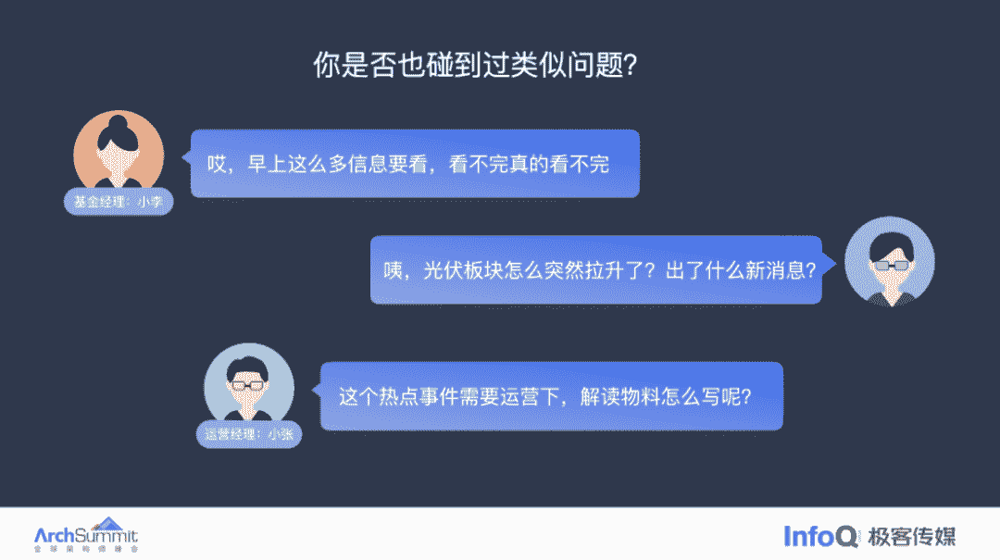
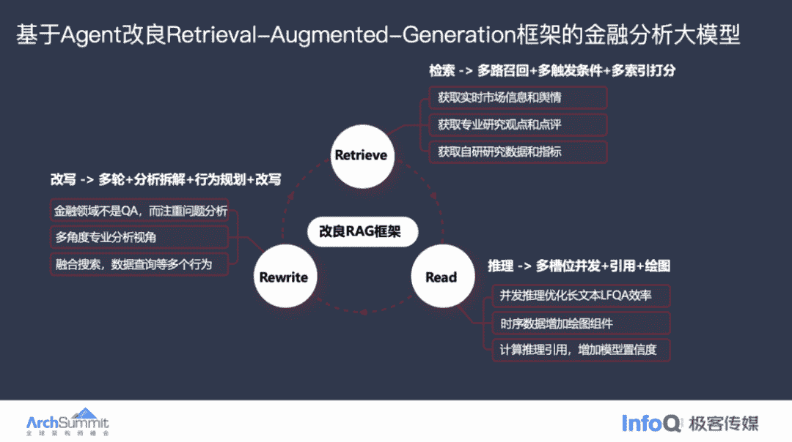
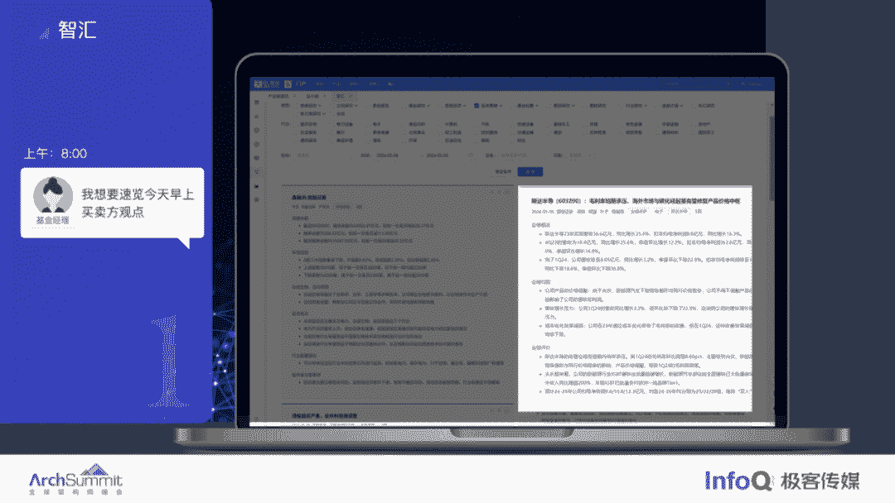
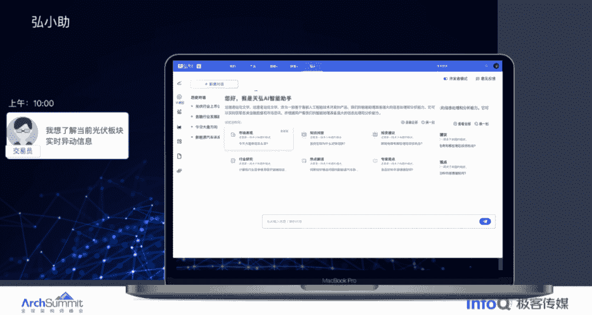

# 天弘基金：AI Agent在金融场景下的应用

> 来源：[https://my.feishu.cn/docx/SxKwdEGAXozZ64xeBXFcAdtKnie](https://my.feishu.cn/docx/SxKwdEGAXozZ64xeBXFcAdtKnie)

<https://my.feishu.cn/sync/CV7edZp1nspUQobYJhicxeP7nrb>

> 🔗 原文链接： h[ttps://mp.weixin.q](https://mp.weixin.qq.com/s/Asq0DVboLUEP8pEDIcuOgg)q.com/s/Asq0DVbo...

> ⏰ 剪存时间：2024-07-07 16:04:34 (UTC+8)

原创 平野 InfoQ数字化经纬 2024年06月25日 13:00

嘉宾 | 平野 天弘基金人工智能部负责人

编辑 | 黄雯希

近年来，随着国家对“科技金融”领域关注的不断加深，天弘基金以其多年积累的技术开发能力和丰富的行业经验，在大模型方面持续进行自主研发和创新。根据最新的行业数据分析，天弘基金的金融大数据模型在行业分析、问题解决深度以及金融数据时效性等关键指标上取得了显著进展，已成功应用于投资研究和销售策略中，展现出卓越的效果和领先的技术实力。

AI Agent 是人工智能领域的一项重要技术，它能够模拟人类的智能行为，执行各种任务。然而，在实践中，AI Agent 面临着诸多挑战。如何在复杂环境下进行决策，高效地处理数据，深入探索 AI Agent 的发展与实践，成为了当前人工智能领域的重要议题之一。

在日前举办的 ArchSummit 全球架构师峰**会**深圳站上，天弘基金算法团队负责人平野 分享了其团队在金融行业内开发的基于大模型的 AI Agent， 以及 AI Agent 的核心技术和在金融领域的实际应用案例。 AI Agent 通过深度学习和自然语言处理技术，能够理解和生成人类语言，进而 实现与客户的自然对话、提供金融咨询、进行投资决策辅助等 ，为金融行业的创新发展注入新的动力。

8 月 16-17 日， [FCon 全球金融科技大会 ](https://mp.weixin.qq.com/s?__biz=MzkzMzQzNjQ5Mw==&mid=2247489900&idx=2&sn=e6da909e659e3a7af44cf8c9fd8a2a28&scene=21#wechat_redirect)将在上海举办。本届大会由中国信通院铸基计划作为官方合作机构，将邀请国内外金融机构及金融科技公司专家分享其实践经验与深入洞察。AI Agent 智能体作为焦点话题，届时也将有多个议题分享，蚂蚁集团投研支小助技术负责人纪韩将带来《多智能体协同范式在金融产业中的应用实践》，文因互联董事长 / 创始人鲍捷博士将分享企业如何《精益地打造金融专家智能体》......

以下是平野老师分享全文（经 InfoQ 进行不改变原意的编辑整理）

# **大模型的发展现状**

大模型的出现经历了从兴奋，到质疑，再到理智对待的发展阶段。提到 AI Agent ，实际上它是基于大模型的 Agent 技术。大模型从 2022 年底开始备受关注，到现在越来越流行，竞争也越来越激烈。

在第一个阶段，大模型的出现是非常令人兴奋的， ChatGPT 在推出后的五天内就积累了 100 万用户，两个月内达到 2 亿用户，打破了史上所有 APP 用户增长速度。随后，国内各大厂也开始进入这个领域，全力投入 AI，很多从事大模型的公司如雨后春笋一样冒出来，全部卷入这个行业中来，那个时候经常听到“all in AI”。接着是质疑阶段。媒体报道充斥着各种消息，有的说在 AIGC 时代需要庞大的算力，有的说斯坦福推出的 Alpaca 模型只需 100 美金就能训练出我们自己的大模型。这件事情也引发了大众的争议，质疑大模型经常会一本正经地胡说八道，也就是所谓的“幻觉”。另外，很多公司和研究机构投入大量的算力资源和人才资源，但真正落地的场景还在探索中，没有找到非常好的新技术的应用场景。这时候也有人质疑，大模型的成本是否太高？相关人才是否难找？

而且随着监管制度的不断完善，对大模型的伦理和相关的安全性、合规性要求也越来越高。现在大模型的发展已经进入了一个理智的阶段。根据天弘基金在全体员工的抽样调查中，发现约 25.7% 的用户已经基本上离不开大模型，这个数据还在不断增长。未来大模型在各行各业的应用会越来越多，越来越普及。

# 金融行业如何应用 AI Agent

要想在金融行业应用 AI Agent 首先要考虑三个问题：

**第一个问题是资源和人才 **。作为一家金融公司，在开始做大模型时，没有像一些科技大厂一样拥有大量资源和人才。人才和资源的密度、总量都是有限的，需要选择性地进行投入，要决定哪些项目要坚持做，哪些项目要放弃。例如，数字人在很多销售领域的公司里可能很有用，但对金融的业务帮助不大，所以我们舍弃了这类看似高大上的技术。

**第二个问题是研发方式 **。金融公司要不要直接购买第三方厂商的模型进行使用？但很多金融领域的使用场景中运用第三方的大模型是行不通的。因此，天弘更多地是采用自主研发。

**第三个问题是算力 **。金融行业是否要应用 AI Agent？金融公司往往担心算力投入过大，像 ChatGPT 每个月的在算力上的开销至少是千万美金以上。金融公司是否需要上千张 GPU 卡才能将自己的 AI Agent 研发成功？但经过探索发现，可以用较小的成本做出有用且效果不差的模型。

此外，还要明确大模型并不能解决所有问题，大模型只是提升生产力的一种工具。它可以只是一把枪，单如果能在特定的场景下理解业务然后训练和优化大模型，那么它就能成为精准把握市场机会的狙击枪，这样的效果会比普通的大模型要好得多。

# 金融行业应用 AI Agent 的原因和重要性

举例来说，在金融行业，不同角色会遇到很多问题。作为基金经理，每天早上要看大量信息，看不完怎么办？作为交易员，突然发现光伏板块上涨，想知道原因或相关新闻怎么办？作为运营经理，发现有个热点，想快速抓住市场机会，领先发布相关营销物料，怎么办？这些问题看似简单，但并不是大模型就能完全解决的。

这时候，Al Agent 就能发挥作用。它可以在各种场景中提供实时性的数据，解决传统方法中训练时缺乏时效性的问题。那么，什么是 Al Agent 呢？

Agent 是一种能够自主决策、采取行动以达到某种目标的实体 ，Al Agent 主要依托 LLM 模型和具体的业务场景来调用相应的工具来完成任务目标，简单来说大模型 + 插件 + 执行流程 = Agent。如果延伸到智能体，那就还需要反思、环境感知等等多模块。通过应用 AI Agent，我们就能解决特定场景中的问题。

**接下来简单介绍一下 AI Agent 的组成部分。 AI** Agent 主要有四个分支：Memory、Tools、Planning 和 Action。

Memory 分为长期记忆和短期记忆。 短期记忆用来感知当前发生的状态，以即时决策。长期记忆则会把一些数据和内容存储在数据库或记忆系统中，供以后查询使用。查询后，可以通过预先调整来做相应的行动（Action）。

**Tools 模块是 Agent 用来处理和**分析数据、进行推理和决策的算法和方法。 Tools 让模型和外部世界进行互联互通，既能让模型感知世界，也能让模型通过利用工具来改变外部状态。在金融领域使用工具，我们主要可以赋予模型感知金融市场实时变化的能力。例如，如果要查一个基金的数据，或在营销中查某个用户相关的购买数据，就需要调用相应的查询 API，我们称之为 Chat BI。Tools 决定了你需要使用什么 API。工具部分提供了 Agent 处理信息和执行任务的核心能力。

**Planning 模块负责根据当前的目**标和环境条件制定长期和短期的行动计划。 这包括考虑到不确定性和可能性的计划制定，以及如何有效地达成设定的目标。规划使得 Agent 能够在复杂和动态的环境中进行有条理的行动。例如，如果我要写一个大纲，Planning 会告诉我第一步做什么，第二步做什么等等。或者，在写营销文案时，它会规划出逻辑顺序，确保步骤有条不紊地进行。此外，还有思维链（Chain of Thought，COT），这也是 Planning 的一部分。

**Action 模块涉及 Agent 基于规划和当**前环境状态选择和执行具体的行动或操作。 这是 Agent 与外部世界交互的方式，通过执行行动来实现其目标和任务。则通过执行 Planning 规划的步骤，结合感知信息，调用合适的 Tools 来实现最终的行动目标。

那么，Al Agent 在金融领域能解决什么问题呢？它在金融领域最重要的应用场景是统一数据交互形式和多样化数据类型的交互。

Al Agent 的应用的核心是数据和交互。将不同模态和结构的数据进行交互，并通过简单直观的工具调用，以对话式的方式（例如 ChatGPT）呈现给用户，这是 Al Agent 的目标。

所以在金融领域的应用场景中，有几个重要的板块：

首先是 **搜索 API **。像大家可能熟悉的 new Bing ，这些平台现在都采用实时检索结合大模型的方式。在金融领域，经常需要查询各种基金数据、交易数据或者实时市场行情数据等。

其次是 **多模态交互 **。在很多领域，多模态交互是很重要的。比如在视频创作、营销文案、财务报表等场景中，多模态交互可以更直观地呈现复杂数据，提升用户体验。

另外，还有 **ChatBI 和工具交互 **，这取决于在每个业务场景中我们需要执行的具体操作以及调用的工具，然后将结果通过用户界面展示出来，进行一个用户界面的交互。

# 天弘基金应用 Al Agent 的经验分享

金融分析模型框架

这里简单介绍一下我们团队基于改良 Retrieval-Augmented-Generation 为基础的 Agent 框架的金融分析大模型。

**首先是我们称之为改良 RAG** 的一个框架，即 实时检索与大模型结合的框架 。这个框架在 2024 年越来越火，许多大模型公司都会选择在这个框架上做延展。其实我们在 2023 年初就开始尝试这个框架，因为它对计算的资源要求不高，而且具有实时性的效果。所以我们在 RAG 的基础上进行了改良，分为几个模块：

1.  **改写（Rewrite） **：在检索之后拿到的知识板块是在召回的这一块，我们把传统的 RAG 改写，按 Agent 的思路进行改良，先进行多角度的分析思考，再在每个分析视角下进行问题拆解，问题改写，和工具调用。我们会对问题进行改写，以让大模型能更好地理解和回答问题。比如，我们会将复杂的问题拆解变成多个子任务，在这些子任务上进行规划，即 planning。在 planning 之后，如果有必要会进行二次改写，再通过规划后的内容进行检索 + 金融工具调用。

1.  在金融领域里面会有很多复杂的问题。比如，哪些国家是因为经济下行不得不下调利率，而使得整个国家的经济健康发展？这样一个问题，在百度或者谷歌 Google 直接搜索都是搜不出来答案的。所以在这种情况下，需要把这个内容进行改写，把它变成子模块，进行每个子模块的搜索，再用大模型进行归纳。

1.  **检索（Retrieve） **：多路召回 + 多触发条件 + 多索引打分。比如，提出一个问题，先进行搜索，而不是直接用大模型回答。搜索包括搜索互联网内容和天弘基金自己的内容库，这样不仅可以获取网上公开的实时数据、天弘基金内部的数据、专业研究员的市场观点以及所自己积累的这种内部语料等。

1.  **推理（Read） **：即归纳和总结。我们通过改写完的问题检索，会得到很多信息，把得到的信息进行排序和推理，最后得到一个总结性答案，就是我所说的推理。天弘基金使用的是多槽位推理，在多个子任务中同时进行大模型推理，最后给出总结。

框架创新

在这个设计大模型的过程中我们也做了一些创新。比如大家常说的 COT，也就是思维链（Chain of Thought），我们在此基础上做了改进，称之为 COM，就是把 Thought 变成了 Mind。 COM 的意思是将一个关于金融的复杂问题拆解成多个子问题再进行操作。 通过很多尝试，我们发现，一些基础的大模型，对于你提出的金融问题，回答的结果虽然正确，却并不是我们所想要的。作为一个专业的金融研究员，希望得到的答案也是专业的。在这种情况下，所需要的不是一个普通的、正确的答案，而是一个可以帮助做出正确决策的答案。

所以我们创新了 COM，帮助我们在构建这个大模型中融入了研究员和基金经理的这种思维模式，让大模型也有这种研究的思维。

接下来，我要介绍的是在检索以后，我们做的一些召回策略。在检索完成后，我们会进行召回策略的制定。例如，我们使用多路召回和多条件触发。理解用户意图不仅限于关键词匹配，还涉及时效性和语义理解等。我们采用多种索引方式，包括 向量索引、关键词匹配（如 BERTSpan）、实体识别（NER） 等。

另外，我们在粗排阶段，我们进行了相关性的过滤模型优化。在召回模块中，除了实时检索的数据，我们还整合了内部数据。这些内部数据通过知识图谱（KB）系统进行连接，让 Al Agent 的回答更偏向于研究员的研究。我们结合了产业链系统，确保对行业上下游关系的全面理解。比如说，当我们要分析光伏行业时，需要了解其上下游的供应商、完整的供应链和产品承接方。这些数据怎么能结合在一起准确地出现在金融从业者的答案中呢？我们进行了 KB 内容建设。首先是打通了产业链的上下游数据。我们会自动化地处理了一部分不变的市场数据，如公司行业指标等，把它们客观地呈现出来。另外，我们还针对了一部分变化的数据，如一些分析师的观点和各个业的异动，把每一个子模块都纳入异动监测的模型中，确保这些动态数据也能及时反映在大模型的回答中。

通过这些改进，我们发现效果得到了显著提升。进行对比，会发现在金融领域，我们团队在金融行业内开发的基于大模型的 AI Agent 与 ChatGPT 几乎不相上下，甚至在某些场景下我们会回答得更出色，因为我们针对金融领域进行了专门的训练。

关于 reference，我们实际上也做了好几个版本。现在我们的 reference 主要有几个关键点。一个是确保输出的内容都是都是有源可溯的，也是真正所需要的。我们会在答案中加入 reference，标明每一句话的来源，无论是来自我们的知识库还是网上公开的内容，都会有明确的标注，并且可以查看最终的数据源。

# **大模型产品解读**

最后介绍一下天弘基金的产品。刚才提到的可能是一些技术细节，在产品方面，天弘基金内部已经发布了大约七到八款大模型相关的产品，这些产品还没有对外发布。总**结一下**，大模型可以在一天之内做些什么？用一个时间线来串起整个大模型的产品，比如说，早上研究基金经理来到我们公司，可能需要浏览各种研报。这时候，我们有一个产品叫 智汇 ，可以让研究员快速浏览市场上最新的研报，并且筛选出他们感兴趣的内容。天弘大模型的优势在于总结研报或 PDF 时，如果涉及投资领域，天弘基金训练后大模型可以识别文章中提到的投资标的，如最近的 AI 医疗、AI 办公和 AI 法律等领域。这是研究员非常关注的内容。

我们还按照不同的研报类型，例如行业分析，市场策略，宏观解读这些研报分类训练了不同的研报摘要模版。其次，作为研究员，在早间浏览黄金新闻时，我们根据研报进行进一步解读，我们发布了智读产品，专门针对特定的研报进行解读和提问。也就是当你看到一篇特别感兴趣的文章时，你想要深入研读它，这时候打开我们的系统，你可以提出问题，还可以对比多篇文章进行阅读。

接下来是 **“弘小助” **板块，这是我们的核心之一，涵盖行业研究、市场分析和金融知识问答等多个方面的专项训练，在市场表现、行业分析、热点解读等几个方面做得相当出色。我们内部推出的产品，可以整合市场上公开的各种研报和公开的第三方数据源，以及包括内部基金经理的观点。比如，如果向这个大模型产品提问“光伏行业能否现在买入？”随后利用我们自己独创的 COM，将研究员的思维模式融入其中，通过意图分析后，为投资研究角色提供了答案，给出的回答会让提问者至少了解了最近光伏行业的市场表现。不仅限于这些问答，“弘小助”还会提供类似光伏指数这样的行业指标，同时将产业链中的信息整合进来，解释每一个异动点背后的原因，并深入分析这些异动点。接下来是“reference”，也就是我们提到的，你可以看到每一个内容的来源。另外，我们还将大模型整合到产业链系统中，使用弘小助来进行产业链异动解读、热点挖掘等，使得产业链更智能化，特别是在发现异动方面的效果明显优于以往小模型的应用。

除以上应用的落地，我们还进行了一些可能探索性工作，包括 利用大模型挖掘金融中的量化因子 。我们一直在思考大模型是否能帮助我们解决投资中的因子挖掘问题。之前国外有几个大的基金公司，专门从私募基金中挖掘出一批非常厉害的“大牛”，用于进行大模型挖因子的工作。天弘基金当时也在进行类似的尝试，这件事是否可行，是否能实现。我们进行了一系列的实验，其中有几个是我们自己创新的方法。在沪深 300 的股票池中进行了测试后，我们发现，与我们常规的 word count 101 算法或者最近流行的强化学习挖因子相比，大模型的效果非常显著，我们的信息系数（IC）达到了 0.0326，这比目前我们尝试的强化学习的效果还要好。从理论上讲，如果有很多个因子，需要进行组合，这其实是一个计算机难以完成的暴力求解过程。但是如果能够借助大模型的思维方式，通过某种逻辑形式将一些不必要的组合排除在外，就能够显著地缩小最终的搜索范围。

关于金融大模型，天弘基金会始终坚持业务导向，务实创新。始终坚持技术引领，前瞻探索。始终坚持创新合作，共创价值。始终坚持合规运营，敬畏风险。始终坚持成本效益，精准投入。

# **专题征稿启事**

**InfoQ 数字化经纬正策划**一项专题 《央国企数智化转型与创新》 ，希望通过本专题，探讨央国企的数智化转型现状、挑战和路径，寻找变革路上的成功案例，为数字经济下的产业焕新提供样本参考，为未来智能产业发展探寻路径。

我们 欢迎相关企业实践案例的投稿，或是希望接受我们采访的企业与个人主动联系我们 。

---

<https://my.feishu.cn/sync/CV7edZp1nspUQobYJhicxeP7nrb>