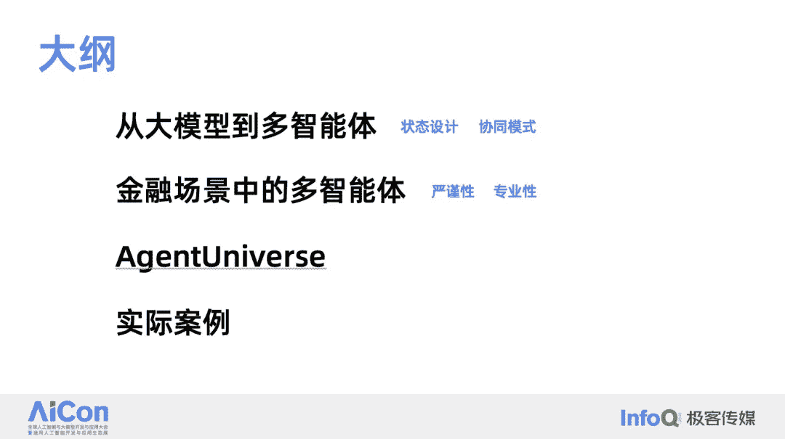
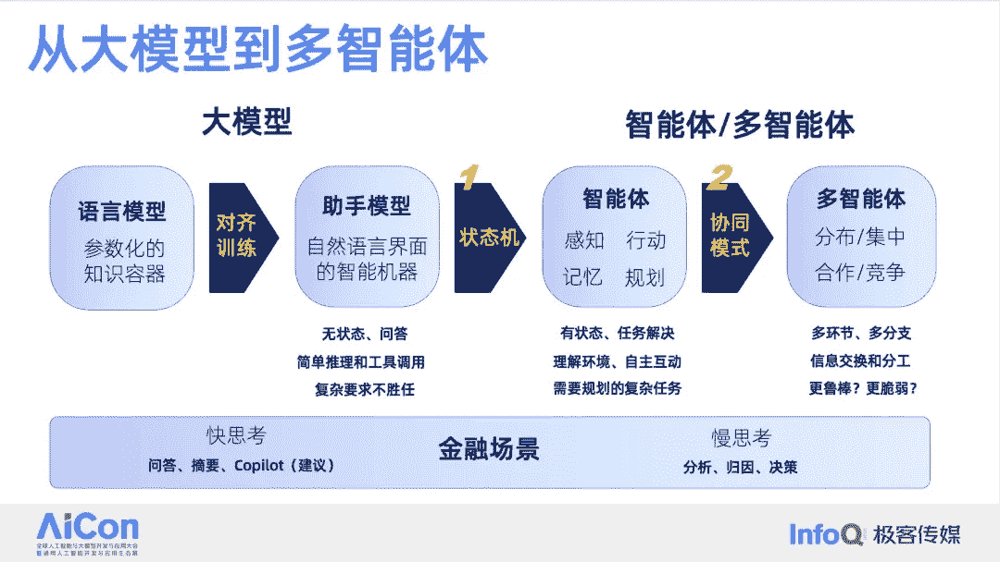
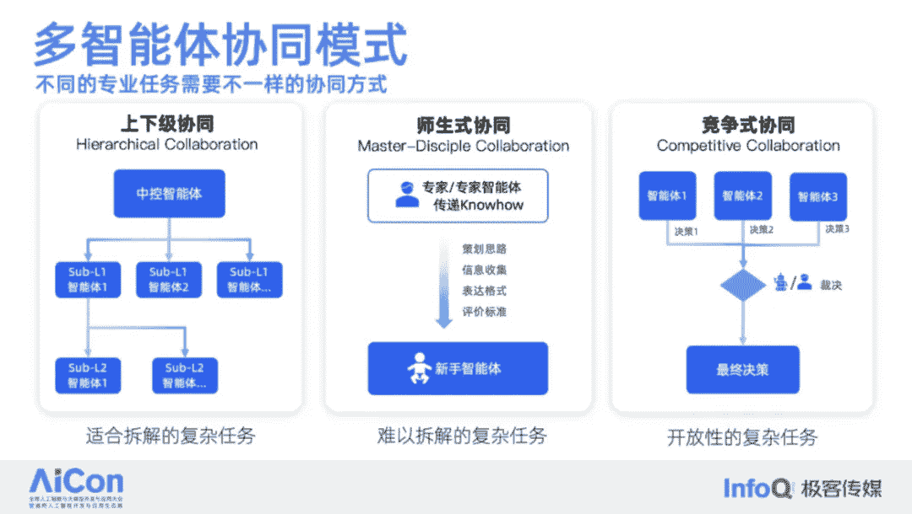
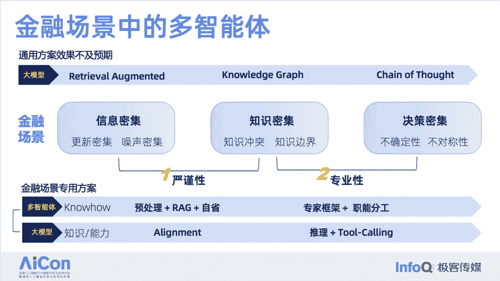
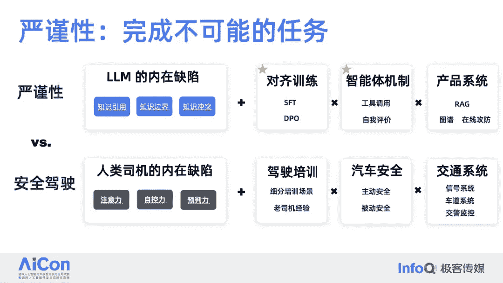
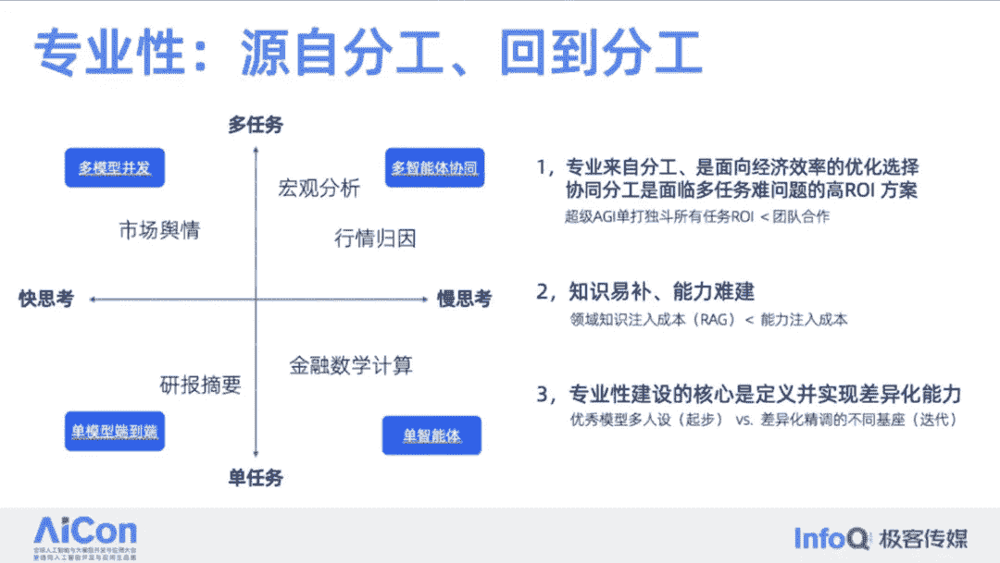
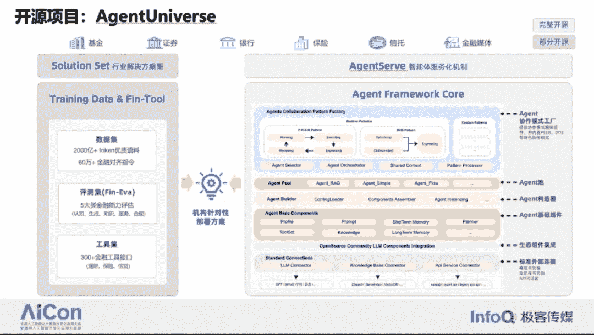
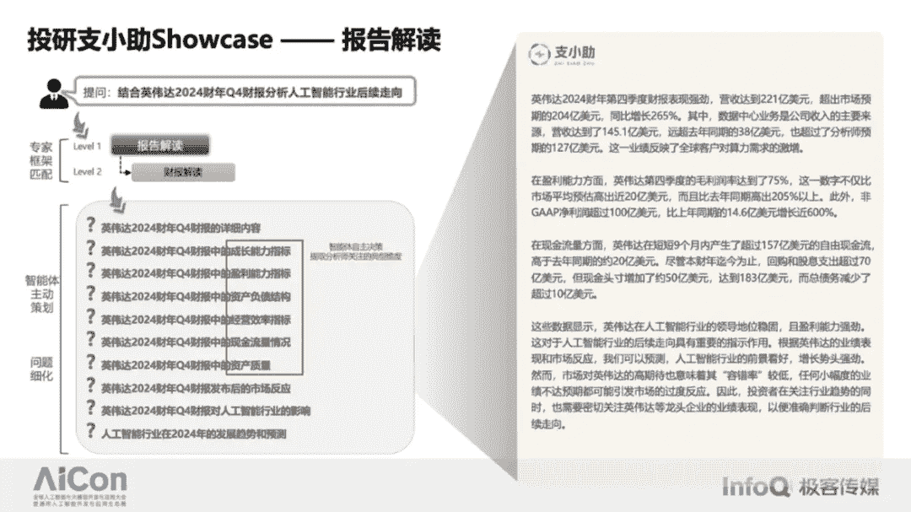
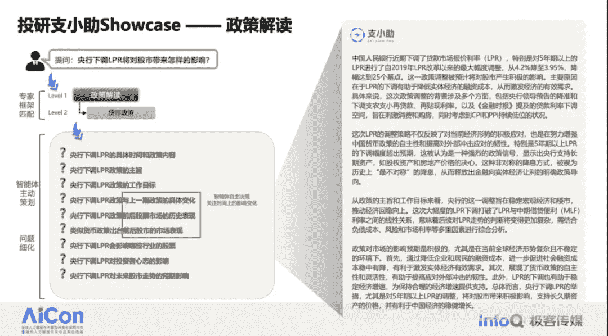
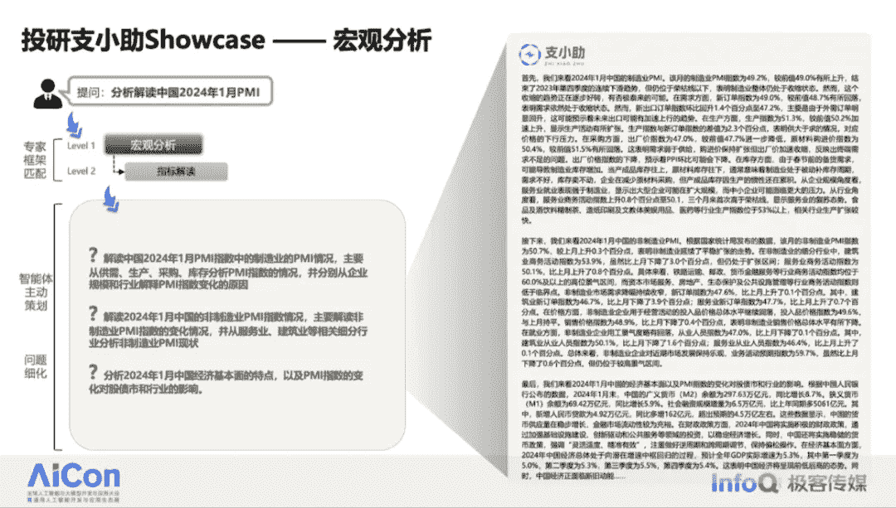

# 蚂蚁集团：多智能体在金融场景的应用探索

> 来源：`https://my.feishu.cn/docx/UfL7d4pf7oT4ELxgb0scSSUTnLh`

> `https://my.feishu.cn/sync/CV7edZp1nspUQobYJhicxeP7nrb`

> 🔗 原文链接：`https://mp.weixin.qq.com/s/UrT3rh6x03fIIZjcSI5rqQ`

> ⏰ 剪存时间：2024-07-07 16:04:56 (UTC+8)

陈鸿 InfoQ数字化经纬 2024年07月02日 13:00 北京

嘉宾 | 陈鸿 蚂蚁集团专家

编辑 | 李忠良

在金融科技的浪潮中，多智能体技术正成为推动行业创新的关键。面对海量信息和复杂决策，如何利用这一技术优化金融决策呢？在 AICon 全球人工智能开发与应用大会（北京站）上，InfoQ 荣幸地邀请到了 蚂蚁集团资深算法专家陈鸿先生 。在他的精彩演讲中，陈鸿深入介绍了蚂蚁集团在大模型技术领域的最新进展，并针对金融行业所面临的信息爆炸、知识复杂性以及决策难度等挑战，提出了创新的解决方案。

他特别强调了基于 `AgentUniverse` 框架的 PEER 模式（Plan-Execute-Express-Review），这一模式有望有效提升金融决策的精准度和效率。 本文是对陈鸿先生演讲内容的精心整理，旨在为读者带来前沿的大模型洞察，并启发思考如何将这些技术应用于金融行业的实际问题解决中。

另外，即将于 8 月 18-19 日举办的 AICon 上海站同样设置了 「大模型 + 行业创新应用」 专题分享，我们将精选具有代表性和规模的典型案例，展示大模型技术在不同领域中的实际应用与成效。目前是 8 折购票最后优惠期，感兴趣的同学可以访问文末 「阅读原文」 链接了解详情。

在大模型技术日新月异发展的时代，技术观点也得日拱一卒，苟日新日日新，不存在稳定的金科玉律。与其私藏一时一刻的技术思考，不如分享以求碰撞和启发。故此我把为这次 AICon 准备的 PPT 材料发布出来，并补上解读，从 「在线生成」转成「离线生成」 ，没有时间限制，或可以更系统一点。

## 从大模型到多智能体

智能体、多智能体都是当下的技术热点，但作为一个技术人应该理解，所有的技术都有自己所针对的问题、及其能力边界，并不存在普适的、放诸业务场景皆 work 的技术方案。我们在这里尝试区分，从大模型到智能体再到多智能体这几个 AI 热点概念背后的关键差异和适用范围。

先从语言模型说起，一个经过足够语料充分预训练的基模型（base model），就是一个压缩了海量知识的知识容器，但这些知识关在数百亿到千亿的参数黑盒中难以使用。OpenAI 在 2020 推出 GPT3 的时候，因为它生成内容的不可靠和不可控，引发了当时媒体对 AI 的嘲笑和质疑，而不是现在的追捧。

2022 年底 ChatGPT 破圈逆转了大众对大语言模型的看法，基模型在完成对齐（SFT + RLHF/ DPO）之后，就成为一个助手模型（Chat model），它可以被看作一个以自然语言为输入输出接口的 AI machine，它不仅掌握语言且对齐了人的偏好，于是可以流利的和人交流；并因为能输出语言，而可以通过语言操控其他工具；我们还发现这些对齐过的模型具备一定的简单推理能力，虽然问题复杂的时候，就容易失败。整体上，这一批 Chat Model 已经开始让人产生了它具备一定程度智能的错觉，当然实际上， 大模型只是一个无状态的 query-answer machine，某种意义上等价为一个哲学家约翰塞尔（John Searle）提出的中文屋子（chinese room） （不知道的话建议搜索并读一下这个有趣的思想实验），LLM 是无状态的，比如你在和大模型聊过五分钟后和它再聊，与隔上五天再和它聊，它对待你不会有任何差别。在本质上，LLM 和其他神经网络模型一样是个无状态的函数，目前 LLM 的一切状态性处理，都依赖外部的 Prompt 机制。LLM 能和人进行多轮对谈，需要外部系统对整个对话 session 的状态保持（并回传到 prompt 里）。

从大模型到智能体，关键的区别就是从无状态的模型变成了有状态的状态机。 智能体要接入（Grounding）环境，完成任务，就必然涉及工作流（workflow），就需要有保持任务状态的能力，无状态的模型无法持续跟进一个任务的工作进程。我们在下一页 PPT 会展开讨论这一点，我们会看到智能体的感知、行动、记忆、规划，也都需要基于一系列离散的被定义的状态来进行，或者说，一个智能体能在其中规划并活动的外部环境需要被加工为离散化概念，发散来说，人类也是这样，光谱是连续的，但人类能喊出名字的只有赤橙黄绿青蓝紫，声音的频谱是连续的，但人类的知觉把音频加工为一系列离散的元音 / 辅音 / 字 / 词，是这些离散的 token 而不是连续的音高构成了语言的基础。可以发现，人类智能从感觉到知觉也是一个从连续到离散的状态化加工过程。要让大模型接入真实世界解决真实任务的时候，我们就需要把大模型进一步封装为某种智能体。

我们说成为状态机是 Agent 规划和完成任务的关键，但专业任务往往是多环节多分支的，在每个环节和分支上，专业化分工会有更高效的 ROI。这就产生了从智能体发展到多智能体的必要性，而在不同环节的职能岗位上，不同的智能体如何通过合理的协同模式组织在一起，这是属于多智能体的核心技术问题，多智能体作为一个团队，需要比直接大模型端到端或单一智能体从头单打独斗更鲁棒，而不能因为组织的复杂性让整体变得更脆弱。后面我们也会有专门一页 PPT 讨论多智能体的协同模式。

最后我们看 PPT 的下面部分，我们把金融场景里的任务粗分为两类，一类是可以由大模型端到端直接生成结果的，端到端可以类比为人类的系统 1 或快思考模式，包括「问答、摘要、给出建议」这些任务。这容易理解，我们说话的时候，不需要也没有办法去一个一个字往外说，我们真正思考的单位是一个个念头或者想法，是这些想法构成推理和思考的基础单元（building-block），这也就是所谓的系统 2 或慢思考，也是当前大模型难以很好处理的推理问题，但我们可以基于 Agent 的 workflow 与自省来应对。在金融场景里，许多专业任务需要一定程度的分析、归因、决策，这些都更适合通过智能体或多智能体来实现。后面我们也会有一页进一步展开对金融任务的分析。

这页我们讨论基于大模型的智能体。

智能体（Agent）不是一个新概念，它的历史比大模型更久，1995 年出版的经典著作 《Artificial Intelligence：A modern approach》 第一版就以 Agent 为中心展开（附带一提，这本书最新是 2020 年的第 4 版，依然不改初衷以 Agent 为总领全书的总纲，现在如果出第 5 版，肯定就会讨论 Large Language Agent 了）。感知器 Sensor、行动器 Effector，规划器 Planner，Memory， 这些 Agent 的核心组件或能力在 95-2000 年那时就成体系的提出来了。

如前所述，对以端到端完成任务为目标的智能体而言，没有状态，不成方圆。我们能发现 感知、规划、行动、记忆这些智能体的核心能力事实上都依赖对特定状态的定义和识别。 例如，感知能力，依赖对智能体所在环境状态的定义和识别；规划能力，依赖对任务不同状态的定义和识别；行动能力，依赖行动选项状态的定义和识别；记忆能力，则依赖对行为结果状态的定义和识别。智能体正是通过对这些状态的识别，和外部环境有效对接，管理和完成任务。这是一套强调落地的合理设计，但涉及状态的识别或状态间的迁移，只能依赖规则或上一代机器学习算法，由于泛化能力不足，智能体在实际任务中就不免会制造各种 bug。例如扫地机器人是个典型的具身 + 自治 Agent，但大家只要家里有过扫地机器人的，应该能想起各种扫地机器人因为 corner case（literally！）闹的笑话。

在大模型横空出世之后，加上 AutoGPT，LangChain 等框架的出现，充分发挥了大模型控制工具的能力，让许多人看见了用大模型作为智能体核心引擎的优势，更重要的是，LLM 取代机械的规则，能更鲁棒更泛化的识别任务（以及环境）状态，在理想情况下，当前 LLM-based Agent 能基于自然语言的任务描述持续展开任务，泛化地确认任务完成进度，并视情况动态规划再采取行动，这是一个美好设计，但当然未经调整的通用大模型还是很难无痛顺利完成任务，因为一个专业任务不可避免地涉及大量过程性知识，如何感知、如何执行、如何规划背后都依赖各种专业 KnowHow，所谓 Know-How，就是一件事如何完成，是所谓过程性知识。这些专业的 Knowhow，或过程性知识往往是不成文的，大家交接工作的时候，最麻烦的就是这些没有写在文档里的经验。要让智能体顺利完成任务，就需要形式化那些不成文的专家 Know-how，提供将之引入智能体的合理机制。

从单 Agent 到多 Agent 协同，这是源自 ROI 的压力，专业任务往往是多环节多分支的，在每个环节和分支上，经济规律决定了专业分工会有更高效的 ROI。这就产生了从智能体发展到多智能体的必要，而在不同环节的职能岗位上，不同的智能体如何通过合理的协同模式组织在一起，这是属于多智能体的核心技术问题。

人类自己就是依靠分工协同而成为了地球的顶级掠食者，人没有依靠牙齿爪子、力量速度等等单一个体的能力，人是靠组成一个社会之后形成的集体能力，这超越了任何超级个体的能力。集体力量大这件事在 AI 上也不会例外，当然，成功的社会化并不容易，历史不止一次的证明，引入有效社会化机制（组织形态）的力量和价值（以及错误的组织形态的破坏性）。不同的组织形态（协同模式）适配着不同的任务。

回到多智能体上， 不同类型的专业任务也一样需要我们为之设计不同的协同模式。 第一类：任务可以逐层分解的适合上下级协同的模式（这个模式非常常见，后面我们开源的 Agent 框架核心贡献就是提供了这个模式的一个核心抽象：PEER，Plan-Execute-Express-Review，此处不再赘述），第二类：那些存在解法但难以拆解为固定步骤的更适合师生传授式协同（例如数学证明需要的是思路点拨或样题举例， 从费马大定理到行程问题都不适合分工规划再解决）。第三类：那些开放性的复杂问题无从规划，则更适合交给某种竞争 - 评价的机制让不同智能体并发搜索可能解法。

## 金融场景中的多智能体

回到金融场景，我们把 金融场景的特殊性总结成三点：信息密集、知识密集、决策密集。

关于信息密集，我们都知道一方面金融业务强依赖高频更新的资讯（ 更新密集 ），导致严谨的时效性处理必不可少，另一方面，这些信息中大量属于相关但无因果关系的噪声信息（ 噪声密集 ），需要有效屏蔽噪声才能做出正确决策。

知识密集：我们能看见金融市场中，围绕各种资产，有各种不同的理论和分析，但金融中的知识，不仅高密度，还是彼此高度对立的。我们会发现许多互相冲突的观点，某种意义上，这些冲突构成了市场交易的基础，买卖双方必然对资产价格有截然不同的预期，所以才有一买一卖，双方意见一致则不会形成交易，某种意义上，这就是为什么需要金融市场。市场是一种通过交易形成共识的机制。于是，金融领域中的观点必然冲突（ 知识冲突 ），这对大模型构成有趣的挑战，面对金融领域的多篇观点时，LLM 不能强行捏合成一个统一观点，既需要明确共识，也需要暴露分歧。

在金融领域，比知识冲突更需要 LLM 关注的是知识的边界，不存在无远弗届永远生效的知识，大的说，牛顿三定律在接近光速时失效，小的说，许多金融逻辑都有对宏观经济形势的潜在要求（ 知识边界 ），大模型在理解和处理这些逻辑的时候，需要理解这些知识的边界，否则就会闹出笑话。最后是决策密集，金融领域的决策（decision-making）有相对于其他决策任务的非常强的特征。一个是不确定性，金融决策面对的是开放环境，其他市场主体的参与和博弈带来了无穷变数，金融决策从头到尾都需要和不确定性信息共舞。另一方面，金融决策是高度不对称的，我们熟知搜索推荐解决的是海量信息中只有个别有效的信息不对称问题，但在金融决策中有类似的不对称现象， 往往在大量决策中只有个别决策处于关键位置，带来关键收益（或避免风险）。如何定位这些关键决策点是金融所要处理的决策不对称性问题。

信息、知识、决策的问题对大模型而言都有标准解法，例如用 RAG 提供信息更新，引入图谱来规范知识，再包括强化推理能力的 CoT 方案。但 面对金融特性，这些标准方案的效果不及预期。 RAG 容易，但 RAG 多篇混入的噪声信息不容易处理。图谱有效，但图谱难以处理冲突和有边界的知识（有边界的知识不是 Knowledge Graph 中简单的二元关系，需要 N 元关系来刻画），CoT 也难以处理决策的不确定性和不对称性。

所以我们需要考虑金融场景的定制方案。此处 我们把信息、知识和决策三类任务总结成两个对齐方向： 一个是 严谨性 、一个是 专业性 。后面会有两个独立页来各自展开，所以这里我们简单过一下，能看见我们其实是期望通过大模型和多智能体两层各司其职，大模型负责压入必要的知识和能力，多智能体装载相关过程性 Knowhow 来保障金融的严谨和专业。

大模型具有幻觉的内在缺陷已经是一个老生常谈，不过有内在缺陷并不意味着 基于大模型的智能体应用不可能按严谨的标准完成任务。毕竟人也一样有类似的问题，人类也早已熟知通过系统的方式保障严谨标准的达成。

幻觉是两种生成式智能（人和 AI）共同具有的特征，它恰恰来源于对空缺的预测和生成， 有一系列认知神经科学的实验说明，当一些人类患者的和视觉相关的脑组织被切除或破坏，他们本应消失的视野（盲区）里会被大脑自动填补出生动的幻觉形象（爱丽丝综合症），更日常的例子相信每个普通人也都体验过，当我们被人问及一些位于我们知识边界之外的问题，大脑会快速脑补出一些如假包换的「幻觉」来填充知识的空洞。我们在这里列了知识引用、知识边界、知识冲突来说明容易引发大模型幻觉出现的场景，当然也不限于此。

具有内在缺陷，不代表系统不能安全工作。 人自己就是例子。人类本身就会有注意力的问题、预判力的问题，但我们在大多数情况下还是信任我们的司机能把我们安全的送到目的地。我们培训司机的驾照考试，某种意义就是一个对齐过程：让普通人向老司机一步步对齐。科目一 / 科目二 / 科目三分别就是知识注入的预训练 / 持续训练、SFT 阶段，以及最后的强化学习阶段（边上坐一个老司机评价你是否 OK）。但汽车如果危险仅仅有一个安全驾驶的司机也不行，汽车也需要遵循安全规范预防各种情况并做好各种最坏情况下的安全措施，最终如果我们有一个安全的司机和一辆安全的汽车，我们期待交通系统整体也是安全的，例如必要的信号灯、车道、交通警察等等。

把这个 metaphor 映射回 LLM 应用，LLM 需要面向严谨性对齐（基于各种细分任务且接受老司机检验，就像驾照培训需要分解到转弯倒车入库等等具体任务），LLM 外的智能体则需要准备好更多面向严谨的辅助性措施（类似于汽车之于司机），最终才是 AI 应用所在的整体系统可以做的一些规范性工作。个人意见是严谨性任务还是应该聚焦在模型和智能体这两层，系统级别的围栏有效且必要，但如果模型和智能体毫无改善，不免出现大量尴尬的拒答。

专业是相对于通识而言。 我们在讨论专业性的时候，需要意识到， 专业本身就是分工的产物，无分工，不专业。 一个个专业职能和擅长这些职能的专家的产生，本身是人类社会面向经济效率的优化结果。只有协同分工才是针对多任务难问题的高 ROI 方案，那么自然的问题，AGI 不需要面向任务优化，用一个超强的 AGI （或当前可得的最强大模型）去处理所有问题是否才是 LLM 时代的合理解法呢？滥用最强模型当然不合理，各家大模型厂商也提供不同尺寸的模型供应用方选择，应用方更有责任面向专业任务，将基座向特定专家对齐（向普通人偏好对齐的通用基座容易 underqualified 或 overqualified ）。在面对复杂困难任务的时候，通过多智能体团队协作，ROI 更容易胜过 超级基座单打独斗。

其次，在专业领域，知识容易速成（弥补），但专业能力则提升困难。这个点，LLM 和人也高度一致。当新知识新技术出现，我们可以通过网络或翻查 Manuel 快速弥补自己的一些知识漏洞，但如果能力有缺，不经过亲手实践和踩坑获取一手经验教训，难以有所进步。对大模型也是如此，知识缺乏，可以 RAG，可以 KG，但如果模型的一些专业能力不足，计算 / 推理 / 行情归因，都不是简单能解决的问题。

于是最终的结论也很明显。 专业性建设的核心就是对一个系统中不同专业职能的差异化能力的定义和实现。 起步阶段我们可以从优秀基座通过人设套取数据，但面向专家的对齐工作逃不掉，最终需要差异化精调的不同能力，这些能力建议聚合在一个基座中，但还是由不同 Agent 差异化使用。

## 多智能体框架 `AgentUniverse`

关于我们已经开源的多 Agent 框架 `AgentUniverse`，各位可以通过《从孤立到协作，大模型多智能体协同使复杂任务迎刃而解（点击即可查看）一文做深入了解，Github 上也有相关的项目介绍和代码：`AgentUniverse` 项目地址：

+   `https://github.com/alipay/agentUnivers`
+   `https://gitee.com/AgentUniverse/AgentUniverse`

欢迎开发者们加入社区体验、共建。

投研支小助其底层是基于 `agentUniverse` 的 `PEER` 框架，基于这个 `PEER` 框架我们又融入大量投研专家经验，构建了一个 投研 `Copilot`。`PEER` 模式是 `agentUniverse` 当前版本最具特色的多智能体协作模式组件，该模式包含计划 (Planning)、执行 (Executing)、表达 (Expressing)、评价 (Reviewing) 四个不同职责的智能体。

计划者拆解任务（例如把 `query` 分解为一系列子 `query`），执行者完成任务（例如检索），表达者汇总表达，评价者最终把关，OK 则输出，不 OK 则重复 `workflow`，`PEER` 这个计划 - 执行 - 表达 - 评价的循环构成了层级式分工协同的抽象，值得指出，虽然 `PEER` 虽然看起来像 `Rag Fusion`（而且它确实胜任 `Rag Fusion` 工作），但它不止于此，它本质上是分工这件事的一个合理抽象。抽象有其价值，抽象让分工这个优化方式可以递归使用，不断深入。例如 `PEER` 可以在计划环节也引入一层 `PEER` 通过分工去得到足够好的拆解，或者在评价环节再引入 `PEER` 的分工来做细粒度的精细评价。抽象让 `PEER` 的分工可以这样不断递归深入直到 `Know-how` 的尽头。

在图里右侧的专家框架是当前我们对投研领域专家经验的形式化落地，我们针对 9 类典型的定性分析场景，给出了 30 个不同的细分专家框架。体现了之前所说的专家 `Know-how` 的引入，在一系列消融实验中我们确认了这些专家框架的价值，不同机构可以通过定制这些专家框架让投研支小助呈现出完全不同的解读思路，这比用 `SFT` 强行 `tuning` 基座模型合理且便捷。

投研支小助目前在蚂蚁内部在报告解读、市场分析、政策解读、宏观分析等多个场景中是助力金融专家提升生产力的典型应用，实测数据表明，其每日可辅助一名投研分析师高质量地完成超过 100+ 篇研报、财报和金融资讯的专业解读，完成 50+ 金融事件的推理归因分析。

# 实际案例

这是财报解读的例子，`Query` 是：“结合英伟达 2024 财年 Q4 财报分析人工智能行业后续走向”，可以看见在策划环节，智能体展开了一系列分析师关注的典型维度，规划智能体遵循了分析师的解读框架，通过一个嵌套的 `PEER` 过程产出了这一系列新的问题。

每天的行情资讯是高度套路化的，解读行情也有自己的套路，难点在于能否在套路化的解读中展现足够的洞察，保持观点数据的严谨则是基础要求。

政策，尤其是财政政策和货币政策，对经济有着深远的影响，也对用户的投资策略牵一发而动全身。用户可以向支小助提问相关政策对市场带来的影响，支小助得益于专家分析框架，能像个老手一样对比政策前后的变化去分析政策影响。

宏观分析是指对整个经济体的广泛性分析，包括但不限于经济增长、通货膨胀、就业状况、财政政策、货币政策、国际贸易和汇率变动等。支小助通过 `PEER` 范式，对宏观经济等相关复杂问题也能生成完整报告，胜任基础的宏观工作。

最后，做一个简单的预告，我们团队的同学很快会针对 `AgentUniverse` 框架核心的 `PEER`（Plan- Execute- Express - Review） 框架产出论文，敬请期待。

## 嘉宾简介

陈鸿（花名：五噫），蚂蚁集团资深算法专家。蚂蚁集团财富保险事业群智能服务算法总监，北京大学计算机系，豆瓣第 21 号员工，19 年加入蚂蚁，在蚂蚁数字金融线周游列国，历经财富、网商、花呗、借呗、芝麻、平台和服务，曾主持智人自动数据核对、金融行为序列、网格化运营、用户进阶路径决策、流量运筹、支小宝 2.0、金融大模型等技术项目。

<https://my.feishu.cn/sync/CV7edZp1nspUQobYJhicxeP7nrb>
