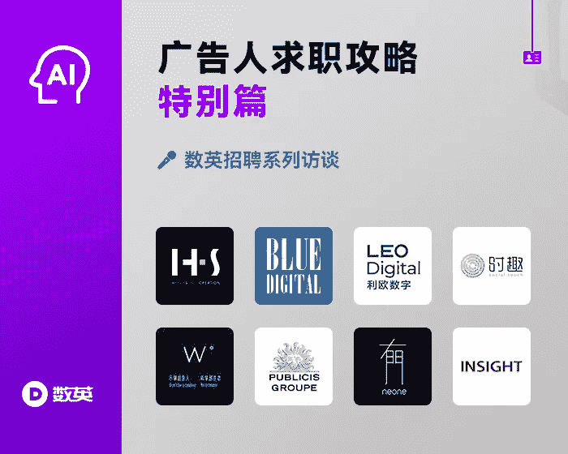
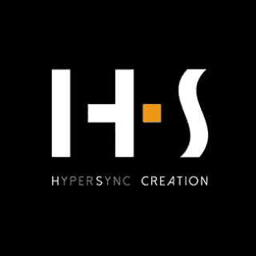
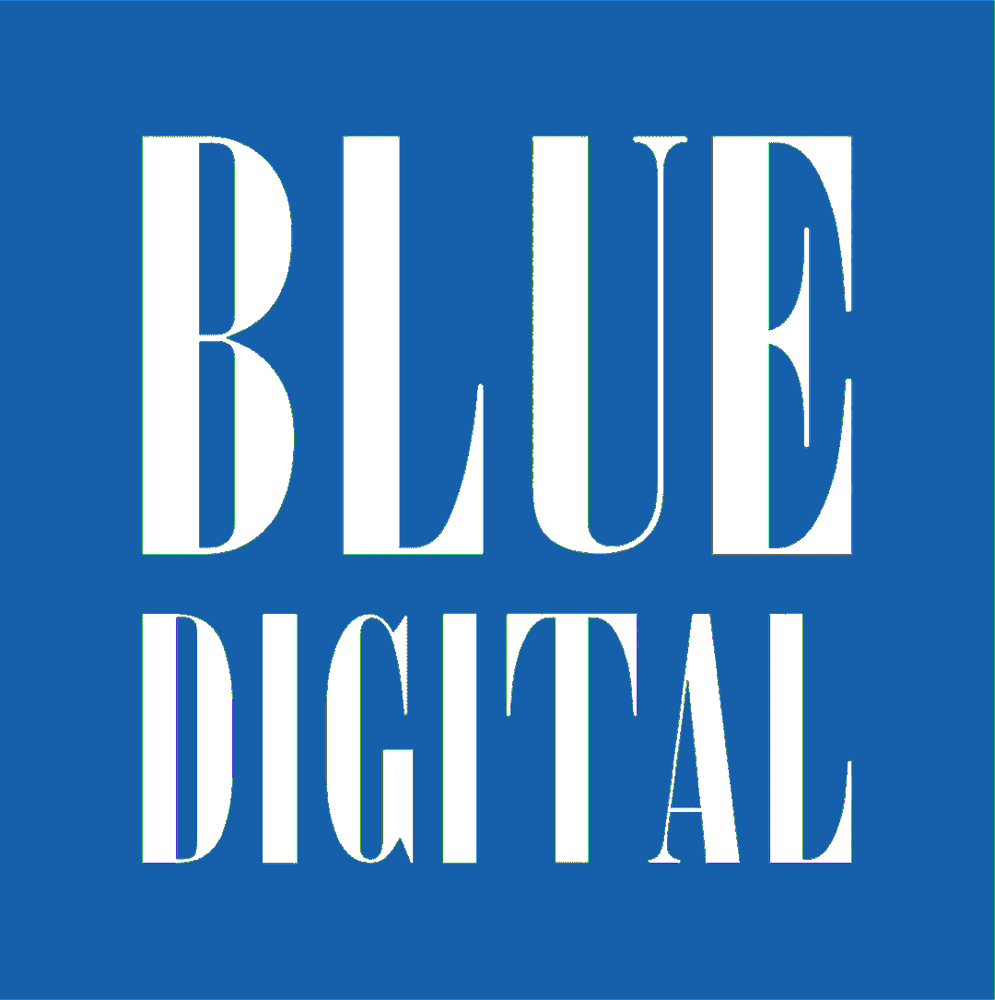
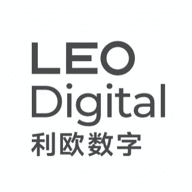
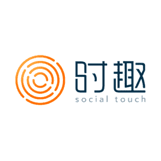
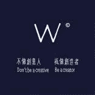
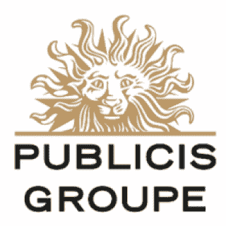
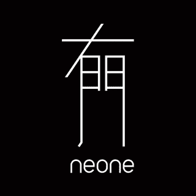
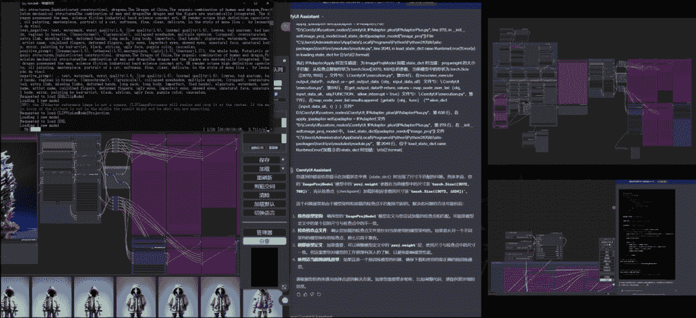
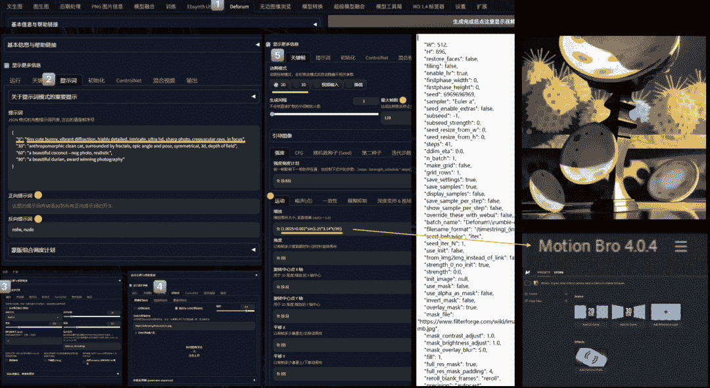

# 广告公司AI岗位求职攻略，助力职业进阶

> 来源：`https://my.feishu.cn/docx/TbdUdqyDJoNvTUxAavqcXICHnGE`

<`https://my.feishu.cn/sync/CV7edZp1nspUQobYJhicxeP7nrb`>

> 🔗 原文链接：`https://mp.weixin.qq.com/s/2Y2mVt0cX9TEBWuY8NlntA`

> ⏰ 剪存时间：2024-07-07 16:08:05 (UTC+8)

原创 数英编辑部 数英DIGITALING 2024年06月28日 20:36 上海

技术进步与行业发展，带来新的职业机遇。在这个春夏，广告营销行业媒体、垂直招聘平台数英，从“运营”和“AI”两大方向出发，采访10+广告公司相关业务负责人及HR，为大家带来广告营销行业招聘动向与职业生态观察，并提供一份值得参考的求职攻略。

## 数英招聘系列访谈（特别篇） AI时代的广告业观察

时代巨变，往往始于微末。据观察，目前已有多家广告公司和集团全员使用AI赋能工作——了解和掌握AI，正在成为与所有工作岗位息息相关的能力。

为此，我们邀请了8家不同规模、不同业务，但在AI方面都有深入探索与实践的广告公司，从企业视角分享AI相关经验与观察。

此次内容聚焦三大维度，为从业者提供求职与发展的参考：

● AI时代的相关人才需求——招聘计划、人才考察方式、内部培训与发展计划……

● AI发展下的业务应用——AI+具体业务应用、创意工作流程变化、客户需求变化……

● AI时代的广告营销行业动态——AI技术应用领域、市场需求变化观察、发展趋势和挑战……

结尾部分，还有针对广告营销行业多个岗位的AI+职业的精华放送。干货满满，赶快码住！

## 8家广告公司的AI经验分享

### （以下受访企业按名称首字母排序）

### HS Creation 和势

受访人：HS Creation 和势 创始人 Vivian；设计部门AI负责人 海博；美术指导 阿六

代表案例：东阿阿胶芒种《忙时有人爱》；神州租车AIGC小片：祝你新岁繁花开

2022年底，和势开始关注AI技术在广告营销领域的应用，并多次组织内部培训，将AI技术有效融入设计和视频制作流程中。在具体实践中，和势发现应用AI技术能显著提升工作效率，尤其在初级设计和插画方面，能为公司节省人力成本。而在文案创意中，AI现阶段的局限性较为明显，仍需更多地探索。

#### AI技术主要应用在哪些业务领域？

AI生成内容，主要有四类应用方向：言语类、图像类、视频类、音频类。

目前，和势主要在图像类、视频类及音频类（视频配音）应用较多，言语类应用也做过尝试，但效果有限。言语类应用可支持常规纲要和简单文章。

设计与视频类。AI技术能提高设计效率，当设计师有一个设计或脚本想法时，可以通过AI生成多个参考图像，后期在这个基础上再做优化创意。

针对细节多、画面复杂的创意呈现，可以通过AI生成，减少设计师在细节上耗费大量时间；一些手绘或3D图形的创意Demo可以通过AI完成，快速看到Demo是否符合此次创意需求。不过，实际执行还需要设计师完成，比如色彩、产品结合、细节的打磨，这些AI还不能完成。

文案创意类。目前停留在资料收集、框架梳理和翻译，较难应用到创意文案上。随着言语类AI的发展，我们还会继续探索其他可能性。

#### AI技术的引入，对创意工作流程产生哪些影响？

1. 高效收集资料，降低素材购买成本。

以前到素材网站收集素材，现在就可以通过AI平台生成想要的素材，降低了购买素材版权的费用。也会使用言语类AI应用（如`ChatGPT`）收集资料，这个Copy和设计都会用到。

2. 辅助设计，提高效率。

比如，以前视频类内容，需要找专业插画师绘制分镜头，因为绘制分镜不仅要懂手绘，还要懂镜头运转、画面承接，现在这个工作可以交给AI高效完成。

另外，针对我们团队来说，使用AI技术后，一些初级技术的插画师岗位，可以空出来招募更资深的设计。

#### 在应用AI的过程中，通常会遇到哪些挑战？

1. 使用上：对AI语义的理解与认知需要花时间尝试。

目前AI应用以国外平台为主，对中文的理解有限，我们需要学习如何更有效地沟通。此外，这些平台对色彩、构图、对比、光影变化等专业术语的理解，有一定的偏差，需要不断尝试。

2. 业务上：对外沟通时，对AI的能力需要更多解释。

AI应用仍有许多的限制，并非许多人想象中可以实现一切。举个例子，我们需要生成一个人物在多个场景中的多帧画面，要保证每一帧画面里的人脸都是同一个，是具有挑战的。如果客户纠结于人物脸部细节，那就要手动逐帧调整，非常费时间。

3. 成本上：设备需求不断提高。

新技术对设备有要求，我们最近又更换了去年购置的电脑电源和显卡。目前来看，设备迭代的速度还会加快。

#### 哪些行业的品牌广告主更偏好AIGC广告？

各行业都有需求。但行动比较快的是电商、快消行业。

金融、制造业，以及一些To B业务领域会略有滞后，但在与客户沟通时他们也都表达出了兴趣，只是还在寻找AI与自身的结合点、用户是否接受。

#### 针对AIGC广告，客户提出了哪些新的诉求？

需求本质并没有发生变化。一些企业期待使用AI降低素材购买承办，实现降本增效，但这部分需求占比相对较小。更多企业应用新技术，是希望展示自身的创新能力，呈现出更积极、年轻化的状态，吸引新一代消费群体。

从内容上来看，有客户会要求在表现手法结合AI的特点。一些客户在提案阶段会要求用AIGC风格，比较梦幻、概念化的，但实际执行阶段，还是会更关注产品特性的表达，具体的使用场景，更贴合业务的需求。

总体内容上，客户的需求没有变化。哪怕是用AI生成的素材，他们也是既要又要的。因为目前AI与品牌或产品结合还属于应用早期，甲方执行者没有过往可借鉴的案例用来说服领导。所以现在应用AI做创意还是有挑战的，既要符合过往基调，又要有效地利用AI呈现的技巧。

#### 面对AI技术的快速发展，广告人与广告营销行业该如何做？

1. 新技术是工具，拥抱新技术，做好基本功。广告的本质不会变，未来的机会应该是给拥抱变化的所有广告人的。

2. 成熟的创意人，可以运用AI开出新的花朵。去年听到一个说法，以前成熟的码农面临中年危机，但AI来了，他们又重新焕发生命力，因为初级的程序AI就可以写，所以需要熟手做更高阶的工作。广告公司也有类似的情况，成熟的创意人可以与AI联手创作出更多创新的作品。

3. 对公司而言，可以与超级个体联合，缩小公司规模，降本增效。

#### 零基础的广告人想学习AI，优先推荐学习哪类AI应用？

图片生成的AI应用，主要是Midjourney和Stable Diffusion。

Midjourney（MJ）操作简单，没有电脑配置要求，无需高性能硬件，通过网络即可以操作应用，使用难度较低。输出关键词并选择选项，就能生成大量无版权图片使用，部署过程非常简单，没有复杂的门槛，新手同学可以尝试快速上手。但MJ无法对模型进行训练。

还有一个常用的AI应用是Stable Diffusion（SD），它有两种界面方式：Web UI和Comfy UI。Web UI适合新手入门，Comfy UI不适合新手，要有一定的SD基础。SD对于硬件要求高，安装部署麻烦，需要本地独立显卡。

对比MJ，SD具有极强的可控性，可以随意换风格和形态，出图的数量也非常多。SD可以训练自己的模型，完全按照自己的想法来生成所需的内容。总之，SD是一种难上手但可控性比较强的工具，可以完全本地运行，无需联网。

视频整体操作门槛比图片要高一些，相对不适合新手。我们日常用的主要用的是Pika，Runway。

关于AI工具的操作，我们设计部的同学整理出一份《AIGC应用内部培训资料》，可以与大家一起分享，共同进步。

#### 还有其他可以分享的AI相关学习渠道与资源吗？

1. 视频课程网站：

`Youtube`（`https://www.youtube.com`）

`bilibili`（`https://www.bilibili.com`）

有大量优质的AI课程的学习资源。

2. 大模型网站：

`Liblib AI`（`https://www.liblib.art`）

`Civitai`（`https://civitai.com`）

可以收集大模型和各种lora模型，适合成熟AI使用者进阶。

3. 其他：`Discord`（`https://discord.com`）

可以参考和学习社区中的AI内容。

### 新蓝色光标数字营销集团

受访人：新蓝色光标数字营销集团 高科技事业群 联席总经理 李宁

代表案例：《万物皆可YOGA》《宁德时代：全球首个用户主演的AI广告大片》

新蓝色光标数字营销集团（简称“新蓝标数字集团”）是蓝色光标集团旗下核心业务品牌之一，是AI时代交互式营销解决方案提供商。目前，AI已经融入了新蓝标数字集团从前台到后台整个业务团队的日常工作中，而从业务层面上来看，AI已经开始成为一种思维模式，一种判断标准，重塑着公司的面貌。

#### All in AI战略下，蓝标业务模式与组织架构发生哪些主要变化？

我所在的公司是新蓝色光标数字营销集团，是蓝色光标集团旗下核心业务品牌之一，AI时代交互式营销解决方案提供商。希望我的介绍，可以帮助大家了解到新蓝标数字、了解到蓝色光标的一些AI方面的实践。

在过去一年多的时间里，在集团CEO潘总的带领下，All in AI战略从起初自上而下地宣传与落实，已经演变成为自下而上、业务自驱发展的模式，在业务创新、生产力进化、组织文化三个方面提供了新的“源动力”。

从业务层面来看，AI已经开始成为我们做决策的一种思维模式，一种判断标准，这种AI范式决策链路将会重塑公司的面貌。

提到生产力进化，经过不断迭代的演变和实践，生成式AI已经融入蓝标的工作日常，工作模式也已发生改变。可以说，生成式AI已经大幅度地提速了我们的日常产出。

与此同时，AI也在重构我们的组织和文化。从招聘、晋升到激励，AI已经嵌入到业务考核的方方面面，也推出了具有针对性的AI人才招聘和培养计划，包括建立纯AI作业驱动的团队。接下来，我们会将公司倡导的“No AI，No Bonus，No Promotion”践行得更彻底。

#### 招聘中，是否已将掌握AI技术视为候选者的必备能力？如何判断候选者对AI的了解程度或使用情况？

我认为伴随着AI生态或者说大模型生态的进一步成熟，无论任何行业的从业者都需要对AI技术有所掌握。对于我们来说，候选人或者在职员工，熟练运用AI技术尤其是生成式AI是必选项。

对于候选者的AI了解程度和使用情况，我们有完整的测试题库，可以针对不同的业务团队和具体需求，选取不同的考题板块进行测试。但我们最看重的还是大家使用AI时的思考逻辑和实际产出的对应情况。

#### 哪些岗位对AI技能有更高的要求？

我们对AI的要求已经贯穿从前台到后台的整个业务团队，随着传统制作方式逐渐被生成式内容取代，重复的常规劳动不再重要。我们期盼在创造力层面，解放更多的人才势能，发挥人脑价值，这样有想象力的人才才会愈发珍贵。

我所在的高科技群组服务的客户，本身对前沿科技高度敏感并且在应用层面推动落地的企业，所以我现在对团队要求的能力模型包含了三个Knowhow，即AI Knowhow、行业Knowhow、营销Knowhow。

AI Knowhow既包含了对AI工具的应用，也要对AI领域的发展、技术肌理有理解，这和客户本身发展的路径是相匹配的。而行业Knowhow和营销Knowhow，是过往必须具备的两个核心能力，随着AI的发展，这两个能力有了新的外延——与AI相融合才能更好匹配AI时代下营销的发展。

#### 具体在日常工作中，各个岗位如何利用AI提升工作效率？如何用AI进行员工考核？

AI对于创意岗位的提效有两种，第一种是直接提升工作效率，从创意工作流来看，公司在不断的部署各个岗位的工作流，起到提效率的作用，而创意在当中的前期思考，创意输出，执行通过AI的辅助下也得到了相应的提效。

第二种是提升效果，无论是哪种类型的内容，哪个岗位的创意通过AI的辅助，产出的效果也得到了一定的效果提升。

而对于Account类岗位，在AI的帮助下，我们搭建了基于数据的内容策略体系，使用“词意云”替代传统的“词云”。根据不同平台属性搭建相应的词库，同时填充不同客户的关键信息搭建一一对应的知识库，不断的完善与AI的交互训练，最终实现AI的人格化写作。

公司对于AI有很丰富的培训体系，同时AI的考核已经融入了每一个员工的行政考核当中，如：升职一定要通过AI的考试。

#### 广告营销行业中哪类传统岗位对AI的需求量更大？不同岗位对AI的要求是怎样的？

根据目前的实际情况来看，在生成式AI创造的内容中，图片类占比25.5%，视频类占比26%，投放类素材占比23%，策略、文案类占比19.5%，其它类型占比约6%。可以预见，随着更多工具升级及多模态模型的到来，视频比例一定会得到快速提升。

无论是文案、美术、制片、制作岗位基本的要求都是需要熟练掌握AI的基本工具，如：图文、视频、音频类的生成，方可辅助作业。

#### 在广告营销领域，哪些行业的客户对AI的需求更为迫切？主要需求集中在哪些方面？

在过去的一年中，我们创造了近300个真正的AI营销案例。AI正在快速渗透、改造广告营销领域，AI网红业务、生成式KOC、生成式社区营销、跨境电商（智能客服、AI产品设计、AI导流）等业务首当其冲。得益于AI快准狠的技术优势，客户对于短时间内，迅速、精准的产出提出了更高要求，这也给营销把握时间节点提供了反应时间和空间。

#### 具体到广告内容的需求上，是否有发生变化？更偏好哪种视觉风格和创意类型？

好的洞察、高质量交付，以及帮助客户达成营销目标的内容，是行业、客户，以及我们自身始终不变的标准和“偏好”。在AI带动下，可能市场上会出现某种“AI风格”明显的作品，但这只是发展过程中的一种现象，而非AI营销本身的追求。

#### 哪些广告业务领域更能被AI赋能、实现降本增效？

个人认为，未来传统的搜索广告或短视频广告模式将被彻底颠覆重构，真正基于上下文推理逻辑实时生成的AI广告形式将登堂入室，并在2到3年内逐步规模化。

#### 蓝标正在打造AI Native模式，可否分享一下具体构想与实际应用？与传统广告营销工作模式有何不同？

中国营销行业是一个万亿级的市场，在这个愈发内卷的市场中，内容创造、创意服务等各方面都已经出现巨大且难以逾越的瓶颈。生成式AI是中国营销行业突破瓶颈、开启全新增长的大机会。

以广告业务为例，过去，以“判别式AI”为底层逻辑的“千人千面”程序化广告将被“万人亿面”的智能体所重塑。个性化广告将由自然语言驱动生成，并根据用户偏好实时交互——这是真正意义上的AI Native广告，是一座待开采的金矿。

在此判断之下，公司脚踏实地地探索与实践，要打造真正意义上的AI Native组织。这样的组织将代表最先进的生产力，高度扁平化，拥有极高的人才密度、极强的AI信仰与自驱力。我们已经在尝试建立纯AI作业驱动的团队，一切以AI Native为核心架构流程和驱动业务。同时，我们也将大胆构建AI原生营销、原生内容或者生成式营销新模式。

#### 实际的创意应用中，如何融合AI技术与品牌调性、产品场景，解决客户需求？

正如前面所说，我们的团队有着很深Knowhow积累和经验，即AI Knowhow、行业Knowhow、营销Knowhow。

AI Knowhow既包含了对AI工具的应用，也要对AI领域的发展、技术肌理有理解，这和客户本身发展的路径是相匹配的。而行业Knowhow和营销Knowhow，是过往必须具备的两个核心能力。

在这三方面的KnowHow和相应的工具辅助下，我们不断训练属于客户的AI模型，就可以用于后续的内容生产。例如，对产品进行实拍之后，在训练后的AI模型作用下更换不同背景，实现产品与场景的融合。

#### 蓝标是否有组织内部培训和发展计划？

蓝色光标All in AI，公司内部有着非常丰富的培训课程、员工发展计划和文化活动等资源，也在内部的飞书和知识分享平台——BlueWow上有海量的案例、课程、简报等关于AI的信息以供学习。

同时，蓝色光标也在行业内推出了首个由营销公司发起的AIGC青年赛——Young Blue Awards，面向大学生和入职5年以内的职场新人，获奖者不仅能得到奖金，还有机会进入到蓝标实习、工作。这些都可以帮助到蓝标的员工和潜在员工转型AI、拥抱AI。

#### 对零AI基础的广告营销从业者，想转型到AI相关岗位，该从何抓起？

1. 理解AI底层原理。我们还处在AI发展的早期阶段，大模型技术日新月异、千头万绪，很容易让人摸不到头脑。但是技术的底层原理是既定的，吃透之后，对于各种新技术、新产品的理解和使用都非常有帮助。

2. Learning by Doing。对我们来说，AI不是一个学术问题，而是一个实操问题。所以，一定要回到实际使用场景中去思考和实践，让AI在业务中发挥价值。

对蓝标外部的朋友来说，在行业知识获取上，现在信息获取的路径非常多，我比较推荐在GitHub上有很多系统性的教学，覆盖从机器学习到Python。

### 利欧数字

**受访人：** 利欧数字人事行政副总裁 陈文钰；利欧数字产品研发中心副总经理 周崧弢

AI产品：LEO AIAD

在招岗位：产品经理（广告+AI方向）......

▼ 扫码查看企业招聘详情

利欧数字一直积极探索用数字技术与数据为营销业务赋能。2023年，利欧数字推出面向营销全行业的AIGC生态平台「LEO AIAD」，LEO AIAD是一个更懂营销人的生成式AI工具，LEO AIAD在算力提升、生产力优化、私有化模型搭建、投放效率升级、数字资产确权等方面进行了研发。LEO AIAD以人智协同的各项功能重新定义了营销人的工作流程，帮助营销人提高工作效率。

#### 利欧数字如何确保AI生成的内容能适应不同营销场景，更懂营销人？

1、通过AI Agent的开发框架，将利欧数字长期积累的基于数字营销领域不同业务工作经验的方法论沉淀赋予AIGC的模型，简化使用者输入和控制模型的过程。营销人不需要通过大量专业的提示词输入过程去控制模型的推理，可以用自然语言表达需求，并控制AIGC模型出更符合预期的专业反馈，降低人类应用AIGC模型的门槛；

2、通过增强检索生成技术RAG和知识库嵌入技术，让AIGC模型在本地化专用知识库范围内检索和组织匹配推理答案，控制模型幻觉、提高模型推理的个性化和专业性；

3、对可用的AIGC模型进行精调fine-tuning或者低阶适配训练LoRA，提高模型的专业推理表现；

4、加强对数字营销专业人员的培训，提高不同数字营销岗位对模型的应用技巧。阶段目标是能实现为每一位数字营销的专业人士配备处理不同专业任务的专用人工智能助理（专属智能体）。

#### 目前，AI技术主要应用在利欧数字的哪些领域？

1、广告内容创作生成：LEO AIAD支持跨模态内容生成，有聚焦文案创作的LEO Copy及聚焦图片创作的LEO Diffusion。创意人只需简单输入一句中文，就能稳定输出更符合营销领域的多任务、多场景、多功能需求的高品质AI生成内容。创意人经常会通过LEO AIAD在创意发想时去寻找更多风格、方向上的启发，尤其在时间比较紧凑的提案准备期间，可以帮助提升至少30%的工作效率；

2、广告投放工作流程改造：LEO AIAD目前已经嵌入「盘古」（利欧数字自研的面向百度营销和华为广告的Trading Desk）、「泰坦」（利欧数字自研的面向字节系，赋能巨量广告和巨量千川的Trading Desk）等广告交易服务工具，一方面改造了程序化广告交易的作业流程，大幅度提高了工作效率，另一方面提高了部分程序化广告交易场景的广告投放效果，提高了广告ROI；

3、智能助手：基于AI Agent应用框架打造的AI智能体助手AI Partner，营销人可以像和人类助手沟通一样，通过非常简单的自然语言和AI Partner进行多轮、高频的交流，创造所需的多个专业细分领域的智能体助手。

#### AI技术对广告投放的提升，具体体现在哪些方面？

LEO AIAD已经实现了对接内部包括程序化购买系统、桌面交易工具、数据处理环节、系统运维等多个自研系统。

以短视频脚本为例，我们内部短视频脚本创作编写业务过程中AIGC工具参与的比例超过70%，过去一个专业短视频脚本岗位的编剧一周最多写60篇短视频脚本，现在AIGC工具的辅助下，一分钟至少可以输出5篇短视频脚本。整个短视频创作流程中，编剧岗位的工作，从具体写剧本变成了撰写提纲，然后交给机器扩写，然后再与导演组共同审核稿件，挑选拍摄成本最优的方案。

以SEM（搜索引擎营销）为例，SEM组的一个搜索引擎营销优化师从过去管理不超过100个账户到现在能同时管理超过1000个投放账户。目前90%的搜索营销文案内容已由AIGC模型接管，从选关键词，关键词对应标题、摘要、落地页文案等内容模块全部配套提供，LEO AIAD提供的工具可以在分钟级处理100万套SEM内容，而且有80%-90%是可以直接通过媒体平台的审核后发布。

此外，在SEM投放管理和投放控制上，利欧数字基本实现了人机协同的自动化优化作业全覆盖。在今年618大促期间的优化操作规模同比2023年度水平增加了1233%，广告主的投放金额消耗同比增加了200%。系统进一步优化了大规模广告优化任务的执行效率，以一个10万搜索单元的优化任务为例，处理效率提升55%，更好地满足客户在大促期间优化策略的快速落地。

#### 目前，利欧数字内部各团队使用LEO AIAD的情况如何？

利欧数字内部已经实现了全员使用LEO AIAD。除了业务团队[除了业务团队](https://mp.weixin.qq.com/s?__biz=MjM5ODQwNTA2OA==&mid=2649198513&idx=1&sn=ea794f93890cb4f2b1ee83a543a55bdf&scene=21#wechat_redirect)外，LEO AIAD也开始支持到职能部门的工作。最近我们也帮行政部门制作了一个AI助手，并把它接入企业🛰️，员工有任何人事相关的问题都可以直接提出。目前这个功能还属于内测阶段，正在测试中。此外，最近我们也开启了「AI工牌」焕新计划，让全员参与进来，看到AIGC的乐趣。在我们看来，AI技术不会局限于某个岗位，而是人人都要会用的效率工具。

#### 与通用AIGC大模型相比，利欧数字研发的LEO AIAD的学习成本更低吗？

对我们内部的员工来说，LEO AIAD的学习成本肯定远低于市面上的AIGC产品；

1、区别于付费的AIGC产品，我们的LEO AIAD是免费开放给全体员工使用；

2、为了降低员工使用门槛，我们优化了复杂的Prompt输入过程，让员工更快速上手；

3、我们也会不断收集员工的需求和反馈对产品进行快速迭代，使其更符合营销人的需求。目前的产品迭代频率是每两周一个功能发布里程碑。

#### 满足利欧数字业务需求的AI向人才，需要满足哪些条件？

目前，我们主要招聘的AI向人才，集中在开发岗位上，此外也会招聘AI产品经理。目前市场上AI人才非常紧缺，且大部分集中在大模型公司。

鉴于我们的产品是在AI的应用领域，因此我们在招聘时，最核心的考察点还是候选人在岗位上的基本素质以及他本身的学习能力与好奇心。对于AI这样的前沿科技，我们认为拥有学习能力与好奇心的人，会更愿意探索新事物，无论过去掌握情况如何，未来都能通过学习，将AI与工作更好地结合。

#### 如何考察求职者对AI的了解程度与学习能力？

HR考核阶段：我们希望候选人对目前整个AI市场有一定的全局观，我们会邀请他给我们介绍一下他对AI的理解，包括他所了解的AI市场上的产品，他使用过哪些产品，他对这些产品的认知、理解和评价，通过这个过程，也能够帮助我们HR更好地学习和了解AI。

业务能力考核阶段：我们会设置现场测试，比如，把内部使用的一个AI模型作为题目，让候选者在30到40分钟内进行了解和使用，以此来判断候选人的学习能力。

#### 目前，公司内部有哪些培训计划？

1、面向全员的培训：我们会在线下和线上内训平台两个维度组织培训，帮助大家了解AI目前的行业现状，同时利欧内部每次产品迭代后也会组织相应的培训；

2、一对一帮扶：我们不断组织面向员工的模型推理和操控的培训，从面向全员的基础培训到专项的特别技能培训，再到业务专家和研发部门工程师“1帮1，1对红”的专门小工作组形式。只要员工有学习动力和意愿，公司是非常愿意积极提供各种条件和资源的；

3、管培生AI轮岗：今年针对管培生，我们增加了一个AI环节面试，同时也增加在AI产品研发部门的轮岗，我们希望他们学成之后，可以在各个部门去推动AI的应用。内部培训一方面是希望能让大家快速上手，另一方面，培训中的反馈也帮助我们不断优化AI产品。

### 时趣

**受访人：** 时趣CTO 赵伟

AI产品：星云创意平台

`https://biginhouse.com`

在AI生成式内容爆发增长的当下，时趣认为应当让AI回到技术的位置。通过发展AI生产力，为创意赋能才是AI时代的最优解。为此，时趣开发星云创意平台，并大量招聘AIGC多媒体设计师，通过“AI+人”的协作方式，平衡机器效率与创意思考，为业务寻找最优解。

#### 今年AI相关岗位的整体招聘计划是怎样的？

主要招聘的是AIGC多媒体设计师。这个岗位主要负责AIGC创意交付，它是一个交叉性的岗位，既要懂创意，也要懂技术，对综合素质要求比较高，目前大部分候选者的职业背景是以创意为主。

另外，我们内部也设有AI算法工程师岗位，这个岗位暂时没有扩招的需要。

#### 与传统创意设计岗位相比，对AIGC多媒体设计师岗位的考察有什么不同？

招聘流程上没有太大区别。都是筛选简历、电话邀约、布置作业、线下面试。

作业环节，我们会把以前客户的brief拿来稍微演绎一下去出题，可能会是要求使用AIGC做一个视频，一方面考察候选人对AI工具的应用能力，另一方面也会考察候选人的创意思维。

在能力考察上，和过去的创意设计相比，会比较看重求职者对AI工具的使用能力，主要工具包括Stable Diffusion、Pika、Runway、Midjourney、ChatGPT等，均需熟练应用。目前，会优先选择掌握视频制作的候选者，因为一般会用AI做视频的，图片制作也很熟练了。

另外，也比较看重学习能力，要对前沿的技术有兴趣，也要有深度钻研的能力。

#### AIGC作品同质化严重，如何判断作品是否是抄袭？

如果求职者有能力抄袭，作出一些很经典的AIGC作品，实际上能验证出，他对AI应用有很好的掌握与控制能力。因为AI随机性非常强，就算把关键词给你，你也很难把原作品完全复制出来。

创意层面，目前主要还是基于过去作品的创作过程和出街效果，不局限于AIGC作品。因为AI技术还比较新，大家整体的作品也不够成熟，所以还是会结合求职者此前作品进行整体的评估。

#### 如何具体评估求职者的AI应用能力？

1、通过AI案例的分析与拆解，考察求职者对AI工具的熟练度。会以某个近期比较热门的AI案例为题，提问求职者，如果让他做这个案例，会用哪些工具、插件。

2、通过细节提问，考察求职者对AI工具的深度学习能力。当然，我们会进一步追问求职者细节问题，比如，如何去调试插件、模型参数，如何让动画变得更流畅，根据这些问题能够很容易判断出，一些人对AI的学习是否只停留在表层，同时，也能验证他是否具备很强的学习能力，或者对前沿技术没有很强的好奇心。好奇心与学习能力在AI领域的学习中十分重要。

3、熟练使用新出的AI应用，会加分。对新技术的关注与学习，能够证明求职者对AI有较强的自驱能力与学习能力。

#### 没有AI相关背景或经验，想要转做此类工作，从何抓起？

1、自学基础知识，并持续练习。目前网络上的知识很多，适合少数自学能力和实践能力极强的人。

2、参加专业培训，适合大部分有一定设计经验或功底的人。线上或线下形式均可，线下效果最佳。比如，时趣星云创意平台推出面向设计师的AIGC课程，由经验丰富的AIGC讲师教学，真实拆解优秀出街作品，也会培训策略故事能力，参与者有机会实践真实项目。

过往如果有技术编程、创意策划、创意设计等能力，更容易在AI类岗位中发挥价值。

#### 广告营销行业，与AI相关的岗位整体需求状况是怎样的？

广告营销行业中AI相关岗位主要包括算法工程师、AI产品经理、AI营销专家、AI设计师等技术岗和业务岗。

短期内，AI工程师的需求量更大；长远看，随着市场对营销服务的要求不断提升，能够熟练有效运用AI工具的AI营销专家和AI设计师将更受欢迎。

#### 从客户角度来看，针对AIGC广告，客户需求发生了哪些变化？

一是成本上会有期待，希望花更少的钱做更多的事，这也带来了很多新的需求。

比如，有些场景需要实拍，但有了AI之后，就可以减少这方面的成本；要求相对低一些的内容，比如效果广告，可能会倾向于使用AI去完成。但一些复杂的、高阶的创意需求，仍然需要人来参与，AI只能作为一个辅助性的工具。

二是内容上，一些客户会追求天马行空、比较放飞的视觉风格。

#### 广告人和广告营销行业，如何应对AI带来的冲击？

最关键的，还是先用起来AI工具，提升自己的工作效率。

多关注当下热门的AI案例，了解AI的应用程度，对AI的能力有一个基础的把握。

对公司来说，一方面是要不断钻研如何利用AI更好地服务客户业务，另一方面也要成长为实力更综合的团队，灵活应对更加多元化、个性化的客户和市场需求。

### W

**受访人：** W 野太美舱 创意副总监 大伯；W 野野生打舱 创意副总监 lyra；W 野狗人事舱 HR Apple；W 野狗Ai同学舱 AIGC设计师 张鹏

代表案例：周大生520微电影《爱神•金不换》

在W，能使用AI辅助工作已成为一项隐性要求，不仅创意执行岗位使用AI辅助内容生产，职能型岗位也在应用AI提升工作效率。尽管核心创意仍需人工打磨和判断，但AI技术在辅助创意脚本和视觉生成方面展现了强大优势。在W看来，使用AI技术让广告公司的价值从执行重新回到创造，推动行业更好地进化。

#### AI技术主要应用在W的哪些业务领域？

日常工作各个方面都会用到，包括资料整理、初阶内容产出、内部提报。

更集中的应用主要是在商业项目上，比如，野小慧国际女性艺术展，以及与飞书、周大生合作的AI项目。执行过程中，会使用AI辅助做一些创意脚本，以及视觉生成的工作，但核心创意还是要人去进行判断，不断打磨。

#### 是否有AI相关人才的招聘计划？

有的。关于AI设计师岗位，W会在社交媒体平台上，通过一系列主题挑战赛，招募有能力的AI创意人才。今年7月份，我们还会与中央美术学院合作特设AI相关课程，届时也希望吸引到更多年轻人的关注。

W对AI相关人才的需求，并不局限于创意岗位。我们内部每周一都会请AI同学舱的小伙伴向其他同学分享AI使用经验心得，目前W从运营、美术，到财务、人事，几乎所有岗位都在使用AI工具。虽然目前使用AI还不是硬性的招聘门槛，但各个岗位的招聘中，AI能力已经成为隐形的要求。

#### 符合W.Ai向业务需求的人才需要具备哪些条件？

1、复合型人才，有多元兴趣爱好，在审美和文化上有非常强的知识储备，这样才能对AI生成出的内容，作出更好的判断。

2、能深入钻研专业性人才。AI的显著特点是随机和不确定性，很多人可能会在随机性中变得迷茫，所以好的AI使用者，一定要有坚持探索的自驱力。

3、独特思维的人才，比如共情思维、创造思维、交叉思维，能将不同领域联系起来，提出新的观点。

AI到来之后，知识可能不再是力量了，我们需要真正有创造力的人。

#### AI技术的引入，对W的工作流程产生哪些影响？

1、就个人工作来说，使用AI能极大提升工作效率。

在创意执行中，从0到1的工作，仍需要设计师亲力亲为；从1到100的过程中，有许多重复性的基础工作，会交给AI来完成，大大地提升个人工作效率。2023上半年，W与银联合作的「有礼乐开花」项目中，需要针对十八个城市设计出符合它们各自地标特征的视觉元素，十八张完整落地的KV，我们一周便完成，就是通过AI工具节省了大量时间成本。现在的W已在大量的项目流程中更高质量地运用AI工具。

2、团队协作上，整体效率更高，使用人力相对变少。

#### 实际应用中，如何有效融合AI技术与内容创意？

我们不只结合AI技术应用去输出[视觉](https://mp.weixin.qq.com/s?__biz=MzU0Njc4NTkyMg==&mid=2247602313&idx=1&sn=7d49b2786fa628ee3730189405a12d11&scene=21#wechat_redirect)创意，也会通过对AI的深层理解与演绎，把品牌的 DNA 给 highlight 出来，通过创意本身让大家了解品牌。

比如说，在飞书的项目中，飞书的slogan是“先进团队用飞书”，它非常强调“先进”，所以我们就思考，飞书的AI应该是如何的？我们得出的答案是，更先进的AI，应该是更像人的。因此，整体创意方向就是把飞书拟人化，变成你的一个同事，与你一起工作。以此与其它工具平台区分开来，体现出它的先进特点。

#### 相比传统广告，针对AIGC广告，客户需求发生了哪些变化？

本质上没有发生大的改变，主要有两个小的变化：

1、视觉上，一些客户会增加科幻感、未来感需求。但整体没有太大变化，AI在各种风格上的表现力都挺强的。

2、创意上，会对内容复杂度以及创意本身提出更高需求。因为视觉效果都能做得到，那考验的就是创意了。

#### 哪些行业的品牌广告主更偏好AIGC广告？

基本上，所有想呈现科技和技术DNA的品牌，都会做AIGC广告。我们接触的，不只有互联网品牌，也有美妆、香水、服装、医药品牌，AIGC广告的应用不会局限于某个行业。

#### AI的出现，对广告行业带来哪些冲击？

AI让大家的执行水平都拉到同一起跑线，也更加考验创造力。以前，广告行业非常看重执行，可能有一个很好的idea，但是执行不出来，比如有一些特定的艺术风格，你只能去找某两个艺术家，找不到的话就做不了。但现在AI打破了这个壁垒，每个人都可以成为自己风格的原创者，也可以成为别人风格的执行者。那接下来，考验的就是创造能力。

其实，AI可以算是广告公司的好伙伴，因为它让广告公司的价值从执行回到创造，实际上是帮助整个行业进化了。

#### 零AI基础设计师，推荐先学习哪一类AI应用？

Midjourney和ChatGPT。

（进阶一点的AI应用呢？）

AI发展很快，工具的建议会有时效性，但对目前而言，还是Midjourney和ChatGPT。它上手很简单，但是要做出很好的东西，还是要依靠自身审美的提升、对品牌调性的理解，以及对Prompt深度研究，应该算是易学难精。

# Publicis Groupe 阳狮集团

**受访人：** Publicis Sapient Chief Digital Officer, Publicis MSL & Executive Director, Albert Lee

作为阳狮集团下专注于为企业提供数字化转型服务的代理商公司，Publicis Sapient 在 AI 技术的应用十分广泛，主要包括三大方面：视觉创意生成、数据资料收集、辅助内部工作应用。在 Publicis Sapient 看来，对前沿技术保持开放态度与不断试错的精神，是迎接 AI 时代浪潮的关键。

去年 5 月，阳狮集团全球还收购了 Publicis Sapient AI Labs，这是一个创新的 AI 研发合资企业，此次收购将进一步增强 Publicis Sapient 的数据和 AI 能力，并使该公司能够开发跨行业的创新解决方案，涵盖各种应用，如生成式人工智能、自然语言处理（`NLP`）、计算机视觉和自主系统。

## 目前，AI 技术主要应用在哪些业务领域？

1. 视觉层面上。比如，辅助设计 `KV` 视觉、制作社交媒体广告、户外广告。一些展会中的倒计时视频、暖场视频，也会使用 AI 去做。此外，数字人方面的业务我们也有涉及。

2. 数据收集分析层面。AI 能够收集与分析大量的文章和数据，所以也会利用 AI 辅助做策划、竞品分析、用户画像分析等。

3. 在内部工作应用中，我们会使用 AI 辅助做 `PPT`、会议纪要、脑图。过去脑图是自己一个人去想，现在加入 AI 之后，相当于多了一个同事一起头脑风暴。

## AI 相关岗位的招聘计划是怎样的？

目前，招聘比较多的是 `AIGC` 设计师。考核上，过去会考察候选人对于 `Photoshop`、`C4D` 的使用技巧，现在会在这个基础上，考察候选者对于 AI 工具的使用经验，比如，`Stable Diffusion`、`Adobe Firefly`，等等。`AIGC` 设计师的候选人职业背景方面，通常具备广告营销行业经验。

另外，Publicis Sapient 也会招聘前端、后端开发。在考核上，会加入对于 AI 技术能力的考核，要懂得大模型的编程，比如，`Stable Diffusion` 模型的开发与调用。AI 应用工程师候选人多数来自互联网行业，相对较少来自广告营销行业。

## 与传统设计与开发岗位相比，AI 设计师与 AI 应用开发更看重求职者哪方面的素质？

第一，要对新技术保持拥抱和接受。`AI` 技术的迭代速度非常快，不仅图片、视频，也有数字人、声音，新技术源源不断出现，这就要求我们一直对前沿技术保持开放、好奇的心态。

尤其是做创意的，了解前沿技术，才能知道技术的边界在哪里，知道它能够做什么、不能做什么，才能更好使用它为创意赋能。

第二，要敢于试错。AI 并非很多人以为的，只需要输入一个指令就会得出理想的结果，AI 需要不断试错，不能轻易灰心放弃，才能更好地去掌握 AI。

## 如何考察求职者对 AI 技能的熟练程度？

第一，看候选人怎么去输入 `prompt`，这个很重要。

第二，考察他们对不同模型的认知，可能会直接给他们一个 `Stable Diffusion` 的界面，再给出一个作业，比如把一部汽车换入与之调性相匹配的背景、做一个像牛油果的椅子，让求职者实时去制作。

## 在广告营销行业中，哪一类岗位对 AI 技术的需求更大？

无论哪个岗位，未来使用 AI 都会成为一种标配能力。目前来说，无论岗位需求是否明确提到，会使用 AI 一定是一项优势。使用 AI 之后，工作效率、创意能力和生产能力都会大幅提高，自然比其他人的能力更强。

## 在公司内部的各岗位中，AI 技术的应用情况如何？

Publicis Sapient 全员都会使用 AI 技术来辅助工作。同时，我们也会总结工作经验与案例，在集团内进行培训，希望让更多人看到 AI 确实可以为生产力、创作力带来一些不同的改变。

## 能否分享一下在 AI 方面的内部培训情况？

我们会针对不同岗位的工作需要，制定相应的培训。

对 `Account service` 和 `Strategy team`，主要会培训如何使用 AI 更好地收集、整理和分析数据。视觉方面，会推荐他们使用一些相对上手更快的 AI 应用，像 `Dreamina`、`Ideogram`、`Krea AI`，能够做一些相对简单的图片，帮助美化 `PPT`，提升工作效率。我们集团内部也有 `Marcel` 与 `Edge AI` 平台，方便全部员工使用。

`Dreamina`

`https://jimeng.jianying.com/ai-tool/home`

`Ideogram`

`https://ideogram.ai/login`

`Krea AI`

`https://www.krea.ai/home`

对设计师，我们的培训会更复杂，从基本概念到工具使用，到如何打 `prompt`，如何调试模型，都会一一进行培训，通常需要 4 到 5 个课程周期。

在每个培训课程中，为了增加同事对 AI 的兴趣，我们会让之前的学员实时演示他们使用 AI 做出的作品，刺激大家对于 AI 的兴趣。不过通常来说，作品在演示之前已经经过了很复杂的调试，但在演示中会删去复杂的调试环节，用简单的前后效果激发大家对 AI 的兴趣。兴趣对于学习 AI 是非常重要的。

## 未来哪些 AI 相关人才的需求会增加？

对 AI 模型训练方面的人才需求可能会变多。我们注意到，许多品牌客户都希望有自己独特的模型，包括语言模型和图片模型。

AI 模型训练是一项专业性很强的工作，需要具备技术能力、数据理解和设计概念，这往往不是一个人能够完成的工作。为了适应这种需求，我们在招聘设计和技术岗位时，也会特别注重候选者在 AI 模型训练方面的能力。

## 引入 AI 之后，客户的需求发生了哪些变化？

企业对新技术的需求是逐步增长的，不会突然全面应用，目前我们接触到的主要需求有：

1. 批量生成媒体投放图片。客户希望通过 AI 提高内容生产效率，不仅能大批量生成图片，还能批量调整细节，适应不同场景的投放需求。

2. 建立数据库和客户服务系统。尤其是电商行业，面对大量的咨询需求，使用 AI 能够大幅度提升沟通效率。

3. 训练虚拟人。与具体业务场景结合，生成不同姿态的虚拟人图片、视频。

很多公司仍处于探索阶段，通过小规模投入，试图将 AI 与业务结合，实现降本增效。当他们发现 AI 确实能够带来价值后，会逐渐扩大应用规模。

## 哪些行业的客户，对于 AI 技术的需求更为迫切？

`FMCG`（快速消费品）公司，汽车行业，电商行业等会需要，因为他们本身的业务场景很丰富，也就需要大量的图片、文案内容进行投放。

## 实际应用中如何结合 AI 技术与具体场景，解决业务需求？

结合 AI 技术与具体场景，解决业务需求的实践有很多，其中 `ChatBot`（聊天机器人）是一个能够广泛应用到各行业的 AI 功能，下面举几个应用案例：

1. 医疗大健康行业。将药品数据资料输入语言大模型，医生可以用自然语言与 `Chat Bot` 对话，快速获取药物的信息和规范，提升工作效率。

2. 旅行和航空行业。使用 AI 分析消费者的偏好，如酒店价格、机票价格的敏感度，再利用 `Chat Bot` 提供个性化定制服务对话，提升客户体验。

3. 大集团的人事管理领域。员工可以自助通过 `ChatBot` 查询请假流程、剩余年假等信息，自动处理报销申请与审批，为公司内部节省大量人力成本。

## 创意内容层面，引入 AI 后客户需求是否有发生变化？

科技行业的客户，会希望通过 AI 来展现自身的科技创新能力。

不过，大部分客户在内容创意上，没有明确的需求变化，但会希望看到 AI 能带来不一样的效果和创意。

实际应用中，我们创意团队会与技术团队紧密协作，通常会从两方面出发，结合 AI 技术与创意：

第一，以客户需求为导向。根据客户提供的 `brief`，评估哪些 AI 技术可以用于实现其需求，再去提出创意解决方案。

第二，以技术或者案例为导向。通过了解前沿的 AI 技术，以及最新的 AI 创意案例，从中获取灵感，再去思考如何应用到项目之中。

第三，我们也会帮客户主办 `AIGC Workshop`，通过案例结合实际每家公司的营销流程，一同探索 `AIGC` 可以降本增效的领域。

## AI 的普及使许多“超级个体”开始涌现。在这种环境下，广告公司的优势是什么？

一个人或许能完成小公司的业务，但对于服务大型品牌客户来说，需要具有综合能力的大公司。在资源整合上，阳狮集团作为全球领先的商业传播咨询公司，能够全方位地整合资源，如 `KOL`、媒体资源、行业专家，等等，为客户提供更全面和复杂的服务。

未来，大型广告公司与商业传播咨询企业谁能够更好地应用 AI，谁才会有更强的竞争力。

# 有门

**受访人：** 策略总监 老蒋；AI 设计师 加加

`https://mp.weixin.qq.com/s?__biz=MjM5NTkwNTYwMQ==&mid=2649995984&idx=1&sn=729166ed90ad92ae6295fda0ddba70a7&scene=21#wechat_redirect`

**代表案例：** 2024，龍的主场

在招岗位：AI 美术设计师、`AI` 视频剪辑......

▼ 扫码查看企业招聘详情

从探索元宇宙，到发展 AI 向业务，有门一直紧跟前沿动态，寻求以技术赋能广告营销业务。在有门看来，AI 与 元宇宙的关系，就像是道家的“道”与“术”，AI 作为核心技术，能驱动广泛的智能生成与应用，元宇宙也是 AI 的应用场景之一。目前，有门已成立 AI 实验室，正在积极探索用 AI 实现个性化内容生成，赋能创意产出。

## 探索 AI 后，有门的业务架构发生了哪些变化？

我们成立了一个 AI 实验室，其中包括研发团队，负责技术研发和突破，还有产品团队负责将技术转化为产品。比如，我们目前有开发专门在内部使用的 AI 产品，主要辅助文案、设计进行内容生成。当然，我们也会针对客户实际的应用场景，去进行产品开发，并对具体技术应用进行讲解。

我们这个团队主要还是探索 AI 的前沿发展，像沙盘推演一样进行实验，探索一些 AI 落地的新方向。另外，我们也会辅助有门其他事业部门去做提案，看如何用 AI 创造新玩法，增加方案的趣味性。

未来发展方向上，我们主要聚焦的是智能创意产出，以及个性化内容生成这些领域。

## 从探索元宇宙到发展 AI，两个方向有哪些相同与不同？

如果用道家的“道”与“术”来讲的话，元宇宙更偏向于“术”的层面，它更多关注的是前沿技术与具体场景的使用方法。

AI 则更偏向于“道”，它自身具有内驱属性，借助 AI 可以生成各种模型，它的内核是驱动新产品、新模型、新想法的产生。换言之，元宇宙更像是 AI 技术的应用场景。

## 引入 AI 后，对内部的工作流程产生了哪些影响？

使用 AI 后，工作流程发生了很多变化。在提案前期，尤其是涉及新领域时，我们都需要查找大量的资料和数据，AI 的存在可以大大提高前端在搜索、查阅和总结的效果。

团队合作方面，有门目前在部署本地化的 AI 工具，用它来优化工作流程，提高整体的协作效率。

有门 `comfy ui` 文生图工作流

有门 `sd deforum` 文生视频工作流

## 在实际应用中，如何使用 AI 精准地表达创意？

`AI` 有一个特点是随机性，它生成的结果就像抽卡、开盲盒一样。但这一逻辑成立的前提，是因为一些通用型 AI 应用的数据库，本身是非常庞大且广泛的。如果将 AI 的数据库或者知识库，限制在一定的范围内，那么它生成的结果一定会更加可控。

在我们看来，AI 一定是“越用越好用”的，在使用过程中，它会越来越了解使用者，也会更加听话。

## 内部是否有组织 AI 相关的培训？

有的，我们会定期进行内部培训，其中包含了 AI 基础知识、最新技术趋势，以及如何让 AI 赋能工作流程的培训。

此外，我们也会鼓励员工参加一些外部的研讨会以及培训课程，提高他们的 AI 技能。

## 目前，符合有门 AI 向业务需求的人才需要具备哪些条件？

1. 要对 AI 的基础逻辑有一定的了解。

2. 对 AI 充满兴趣，具有强大的驱动力。对当代年轻广告从业者来说，兴趣往往是他们的第一驱动力，而内驱力对于学习新兴科技十分重要，好的 AI 作品或产品，一定是具有创新性的，如果你只懂得跟随前人的脚步，就很难用 AI 创造出自己的东西。

3. 最好有广告或市场营销背景，这样会更明白 AI 该如何在这个行业里发挥作用，以及 AI 可以在哪里发挥作用。

4. 强大的学习能力。AI 技术迭代非常之快，需要使用者不断学习。

## 对 AI 工具的使用有哪些要求？

我们不要求求职者对 AI 工具非常熟练，但他一定要有兴趣和自驱力。

如果说有两种新人，一种他只是知道 `Midjourney`、`Stable Diffusion` 这些 AI 工具，但没有操作过的。另一种是他知道，并且有兴趣去研究和搜索的。那么，我们当然会选择后者。

`AI` 并非很成熟的技术，对于大多面试者来说，使用熟练已经是一个相对较高的门槛了。

## 广告营销行业哪一类岗位对 AI 的需求更大？

从创意执行层面来看，文策类和设计类对 AI 的需求都很大。

文策类型的工作，需要更多的认知触角，无论是文案、策略还是策划，他的工作是帮助品牌去接触消费者，所以这些岗位，需要更多的资料和信息先去了解消费者和市场。`AI` 的加入，能够让文策类的岗位有更广的认知触角，去探索得更广、更深，也会有更精准的洞察与共情能力，去打动消费者。

设计类型的工作，需要的则是效率。借助 `AI`，设计者可以将自己想表现的内容更快捷、高效地呈现出来，此外 `AI` 也能为设计者带来一些创意的新想法，增强创新性。

使用 `AI` 会成为未来广告人的必备技能，这是大势所趋。

## 哪些行业的品牌广告主更偏好 AIGC 广告？

`科技`、`汽车`、`快销`、`时尚`、`美妆`、`奢侈品`，这些行业的品牌广告主可能会对 `AIGC` 广告更感兴趣。总体来看，`AIGC` 广告的行业分布很广泛。近期，我们 AI 实验室与 米其林餐厅合作 `AIGC` 广告，也围绕着 酒类、玩具类 产品，以及 奥运赛事 创作了一系列的 `AIGC` 广告作品。

短期来看，很多客户选择 `AIGC` 广告与它本身的新鲜度息息相关。当下，在大多数消费者眼中，`AIGC` 广告是一种很新奇的事物，可能有一些视觉未必是 `AI` 做的，但 `AIGC` 的视觉风格能引发一些消费者的兴趣。

长期来看，`AIGC` 广告会改变创意生成的逻辑，使用 `AIGC` 广告自然能帮助品牌广告主降本增效。比如，过去花 200 万拍一条 `TVC`，然后围绕它做大量传播和铺垫；现在很多客户的想法会发生一些转变，同样是 200 万，可以做 20 条短视频，去广泛地投放，总会有一个爆品。这也是品牌广告主青睐 `AI` 的一个原因。

## AI 的发展推动“超级个体”的流行，在此前提下，广告公司的优势是什么？

`AI` 技术的流行能够让个体独立完成很多工作，他们响应需求的速度会更快。广告公司的优势在于，能够提供更全面的服务。

其实，以上一波热点趋势为例能得出结论。前些年有很多爆红的 `KOL`、`KOC`，他们也属于“超级个体”，但甲方直接找他们合作时会发现内容质量、互动方式以及沟通，都会出现一些问题。

而广告公司作为专业团队，能够从市场调研、创意产出、落地执行，提供一站式的服务，这是超级个体所无法实现的。

未来，广告公司的组织模式一定会更加多元，但我们尽量不要对未来有太过具象化的定义，尤其是 `AI` 迭代速度如此之快的当下，可能第二天就会出现新技术，那么一切又变了。

# 因赛集团

**受访人：** 因赛集团 `CTO` 赖晓平 ；首席人力资源官(`CHO`) 郭晓清

AI 产品：`InsightGPT`

`https://gpt.idealead.com`

在招岗位：`AIGC` 产品经理、`AIGC` 商业化、`AIGC` 算法工程师......

▼ 扫码查看企业招聘详情

早在 2019 年，因赛集团就搭建了技术研发团队，致力于自主研发营销内容智能创意生成技术；2023 年，因赛集团推出自研营销行业垂直应用大模型 `InsightGPT`，赋能品牌营销。因赛集团认为，学习应用 AI 技术要从实际的专业需求、工作场景或客户需求出发，同时了解 AI 的能力，再有的放矢地学习相关技术，才能够更高效地使用 AI。

## 目前，AI 技术主要应用在因赛集团哪些业务领域？

从 2019 年开始因赛集团就搭建了技术研发团队，致力于自主研发营销内容智能创意生成技术，并推出因赛引擎 `INSIGHTengine`。2023 年，因赛集团推出自研营销行业垂直应用大模型 `InsightGPT`，2024 年 4 月开始，`InsightGPT` 全面进入商业化阶段。

目前，在因赛集团的业务实践当中，AI 技术主要应用于五个领域：汽车品牌内容创意、游戏品牌内容创意领域、`Social` 整合营销业务、`KOL` 新媒体传播内容领域、信息流内容投放领域。

## 是否有相关的人才招聘计划？

当前，因赛集团 `AIGC` 相关岗位的招聘主要有两大方面：

第一，集团 `AIGC` 研发相关岗位。侧重于核心算法、数据岗位招募；

第二，是 `AIGC` 商业化岗位。侧重在 `B` 端客户开拓方向，包括大型集团客户和中小微商家。

`AIGC` 商业化是因赛集团当前的重点工作之一，根据公司需求以及对市场相关岗位的调研情况来看，`AIGC` 商业化人员需要对广告营销业务有较为清晰的了解，尤其在效果类、销售类广告业务要具备一定从业经验或者深刻的认知，了解 `AIGC` 在中国的商业化进程和同类产品的实践进度。

此外，还需要对主要平台玩法有一定的了解，如字节系、阿里系、`📕` 等等。

## 符合因赛集团 AI 向业务需求的人才需要具备哪些条件？

具体到因赛集团的实际业务，分两个维度来看：

1. 偏向产品侧的岗位，会着重考察了解求职者对于当下各类 AI 工具的了解程度，以及它们的优势差异和市场定位。

例如：文本类的 `ChatGPT`、`文心一言`、`Kimi` 等等，图形类的 `Midjourney`、`SD`、`文心一格`、`美图` 等，视频类的 `Sora`、`Runway`、`剪映` 等。

同时，也会考察求职者是否有利用 AI 工具辅助创作或者提案、是否有参与同类产品的设计研发等相关经验。

2. 偏向技术侧的岗位，会通过案例分析或者技术性问题的讨论，考察求职者对大模型技术底层算法的了解程度以及实际经验，以及对 AI 基础知识的理解，决策过程和解决问题的能力。

例如，在文生视频技术方面，解决涉及自然语言处理、视觉处理、画面合成等多个领域的技术融合方面的优化思路和方案；画面设计三维结构时，尤其是镜头在围绕物体时，如何能保持结构一致性。

公司在营销`AIGC`应用大模型方向的研发，对`AI`向人才的考察也更看重过往的实操经验。

当然，在对于`AIGC`产品开发和推广方面还需要有足够的热情和全新的思路，毕竟这是一条漫长且艰辛的路，需要能够沉得下心。

### 广告营销行业中，哪类岗位对`AI`的需求更大？

`AI`技术能够帮助广告营销各岗位提质增效，但仔细分析，当前学习`AI`技术并非广告营销行业从业者自发需求，而是因为市场环境及客户需求的变化带来的。

在服务客户的过程中，我们也发现客户对于内容的要求，无论质量还是数量都更加严格，因此，广告从业者也需要借助更智慧的技术手段，提升自身业务水平。

从`AI`技术成熟度和业务的角度出发：美术类、文案类对`AI`需求是最大的，但是我们要清楚的是`AI`能辅助完成的是80分以下的产出，所有80分以上的产出还需定制化服务来解决。

### 零`AI`基础的广告营销从业者，想要转型到`AI`相关岗位，该如何入手？

建议从自身出发，先了解不同的`AI`工具在自己的业务领域能解决什么问题，再有的放矢地去学习相关工具和技能，辅助解决问题。

美术一类的岗位，使用`AI`能提升创作效率，但本质上`AI`只是放大了他们自身的核心创意。

`Account`一类的岗位，需要具备对不同类型产品的了解，同时能够摸清用户的真实需求。`AIGC`商业过程中存在的一个痛点，客户对`AI`的能力并不清晰，往往存在过高的期望。所以这类岗位还存在“科普”义务，让客户了解`AI`的真实情况以及应用能力。

### `AI`技术在因赛集团内部使用情况如何？

公司内部鼓励大家使用`InsightGPT`辅助创作和提案，也会根据不同业务团队的实际需求来调试迭代大模型功能。

目前，公司内部大家对于`AI`辅助工作的认可度还是很高的，今年以来的很多客户比稿中，很多素材内容都是通过`InsightGPT`辅助实现的。一方面大大节约了时间，另一方面帮助我们突破创意和想象的边界。

### 是否有组织内部培训和发展计划？

2023年开始，因赛集团已经组织研发团队和相关岗位人员学习和对比主流`AI`工具和产品。

`InsightGPT`内测后，我们鼓励所有业务团队中的一线实践岗位，亲自体验使用，辅助完成相关工作，一方面是通过“以战代练”反馈更多有价值的信息；另一方面在业务实践当中也能够提成工作效率。

### 实际应用中如何融合`AI`技术与具体场景，解决客户需求？

以今年龙年营销为例，我们基于`AIGC`大模型推出“龙年祈福”产品，具备`AI`真人视频、`AI`换装、`AI`龙图拜年、`AI`卡通人像、`AI`萌宠照等五种新奇玩法。

起初，我们在公司年会上从内部推广，获得大家的好评和认可。随后，也向B端客户推广，提供全新的节日营销解决方案，让更多的外部客户关注到了`AI`技术在具体营销场景中的应用。

这为我们`AIGC`商业化探索以及团队服务客户方面，都提供了很好的帮助。

### 广告营销领域，客户对于`AI`技术的需求集中在哪些方面？

广告内容需求会根据市场环境、品牌实际需求而变化。对`AI`技术的需求也会受技术发展阶段的影响。

目前营销行业中，`AI`主要运用在内容生成和数据整合方向。随着技术的不断发展和成熟，未来在行业洞察、数据分析、媒介采买、媒体投放等方向，`AI`技术的渗透程度会越来越高，能解决的问题也越来越多。

# 【精华放送】广告营销行业 `AI`+职业进阶参考

## 一、了解`AI`在行业中的应用

在广告营销行业中，`AI`目前应用领域：

- 辅助创意创作：使用`AI`生成图像、视频、和文案。目前，`AI`主要在创意创作的各个环节中辅助生成内容，例如，利用`AI`工具快速生成设计素材、辅助绘制视频分镜、内容翻译等等。

- 数据收集与分析：使用`AI`收集相关资料数据，辅助进行策划、提案、竞品分析、用户画像分析、优化效果广告投流等。

- 开发行业垂直产品：通过调试和优化`AI`大模型，使`AI`专门服务于某个具体的行业或领域。例如，多家广告公司和集团开发针对广告营销行业的`AI`产品，满足内容生成、广告投放等需求。

- 个性化用户互动：借助`AI`实时分析、快速响应的特点，开发满足千人千面的个性化互动广告或产品。

- 工作效率提升：使用`AI`高效完成重复性工作，如数据录入、报表生成、会议纪要；也可使用`AI`提供灵感，如头脑风暴、美化和制作`PPT`等等。

- 其他前沿探索：与其他科技形式结合，赋能广告营销。例如，`AI`+数字人应用，赋能电商直播、短视频投放等场景；`AI`+元宇宙场景，探索沉浸式广告和品牌体验方式，等等。

## 二、了解`AI`相关人才需求

从企业角度来看，大多企业认为`AI`并非某个具体工作岗位，而是一种提升工作效率的技能，因而会使用`AI`，无论在哪个行业和岗位求职，都会更容易脱颖而出。具体在岗位中，目前人才市场上，明确提出需要`AI`技能的职位，大致分为四种类别：

1）`AI`创意创作：如，`AIGC`设计师，`AI`文案策划；使用`AI`赋能内容创作，提升内容创意效率。

2）`AI`+行业专家：如，`AI`营销专家、`AI`广告投放专家；整合`AI`技术与业务需求，提升业务发展，综合能力要求强，需要候选人在所属行业领域有较强的积累。

3）`AI`产品应用：如，`AI`产品经理、`AI`应用工程师；负责`AI`产品的规划、开发和调试，确保产品满足市场需求。

4）`AI`研究开发：如，深度学习专家、数据科学家。从事前沿`AI`技术的研究，推动技术创新和突破。

## 三、了解`AI`能为自己做什么

熟练使用`AI`的前提，是要了解`AI`如何为具体工作、业务场景提升效率。

下面，以广告行业中较多的创意执行类岗位为例，总结分享如何使用`AI`为各岗位的工作赋能。

### ▼ 文策类：

#### 常用`AI`工具：

**1）文字类：**

`Chat GPT prompt` 指南

`https://platform.openai.com/docs/guides/prompt-engineering`

`Perplexity` 使用教程

`https://www.perplexity.ai/hub/getting-started`

`Copy.ai` 营销中的实用汇总

`https://www.copy.ai/blog`

文心一言 使用教程

`https://yiyan.baidu.com/tutorial`

**2）图片类（上手简单）：**

`Dreamina` 即梦

`https://jimeng.jianying.com/ai-tool/home`

`Ideogram`

`https://ideogram.ai/login`

文心一 言

`https://yiyan.baidu.com`

#### 常用场景：

- 收集行业资料、内容翻译；

- 提炼资料重点、绘制思维导图；

- 查找错别字、优化语句逻辑；

- 撰写长文大纲、快速生成初稿；

- 生成视觉素材，美化`PPT`；

- 提供灵感，发散创意；

�

**注**：目前，在创意文案、创意策略等需要创意思维的领域，较难直接使用`AI`创作，若想直接应用`AI`，需不断调试和训练`AI`，使其满足个性化创意需求。

### ▼ 美术类：

#### 常用`AI`工具：

**1）图片类：**

`Midjourney`

`https://www.midjourney.com/home`

`Stable Diffusion`

`https://stability.ai`

`DALL·E3`

`https://openai.com/index/dall-e-3`

**2）视频类：**

`Pika`

`https://pika.art/home`

`Runway`

`https://runwayml.com`

**3）音频类：**

`Suno`

`https://suno.com`

`Stable Audio`

`https://www.stableaudio.com`

#### 常用场景：

- 生成设计素材，减少购买及搜索成本；

- 批量生成简单的视觉广告，降低成本；

- 快速修改广告内容，提升多场景投放效率；

- 提案阶段，辅助绘制草稿、视频分镜，提升效率；

- 大型项目中，辅助完成重复性内容；

- 提供灵感，发散创意；

�

**注**：目前，在美术类的创作中，视频类的难度要高于图片类，新手入门建议从图片开始。

部分`AI`应用（如`Stable Diffusion`），对于硬件配置有较高的要求。

### ▼ Account：

#### 常用`AI`工具：

资料收集：

`ChatGPT`

`https://chatgpt.com`

`Kimi`

`https://kimi.moonshot.cn`

`Perplexity`

`https://www.perplexity.ai`

#### 常用场景：

- 资料收集，快速了解行业；

- 趋势调研，辅助客户预期管理；

- 拆解`Brief`，梳理项目逻辑；

- 辅助项目管理，制定时间表；

- 引导沟通，调整话术；

�

**注**：在未来，随着`AI`在各行各业的深入应用，`Account`需要快速了解不同`AI`产品现阶段的应用能力，以便进行客户预期管理，推动项目完成。

## 四、`AI`学习资料汇总

采访过众多经验丰富的`AI`使用者后，他们认为，学习`AI`的最好方式是结合日常工作需要，深入使用不同`AI`产品；而最好的`AI`学习资料，或许是各大`AI`产品的使用指南。以下，为各类主流`AI`产品官网资料汇总：

**1、文字类：**

`ChatGPT prompt` 指南

`https://platform.openai.com/docs/guides/prompt-engineering`

`Perplexity` 使用教程

`https://www.perplexity.ai/hub/getting-started`

`Copy.ai` 营销中的实用汇总

`https://www.copy.ai/blog`

文心一言 使用教程

`https://yiyan.baidu.com/tutorial`

**2、图片类：**

`Midjourney` 中文使用指南；`Midjourney` 关键词手册

`www.midjourney-zh.com`

`Stable Diffusion` 官网教程

`https://stable-diffusion-art.com/beginners-guide`

`Stable Diffusion` 教程、提示词和资源

`https://stable-diffusion-art.com`

`DALL·E` 免费教程、指南、提示词和小技巧

`https://community.openai.com/t/dall-e-wizard-free-tutorials-guides-prompts-tips-and-tricks/29698`

**3、视频类：**

`Pika` 常见使用问题

`https://pika.art/home`

`Runway` 视频创作指南

`https://help.runwayml.com/hc/en-us/sections/20193397970323-Generate-Videos`

`Runway` 提示词指南

`https://help.runwayml.com/hc/en-us/sections/23989550580627-Prompting`

**4、音频类**

`Suno` 百科 写出更好的音乐提示词

`www.suno.wiki`

`Stable Audio` 使用指南

`https://help.runwayml.com/hc/en-us/sections/23989550580627-Prompting`

## 写在最后

作为热衷于尝鲜的行业，广告营销总是走在时代浪潮的前沿。前有社交媒体平台飞速崛起，后有`AI`技术爆炸式发展，从内容生产到媒介渠道——改变，无时无刻在发生着。

正因如此，数英紧跟行业动态，抓住“运营”与“`AI`”两大热门方向，探访多家头部广告公司与集团，力图为求职者以及有追求的广告人，提供一份值得参考的职业发展建议。

数英也希望，借由此次招聘专题，能够在这变化着的时代，为大家带来一些确定性的信心。毕竟，时代总在发展，让变化发生，才能向未来而行。

关于`AI`在广告营销的应用，你还有哪些问题？

对于广告营销行业新的职业路径、发展方向，你有哪些思考？

欢迎大家评论区讨论。

---

`https://my.feishu.cn/sync/CV7edZp1nspUQobYJhicxeP7nrb`
