# AI创生时代，2024中国AI新风向30条判断

> 来源：[https://my.feishu.cn/docx/H3OkdsHbboTXOqxB8wEcm6a0nCf](https://my.feishu.cn/docx/H3OkdsHbboTXOqxB8wEcm6a0nCf)

<https://my.feishu.cn/sync/CV7edZp1nspUQobYJhicxeP7nrb>

> 🔗 原文链接： h[ttps://mp.weixin.q](https://mp.weixin.qq.com/s/cUGTxQlffJi4RLo1D324JQ)q.com/s/cUGTxQlf...

> ⏰ 剪存时间：2024-07-07 16:14:08 (UTC+8)

原创 甲子光年 甲子光年 2024年05月15日 16:06  北京

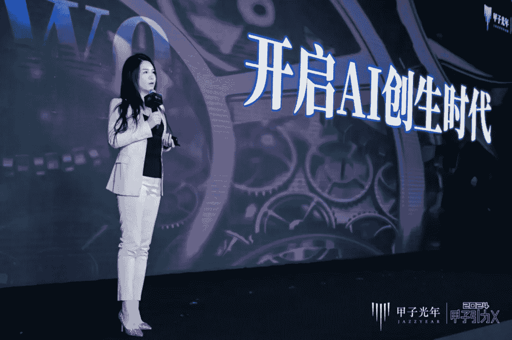

2024年5月15日，甲子光年创始人&CEO 张一甲于「AI创生时代——2024甲子引力X科技产业新风向」发布2024中国AI新风向30条判断。

5月15日，中国科技产业智库「甲子光年」在北京 中关村东升科技园万丽酒店 举办 「AI创生时代——2024甲子引力X科技产业新风向」大会 。甲子光年创始人&CEO 张一甲重磅发布主题报 告《AI创生时代，2024中国AI新风向30条判断》。以下为报告详细内容。

欢迎来到甲子引力XAI创生时代。

## **关**注👸号「 甲子光年 」，后台回复“2024中国AI新风向 ”，获得报告高清版完整PDF。或者点击文末“阅读原文”，进入甲子光年官网下载。

# **1.AI一天，人间一年**

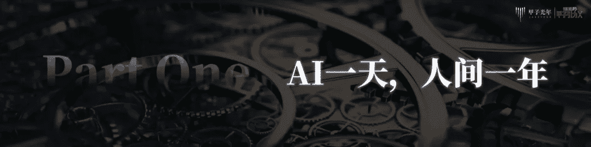

AI一天，人间一年。用一个词形容过去一年的AI行业，你会说什么？

## **1.1  **

关闭

**观看更多**

更多

退出全屏

切换到横屏模式

[🎦 点击观看视频](https://mpvideo.qpic.cn/0b2edyaaeaaaeiafu7kevvtfahwdaipaaaqa.f10102.mp4?dis_k=6848bd4e76af85052e2a10624dd4f3a7&dis_t=1720339726&play_scene=10120&auth_info=dKDR2YdbZmBriYDzig0PcD1v&auth_key=0566836b9858fb856dd63671ff45ff31&auth_info=cLeJ77IwZEdZya3wm3ooeCM1OxEbbWofZy0wTzx8QnpJUHd3fnwbPShpAjEAQiRb&auth_key=4cc801b3e1df56a76f283576879555a1&vid=wxv_3458837791650594823&format_id=10102&support_redirect=0&mmversion=false)

> 无法获取音频链接

视频详情

##

## 1.2 一场技术hype的压缩版

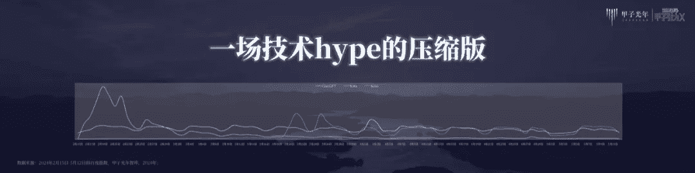

过去一年， 我们经历 了 AI hype的压缩版。

## 1.3 AI进入史上最密集的进展发布期

从2月份Sora发布以来，AI进入史上最密集的进展发布期。

## 1.4 人工智能对五大生产要素同时产生显著影响

AI的重要性在于，它对五大生产要素同时产生显著影响，而这些生产要素的影响是相互关联的。劳动创造技术，技术需要数据也需要资本。

#### 1.4.1 劳动力：极化与平权，AI改写劳动的第一性原理

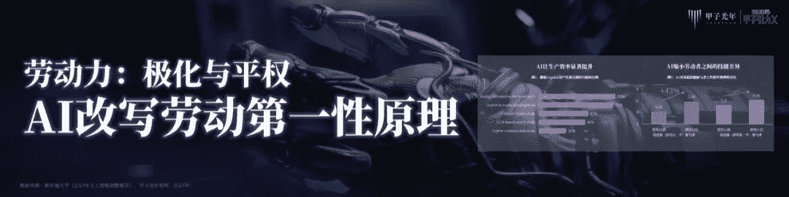

首先看AI对劳动力的影响。有两个特征比较显著，一个是极化，一个是平权。

**极化： **用 AI和不用AI的人群，使用AI的人拥有更高的生产力。比如，使用Microsoft Copilot或Github Copilot的员工相比未使用者，完成任务的时间减少了26%至73%。

**平权： **在使用AI的群体中，AI逐渐抹平普通人和专业人士差距。两组咨询师在采用人工智能后都经历了绩效提升，高技能（排名前一半）参与者显示出了16.5%的增长 ，而低技能（排名后一半）参与者表现出了43.0%的改进。

**除了极化与平权，AI让知**识的获取成本无限逼近于0，意味着 劳动的第一性原理被改变。

#### 1.4.2 技术：AI写入所有技术的DNA，改变研发审美

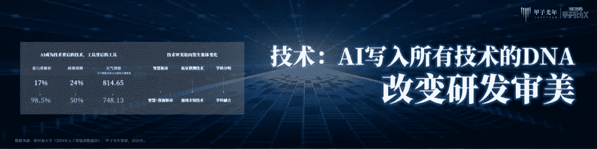

**再看AI对技术的影响。最直接的影响是，** AI会 写入 所有技术的DNA ——AI成为技术背后的技术，工具背后的工具， 比如，使用AI之后，人类在蛋白质解析、病毒预测、天气预报等很多方面都表现出显著的能力提升。

这也驱动着 **技术审美取向发生集体变化：之前是智慧推动，现在是智慧+资源推动 ，从 simple is beau**tiful 到 “粗暴计算”也是美 ， 大模型的出现会抹平很多 细分技术 的差异 ，有点像物理学进入大型粒子对撞机时代。

另一方面，AI改变技术突破的逻辑。过去技术研发是“以果求因”模式，先有推测，后通过实验验证；未来技术研发将变为“由因及果”，AI可以涌现大量未知技术。

此外， AI 改变科研，也在推动技术跨界、学科融合。

#### 1.4.3 数据：从用不上到用得上，从找出来到造出来

AI 让数据要素真正被用起来。 Gartner预测，相比于2022年，到2025年企业数据利用率可以提高到400%。

另一方面，研究人员预测了未来大模型训练数据集规模的增长趋势。结果**表**明： 高质量的语言数据将会在2026年用光 。 因此，合成数据的重要性日益提高，已经成为训练用数据的主要来源渠道之一。 2024年 ，预计 用于训练 AI 的数据中有60%将是合成数据 ， 到2030年AI使用的绝大部分数据将是人工智能合成的 。

数据要素方面，AI让数据 从用不上到用得上，从找出来到造出来。

#### 1.4.4 资本：AI总投资下降，生成式AI投资占比快速上升

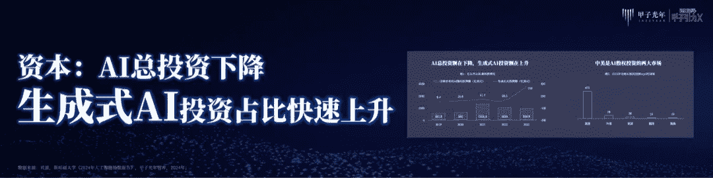

然后是对资本的影响。受制于资本环境的影响，AI的总投资额从2021年往后是逐年下降的，生成式AI的投资额占比在快速上升。

#### 1.4.5 土地：数字链条拉长，物理链条缩短，信息态资产指挥物质态资产

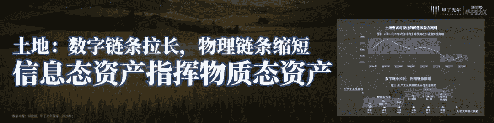

AI对土地的影响更像是替代作用——数字链条拉长，物理链条缩短，AI驱动的世界，是信息态资产指挥物质态资产的世界。

## 1.5 整体的大共识，局部的非共识

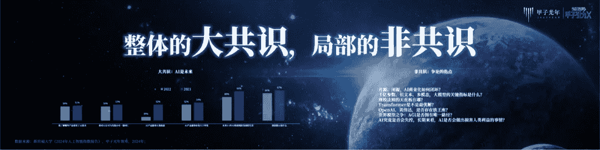

过去一年最大的特征是，大共识已经形成：AI是未来。但也有很多认知没有收敛，形成了各种争议：开源、闭源，AI商业化如何闭环？千亿参数、长文本、多模态，大模型的关键指标是什么？规模法则的天花板在哪？Transformer是不是最优解？OpenAI、英伟达，是否存在铁王座？世界模型与AGI是否拥有唯一路径？AI究竟是否会失控？一些具体的问题，我们会在今天的圆桌论坛里讨论，在这里，我们先概括几个显著特征。

## 1.6 明牌游戏与me too竞争：你一旦有，我马上有

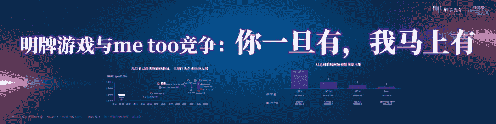

首先， **AI 已经变成了一场明牌游戏 **——一旦先行者跑通了，验证了，后来者的速度就加快了。从结果看，AI很像是一场me too竞争：你一旦有，我马上有。 过去一年AI 的 追赶周期明显在缩短。 GPT-3、文本生成、千亿参数、Sora、长文本，第二名和第一名发布时间的间隔越来越短。 每开一场发布会，英雄座次表就可能变化。

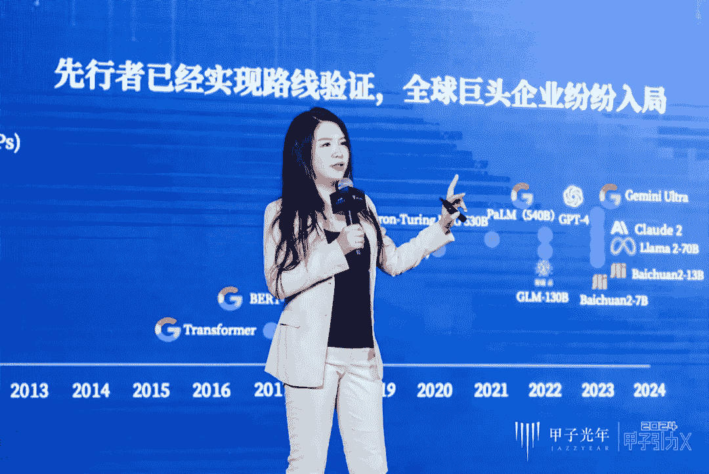

## 1.7 先发优势还是后发优势？低端颠覆：第二名永远是投入产出比最高的？

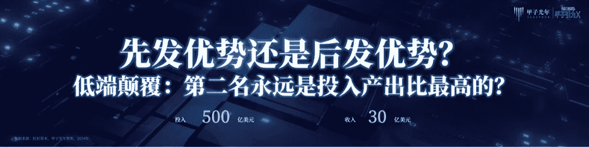

一方面，AI似乎有先发优势：先行者可以有数据飞轮；另一方面，AI似乎有后发优势：后来者的投入产出比更划算。

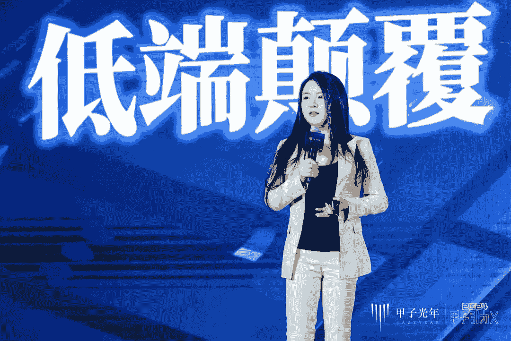

红杉资本透露，AI行业去年仅在英伟达芯片上就花费了50**0亿美元，但产出的营收**只有**30亿美元， 17:1的**投入产出比 ——这个数字是好还是不好？从好的方面看，作为对比，SaaS花了近 10 年才达到这个收入水平，从坏的方面看，AI的商业闭环还没有形成。OpenAI显然是喜欢先发优势的，但很多市场派喜欢后发优势。之前傅盛和我说， 商业的本质是低端颠覆。 这是不是意味着， 第二名反而永远是投入产出比最高的？ 这个问题，我们一会儿巅峰论坛可以聊一聊。

## **关**注👸号「 甲子光年 」，后台回复“2024中国AI新风向 ”，获得报告高清版完整PDF。或者点击文末“阅读原文”，进入甲子光年官网下载。

# **2.开启AI创生时代**

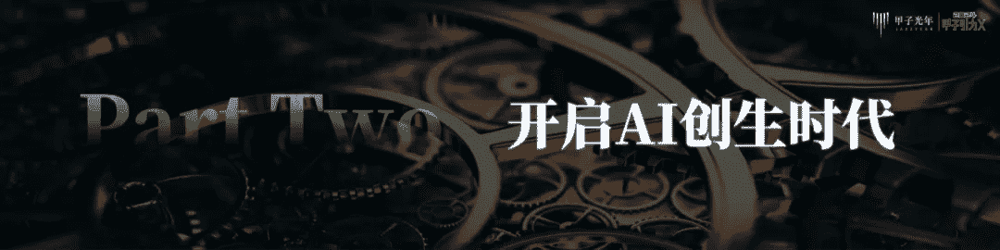

**在科技发展的长河中，我们**正站在 一个特殊的历史交汇点。 一方面，令人瞩目的技术成就正以史无前例的密度迭代，另一方面，我们也面临着诸多从未有过的挑战，如技术范式的分叉与争议、算力与电力的紧缺、AI“钱景”不明的质疑，以及版权、隐私、真假信息、伦理等复杂问题。

**甲子光年智库在今年3月发**布的报告提出 “AI创生时代”的概念 。这是一个新的历史阶段，生产力变革与生产关系变迁同时发生，AI技术从数字世界渗透到物理世界，逐渐逼近并超越人类的生产活动行为边界，形成人类智慧之外的“第二智慧体系”。在AI创生时代，我们关注技术范式如何收敛，关注技术跃进如何重塑千行百业，更关注此刻的每一个决定对未来社会经济结构的深远影响。

## 2.1 AI 改变世界的两大维度：AI主语化+AI 映射力

AI改变世界有两大维度。 第一，AI主语化： 从人主导向AI主导 ，人的主导权逐渐让渡， AI主语化了； 第二， AI映射力：AI对物理世界的映射能力 逐渐增强， 逐渐实现人类能力的赶超，从大脑、小脑到体力。

## **2.2 AI改变世界的四个阶段：AI生产时代、**AI原生时代、AI创生时代、AI文明时代

从AI的两条主线展开，甲子光年智库将AI改变世界的过程划分为四个阶段：

+   L1-AI生产时代：人类为主， AI为辅， AI对物理世界的映射能力低。AI引发各产业的生产力变革，迎来“工业革命”，大幅提升生产效率。

+

+   L2-AI原生时代：AI为主，人类为辅， AI对物理世界的映射能力低。AI渗透率将无限逼近直到超越人类在数字世界的生产活动行为边界。

+

+   L3-AI创生时代：人类为主，AI为辅， AI对物理世界的映射能力高。 AI逐渐渗透逼近人在物理世界的生产活动行为边界。

+

+   L4-AI文明时代：AI为主，人类为辅， AI对物理世界的映射能力高，人类文明进入“双生时代”。

值得**一提的是，**1956年达特茅斯会议开始，AI路线被划分为符号主义、联结主义、行为主义。L1和L2以符号主义和联结主义为主要发展方向，L3则叠加行为主义（具身智能）。等到L4AI文明时代，则是实现了三个主义的 三流汇一。

## 2.3 AI在不同阶段意味着什么？

**AI在不同阶**段意味着什么？在L1的AI生产时代，AI意味着 第**二生产力 ，****关键是降本**增效，推动数字化转型，本质是效率、**成本问题；在L**2的AI原生时代，AI意味着 第二 语言 ，新的交互形式与内容载体；在L3的AI创生时代，AI意味着人类之外的 第二主体 ，推动端上智能、软硬结合、世界模型落地；在L4的AI文明时代，AI意味着 第二文明体系 。

## 2.4 信能比的下一步，AI改变世界的评估体系

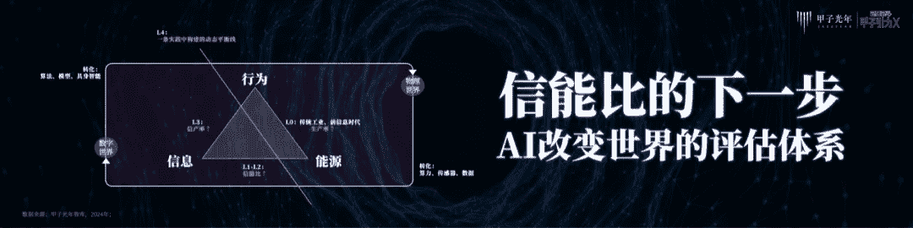

去年4月份，甲子光年智库提出了评估智能新世代的评估**指标：**“信能比”， 反映单位能源所能驾驭的信息量。 最近，甲子光年智库在信能比的基础之上进一步完善了评估体系，在信息与能源之外新增一个维度： 行为。

**能源、信息和行为 **是现代社会和自然界 **中三个基本而相互关联的概念 ——科技**的进步，就是三者之间转化能力加强的反映。

【 能源与行为 ：用生产率度量】 在传统工业时代，是能源向行为的转化。

**【能源与信息：用信能比度量】 **现代信息技术非常依赖能源。在这个转化过程中，AI影响世界的进程处于L1-L2阶段。

【 信息与行为 ：用信产率度量】 信息指导行为。在这个转化过程中，AI向物理世界的渗透能力不断提高，这就是L3。

**随着AI对物理世界映射能力的不断优化， 将会在实践中构建一**条AI影响世界发展的动态平衡线 。正构建AI与人类共生的双生文明，这就是L4。 这个基本框架可以让我们来分析此刻AI及其影响、机会和可持续性。

## **关**注👸号「 甲子光年 」，后台回复“2024中国AI新风向 ”，获得报告高清版完整PDF。或者点击文末“阅读原文”，进入甲子光年官网下载。

# **3.30个判断**

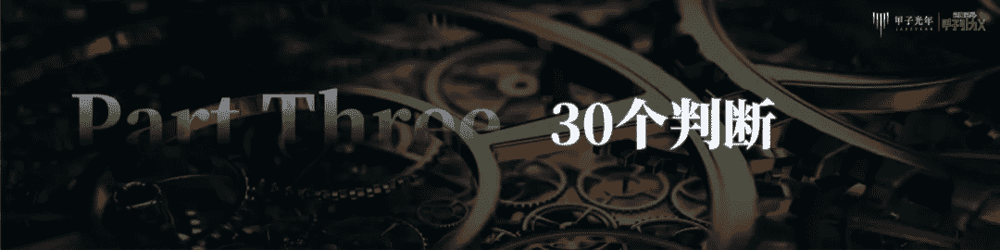

从这个框架展开，我们可以进入具体的30个判断。

## **3.1 L1：AI生产时代**

### 【判断1】AI生产时代本质仍是供给侧改革，以泛化能力降本增效

**刚才讲到，L1-AI生产**时代的核心是数字生产力， 仍属于数字化转型的范畴 。 人工智能对供给端的影响将远大于互联网 ，底层逻辑仍是降本增效、供给侧改革，核心模式是to B。L1的着眼点往往是在老需求上提供新的供给能力，而非开辟新场景。

四小龙时代，AI饱受诟病的是定制化服务的投入难以支撑to B的商业闭环，“有多少个客户，就有多少个模型”；但进入AI生成时代， 大模型通过预训练拥有了更泛化的智慧，使得定制化投入可以下降。

### 【判断2】算力江湖没有铁王座，基建化与市场化各有分工

AI生产时代，算力是生产力的压舱石。这里面 最大的命题是，要解决算力供需结构的矛盾。

**算力江湖包括算力生产者、算力调度者、算力服务者，以**及算力消费者。他们有各自需要解决的问题。

第一， **算力生产者 ： **需要应对 算力供给与需求之间的结构性矛盾 ，解决算力资源浪费和低水平重复建设等问题。如果“一哄而上”地建设，反而可能造成资源浪费和效率低下，比如有些智算中心建成后用不起来，不得不把机器关掉。因此，算力生产者需要不断进行技术创新，比如 黄仁勋认为算力在未来要做到10年100万倍，这是技术创新的flag。

第二， **算力调度者 ： **算力需求非常多样化，因此 算力要互联互通，解决算力资源分配不均和优化调度的难题。

第三， **算力服务者 ： **要解决 **算力使用门槛较高的问题。 **算力的使用需要技术知识和操作技能，有些公司点亮不了，有的点亮以后用不起来；此外，还有能耗及数据安全问题要被解决。

第四， **算力 消费者： **更加关注成本效益问题。

在这四个层级中， **有的适合基建化，有的适合市场化，一个健**康的算力生态应该是一个各司其职的生态。 比如，算力生产可以通过大规模基建化来优化，而调度和运营服务则更适合市场化。

举一个例子，星凡星启（成都）科技有限公司， 专为解决国产算力生态问题而设计，深度适配常用的大小模型、开发工具链以及多种国产芯片，确保计算资源得到充分利用，提高大模型推理性能，统一管理软硬件和大模型，一个入口即可自动提供大模型全流程开发及应用服务 。

它代表了这个行业涌现的一批创业公司——核心关注点是 让算力更可用：一体化交付、低成本建设、低使用门槛、极致性能。

**整个“算力江湖” 的 构成是极其复杂和多元的，并不存在一个能够统领全局的“铁王座**” ——因为只有算力供给足够“包罗万象”，才能满足算力需求足够多的“奇形怪状”。

### 【判断3】AI算力运营商，让算力真正“用起来”

这里我们需要强调： 让算力“用起来”的重要性不亚于让算力产出来。

一方面，算力场景的多样性需要异构算力，另一方面又迫切需要异构算力下的能力开放和统一管理，尤其是在自动驾驶、智能制造等新兴业务领域，需要灵活和便捷的资源匹配。

从这张图看出：算力调度是算力的链条中居于中间不**可或缺的一环。这就涌**现了一个新的角色： AI 算力运营商。 AI算力运营商利用算力调度平台，平衡算力供需，降低门槛，提升利用率。

举个例子，善思开悟。善思开悟作为HPC+AI异构计算的代表企业，拥有丰富的自持及代运营算力资源，全线装备高端GPU，具备先进的组网能力，通过灵活的资源调配，提供高效、稳定及创新的传输、计算服务，目前已完成四轮融资。公司汇聚了多名国内外优秀人才，拥有国内领先的万卡经验集群组网团队，其与中山大学共创“AI创新赋能联合实验室”，依托其高性能计算平台，深化人工智能技术产业应用。

### **【判断4】让大模型如虎添翼，多沟通（提示词工程**）、多读书（RAG）、多练习（模型微调）

大模型要被企业用起来，需要融入到企业现有的场景中。核心有三条路： 提示词工程、RAG（检索增强式生成）和模型微调。

方法1：多沟通——提示词工程（Prompt Engineering）

很多时候，用户经过摸索可以很快构建出高效的提示词解决自己的问题。然而，当你发现自己要构建的模板越来越复杂却仍然无法满足要求，这就是需要引入RAG或者微调的信号。

**方**法2：多读书——检索增强式内容生成 （RAG：Retrieval-Augmented Generation）

RAG的核心是为大模型补充知识。 任何的大模型一旦训练完成就变成了一个静态的**文件**，当你问ChatGPT自己公司内部有关年假的相关规定，它无法准确回答，而当你持续对话时，它又会遗忘之前的信息 。 需要为模型提供更多上下文的时候，就需要用到RAG技术。RAG特别适用于那些需要大量知识的任务。

方法3：多练习——微调（Fine-tuning）

**微调之所以称为微调，是因为不是从零开始，是基于一个预训练好的基础模型**通过继续训练来调整模型行为。这个过程和我们所说的熟能生巧和举一反三的过程很像。 这个过程所使用的数据量远远小于预训练模型所需要的数据量，基本在基础训练量的1%左右。

**这3个方法不是非此即彼而是相互配合。对于企业技术管理者**来说， 重要的是构建一种机制，让企业内部具备持续改进的能力，不断逼近更加高效、可扩展、经济可行的方案。

### 【判断5】合成数据≠高质量数据，模型的“自我提升能力”是未来看点

**如开头讲，合成数据的使用比**例大幅上升，然而 合成数据≠高质量数据 。 2023年发表的**一项研究揭示了仅使用合成数据，随着**训练代数的增加，模型输出质量可能逐渐下降。例如， 在右图生成的面部图像逐渐显示出奇怪的、类似哈希标记的图案，严重影响真实感。

这引出了一个关键的问题： **模型能否生成比其训练数据更好的合成数据，从而实**现自我提升？ 模型能不能“吃草挤奶”？ 如果模型能够生成比原始训练更高质量的数据，那么这个迭代飞轮的 上限就打开了。合成数据的 自我提升上限及其实际可行性，仍是需要探讨的问题。

### 【判断6】开源不等于免费，闭源不等于赚钱，背后是一本供给端的经济账

前阵子李彦宏发表“开源模型会越来越落后”的言论进一步引起了大模型开闭源的争论。开源OR闭源，争论的到底是什么？

2019-2023年，开源模型的数量大于闭源模型的数量。就模型能力而言，4月19日发布的开源大模型Llama 3在多项性能基准上展现了行业领先水平，开源界的Mistral、Grok、DBRX近期也都展示出与GPT-4“同代”的水平。技术快速迭代正在逐步缩小开闭源模型的性能差。

值得强调的是， **开源不等于免费，闭源不等于赚钱， 现在不管开源、闭源，几乎都不赚钱——二者不是对**立关系， 背后是一本供给端的经济账 ， 经济 的 可持续性 才是这场争论的本质。

### 【判断7】上云不等于便宜，下云不等于安全，一本需求端的经济账

**马**斯克收购X（原Twitter）一周年之际，X团队说了一件事： 他们优化了X的云服务使用方式，将更多工作负载迁往本地 ， 这一转变使X每月的云成本降低了60%。X为何下云？

多数企业将上云视为降本增效的关键。然而，许多企业在公有云上的支出超出预**算平均达15%，且在Ia**aS和PaaS上的浪费率高达27%。这促使企业开始寻求 更有效的云资源管理方法 。

IBM报告指出，80%的企业已经考虑或正在考虑将已经部署在公有云上的工作负载迁回私有的基础设施。那么，上云是不是还是必选题？

各家之言有很多身份决定立场的成分。 上云不等于便宜，下云不等于安全。 上云下云背后，是一个涉及财务、战略、技术的全面账本，企业需要综合评估，才能做出更明智的决策。

### 【判断8】AI+企业管理，从构建超级智能管理助手开始

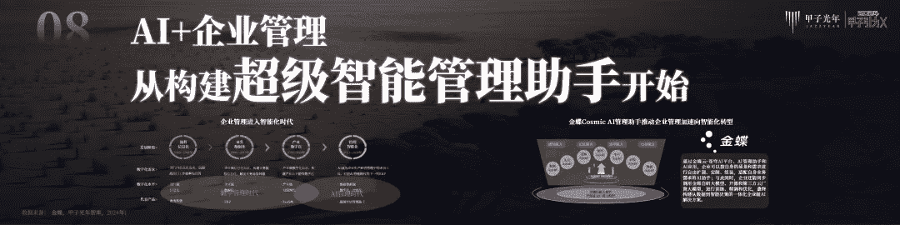

刚才谈了供给端和需求端的经济账，那么，L1时代具体的交付模式是什么，价值如何落地呢？

我们可以看看金蝶。通过金蝶云·苍穹AI平台、AI管理助手和AI应用，企业可以按自身的场景和需求进行自由扩展、定制、组装，适配自身业务需求的AI助手；与此同时，企业还能同步调用金蝶自研大模型、开源和第三方云厂商大模型，进行训练、精调和优化，最终构建从数据到智能决策的一体化企业级AI解决方案。

这就像一个 **超级智能管理助手 **，让数字老板成为可能。 企业数智化建设正在进入“数字老板”时代。

## **3.2 L2：AI原生时代**

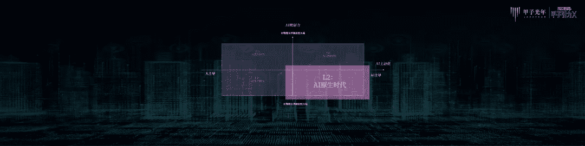

## **3.2.1 本质**

### 【判断9】 AI原生的核心特征是 端到端，AI不断逼近“最短路径”

AI原生时代的关键词是数字世界，AI主导。

AI原生时代的核心特征之一是 **端到端的处理能力 **，这种能力使得AI系统能够直接从原始输入到最终输出之间建立一个直接的映射关系，而无需人为经历中间的多个处理步骤。在这个特征中，AI不断逼近“最短路径” ，软件不断取代服务 。 AI Agent就是这种端到端的具体表现。

### 【判断10】AI原生与互联网底层逻辑的变化：未来是生成的

AI原生和互联网原生的最核心变化是什么？ 黄仁勋说：未来是生成的。他的意思是什么？

以图像存储为例，过去，字母“A”被简化为像素的集合，每个像素以二进制形式存在；现在，我们不再将字母“A”单纯地视为一个由像素构成的静态图像，而是将其视为一个多维空间中的一个点，无论字体、大小或风格，这个多维表示都能泛化并识别出其特征；未来， 计算机不仅仅是理解这个多维点，而是主动地理解信息的上下文和含义，不仅仅看到图像的表面，而是 洞察其背后的概念和情境 。这个过程逼近人类思考方式。

**注意，这个变化有着深刻的哲学底色，人脑构建现实， 不**是靠存储像素，而是思考“概念”——“概念”是一种非常高级的智慧，哲学家们已经思考了几千年。

而未来，概念不是静态的，而是一个动态的、不断演变的过程。 未来不是提前存进去、用的时候搜出来的，未来是生成的，是响应式的。 其中，AI搜索是这种变化很鲜明的表现，比如，新一代搜索与老一代搜索的最大区别是长的输入带来的上下文感知能力。

## **3.2.2 交互**

### 【判断11】拍扁传统工作流，“提示交互式”成为内容产业新范式

今年的小高潮是视频和音乐的AI原生产品。好莱坞拍摄一部影片平均用时871天，而今年3月上映的《终结者2：审判日》翻拍版作为人类史上第一部完全由AI制作的长篇电影，整部电影制作仅用了三个月；在音乐制作领域，使用Suno v3能够一分钟内生成一首美妙的歌曲。工作流被拍扁，提示交互式成为范式，这让AI对内容产业带来直接影响。

### **【判断12】交互革命的继续，Prom**pt只是阶段性产物，最好的UI是忘记UI

目前，Prompt在与AI系统交互中扮演着重要角色，但它不是最好的交互。为什么会有这个判断？因为 P rompt 还不够简单，不够自然。AI产品应该自己去理解你想要什么，如果给了 P rompt ，就理解 P rompt ，如果没给 P rompt ，就从你的其他交互形式里去自己提炼意图。长文本可能取代微调，手绘可能取代语言， P rompt 更像是一个阶段性产物。

**用户友好性成为最近 AI 发布的指北针。 用户友好包含个性化、可访问性，但最核**心的是交互。 最好的 UI ，是你忘记UI，甚至忘记交互，只专注在最自然的意图和目标。人机交互的大方向，是从流程交互走向提示交互，再走向无意识交互——告别“词不达意”阶段。

### 【判断13】实时性是AI原生的灵魂，以时间的无限性代替空间的有限性

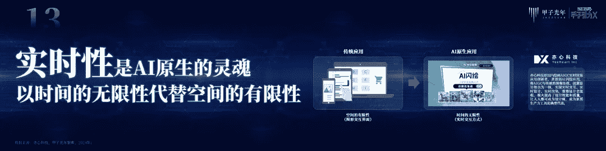

AI原生的易用性追求极简设计，最多两级菜单，最好**没有菜单**。入口极简，如何解决复杂任务？ 实时性。

实**时性背后有两层**深刻含义**：第一，从离散到连续，**以实时互动的无限性取代了菜单的有限性；第二，从有限到无限，用 时间的无限性 取代了 空间（图形交互界面） 的有限性。

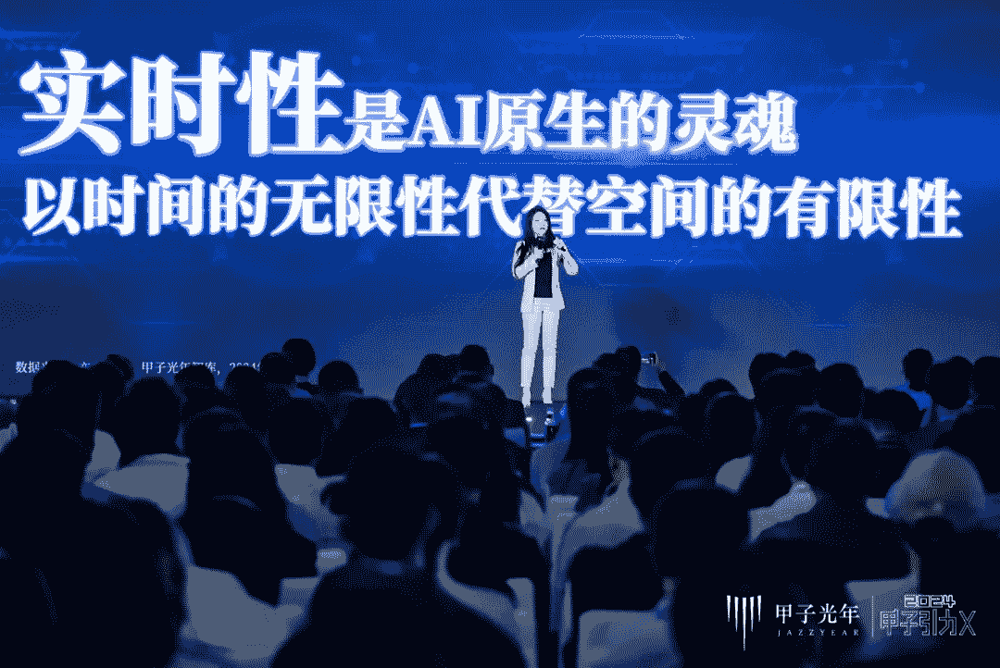

GPT-4o的运行速度大大提升，让聊天机器人对话的响应速度大幅提升，对音频输入的平均响应时间为320毫秒，与人类的响应时间相似。

用户可以向ChatGPT（由 GPT-4o 提供支持）提出问题，并在ChatGPT回答时打断它。OpenAI表示，该模型提供“实时”响应能力。

无独有偶，几个小时前，Google发布了名为 Project Astra 的通用 AI 代理，一款以取景器作为主界面的应用程序。谷歌在演讲中展示了一个人拿着手机，将摄像头对准各个地方，Astra反应很快，实时与人类进行语音互动。

海外巨头开始卷易用性了，这更像是国内的机会。 举个例子，亦心科技是国内绘画AIGC实时渲染应用创新者，其首创AI闪绘应用，将AIGC与传统的图像处理、创意设计结合为一体，实现实时交互、实时设计、实时渲染，重塑设计全流程，极大提高了设计效能和质量，让人人都可成为设计师，成为新质生产力工具的典型代表。今天在现场外面的展区大家也可以直接体验。

### 【判断14】AI To C超级产品，第一战在流量，第二战在黏性

从降本增效走向更大的产业革命，有一个很重要的分水岭是to C。To C是最能撩拨人的想象力的，一旦技术to C，紧接着就会**问：会有全民化的超级应用吗？目前超级产品基本是四类：个人聊**天与助手、搜索、图**像与设计、办公。但它们面临一**个类似的问题： 目前很多是“日抛”型用法，头部 AI 产品的月度留存（42%）比不上头部互联网产品（63%） 。 忠诚度从何而来？ 工具不如情绪；内容不如社交。

### 【判断15】AI原生社交网络，你的社交对象不一定是人

从**content到connec**tion是一个自然的过渡——AI可以生成内容，就必然会影响社交。因此，AI社交是一个 强用户黏性、高变现潜力赛道。

### 【判断16】AI Agent，从单体智能走向多体智能

发展多体智能（Multi-Agent Intelligence，MAI）是人工智能领域的一个重要方向，它涉及多个智能体（agents）的协作、通信和决策。

举个例子，汇智智能基于自研CarrotAI大模型和独创的数字生命专利技术，让Agent拥有了持续学习、进化迭代的生命力，可为企业快速打造专属的数字员工团队，并构建“员工+数字员工”的组织协作交互新范式。将数字生命的交互对象从单体扩展到多体，助推智能体进入多体智能时代。

为什么要发展多体智能？

多体智能可以解决超出单一智能体能力的复杂问题。即使部分智能体失败，整个系统仍然可以继续运作。此外，多体智能体可以相互学习和适应，更有效地利用计算资源，可以模仿人类社会的行为。在生物学、生态学和物理学等领域，多体智能可以模拟自然现象，辅助研究。

## **3.2.3 商业化**

### 【判断17】AI builder，学术权威让渡于产业权威

2023年，产业界发布著名模型的数量明显领先于学术界，这与十年前形成鲜明对比。同时，人工智能博士人才也加速流向产业界，开发者成为AI变革最主要的驱动者。

### 【判断18】“用产模云算投”：小公司做小闭环，大公司做大闭环

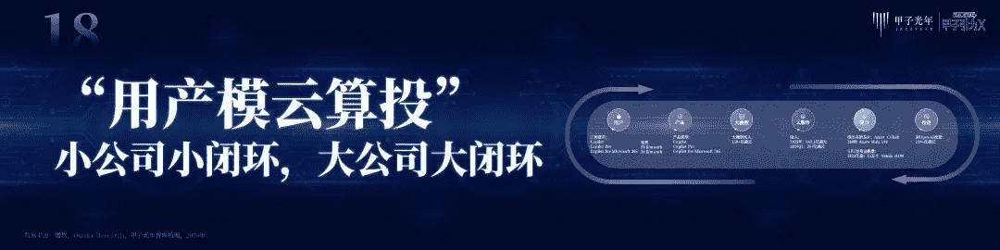

用户购买产品，产品购买模型，模型购买云，云购买卡，同时，大厂还要做投资。沿着这个链路去算账，就可以看AI商业化究竟怎么闭环。

**大公司大闭环。 **AI的争夺，很多是背后云厂商的争夺，阿里云几乎投资了所有国内AI大模型独角兽，被开玩笑称为“中国大模型ETF”。从2024Q1财报看，科技巨头是这一波AI浪潮最大的受益者。比如微软，云业务营收31%的同比增速中，有7%直接归因于AI技术。摩根士丹利分析，AI驱动将有效推动百度的广告转化率提升，预计到2024年，AI技术将为百度带来约30亿的广告增量收入。

**小公司小闭环。 **产模一体化提供了AI商业化的一个路径：践行“产模一体化**”**的出门问问成为了国内AIGC第一股。 产模结合最大的魅力，更在于它能够实现更彻底的端到端训练，进而形成「数据飞轮」效应，最终实现让数据自动驱动模型和产品的更新迭代。 如果一个公司只有产品没有模型的一些相关技术，它会失去核心的竞争力，但一个公司如果只做模型参数而不做产品，技术就很有可能是研究人员的自嗨。

## **3.3 L3：AI创生时代**

**AI 创生时代 ， **AI与物理世界进一步融合，逐渐渗透逼近人在物理世界的生产活动行为边界。从AI for science到生产制造，从人形机器人到世界模型，AI将逐渐突破人类为主语的创造范畴，世界模型将创造人类智慧之外的“第二智慧体系”。 数字链条驱动物理链条 ，再反过来影响数字链条。

### 【判断19】万物融智，五大形态角力最强势AI终端

为了实现规模化扩展，AI处理重心正向端侧转移。如果 AI 终端不普及**，单靠统一的云上AI很难打。从去年到今年，所有几乎终**端厂商的发布都和AI相关， AI手机、AIPC、 X R 等便携戴 设备 、智能汽车、人 形 机器人 ，五大形态是核心。

AI终端的赛事不仅是形态有关，和功耗也有关。这就不难理解终端厂商自己要做芯片。也不难理解对于模型厂商，拿下类似苹果这样的终端意味着什么。

从最新进展看， **GPT**-4o引发了外界对GPT-4o与Siri如何融合、ChatGPT与苹果如何共同塑造下一代 AI 手机的广泛关注。英伟达高级研究科学家 Jim Fan评论：谁先赢得苹果，谁就赢得了胜利。这将是一个从一开始就拥有十亿用户的AI产品，对苹果来说，OpenAI就像是智能手机领域的FSD。

无独有偶，刚刚，谷歌宣布Gemini 正在“成为 Android 上新的人工智能助手”。今年的看点是： 谷歌和苹果在软硬结合上能不能玩得更好。

**对于**终端厂商来讲，这是必争的一战，短期来看，这意味着 抢占流量入口，带动换机需求；长期 来看，Device-as-a-Service，终端将从客体逐渐演化为主体，与人共同和外部空间交 互，这已经超越了消费电子和互联网超级平台的概念。

### 【判断20】FSD从汽车到机器人，端到端加速落地

FSD（Full Self-Driving，全自动驾驶）技术在汽车领域的应用是目前的热点话题，而今天，这个概念也在走向机器人。 在自动驾驶领域发生的事情还会在机器人领域发生。 汽车和机器人有很多相似之处：感知系统、决策算法、路径规划、系统集成、安全和冗余、交互能力、适应性、伦理和责任。当然，将FSD技术应用于机器人领域可能会面临一些额外的挑战，例如机器人的尺寸和形状多样性，以及与人类更密切的交互。

### 【判断21】从空间计算到空间智能，核心是让虚拟时空符合物理规律

李飞飞创立新AI公司，专注于“空间智能”，旨在让AI像人类一样进行高级视觉推理。从Vision Pro到李飞飞的创业，空间计算成为趋势。真实空间物理系统的时空属性**变化遵循客观规律，空间**计算平台对于时空属性的程序控制需要考虑客观物理规律前提。 空间计算的核心命题，是让虚拟时空符合物理规律。 为什么要符合物理规律？只有这样，才能从物体之间的关系中获得预测和洞察力的能力， 从空间计算到空间智能。

### 【判断22】具身智能是“被期许的王”，木桶效应决定落地速度

**为什么具身智能，以及人形机器人这么火**？ 因为我们太需要一个超级终端品类去承载 AI 和各类技术，拉动工业上游的增长。

那么，具身智能是不是一定要越来越“像人”？ 双足是不是必须的？人形是不是必须的？ 不一定。用金属结构去模仿分子结构天渊之别的生物骨骼和肌肉结构，这个仿生学思维方向是很性感的，但不一定 符合奥卡姆剃刀原理。奥卡姆剃刀原理的核心是——如无必要，勿增实体。 从实用主义的角度，具身智能不必像人；从情感陪伴的角度，人形机器人不一定需要过多功能。

前阵子我在中关村论坛主持人形机器人围炉夜话，一位观众站起来说，孩子在国外，自己四五十岁，但已经是空巢老人，他愿意花二三十万去买一个人形机器人——不需要它做饭，不需要它干活儿，它只需要长得很像人，可以陪他坐坐，在家里走两步。 功能和情感的诉求，对具身智能的期待是不同的。

但另一方面，值得强调的是， 具身智能的发展受限于 木桶效应 。 软件可以指数级迭代，硬件很难。当AI进入具身智能，技术维度很多，迭代最慢的技术会影响具身智能的落地速度。

### 【判断23】AI科学革命，人类后退一步，AI向前一步

**AI正在推动新一波科**学**革命。**比如刚刚发布的 AlphaFold  3， 采用了AI绘画的常见技术——去噪扩散模型。在一个案例里，AlphaFold 3预测了一个蛋白质和DNA双螺旋如何**紧密拥抱，这个预测几乎和科学家辛苦**实验发现的真实样子一模一样。想象一下，AI像搞艺术一样地搞科研：从一团模糊的原子“泥浆”开始，一步步雕琢，最后呈现出了清晰的分子结构，连每个原子的三维位置都能精准给出。 AlphaFold 3预测分子之间相互作用本事，比现在所有的工具都要厉害 ——谁能想象， 药物发现和艺术创作在AI的智慧体系里可能是同一件事。

### 【判断24】目前的AI很“INTJ”，世界模型仍有多元可能

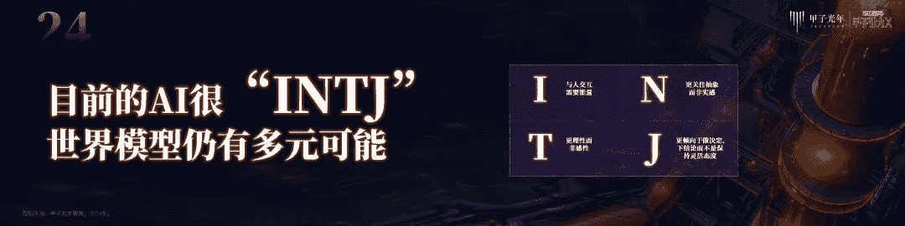

刚**才的例子也说明，在AI的智慧体系里，学科分类正在模糊。我们要进一步追问，AI的智慧体系**将形成怎样的特征？ 开个玩笑，现在的人工智能更像MBTI测试里的INTJ：I：与人交互需要能量；N：更关注抽象而非实感；T：更理性而非感性；J：更倾向于做决定、下结论而不是保持灵活态度。

**当**人们在辩论AI世界模型的时候，背后是对智慧本身不同的理解。 物理规则模型、统计模型、代理模型、混合现实、数字孪生与仿真、系统动力学模型、因果模型、模拟进化模型、认知架构模型…… 这背后和技术范式的选择也息息相关。

自2017年谷歌发表开创性论文以来，Transformer架构已成为主导范式，然而，在AI研究领域的边缘，一些团队正在努力开发新一代AI架构，这些架构在不同方面优于Transformer。从自然进化的角度看，要衡量某种物种演化成功与否，评断标准就在于 世界上其DNA螺旋的拷贝数的多寡 。同理，世界模型将何去何从，我们只有从最终的应用中获得答案。

## **3.4 L4：AI文明时代**

### 【判断25】社会角色：AI术业有专攻，人类分工扁平化

传统工业文明时代，社会具有明确的分工，不同行业、不同场景、不同职业泾渭分明。伴随AI技术的应用，将会拉平普通人与专业人才之间的能力差距，让劳动分工更扁平。

### 【判断26】自体心理：知识半衰期缩短，安全感需要新的满足

1900年，人类的知识大约每世纪翻一番；1945年，人类的知识大约每25年翻一番；1982年，每12-13个月翻一番；2020年，人类的知识总量每12小时翻一番。

**一个**世纪前，工程师在获得学位时所学的一半知识需要35年的时间才能被推翻或替换。 而现在 ，工程学位的半衰期在2.5到5年之间。 伴随知识的获取成本无限逼近于0，知识的半衰期快速缩短。

生成技术带来内容泛滥，而人类的带宽有限，快速过时的知识、大规**模无法分辨真假的信息会将人类引向何方？ AI的文明对自体心理发**出了挑战。科技很快，人性很慢。人们需要新的安全感，而这些安全感越来越不来自知识。

### 【判断27】人机协作：从半人马模式到赛博格模式

**AI对不同人表现出不同的作用力， 白领工作可能面临更多由**AI直接替代的风险，而蓝领和绿领工作则可能更多地受到AI辅助和增强的影响。

人与人工智能协同有两种模式：第一种， **Centaur**s（半人马模式）： 工作者决定哪些任务由AI完成，哪些由人类完成**，AI和人类**工作者在任务完成上有 明显的分工； 第二种， Cyborgs（赛博格模式）： 人完全将他们的工作流程与AI集成，并且持续地与技术互动，人与AI的能力形成一个统一系统，工作 界限不明显。

人在数字链条里待的比例越来越高，AI在物理链条里待的比例越来越高。 伴随这个过程，赛博格模式将越来越主流。

### 【判断28】经济权重：从研发为生产服务，到生产为研发服务

**AI会改变经济的权**重。传统工业时代， 研**发是为生产服务 的；**而数字经济时代， 是生产为研发服务。 比如，苹果公司在全球有成百上千家零件供应商，是苹果公司为这些厂商服务，还是这些厂商为苹果公司服务？毫无疑问，生产为研发服务——苹果公司的研发创造了软价值，而生产和装配者只是兑现这些价值，前者创造的价值占80%，后者创造的硬价值只占20%，这种“二八现象”成为经济价值分布的常态。 信息态财富一定会控制全球物质态财富的创造。

### 【判断29】文化形态，AI推动人类认知重塑，开启新一轮文艺复兴

具有相同认知观念的人群逐步形成新的文化**圈层，并进一步推**动AI版本的文艺复兴。 代际冲突、话语权区隔、文化与亚文化的互换…… 此刻人类做的很多事情可能会变成未来的 非物质文化遗产 。

### 【判断30】双生文明：界限模糊，人与AI“彼此彼此”

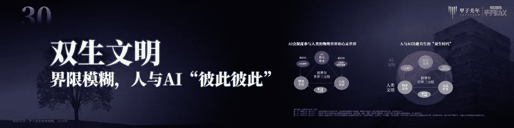

AI会深度参与人类的物理世界和心灵世界，人类智慧与AI将互相影响、共同进化，人类文明进入“双生时代”。

## **关**注👸号「 甲子光年 」，后台回复“2024中国AI新风向 ”，获得报告高清版完整PDF。或者点击文末“阅读原文”，进入甲子光年官网下载。

# **4.反思**

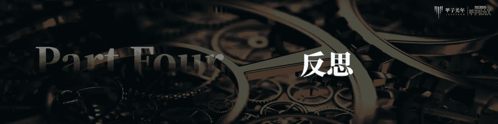

### 4.1 AI是否真的创造了新的需求？

关于AI，我最近一直在思考一个问题。AI对供给侧的改革是毋庸置疑的，但总需求呢？如果一项技术对生产端的加持远大于对需**求端的激发，有可能出现**相关产品价格的下跌，结果相关GDP反而会变小。技术对经济的影响是非常复杂的。也许AI无法完全避免 当年互联网泡沫的覆辙 ，“路多车少”是无法真正跑完闭环的。 所以我们很有可能经历局部的经济阵痛。

### 4.2 是人类驯服了AI，还是AI驯服了人类？

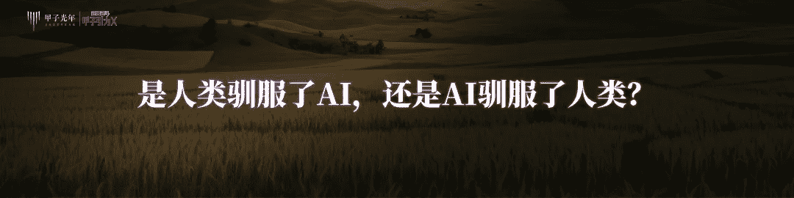

《人类简史》有一个著名的表述： 不是人类驯服了小麦， 而 是小麦驯服了人类。

人类曾有长达250万年的时间靠采集及狩猎为生，直到大约1万年前的农业革命。在短短1000年内，小麦突然就传遍了世界各地，同时开启了人口爆炸。这似乎是个人越来越聪明的故事，人们驯化绵羊、种植小麦，日出而作，日入而息，人类忙着播种、浇水、除草、牧羊……但尤瓦尔赫拉利说了一个非常极端的话，他说， 农业革命真正的本质是：让更多的人以更糟的状况活下去。

**他说，并没有任何证据显示人类越来越聪明。 农业革命**所带来的非但不是轻松生活的新时代，反而让农民过着比采集者更辛苦、更不满足的生活。 人类的食物总量增加了，但农民的工作要比采集者更辛苦，而且饮食可能还要更糟。

到了今天，虽然人类有着种种先进科技，但食物热量超过90%的来源仍然是被驯化的植物。“驯化”一词来自拉丁文，意思就是“房子”。但现在关在房子里的可不是小麦，而是智人。这个故事今天看起来很熟悉——从信息时代开始，我们越来越被“困在系统里”。人类改变了信息，也被信息改变。进一步， 不知道是人类驯服了AI，还是AI驯服了人类。

“**从**动物到上帝”，不一定是人类的追求，但更像是人类治下AI的发展方向。有人说，那不妨停下来吧——但去年甲子引力我们也提到过科技发展的三定律， 技术的发展并不以个人的意志为转移。在一个自由市场中，效率的最大化是无法人为阻止的过程。这不禁让我们追问，生命的本质和AI究竟是否不同。

### **4.3 生命以负熵为食**

在物理学中，熵是一个衡量系统无序程**度的量。奥地利物理****学家薛定谔首次提出： 生命**以负熵为食。 生命依靠从外部环**境**摄取负熵来维持和发展。新陈代谢的过程，是有机体 通过“入”和“出”的交换 消除活着的时候不得不产生的熵 。

**生命是远离热力学平衡的。 **它从环境摄入高级形态的能量，维持和发展生命，将低级形态的能量排给环境。

生命以负熵为食。AI呢？AI对熵的影响**是一个复杂的问题。一方面，AI系****统能够 识别模式，预判趋**势，从而减少数据的混**乱度，增加信息的有序性；另一方面**， AI的发展所导致的社会结构变化，例如工作岗位的消失，会阶段性地 增加社会系统的复杂性， 尤其是“黑箱”模型 引入了新的不确定性；此外，AI系统在运行过程中会消耗能量，增加热力学熵 ，尤其是在“信能比”低的情况下。

简言之， **AI系统在不同的时空尺度上减少了某些熵，增加了另一些熵**，将混乱度从一个系统转移到另一个系统。 当然，更长期的视角看，AI会形成新的秩序和结构，但过程中也时时考验着人类的社会治理能力。

AI增加了复杂性，需要更多的力气去把握这种复杂性。通过GPU产生的智慧，往往要消耗更多的GPU来制衡，这又对能源的供给提出了新的要求……这个逻辑会一直演绎下去。

### 4.4 双生文明的序章：AI会是那个水中的月亮吗？

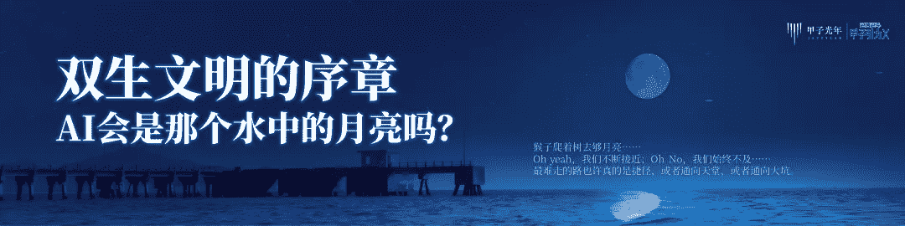

在面**对AI层出不穷的进展时，我偶尔会**想起一个故事：猴子爬着树去够月亮……Oh yeah，我们不断接近；Oh No，我们始终不及……最难走的路也许是捷径，或者通向天堂，或者通向大坑。 速度并不是文明进步的标尺。AI是我们去捞月的方法，而也许并不是那个月亮。

### **4.5**

最后，让我们再一起看看，在人类最朴素的直觉和最绚烂的幻想中，AI究竟意味着什么。

关闭

**观看更多**

更多

退出全屏

切换到横屏模式

[🎦 点击观看视频](https://mpvideo.qpic.cn/0bc3siaaeaaacuafvisevftfbewdakjaaaqa.f10102.mp4?dis_k=0c57580d085df531ed72b89b0cff93e7&dis_t=1720339726&play_scene=10120&auth_info=d9Hm6/0INWhk2YT0iF9QcDlv&auth_key=86272efeeda674f9a385973ac93afe54&auth_info=c/7E65ZhN09Wman3mSh3eCc1PUoaYj1DYyw3QWh+HHpKVCB2ey9INSc5BjYCEHtb&auth_key=97826dc2138ca5ddbaef762d97507355&vid=wxv_3458839037996417024&format_id=10102&support_redirect=0&mmversion=false)

> 无法获取音频链接

视频详情

**致谢**

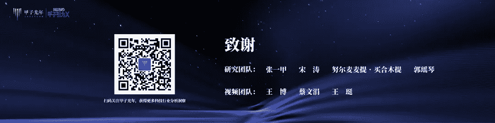

以上，感谢甲子光年团队，今天的大报告就到这里，谢谢大家。

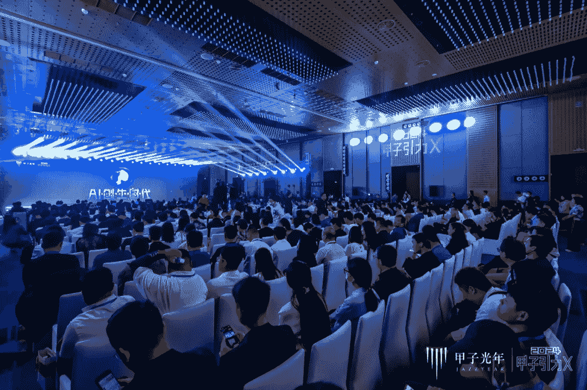

END.

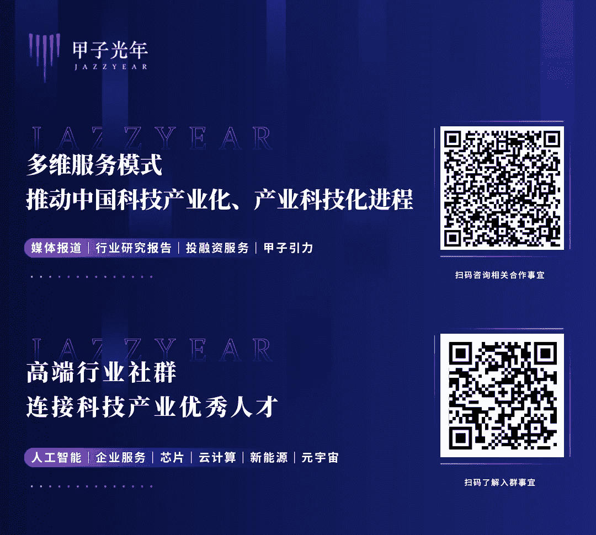

---

<https://my.feishu.cn/sync/CV7edZp1nspUQobYJhicxeP7nrb>