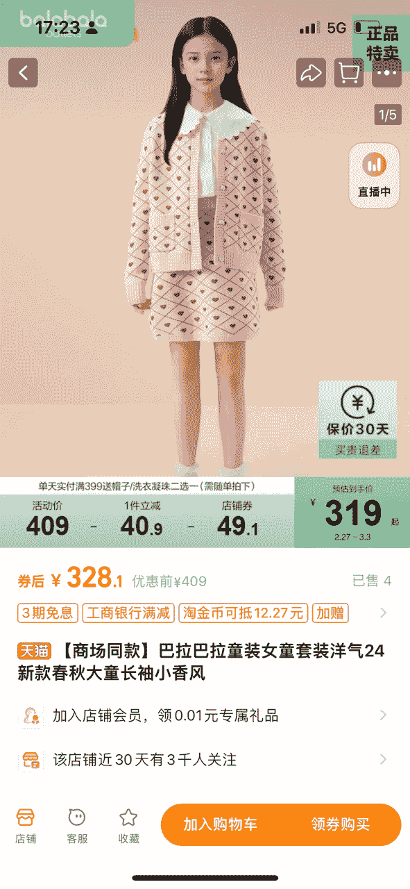
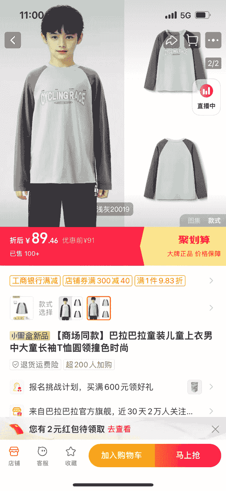
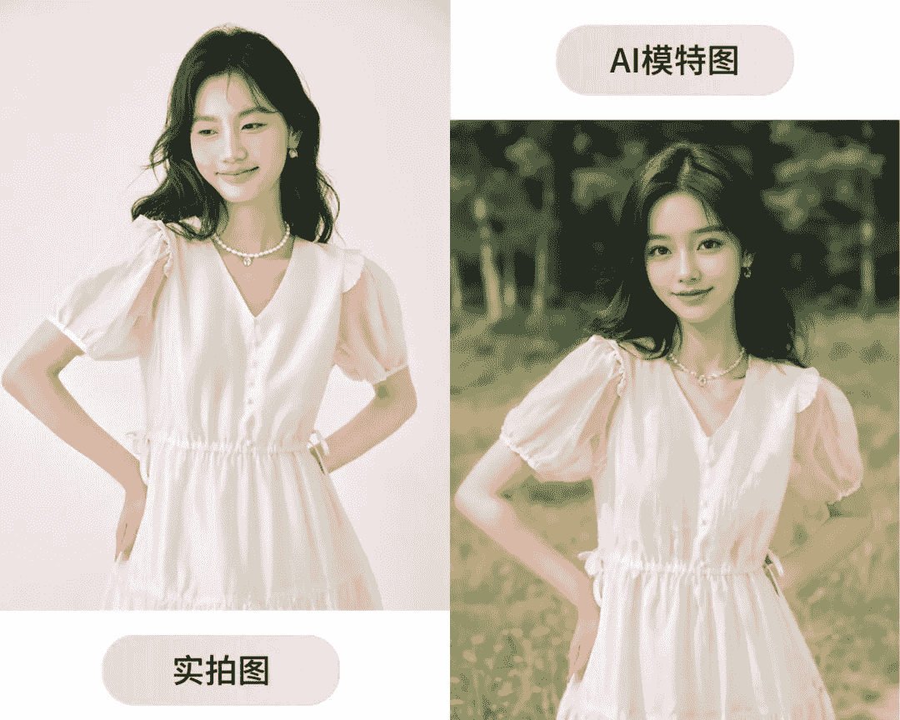
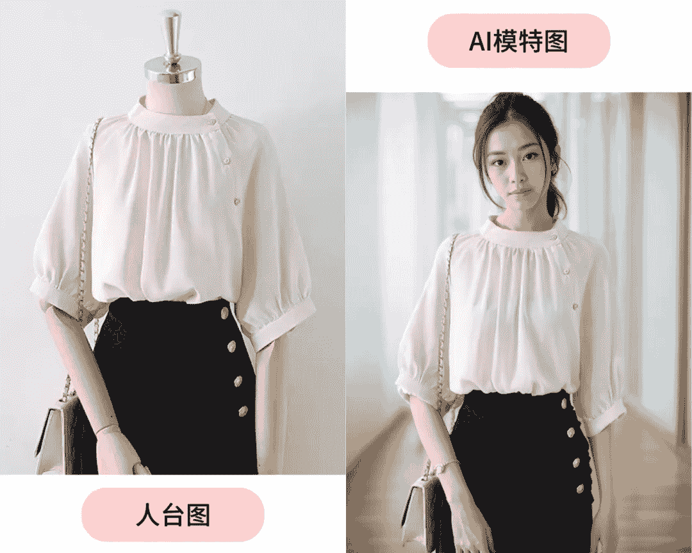
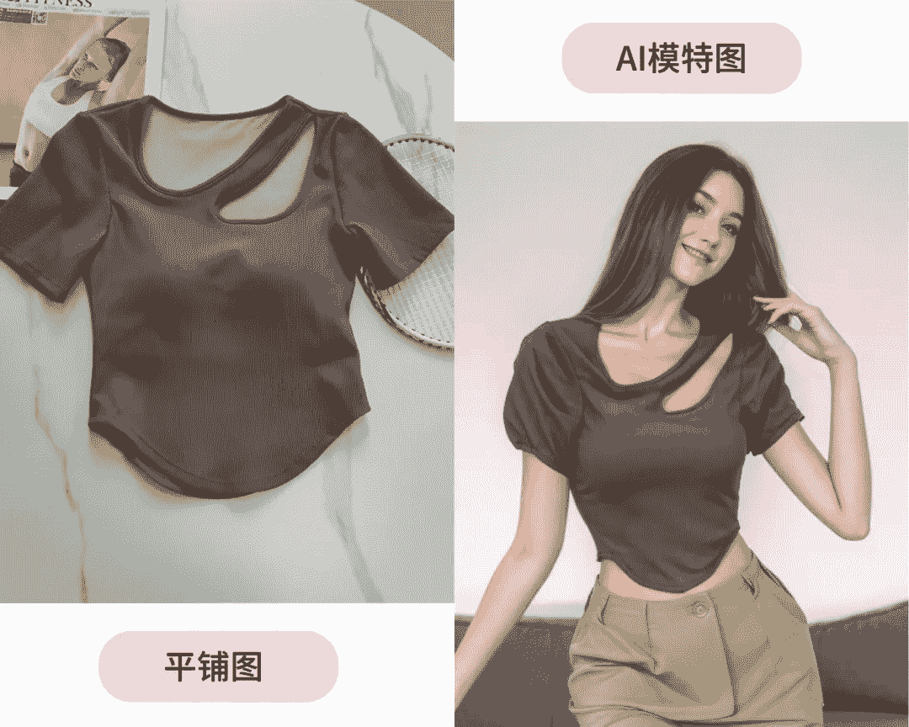
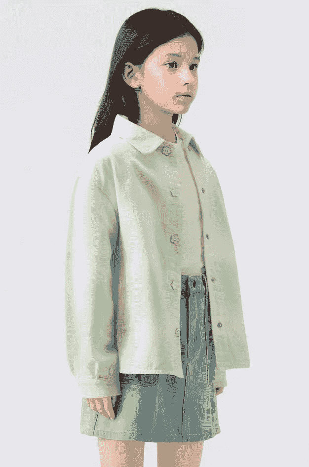
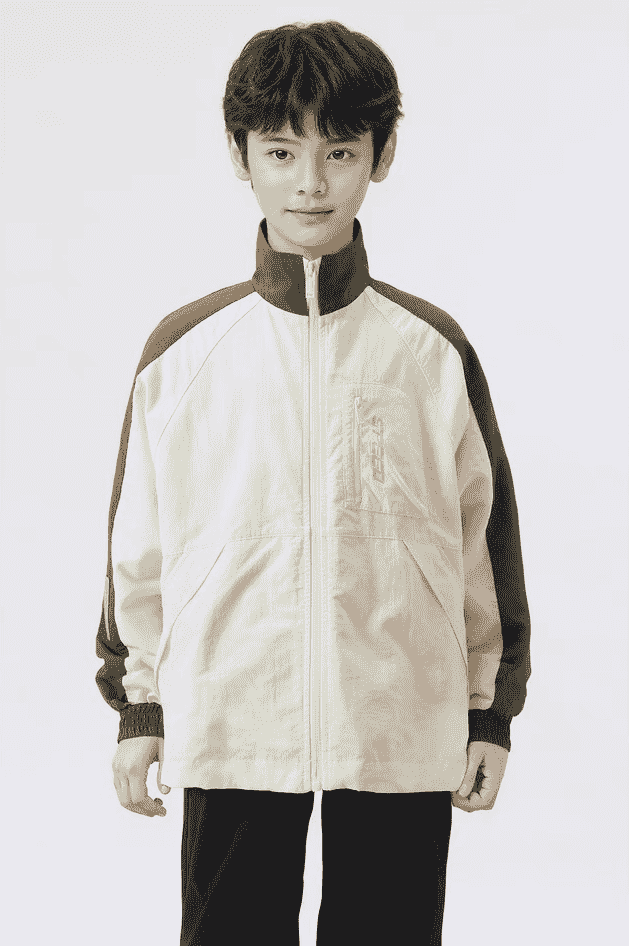
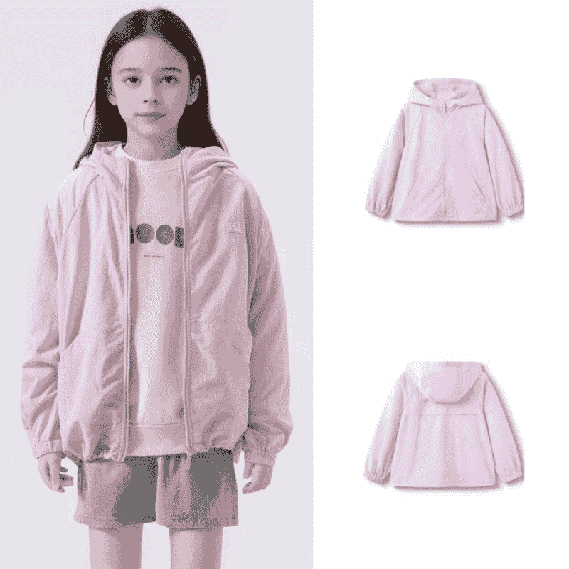
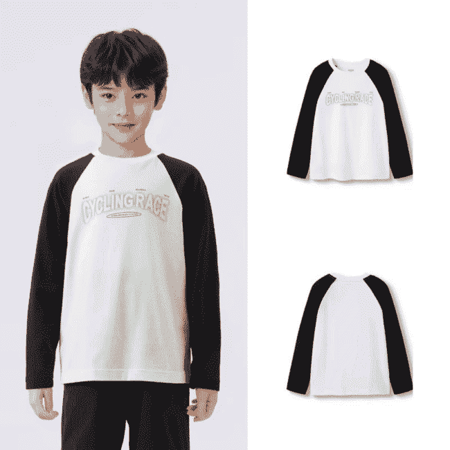
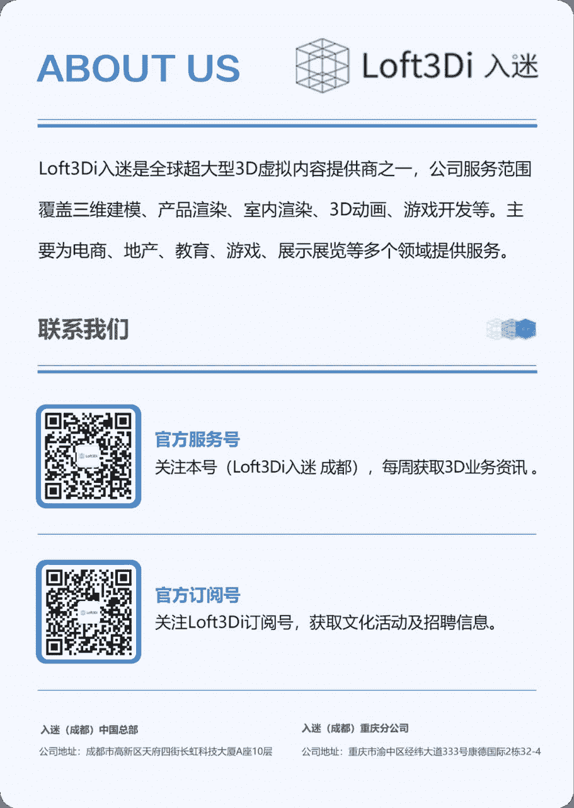

# AI电商换装案例：Loft3Di×森马集团

> 来源：[https://my.feishu.cn/docx/CF4EdX1C5oMNukxSRCjcHYh1nNg](https://my.feishu.cn/docx/CF4EdX1C5oMNukxSRCjcHYh1nNg)

<https://my.feishu.cn/sync/CV7edZp1nspUQobYJhicxeP7nrb>

> 🔗 原文链接： h[ttps://mp.weixin.q](https://mp.weixin.qq.com/s/X80k1QmxwHbehYTQHm6TUA)q.com/s/X80k1Qmx...

> ⏰ 剪存时间：2024-07-07 16:19:52 (UTC+8)

原创 Loft3Di入迷 Loft3Di入迷 成都 2024年03月01日 14:59  四川

**去年，AIGC飓风正起，****Loft3Di乘势设立了A**I团队，专注于“AI换装”技术的研究。此后，我们在持续优化算法的同时，也在积极与众多服装品牌接洽，希望与之携手，共同推动“AI换装”技术的商业化进程。

本期，我们将与大家分享 Loft3Di与森马集团 的合作案例，希望借此增强服装行业对“AI换装”的认识与信心。

# **BACKGROUND**

# **合作背景**

Loft3Di × Semir

# **0 1**

2023年7月，Loft3Di与森马集团进行了首次接洽。由于AI换装是一项新兴技术，尚未大规模投入商用，缺乏商业案例和信任背书，合作初期面临诸多挑战。

不过，经过前期严格的测试与试合作，入迷AI团队依然凭借过硬的技术实力和出色的项目交付能力，赢得了森马集团的认可与信任。

最终，在2023年年底，我们与森马旗下的童装品牌 balabala、minibala 成功签订了合作协议。

**

截至目前，入迷**AI团队已向合作品牌交付了 超 1300张 AI模特图，其中已有大量图片代替“实拍模特图”投放于线上店铺。

**

与此同时，森马旗下**的成人服装品牌 舒库（SHUKU） 也对AI换装技术表达了浓厚的兴趣及合作意向。

# **SOLUTION**

# **AI换装·解决方案**

Loft3Di × Semir

# **0 2**

随着与森马集团合作的逐步推进与深入，入迷AI团队结合AI换装的实际应用场景，对原有解决方案进行了迭代与创新。

据核心工程师透露，未来AI换装的效果将会随算法的优化更加逼真、自然。

# **0 1**

**AI模特图整体制作方案**

**

基于服装实拍图、人台**图、平铺图，提供AI模特图整体制作方案 。不限模特长相、姿势、种族、年龄；不限服装类型、款式；不限场景。

<整体制作方案示意图>

# **0 2**

**AI 模特图定制方案**

**根据客户的特殊定制需求，提供AI模**特形象定制方案，模特图换款、换色方案。 支持自由定制模特形象，随心切换模特图的服装款式及颜色。

< balabala定制方案示意>

图源：balabala淘宝店铺

在携手推进“AI换装”商业化应用的同时，Loft3Di还为森马集团提供了3D渲染、动画 等定制服务，助力其实现营销内容升级。相信凭借前期良好的合作基础，双方的合作将在未来进一步深化、拓展。

---

<https://my.feishu.cn/sync/CV7edZp1nspUQobYJhicxeP7nrb>