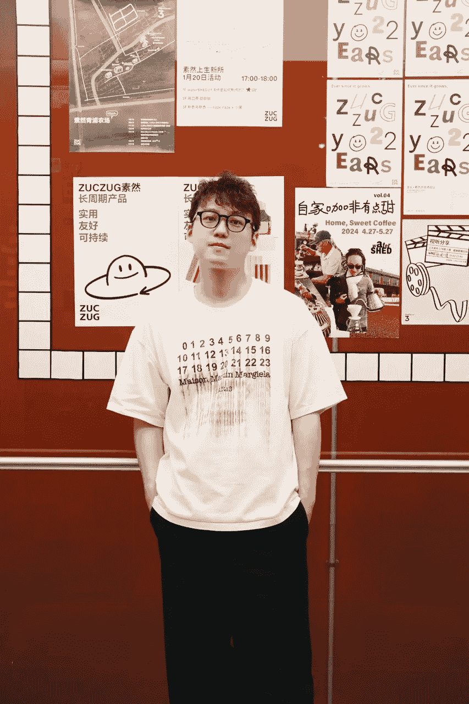
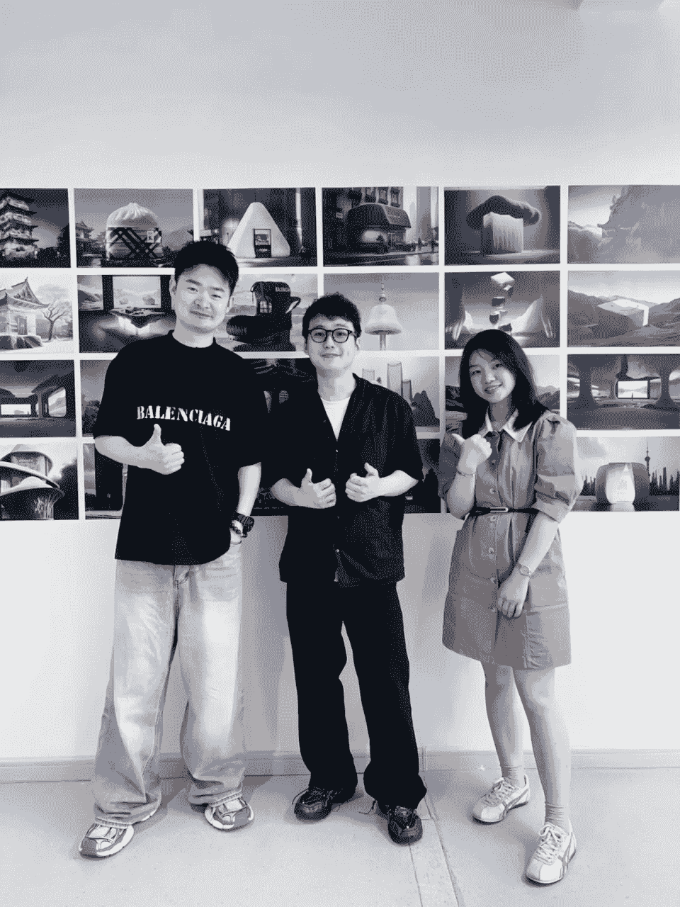
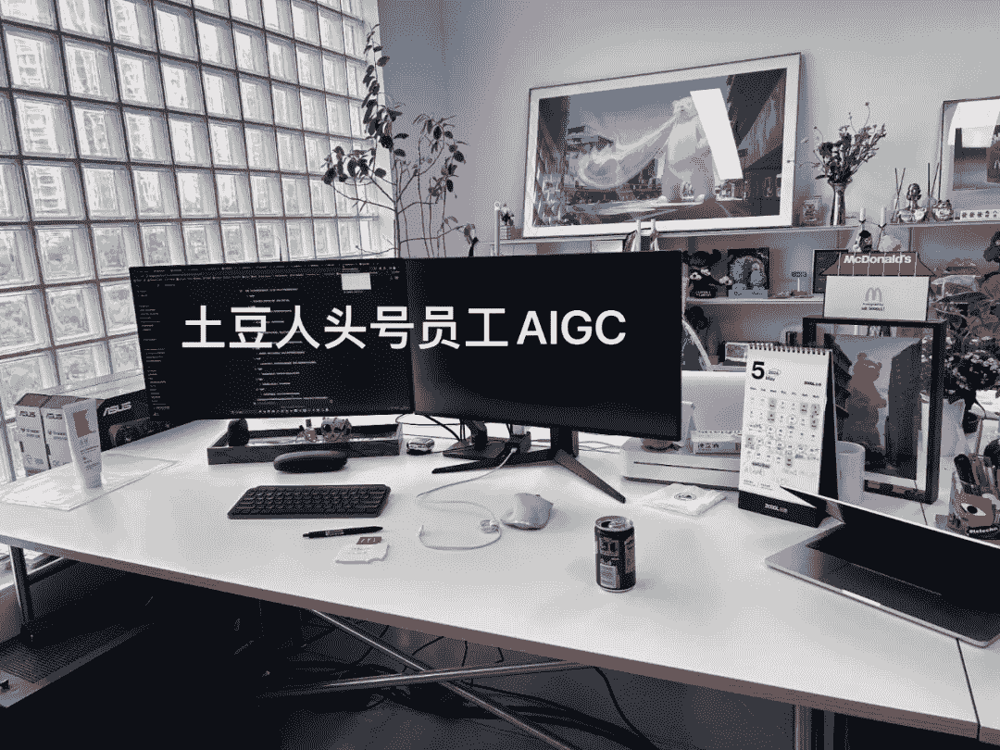
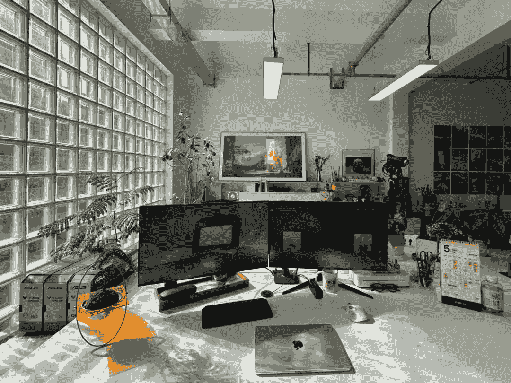
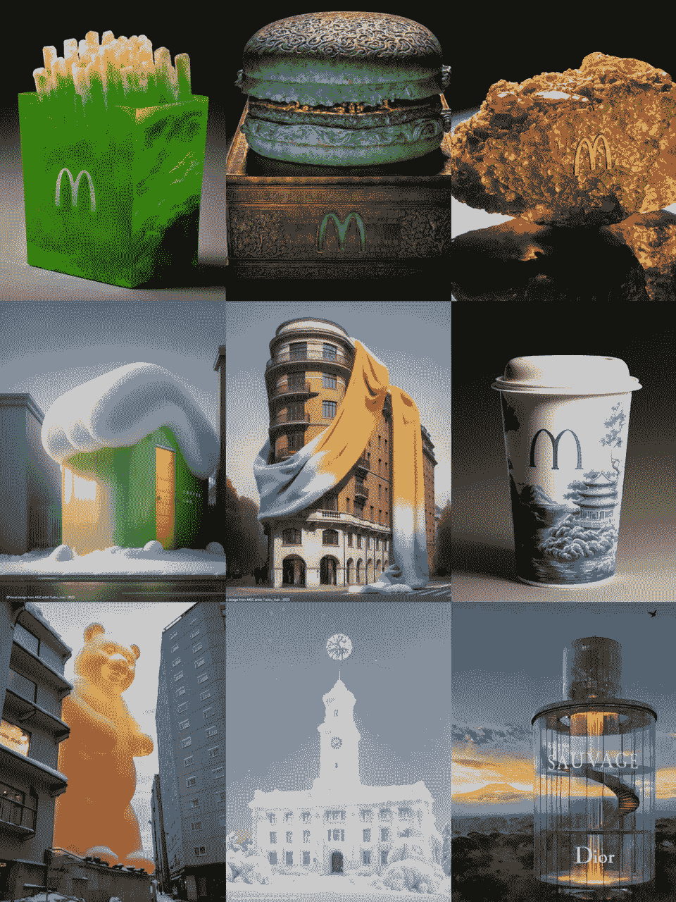
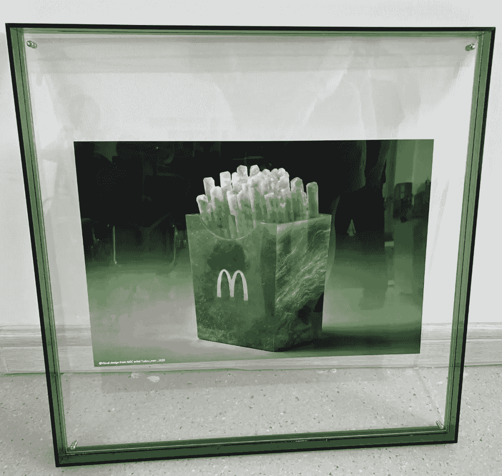
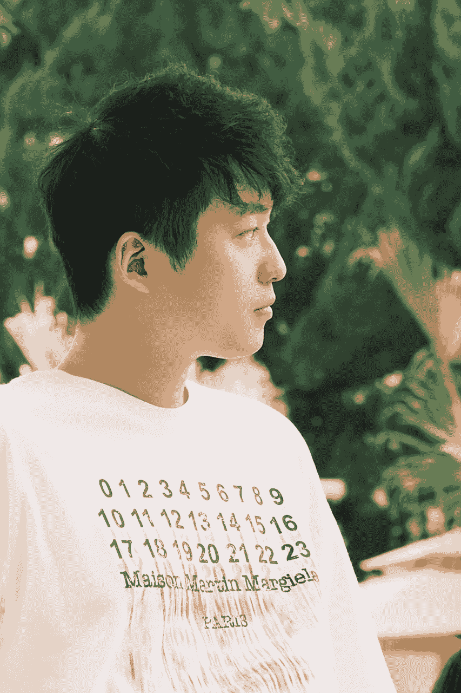
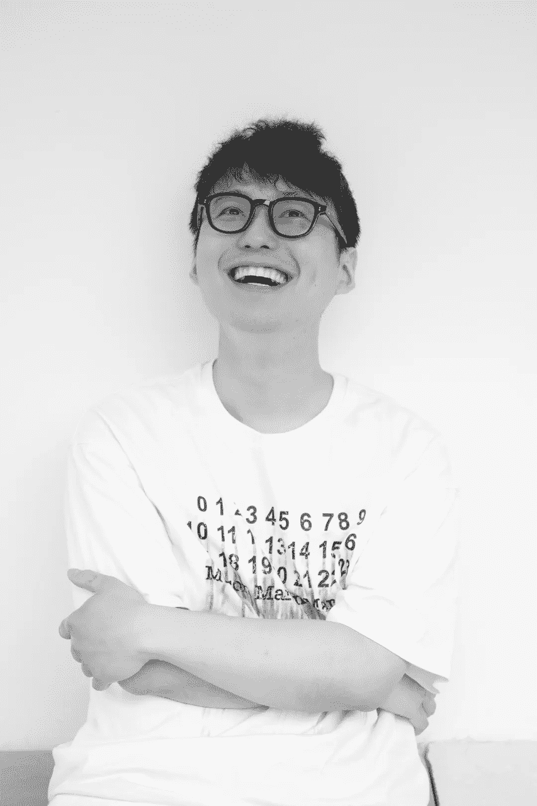
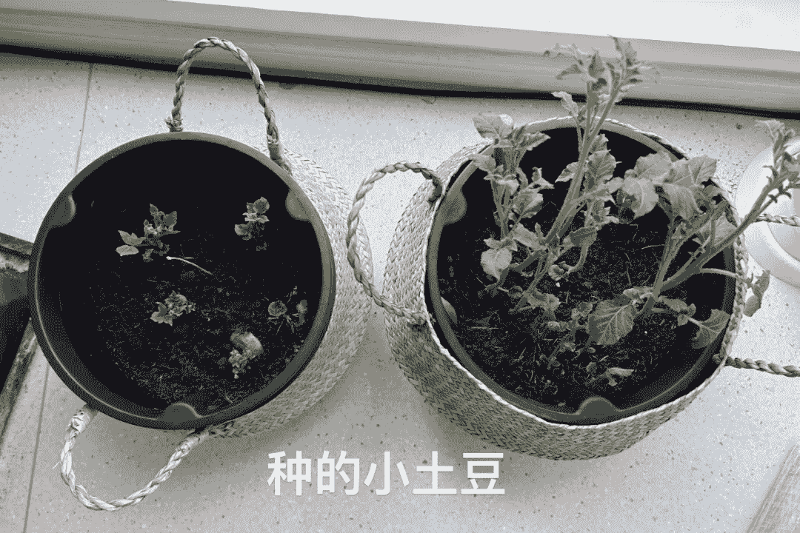

# 小而美的AI广告创意团队-土豆人

> 来源：[https://my.feishu.cn/docx/U8EDdU49Io6TkZxFhYgcVOwxntc](https://my.feishu.cn/docx/U8EDdU49Io6TkZxFhYgcVOwxntc)

<https://my.feishu.cn/sync/CV7edZp1nspUQobYJhicxeP7nrb>

> 🔗 原文链接： h[ttps://mp.weixin.q](https://mp.weixin.qq.com/s/WMrqKAhihMvUv3Jz6b-n_A)q.com/s/WMrqKAhi...

> ⏰ 剪存时间：2024-07-25 23:19:53 (UTC+8)

风口会过，但IP价值永存......

**—— 土豆人tudou_man**

文 | 毛爷

采访 | 狂人、毛爷

站在AI的风口上，有人在观望，有人已经赚到了第一桶金！

今天的主角不是被抖音封号的李一舟，而是📕KOL数字艺术家 土豆人tudou_man（林晨）。

还在2022年11月，土豆人第一次接触AI的时候，命运的齿轮就在悄然转动。

4个月后，土豆人放弃从业7年的广告公司和创意合**伙人职位，A**LL in AI打造出个人 艺术家IP ，这不仅需要胆识、魄力，还有非常人的洞察和远见。

虽然离他爆火过后一年多了，我们还是想了解他这一年后的变化与新的故事，以及看待AI新的角度。

从左到右：狂人、土豆人、毛爷

#

#

# **01.**

# **3个月作品产量超过10年总和**

外**界对AI浅薄的认知就是****提效，这放在土豆**人身上得到了加倍的效果。土豆人坦言“接触AI的前三个月，作品数量就 超过了前10年的总和 。”他感慨道，“AI的赋能让我实现了以前 无法想象的成长 。”乍一听很夸张，但放在土豆人+AI这个组合体上又不足为奇了。

“我专注于AI这块差不多一年半了，从2022年11月份开始接触。”土豆人回忆起最初的感受，他的眼中闪过一丝复杂的情感。“最初接触到AI时，感觉非常惊喜，但这种惊喜很快被彷徨和害怕所取代。就像打开了潘多拉的盒子，AI的迅速发展让人感到行业和工作的巨大冲击。”

在经历了初期的恐惧和市场的急剧变化后，他孤注一掷，决定出来尝试AI创作。“很多人对我离开广告**公司感到惋惜，**但我认为这是一种消耗。我感受到整个行业的船下沉，如果不做出改变， 我可能会沉船 。”

从广告人到一名独立数字艺术家，并**建立自己的工作室。土豆人开**始探索如何将 商业、艺术与技术三者融合 ，以适应AI时代带来的新需求。这一职业生涯的重大转折，不仅改变了他的工作内容，也重新定义了他的创作视角。

尽管土豆人的工作室人手不多，我们去的当天办公室一共三**个人，一个助理，一个临时员工，**但他们的 工作效率却能匹敌传统的大团队 。

“我希望以高能效运作，避免传统广告公司那种体量大、效率低的模式。”他说，“在广告公司，每个大团队要解决大的品牌和客户，需要投入很多人力，但在AI的帮助下，公司的法务都是ChatGPT4在担任。”现在的他们更多工作是自主创作，探索艺术与科技在商业上的可能性。

# **02.**

# **AI创作的不可预见性**

“你 **越是想得清楚的时候越做不出来 **。”这是土豆人AI创作一年来最大的感受，也是AI创作和传统3D和绘画创作完全不一样的地方。

“传统3D创作属于可预见性创作，通过动态草图再上加一些关键帧镜头的渲染设定，就大概能知道最后作品会长什么样子。但目前AI创作对结果却是不可预判的，不断在不同模型不同技术面前来回横跳，有时候创作一个内容测试几百遍是很正常的事情。”

在AI创作的世界里， **不可预见性和不稳定性 **是土豆人面临的巨大考验。土豆人谈到，使用Stable Diffusion技术**创作视频时，生成结果往**往难以预料。这种不确定性不仅对创作者本身构成挑战，更要求 合作方给予高度的信任 。

黑箱测试，是土豆人应对不可**预见性的重**要方法。等品牌方脚本确认后， （注意这里的脚本 与传统广告片含分镜及运镜的脚本不一样，AIGC创作的创意只能给到一个创意思考和关键词设定，以及一些过往跑出来的影调参考。） 他会进行为期两到三周的 封闭测试 。

在这段时间里，土豆人需要反复尝试数百次，其中最重要的工作方式就是结果迭代，包括横向结果迭代和纵向结果迭代，以不断优化作品。每次测试**都需要大量的时间，一个**15秒的片段可能需要半小时到40分钟的电脑演算。为了提升测试效率，他不断增加电脑设备，进行并行运算。每天晚上进行多个版本的测试，并在次日 审查和优化调参、修改 。

在**黑箱测试结束**后，土豆人会精心挑选出满意的片段，进行剪辑和音效处理，最终提供给品牌两个选择。希望通过高质量的作品，让客户在选择中感受到创作的 诚意与用心 。”这种对品质的坚守，使得每一件作品都成为创作者与品牌之间深度沟通的桥梁。

在最近与奔驰、雅诗兰黛等合作项目中，土豆人成功地将CGI、实拍和AIGC技术相结合，克服了纯AIGC在展示品牌元素时的不稳定性问题。他解释说，纯AIGC**在生成品牌产品时容易出现**变形，为了避免这一问题，他通过不断测试和专属模型训练，提高了作品的准确度和稳定性。这种技术与艺术的融合，不仅让作品更具表现力，也为品牌 提供了更多高质量的选择 。

除了对作品的不可预见性，土豆人对工作室下**个月或者下个季度都没**有办法做预判，因为 一切都发生得太快了 。唯一能在这些不确定性中找到确定性的是缔造土豆人数字艺术家IP。“我会继续的去夯实这个IP，包括tudou_studio。”

# **03.**

# **风口会过，但IP价值永存**

AI其实并不是一个新词，但直到去年，人们才开始全面认知AI的潜力。到了今年年初，随着Sora的推出，又掀起了第二波AI的热潮。尽管现在话题热度有所下降，但人们对AI的敏感度和接受度已经显著提高。

**土豆人进一步解释道：“未来**，AI将像Photoshop一样， 平滑地融入到我们的工具中 。就像现在谁说自己的作品是用Photoshop做的，不会引起任何轰动，因为这已经是再正常不过的事情了，未来的AI也一样。微软已经把AI集成到新一代的电脑中，苹果和OPEN AI也签订了协议，下一代的Siri将会集成更多的AI功能。这样一来，AI工具将变得更加普及，人人都可以使用。”

**土豆人强调，作品的价值**不在于它是用AI做的，而 在于创作者本身的价值 。

他**切换到AI赛道，没有做AI资**料库或者AI照相机等功能性的产品，而是选择了做数字艺术家个人IP，因为他坚信“ 风口会过，但IP的价值永存 ”。

而这种思维的形成，与他七年的广告公司经历有着密切联系。土豆人很早就意识到一个问题，自己参与的项目往往与他个人关系很远，甚至与广告公司关联也不大，更多是在为品牌做嫁衣，这种幕后工作方式让他开始思考如何打造个人IP。

去年年初，他开始在📕上发布作品，迅速找到了市场上的区隔空间，成为国内**首批专注于概念装置和概念**建筑的创作者之一。他擅长提取品牌的概念元素，并结合自己 乌托邦般的梦境创作风格 ，快速积累了大量作品。这个时候他顺理成章的变成了土豆人。

现阶段，他的创作主要分为两类： 热点延续和自有IP的深化与梳理 。经过1年多的沉淀，他已经建立了许多自有IP，这些IP可以被进一步发展为装置艺术品等形式，增强作品的厚度和立体感。

他继续说道：“我们现在做的巨熊软糖，以及重塑山河等非商业系列，都进行了视频化的开发。这些作**品在 未来的文旅或展**览中，都可以进行综合化的应用 。这是我们为未来做的布局。因为我发现，单单只是一些平面的图片，对观众来说 价值和体量都太单薄 了。”

“我希望未来形成一个 **三足鼎立的状态 **。”土豆人说道。“在前期，我创作了许多概念内容，未来会把这些重要的IP进行资产固化，包括开发成视频和线下落地的装置，让它们在之前的创作内容上得到延展和资源的丰富化、最大化。不然这些作品只是一些图片，很快就会被遗忘，这不是我想看到的。”

土豆人**分享了一个正在打官司的案例：“我有一个叫**‘伴心’的作品，现在正在打官司。有人侵权了，把我的作品抄袭并制作出来，甚至在常熟琴湖落地了。这是我非常重要的一个IP作品，我去年就登记注册了。这会是国内AIGC创作版权认定的重要一案，无论成败都会推动国内这个领域的法律进步。 但是今天如果我作为头部创作者不站出来，只会让中国的无数艺术工作者被无意识侵害。 ”

**土豆人回忆起去年七月份开始研**究视频创作的经历：“研究视频很重要，因为 品牌对动态内容的需求非常大 。如果我不掌握这个内容，就会脱节。现在也是一样，我必须不断推出新鲜的模块，才能有新的话题。 不管是视频还是装置，这些都是帮助我的IP完成沉淀 。”

# **04.**

# **报价飙升10倍，未来只会更值钱**

“我在做的是 **升值路线 **。”土豆人解释道，“我的作品价格会随着品牌影响力和合作项目的积累而不断升值。所有的合作中， 品牌都会明确标注与土豆人的合作 ， 这是一个台前的展示，不再是传统广告公司的幕后工作 。”

土豆人去年投身AI事业刚开始进展并非一帆风顺，他坦诚道，最初的几个月确实充满波折和挑战。不仅自己要学习新的技术如Stable Diffusion；在业务合作上，还面临许多法律和版权的困扰，无法明确如何进行商用。

真正**的转机来自于与麦当劳的合作 。**去年一月份，土豆人创作了一系列与麦当劳相关的艺术作品，如青铜器汉堡、传世宝玉薯条和青花瓷可乐。这些作品迅速走红，引发了广泛的关注。去年四月，由麦当劳牵头，这些作品在全平台发布，标志着一个重大转折点。这不仅 证明了AIGC创作的营销价值 ，也为土豆人带来了更多的业务机会。

谈及价格变化，土豆人透露， 从去年到今年，他的报价至少翻了十倍 。去年初，他仍然以创意总监的身份进行创作，心态上更多是服务者。然而，从去年**下半年开始，他明确了自己 作**为数字艺术家IP的定位，更加注重个人创作的主观表达 。品牌找他合作，是希望通过他的创作语言和风格产出内容，而不是完成一个简短的制作任务。这种 转变使得他的价值被无限放大 。

土豆人强调，艺术价值无法简单通过价格衡量。他对创作内容享有绝对的把控权， 作品经过反复打磨，代表着他当下最好的水平 。

当他离开广告圈，再往回看时，认为广告公司的价值在稀释。有些广告人认为，如果两年内不拥抱AI，广告公司可能会消亡。然而，土豆人质疑这种观点，认为 拥抱AI并不是降低价格和提高人效比，而是要找回广告公司的核心价值 。AI只是工具，不能替代创意和价值的本质。许多公司因为AI的便利，陷入了比稿和快速提案的循环中，创意被大量生产，价值却在下降。

###

### 土豆人强调，广告人必须重新定位自己的价值，坚持高质量的创作。他的升值路线不是为了迎合市场的低价竞争，而是通过不断提升自己的作品价值和品牌影响力，实现长期的市场认可。

# **05.**

# **合作客户都是头部品牌**

采访的中途正好有快递上门，土豆人暂停了对话去签收了一个快递，是戴尔的产品，“过几天戴尔过来拍片子”。我们趁机聊了聊这一年多来他合作过的那些品牌。

土豆人提到，现在合作的品牌基本都是奢侈品、美妆、头部快消、3C电子和豪车等品牌。“因为他们在意识层面已经达到了next le**vel，他们**更多的时候解决的是别的问题，而不是通过我这样的一个创作内容去定生死。”大品牌则视其为媒介预算的一部分，抱着 体验的心态 ，更愿意尝试。

这一年多来的创业经历，让土豆人更加看清自**己的位置，所**以现在合作定位很精准，就是 艺术家共创 。对品牌来说是传播中的加分项。

在以尊重为前提的情况下，给自己定了三不接客户的标准：

**1. 制作的活不接**

**2. 急的活不接**

**3. 没钱的活不接**

“大家是一个在有物质保障基础上，再去做艺术、科技方面的探索。只有这样我才能说，在今天没有任何负担的前提下尽可能的全身心投入，把这个东西高质量的完成。但是现在有一些品牌，他们的心智还停留在 AI很快；或者因为今天没有什么钱，所以想用AI来做...... ok，这不是我的受众，也不是我的合作客群。”

**一年多的沉淀，土豆**人有了选择的机会。这是他很庆幸的事情，因为他现在 最宝贵的就是时间 。“每天这个时间过了就过了，但今天我要完成哪些创作，或者这个月里面 我选择跟谁合作，其实都是有决定性意义的 。因为每一件作品对我来说可能是现在的技术或者想法的一次突破，但如果是一个很耽误时间的东西，我这一个月可能就被耽误掉了。”

土豆人最忙的时候可能 **5个项目同时运转 **，差点惊掉狂人的下巴，同时也让我们很羡慕。

“所以才那么多机器，有的设备在做已经开始进行训练了，有的可能还在做前期的资料的筹备，有的开始在做模型的整理，有的可能在做剪辑，其实工作是可以错开的。在创作过程当中，尤其是做视频，有大量时间是在等，就等电脑去算，但这个时间对我来说，其实可以分开精力去做别的事情，可以去再做别的项目的一些构想或者前期准备工作。然后我无非就是要把设备、人的工作协调好。”

未来土豆人的目标是希望把各大奢侈品都转一圈

# **写在最后**

**选对赛道，就像乘上升电梯 **。土豆人用自己的勇气和智慧，赌了一把，意外走上了另一条完全不同的开满了花的狂野之路。在还没有人涉足的领域，一个人在狂奔，现在工作室成立才一年，商单报价翻10倍，而且未来只会越来越贵越来越值钱。

最后分享一个小彩蛋，土豆人在落地窗前种了两盆土豆，其中一盆已经出了新的枝叶，向四面八方伸去，仿佛土豆人AI的创作之路。

每天中午11点半，不见不散 ▼

你说你喜欢雨，但是你在下雨的时候打伞

你说你喜欢太阳，但你在阳光明媚的时候躲在阴凉的地方

你说你喜欢风，但是在刮风的时候你却关上了窗户

这就是为什么我会害怕你说 **你也喜欢广告**

因为你连“廣告狂人”都没有关注...

快长按二维码 ▲ 关注我 啊 **魂淡**

---

<https://my.feishu.cn/sync/CV7edZp1nspUQobYJhicxeP7nrb>