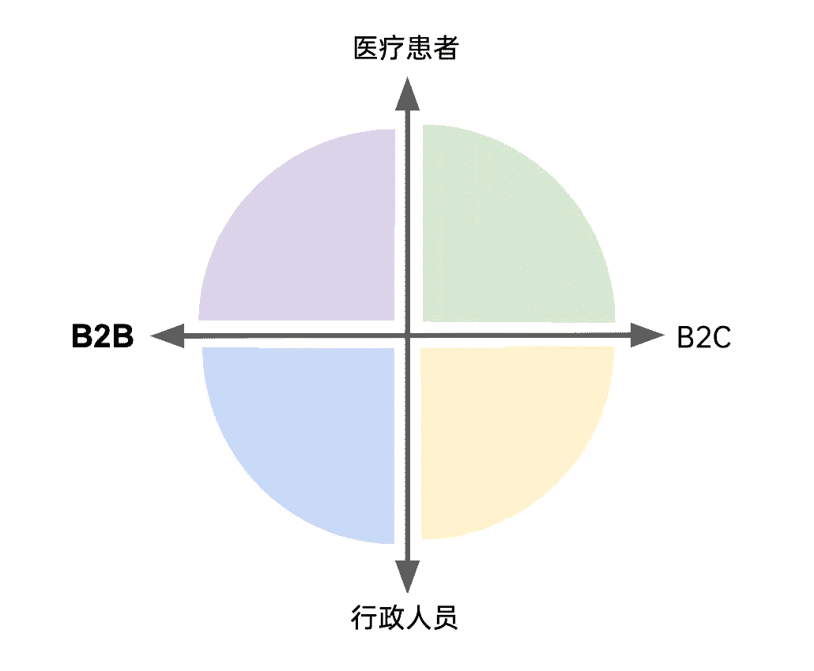

# AI 在医疗健康领域如何落地？

> 来源：[https://my.feishu.cn/docx/IiYNdmpfgoUQbixep3KcWh5inwb](https://my.feishu.cn/docx/IiYNdmpfgoUQbixep3KcWh5inwb)

<https://my.feishu.cn/sync/CV7edZp1nspUQobYJhicxeP7nrb>

> 🔗 原文链接： h[ttps://mp.weixin.q](https://mp.weixin.qq.com/s/FO0DVmxIXNrxc38r9HSrLQ)q.com/s/FO0DVmxI...

> ⏰ 剪存时间：2024-07-25 23:16:44 (UTC+8)

原创 Founder Park Founder Park 2024年07月19日 19:58  北京

「 娱乐应用 kill time，效率工具 save time，而医疗能延长时间。 」

在 AGI Playground 2024 上， 百川智能创始人 & CEO 王小川是这么说的 。

在他看来，如果 AI 能造出一名高水平的医生，就是达到 AGI 了。

那么，AI 在医疗健康领域有哪些想象和可能性？

知名投资机构 a16z 最近的一期播客，尝试探讨和回答了这个问题。AI 可能会在哪些医疗领域落地？我们应该当 AI 当医生还是当助理？AI 能解决医疗人员紧缺的问题吗？

对谈嘉宾介绍：

Vijay Pande：a16z Bio + Health 的创始普通合伙人

Julie Yoo：a16z Bio + Health 的普通合伙人

文章编译自播客，Founder Park 略有增删。

播客：https://www.youtube.com/watch?v=JwQP0zAsQEs

## **01**

## **医疗行政工作**

## **可能是 AI 最先落地的领域**

**Julie：Vijay，我们一直在讨论，医疗健康行业过去被认为是一个很难快速落地新技术的领域，但我们也非常乐观地认为，医疗健康可能是**当下AI技术的最大受益者之一。因此想探讨一下医疗健康 AI 领域的一些重大挑战。从概括性的思考开始，你认为你认为人工智能能立即在医疗健康领域中发生的作用是什么？

**Vijay **：嗯，这是最困难的部分。如果我们放眼 20 年后，很多事情都有可能发生。但是当下会直面技术和人的难题。人们现在接受什么，能够用技术**做什么？当你回顾技术和医疗保健的历史**时，你会发现，技术是如何被购买、整合进医生的工作流程中的？我认为短期内，我们需要的不仅仅是比现在好 10% 的技术，而是要 有一个能让人们自然而然地接受、非常容易采纳的技术，哪怕它只比现在好 10% 。

所以，当你考虑什么可以提升 10 倍的时候，可能是做出决策，或者作为医生的助手帮助医生，这是他们以前没有的超能力。或者，如果它只比现在好 10%，但更容易被采纳，也许它看起来不像软件，可能更像是人员配置或者你发送的短信，这些都很容易融入现有的工作流程。即便这样的改进很小，也可能非常重要，因为医疗健康行业的技能要求非常高。

**Julie **：对，我认为这很及时。显然，医疗保健行业目前面临的一个主要危机是劳动力危机。无论是临床还是行政工作，我们都面临着高度专业化的劳动力短缺。而且，现在从事这些工作的人因为技术负担而极度疲惫，比如收入支出的任务或电子健康记录表的工作流等。这是我们经常听到的问题。

你提到的另一个问题是，过去阻碍我们的往往是人类自身，而不是技术。但在医疗健康中，最难的是如何改变人们的行为，无论是患者需要采取的新行为来帮助他们康复，还是临床医生需要改变他们的工作方式。对我来说，最大的机会之一是如何将已经在特定人群中证明有效的改变行为的方法，打包成产品，并以一种能够迅速在全球范围内推广的方式，让更广泛的人群受益。我们投资组合中有很多这样的例子，我相信我们会在这方面进行更多的探讨。这些都是目前需要深入思考的重要问题。

**考虑你刚说的，假设我们都从根本上相信人工智能的乐观前景，那么**在短期内，人工智能实际上可以有哪些用途？

我们提出了一个 2*2 矩阵，一条轴上是 B2B 的应用场景——历史上，很多技术首先是由内部人员采用的。在轴的另一边是消费者或患者。还有一条轴是行政性质的内容，更多的是后端办公室工作，而不是向患者提供医疗服务的临床工作。你已经说到每个象限中的风险是非常不同的。 我认为到目前为止，最容易获得成果的领域实际上是行政 B2B 应用 。你如何看待医疗健康行业中行政方面的应用？让我们来谈谈那些已经在运行的好案例。

**Vijay **：选择行政应用确实理所当然。我认为每个人都知道，成为医生真的很难。如果你让人工智能做一些临床建议或其他事情，我们甚至还没有弄清楚人类在系统中的位置以及所有这些事情。但我们会弄清楚的，这就是我们需要做的工作。

如果**我们今天考虑的是后勤办公室，我们已经有了计算机**，已经有了算法，也有了大量的人力资源。你可以问自己，为什么需要人们做 RCM 或其他任务？这些任务实际上是否可以自动化，并且可能对成本产生巨大影响？但实际上， 这也可能改变我们对后勤办公室的看法，我们将其视为一个数据问题，而不是一个人员配备问题。

##

## **02**

## **AI 能够更高效地利用**

## **健康数据**

**Julie **：你提到了算法，这让我想到了理赔。如果你考虑医疗健康中的支付流程，医疗健康 90% 的钱都是报销收入，提供者必须向支付者提交理赔的钱。这实际上就是一种算法。你可以把理赔看作是一种需要解释的逻辑单元。

**Vijay **：应该没有人告诉过我，这相当有趣。

**Julie **：是的，但目前它的处理方式是一个非常序列化的工作流程。首先你必须解释，这是什么类型的理赔？是专业理赔吗？是住院还是门诊理赔？然后，在任何给定市场中，可能有数千种支付产品，那么它对应哪一个？然后在这个计划产品内部，又有一大堆规则，比如在什么情况下这种理赔有效等等。总之，有一个完整的价值链决策过程。通常情况下，你可能需要请一个护士参与其中，因为可能涉及一些临床判断，这就是「事先授权」发挥作用的地方。

所以你可以想象， **如**果我们拥有所有这些数据，以及围绕这些数据所需的一系列决策的自动化系统，我们基本上能够消除整个端到端的流程，实现实时支付 。对我来说，这基本上可以节省我们系统中 30% 的浪费。这是一个圣杯问题——极其美好但具有挑战性。

圣杯问题：描述那些看似简单但实际上非常复杂的问题，或者那些需要大量创新和突破才能解决的问题，（Holy Grail Problem）是计算机科学中的一个术语。

Vijay：是什么阻碍了它的应用？

**Julie **：它已经根深蒂固了。而且，你知道，有一些公司正在做这件事，但你必须数字化。你知道，很多的流程和说明都在 PDF 文档中。

**Vijay **：讽刺的是， PDF 在某种意义上并没有数字化 。

**Julie **：是的，我们有一个名叫 Turquoise 的公司，在做合同方面的工作。支付者与服务提供者的合同，可能包含数千亿美元的收入。它通常是一个完全单一的 200 页 PDF 文档，但合同中的任何一行都可能对服务者的收入以及支付者的成本有巨大影响。

然而，这些事情通常只有在两年一次的重新谈判的时候，才会被提起，而且没有人会看那一行，他们看的是整体。所以，如果能在合同内部数字化数据，并且能够对其运行各种场景，像是这 10 项服务的价格具体应该是多少等等，这对支付流程和整个系统会有很大影响。

**Vijay **：甚至可以更频繁地去做这些事，不限于每两年一次。

**Jul**ie：另一个有趣的事，如果你掌握了数字化的信息以及患者更长期的健康信息，就能在全国建立一个始终开放的临床试验基础设施，可以实现按需对人群进行分类分析，输入你需要的特征，进行数据分析，无论你想要回顾过去的情况还是预测未来。你觉得这个想法怎么样？实现这样的东西对我们来说有哪些障碍？

**Vijay **：这是一个非常令人兴奋的想法。我们可以获得大量数据，并大大改善医疗健康，但在没有 AI 的情况下，这简直难以想象。没有 AI，我甚至不知道该怎么做，也不知道怎么付费寻找这样的服务。

**Julie：这是什么意思？**

**Vijay **：很多事情实际上都变成了数据问题，比如对数据的分割，比如跟踪这个人服用了这种药物，人在这个时刻有什么反应，最终理解一些试验中的因果关系，对吧？

我们喜欢临床试验的一点是，它们帮助我们认识因果关系。 人们常说相关性不等于因果性，但这并不意味着我们不能研究因果性 ，试验就是关于因果关系的。通过试验拥有这些数据后，AI 的表现就会非常出色，尤其是某些类型的 AI，例如贝叶斯统计，在因果性方面非常擅长。

因此，我们实际上可以获得对因果的理解。它可能很复杂。比如不应该与避孕药一起喝葡萄柚汁，因为 P450 酶会抵消药效。我不知道是谁发现了这个，但谁会知道，还有什么我们还没发现的事呢？

如果你有一个app，能够了解你的饮食习惯，了解身体的基本情况，知道你在用什么药物，并且掌握这些信息，前景是非常令人惊叹的。在没有新药、没有新治疗方法的情况下，我们仍然可以优化医疗。目前无法优化，是因为没有 AI，这种优化几乎是不可能实现的。但一旦建立了这种基础设施，新药就可以采用新设施进行优化。

最后， 我们不仅可以优化健康状况，还可以降低成本 。比如这种药比另一种贵 10 倍，但也许对我来说结果并无不同。所以也许我应该选择更经济的那种。如何思考这个问题呢？这是一个非常复杂的数据、逻辑问题，是我们可以通过 AI 真正解决的部分。所以，正如你所见，我对此非常兴奋。

**Julie **：我记得多年前我和美国退伍军人事务部（VA）的 CIO 有过一次对话，她说自己的员工里，每天有 100 万个临床试验在自然进行，而人们却不知道如何利用这些数据。所以，即使仅仅是电子健康记录（EHR）数据，都可以想象出无限的可能性，更不用说加上日常行为数据，还有其他信息。这就是 CIO Ella Lemska 所用的方式——用会话形式捕捉日常行为，记录你在做什么，你在吃什么，你在与谁互动等信息。

**Vijay **：这不就是医生的行为吗。AI 就像一个医疗系统，我们终于可以调试它了。技术背景的人也会觉得有趣，虽然不熟悉 RCT（随机对照试验），但这基本上就是一个巨大的 A/B 测试，而在技术领域，这种方法已经深深扎根了，甚至每一个像素都进行了 A/B 测试。我希望医疗健康能够像网页中的像素一样可以被优化，那将是多么的令人期待，毕竟多变量优化方面的优化程度是非常惊人的。

## **03**

## **AI 可以优化预约机制，**

## **减少资源浪费**

**Ju**lie：这还涉及到人们常谈论的另一个重要问题——医疗健康领域，能否拥有一个即时定价的市场？在任何给定的时间段内，某项服务的供应动态可能会有很大不同，为什么不能像其他行业那样，进行不同的定价呢？

**Vijay **：为什么会这样？

**Julie **：实际上，这被现在的很多合同视为非法。人们被这些高度具体的庞大协议限制了。由于存在理赔系统，所以不可能有实时判断服务价格这一概念。但这也是机会。 这不需要最先进的AI，但肯定需要在这方面运行机器学习。 需要让 AI 明白，哪些规则实际上无效，并不能真正影响成本或价格，哪些规则是最重要的，应该保留，以某种自动化和系统化的方式进行确定。这是一个巨大的机会，代表了我们今天系统中浪费的那一部分，是一个有趣的想法。

**此外，至少在我医疗健康的职**业生涯中，我想解决的一大问题是， 供需之间存在的根本不匹配 。我认为我们投资的许多公司都存在这个问题。我曾经创办了一家公司，专注于解决排班预约的难题。我相信你也经历过这样的现象：作为患者，你被告知要等几周才能预约到医生，你以为每个医生的日程都排满了。但事实是，我们系统中的很多空间都完全浪费了。如果你能更好地了解底层数据，那么能显著减少等待时间，改善消费者体验，同时也帮助服务的提供者更好地利用时间。你有没有见过一些有趣的例子，能够很好地代表这一点？我们有很多公司试图提高这个的透明度，例如雇佣教练的公司。或许这可以应用到护理模式中。

**Vijay **：我认为你在描述的事儿，在引入 AI 之前就存在。我们需要转向一些更复杂、更现代的计算方法，比如记录系统。 我们经常讨论的技术与人的关系，也许是行医的方式需要改变。

比如说，医生的工作流程非常重要。你想想医生是如何度过他们的一天，我们如何支持医生去做我们希望他们做的事情，以及他们自己想做的事情，这就是最大化患者的福利。也许我们需要减轻他们的负担。有些公司正在考虑推倒重建，比如像 Devoted Health 和 Orinoco，它们决定在解决内部系统问题。这就是为什么在我们考虑AI之前，首先需要数字化我们的基础设施和工作流程，才能有效地支持医疗健康的转型。

**Julie **：没错，像 Devoted Health 这样的公司就是一个例子，他们确实从最简单的事情开始，建立了自己的排班系统，以适应他们追求的精确护理模型。我记得在前司工作的时候，看到了医生们安排日程的方式，非常符合你的观点。他们会设计日程表的模板，特别是以一种非常保护性的方式，近乎于防守，因为他们感到现有系统进行安排的方式，使得他们感到不舒服。

**Vijay **：这确实是一种习得行为，因为他们想要保护他们的时间，他们在过去确实有过不好的经历。

**Julie **：假设一天内连续有 10 个从未见过的创业者来进行演示，我们需要连续几个小时都处于高度集中状态，这在身体和精神上是很大的折磨。对医生来说也是一样的。他们说，如果早上给我安排 4 个新患者，这比复诊患者或其他任务要更累。

**Vijay **：尤其是，看完演示之后，我们还得针对那些撰写一篇文章。

**Julie **：确实，这更糟糕。

但你可以看到，传统系统的设计方式具有副作用，不幸导致了医生的防御行为。如果能像 Devoted 这样的公司一样，推倒当前的设计开始重建，能否设计出一个更加逻辑，能够从历史数据中学习的系统呢？这里甚至可以加入强化学习功能，医生提供反馈，随着时间推移系统进行自我迭代。

Vijay：我们讨论了类似从一张白纸开始的想法，这是唯一的方法吗？

**Julie **：我希望随着AI浪潮的到来， AI 真正成为一种推动力量，让人们实际利用现在已然数字化的数据。 我们在医疗健康行业，开始鼓励医生采用电子表单记录，实际上只有 10 年还是 11 年。令人惊讶的是，不到五年前，不到 70% 的医生有了电子健康记录。实际上，长期时间内，拥有的患者数字化信息还相对较新。因此我们还没有充分利用这些数据集。

我认为这方面过去并没有太多的激励措施，在技术能力上，特别是在堆栈的中间件层面上，我们可能并没有去做一些有意义和有用的事情。但我认为，正是在AI带来的巨大技术变革之下，你可以思考如何处理这些信息，如何合成它，如何采用友好的方式，呈现给用户。这可能是一个转折点，促使人们释放这些数据。

另外，当前医疗服务组织和医院都在财务上挣扎，他们中许多人正在寻找方法将他们的数据资产变现。所有 AI 公司都需要数据，正好医疗公司或医院拥有 AI 公司未能利用的记录系统。AI 公司可以付钱给他们，给予收入分成或股权等，从而获取专有数据集来训练他们的模型。

## **04**

## **人员短缺**

## **推动了 AI 的更快落地**

**Vijay：考虑到各种危机，比如人员短缺危机、医院正在应对的财务问题，哪些危**机将成为催化剂，哪些将成为障碍？我们似乎认为，人员短缺危机确实像是AI的助推力？

**Julie **：确实奇怪，但确实。

**Vijay **：COVID-19 无疑是推动人工智能发展的助力，特别是在我们如此习惯互联网方案的情况下。但并不是对所有问题都有帮助。

**Julie **：确实有很多人可能不认为这是助推力，但我认为这是一个很好的催化剂。现在人们已经到了一个破局的点，传统的解决问题方式已不再适用。如何培养更多的医生？如何培养更多的护士？我们无法在现实上做到这些。因此，这推动了很多技术的采用。我们团队在最近的摩根大通会议上，曾评论说很多公司不仅谈论他们打算如何利用AI，而且谈论了如何真正在实践中部署 AI，因为他们找不到其他解决问题的方法。

我认为另一个可能被某些人视为障碍，但在创业者看来是助推作用的，就是医疗健康中的商业模式变革。基于价值的护理从根本上打破了医疗健康数十年来运作的模式。我认为现有企业更可能在这种动态中处于被动状态，而不是那些能够基于新的支付领域，构建新型护理和运营模式的创业公司。相比之下，我对那些必须同时在付费模式与价值模式之间保持平衡的组织，实际上并不羡慕，那样非常具有挑战性。

**Vijay **：就像在按服务收费的世界中，人工智能很好，但也许它并不符合你想要做的事情。而在基于价值的护理世界中，实际上人工智能是催化剂，对吧？因为能做得更好。

**Julie **：你可以看到它的价值。实际上很有趣，让我想起的一个例子是人工智能现在正在被起诉，有一些国家支付方正在使用 AI 算法来自动化医学治疗的事先授权。有一些主要的全国支付方正在使用 AI 算法来自动化授权，他们所做的就是把人类写的规则——人类执行得很慢——更快地执行。现在突然所有人都在抱怨，拒绝率上升了，但实际上并没有，拒绝率并没有上升，拒绝发生的速度上升了。

不要责怪技术，要责怪那些实际编写规则的人类 ，你只是看到了这个问题的加剧版本。我认为很多情况下人们指责技术，实际上应当看到底层系统的问题。

**J**ulie：我们谈论了医疗行政管理，还有排班制度，现在我们来谈谈电子健康表本身。把 LLM 作为电子健康记录，你对此有什么看法？

**Vijay **：我认为 LLM 真正被低估的事情是，人们认为它就像一个寓言，或者类似的东西，但我觉得它至少对我们来说，是一个用户界面，对吧？对于那些曾经使用过的人来说，是从命令行界面进化到图形用户界面，那比命令行更好，但现在我们又回到了文本和键入东西的阶段，只不过不再是一些必须记住奇怪命令，你只是直接说你想要什么。你只需要说话，就说英语。我们如此习惯于用英语相互交流，这很容易，它不需要培训。

现在当你看到电子健康记录是一个LLM时，数据就在其内部，你可以进行查询并让它综合分析，这一切都非常自然。显然，你希望分区清晰，这种技术听起来非常可行。你想象参加一个黑客马拉松，把各种部件放在一起完成这个任务。但你需要的不仅仅是连接到 GPT-4 或 Gemini 这样的工具，你需要一些医学的东西。

**Julie **：是的，这正是我们认为专家模型是必要的原因之一，人们需要用它将医疗信息解释为一般的信息。对于我们来说，这显然是开发的重要领域，公司正在开发总结现有医疗记录数据的工具。如何在患者进门讲述他的故事前，了解他一路的病情，而不仅仅是看一堆数字记录和就诊的零星信息，而是真正地了解他的故事，这包括社会决定因素，家庭和临床环境外发生的事。我们看到很多公司在这方面进行开发。

另一个显而易见的用例是记录助理的使用。你可以与你的医生进行对话，看着他们的眼睛，而不是看着他们在整个看病期间坐在键盘前打字。AI 可以把病情写成一个完整的故事，然后添加到你的医疗记录中。它后续还可以继续增加病情描述，使其成为连续的记录。

## **05**

## AI 应该是医生、护士的 copilot

**Vij**ay：思考AI在医疗领域的应用，一种方法是看现有的工作哪些可以被 AI 替代。这样做非常有道理。我也很好奇，如果没有人类参与，工作还会被切割和分配吗？因为基于人类的工作方式，人们才被分配特定的工作。也许当 AI 能够完成所有工作时，住院医师就不再是必要的工作。

**Julie **：如果你要解构医生的工作，你可以重新组合成不同的角色。实际上，曾经有一段时间，像数据分析师这样的概念变得流行，基本上医疗行业每个工作都在做某种程度的数据解释。所以，如果你解构事情，并创造出一个横向的工作，专门进行数据解释和类似的事情，也许更接近我之前描述的情况。创造一个数据角色，它实际上是一个合成所有这些信息的中介。要使这成为现实，目前存在的问题是今天的信息体系结构非常零散。你可能是一个相当健康的人，一年或两年才见一次医生。那么，如何通过展示连过往续的信息，使得这次看病实现更好的效果呢？无论是自我报告的信息，远程患者监测数据，还是其他信息来源，都可以使得患者的病情更全面。

回到我之前说的，我们可以将工作颠倒，用不同的方式将其重组，我是喜欢这种观念的。

**Vijay **：医学通常是由一个团队完成的，可能有护士、助理医师、医生或专家等各种人员。AI 的进入，就像是 copilot，团队中的每个成员都有一个 copilot，一个同龄人，一个团队的贡献者。这会让每个人都感觉很好。你不会让一个人去做数据的工作，虽然原则上人可以用计算器和很多时间来做所有必要的工作，但你永远不会让一个人去做。人和 AI 都要做自己擅长的事情。

**Julie **：是的，这让我想起了一个公司。他们提出的想法是，由于住院病房里的护士们因为住院设置混乱，经常发生各种意外事件，很多护理团队要么把类似对讲机的设备挂在肩膀上，要么使用某种实时通信机制，与其他成员沟通。这家公司说，为什么不将 AI 引入到类似的对讲机信号中，让它像是一只小蟋蟀一样坐在每个人肩上，通过倾听对话来达到之前的效果。

就像我经常谈论的大白一样。 **每**个人都可以有一个类似超能陆战队中大白的伴侣，安置在他们的护理团队里，成为信息流的管理者，综合和阅读信息，并在发现问题时发出警报。

**Vijay **：我不知道你是否在急诊室花费过很多时间。我有很多疤痕缝合的经历，几年前大概就在这附近，我用菜刀割伤了自己。我看着伤口觉得可能需要缝合，于是去了急诊室，在那里等了两个小时。我四处看看，等待，觉得可能还要再等上四个小时。我心里琢磨着，也许在第一个小时我还在烦恼地找护士和值班人员，但最后我只好离开了。我遇到过其他情况，只是想跟某人聊聊，但不能每个人都去找医生护士聊天，因为这样他们会忙不过来。如果我只是简单地发短信，就可以获知事情的进展如何，其实有很大的作用。

**Julie **：确实，没错。 **这就涉及到重构临床医生的角色 **，其中只有一部分是真正的治疗。今天我们可能无法创建一个可以缝合手指的AI，但是可以利用分类的概念把你引导到正确的治疗场所。我应该呆在家里吗？我应该去急诊诊所吗？我是应该立即去急诊室，还是可以去看看我的全科医生？这实际上是一个关键角色。

目前的话，正如我所有的家人一样，我会打电话询问我当医生的表妹。她是心脏病专家，但她会被问到关于身体每一个部分的问题。她会告诉我，是否应该带儿子去医院，还是需要立即去急诊室？这就是那种 AI 可以扮演的角色之一。这实际上也会极大地帮到医生，他们不必再去处理这些问题。

**Vijay **：确实，当患者或业余人士在决定的时候，另一种选择是「谷歌医生」。特别是我的朋友们，你可能也经历过这种情况。比如你生病了，可能觉得不一定需要去看医生，但如果是自己的孩子，也许还是会去看一看。但是这无论对医生还是患者，都是一种负担。

**Julie：我们已经谈到了电子健康记录表、患者的故事等等概念，现**在我们谈谈在患者首次接触医疗健康系统时的体验。AI在其中能产生影响的机会在哪里？

一个是让患者不再去使用谷歌，而是使用一个专门为此训练的 AI 工具。这里常被提到的问题是，AI 在医疗决策中可以介入到什么程度？监管的界限在哪里？开发者应该如何考虑这个问题。你显然在这方面已经有了大量的思考，做了大量的工作，包括与监管机构交谈，了解他们的想法。对于那些试图弄清楚这条线在哪里、思考是否越线的企业家们，你会给出什么建议呢？

**Vijay **：我认为某些界限比其他的更清晰。但在有灰色区域的情况下，我认为监管者们很愿意与初创企业交流，尤其是软件方面更是如此。他们希望弄清楚你的定位和角色。

棘手的部分是无人知道界限的时候。我认为那不仅仅是咨询了，是在探索当前规范事物的框架和理念。这种软件是否属于医疗设备？是否是正确的定义？在思考这个问题时，需要人们作为领先者去思考。实际上，大家也对此类讨论表示欢迎，因为这对所有人来说都是新的。

**Jul**ie：当然，那你觉得，医疗是一个在人工智能方面拥有监管框架的行业吗？特别是在许多情况下，医疗保健在技术方面实际上是领先的。这在一些罕见的案例中尤为明显。您认为生成式人工智能相对于历史上的其他 AI 浪潮，是否应该有完全不同的监管框架？或者我们要不要尝试让当前的系统适应这些新技术？

**Vijay **：我们的医疗领域已经有大量的监管，必须问的是哪些具体的事情中，采用更多的监管对患者有益？有没有相关的例子？我觉得人们并没有谈到这一点。

**Julie **：所以，更广泛的观点是，不要仅仅专注于对技术本身进行监管，而是应该关注技术将被用于哪些事物。

**Vijay **：是的。

## **06**

## **我们需要的是 AI 分诊医生，**

## **而不是主治医师**

**Ju**lie：好的，让我们来谈谈所有圣杯中的圣杯——AI医生，AI 完全具备临床医生角色的全栈能力，做出诊断决策和治疗决策。你认为实现这个离我们有多远？你认为在更广泛的生态系统中，实现这一点需要什么条件？

**Vijay **：我有一个喜欢的 2*2 框架，用来试图理解哪些决策是复杂的，哪些是简单的，哪些是在出错时易于恢复，哪些难以应对错误。那些简单且容错率高的，机器学习已经可以完成。而那些简单但出错就可能导致重大后果的事情，像是开车——每个人都能开车，但如果操作不当，可能会伤人甚至致命，问题确实比较棘手，但我们看到人们正在通过自动驾驶汽车技术解决这个问题，并开展了大量工作。

**我认为医学的困难之处在于，它是一项复杂的**工作，需要专家，错误会产生巨大的影响。 也许我们可以从护理开始，我们已经看到了这一点，例如 Hippocratic 这样的项目，这是很有道理的。你不是在做出诊断，你在做的是无害的护理，我认为这是非常聪明的。后面也许我们可以逐步发展到 PA，即医师助理，再从那里进一步到全科医生。

我认为全科医生，类似于全科医师的门诊医生，这一层非常有趣。在很大程度上，是在做分诊，将患者转诊给专科医生。AI 不必成为肿瘤学家、心脏病专家等所有这些专科医生。能做到这一层级就非常有趣，因为很多医疗工作都是在这个层级完成的。如果每个人都能随身携带 AI 门诊医生，我认为这对健康的影响将是巨大的。即使我们只能达到这一层级，我也会感到非常兴奋。一旦到了这个层级，我们可以想象 AI 进入专科领域，虽然那可能稍微还需要一些时间。

**Julie **：是的，我觉得你说得对，我们要找到一种方法，这样劳动力供给端能够创造更大的效益。正如你指出的，我们不可避免地需要找到一种方法来增加我们劳动力基础的杠杆效应。

**Julie：你对医生的助手有什么看法？你认为这是一个**更接近的、可行的方向，在近期产生影响吗？

**Vijay **：我觉得助手的整个问题在于， 能不能将它融入到医生的工作流程中 ，让他们把它视为一种好处，而不是麻烦。在类似看病记录员的开发中，我们已经看到医生们觉得这个东西很棒。如果我们能创造出类似的产品，也许就是创始人们的挑战。创造出一些产品，让人们争相购买，显然需要对这个领域非常了解，了解你的客户、将要使用它的人。所以我认为如果 AI 能进入医生的工作流程中，可能会取得很好的效果。

**Julie **：贝叶斯方法确实做到了最极致的方式。将它直接嵌入到电子健康记录的工作流程中，那么当医生打开时，记录已经自然地存在其中，不需要医生再操作。

**Vijay **：的确如此。

## **07**

## **临床实验和医疗保险**

## **是有潜力的 AI 落地场景**

**J**ulie：基于我们刚刚讨论的内容，考虑人们要面对的宏大挑战，有哪些类型的初创公司，是你希望它们会出现，但目前还没有看到的呢？

**Vijay **：有一个领域，我一直在等待，可能还为时过早。但也许不是，现在就是正确时机。那就是用 AI 来解决临床试验问题。

首先，临床试验显然非常重要，我们谈过将持续的临床试验作为医疗健康数据的一部分。临床试验涉及的资金如此之大，即使能提升 5% 或 10% 也会产生巨大的影响。你不需要做出巨大的成就，就能实现十倍或百倍的效益。我记得大约十年前，我有个熟人在谷歌工作，他们在优化各种过滤器和其他东西。他们将广告过滤器的效果提高了 5 倍，基本上这 5 倍就相当于 1 亿美元，非常羡慕。

我在从事药物设计工作，小改进就能带来巨大的现金流。因此，针对临床试验的任何进展都可能产生巨大的影响，甚至只是选择临床试验的顺序。我认为这个领域的任何进展，都可能产生巨大的影响，但我们还没有看到太多这方面的创新。部分原因可能是，如果你不是这个领域的人，不会想到去做那些，但我认为这会是我的选择。

**Julie **：我的想法是，从零开始设计一个基于人工智能的健康保险计划，它可以成为医疗支付流程的方式，解决我们之前谈到的所有问题。健康计划的组成部分包括支付机制和理赔，还有一个基于人群风险评分的保险审批流程。此外还有服务提供网络——实际上就是病人引导工作，基于对病人叙述的理解，判断他们需要什么样的服务。

从现有的构建方式来看，你可以看到巨大的机会。通过利用数据和人工智能，像你刚刚提到的那样，在健康计划的成本结构或风险核保方式上产生 1% 的影响，可能会直接意味着节约数以亿计美元的成本。因此，对我来说，这种全面采用AI技术的本地健康计划非常吸引人，它全面承担了人群风险，并充分利用我们所讨论的数据集，几乎是个体级别的医疗计划。

想象一种个性化的健康计划，根据你的行为、医疗保健史等因素来定价，与你的同龄人、同事等等完全不同。这与现在的情况截然不同——当前的健康计划往往是最低的公分母。因为那是在试图以粗暴的方式试图为所有人设计健康方案，所以每个人都会受损。

这些都是一些非常大胆和宏大的挑战，我们希望有许多创业者能够踏上追求这些问题的道路，我们也非常乐意与任何正在解决这类问题的人交流。

---

<https://my.feishu.cn/sync/CV7edZp1nspUQobYJhicxeP7nrb>